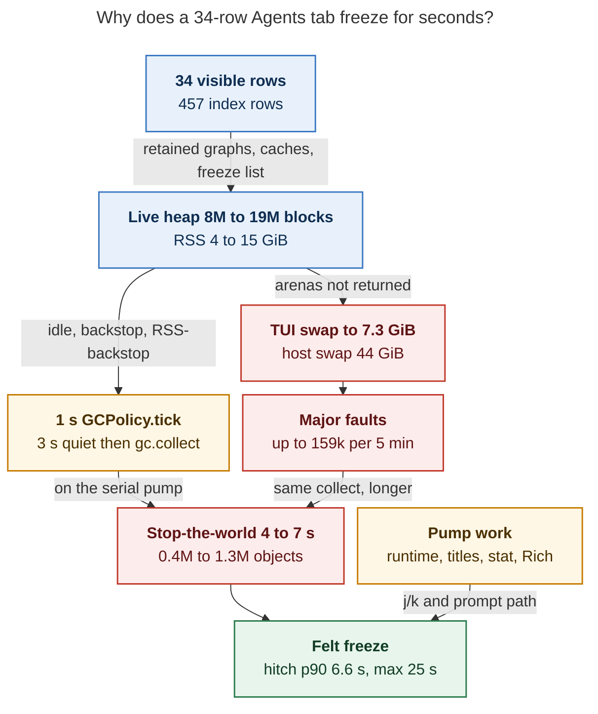

# TUI slowdown, 30 October 2026: heap growth, UI-thread GC, and pump work

Independent researcher `grk` report. Peer swarm reports were not consulted.

The live Athena TUI is slow because a 2.5-hour instance with 34 visible agent
rows already holds 7–15 GiB RSS, has swapped 7.3 GiB, and spends about 8% of
wall time in loop hitches. Startup is fine. The session is not. Full garbage
collection still runs on the UI-thread 1-second timer and takes 4–7 seconds
once the heap is that large. Swap then turns those pauses into 10–25 second
freezes through major faults.

The recommended fix is to shrink and bound the live heap so a full collect is
cheap, then stop starting gen-2 collections on a 3-second quiet window. Do not
disable the collector, do not raise `threshold2` further, and do not move
CPython stop-the-world collection onto a worker thread.

## Verdict

| Question | Answer |
| --- | --- |
| Is this a startup regression? | No. First paint 0.59 s, Agents ready 8.0 s, Tier 1 artifact-index, 34 rows / 457 index rows. |
| Is the live session slow? | Yes. Loop-frozen share 7.85% over the retained window; hitch median 3.8 s, p90 6.6 s, max 24.7 s. |
| Dominant mechanism? | A 15 GiB Python heap plus UI-thread `gc.collect()`, amplified by 7.3 GiB of TUI swap and 44 GiB of host swap. |
| Did the measured GC-fix epic land? | Graph-allocation and related producer phases are in the live SHA. They are not sufficient. `sase-1nc` remains READY with a 30 October +1. |
| Safe immediate relief? | Restart this TUI instance. It restores first-paint class latency for hours, then the same growth returns. |

## Method

This report uses only already-on telemetry and source. The live TUI was not
restarted, instrumented, or signalled.

- Live process PID 2704211, `python -m sase tui --restart-service`, CPython 3.14.7, SASE 0.18.1, Textual 8.2.8.
- `app_instance_id` `f8c86c23`, `source_revision` `dab2d701fbac135ff3e828b2d0efd330c5a19b47` (primary HEAD).
- `~/.sase/logs/tui_stalls.jsonl` plus `.1` (2 MiB rotation; older hours of this 18-hour `--restart-service` process are gone).
- `~/.sase/logs/tui_startup.jsonl` row for this instance.
- `tools/tui_freeze_report --instance f8c86c23 --since 2026-10-30T18:00 --until 2026-10-30T21:00`.
- `/proc/2704211` RSS/swap, host `free`/`uptime`/`df`, hitch `main_thread_stack` leaves.
- Source: `src/sase/ace/tui/util/gc_policy.py`, Agents capacity refresh, `_try_patch_agent_row`, stranded-work cache, `tui_perf.md` rules.
- Beads `sase-1nc`, `sase-1nf.14`, `sase-1nf.14.1` via `sase bead read`.
- Prior independent research `research:202610/tui_gc_measurement_20261023.md`, `tui_gc_fixed_capture_20261028.md`, `tui_gc_fixed_soak_20261029.md`.

`SASE_TUI_PERF` is unset on the live process, so there is no current-instance
j/k JSONL. Hitch `last_action` values stand in for interaction class. Heap
sampler (`SASE_TUI_HEAP`) and GC census (`SASE_TUI_GC_CENSUS`) are also unset;
no `tui_gc_census` rows exist for this instance.

## Live instance

The OS process has been up 18 hours because `--restart-service` execs in place
and keeps the PID. This **instance** started 2026-10-30 18:32:16 UTC. Heartbeats
cover 19:02–20:52 UTC (`uptime_s` 0.51 h → 2.35 h). Stall-log rotation dropped
everything before 19:02 UTC.

| Signal | Value |
| --- | --- |
| Visible agent rows / index rows | 34 / 457 |
| Load at startup / now | 22.3 / 29.2 (64 CPUs) |
| First paint / Agents ready | 0.593 s / 8.021 s |
| RSS at first heartbeat | 14.58 GB |
| RSS range over 23 heartbeats | 4.07–15.03 GB |
| RSS last / `/proc` now | 7.27 GB / ~7.4 GB |
| VmSwap first → last | 9 MiB → 7.86 GB (`/proc` 7.38 GB) |
| `allocated_blocks` | 7.92 M → 18.83 M |
| `gc_freeze_count` | 722 k → 606 k (immortal tracked set) |
| `gc_threshold` | `[2000, 10, 10000]`, `threshold_policy=raised` |
| Process CPU / threads | 202% / 28 threads |
| Host memory / swap | 51 / 62 GiB used; 44 / 63 GiB swap |
| `/tmp` tmpfs | 28 / 32 G (88%) |

A 34-row Agents tab holding 15 GB is retention, not roster size. The heap
oscillates as idle/backstop collections free arenas and the session reallocates
them. Swap only climbs.

Heartbeat trajectory (local EDT, one row per 5-minute window):

| Time | RSS GB | Swap GB | Blocks M | Loop hitch s | Pump hitch s | Gen-2 s | Major-fault Δ |
| --- | ---: | ---: | ---: | ---: | ---: | ---: | ---: |
| 15:02 | 14.58 | 0.01 | 7.92 | 45.20 | 0.00 | 7.27 | 28 |
| 15:22 | 9.32 | 0.16 | 11.78 | 3.88 | 0.00 | 0.00 | 82 |
| 15:37 | 4.07 | 0.29 | 13.07 | 41.06 | 5.72 | 12.54 | 1,667 |
| 15:52 | 9.26 | 0.71 | 17.17 | 48.82 | 4.58 | 21.90 | 9,492 |
| 15:57 | 10.95 | 3.75 | 16.98 | 54.42 | 0.00 | 13.67 | 88,940 |
| 16:12 | 15.03 | 0.87 | 16.22 | 19.61 | 0.00 | 2.86 | 8,834 |
| 16:37 | 5.31 | 0.91 | 18.45 | 68.44 | 3.82 | 15.69 | 97,792 |
| 16:47 | 10.28 | 4.24 | 18.30 | 16.13 | 0.00 | 4.12 | 7,284 |
| 16:52 | 7.27 | 7.86 | 18.83 | 41.60 | 15.18 | 0.00 | 159,011 |

Several 5-minute windows spend 40–68 s in loop hitches (13–23% frozen) before
swap is large. Swap then adds 10^4–10^5 major faults per window. The last window
alone recorded 159,011 major faults.

## Freeze-report numbers versus targets

`tools/tui_freeze_report --instance f8c86c23` on the retained logs:

| Metric | Target (sase-1f3 / sase-1nc) | This instance |
| --- | ---: | ---: |
| Loop-frozen share | < 0.5% | **7.85%** (847.9 s / 187 episodes) |
| Hitch median / p90 / max | — / — / interactive | 3.766 / 6.587 / **24.717 s** |
| Late hitch time | 0 outside idle/census | **69 episodes / 270.6 s** |
| GC share | < 3% | **6.58%** (710.4 s) |
| Idle full-GC p50 / p95 / max | p95 ≤ 0.5 s | 3.678 / **5.753** / **10.738 s** (n=54) |
| Gen-2 near input (start) | 0 | 0 automatic / 0 of 4 backstop / 0 of 7 RSS-backstop |
| RSS | < +0.5 GB / 4 h | 13.6 → 6.8 GiB, peak 15 GB inside 2.3 h |
| VmSwap | ~ 0 | **9 MiB → 7.3 GiB** |

The idle gate still **starts** gen-2 only after 3 s of quiet input. It does not
bound the pause after the collect begins. A 6–10 s stop-the-world collection
started on a quiet window freezes the next key.

GC time by trigger (same report):

| Trigger | Pauses | Role | Time |
| --- | ---: | --- | ---: |
| `idle` gen-2 | 54 | 1 s timer, 3 s quiet, `gc.collect()` on MainThread | 196.1 s |
| `rss_backstop` gen-2 | 7 | RSS grew > 500 MB since last full | 25.2 s |
| `backstop` gen-2 | 4 | 5 minutes without a full collect | 16.8 s |
| `automatic` gen-0 | — | CPython nursery | 63.1 s |
| `automatic` gen-1 | — | CPython | 84.0 s |
| Combined automatic | 890 | p95 0.475 s | — |

833 of 897 raw `tui_gc_pause` rows in the combined JSONL are `automatic`
(mostly gen-0/1). Those are 50–400 ms each and add up. The 4–7 s freezes are
the tagged gen-2 collects of 0.4–1.3 million objects.

Longest MainThread gen-2 samples from the JSONL:

| Local time | Trigger | Duration | Collected | Major faults | Input age at start |
| --- | --- | ---: | ---: | ---: | ---: |
| 16:00:09 | idle | 6.781 s | 784,874 | 1,377 | 80 s |
| 16:23:51 | rss_backstop | 6.769 s | 377,514 | 750 | 180 s |
| 16:03:28 | idle | 6.187 s | 603,725 | 0 | 31 s |
| 16:16:05 | backstop | 5.838 s | 1,006,896 | 1,212 | 15 s |
| 16:41:30 | idle | 5.430 s | 920,654 | 35 | 51 s |

Zero major faults still produced a 6.2 s pause. Swap makes the worst pauses
worse; it is not required for a multi-second freeze. That matches the 23
October r5 finding.

## Hitch stacks: work still on the pump

All 181 `tui_hitch` rows are on the Agents tab. Last actions: `text_area_changed`
52, `j` 37, `u` 37, `enter` 18, `k` 12. Prompt typing and j/k are the felt
surface.

Informative stack leaves (not the generic `ace_handler` / `run_async` frames):

| Count | Frame | Why it is on the pump |
| ---: | --- | --- |
| 20 | `aggregate_clan_runtime` → `sase.core.agent_runtime_facade` | Clan runtime suffix during row paint / runtime patch. |
| 19 | `stranded_project_key_for_agent` / `stranded_project_keys` | Walking the live roster for project keys during render/warmup overlay. |
| 12 | `GCPolicy.tick` → `collector.collect()` → `gc_telemetry._gc_callback` | 1 s `set_interval` runs a full collect on the serial pump. |
| 7 | `_surface_tokens._stat_path` → `path.stat()` | Disk `stat` on a timer/callback. Cheap until the process is swapped. |
| 5 | `renderable_digest._update_text_digest` | Hashing renderables on the UI thread to skip unchanged Options. |
| 5 | `GCPolicy._spawn_trim_thread` | Trim dispatch is off-thread; starting it still runs on the tick. |
| 4 | `list_project_records` via `project_lifecycle_facade` | Project catalog work reaching a key path. |
| 3 | `compile_query_profile` | Query-profile digest/validate on a refresh path. |
| 2 | `patch_runtime_suffix_row` | Runtime-suffix patch of visible rows. |
| 1 (caught live) | `_apply_agents_capacity_row_updates` → `_try_patch_agent_row` → `_agent_panel_title_for_key` → `_active_panel_title_jump_hints` | Capacity occupancy patch rebuilds panel titles. |

`tui_perf.md` already forbids this shape:

1. Never block the event loop with disk I/O or other synchronous work in
   handlers or render paths.
2. Off the event loop is not off the pump. `set_interval` callbacks are
   serially awaited. Keep them thin; slow bodies go through
   `spawn_pump_free_task()`.
6. Prefer `patch_row()` over full rebuilds; do not recompute grouping titles
   unless membership changed.
7. Debounce detail panels; highlight stays immediate.
8. Render paths never `stat`/glob.
10. Periodic ticks revalidate; recomputes get a longer cadence.
14. Idle ticks skip unchanged surfaces.

`GCPolicy.tick` is installed with `set_interval(1.0, ...)` and calls
`self._collector.collect()` inline (`gc_policy.py` lines 336–356). That is a
full stop-the-world collect on the pump. `malloc_trim` is already on a daemon
thread. The collect is not.

Capacity patches already compute on a worker (`asyncio.to_thread` in
`_run_agents_capacity_refresh_from_roster`) and then call

```python
try_patch(row, refresh_info=False)
```

`_try_patch_agent_row` defaults `refresh_title=True`. Occupancy fields
(`runner_slots_in_use`, `capacity_state`, …) do not change grouping
membership, but every patched row still rebuilds the panel title and jump
hints. The docstring on the patch helper already tells callers to pass
`refresh_title=False` when they will refresh titles once. The capacity path
does not.

Prompt subtitles are documented as “never debounced” in
`refresh_cursor_readouts`. That is the right rule for a caret, and the wrong
rule for restyling Rich `Content` into `border_subtitle` on every
`text_area_changed` while the heap is swapped. Highlight can stay immediate;
the Rich restyle can follow the 150 ms `DetailPanelDebouncer` pattern.

## Why previous epics did not end this

Closed `sase-1ez` moved automatic gen-2 off the interactive path by raising
`threshold2` to 10_000, freezing once after startup, and collecting on idle.
The policy is installed and `threshold_policy=raised` on this instance. The
idle collector is the remaining multi-second MainThread pause.

`sase-1nc` (READY, large bug, +1 from `sase-1nf.14.1.land` on 30 October)
already states the constraint: plan a bounded retention investigation, and do
not merely raise thresholds or move CPython GC to a worker and assume it
cannot pause the process. CPython `gc.collect()` is process-wide
stop-the-world. A worker thread still pauses the UI.

`sase-1nf.14.1` closed this morning after producer phases landed and
verification phases closed on a FAIL/INCOMPLETE matrix. Graph-allocation
(`classify_cached_graph_needs`) **is in the live SHA** (`dab2d701` contains
`8d41b72218` and `_loading_graph.py`). This instance still grows from 8 M to
19 M allocated blocks in two hours with 34 visible rows. Avoiding discarded
graph copies is necessary and not sufficient.

The 23 October r5 quiet four-hour capture already missed Athena targets (idle
p95 2.761 s, GC share 5.7%, hitch share 3.6%, RSS +0.69 GB, swap 620 MB). The
28–29 October “fixed code” capture/soak missed them by more, on a SHA that
lacked graph-allocation, under heavier load. Today’s live SHA has
graph-allocation and still misses every interactive budget. The remaining
work is heap bounding plus collecting less often, not another threshold bump.

`sase-zn` remains relevant as host relief: `/tmp` is 88% full with leftover
CI/cargo/triage trees (several 0.5–3.4 GB directories), and host swap is 44
GiB. That pressure turns TUI pauses into major-fault storms. It does not
create the 15 GB Python heap.



**Caption:** A 34-row roster is enough to grow a multi-gigabyte heap. The idle
policy then runs a full collect on the UI-thread timer. Host swap stretches
those pauses; paint and patch work on the pump fills the gaps between them.

## Architecture that stays reliable

Keep the existing fast path. Do not add a second refresh pipeline, remount
tribe panels, or skip occupancy/status patches.

Reuse, do not replace:

- `spawn_pump_free_task()` / `cancel_pump_free_tasks()` for any slow timer body.
- `patch_row()` / `_try_patch_agent_row(..., refresh_title=False, refresh_info=False)` for occupancy-only updates.
- `DetailPanelDebouncer` (150 ms) for prompt subtitle restyle.
- Refresh-token probes that reload only drifted surfaces.
- `copy_agent_rows_relinked` on worker-owned copies; never copy into the live graph from a discarded load.
- Stall watchdog, memory heartbeat, `tools/tui_freeze_report` for acceptance. No new metrics plane.

Do not do:

- `gc.disable()` or `SASE_TUI_GC_POLICY_DISABLE=1` as the product default. Automatic gen-2 would return to the keystroke path.
- Raising `threshold2` past 10_000. Automatic gen-0/1 already dominate pause *count*; gen-2 is already policy-driven.
- Moving `gc.collect()` to a worker and treating that as off the UI. It is still stop-the-world.
- Auto-killing or auto-restarting a live TUI when RSS is high. Notify through the existing update/stale-code panel.
- Full Agents rebuilds when a capacity badge changes.
- Expanding first-paint reads or dropping the bounded artifact-index path.

## Recommended solution

Three layers. Later layers assume earlier ones. Measure each with the existing
freeze report on a **new** `app_instance_id` (exec restart keeps the PID).

### Layer 0 — operational, today, reversible

Restart the live TUI so this 18-hour `--restart-service` process drops its 7.4
GiB RSS and 7.4 GiB swap. First paint on this SHA is already 0.6 s. Clear
disposable `/tmp` CI/cargo/triage trees when the user wants host relief
(`sase-zn` recipe in `docs/contribute/perf-runbook.md`). Do not treat restart
as the product fix.

### Layer 1 — cheap pump wins, low regression risk

These are local call-site fixes on paths the stacks already name. They do not
change GC policy.

1. Capacity row updates pass `refresh_title=False` (and keep `refresh_info=False`).
   Occupancy is a badge. Rebuild the title once per snapshot if a status change
   actually moved grouping membership (`notify_roster_status_mutation` already
   exists).
2. Runtime suffix and clan-runtime aggregation: compute ticks off the pump on
   the existing capacity/runtime cadence (10 s revalidate, not per keystroke),
   then `patch_runtime_suffix_row` only when the tick text changed. Stop calling
   `aggregate_clan_runtime` from a paint/hitch stack.
3. Debounce `border_subtitle` Rich restyle on `text_area_changed`. Keep caret
   and highlight synchronous.
4. Move leftover `path.stat()` / `list_project_records` off timer callbacks
   onto the token-probe worker that idle refresh already uses. Under swap,
   `stat` is not free.

Acceptance for this layer: Agents-tab hitch stacks no longer end in
`_agent_panel_title_for_key`, `aggregate_clan_runtime`, or `_stat_path` during
a quiet occupancy tick. No change to visible queue-position correctness.

### Layer 2 — collect less, only when a collect is cheap

This is the `sase-1nc` policy change, written so CPython’s stop-the-world
behavior stays honest.

1. Short idle (3 s quiet, prompt and navigation gates already in
   `idle_gate`) may run `gc.collect(0)` or `gc.collect(1)` only. Never gen-2.
2. Gen-2 (`gc.collect()` / `gc.collect(2)`) requires a **long** quiet window
   (30–60 s, not 3 s), no prompt, no navigation gate, and no modal text input.
   Drop the 5-minute backstop that currently forces a 6 s freeze in a 3 s
   typing gap. Keep an RSS-growth signal as a *hint* that a long-idle collect
   is due, not as a license to collect after 1–3 s.
3. Predict cost before starting gen-2: if `allocated_blocks` or
   `gc.get_count()` imply a pause above ~200 ms (calibrate from this instance:
   0.4 M collected ≈ 6 s, so the budget is far smaller), skip, emit a
   heartbeat field, and ask the user to restart via the existing stale/update
   row. Skipping a collect is better than a 7 s freeze.
4. Keep `startup_freeze` exactly once, but freeze only interned immortal
   structures (styles, keymap, fonts), not the Agents graph. Today’s
   `gc_freeze_count` of ~606 k after two hours is a floor under every later
   collect. If dismissed agent rows are in that set, they never leave RSS.
5. Keep `malloc_trim` on the daemon thread, after a successful collect, at
   the existing 10-minute bound.

Acceptance: idle gen-2 p95 ≤ 0.5 s **or** zero gen-2 pauses in any window
with input_age < 30 s; GC share < 3%; loop hitch share < 0.5% on a restarted
instance with the same 34-row class roster. If p95 is still > 0.5 s, the heap
is still too large (Layer 3); do not lower thresholds to hide it.

### Layer 3 — bound the live set so collect stays cheap

This is the actual architecture. A 34-row UI should not own 15 GiB.

1. One authoritative detached Agents graph. Incremental patches in place.
   Discarded loads must not leave copies (the re-landed classifier). Audit
   the new capacity path: it still does `copy_agent_rows_relinked(roster)`
   twice per install, at least every 10 s, then writes 15 occupancy fields
   into every live alias of each identity. That is correct isolation and a
   steady allocator. Cache the last occupancy tuple per identity and skip
   copy+patch when it is unchanged.
2. Bound event, completion, and wait caches (phase `sase-1nf.14.1.5` already
   aimed here). Put a hard entry cap and a generation stamp; drop bodies for
   rows not in the visible window plus a small MRU.
3. Textual Option/render caches: `renderable_digest` exists to skip work, and
   still appears on hitch stacks. Digest off the pump or only for dirty rows.
   Do not retain per-row renderables for collapsed/offscreen tribes.
4. RSS circuit breaker, notify-only: when heartbeat RSS > 2.5 GB (the closed
   `sase-v3` idle band) or `vmswap_bytes > 0`, drop non-visible caches, skip
   gen-2, `malloc_trim`, and surface a restart row on the Update panel. No
   automatic process kill.
5. Attribute survivors with one opt-in `SASE_TUI_HEAP=1` plus a single idle
   census on a **restarted** instance, not on this 15 GB process. Census
   lengthens the pause; it is a measurement tool.

Acceptance: four-hour same-instance window, Athena and Apollo, RSS growth
< 0.5 GB, VmSwap 0 on Athena while host swap is not itself thrashing, j/k p95
< 16 ms on Agents and at least one other usual tab, prompt-active hitch share
below idle hitch share.

## Implementation order

| Step | Change | Risk | Why this order |
| --- | --- | --- | --- |
| 0 | Restart TUI; optional `/tmp` cleanup | None | Immediate relief; measurement needs a new `app_instance_id`. |
| 1 | `refresh_title=False` on capacity patches | Low | One default already documented; occupancy stays correct. |
| 1 | Debounce prompt subtitle restyle | Low | Highlight stays live; Rich restyle follows existing debouncer. |
| 1 | Runtime ticks off the pump | Medium | Must re-read selection after await (`tui_perf.md` rule 4). |
| 2 | Gen-2 only on long idle; skip if too expensive | Medium | Idle RSS will rise until Layer 3; that is preferred to 7 s freezes. Watch fragmentation. |
| 3 | Occupancy-tuple short-circuit and cache caps | Medium | Status/queue correctness tests already around capacity. |
| 3 | RSS notify breaker | Low | Presentation only. |
| Measure | New instance, `SASE_TUI_PERF=1`, freeze report, jk bench | — | Do not pool PIDs across `--restart-service` execs. |

Owner for the policy and heap work is the still-open `sase-1nf.14` /
`sase-1nc` track. Layer 1 can land as ordinary TUI patches without waiting on
a new epic. Do not close `sase-1nc` on another FAIL/INCOMPLETE soak.

## What this report did not do

- Did not restart or re-instrument the live TUI.
- Did not capture a representative j/k p95 for `f8c86c23` (`SASE_TUI_PERF` unset).
- Did not run a type census, so survivor types for the 19 M blocks are unlisted.
- Did not measure Apollo today.
- Did not read other swarm reports from this request.

The missing census does not block Layer 1 or the gen-2 quiet-window change.
It blocks claiming a single leaked type in Layer 3. Run the census on a fresh
instance.
