```mermaid
---
title: "How should session lookup change?"
accTitle: "Current and proposed stranded-session lookup"
accDescr: "Today each assignee triggers a query of all tier rows with filtering in Rust. The proposal batches session keys and filters through SQL indexes, retaining the Rust post-filter, exact assignee recheck, and artifact-directory deduplication. Arrows show query execution order."
config:
  flowchart:
    rankSpacing: 16
    nodeSpacing: 12
    wrappingWidth: 180
---
flowchart TD
  subgraph TODAY["Today: repeat per assignee"]
    TQ["`**Index query**<br/>One assignee at a time`"]
    TS["`**Tier-row selection**<br/>Read all tier rows`"]
    TR["`**Rust post-filter**<br/>Match session or name`"]
    TC["`**Exact recheck**<br/>Deduplicate artifact directories`"]
    TQ --> TS
    TS --> TR
    TR --> TC
  end
  subgraph PROPOSAL["Proposed: batch by project"]
    PQ["`**Index query**<br/>Batched session keys`"]
    PS["`**SQL IN + indexes**<br/>Select matching sessions/names`"]
    PR["`**Rust post-filter**<br/>Keep correctness backstop`"]
    PC["`**Exact recheck**<br/>Deduplicate artifact directories`"]
    PQ -.-> PS
    PS -.-> PR
    PR -.-> PC
  end
  classDef focus fill:#E8F1FB,stroke:#3B78C2,stroke-width:1.5px,color:#0F2E52
  classDef risk fill:#FDECEC,stroke:#C0392B,stroke-width:1.5px,color:#5F1414
  classDef outcome fill:#E7F5EC,stroke:#2E7D4F,stroke-width:1.5px,color:#123D24
  classDef proposed stroke-dasharray:5 3
  class TQ,TR,PQ,PS,PR focus
  class TS risk
  class TC,PC outcome
  class PQ,PS,PR,PC proposed
  style TODAY fill:none,stroke:#3B78C2
  style PROPOSAL fill:none,stroke:#2E7D4F,stroke-dasharray:5 3
```

# Diagram proposals: TUI slowdown, October 2026

Proposals for the swarm linker, not a report. Each diagram restates only what the source
report says. Arrows show query execution order; dashed paths and outlines are proposed.

```yaml
source: research:202610/tui_slowdown_index_lock_fallback_scans/tui_slowdown_index_lock_fallback_scans__final.md
producer: research.5k.image
check: "mmdc 12.0.0 with the PDF-mirroring config rendered 1 of 1 Mermaid diagrams"
```

## indexed-session-lookup

```yaml
anchor: |-
  Translate `Equals`/`Any` on `agent_session` and `agent_name` into SQL `IN` clauses.
question: |-
  How does the proposed lookup reduce repeated work while preserving matching checks?
illustrates: |-
  Batching the stranded query per project and filtering in SQL removes repeated full-tier work while retaining the Rust post-filter, exact assignee recheck, and per-artifact-directory deduplication.
caption: Proposed batching and SQL filtering reduce repeated work while retaining the Rust post-filter, exact assignee recheck, and artifact-directory deduplication.
review: "576x577 px, fit 100.0%; question, source-trace, labels, arrowheads, crossings, and visual checks passed; 1 revision, 2 look rounds"
```


