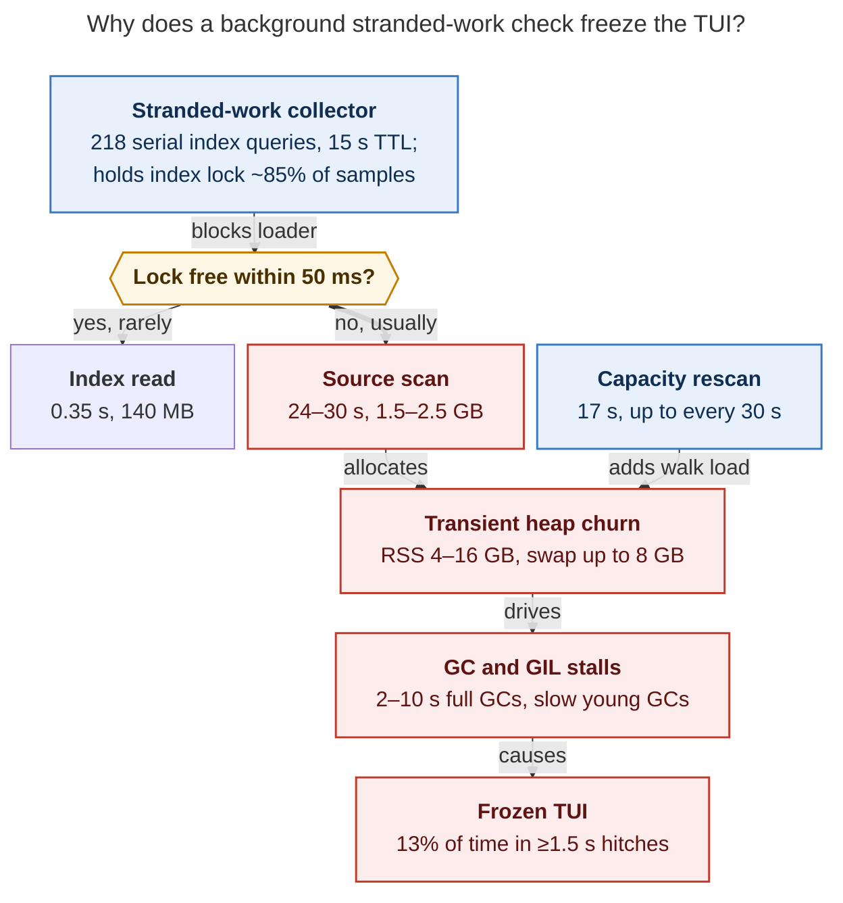

# The TUI slowed down again because the stranded-work collector starves the artifact-index lock, and Agents loads fall back to multi-GB filesystem scans

> **Request:** The TUI has slowed down again lately. Research how to speed it up again,
> prioritizing good architecture and reliability (don't break anything), and end with a
> recommended solution.

Researcher: cld (swarm `research.5k`) · 2026-10-30 · host athena (64 cores, 62 GiB RAM) ·
live TUI PID 2704211, app instance `f8c86c23`, source `dab2d701fb`, CPython 3.14.7 ·
workspace master `feae9c8777`. No code paths relevant here differ between the two
revisions.

## Bottom line

1. **The slowdown is a load regression, not a GC-policy regression.** The live TUI spends
   **13.3% of wall time in event-loop hitches of 1.5 s or more**. Over 7,523 s of
   heartbeat windows, 1,002 s were frozen. GC accounts for 10.5% of wall time, and RSS
   swings between **4.1 and 16.1 GB**, with up to **7.9 GB swapped**. On 23 October, the
   r5 baseline on this host was 3.6% hitches, 5.7% GC and 2.2–4.7 GB RSS. The idle-GC
   policy from the earlier GC epic is active (`threshold_policy=raised`, startup freeze,
   idle/backstop triggers), but it cannot keep up with the allocation churn described
   below.
2. **Root cause: one background feature holds a process-wide lock for most of the
   session.** The stranded-work collector (`sase/bead/stranded_facts.py`, landed
   23–26 October) runs **one full-history artifact-index query per candidate bead
   assignee**:
   - The sase project has **218 candidates** (117 in-progress epics, 100 phases, 1 task;
     the oldest was last updated 13 August).
   - Each query costs about 0.6 s, because sase-core applies the `candidate_filter` in
     Rust after an unindexed scan of every row. The index has 22,118 rows.
   - Every query runs under the process-wide `_ARTIFACT_INDEX_OPERATION_LOCK` RLock.
   - The report has a **15 s TTL** and is force-refreshed on every beads-watcher event,
     so it effectively runs back-to-back.
   - In 59 non-blocking `py-spy` stack dumps (~2.5 min), a stranded query was in flight
     in **51**.
3. **The Agents loader responds to the busy lock by doing roughly 70× more work.** Its
   index read (`query_agent_artifact_index_bounded`) waits only **50 ms** for the lock.
   On timeout, it falls back to a filesystem source scan of every artifact directory.
   Standalone measurements on this host:

   | Path | Wall time | Records | Peak RSS | Python blocks |
   | --- | ---: | ---: | ---: | ---: |
   | Index read (tier 1, cached), what the loader wants | **0.35 s** | 497 | 140 MB | — |
   | Lock-busy fallback scan, tier 1 | **24.3 s** | 16,615 | 1.55 GB | +3.0 M |
   | Lock-busy fallback scan, full history | **30.3 s** | 22,397 | 2.49 GB | +4.3 M |

   - The live loader's `index` sub-stage has a **p50 of 23.8 s**, matching the
     fallback-scan cost.
   - In 2,366 logged slow full loads since 29 October 16:09, **1,978 (84%)** had an
     index stage of at least 15 s, which is the fallback signature.
   - That is 70–90 such scans per hour, often two at once.
   - Every sample that caught the loader in its index path (30 of 30) also caught the
     stranded collector holding the lock.
4. **The multi-GB transient scan payloads drive the GC and GIL stalls.**
   - Young collections that normally take 0.04–0.6 ms take 50–500 ms here, mostly with
     zero major faults, because they traverse huge young containers.
   - Idle and backstop full collections take 2.75 s p50 and up to 10.7 s when they fault
     on swapped pages.
   - Worker threads converting tens of thousands of records hold the GIL.
5. **Secondary contributors** landed in the same window:
   - a machine-capacity feed (27 October) that rescans artifact directories (17 s) up to
     every 30 s;
   - per-second UI-thread work: `stranded_count_for_agents` builds a `Path` per agent
     every countdown tick, and `aggregate_clan_runtime` runs per tick;
   - a GC-policy trim thread spawned from the UI thread.

**Recommendation, in short:** see [Recommended solution](#recommended-solution).

- Make the stranded collector **one batched query per project**. This is measured:
  1.78 s replaces about 127 s, with a 15/15 parity spot-check.
- Stop the Agents loader from turning "lock busy" into an O(archive) scan. Serve the
  last good snapshot and retry instead.
- Slow down stranded and capacity refresh cadence.
- Then move the session-record lookup into sase-core as an indexed SQL query, and only
  then re-measure GC before touching GC policy again.

*Figure 1. The stranded-work collector keeps the artifact-index lock busy. The Agents
loader times out after 50 ms and substitutes a 24–30 s filesystem scan, and those scans'
multi-GB transient heaps (plus the capacity rescans) produce the GC and GIL stalls you
feel as freezes. Rendered with mermaid-cli 12.0.0 at 646 × 1068 px (83.6% PDF fit).*

---

## 1. How much slower, and since when

| Metric (Athena) | r5 baseline, 23–24 Oct (`2d1e7fd4`) | Fixed-code capture, 28 Oct (`196690f6`) | Live now, 30 Oct (`dab2d701fb`) |
| --- | ---: | ---: | ---: |
| Loop hitches ≥1.5 s / wall time | 3.58% | 14.2% | **13.3%** (1,002 s / 7,523 s) |
| All GC / wall time | 5.71% | 11.3% | **10.5%** (791 s) |
| Full (gen-2) GC / wall time | — | — | 3.6% (269 s) |
| RSS range at heartbeats | 2.2–4.7 GB | 4–16 GB | **4.1–16.1 GB** |
| VmSwap max | 0.62 GB | 0.63 GB (soak) | **7.9 GB** (`/proc` at 20:49 UTC) |
| Agents j/k p95 | 1 sample | 839 ms (n=31) | not re-measured (no `SASE_TUI_PERF`) |

Sources:

- The baseline and capture columns come from `research:202610/tui_gc_measurement_20261023.md`
  and `research:202610/tui_gc_fixed_soak_20261029.md`.
- The live column comes from `~/.sase/logs/tui_stalls.jsonl{,.1}` `tui_memory_heartbeat`
  rows for instance `f8c86c23`, with windows of at least 200 s.

**Dating the regression.** The r5 source `2d1e7fd4` contains **none** of the stranded-work
TUI wiring. The 28 October capture source `196690f6` contains **all** of it (checked with
`git merge-base --is-ancestor`):

| Commit | When | What |
| --- | --- | --- |
| `5d982d2bb9` | 23 Oct 17:21 | collect stranded-work facts (per-assignee index query) |
| `bb81495765` | 23 Oct 18:22 | show stranded bead work in Agents rows: wires the collector into the TUI bead warmup |
| `c793bff54b` | 24 Oct 06:53 | flag stranded work in the Beads pane |
| `98cb07ebb8` | 26 Oct 20:12 | query `any(agent_session, agent_name)` per assignee |
| `13abbfb01e` | 26 Oct 22:31 | open beads with a completion failure also become candidates |
| `dd9e740aec`, `7d1584c47e` | 27 Oct | machine-capacity report feed and inspector (10 s poll, ≤30 s rescans) |

r5 was a quiet workload, so the baseline is not a perfect control. Still, the jump
from 3.6% to 14% hitches tracks exactly the window in which these landed. The live
evidence below ties the mechanism to them directly, not just by timing.

**Why "lately" keeps getting worse.** The collector's cost scales as *candidates ×
index rows*. Both grow:

- In-progress epics and phases accumulate. 117 epics are in progress, dating back to
  August.
- The index grows with every agent run (22,118 rows, 338 MB).

## 2. Evidence chain

### 2.1 The Agents loader's "index" stage is a fallback scan, not an index read

`tui_agent_loads.jsonl` gained `disk_substages` on 29 October. Live instance
`f8c86c23` had 159 slow full loads:

| Sub-stage | n | Sum | p50 | Max |
| --- | ---: | ---: | ---: | ---: |
| `index` | 159 | **3,650 s** | **23.8 s** | 64.3 s |
| `decode` | 159 | 498 s | 1.46 s | 23.9 s |
| `provider` | 159 | 50 s | 0.11 s | 5.7 s |
| `projections` | 159 | 17.5 s | 0.09 s | 0.98 s |

- That is 3,650 s of index stage in a 2.4 h session, so on average more than one
  fallback scan was running at any moment.
- Across all instances since 29 October 16:09, the distribution is bimodal:
  - **268** loads under 1 s and **118** at 1–5 s: the index got the lock;
  - **1,606** at 15–30 s and **372** at 30 s or more: the source-scan fallback.
- Sources, by total stage time: `auto_refresh` (68 loads, mean 27 s), `input_quiet_tier2_reconcile`
  (24, mean 42 s), `roster_completion_retry` (32, mean 26 s), `tier1_index_revalidate`
  (15, mean 27 s).

The code path, `src/sase/ace/tui/models/_agent_loader_artifacts.py:354–383` at
`dab2d701fb`:

- `agent_loader.py:12` imports `query_agent_artifact_index_bounded as
  query_agent_artifact_index`.
- The bounded call returns `None` when `try_agent_artifact_index_operation_lock(0.05)`
  fails (`DEFAULT_READ_LOCK_TIMEOUT_SECONDS = 0.05`).
- The loader then calls `scan_artifacts(None if full_history else
  _TIER1_FALLBACK_SCAN_OPTIONS)`.
- The tier-1 "bounded" fallback still visited 22,397 directories and parsed 36,576
  markers in the standalone run. It is bounded in name only at today's archive size.

### 2.2 Who holds the lock: live stack sampling

I took 59 `py-spy dump --nonblocking` snapshots of the live TUI at about 2 s spacing.
Non-blocking mode does not pause the process.

| Observation | Samples |
| --- | ---: |
| A thread inside `query_agent_artifact_index` ← `stranded_facts._query_session_records` | **51 / 59** |
| At least one `scan_agent_artifacts` (filesystem walk) in flight | 38 / 59 |
| Two scans in flight at once | 13 / 59 |
| Loader inside `query_artifact_index_for_loader`, in the fallback scan (`:363`) or the lock try (`:355`) | 30 / 59 |
| …of which the stranded collector was simultaneously in its query | **30 / 30** |
| Capacity feed scan (`collect_runner_slot_records` ← `load_or_refresh_runner_slot_scan`) | 22 / 59 |

An earlier batch of 25 dumps showed the same pattern: 17 of 25 had a stranded query in
flight. No dump showed any *other* long holder of the index lock.

### 2.3 Why the stranded collector is so expensive

`collect_stranded_work_input` → `_session_record_cache` →
`_query_session_records(project, assignee)` works as follows:

- It builds **one** `AgentArtifactIndexQueryWire` per assignee: full history,
  `include_hidden=True`, and `candidate_filter = any(equals agent_session, equals
  agent_name)`.
- It runs each one under `agent_artifact_index_operation_lock()`.
- sase-core (`crates/sase_core/src/agent_scan/index/selection.rs`,
  `select_pending_rows_for_candidate_filter`) selects every candidate row with the tier
  `WHERE` clause and then applies `candidate_filter_matches` in Rust. The filter is never
  pushed into SQL. `idx_agent_artifacts_agent_session` exists but is not used for this,
  and `agent_name` has no index.

Measured standalone, read-only:

- Per-assignee queries take 0.55–0.63 s each; 15 of them took 8.75 s. The 218 queries
  for the sase project come to **about 127 s per report**.
- The cache TTL is 15 s (`agent_stranded._CACHE_TTL_SECONDS`), and
  `_schedule_bead_confirmation_warmup` forces a stranded refresh on every
  `beads_watcher` event. With dozens of agents editing beads, the next refresh is
  always already due. The warmup is coalesced, so only one runs at a time, but they run
  back-to-back.
- The PyO3 binding releases the GIL during the Rust query
  (`py.allow_threads` in `crates/sase_core_py/src/agent_scan/mod.rs:632`). The damage
  is the **lock monopoly**, not GIL time.

The same collector also runs out-of-process in the wait-checks chop
(`_chop_wait_checks_stranded.py`) and in `sase doctor`. Those were not measured here,
but they pay the same per-assignee cost: `sase_job_wait_checks` was at 98% CPU and
0.9 GB RSS when sampled.

### 2.4 How the scans turn into freezes

- **Heap churn.** Each tier-1 fallback scan adds about 3.0 M Python blocks and peaks at
  1.5 GB; a full one adds 4.3 M blocks and peaks at 2.5 GB. At 70–90 scans per hour,
  that is on the order of 100 GB/h of transient allocation through worker threads.
  - The heartbeat RSS alternates high and low: 10.3 → 13.4 → 9.3 → 14.4 → 7.4 → 14.6 GB.
    That is consistent with per-thread glibc arenas retaining freed memory until the GC
    policy's `malloc_trim`, which runs at most every 10 minutes.
  - `allocated_blocks` at heartbeats only ranges 7.8–22 M, so most of the RSS is
    transient, not a live-object leak.
- **Young collections become slow.** Of the young collections that took 50 ms or more
  (logged threshold), 863 had zero major faults (p50 80 ms, max 1.9 s). A synthetic
  probe on the same interpreter shows ordinary gen-0/gen-1 collections at 0.04/0.6 ms,
  independent of heap size. The slow ones are traversals of freshly built multi-thousand
  record containers.
- **Full collections become slow, then slower in swap.** The current instance has 74 idle
  full GCs (p50 2.75 s, max 6.8 s), plus 10 RSS-backstop and 4 time-backstop GCs.
  Faulting full GCs have p50 3.99 s and max **10.7 s**. Swap is host-wide: 43 GB used,
  load average about 30, much of it from pytest worker pools (execnet workers) running in agent workspaces. The TUI itself is
  the largest single footprint, at 6.3 GB RSS plus 7.9 GB swap.
- **GIL starvation.** In a `py-spy --gil` sample, worker threads converting scan and
  notification payloads appeared among GIL holders alongside the main thread. Fewer
  than half the samples succeeded (447 of 871 attempts, the rest errored), so treat the
  shares as indicative only.

Of the recorded hitches, 72 overlap idle full GCs (243 s), 112 overlap slow gen-0
collections (324 s), 15 overlap backstop GCs (65 s), and 54 (119 s) overlap no logged
collection.

### 2.5 Secondary contributors (real, smaller)

These are on-time hitches, where the watchdog polled on schedule and the UI thread was
busy. They come from instance `f8c86c23`; durations are inflated by GIL contention from
§2.4.

| UI-thread path | Hitches | Seconds | Note |
| --- | ---: | ---: | --- |
| `_on_countdown_tick` → `patch_active_runtime_rows` → `compute_row_runtime` → `aggregate_clan_runtime` | 22 | 82 | Per-second clan runtime aggregation |
| `_update_agents_info_panel` (countdown tick) → `stranded_count_for_agents` → `stranded_project_key_for_agent` | 14 | 53 | A new `Path(str(project_file)).parent.name` for every agent, every second |
| `gc_policy.tick` → `_maybe_trim` → `_spawn_trim_thread` (main thread blocked in `Thread.start()`) | 6 | 27 | Spawning a thread from the UI thread under GIL contention |
| `gc_policy.tick` → idle `gc.collect()` on `MainThread` | 13 | 54 | Expected under the idle policy; shrinks once churn drops |

- **Capacity feed** (`event_refresh/_auto_refresh.py`): it polls every 10 s, and every
  runner-slot token change triggers a display rescan. A rescan is rate-limited to once
  per 30 s (`DISPLAY_RESCAN_INTERVAL_SECONDS`). Each rescan is a capacity-only filesystem
  walk: **17.1 s, 0.45 GB peak**, returning 116 records. The token changes on every
  launch and exit, so this runs about twice a minute during busy periods.
- **Telemetry overhead (likely, small).** Each 5-minute heartbeat calls
  `gc.get_freeze_count()` and `sys.getallocatedblocks()`. In CPython's default build both
  walk large structures: the permanent-generation list (~1 M frozen objects) and every
  pymalloc pool. They appeared as GIL holders in the `--gil` sample. This is not proven
  to matter.

## 3. Options considered

| Option | Fixes root cause? | Risk | Verdict |
| --- | --- | --- | --- |
| Tune GC further: higher thresholds, rarer idle GCs | No; full-GC cost tracks heap size and churn | Medium; more retained memory, swap | **Defer** until the load fix is measured |
| Batch the stranded collector to one query per project (Python only) | **Yes**, removes the lock monopoly | Low; same core query shape, exact recheck kept | **Do first** |
| Loader: on lock-busy, serve last good snapshot and retry; no source scan | **Yes**, removes the O(archive) fallback | Low–medium; must preserve completeness semantics | **Do first** |
| Raise the loader's 50 ms lock timeout | Partly; trades a scan for a wait | Low | Fallback only if the stale-serve path is rejected |
| Remove the process-wide index lock, or make it reader/writer (SQLite WAL allows concurrent readers) | Yes, structurally | **Medium–high**; the lock's original invariants are unverified here | Later, behind evidence of what it protects |
| Push `candidate_filter` equality on indexed columns into SQL in sase-core (`agent_session IN …`, add an `agent_name` index) | Yes; makes the stranded lookup O(matches) | Low–medium; core change plus pin ratchet | **Do second** (Rust-core boundary) |
| Capacity feed reads axe's scan cache or the index instead of rescanning | Yes, for that load | Low | Do second |
| Archive or close stale in-progress epics (data hygiene) | Mitigates growth only | Low, but it is user data | Optional; not a fix |

## 4. Reliability guardrails for each change

- **Batched stranded query.**
  - Keep `_record_matches_assignee` as the exact recheck and the per-`artifact_dir`
    dedupe, then group records by assignee.
  - My prototype matched per-assignee results on 15 of 15 assignees. Extend
    `tests/test_stranded_single_turn.py` with a parity test: batched versus per-assignee
    over a fixture with session roots, successors and shared names.
  - The wait-checks chop and `sase doctor` share the collector and get the speedup for
    free.
  - Chunk filters (for example 100 assignees per query) so the wire payload stays
    bounded as candidates grow.
- **Stale-serve on lock busy.** This follows tui_perf rules 5 and 9: show cached data,
  reload in the background, and never do O(archive) work on the interactive path.
  - Never mark a stale snapshot `complete_history=True`. Keep the tier-2 latch semantics
    ("complete only after an authoritative reconciliation has landed").
  - Return the cached state with an `index_error`/`repair_reason` such as
    `artifact_index_lock_busy_served_cached`.
  - Schedule a coalesced retry with the existing loading/pending flags,
    last-request-wins.
  - Keep the source scan only for "index missing or failed". Tier-2 reconcile defers and
    retries instead of scanning.
  - The old branch is still reachable for a missing index, so this is not a deprecation.
    If you want a rollback path during rollout, a `sunset` flag via `sase flag new`
    (sase_flags conventions) can keep the scan-on-busy branch reachable.
- **Cadence changes.**
  - Raise the stranded TTL from 15 s to about 60 s.
  - Debounce `beads_watcher`-forced refreshes to at most one per 30–60 s.
  - Keep the fingerprint check so real bead changes still invalidate.
  - Users see stranded flags update up to about 60 s later; that is the trade-off to
    accept or reject.
- **UI-thread fixes.**
  - Memoize `stranded_project_key_for_agent` by `project_file` string. A module-level
    dict bounded by project count is enough.
  - Compute `stranded_count_for_agents` when a report changes, not on every countdown
    tick.
  - Replace per-trim `threading.Thread` spawns with one long-lived daemon trim worker
    woken by an `Event`.
  - All of these are presentation-local and stay in this repo.
- **sase-core pushdown.**
  - Translate `Equals` on `agent_session` / `agent_name` (and `Any` of them) into
    `WHERE agent_session IN (…) OR agent_name IN (…)`, with a new
    `idx_agent_artifacts_agent_name`. The index requires a schema migration step.
  - Keep the Rust post-filter as a correctness backstop.
  - Move sase's `sase-core-revision.txt` pin past the core commit (`docs/rust_backend.md`).

## 5. How to verify, with telemetry that already exists

1. `tui_agent_loads.jsonl`: `disk_substages.index` should collapse to the sub-second mode.
   The ≥15 s mode should disappear: from 84% of slow full loads today to about 0.
   - Add `artifact_source` and `repair_reason` to `tui_agent_load_slow` rows so a
     lock-busy fallback is visible directly, not inferred from durations.
2. `tui_memory_heartbeat`: targets are hitch share under 3% (r5 territory first), RSS
   back under about 5 GB, and VmSwap near zero.
3. `tui_gc_pause`: young-GC rows of 50 ms or more should become rare, and idle full-GC
   p50 should drop well below 2 s.
4. Live stack sampling: repeat the 59-dump loop
   (`py-spy dump --pid <tui> --nonblocking` every 2 s). Stranded queries should be in
   flight in only a few percent of samples, with no `scan_agent_artifacts` under
   `query_artifact_index_for_loader`.
5. Only then resume the `sase-1nf.14.1` GC acceptance soak. Today's soak FAILs measure
   this load regression, not the GC policy.

## 6. What I did not establish

- I made no code changes and did not run benchmarks (`bench_tui_jk.py`,
  `bench_tui_trace.py`). The live TUI had `SASE_TUI_PERF` and `SASE_TUI_TRACE` off, so
  there are no fresh j/k latencies.
- `py-spy --nonblocking` sample shares are approximate. Many GIL-mode samples errored on
  the swapped process.
- I did not establish why `_ARTIFACT_INDEX_OPERATION_LOCK` is process-wide and covers
  reads. It may protect repair or write interleavings or connection reuse. That is why I
  rank removing it last.
- Host-wide memory pressure from concurrent test runs in agent workspaces (more than a
  dozen pytest workers at about 1.3 GB each when sampled) amplifies every GC pause through swap. The TUI fix shrinks
  the TUI's share; it does not fix host contention.
- I did not file task beads, to avoid five duplicate filings from this swarm. The lead
  can file from the recommendation below.

## Recommended solution

Ship in three small, independently revertible steps. Measure after each one with §5, and
change GC policy only after step 2.

**Step 1: remove the lock monopoly and the O(archive) fallback (sase, Python only, low
risk). This should restore most of the lost speed.**

1. **Batch the stranded collector.** In `stranded_facts._session_record_cache`, issue one
   `query_agent_artifact_index` per project, chunked at about 100 assignees. Use
   `candidate_filter = any(equals agent_session=a, equals agent_name=a for a in chunk)`,
   then group with the existing exact `_record_matches_assignee` recheck and
   `artifact_dir` dedupe. Measured: **1.78 s for all 218 assignees** instead of about
   127 s, with 15/15 parity. Add a batched-versus-loop parity test.
2. **Never source-scan because the lock is busy.** In
   `_agent_loader_artifacts.query_artifact_index_for_loader`, when the bounded query
   returns `None`:
   - serve the newest `_ARTIFACT_SNAPSHOT_CACHE` entry, even if its signature is stale,
     with `complete_history=False`;
   - schedule the existing coalesced background reload;
   - keep the source scan only when the index is missing or the query errors.

   Optionally put the old branch behind a `sunset` flag for one release.
3. **Throttle the stranded refresh.** Use a TTL of about 60 s and debounce
   `beads_watcher`-forced refreshes to at most one per 30–60 s, keeping the bead-store
   fingerprint check.

**Step 2: make the remaining work proportional to what changed.**

4. **sase-core: index-backed session lookup.**
   - Push `Equals`/`Any` predicates on `agent_session` and `agent_name` into SQL, and
     add an `agent_name` index.
   - Better still, expose a dedicated `stranded_session_records(project, sessions)`
     binding next to the existing stranded reducer, so the shared backend owns it
     (rust_core_backend_boundary).
   - Ratchet `sase-core-revision.txt`.
5. **Capacity feed.**
   - Raise `DISPLAY_RESCAN_INTERVAL_SECONDS` from 30 s to about 120 s for the TUI
     display path.
   - Prefer reading axe's `runner_slots.scan.json` or an index-backed capacity query
     over a 17 s filesystem walk.
6. **UI thread.**
   - Memoize `stranded_project_key_for_agent`, and compute stranded counts on report
     change rather than every tick.
   - Profile `aggregate_clan_runtime` on the 1 s countdown and cache it per
     clan-membership fingerprint.
   - Replace per-trim thread spawning with a persistent trim worker.

**Step 3: re-measure, then decide on deeper changes.**

7. Re-run the §5 checks, then the `sase-1nf.14.1` soak. Only if full-GC pauses still
   miss targets once churn is gone, revisit `MIN_FULL_INTERVAL_S` and idle-GC cadence,
   and cache the heartbeat's freeze count.
8. Consider a reader/writer split of `_ARTIFACT_INDEX_OPERATION_LOCK` only after
   documenting what the lock protects. Fair access for interactive readers is the
   structural end state, but it is the riskiest change and is unnecessary once no
   background job holds the lock for long.

Steps 1.1–1.3 are small, local to two Python modules, and preserve existing semantics.
Together they remove the condition that triggers about 80 multi-GB scans an hour.

---

### Appendix: reproduction (read-only)

All probes used the TUI's own interpreter, `~/.local/share/uv/tools/sase/bin/python`
(editable install of the primary checkout):

- `query_agent_artifact_index` with the tier-1 cached query from
  `_agent_loader_artifacts`: 0.35 s, 497 records.
- `scan_agent_artifacts(sase_projects_dir(), _TIER1_FALLBACK_SCAN_OPTIONS)`: 24.3 s,
  16,615 records, 1,546 MB max RSS.
- `scan_agent_artifacts(sase_projects_dir(), _TUI_SCAN_OPTIONS)`: 30.3 s, 22,397 records,
  2,491 MB.
- `runner_slots._scan.collect_runner_slot_records()`: 17.1 s, 116 records, 454 MB.
- `stranded_facts._query_session_records('gh_sase-org__sase', a)`: about 0.6 s per
  assignee. The batched `any(...)` version over all 218 assignees took 1.78 s and
  returned 388 records.
- Live inputs:
  - `~/.sase/logs/tui_stalls.jsonl{,.1}` (`tui_memory_heartbeat`, `tui_gc_pause`,
    `tui_hitch`);
  - `~/.sase/logs/tui_agent_loads.jsonl{,.1}` (`tui_agent_load_slow` with
    `disk_substages`);
  - `~/.sase/logs/tui_startup.jsonl` (instance and revision);
  - 84 `py-spy dump --nonblocking` snapshots and one 90 s `py-spy record --gil --nonblocking`
    of PID 2704211.
