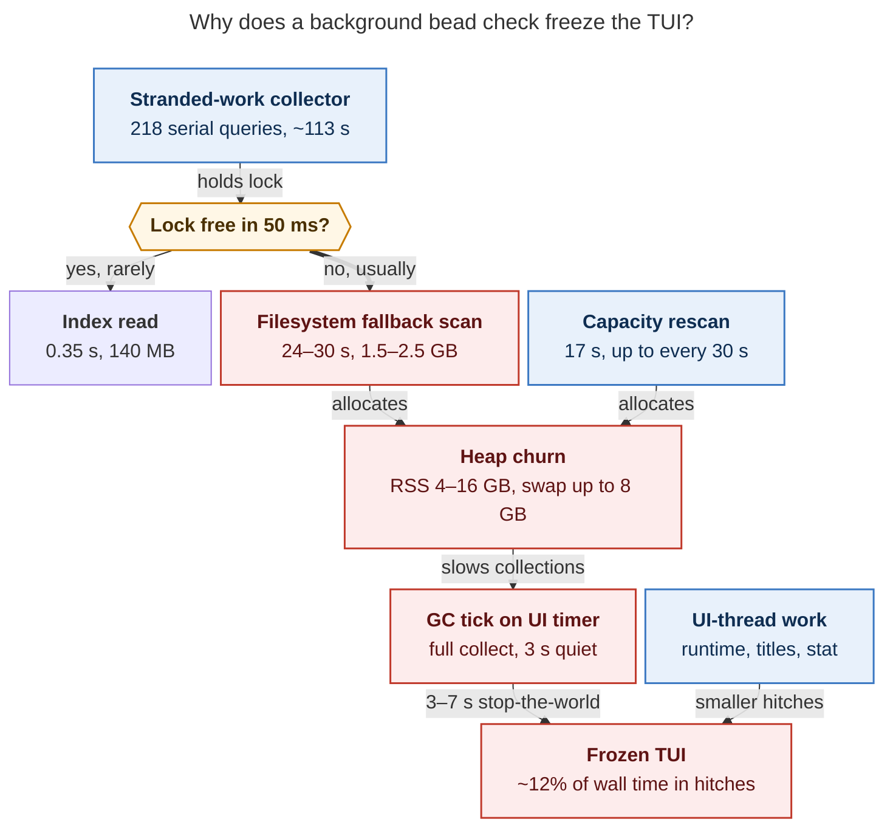

# TUI slowdown, October 2026: index-lock starvation turns Agents refreshes into multi-GB scans

> **Request:** The TUI has slowed down again lately. Research how to speed it up again,
> prioritizing good architecture and reliability (don't break anything), and end with a
> recommended solution.

Lead researcher consolidation, 2026-10-30, Athena. Merges five independent reports
(`cdx`, `cld`, `grk`, `mus`, `gem`) with my own verification against the live TUI
(PID 2704211, app instance `f8c86c23`, source `dab2d701fb`, CPython 3.14.7,
Textual 8.2.8, Rich 15.0.0) and the workspace checkout (`feae9c8777`). Between those two
revisions, no code on the implicated paths differs.

## Bottom line

1. **This is a load regression, not a GC-policy regression.** On 23 October, the live TUI
   spent 3.6% of its time in loop hitches and 5.7% in garbage collection (GC). Now it
   spends about **12–13% frozen in hitches** and **10–11% in GC**. RSS swings between 4
   and 16 GB, and up to 7.9 GB is swapped out. The idle-GC policy from the earlier GC
   epic is installed and working. It cannot keep up with the allocation churn below.
2. **Root cause: the stranded-work collector monopolizes the artifact-index lock.**
   - The collector landed 23–26 October and is wired into the TUI's bead warmup.
   - It runs **one full-history index query per candidate assignee**. The sase project
     has 218 of them, at about 0.5 s each, so each report takes about 113 s.
   - Every query runs under a process-wide `RLock`.
   - The report expires after 15 s and is force-refreshed on every beads-watcher event,
     so it runs nearly back-to-back.
3. **The Agents loader turns "lock busy" into a full filesystem scan.**
   - Its index read waits only **50 ms** for the lock.
   - On timeout, it falls back to `scan_artifacts`. That takes 24–30 s and peaks at
     1.5–2.5 GB, compared with **0.35 s and 140 MB** for the index read it replaces.
   - In the live log, **84% of slow full loads (172 of 204)** show this fallback
     signature: an index stage of 15 s or more.
   - Across 30 retained hours, this happens 60–110 times an hour, day and night.
4. **Those scans' transient heaps make every collection slow.** Young collections take
   50–500 ms instead of under 1 ms. Idle full collections take 3–7 s, and swap stretches
   them to 10–25 s. The GC policy then runs those full collections on the UI's 1 s timer,
   so the next keystroke waits.
5. **The fix is small and local.**
   - Batch the stranded query into one query per project. Measured: 113 s → 1.5 s, with
     identical results.
   - Never answer "lock busy" with an O(archive) scan. Serve the last good snapshot and
     retry.
   - Slow the stranded cadence.
   - Then push the lookup into sase-core SQL, and only then revisit GC policy, with
     measurements.

## 1. Symptoms, reconciled

The five reports quote different percentages for the same instance. That is a
denominator difference, not a disagreement:

- `tools/tui_freeze_report` divides by the requested window, so grk's 3-hour query
  reports 7.85% hitches and 6.58% GC.
- Dividing by the instance's actual heartbeat windows gives cdx's 12.3% / 10.1%, cld's
  13.3% / 10.5%, and gem's 12.75% / 10.7%.

The heartbeat-window figures are the right ones.

| Metric (Athena) | r5 baseline, 23 Oct (`2d1e7fd4`) | Live, 30 Oct (`dab2d701fb`) | sase-1f3 target |
| --- | ---: | ---: | ---: |
| Loop hitches / wall time | 3.58% | **~12–13%** | < 0.5% |
| All GC / wall time | 5.71% | **~10–11%** (68% of it gen 0/1) | < 3% |
| Idle full-GC p50 / p95 / max | p95 2.76 s | 2.7–3.7 s / 5.0–5.8 s / 6.8 s (10.7 s when faulting) | p95 ≤ 0.5 s |
| RSS at heartbeats | 2.2–4.7 GB | **4.1–16.1 GB** | < +0.5 GB per 4 h |
| VmSwap max | 0.62 GB | **7.9 GB** | 0 |
| Hitch median / max | — | 3.8 s / 24.7 s | — |

Sources:

- The baseline comes from `research:202610/tui_gc_measurement_20261023.md`.
- The live column combines the cdx, cld, grk and gem extractions from
  `~/.sase/logs/tui_stalls.jsonl{,.1}`.
- No current j/k latency exists: `SASE_TUI_PERF` was off in the live process.
- Startup is healthy: first paint takes 0.59 s and the Agents tab is ready in 6–8 s.
  The slowdown builds up during a session.

The live load fluctuates. At 21:26 UTC, while I sampled, host load had fallen to 18 and
the TUI held 3.0 GB RSS and 0.96 GB of swap. At 16:52–20:49 UTC, the researchers saw load
25–30, 7–16 GB RSS and 7–8 GB of swap.

## 2. The causal chain

*Figure 1. The stranded-work collector keeps the artifact-index lock busy. The Agents
loader times out after 50 ms and substitutes a 24–30 s filesystem scan. The scans'
multi-GB transient heaps, plus capacity rescans, make every garbage collection slow, and
the GC policy runs full collections on the UI timer. Smaller UI-thread work adds more
hitches. Rendered with mermaid-cli 12.0.0 at 795 × 1116 px (80% PDF fit).*

### 2.1 The lock holder: per-assignee stranded queries

The collector lives in `src/sase/bead/stranded_facts.py`:

- `_session_record_cache` loops over `sorted(assignees)`.
- For each assignee, `_query_session_records` issues a full-history, `include_hidden`
  query whose `candidate_filter` is `any(agent_session == a, agent_name == a)`.
- That query goes through `query_agent_artifact_index`, which holds
  `_ARTIFACT_INDEX_OPERATION_LOCK`, a process-wide `RLock`
  (`src/sase/core/agent_artifact_index_lock.py`).
- sase-core does not push that filter into SQL: it selects the tier rows and filters in
  Rust (cld, `agent_scan/index/selection.rs`). There is no `agent_name` index.

The cadence keeps the lock busy:

- The cache expires after `_CACHE_TTL_SECONDS = 15.0`
  (`src/sase/ace/tui/models/agent_stranded.py:27`).
- `_schedule_bead_confirmation_warmup` forces a stranded refresh for the
  `beads_watcher` and `stranded_resolve` sources (`_loading_bead_warmup.py:166`).
- Warmups are coalesced but re-arm themselves when a request arrives mid-run, so they
  run back-to-back.

**My replication.** Read-only, run from a separate process, so it did not touch the TUI's
lock:

| Measurement | Result |
| --- | --- |
| Stranded candidates in `gh_sase-org__sase` | 218: 117 in-progress epics, 100 in-progress phases, 1 task; 218 session keys |
| Per-assignee query, n = 12 | mean 0.517 s, max 0.582 s → **~113 s per report** |
| One batched `any(...)` query over all 218 keys | **1.51 s**, 388 records, 137 MB peak RSS |
| Parity: batched + existing `_record_matches_assignee` recheck vs. per-assignee | **0 mismatches** in 12 of 12 assignees |

This agrees with cld's earlier figures: 0.55–0.63 s per assignee, about 127 s per report,
1.78 s batched, and 15 of 15 matching.

Two signs show the cost will keep growing. Candidates (in-progress epics and phases)
accumulate, some untouched since August, and the index grows with every run (22,118 rows,
338 MB per cld).

### 2.2 The amplifier: "lock busy" becomes an O(archive) scan

In `src/sase/ace/tui/models/_agent_loader_artifacts.py` (around lines 354–383), the
loader calls `query_agent_artifact_index_bounded`. That call returns `None` when the lock
is not free within `DEFAULT_READ_LOCK_TIMEOUT_SECONDS = 0.05`. The loader then runs
`scan_artifacts(None if full_history else _TIER1_FALLBACK_SCAN_OPTIONS)` and labels the
result `repair_reason="artifact_index_lock_busy_*_fallback"`.

The fallback has existed since 11 September (`62ad9b657c`, sase-zn.5, "bound artifact
index reads"), when no background job held the lock for long. It turned pathological only
once a long-running lock holder arrived. Even the "bounded" tier-1 fallback visited
22,397 directories in cld's standalone run.

cld's standalone measurements on this host:

| Path | Wall time | Records | Peak RSS | Added Python blocks |
| --- | ---: | ---: | ---: | ---: |
| Tier-1 cached index read (what the loader wants) | **0.35 s** | 497 | 140 MB | — |
| Lock-busy fallback, tier 1 | 24.3 s | 16,615 | 1.55 GB | +3.0 M |
| Lock-busy fallback, full history | 30.3 s | 22,397 | 2.49 GB | +4.3 M |

**Live load-log evidence.** I re-extracted `~/.sase/logs/tui_agent_loads.jsonl{,.1}`
through 21:25 UTC:

- **Instance `f8c86c23`:** 344 slow-load rows, 204 of them `full`.
  - The `index` sub-stage has p50 **23.4 s**, p95 35.6 s and max 64.3 s.
  - Its distribution is bimodal: 23 loads under 1 s, 9 at 1–5 s, 142 at 15–30 s and 30
    at 30 s or more.
  - Sources: `auto_refresh` 91, `roster_completion_retry` 42,
    `input_quiet_tier2_reconcile` 30, `tier1_index_revalidate` 19.
  - `auto_refresh` is a tier-1 cached read. Those should cost about 0.35 s, so a
    multi-second `auto_refresh` index stage is the fallback signature.
- **All 30 retained hours:**
  - Every hour had 59–109 slow full loads, and 79–92% of them were at 15 s or more.
  - Each hour accumulated 1,300–2,260 s of index stage, so a scan was in flight roughly
    40–60% of wall time.
  - The pattern is flat through the night. That rules out user activity as the driver
    and points to a background producer.

**Stack sampling.** cld took 59 `py-spy dump --nonblocking` samples:

- A stranded query was in flight in **51**.
- The loader was caught in its index path 30 times. Each time, the stranded collector
  held the query.
- No other long lock holder appeared.

I took 20 more samples in a quieter period (21:27–21:29 UTC), and 15 were readable. A
stranded query was in flight in **7 of 15**. No loader fallback was caught in that short
window.

**Gap:** the slow-load rows do not record `artifact_source` or `repair_reason`. The
fallback is therefore inferred from durations, not logged directly. Fixing this is part
of the recommendation.

### 2.3 How scans become freezes

The scans run in worker threads (`asyncio.to_thread`), so they never block the UI
directly. The damage arrives through the shared heap and the GIL:

- **Young collections slow down.** cld logged 863 young collections of 50 ms or more
  (p50 80 ms, max 1.9 s) with **zero** major faults. Ordinary gen-0/1 collections take
  0.04–0.6 ms on the same interpreter. The slow ones traverse freshly built
  multi-thousand-record containers.
- **Full collections are slow even without swap.** grk logged a 6.2 s idle full collect
  with 0 major faults. Swap makes the worst ones worse: one window had 159,011 major
  faults, and hitches reached 24.7 s.
- **RSS is mostly transient, not leaked.** Heartbeat RSS alternates 10.3 → 13.4 → 9.3 →
  14.4 → 7.4 GB, while `allocated_blocks` stays at 8–22 M. That fits glibc arenas
  retaining freed scan memory between `malloc_trim` calls, which run at most every 10
  minutes.
  - However, blocks still roughly doubled (8 M → 19 M) within about 2 h (grk). Some
    retention growth is real and unattributed, because no GC census ran on this
    instance.
- **GC runs on the UI's 1 s timer.** `GCPolicy.tick`
  (`src/sase/ace/tui/util/gc_policy.py`) calls `self._collector.collect()` inline from
  a 1 s `set_interval` after 3 s of quiet input. The 5-minute and RSS backstops also use
  3 s of quiet. The gate controls when a collection starts, not how long it lasts, so a
  5 s collection started during a 3 s reading pause freezes the next key. The idle
  collect stacks in grk, mus and cdx all show this.

### 2.4 Secondary contributors (real, smaller)

All of these were verified in code; stack counts come from the hitch logs of instance
`f8c86c23`.

| Site | Evidence | Fix shape |
| --- | --- | --- |
| Per-second `aggregate_clan_runtime` from `_on_countdown_tick` → `patch_active_runtime_rows` | 20–28 hitch stacks (grk, cld, cdx). The runtime cache fingerprints every member *before* it looks up the cache (cdx). | Cache by runtime-input revision; recompute only on change. |
| `stranded_project_key_for_agent` builds a `Path` per agent per tick; `stranded_count_for_agents` runs per tick | 14–19 stacks (cld, grk) | Memoize by `project_file`; recompute the count when the report changes. |
| Capacity patch rebuilds panel titles | `_loading_filter.py:220` calls `try_patch(row, refresh_info=False)`, but `refresh_title` defaults to `True` (`_display_panel_patches.py:401`). Each capacity compute also makes two `copy_agent_rows_relinked(roster)` copies (lines 91, 100). Verified. | Pass `refresh_title=False`; refresh titles once, only when membership changed. Skip copy and patch when the occupancy tuple is unchanged. |
| Machine-capacity feed rescans artifact directories | 17.1 s and 0.45 GB per rescan, at most once per 30 s (`DISPLAY_RESCAN_INTERVAL_SECONDS = 30.0`); in 22 of 59 cld samples | Reuse axe's slot-scan cache or the index; lengthen the interval. |
| GC trim thread spawned from the UI thread | 5–6 stacks with `Thread.start()` blocked under GIL contention | One persistent trim worker woken by an `Event`. |
| `stat` in token probes on timers (`_surface_tokens._stat_path`; capacity token probe is synchronous) | 7 stacks; one 5.9 s stall (mus) | Probe on the worker that already serves idle refresh. |
| Prompt `border_subtitle` Rich restyle on every `text_area_changed` | 52 hitches had `text_area_changed` as their last action (grk) | Debounce the restyle through `DetailPanelDebouncer`; keep the caret immediate. |
| Host pressure | 37–44 GB of swap used and `/tmp` 88% full (mus, grk) | Operational relief; it amplifies faults but does not create the heap. |

## 3. Where the reports disagree, and how I resolved it

| Claim | Who | Verdict |
| --- | --- | --- |
| Root cause is lock starvation plus fallback scans | cld | **Accepted, and replicated**: stranded cost, batching parity, bimodal log, stack samples. The other reports describe downstream effects of the same churn. |
| Root cause is heap retention or graph copying | grk, cdx | **Partly.** Graph copies scale with data (cdx probe: 126 ms for 600 children) and blocks did grow. But the 4–16 GB swing is mostly transient scan payload. Treat retention as a later, census-driven step. |
| Lower `threshold2` to 2,000 for "frequent cheap gen-2" | gem | **Rejected.** Full collections already run about every 2 minutes (74 idle plus 14 backstop in 2.4 h). Garbage is not piling up between them, and each one costs seconds because the live heap is big. More automatic gen-2 puts multi-second collections back onto the keystroke path. |
| Move `gc.collect()` to a worker via `spawn_pump_free_task` | mus | **Rejected.** CPython collection is stop-the-world and holds the GIL. A worker-thread collect still freezes the UI, and sase-1nc already warns against assuming otherwise. grk's long-quiet, cost-gated policy is the right shape, *after* the load fix. |
| Textual `Strip` caches form self-cycles | gem | **Mechanism real, magnitude unknown.** In Textual 8.2.8, `crop()` returns `self` *without* caching it, so gem's example is wrong. But `adjust_cell_length` stores `self` in `_line_length_cache` when the length already matches, and `crop_extend` can cache `self` too. Those are real self-cycles. Nothing shows they matter here, and clearing Textual's private caches would be fragile. Measure with a census first. |
| 37 MB name registry and 4.7 MB dismissed JSON drive churn | gem | **Secondary.** The sizes are confirmed (39 MB and 4.8 MB). But the `dismissed_snapshot` sub-stage is p50 3 ms (signature-gated), and the registry parse is 0.34 s and about 128 MB peak, only on the detail-header page-URL path with a 30 s TTL. The retention gap is real hygiene debt, not this regression. |
| A full-load "stampede" saturates 16 threads; add a single-flight coordinator | gem | **Rejected.** Broad and delta loads already share the `_agents_loading` and pending-flag coalescing (cdx; tui_perf rule 5). Measured overlap is about 0.4–0.6 scan-seconds per wall-second, not 16. A second scheduler would duplicate the existing one. |
| GC pauses always fault heavily, about 140 major faults each | gem | **Rejected.** 863 slow young collections had zero faults (cld), and a 6.2 s full collect had zero (grk). Swap amplifies the pauses; it does not cause them. |
| Two `ace-fs-watcher` threads mean a double-start leak | mus | **Rejected.** They are `_fs_watcher` and `_prompt_source_watcher`, by design (`_startup_watchers.py:67,96`). |
| Per-keystroke footprint counters cost latency | mus | **Unmeasured.** A microbenchmark is cheap; this is low priority. |

## 4. Options, ranked by benefit and risk

| Option | Fixes the cause? | Risk | Verdict |
| --- | --- | --- | --- |
| Batch the stranded query per project (Python) | **Yes**: about 113 s → 1.5 s of lock hold per report | Low; same core query, exact recheck kept | **Do first** |
| On lock busy, serve the cached snapshot and retry; never source-scan for "busy" | **Yes**: removes the O(archive) amplifier for *any* future lock holder | Low–medium; completeness semantics must hold | **Do first** |
| Stranded TTL 15 → about 60 s; debounce watcher-forced refreshes | Mitigates | Low; stranded flags update up to about 60 s late | **Do first** |
| Push `agent_session`/`agent_name` filters into SQL, add an `agent_name` index (sase-core) | **Yes**: lookups become O(matches) | Low–medium; schema migration plus pin ratchet | **Do second** |
| Cheap UI-thread fixes (§2.4) | Removes smaller hitches | Low | Do with or after the first group |
| GC policy: gen-2 only on long quiet, skipped when predicted expensive | Bounds pause placement | Medium; idle RSS rises until the heap shrinks | **After** remeasuring |
| Reader/writer split of the index lock | Structural | Medium–high; the lock's invariants are undocumented | Only after documenting them |
| Immutable, versioned Agents read model (cdx) | Cuts graph-copy churn | Medium; broad | Longer-term, evidence-gated |
| Lower `threshold2`, `gc.disable`, worker-thread collect, TUI rewrite, more threads | No | Medium–high | **Reject** |

## Recommended solution

Ship in small, independently revertible steps, and re-measure after each with the
existing telemetry. Change GC policy only after the load fix is measured.

**Step 0: operational relief today (no code).**

- Restart the TUI. This drops the accumulated heap and swap, and makes later
  measurements use a fresh `app_instance_id`; `--restart-service` keeps the PID.
- Optionally clear `/tmp` scratch trees with the idle-host recipe in
  `docs/contribute/perf-runbook.md`.
- Expect the relief to fade. The stranded collector starts again right away.

**Step 1: remove the lock monopoly and the O(archive) amplifier.** This is sase only,
Python only, and four small commits. It should restore most of the lost speed.

1. **Batch the stranded collector.**
   - In `stranded_facts._session_record_cache`, issue one query per project, chunked at
     about 100 session keys. Use
     `candidate_filter = any(equals agent_session=k, equals agent_name=k for k in chunk)`.
   - Group results with the existing exact `_record_matches_assignee` recheck and the
     per-`artifact_dir` dedupe.
   - Add a parity test, batched versus per-assignee, covering session roots, successors
     and shared names (`tests/test_stranded_single_turn.py`).
   - The wait-checks chop and `sase doctor` share this collector, so they speed up too.
2. **Never source-scan because the lock is busy.** In `query_artifact_index_for_loader`,
   when the bounded query returns `None`:
   - **Tier-1 request:** return the newest `_ARTIFACT_SNAPSHOT_CACHE` entry even if its
     signature is stale, with `complete_history=False` and
     `repair_reason="artifact_index_lock_busy_served_cached"`.
   - **Full-history (tier-2) request:** keep the current roster, leave history
     incomplete, and re-arm the existing quiet-time reconcile.
   - In both cases, schedule the retry through the existing loading and pending flags
     (last request wins). Do not add a new refresh path.
   - Keep `scan_artifacts` only where it is legitimately needed: the index is missing or
     the query errors, or startup has no snapshot at all. Startup with no snapshot is
     tui_perf rule 9's bounded first-paint fallback.
   - Never mark a stale snapshot complete.
   - If you want a rollback branch during rollout, follow the `sase_flags` conventions.
3. **Throttle the stranded refresh.**
   - Raise the TTL from 15 s to about 60 s.
   - Debounce `beads_watcher`-forced refreshes to at most one per 30–60 s.
   - Keep the bead-store fingerprint check, so real bead changes still invalidate.
4. **Make the fallback visible.**
   - Add `artifact_source` and `repair_reason` to `tui_agent_load_slow` rows, so lock-busy
     and incomplete-history fallbacks are logged directly instead of inferred.
   - This covers the separate `full_history and not complete_history → scan_artifacts()`
     branch too.

**Step 2: make the remaining work proportional to what changed.**

5. **sase-core: indexed session lookup** (rust_core_backend_boundary).
   - Translate `Equals`/`Any` on `agent_session` and `agent_name` into SQL `IN` clauses.
   - Add `idx_agent_artifacts_agent_name` through a schema migration.
   - Keep the Rust post-filter as a backstop.
   - Better still, expose a dedicated `stranded_session_records(project, keys)` binding.
   - Ratchet `sase-core-revision.txt`.
6. **UI-thread fixes from §2.4.**
   - Pass `refresh_title=False` on capacity patches, and skip copy and patch when the
     occupancy tuple is unchanged.
   - Memoize stranded project keys, and compute the count when the report changes.
   - Cache runtime aggregation by runtime-input revision.
   - Use a persistent trim worker.
   - Move remaining timer `stat` probes to the token-probe worker.
   - Debounce the prompt subtitle restyle.
7. **Capacity feed.** Read axe's slot-scan cache or an index-backed query instead of a
   17 s walk, and lengthen the display rescan interval.

**Step 3: re-measure, then decide on GC and retention.**

8. Run a fresh-instance session with `SASE_TUI_PERF=1`, then `tools/tui_freeze_report`.
   Leading indicators:
   - The ≥15 s mode of the index sub-stage disappears (from 84% to about 0%).
   - Stranded queries appear in only a few percent of stack samples.
   - RSS stays under about 5 GB, and swap stays near zero.
9. If idle gen-2 p95 still exceeds 0.5 s, adopt grk's policy:
   - Short idle runs young collections only.
   - Gen-2 runs only after 30–60 s of quiet with no prompt or modal input, and is skipped
     when its predicted cost exceeds budget.
   - The RSS backstop becomes a hint, not a 3-second license.
   - Never lower `threshold2`, disable GC, or "move" collection to a worker.
10. Run one opt-in GC census (`SASE_TUI_GC_CENSUS=1`) on a fresh instance to attribute
    the residual 8 M → 19 M block growth (graph copies, render caches, Strip self-cycles)
    before any retention work.

**Step 4: structural follow-ups, evidence-gated.**

- Document what `_ARTIFACT_INDEX_OPERATION_LOCK` protects, then consider a reader/writer
  split; SQLite WAL allows concurrent readers.
- Evolve the Agents read model toward immutable, versioned records (cdx).
- Close the JSON-registry retention gap (gem) as hygiene.

**Acceptance targets** are unchanged (sase-1f3 / tui_perf):

- j/k p95 under 16 ms on each tab you normally use;
- idle full-GC p95 at most 0.5 s;
- GC under 3% and loop hitches under 0.5% of wall time;
- RSS growth under 0.5 GB over 4 h, and zero swap;
- measured on a restarted instance, with prompt typing included.

**Reliability guardrails.**

- Every change rides the existing fast path, coalescing flags, `patch_row` and
  pump-free tasks.
- Re-capture tab and selection after every await.
- Incompleteness stays visible until an authoritative reconcile lands.
- Each step is one revertible commit, verified with `just check` plus the focused
  tests and benches above (`check-full` stays explicit-only).
- The open GC track (sase-1nc, READY) should be sequenced *after* Step 1. Its soak
  failures currently measure this load regression, not the GC policy.

No task beads were filed for this work. A bead search found none covering the stranded
lock monopoly or the fallback scan, so file them, or plan an epic, when you approve the
direction.

---

### Appendix A: inputs

| Suffix | Report (this directory) | Strongest contribution |
| --- | --- | --- |
| cld | `tui_slowdown_index_lock_fallback_scans__cld.md` | Found the root cause: stranded lock monopoly, 50 ms fallback, standalone scan costs, py-spy evidence, batched prototype |
| cdx | `tui_slowdown_index_lock_fallback_scans__cdx.md` | Denominator-correct GC and hitch math; graph-copy and runtime-cache mechanics; completeness invariants; long-term read-model direction |
| grk | `tui_slowdown_index_lock_fallback_scans__grk.md` | GC tick on the pump; capacity `refresh_title` defect; long-quiet, cost-gated gen-2 policy; history of prior epics |
| mus | `tui_slowdown_index_lock_fallback_scans__mus.md` | Host-pressure context; token-probe and warmup-scheduling stalls; footprint microbenchmark |
| gem | `tui_slowdown_index_lock_fallback_scans__gem.md` | Registry growth and retention gap; Strip cache-cycle lead (corrected above) |

### Appendix B: my verification (read-only)

- **Code read** in the workspace at `feae9c8777`:
  - `_agent_loader_artifacts.py` (lock-busy fallback);
  - `agent_artifact_index_lock.py` and `agent_scan_index_queries.py` (50 ms try-lock);
  - `stranded_facts.py` and `agent_stranded.py` (per-assignee loop, 15 s TTL);
  - `_loading_bead_warmup.py` (forced refresh sources);
  - `_loading_filter.py` and `_display_panel_patches.py` (capacity patch defaults);
  - `gc_policy.py` (inline collect, 3 s quiet windows);
  - `_startup_watchers.py` (two watchers);
  - Textual 8.2.8 `strip.py` from the live tool environment;
  - `git log -S` to date the fallback.
- **Logs:** `tui_agent_loads.jsonl{,.1}`, filtered by `app_instance_id` and bucketed by
  hour; percentiles use sorted index `round(p·(n−1))`.
- **Probes:** I ran the stranded per-assignee and batched queries, and parsed the
  registry JSON, with the workspace `.venv` (`python -I`, `src` on the path). Each ran in
  its own process, so none took the TUI's in-process lock.
- **Stack samples:** 20 `py-spy dump --pid 2704211 --nonblocking` samples at about 2 s
  spacing, which do not pause the process. I did not restart, signal or instrument the
  live TUI.
