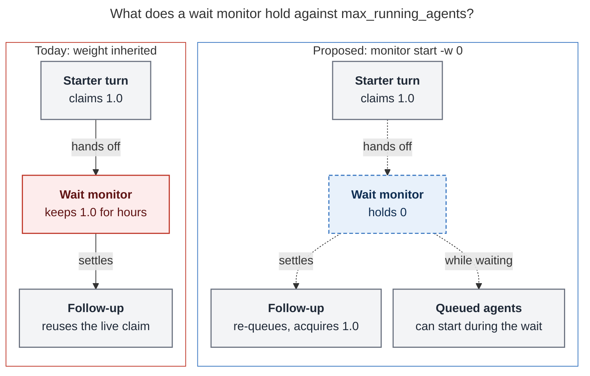
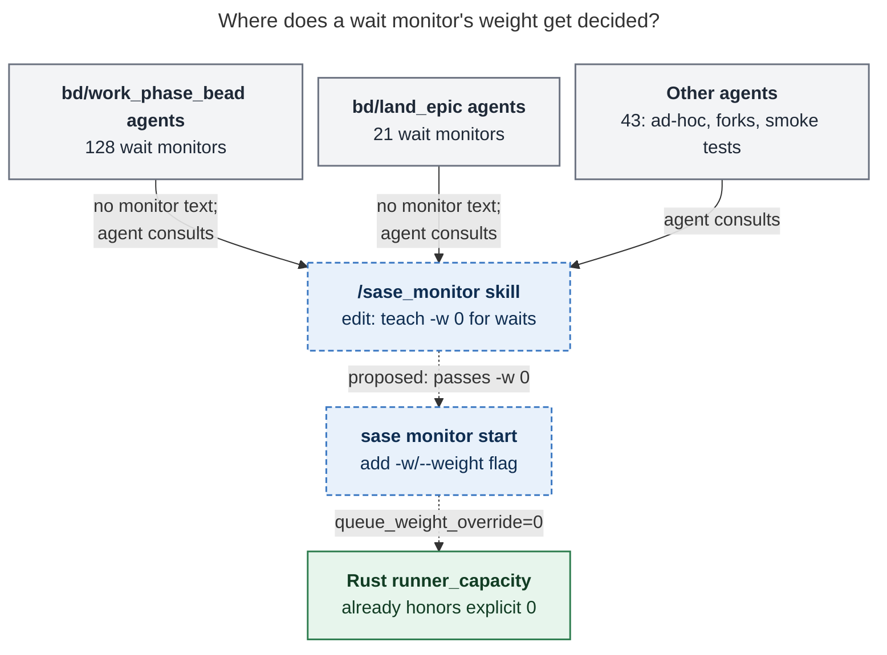
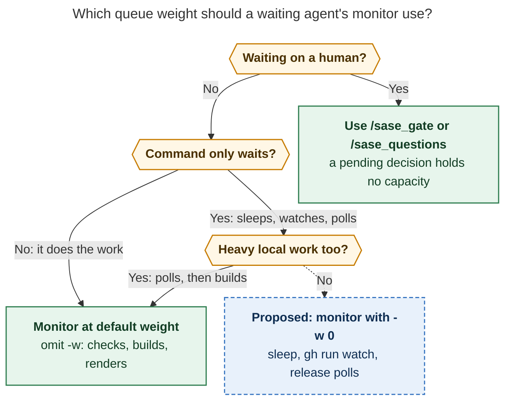

# Zero-weight wait monitors: what has to change, and which macros

## Answer up front

**You can't get there by changing macros alone, because nothing an agent can write
today gives its monitor zero weight.** A monitor always inherits its starter's queue
weight. `%queue(weight=0)` inside `--next` is delivered as literal text. Putting it on the
agent's own launch prompt zeroes the agent's real work too, and every successor inherits
the zero. `sase monitor start` has no weight option.

**Most of the machinery already exists.** The host's epic-launch monitor already runs at
weight 0 through an internal `queue_weight_override`, and the Rust admission core
already treats that zero correctly: the monitor holds no capacity, and its follow-up
queues again at the starter's weight. The missing piece is a small `sase monitor start
-w/--weight 0` flag that exposes this override to agents.

**After that flag exists, only one macro needs to change: the `/sase_monitor` skill.**
It is the only place that teaches agents monitor flags. The bead macros that launch
nearly every waiting agent (`bd/work_phase_bead`, `bd/land_epic`, `bd/work_task`) never
mention monitors, so they need no edits. Two docs pages and the generated CLI reference
also need updates. The full list is under [Recommended changes](#recommended-changes).

## What the screenshot shows

At 13:59 the Agents header read `8 running · 1 queued` with `load: 8/8`: the host was
full and one agent was waiting for a slot. Two of the eight occupied units were monitors
that were only waiting:

| Row status             | Agent (macro)                                  | Monitored command                                                  | Timeout |
| ---------------------- | ---------------------------------------------- | ------------------------------------------------------------------ | ------- |
| `WATCHING MASTER GATE` | `sase-1nn.8.4.land` (lander, `bd/land_epic`)   | `gh run watch 40118139034 -R sase-org/sase --interval 120 --exit-status` | 3 h     |
| `WAITING FOR CORE`     | `sase-1n6.5.1.5.2.1.3.1` (phase worker, `bd/work_phase_bead`) | `sleep 129600`                                        | 36 h    |

`sase monitor list` showed a third pure wait on the same host at the same moment:
`WAITING FOR BI` (`sleep 600`) on the bob-cli lander `bob-cli-an.6.6.6.5.6.5.land`. Each
of these held a full 1.0 capacity unit while waiting. If the two sase waits had held
zero, the header would have read `load: 6/8`. The queued agent would then have had room
to start, assuming it was waiting on capacity rather than a hold.

## How often agents wait inside monitors

I sorted all 2,890 monitor runs on this host (2026-08-13 to 2026-10-24, from `sase
monitor list --all --json`) by command shape and status label. The buckets are
heuristic, so treat the counts as approximate.

| Kind of monitor                                                   | Runs  | Weight held today                    |
| ----------------------------------------------------------------- | ----- | ------------------------------------ |
| Verification (`just check`, `sase tool run`, `-p verify`)         | 2,009 | starter's weight (correct)           |
| Host epic launch (`EPIC APPROVED`)                                | 559   | 0, set by the host                   |
| Other real work (builds, installs, screenshot regen, deploys)     | 130   | starter's weight (correct)           |
| **Pure waits** (sleeps, CI watches, external polls)               | 192   | **starter's weight, usually 1.0**    |

The 192 pure waits ran for 76.0 hours in total, which is 76 capacity-hours at the default
weight. The figure is a floor, because running monitors report only partial elapsed time.

| Wait shape                                                    | Runs | Hours |
| ------------------------------------------------------------- | ---- | ----- |
| Bare `sleep N`                                                | 79   | 35.6  |
| `gh run watch` / `--watch` CI waits                           | 55   | 9.7   |
| Agent-written wait scripts (`WATCHING RELEASE`, `WAITING PYPI`, ...) | 34   | 16.9  |
| `while`/`until` poll loops                                    | 13   | 11.3  |
| `sleep N && <quick status check>`, smoke-test waits           | 10   | 2.1   |
| `tail --pid=<pid>`                                            | 1    | 0.4   |

By who started them: 128 came from phase workers (`bd/work_phase_bead`), 21 from epic
landers (`bd/land_epic`), and 43 from other agents (ad-hoc prompts, forks, and smoke
tests). I checked bead types with `sase bead read` for every bead-named lane.

## How a monitor's weight works today

- **A monitor inherits its starter's weight for its whole life.** The monitors
  reference says it plainly: "A monitor is not a way to free runner capacity"
  (`docs/reference/automation/monitors.md:637`). The session keeps one claim from the
  starter through the monitor to the `--next` follow-up, which reuses it.
- **Waiting on a human is already free.** A pending gate turn or an unanswered
  `QUESTION` "consumes no runner capacity" (`docs/reference/runner-slots.md:119-127`).
  A monitor waiting on a machine is the only kind of wait that still costs a slot.
- **The host already has a zero-weight monitor path.** `src/sase/bead/epic_launch.py:232`
  starts its monitor with `queue_weight_override=0.0`. `src/sase/monitor/member.py:121`
  records it as an explicit zero while keeping the starter's original weight on the
  side.
- **The override does not leak to successors.** `inheritable_queue_weight`
  (`src/sase/core/runner_slots/_queue_weight.py:36`) hands followers the pre-override
  weight. The follow-up's `%queue(...)` prefix is built from it
  (`src/sase/monitor/continuation_delivery.py:188`).
- **The Rust core re-queues the follow-up instead of letting it ride a free claim.** In
  sase-core, `claim_is_reusable` is `occupied_capacity != 0.0`
  (`crates/sase_core/src/runner_capacity/claims.rs:101`). The test
  `zero_weight_claim_is_not_reusable_by_a_serial_successor`
  (`crates/sase_core/src/runner_capacity/tests/waiters.rs:144`) pins this down: a
  successor behind a zero-weight monitor gets `acquire_capacity` at weight 1.0. If the host is full, it
  parks as `QUEUED` like any other waiter. The test
  `explicit_zero_weight_monitor_occupies_nothing_at_a_full_limit` covers the monitor's
  own side.


*A wait monitor today keeps its starter's full claim until it settles; with `-w 0` it holds nothing, queued agents can start during the wait, and the follow-up re-queues for its usual weight.*

## Why `%queue(weight=0)` can't express this today

There are three places an agent might put it, and none of them works:

1. **In `--next` text.** The follow-up body is a macro-disabled region, and only the
   host-built routing prefix stays live (`docs/reference/automation/monitors.md:615-620`).
   The skill warns that `--next` text "reaches the follow-up literally" and "will not
   route or expand anything" (`src/sase/macros/skills/sase_monitor.md:128-129`). Even if
   it were live, it would apply to the follow-up, which does real work, not to the
   monitor.
2. **On the agent's own launch prompt.** This sets the weight for the whole run,
   including the work before and after the wait. A user-authored `%q(w=0)` is also
   inherited by every successor as an explicit zero
   (`docs/reference/runner-slots.md:142`), so the follow-up that runs `just check` would
   run free too. The bead-work macros have no per-phase queue fields anyway.
3. **On `sase monitor start`.** It has no weight option
   (`src/sase/main/parser_monitor.py:205` onward).
   `StartMonitorRequest.queue_weight_override` exists, but only epic launch sets it.

So the change you want is a one-flag CLI change plus guidance. It cannot be done by
editing macro text alone.

## Prior art

The superseded capacity epic `sase-zm` already specified this flag. Its plan
(`plan:202609/command_capacity.md`) said: "Expose `sase monitor start -w/--weight N` as
an explicit total for an unwrapped monitor. Do not inherit the starter's queue weight."
Its phase `sase-zm.5` was force-closed as superseded on 2026-09-17. It wasn't rejected
on the merits: the sase tool roadmap retired all 14 unlanded `sase-zm` phases at once
(`research:202609/sase_tool_epic_roadmap/sase_tool_epic_roadmap.md`). The roadmap also
left one naming question open: `sase proc run` already uses `-w` for `--wait`.

## Design of the missing flag

Add `-w/--weight W` to `sase monitor start` and map it to the existing
`StartMonitorRequest.queue_weight_override`. Five details matter:

- **Accept only `0` at first.** Monitor members never pass through admission: they ride
  the session's claim (`docs/reference/automation/monitors.md:654-656`). Lowering the
  weight is always safe. Raising it would let a monitor take capacity without ever
  queueing. If raises are wanted later, they need a real admission step.
- **Refuse it with `-p verify`, `-f/--completion`, and `-J/--join`.** Those modes run
  verification, which is exactly the CPU-heavy work the capacity budget exists to limit.
- **Leave the follow-up path alone.** Successors already get the pre-override weight,
  and the core already re-queues them. One cost to accept: the follow-up gets a fresh
  `slot_requested_at`, so after a long wait it queues behind newer work of the same
  priority.
- **Add the missing end-to-end test.** `tests/fakey/test_monitor_capacity_e2e.py:315`
  covers a zero-weight monitor with no follow-up. Add a case where a zero-weight wait
  monitor's `--next` follow-up arrives while the host is full: the follow-up must park
  `QUEUED`, then claim the starter's weight.
- **No sase-core change is needed.** The request fingerprint already includes
  `queue_weight_override`, so replaying an identical start keeps working.

Alternatives I considered:

| Option                                                           | Verdict                                                                                                                                                                                    |
| ---------------------------------------------------------------- | ------------------------------------------------------------------------------------------------------------------------------------------------------------------------------------------ |
| **`-w/--weight 0` flag** (recommended)                           | Explicit, uses the `%q(w=...)` vocabulary agents already know, and reuses the tested override path.                                                                                          |
| `-p wait` profile                                                | States intent, but it would supply only the weight: wait labels must name what is awaited, and profiles exclude `-P/--policy`. It could be added later as shorthand.                           |
| Host auto-zero for `sleep N` / `gh run watch`                    | Needs no agent cooperation and covers 134 of 192 waits. It misses scripts (34 runs, 16.9 h) and makes the weight depend on how the command is spelled. Better as a warning (below).        |
| `%q(w=0)` on the agent's prompt                                  | Wrong scope: it zeroes the agent's real work and every successor.                                                                                                                          |
| `%queue` inside `--next`                                         | Literal text, and it targets the follow-up rather than the monitor.                                                                                                                        |

## Which macros and instruction surfaces need updating

The waits in the history came from what each agent's task or plan asked for, not from
macro text: the live monitors' own reasons read "Wait for the authorized daily sase-core
release…" and "Observe exact-head Master Gate on current master". None of the
bundled bead macros mentions monitors, and none of the user-config macros does either.
Whichever macro launched the agent, the wait goes through the same two places: the `/sase_monitor` skill, where the agent learns which flags to pass, and
`sase monitor start`, where the weight gets recorded.


*Every wait monitor goes through the `/sase_monitor` skill and `sase monitor start`, whichever macro launched its agent, so those are the only two places that need to change; the admission core already handles a zero weight.*

| Surface                                                                                             | Mentions monitors?                                       | Change                                                                                                    |
| --------------------------------------------------------------------------------------------------- | -------------------------------------------------------- | --------------------------------------------------------------------------------------------------------- |
| `/sase_monitor` skill (`src/sase/macros/skills/sase_monitor.md`)                                    | Yes: the only place agents learn monitor flags           | **Update**: wait rule, example, flag, hazard (draft below)                                                |
| `docs/reference/automation/monitors.md` › Runner slots                                              | Says a monitor cannot free capacity                      | **Update**: add the agent-authored `-w 0` wait exception next to the epic-launch one                      |
| `docs/reference/runner-slots.md` (monitor paragraph near line 140)                                  | Describes only the host-set zero                         | **Update** that paragraph                                                                                 |
| `docs/reference/cli/monitor.md`                                                                     | Generated from argparse                                  | **Regenerate** with `just fix`                                                                            |
| `bd/work_phase_bead`, `bd/land_epic`, `bd/work_task` (`src/sase/default_config.yml`)                | No                                                       | **None.** Their agents read `/sase_monitor` when they decide to wait. Adding text here costs tokens on every bead launch and duplicates the skill. |
| `/sase_final`                                                                                       | Yes, for verification monitors                           | None: verification keeps its weight                                                                       |
| `/sase_gate`, `/sase_questions`                                                                     | Human waits                                              | None: these already hold zero capacity                                                                    |
| `/sase_handoff`                                                                                     | Points waits to `/sase_monitor`                          | None                                                                                                      |
| Core memory "SASE Final Declaration", `memory-sase.template.md`, Claude single-turn instructions     | Route long commands to `/sase_monitor`                   | None                                                                                                      |
| Muse directive (`src/sase/llm_provider/_muse_directive.py`)                                         | Lists "CI, deploy, release, or rate-limit waits"         | Optional: add "pure waits pass `-w 0`"; Muse sees this text on every turn                                 |
| `lint_and_test.md`, `tui_screenshot.md` memory                                                      | Heavy verification and screenshot monitors               | None                                                                                                      |
| `#research/audio` (sase-research-artifacts plugin)                                                  | Monitors a `listen render`                               | None: that is real work                                                                                   |
| User config macros (chezmoi)                                                                        | No                                                       | None                                                                                                      |

### Draft `/sase_monitor` text

The skill should teach one decision rule: zero weight only for a command that does
nothing but wait on something outside the host. The draft wording below encodes that
rule.


*Only a command that does nothing but wait on something outside the host should take `-w 0`; human waits already use zero-capacity gates and questions, and anything that computes keeps its weight.*

Replace the opening of **Sleep Or Wait** with:

````markdown
Use `sleep` as the monitored command when you need to wait for CI, a deploy, a rate
limit, or a scheduled time. A pure wait uses no host resources, so pass `-w 0`: the
monitor then holds no runner capacity while it waits, and the follow-up queues for
capacity at your normal weight when the wait ends. The same applies to `gh run watch`,
`gh pr checks --watch`, and scripts that only poll something external (a release tag,
PyPI, another bead). Pair the wait with labels that name what is being waited on:

```bash
sase monitor start \
  --reason 'Wait for the CI run on PR #412 to finish' \
  --timeout 6m \
  --weight 0 \
  --start-status 'SLEEPING FOR 300s' \
  --stop-status 'SLEPT FOR 300s' \
  --next 'Check the CI status for PR #412 with `gh pr checks 412`.' \
  -- sleep 300
```
````

Add to **Useful Flags**:

```markdown
- `-w, --weight 0` frees this monitor's runner capacity for a pure wait (sleep, CI
  watch, external poll). The follow-up re-queues at your weight. Only `0` is accepted,
  and it cannot be combined with `-p verify`, `-f`, or `-J`.
```

Add to **Hazards**:

```markdown
- Never pass `-w 0` for a command that does heavy local work (`just check`, builds,
  installs, screenshot regeneration, renders) or that polls and then builds. A
  zero-weight monitor is invisible to the capacity budget, so the host overcommits.
  Waiting on a human is not a monitor at all: use `/sase_gate` or `/sase_questions`.
```

## Recommended changes

1. **Add `sase monitor start -w/--weight 0` (sase, small).** Map it to
   `queue_weight_override`, accept only `0`, and refuse it with `-p verify`, `-f`, and
   `-J`. Add parser and request tests, plus the fakey end-to-end test for a full host
   with a parked follow-up, and regenerate `docs/reference/cli/monitor.md` with
   `just fix`. No sase-core change is needed. Keep `-w` as the short alias to match
   `%q(w=...)`, and accept the cross-command mismatch with `sase proc run -w` (`--wait`).
2. **Update the two reference pages** (`automation/monitors.md` › Runner slots and
   `runner-slots.md`) so the "a monitor is not a way to free runner capacity" rule names
   its two exceptions: host epic launch and agent-authored `-w 0` waits.
3. **Update the `/sase_monitor` skill source** with the text above. Land steps 1–3 in
   one change, because the skill must never teach a flag the CLI lacks. Deploy the skill
   with `sase skill init --force` from the clean, merged tree, as the generated-skills
   rule requires. Do that only after the globally installed `sase` has the flag, which
   is a human-run install.
4. **Leave the bead macros and the other skills unchanged.** Revisit only if adoption
   data (step 7) shows phase workers or landers skipping the flag.
5. **Optional nudge:** have `sase monitor start` print a hint when the command is a
   bare `sleep N`, `gh run watch`, or `gh pr checks --watch` and no `-w` was given. It
   would sit beside the existing `bash -c` warning
   (`src/sase/main/monitor/start.py:351`) and covers about 70% of past waits without
   silently changing weights.
6. **Optional visibility:** the TUI skips queue-weight badges on monitor rows
   (`src/sase/ace/tui/widgets/_queue_weight_badge.py:44`). Showing `w0` there would let
   you see at a glance which `WATCHING …`/`WAITING …` rows are free.
7. **Measure after one to two weeks.** Re-run the classification behind the history
   tables above and check what share of wait-shaped monitors used `-w 0`. If adoption
   is low, upgrade the nudge in step 5 to auto-zero for exact `sleep N` commands.
