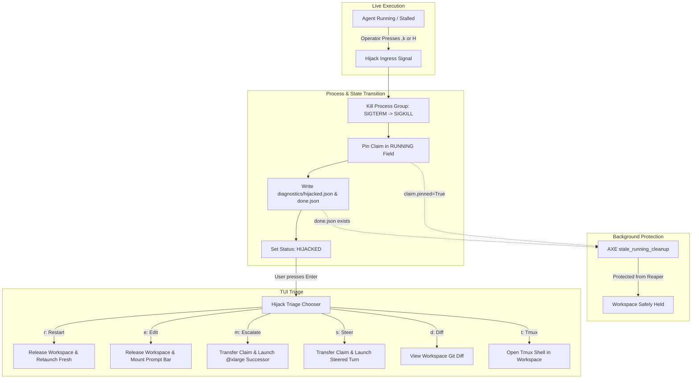
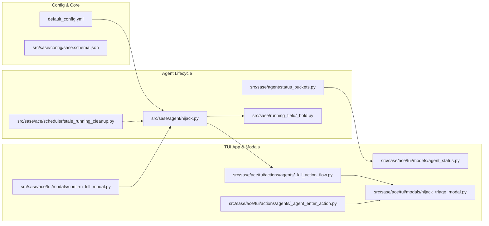

# Agent Hijack: Architectural Design, Critique, and Implementation Blueprint

**Researcher:** `research.33.gem` (Gemini 3.8 Flash High)  
**Date:** 2026-11-02  
**Target Subsystem:** SASE TUI (`sase.ace`), Agent Lifecycle (`sase.agent`), and Workspace Provider (`sase.running_field`)  
**Status:** Complete Research & Recommendation  

---

## 1. Executive Summary

This research investigates the proposal to add **"Agent Hijack"** functionality to SASE. In today's SASE runtime, an agent that stalls, hangs in a tight loop, or becomes unresponsive cannot be terminated without triggering either a full teardown (killing the process group, releasing its claimed workspace clone `sase_<N>`, and dismissing the agent node) or a blind prompt restart. When an agent has spent ten minutes performing valuable edits across dozens of files before stalling on a test runner or rate limit, tearing down the workspace destroys that work completely.

The proposed "Agent Hijack" feature addresses this pain point by decoupling **process execution termination** from **workspace release and agent dismissal**:
1. It halts the runaway or stalled process group immediately.
2. It freezes and preserves the claimed workspace and its in-progress file mutations.
3. It renders the agent node with a prominent `HIJACKED` status on the Agents tab.
4. Pressing `<enter>` on a `HIJACKED` agent summons a single-keypress triage panel offering immediate recovery workflows:
   - **Restart:** Release workspace and re-run original prompt.
   - **Edit & Relaunch:** Release workspace and load the prompt into the prompt editor (parity with `,x`).
   - **Escalate Model:** Keep the workspace and file changes, promote the model alias (e.g. `@large` $\rightarrow$ `@xlarge`), and launch a successor turn to finish the work.

### Core Verdict & Critique Summary
- **Strong Endorsement of Intent:** Decoupling process termination from workspace teardown solves a major real-world friction point in autonomous coding swarms.
- **Critical Flaws in the Naive Proposal:**
  1. *Missing Ingress:* The prompt defines what happens *after* an agent is hijacked and upon pressing `<enter>`, but omits the trigger mechanism for how a running agent becomes hijacked.
  2. *The `@xlarge` Downgrade Trap:* The proposed escalation rule ("use `@xlarge` if `@large` was used; otherwise `@large`") naively *downgrades* an agent that was already running at `@xlarge` down to `@large`.
  3. *The Dirty Workspace & Context Gap:* Spawning a smarter model into a dirty workspace with the *exact* original prompt without continuation context or diagnostic preambles risks syntax confusion, broken locks (`.git/index.lock`), or duplicate operations.
  4. *Reaper Collision:* Without atomic claim pinning and dedicated retention markers, the AXE background job `stale_running_cleanup` will detect a dead PID and automatically reap the workspace within minutes.
  5. *Workspace Slot Starvation:* Retaining numbered workspace clones (`sase_1`..`sase_16`) without a safety TTL risks exhausting the project's workspace pool.

Our design resolves every architectural pitfall while delivering an intuitive, reliable, and visually stunning operator experience.

---

## 2. Formal SASE Glossary Definition

To establish canonical terminology within SASE, we define the new concept according to SASE memory web standards:

```markdown
# Agent Hijack

*Requested · project*

aka hijack, hijacked agent, agent interception

An agent hijack is the administrative termination of an active sase agent's
executing process group that deliberately preserves its claimed sase workspace,
in-progress filesystem mutations, and agent identity instead of releasing the
claim and dismissing the node.

A hijacked agent transitions its visible agent node status to `HIJACKED` on the
Agents tab, pins its claim in the RUNNING field against automatic stale reapers,
and records an unresolved hijack marker in its artifacts directory. Selecting a
`HIJACKED` agent node and pressing `<enter>` triggers the Hijack Triage Panel,
allowing the operator to inspect dirty workspace state, edit the prompt,
relaunch from scratch, or transfer the held workspace to an escalated model
alias or steerable successor turn.
```

### Key Conceptual Distinctions
- **Agent Hijack vs. Agent Kill (`x`):** An Agent Kill terminates the runner and immediately executes dismissal cleanup: writing dismissal bundles, unclaiming the workspace from the `RUNNING` field, and removing the row from the live tree. A Hijack terminates the runner but preserves the workspace claim, leaving the row in the live tree under the `HIJACKED` state.
- **Agent Hijack vs. Kill-and-Edit (`,x`):** Kill-and-Edit tears down the running agent, releases its workspace, and mounts the prompt bar populated with the prior prompt for editing in a *new* workspace. Hijack halts execution *in-place* and allows deciding whether to preserve or discard the existing workspace.
- **Agent Hijack vs. Sase Gate Turn:** A Gate Turn is an agent-initiated pause for structured human input (e.g. approval or question). A Hijack is an operator-initiated emergency halt that freezes execution when an agent has *not* paused voluntarily.

---

## 3. Architectural Analysis of Existing SASE Subsystems

To implement hijacking reliably, we must examine the intersection of process management, workspace tracking, the AXE scheduler, and TUI presentation.



### 3.1 Workspace Claim & RUNNING Field Mechanics
Workspaces in SASE are numbered clones of the primary repository (e.g., `/home/bryan/.local/state/sase/workspaces/sase-org/sase/sase_14`), recorded in the project's `ProjectSpec` file under the `RUNNING` field:

```text
RUNNING:
  14 ace(run)-20261102_201016 my-patch-branch 48291
```

When an agent finishes or is killed:
- `sase.running_field.release_workspace()` removes the row, unlocking the directory for other agents.
- `sase.running_field.hold_workspace_claim()` pins the row by appending `PINNED` to its metadata:
  ```text
  RUNNING:
    14 ace(run)-20261102_201016 my-patch-branch 48291 PINNED
  ```
  Pinning signals to readers that the workspace is not currently executing but remains occupied.

### 3.2 The AXE `stale_running_cleanup` Trap
A critical discovery in our codebase investigation is the background maintenance job `stale_running_cleanup` (`src/sase/ace/scheduler/stale_running_cleanup.py`). Every few minutes, AXE inspects every `RUNNING` claim:
1. It checks `is_process_running(claim.pid)`.
2. If the PID is dead and the claim is **not** pinned, it calls `release_workspace(..., caller_tag="stale-cleanup")` and wipes the occupant directory record.
3. If the claim **is** pinned, it performs a strict safety check:
   ```python
   if _held_agent_artifacts_exist(project_file, claim.artifacts_timestamp) and \
      _held_done_marker_exists(project_file, claim.artifacts_timestamp):
       if not _held_claim_exceeds_ttl(claim.artifacts_timestamp, held_ttl_days):
           continue
   ```
   Notice that `_held_done_marker_exists` explicitly requires `artifacts_dir / "done.json"` to exist!
   
> [!CAUTION]
> If an agent is hijacked by killing its PID and pinning the claim, but fails to write a valid `done.json` marker in its artifacts directory, AXE's `stale_running_cleanup` will classify the pinned claim as a leak without a dismissal path and immediately release the workspace!
> Therefore, the hijack procedure **must** atomically write `done.json` (with `outcome: "hijacked"` and `status_label: "HIJACKED"`) alongside `hold_workspace_claim()`.

### 3.3 Workspace Claim Continuity (`retry_transfer_from_pid`)
When escalating to a smarter model or continuing work in the same workspace, we must not unclaim and reclaim the workspace. SASE already contains an atomic claim transfer primitive:
- In `src/sase/agent/detached_child.py` and `src/sase/agent/launch_spawn.py`:
  ```python
  spawn_agent_subprocess(..., retry_transfer_from_pid=transfer_from_pid)
  ```
- When `retry_transfer_from_pid` is supplied, `launch_spawn` updates the existing `RUNNING` row with the new child PID and clears the `PINNED` flag in a single atomic lock cycle without ever releasing the directory lease.

---

## 4. Critique of the Proposal

While the core premise is exceptionally valuable, the initial specification contains five significant architectural gaps that must be addressed.

### 4.1 Critique Point 1: The Missing Ingress Mechanism
The user request explains:
> "The agent node should then be rendered with the new 'HIJACKED' status on the 'Agents' tab. If the `<enter>` keymap is used when a 'HIJACKED' agent is selected a new panel should be triggered..."

**The Problem:** How does an agent become hijacked in the first place?
If `<enter>` is only active *after* an agent is already `HIJACKED`, how does an operator trigger the hijack while the agent is `RUNNING`?
- Today, `x` on a running agent brings up `ConfirmKillModal` ("Kill this agent? Running work will stop immediately.").
- `,x` in leader mode triggers `_kill_and_edit_agent()`, which destroys the workspace and mounts the prompt bar.

**Our Recommendation:**
We must provide dual ingress paths:
1. **Direct Shortcut:** Bind `,k` (or `,h`) in leader mode on the Agents tab to `action_hijack_agent`. (Note: `,h` is currently assigned to `agent_home`, making `,k`—"kill & hijack"—the cleaner choice).
2. **Integrated Kill Confirmation:** In `ConfirmKillModal` (opened by pressing `x` on a running agent), offer a third button:
   - `[k]` Kill & Dismiss (Releases workspace)
   - `[h]` Hijack (Halts process, keeps workspace, sets status to `HIJACKED`)
   - `[Esc]` Cancel / Keep Running

### 4.2 Critique Point 2: The `@xlarge` Downgrade Trap
The user request specifies:
> "Escalate to a smarter model. We should use the `@xlarge` model alias if the `@large` model alias was used for the previous prompt; otherwise, we should use the `@large` model alias."

**The Problem:**
Consider an agent that was launched with `%model:@xlarge` (or inherited `@xlarge` from an epic task allocation). Following the literal instruction:
- Was the previous model `@large`? No, it was `@xlarge`.
- "Otherwise, we should use the `@large` model alias."
- Result: **The agent is downgraded from `@xlarge` to `@large`!**

**Our Recommendation:**
Implement an explicit progression ladder:
```python
def resolve_escalated_model(current_model: str | None) -> str:
    normalized = (current_model or "").strip().lower()
    if normalized == "@xlarge":
        return "@xlarge"  # Retain top-tier alias; cannot downgrade
    elif normalized == "@large":
        return "@xlarge"  # Promote large to xlarge
    else:
        # Covers @medium, @small, @xsmall, or unspecified defaults
        return "@large"
```
Furthermore, make this configurable in `default_config.yml` via `agents.hijack.model_escalation_ladder`.

### 4.3 Critique Point 3: Dirty Workspace Poisoning & The Context Gap
If an agent is running and gets hijacked halfway through editing five files:
- Some files may contain partial syntax errors or half-finished diffs.
- Stale lockfiles (`.git/index.lock`, `package-lock.json`, test cache locks) may remain on disk.
- Uncommitted changes exist across the working tree.

If we launch a smarter model (`@xlarge`) in that exact workspace with the *exact* original prompt:
- The smarter model is given instructions as if starting from a clean checkout.
- It may run `git apply` which will fail due to existing modifications.
- It will not know *why* the previous agent stopped or what was already accomplished.

**Our Recommendation:**
When escalating or continuing in a retained workspace, SASE should:
1. Remove transient process locks (e.g. `.git/index.lock` if the git process died).
2. Inspect the current workspace state (`git status --porcelain`).
3. Inject a **Continuation Preamble** into the successor agent's prompt:
   ```markdown
   %model:@xlarge

   > [!IMPORTANT]
   > You are resuming work in workspace #{workspace_num} after the previous agent stalled.
   > In-progress file changes are already present in the workspace.
   > 1. Run `git status` and inspect modified files to understand the current progress.
   > 2. Complete the remaining work requested below without restarting from scratch.

   --- Original Request ---
   {original_prompt}
   ```

### 4.4 Critique Point 4: Workspace Slot Starvation
SASE workspaces are numbered directories (`sase_1` through `sase_16`). If a user hijacks several agents across different projects and leaves them in `HIJACKED` status over a weekend:
- Workspaces remain locked as `PINNED`.
- New agent launches will fail with `WorkspaceClaimError: all workspaces in use`.

**Our Recommendation:**
Add an explicit TTL for hijacked workspace retention:
- Configure `agents.hijack.retention_ttl_hours: 48` (default 48 hours).
- The `HIJACKED` badge in the TUI should display retention age (e.g., `HIJACKED (held 2h)`).
- Provide an explicit warning banner if all workspace slots are occupied by held/hijacked agents.

---

## 5. The Triage Panel Design: Complete Options Spectrum

The prompt asks:
> "If the `<enter>` keymap is used when a 'HIJACKED' agent is selected a new panel should be triggered that allows the user to select (with a single keypress) between one of the following options. Think hard about what other options (if any) this panel should support..."

Below is our comprehensive, single-keypress triage menu layout, designed to conform with SASE's Textual modal architecture (`AgentActionChooserModal`):

```text
┌───────────────────────── Hijack Triage: agent.refactor_auth ─────────────────────────┐
│                                                                                      │
│  Agent was halted by operator. Workspace #14 is preserved with uncommitted edits.    │
│  Press a single key to select an action, or Esc to keep hijacked.                    │
│                                                                                      │
│  RETAIN WORKSPACE (IN-PLACE RECOVERY)                                                │
│  [m]  Escalate Model (@large → @xlarge)                                              │
│       Transfers workspace #14 to @xlarge with continuation context.                  │
│                                                                                      │
│  [s]  Steer & Continue                                                               │
│       Keep workspace #14 and enter a clarifying prompt to nudge the agent.           │
│                                                                                      │
│  DIAGNOSTICS & MANUAL INTERVENTION                                                   │
│  [d]  Inspect Workspace Diff                                                         │
│       View git diff / status of in-progress modifications before deciding.           │
│                                                                                      │
│  [t]  Open Tmux Shell in Workspace                                                   │
│       Launch a new tmux window rooted directly in /.../sase_14.                      │
│                                                                                      │
│  DISCARD & CLEAN RELAUNCH                                                            │
│  [r]  Restart from Scratch                                                           │
│       Dismiss agent, release workspace #14, and re-run original prompt.              │
│                                                                                      │
│  [e]  Edit Prompt & Relaunch (,x parity)                                             │
│       Dismiss agent, release workspace #14, and open prompt in editor bar.           │
│                                                                                      │
│  SETTLEMENT & DISMISSAL                                                              │
│  [c]  Salvage & Commit                                                               │
│       Commit current workspace edits via sase stitch, release workspace, and finish. │
│                                                                                      │
│  [x]  Dismiss & Abandon                                                              │
│       Release workspace #14 and dismiss agent without relaunching.                   │
│                                                                                      │
│  Esc / q: Cancel (Leave in HIJACKED state)                                           │
└──────────────────────────────────────────────────────────────────────────────────────┘
```

### Detailed Breakdown of Panel Actions

| Key | Action Label | Workspace Action | Agent State Action | Why This Option is Essential |
| :---: | :--- | :--- | :--- | :--- |
| **`m`** | **Escalate Model** | **Retained** (atomic claim transfer) | Creates successor turn in session | The core requested feature: upgrades reasoning capability to overcome whatever complexity caused the prior model to stall. |
| **`s`** | **Steer & Continue** | **Retained** (atomic claim transfer) | Prompts user for note $\rightarrow$ successor turn | Often the model is smart enough, but hit an unexpected environment roadblock (e.g. "auth service is mocked in test_auth.py"). Steer lets the operator provide guidance. |
| **`d`** | **Inspect Diff** | **Retained** (read-only view) | Modal stays open / subscreen | The operator cannot make an informed choice between Discard (`r`) and Escalate (`m`) without seeing what the agent already changed! |
| **`t`** | **Tmux Shell** | **Retained** | Keeps agent `HIJACKED` | Allows the developer to fix a broken dependency, delete a stuck lockfile, or test a command by hand, then return to the TUI to resume. |
| **`r`** | **Restart** | **Released** (`release_workspace`) | Old agent dismissed $\rightarrow$ fresh launch | When the agent took a completely wrong approach and poisoned the workspace with garbage code. |
| **`e`** | **Edit Prompt** | **Released** (`release_workspace`) | Old agent dismissed $\rightarrow$ prompt bar mounts | When the user realizes their prompt was ambiguous or buggy and needs manual revision before trying again. |
| **`c`** | **Salvage & Commit** | **Released** after commit | Creates stitch $\rightarrow$ marks completed | When the agent actually completed 100% of the work, but stalled during post-run hooks or a hanging reporting tool. |
| **`x`** | **Dismiss & Abandon** | **Released** (`release_workspace`) | Old agent dismissed to archive | When the user decides the task is no longer needed or wants to abort entirely. |

---

## 6. Agents Tab Visual Presentation

To fulfill the mandate that this feature be **intuitive, reliable, and beautiful**, we detail the exact visual presentation on Textual surfaces:

### 6.1 Status String & Color Palette
- **Status String:** `HIJACKED`
- **Color:** `#FF875F` (Bright Coral / Persimmon) on dark themes; renders with high contrast and urgency without the alarmist red of `FAILED`.
- **Glyph:** `⚡` (`\u26a1` - High Voltage / Lightning Bolt) or `⊘` (`\u2298` - Circled Division Slash). SASE standardizes on `⚡` for operator intervention:
  ```text
  ⚡ HIJACKED
  ```
  Rendered in rich style: `bold #FF875F`.

### 6.2 Tree Row Presentation
In `src/sase/ace/tui/widgets/_agent_list_render_agent_status.py`:
```python
HIJACKED_STATUS = "HIJACKED"
HIJACKED_COLOR = "#FF875F"
HIJACKED_GLYPH = "⚡"

...
elif agent.status == HIJACKED_STATUS:
    return Text.assemble(
        (f"{HIJACKED_GLYPH} ", f"bold {HIJACKED_COLOR}"),
        (display_status, f"bold {HIJACKED_COLOR}"),
    )
```

### 6.3 Rail Indicators & Navigation Badges
- In rail cells (`_agent_list_render_rail_cells.py`):
  `⚡` in bold coral indicates that an agent holds a live workspace and is awaiting operator triage.
- In `status_buckets.py`:
  `HIJACKED` is added to `_STOPPED_STATUSES` (which are actionable input pauses, like `PLAN` and `QUESTION`). This ensures:
  1. The agent appears under queries like `needs:input` and `status:stopped`.
  2. Jumping keys (`J` / `jump_to_next_stopped_agent`) immediately land on the hijacked agent.
  3. The unread attention counter badges the tab.

---

## 7. Configuration Specification

To give operators control over hijacking behavior, we propose the following additions to `src/sase/default_config.yml`:

```yaml
# -----------------------------------------------------------------------------
# Agent Hijack & Stalled Turn Recovery
# -----------------------------------------------------------------------------
agents:
  hijack:
    # Whether agent hijacking is enabled
    enabled: true

    # Keybinding in leader mode (bound by default to ,k)
    # Available keys: k, K (lowercase k recommended for ease)
    leader_key: "k"

    # Direct keymap in Agents tab (unbound by default, e.g. "H")
    direct_key: ""

    # Model escalation ladder for the [m] triage action.
    # Defines the target alias when escalating an agent run.
    model_escalation_ladder:
      default: "@large"
      "@xsmall": "@small"
      "@small": "@medium"
      "@medium": "@large"
      "@large": "@xlarge"
      "@xlarge": "@xlarge"

    # Default retention TTL for hijacked workspaces.
    # After this duration, stale_running_cleanup will flag the workspace
    # as an expired hold and alert the user before reclaiming.
    retention_ttl_hours: 48

    # Optional stall-detection watchdog.
    # If an agent produces zero terminal output and zero tool activity
    # for this duration (in seconds), badging in the TUI changes to STALLED?
    # Set to 0 to disable automatic stall badging.
    stall_detection_seconds: 900  # 15 minutes

    # Continuation preamble injected when escalating or continuing in a retained workspace
    continuation_preamble: |
      > [!IMPORTANT]
      > You are continuing a previously hijacked agent run in workspace #{workspace_num}.
      > The previous agent's in-progress modifications are present in this checkout.
      > Check `git status` and `git diff` to understand what was completed before proceeding.
```

---

## 8. Implementation Blueprint & File-by-File Changes

Below is the concrete code modifications plan across SASE:



### 8.1 Backend Implementation: `src/sase/agent/hijack.py`
A new, clean module providing the atomic hijack operations:

```python
"""Atomic agent hijack and workspace freeze operations."""

from __future__ import annotations

import os
import signal
import time
from pathlib import Path
from typing import Any

from sase.core.atomic_json import write_json_marker_atomic
from sase.running_field import hold_workspace_claim
from sase.core.time import local_now

HIJACK_RECORD_LOCATOR = "diagnostics/hijacked.json"


def execute_agent_hijack(
    project_file: str,
    artifacts_dir: str | Path,
    workspace_num: int,
    workflow: str,
    cl_name: str,
    pid: int | None,
    raw_prompt: str,
    model: str | None,
) -> bool:
    """Halt an agent's process group, hold its workspace claim, and record hijack state."""
    # 1. Terminate the process group safely
    if pid is not None and pid > 1:
        try:
            pgid = os.getpgid(pid)
            os.killpg(pgid, signal.SIGTERM)
            # Short grace period for child process cleanup
            time.sleep(0.5)
            # Follow with SIGKILL if still active
            try:
                os.killpg(pgid, signal.SIGKILL)
            except ProcessLookupError:
                pass
        except (ProcessLookupError, PermissionError):
            pass

    # 2. Pin the workspace claim in RUNNING field
    artifacts_timestamp = Path(artifacts_dir).name
    hold_result = hold_workspace_claim(
        project_file=project_file,
        workspace_num=workspace_num,
        workflow=workflow,
        cl_name=cl_name,
        artifacts_timestamp=artifacts_timestamp,
        caller_tag="agent-hijack",
    )

    # 3. Write diagnostics/hijacked.json marker
    artifacts_path = Path(artifacts_dir)
    hijack_record = {
        "hijacked_at": local_now().isoformat(),
        "workspace_num": workspace_num,
        "cl_name": cl_name,
        "workflow": workflow,
        "original_pid": pid,
        "original_prompt": raw_prompt,
        "original_model": model,
        "resolved": False,
    }
    write_json_marker_atomic(artifacts_path / HIJACK_RECORD_LOCATOR, hijack_record)

    # 4. Write done.json marker with status_label="HIJACKED" to satisfy stale_running_cleanup
    done_record = {
        "outcome": "hijacked",
        "status_label": "HIJACKED",
        "finished_at": time.time(),
        "workspace_num": workspace_num,
        "pid": pid,
        "cl_name": cl_name,
        "project_file": project_file,
    }
    write_json_marker_atomic(artifacts_path / "done.json", done_record)

    return hold_result.success
```

### 8.2 TUI Modal: `src/sase/ace/tui/modals/hijack_triage_modal.py`
Extends `ModalScreen[str | None]` to present the options defined in Section 5 with single-key event listeners (`on_key`). When a key (`m`, `s`, `r`, `e`, `d`, `t`, `c`, `x`, `escape`) is pressed, it immediately dismisses with that action token.

### 8.3 Enter Action Wiring: `src/sase/ace/tui/actions/agents/_agent_enter_action.py`
In `action_act_on_agent()`:
```python
if agent.status == "HIJACKED":
    self._open_hijack_triage_modal(agent)
    return
```

### 8.4 Model Escalation Handler: `src/sase/ace/tui/actions/agent_workflow/_entry_relaunch.py`
When `m` (Escalate) is chosen:
1. Resolves the target model via `resolve_escalated_model(agent.model)`.
2. Assembles the continuation prompt by prefixing `continuation_preamble` to `agent.raw_prompt`.
3. Calls `spawn_detached_child(..., transfer_from_pid=agent.pid, prompt=continuation_prompt)`.
4. Removes the `hijacked.json` marker.
5. Updates the Agents tab row to `RUNNING` under the new model.

---

## 9. Test & Verification Matrix

To ensure the new feature is rock-solid, the following automated tests should be added to `tests/`:

1. **Unit Tests (`tests/agent/test_hijack.py`):**
   - Test process group termination (verifying `SIGTERM` followed by cleanup).
   - Test `hold_workspace_claim` interaction (verifying `PINNED` is appended to `RUNNING` row).
   - Test `done.json` and `hijacked.json` atomic marker generation.
   - Test `resolve_escalated_model` ladder (especially testing that `@xlarge` does not downgrade).
2. **Scheduler Reaper Tests (`tests/scheduler/test_stale_running_hijack.py`):**
   - Verify that `cleanup_stale_running_entries` does **not** reap a hijacked workspace whose PID is dead, provided `done.json` and `PINNED` are present.
   - Verify that an expired hijacked workspace (> 48h TTL) is handled per policy.
3. **TUI Component Tests (`tests/ace/tui/test_hijack_modal.py`):**
   - Render `HijackTriageModal` in a Textual pilot harness.
   - Verify single-keypress dispatches for each hotkey (`r`, `e`, `m`, `s`, `d`, `t`, `c`, `x`).
   - Verify `<enter>` routing in `_agent_enter_action` dispatches to triage modal when row status is `HIJACKED`.

---

## 10. Conclusion & Strategic Recommendation

The "Agent Hijack" feature transforms what is currently an all-or-nothing failure mode into a powerful, collaborative human-agent recovery loop. Instead of watching an agent waste twenty minutes of compute only to terminate it and lose all file edits, the developer can freeze the execution in one keystroke, inspect the diff, and hand the reins to an `@xlarge` model or provide steering guidance.

**Key Final Advice for Bryan:**
1. **Adopt `,k` as the Default Leader Shortcut:** Pair it alongside `,x` (Kill & Edit) as `,k` (Kill & Hijack) for instant muscle memory.
2. **Never Downgrade `@xlarge`:** Fix the escalation logic so that `@xlarge` stays at `@xlarge` (or checks for a custom `@smartest` alias).
3. **Always Write `done.json` on Hijack:** Protect against AXE's `stale_running_cleanup` immediately at the point of hijacking.
4. **Include Diff (`[d]`) and Steer (`[s]`) in the Panel:** The triage modal becomes twice as useful when the developer can see the diff before deciding whether to escalate or restart.
