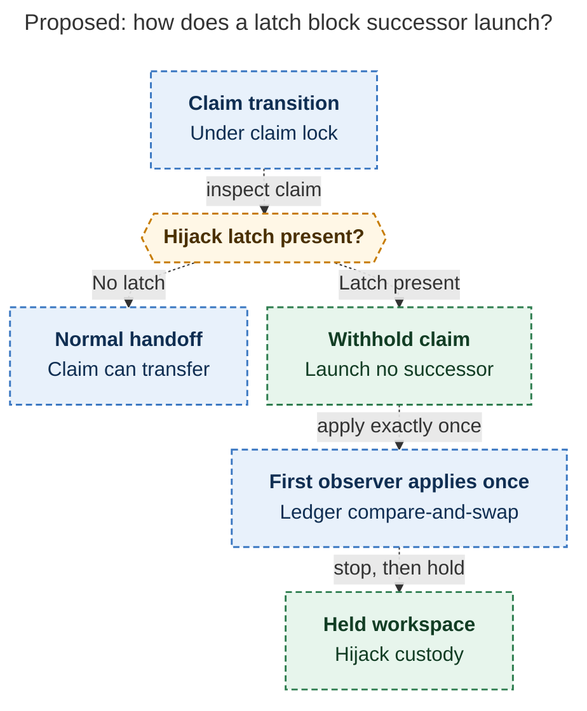

# Diagram proposals: Agent hijack dependability: consolidated findings and recommendation

Proposals for the swarm linker, not a report. Each diagram restates only what the source
report says.

```yaml
source: research:202611/agent_hijack_dependability/agent_hijack_dependability__final.md
producer: research.4u.image
check: "mmdc 12.0.0 with Puppeteer --no-sandbox and the PDF-mirroring config rendered 1 of 1 Mermaid diagrams"
```

## claim-latch

```yaml
anchor: |-
  the first transition that observes it applies it exactly once via a ledger
question: |-
  How does a proposed claim latch prevent a successor from launching?
illustrates: |-
  A latched workspace claim transfers to nobody, and the first transition that observes it applies the hijack exactly once via a ledger CAS.
caption: "Provided every handoff uses claim transfer, a latched claim blocks successor launch and applies takeover once through the ledger."
review: "486.734x868 px, fit 100.0%; question, source trace, labels, arrowheads and visual checks passed; 1 revision across 2 look rounds; batch and negative parse checks passed"
```


