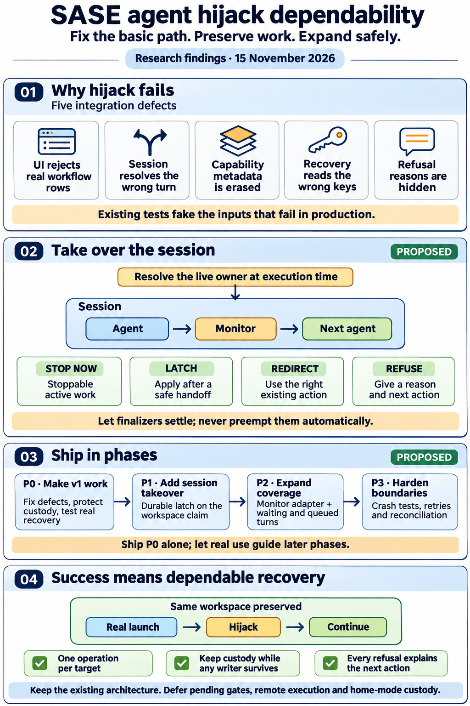
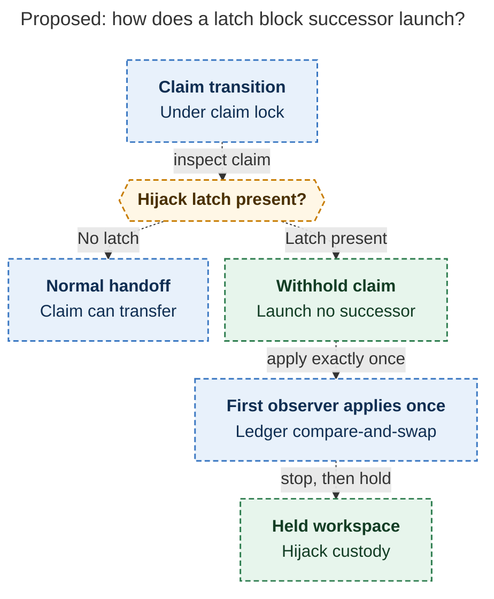

# Agent hijack dependability: consolidated findings and recommendation

> **Research query:** Agent hijacks don't seem to work correctly (see the apollo
> screenshot `20261115_164112.png`); how should they be fixed and made much more
> resilient and dependable, so that hijack works on as many types of sase turns, in as
> many states, as possible? Is this plan a good idea, would a different approach be
> better, which requirement adjustments are justified, and what is the recommended
> solution?

## Bottom line

- **Hijack is broken for every real agent today, not just the one in the screenshot.**
  Independent probes by two researchers (cld on live TUI rows, mus on live
  `agent_meta.json` files) and the lead's own code reads confirm a
  [stack of defects](#verified-defects-on-the-critical-path) on the one hijack path; any
  one of them blocks every hijack. **No hijack has ever succeeded on apollo**:
  `~/.sase/agent_hijacks/` holds only a lock file and no `persist-hijack` proc has ever
  run (cld).
- **The [screenshot](#what-the-screenshot-shows) hit the hardest case on top of that.**
  The user selected the session container row for `tailnet-t.10` while the session
  crossed a turn boundary: agent turn `--5` was in host completion and monitor `--mon-3`
  was live. The generic toast came from the TUI's cheap predicate, which rejects
  **all** real rows because every raw-prompt launch loads as `AgentType.WORKFLOW`, not
  the required `AgentType.RUNNING` (verified:
  `src/sase/ace/tui/actions/agents/_hijack_action.py:23`).
- **The existing tests pass because each one fakes the exact input that is broken in
  production** (hand-built `AgentType.RUNNING` rows; hand-written `agent_meta.json`
  with the capability stamp and legacy model keys). There is no end-to-end canary
  through the real launch pipeline.
- **The request's direction is right; its phrasing should change.** All five reports
  independently converge on the same
  [three amendments](#critique-of-the-request): (1) fix the basic path before widening
  coverage, (2) make the unit of hijack the **agent/session** (resolve the live
  occupying turn at execution time), and (3) replace "as many states as possible" with
  **every (turn kind × state) pair has exactly one defined decision** — stop now, latch
  to the next safe hand-off, redirect to a better operation, or refuse with a specific
  reason ([the per-state decision model](#the-per-state-decision-model)). Generic
  refusals are themselves a bug.
- **Recommendation**: a four-phase plan — [P0](#phase-0---make-v1-real) make v1 real
  (five small fixes + canary + transactional hardening),
  [P1](#phase-1---session-takeover-with-a-durable-latch) session takeover with a
  durable latch on the workspace claim (sase-core wire v2),
  [P2](#phase-2---monitor-adapter-and-waiter-branch) monitor adapter and WAITING/QUEUED
  coverage, [P3](#phase-3---hardening-and-polish) hardening.
  [Defer](#explicitly-deferred-or-rejected) pending-gate hijack, remote execution, and
  home-mode custody. Do not rewrite the subsystem; its ledger/custody/recovery design is
  sound and most defects are integration glue.

## What the screenshot shows

Trigger: `~/tmp/screenshots/20261115_164112.png` (apollo), toast "Selected agent is not
eligible for hijacking" on session `tailnet-t.10`.

The selected row is `6 — ⚡ tailnet (RUNNING) ×15 … ◆ tailnet-t.10` in the `@epic` clan —
the **session container row**, showing RUNNING. One researcher (grk) read the selection
as a WAITING row; the lead re-examined the image: the WAITING row is the neighboring
`tailnet-t.land`, so grk's screenshot diagnosis is wrong, though the WAITING coverage
gap it argues for is real and [kept below](#resolved-disagreements). The other four
reports and the lead agree on the sequence:

1. At 16:41:08 the user pressed hijack on the `tailnet-t.10` container row.
2. The row's Python object is the session's **first** member (`tailnet-t.10--plan`),
   loaded as `AgentType.WORKFLOW` with a stale pid (cld, live probe). The TUI predicate
   refused at the `agent_type` check and toasted the fixed generic string. The Rust
   eligibility function was never called.
3. Even with a perfect UI, v1 would still have refused at that instant: agent turn `--5`
   was finalizing (`final running` in the footer) and `--mon-3` was a monitor turn —
   both refused **by design** (`eligibility.rs`). The monitor ran a post-commit
   acceptance script that failed with exit 1 about two minutes later, and follow-up
   `--6` booted at 16:43 (cld, `sase monitor show`).

So the screenshot demonstrates two distinct problems at once: an ingress bug (wrong
object, generic message) and a coverage boundary (session mid-transition has no
hijackable member). Both need fixing, in that order.

## Verified defects on the critical path

Numbering follows cld's D1–D6, which the other reports and the lead's verification
corroborate. Confidence is high for all of these: each was confirmed by at least two
independent researchers and/or the lead's own file reads.

| # | Defect | Evidence |
|---|--------|----------|
| D1 | **TUI predicate rejects every real agent row.** `agent_can_offer_hijack` requires `AgentType.RUNNING`; every raw-prompt launch is wrapped in an anonymous `tmp_*` workflow and loads as `WORKFLOW`. The same predicate gates the `,k` leader action, its footer hint, and the kill modal's "h Hijack instead", so the affordance never even appears. | cld probe: 0 of 7 live running agents pass; lead verified the predicate source; gem/mus concur |
| D2 | **Session rows resolve to the wrong member.** The container row's object is the session's *first* member (`--plan`, done); CLI `find_named_agent` picks the *latest* member (`--mon-3` at probe time) and then misclassifies it (`is_monitor_turn` comes from a live-row name match, gate-ness from meta keys real turns don't carry, and `_check_eligibility` hard-codes `is_llm_agent=True`, `is_named_proc=False`, `is_clan_container=False`). | cld probes 1 & 3; mus bare-name probe resolved to a DONE predecessor; lead verified `_stop_target.py` |
| D3 | **The hijack capability stamp is erased on every run.** Bootstrap writes `runner_capabilities: ["hijack"]`; moments later directive extraction rebuilds `agent_meta.json` through an allow-list that omits the key (gem: follow-up artifact creation omits it too). Rust then refuses *everything* with `missing_capability` and the misleading message "launched before hijack support; use x". | mus verified live: ~30 metas across two projects, all `runner_capabilities: null`; cld probe 3: every live agent refused; lead grep: the key exists only in `run_agent_runner_bootstrap.py`, not in the preserved allow-list or follow-up writers. An earlier fix for the same bug class exists for `launch_scratch_key` |
| D4 | **Model facts are read from keys runners never write.** `_stop_target.py` reads `agent_llm_provider` / `agent_effort` / `booted_at`-as-float; real runners write `llm_provider` (or `exec_llm_provider`), `reasoning_effort`, and ISO `booted_at`. With D1–D3 fixed, the stop would succeed but **Continue and Escalate — the main keep-work actions — would fail** (`require_concrete_target` rejects a bare model with no provider). | lead verified the reader; cld traced the recovery failure; gem adds the ISO-timestamp parse failure and the `turn_kind` gate/monitor classification miss |
| D5 | **The refusal reason is hidden, and two eligibility policies drift.** The plan (A11, `plan:202611/agent_hijack.md`) required `,k` to toast the refusal reason; the TUI shows one fixed string and never calls Rust `agent_hijack_eligibility`. The two rule sets check overlapping but different conditions and have already diverged in both directions (TUI refuses what Rust would allow, and vice versa). | mus side-by-side analysis; cld; grk; lead verified the toast source |
| D6 | **The screenshot's states are refused by design.** Rust refuses finalizer phases (`declaring`/`executing`/`finalizing`) and monitor turns, gates, named procs, home mode, remote, clans, and bulk marks — intentional, tested v1 restrictions, not bugs. | cdx binding probe table; cld; eligibility.rs read by mus/gem |

**Why the tests missed all of it**: the TUI tests build `Agent(agent_type=AgentType.RUNNING)`
rows by hand; the e2e test hand-writes `agent_meta.json` including the capability stamp
and the legacy model keys. No test drives real launch pipeline → real loader → predicate
→ stop → recover. That missing canary is the single most important addition after the
fixes themselves (cld, mus, gem unanimously).

## Latent defects beyond the critical path

cdx probed the stop transaction itself with injected failures (temporary records, mocked
terminator — no real signals); gem independently corroborated the snapshot-discovery
finding. These matter because they decide whether a *widened* hijack can be trusted:

- **Dedup is per hijack ID, not per target.** Two callers (e.g. TUI + CLI) can race
  through independent records for the same agent and overwrite each other's intent
  marker. The TUI's proc concurrency key does not cover direct CLI calls.
- **Intent-marker persistence is unchecked.** `write_user_kill_intent` returns `None` on
  `OSError` and the orchestrator ignores it — the runner may never learn the stop was a
  hijack.
- **Pre-stop failure can orphan a workspace pin.** If `begin_stop` fails after
  `pin_claim`, the abort path deletes the intent and record but never unpins — capacity
  held with no record explaining it.
- **Partial stop drops custody.** A dead runner with one surviving child advances to
  terminal `stop_failed`, unpins, and reports the agent "still RUNNING" — stronger than
  the evidence; a surviving writer should instead block release under retained custody.
  mus adds: there is no bounded retry or escalation for `stop_failed`; each `,k` re-runs
  the whole protocol identically.
- **Abandoned stop operations are retained but never reconciled** (the stale sweep
  skips `requested`/`stopping` records); recovery (`resolving`) has reconciliation but
  no watchdog, so a successor that never dispatches leaves `RECOVERING…` holding a
  workspace indefinitely (cdx + mus).
- **Snapshot discovery misses real linked-repo metadata.** Stop/release evidence readers
  accept only `list[str]`, but the launcher writes `LinkedRepoResolution` dicts, and
  dynamically opened repos live in marker files the readers never consult
  (`opened_linked_workspaces.json` / `opened_siblings.json`). "Snapshot all work before
  release" is unproven for current metadata (cdx probe + gem independent code trace; the
  e2e fixture papers over it with string paths).
- **Standalone (sessionless) runs pass stop eligibility but recovery raises
  `no_session`** — a supported stop does not imply Continue can work (cdx).
- **Collapsed-row recovery mirroring**: `_mirror_root_from_child` never copies
  `hijack_record` onto a session container row, so even a successful member hijack can
  show "Recovery details are unavailable" when the session is collapsed (gem).
- **Remote referrals are untracked**: the copy-command affordance is right, but nothing
  records the referral or reflects the remote outcome on the mirror row (mus).

## Critique of the request

**Is this a good idea?** Yes — unanimously. Hijack is the only stop path that keeps the
workspace and evidence; every alternative couples "stop" to "lose the work". The v1
design (Rust policy, revisioned ledger, exclusive record creation, claim pinning,
verified process-tree termination, snapshots, exactly-once recovery with identity
checks) is sound and worth keeping. The subsystem is ~11k Python lines with **zero**
successful production uses — so the problem is integration glue and sequencing, not
architecture. Nobody recommends a rewrite.

**But "work on as many turn types in as many states as possible" is the wrong
requirement**, for three reasons the reports converge on:

1. **Fix before widen.** Widening a path that has never completed one real hijack
   multiplies untested surface (cld, mus). The first deliverable is "`,k` on an ordinary
   running agent turn works, and Continue succeeds", guarded by a canary that cannot be
   faked.
2. **The unit is the agent, not the row.** The user means "take the wheel of this
   agent", not "kill the process behind this row". The screenshot's live member changed
   three times in four minutes (`--5` → `--mon-3` → `--6`); only backend-side resolution
   of the occupying turn, atomic with respect to hand-offs, can be dependable (cld R2,
   grk "session takeover", gem "lane-atomic", cdx session scoping).
3. **Some states must not be interrupted mid-flight, and some have nothing to keep.**
   A finalizer committing/pushing, a staged handoff being adopted, and a gate executing
   a selected option can leave half-landed commits or orphaned successors if killed.
   A queued agent with no workspace claim has nothing hijack exists to preserve. The
   safe route to "works in every state" is a **durable latch** — accept the hijack,
   show it as pending, and apply it at the next safe hand-off — plus explicit redirects
   (cld R3; cdx "addressable, not killable"; gem's bounded-drain is
   [resolved below](#resolved-disagreements)).

### Resolved disagreements

- **Finalizing turns.** gem proposed a ~1.5 s bounded drain then *forcible* finalizer
  preemption; cdx and cld argue interruption mid-commit/push is exactly what the
  restriction exists to prevent. **Resolution: latch, don't preempt.** Accept the hijack
  immediately, let the finalizer settle, apply the hijack at the boundary. Bound the
  wait; if a finalizer hangs past the bound, surface an explicit, user-selected
  "hijack now (finalizer interrupted, see snapshot)" escape hatch with an
  `effect-uncertain` warning — never automatic preemption (cdx's emergency path + cld's
  open question).
- **Gate turns.** grk wanted pending-gate cancel-and-hold in an early phase; mus argued
  gates should never be hijacked; gem/cdx split pending vs settling. **Resolution:
  defer pending-gate hijack.** A pending gate is already paused, consumes nothing, and
  has first-class front-door actions (answer, feedback, cancel); hijacking it adds the
  least value of any kind (cld R7). A gate *executing its selected option* is covered by
  the latch (apply after the commands settle, never reinterpret cancellation as
  rejection — cdx). Revisit a dedicated pending-gate adapter only if real use shows
  demand.
- **WAITING/QUEUED.** grk ranked this first (from the misread screenshot); others rank
  it behind the running-turn fix. **Resolution: real gap, phase 2–3 priority.** Session
  roots spend most of their life waiting (monitors, gates, `%wait`, epic land), and `x`
  on them destroys the workspace — "refusing hijack while offering kill trains people to
  destroy the asset" (grk). Requirements: a **processless stop branch** (no pid
  required; skip `terminate_tree`; pin by claim identity, not live pid; skip the
  capability check, which only protects against signalling old runners), and **cancel
  the agent's own wait marker** so a later target completion cannot resume it, while
  waiters *of* the agent stay parked as today (grk R4–R6, R11). With **no** numbered
  claim, redirect to kill-and-edit — do not mint fake custody (cld, gem, mus agree).
- **Remote rows.** Keep local refusal + copy-command (all); add ledger referral
  tracking so the mirror row reflects the remote outcome (mus) — cheap and worthwhile.
  Owner-host routed execution is a later, explicit capability (cdx), not v2 scope.
- **Never hijack** (redirect or refuse with reason, each naming its alternative): named
  procs (stop the proc), clan containers (retarget to the member; auto-select when
  exactly one is live), home-mode turns (no exclusive workspace to hold), bulk marks,
  terminal rows (fork/retry), already-HIJACKED rows (open the recovery panel). All five
  reports agree these exclusions are correct and should stay.

## The per-state decision model

**Target behavior.** `immediate` = stop now · `latched` = durable, applied at the next
safe hand-off · `redirect` = hand the user to the right operation, with a message. Every
refusal carries the Rust `code` + `message`; the generic toast is deleted.

| Occupying state of the selected agent | Decision | Mechanism |
|---|---|---|
| Agent turn STARTING/RUNNING/RETRYING (provider running) | immediate | v1 stop orchestrator after the P0 fixes |
| Agent turn booting / awaiting runner slot, session holds workspace | immediate | Stop runner, hold claim; Continue relaunches stored prompt + instructions |
| `--plan` / `--tale` working turns | immediate | Same as running agent turns (gem: they burn the same quota and go down the same wrong tracks) |
| Agent turn finalizing (declaring/executing/finalizing) | **latched** | Finalizer settles, commits land; runner settles `hijacked` instead of adopting its staged handoff; bounded wait + explicit forced option on hang |
| Handoff staged, not yet adopted | **latched** | Adopter observes the latch at claim transfer and launches nothing |
| Monitor turn running *(the screenshot)* | immediate (adapter) | `stop_monitor`, settle `hijacked`, suppress `--next`, hold workspace; Continue launches the recorded follow-up with partial output |
| Monitor settled, follow-up pending | latched at admission / immediate on the follow-up | Follow-up is an ordinary agent turn |
| Gate awaiting human | **deferred** (redirect to the gate's own actions) | "Awaiting your decision — Enter to review"; revisit on demand |
| Gate executing selected option's commands | latched | Apply after commands settle; never replay or reinterpret the decision |
| WAITING/QUEUED with numbered claim | immediate (processless branch) | Cancel wait/queue, pin by claim identity, drop own wait marker |
| WAITING/QUEUED with no claim | redirect | "Nothing to keep — use kill & edit" |
| Clan container | redirect | Pick/auto-select the live member |
| Named proc / home mode / bulk / multi-step workflow step | refused, with reason | Each names its alternative; workflow steps need their own design |
| Terminal / already HIJACKED | redirect | Fork/retry; open recovery panel |
| Remote row | redirect + tracked referral | Copy command; record referral, reflect remote outcome |

## Recommended solution

### Phase 0 - Make v1 real

_Small; sase only; no wire change._

1. **Preserve the capability stamp (D3).** Add `runner_capabilities` to the preserved
   allow-list *and* re-stamp it in `write_agent_meta` for the runner's own writes (the
   `launch_scratch_key` precedent), and to follow-up artifact creation (gem). Better:
   one shared `RUNNER_BOOT_META_KEYS` tuple for the bootstrap writer and preserver, plus
   an invariant test that every bootstrap-written key survives directive extraction —
   kills the bug class, not the instance. Optional: infer capability from
   `code_identity` commit ancestry for agents already running (prefer ancestry over
   version strings — an editable checkout can lie about versions).
2. **Fix the model-fact keys (D4).** Read `llm_provider` / `exec_llm_provider`,
   `reasoning_effort`, ISO-or-epoch timestamps; classify gate/monitor from durable
   records (`turn_kind`, monitor markers, gate records), never from live-row matches.
   Feed the test from a captured real-runner `agent_meta.json`, not a hand-written one.
3. **Resolve the live member (D2).** TUI resolves a session container to its live
   member; CLI/backend resolve a session name via the session roster's *active* member,
   not `find_named_agent`'s latest. Stop hard-coding eligibility facts.
4. **One eligibility authority (D1, D5).** The TUI predicate becomes a call into the
   same facts builder + Rust decision the orchestrator uses (cache per refresh; refresh
   asynchronously — don't block Textual rendering on filesystem scans, cdx). Toast and
   footer show the decision's `code` + `message` + next action; log refusal codes.
   Mirror the collapsed-row `hijack_record` so recovery opens from a collapsed session
   (gem).
5. **`sase agent hijack --explain NAME`** — read-only resolved member, facts, decision
   (would have caught D1–D4 in a minute; cld/mus).
6. **[Transactional hardening](#latent-defects-beyond-the-critical-path) (cdx).**
   Target-level dedup (reserve under a target-generation key; repeated requests return
   the active operation), verify intent persistence before signalling, restore the pin
   on pre-signal abort, retain custody on partial stop (surviving writer ⇒ blocked
   state, not terminal failure + unpin), accept dict-shaped `linked_repos` and consult
   opened-repo markers in snapshot discovery (share one repository inventory with the
   finalizer), and add stop-phase reconciliation to the stale sweep. Define the
   standalone-run recovery path (session promotion) or refuse the stop with a reason.
7. **Canary test.** Launch through the normal pipeline (anonymous workflow, real
   bootstrap, real directive extraction, fakey provider), wait for RUNNING, assert the
   real loader row passes the predicate, hijack via the TUI's own submission path,
   assert HIJACKED + workspace held, run Continue, assert the successor runs in the same
   workspace and settles. Plus a TUI/backend decision-parity test.

### Phase 1 - Session takeover with a durable latch

_sase-core + sase; large._

- **The latch lives on the workspace claim.** Every in-session hand-off cld traced
  (monitor start, host completion, gate follow-ups, turn follow-ups, successor delivery,
  retries, launch-spawn transfer) goes through a claim transfer/hold under the claim
  lock. A latched claim (`hijack_latch: {hijack_id, requested_at}`) transfers to
  nobody; the first transition that observes it applies it exactly once via a ledger
  CAS. **Verify the "every hand-off goes through claim transfer" assumption early** —
  grep for adoption paths that launch successors without a claim operation (cld), and
  publish lock ordering relative to the claim lock, handoff adoption lock, and gate
  execution lock (cdx).
- **Rust wire v2**: facts gain `occupying_kind` (`llm|wait|queue|monitor|gate|none`),
  `turn_phase`, `has_numbered_claim`, `process_alive` (not merely pid-present),
  `is_session_container`; the decision gains `mode`
  (`immediate|latched|redirect|refused`) and `redirect_op`. Ledger gains `scope`,
  `latched_at`, `applied_at`, `applied_boundary`, and the `latched → stopping → held`
  transition. Bump wire versions, update the PyO3 bindings and Python mirror constants,
  move the `sase-core-revision.txt` pin.
- **The latch never waits on a dead process**: write the latch; stop the live member
  immediately if stoppable; otherwise wait bounded for a checkpoint; if the owning
  process is dead or stuck, reconcile and apply the latch directly. (Evidence stuck
  hand-offs happen: a monitor sat in `staged` for 12 days — cld.)
- **TUI**: `⏏ HIJACK PENDING · after finalizer` overlay; pressing hijack again cancels
  the latch; a latch mooted by clean completion settles as `moot` with a toast.

[The claim-latch diagram](#figure-claim-latch) traces the proposed branch at a claim
transition, where a latched claim transfers to nobody and the first observing transition
applies the hijack exactly once.

_Provided every handoff uses claim transfer, a latched claim blocks successor launch and applies takeover once through the ledger._

### Phase 2 - Monitor adapter and waiter branch

_Medium._

- **Monitor adapter** (closes the screenshot case *and* an existing gap — today `x` on
  a monitor strands the session): stop via `stop_monitor`, settle `hijacked`, suppress
  `--next`, hold the workspace. Recovery: **Continue** (launch the recorded follow-up
  now, partial output injected and labeled untrusted), **Escalate**, **Re-run command**,
  **Dismiss** after snapshot. Hide LLM-only actions that make no sense for a command
  (gem). Support both proc-backed monitors and the legacy supervisor path (cdx).
- **WAITING/QUEUED with a numbered claim**: the processless branch per the
  [WAITING/QUEUED resolution](#resolved-disagreements).

### Phase 3 - Hardening and polish

_Small._

- `sase doctor`: "N running agents lack the hijack capability."
- **Boundary chaos test**: scripted fakey session `agent → sleep-monitor → agent`,
  fire hijack at every checkpoint; every attempt must end `HIJACKED` or `latched` —
  `refused` is a test failure (cld). Crash/kill the worker between every transaction
  step; reconciliation must converge (cdx).
- `stop_failed` bounded retry + explicit downgrade offer; `resolving` watchdog;
  remote referral tracking; clan retarget; occupying-turn-scoped finalizing refusal
  (a WAITING session whose FINAL deck shows an older run must not be refused for
  session chrome — grk).

### Explicitly deferred or rejected

- Pending-gate adapter (documented alternative: the gate's own actions). Remote
  owner-host execution. Home-mode custody. Bulk hijack. SIGSTOP/freeze (retains locks
  and fragile provider state; conflicts with the fresh-successor model — cdx, grk).
  Full subsystem rewrite or "kill with hold + fork" replacement (rewrites an epic that
  closed days ago; revisit only if v1 stays unused after the fixes — cld).

## Acceptance criteria

Measure guarantees, not the number of permitted statuses (cdx):

- The canary passes: real pipeline → hijack → `HIJACKED` → Continue succeeds in the same
  workspace. A screenshot-shaped fixture (workflow root, active monitor, staged
  transition, historical members) resolves ownership and yields a precise decision.
- Concurrent TUI+CLI requests for one agent coalesce into one operation; lost responses
  and retries never create a second stop or successor; races with admission, retry,
  finalizer completion, staged adoption, monitor completion, and gate acceptance produce
  at most one successor per progression point.
- No surviving writer ever permits workspace release; no unrelated process is signalled
  (PID-reuse and permission-denied cases covered; pidfd on Linux is a worthwhile
  hardening for the check-then-signal race — cdx).
- Snapshot discovery exercises real launcher metadata and opened-repo markers; dirty
  primary, linked, external, and sidecar work is restored before release.
- Every refusal, TUI or CLI, carries its code and a next action, and TUI and backend
  decisions agree on identical inputs (parity test).

## Risks and open questions

- **Latch-at-claim-transfer assumption**: if any hand-off path bypasses claim transfer,
  the latch has a hole — verify before building
  [Phase 1](#phase-1---session-takeover-with-a-durable-latch) (cld).
- **Finalizer hangs**: the latch inherits them; the bounded wait + explicit forced stop
  is the mitigation, and "effect uncertain" must be first-class in recovery (cdx).
- **Capability inference for pre-fix runners**: commit-ancestry, not version strings;
  otherwise agents running today only become hijackable as they turn over (cld).
- **Multi-step (non-anonymous) workflow steps** stay refused pending their own design.
- **Scope discipline**: the subsystem is large and unproven in production. Ship P0
  alone, measure real use (refusal-code logs now exist), and let that decide how much
  of P1–P3 to build (cld's framing, endorsed here).

## Sources and researcher contributions

Lead-researcher consolidation · 2026-11-15 · merges five independent reports
([cdx](agent_hijack_dependability__cdx.md), [cld](agent_hijack_dependability__cld.md),
[grk](agent_hijack_dependability__grk.md), [mus](agent_hijack_dependability__mus.md),
[gem](agent_hijack_dependability__gem.md)) plus the lead's own code verification on the
same checkout (sase `082f2bc705`, sase-core `2159438daa`).

| Report | Distinct contribution | Caveats |
|---|---|---|
| [cdx](agent_hijack_dependability__cdx.md) | Stop-transaction fault injection (dedup, intent persistence, pin rollback, partial-stop custody, stale-sweep gap, snapshot discovery, standalone `no_session`); fencing/locking design; external precedents (pidfd, cgroup.kill, systemd, Temporal); per-state support contract | Did not find D3 (capability wipe) |
| [cld](agent_hijack_dependability__cld.md) | Live-row probes (0/7 pass predicate; every agent `missing_capability`); D1–D6 numbering; claim-transfer latch design; monitor-adapter spec; "no hijack has ever succeeded" evidence; phased sizing | — |
| [grk](agent_hijack_dependability__grk.md) | Session-takeover framing; WAITING/QUEUED processless-branch requirements (R4–R6, R11); deny-list discipline; FINALIZING overlay/eligibility mismatch | Misread the screenshot row as WAITING; its Phase B ordering (WAITING first) is superseded by the verified D1/D3 diagnosis |
| [mus](agent_hijack_dependability__mus.md) | Live meta scan (~30 files, capability null everywhere); write-then-wipe root cause with commit archaeology; TUI/Rust policy-divergence analysis; stop_failed/resolving/remote-referral gaps; "fix the message before the matrix" | Treated gate/monitor hijack as permanently out of scope — softened here to deferred/adapter |
| [gem](agent_hijack_dependability__gem.md) | Follow-up-artifacts capability omission; ISO-timestamp parse bug; collapsed-row `hijack_record` mirroring; lane-atomicity framing; coverage of `--plan`/`--tale` and extra active statuses | Bounded-drain finalizer preemption rejected in favor of latching |
