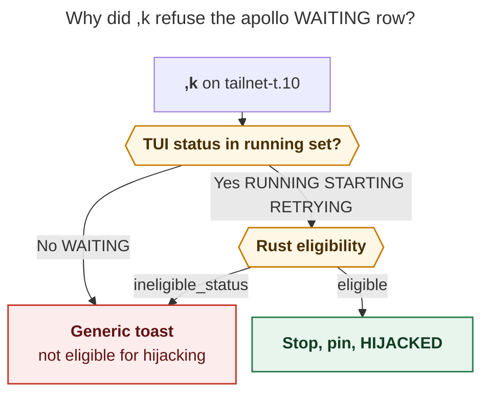
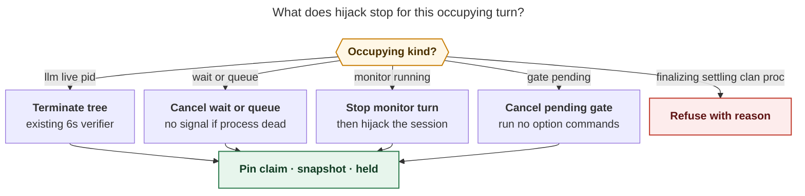

# Agent Hijack Should Be Session Takeover, Not A Running-LLM Allowlist

_Independent swarm report · researcher `grk` · 2026-11-15_

**Question.** Hijacks fail in ordinary TUI states (see `~/tmp/screenshots/20261115_164112.png` on apollo). Should hijacks work on as many sase turn kinds and states as possible, and what is the best way to implement that?

**Sources.** The screenshot; glossary strand Agent Hijack; `plan:202611/agent_hijack.md` (A11); the landed stop orchestrator and Rust eligibility; TUI ingress in `_hijack_action.py`; agent-status and FINAL overlay code; wait-follow custody; prior hijack research `research:202611/agent_hijack_held_workspace_recovery/agent_hijack_held_workspace_recovery.md`. Peer reports from this swarm were not read.

## Verdict

Expand hijack. Do not expand it by adding every status word to the current allowlist.

The screenshot is a real product failure of **v1 eligibility (A11)**, not a broken stop protocol. `tailnet-t.10` is a live local LLM session that still owns a numbered workspace. The operator pressed the hijack key and got a generic refusal. Kill would drop the workspace. Edit-wait is the wrong tool if the intent is “stop this, keep the tree, continue or escalate.”

The original hijack brief said “any agent.” Research **narrowed** that to RUNNING / STARTING / RETRYING local LLM turns because each excluded kind has its own supervisor. That was the right v1 cut. Production use now shows the cut is too tight: **WAITING is the common “I am stuck and I still have a workspace” state**, and session roots spend most of their life there (monitors, gates, `%wait`, epic land).

**Recommended product:** hijack is **session takeover that keeps the numbered workspace**. Occupying turn kind selects a stop strategy. A short deny list stays. Recovery stays one panel.

That is a v2 of A11, not a rewrite of the ledger, snapshots, or recovery panel.

## Screenshot diagnosis

The apollo capture shows:

| Surface | What it shows | What that implies |
| --- | --- | --- |
| Tree row | `tailnet-t.10` **WAITING**, `@epic` phase bead | Live waiter, not a completed row |
| Footer | `x kill`, `W edit wait`, `t tmux choices (2)` | **pid is set** (else the footer would say dismiss) and **workspace_num > 0** |
| Session | `tailnet-t.10 · 12 turns · PLAN` | Session container, not a lone one-shot |
| Jump roster | members include `--mon-*`, `--gate`, and a selected `.land` | Occupying activity is a wait/gate/monitor mix, not a live provider stream |
| Toast | `Selected agent is not eligible for hijacking` | TUI cheap predicate refused **before** Rust eligibility ran |
| Leader footer | hijack chip hidden on WAITING | `,k` still fires; the key is secret, then rude |

The TUI predicate that produced that toast is a local allowlist, not the core reason string:

```python
# src/sase/ace/tui/actions/agents/_hijack_action.py
if agent.status not in {"RUNNING", "STARTING", "RETRYING"}:
    return False
if agent.workspace_num is None or agent.workspace_num <= 0 or agent.pid is None:
    return False
```

Core eligibility repeats the same status cut and would refuse this row even if the TUI let it through:

```rust
// sase-core crates/sase_core/src/agent_hijack/eligibility.rs
"RUNNING" | "STARTING" | "RETRYING"  // else code: ineligible_status
```

A WAITING row with a live pid and a numbered workspace is exactly “kill but keep,” which is what `,k` was named for. v1 still treats it as out of scope.

The FINAL deck switcher reading as “final running” is a separate trap. The `FINALIZING` row overlay only replaces **RUNNING** (and working-plan labels), not WAITING (`finalizer_row_state.py`). A session can show WAITING while a previous member’s finalizers are still visible in the FINAL deck. Eligibility that keys off `agent_meta.finalizer_status.phase` on the container can refuse a waiter for someone else’s landing. That refusal must name the occupying turn, not the session chrome.



_Caption: The screenshot never reached the stop orchestrator. The TUI allowlist hid the core reason, so the operator cannot tell WAITING from “no workspace” from “this is a monitor.”_

## Current design (what already works)

Hijack is a durable custody settlement, and that part should stay:

1. Eligibility (Rust) → refuse with a code and message, change nothing.
2. Ledger `requested` + hijack-mode kill intent **before** any signal.
3. Pin the numbered claim (`hold_workspace_claim`).
4. Verified terminate (6 s grace, then SIGKILL). Survivors → `stop_failed`, still RUNNING.
5. Fallback `done.json` `outcome: hijacked` if the runner dies first.
6. Evidence and snapshots; publish `held`.
7. Recovery panel: Continue / Escalate / Instruct in the same workspace; Restart / Edit / Dismiss after a verified snapshot.

Waiters of a hijacked **target** already park until recovery resolves (`_hijack_follow.py`, glossary). Auto-restart already excludes hijack intent. Remote rows already copy `sase agent hijack NAME`. The beta flag is gone.

v1 eligibility (accepted A11 in `plan:202611/agent_hijack.md`) is the part that does not match how operators use sessions:

| Kind or state | v1 result | Why it was excluded | Operator reality |
| --- | --- | --- | --- |
| RUNNING / STARTING / RETRYING LLM | eligible | Live process, hijack-capable runner | Works |
| WAITING (`%wait`, land, bead, time) | `ineligible_status` | No “running model” | **Screenshot.** Workspace still claimed; `x` is kill |
| QUEUED | `ineligible_status` | Not running yet | Same custody problem if a workspace is already claimed |
| Occupying monitor | `monitor_turn` | Own supervisor | Session root shows WAITING; neither root nor `--mon` is hijackable |
| Occupying gate / QUESTION / PLAN / SUDO | `gate_turn` | Processless human turn | “I do not want to answer; take the work” has no key |
| FINALIZING (`declaring` / `executing`) | `finalizing` | Host-owned completion | Correct to refuse **this** turn; overlay does not mark WAITING |
| Named proc, clan container, bulk, home | refused | Different custody | Keep refused |
| Remote | copy command | Must run on owner | Keep |
| Pre-hijack runner | `missing_capability` | SIGTERM releases the claim | Keep **when signalling**; irrelevant when there is no process |
| pid missing | `missing_pid` | terminate_tree asserts a pid | Blocks processless waiters even after a status expansion |

Two implementation gaps make v1 feel more broken than it is:

1. **Generic toast.** The plan said `,k` toasts the refusal reason. The TUI predicate returns a single warning and never calls `agent_hijack_eligibility`. CLI `sase agent hijack NAME` on the same row would print `agent is not RUNNING, STARTING, or RETRYING`.
2. **Fact gathering is hardcoded** in `_check_eligibility`: `is_llm_agent=True`, `is_named_proc=False`, `is_clan_container=False`, `is_remote=False`. Session containers therefore look like LLM turns. Occupying monitors/gates are invisible unless the selected **row** is the member.

Hijack of a session root uses `_get_selected_agent()`, which is the **tree row**, not the jump-roster member. Selecting `.land` in SESSION TURNS does not retarget `,k`. The operator hijacks `tailnet-t.10` as WAITING even when they are looking at a member.

## Is expanding hijack a good idea?

Yes, with a bound.

**Why yes**

- Hijack’s value is **custody**, not “there is a live token stream.” A WAITING land/phase agent is the stalled-work case the feature was built for: numbered clone, uncommitted or in-progress tree, operator wants a new turn in place.
- `x` on that row is already kill. Hijack is defined as kill-that-keeps. Refusing hijack while offering kill trains people to destroy the asset.
- The original brief was “any agent.” A11 was a v1 sequencing choice (“each excluded kind has its own supervisor”), not a claim that waiters must never be recoverable.
- Session life after the first LLM turn is mostly WAITING: monitors, gates, questions, epic land. If hijack only works in the gold RUNNING window, it is missing during the states where the operator actually reaches for it.

**Why “as many types as possible” is the wrong requirement**

That phrasing will pull in states where hijack is unsafe or meaningless:

- Host-owned **finalizer declaring/executing** on the occupying LLM turn (partial commits).
- A **settling** gate whose selected command is already running.
- **Named procs** and **clan containers** (different supervisors; clan hijack is “which member?”).
- **Home-mode** turns (no numbered project workspace).
- **Bulk marks** (recovery is one-row, exactly-once).
- Treating a **monitor member** as an LLM agent and feeding it a continuation prompt.

Those exclusions should stay, with specific toasts, not disappear in the name of coverage.

**Would I take a different approach?**

I would not invent a second “park” or “seize” verb. I would not model takeover as a gate turn (already rejected in the first hijack research: it promotes every session and makes Edit an argv). I would not freeze with SIGSTOP.

I **would** change the object of hijack from “this row’s status word” to **“this sase agent’s occupying turn.”** The user points at a session. SASE stops whatever is currently occupying it, holds the workspace the session already owns, and opens the same recovery panel.

That is a smaller mental model than “hijacks work on every turn kind,” and it matches the glossary transcript metaphor: hijack is the human’s move; the successor is the next agent turn.

## Adjustments to the requirements (callouts)

Each of these changes the brief “work on as many types / states as possible.”

- **R1. Session takeover, not turn-kind soup.** Hijack targets a sase agent (session or one-turn agent) that owns a numbered workspace. Occupying turn kind only selects the stop strategy. *Why:* The screenshot selected a session root. Operators do not want to know whether the gold word is a monitor, a gate, or a `%wait`.
- **R2. Deny list, not maximum coverage.** Keep refusing: this-turn FINALIZING, named procs, clan containers as a unit, bulk, home mode, imported/historical rows, remote (copy the host command), already HIJACKED (open recovery), settling/executing gates. *Why:* A11’s supervisor warning is still true for those kinds.
- **R3. WAITING and QUEUED with a numbered claim are in v2.** If `x` would kill or the row has a workspace, `,k` must be able to keep that workspace. Pid may be live (screenshot: `x kill`) or absent (processless wait). *Why:* This is the apollo bug.
- **R4. Processless hijack is a first-class stop branch.** When there is no live process, skip `terminate_tree`, cancel the wait/queue, pin by claim identity, write `outcome: hijacked`, snapshot, hold. Do not fake a pid of 0 into the kill intent. *Why:* `terminate_tree` asserts pid; `missing_pid` would still fail after a status-only patch.
- **R5. Capability stamp is required only when signalling a runner.** Processless waits have no SIGTERM handler that can drop the claim. *Why:* v1’s `missing_capability` exists to protect old runners. Applying it to waiters blocks the screenshot for no custody reason.
- **R6. Pin by claim identity, not live pid.** `hold_workspace_claim(..., expected_pid=claim_pid)` must succeed when the claim’s pid is dead but `artifacts_timestamp` still matches. *Why:* Waiters often leave a stale pid on the RUNNING field.
- **R7. Occupying monitor: stop the monitor, hijack the session.** Do not put `--mon` in HIJACKED as if it were an LLM turn. Recovery continuation is the session’s next agent turn. *Why:* Monitor follow-up is `--next`, not the hijack prompt builder.
- **R8. Occupying pending gate: cancel without running option commands, then hold.** Distinct from answering. Toast: “abandoned the gate; workspace held.” Refuse when `gate_state == settling` or `gate_execution_active`. *Why:* `x` on a pending gate already cancels; hijack is cancel-and-keep. A settling gate is already executing host work.
- **R9. FINALIZING refuse is occupying-turn scoped.** Refuse only when the occupying LLM turn’s lifecycle is `declaring` / `executing` / `finalizing`. A WAITING session whose FINAL deck still shows an older run must remain hijackable. Optional later: queue a hijack-after-finalizers intent. *Why:* Overlay and eligibility currently disagree; the overlay never paints FINALIZING on WAITING.
- **R10. Toasts are the core message.** Delete the generic “not eligible for hijacking” string as the primary UX. Footer may hide `,k`; the key must still print `code` + `message` from Rust. Kill-dialog **h Hijack instead** uses the same predicate as `,k`. *Why:* The plan already required this; the TUI never implemented it.
- **R11. Cancel the waiter’s own wait.** Hijacking a WAITING agent must drop its wait marker so a later target completion cannot resume it. Waiters **of** that agent stay parked on the hijack, as today. *Why:* Otherwise land/phase waits race the recovery successor.
- **R12. Clan containers retarget, they do not hijack.** `,k` on a clan toasts “hijack a member” and, when exactly one member is a live occupant, offers to target it. *Why:* A clan is not a workspace owner.
- **R13. No new beta flag for WAITING/QUEUED.** That path reuses the landed ledger. Monitor/gate session takeover can ship in a following phase without gating the screenshot fix. *Why:* The flag was for v1 land; hiding WAITING behind another flag repeats the apollo failure.

## Alternatives considered

| Approach | Verdict |
| --- | --- |
| Add WAITING to the two status allowlists and stop | Fixes the screenshot when pid is live; still fails processless waits, monitors, gates, generic toasts, session targeting |
| “Hijack anything” including finalizers and named procs | Unsafe; A11 was right about supervisors |
| New verb (`park`, `seize`) for waiters | Splits the recovery panel and the key the operator already reached for |
| Hijack as a gate turn | Rejected in v1; still wrong (session promotion, Edit is not argv) |
| Teach operators to `W` edit-wait or `x` then recover | Edit-wait changes dependencies; kill drops the workspace. That is the gap hijack exists to close |
| TUI-only: show a better toast, leave eligibility | Honesty without a capability. The operator still cannot keep the workspace |

## Recommended solution

**Ship v2 eligibility as session takeover with a typed stop dispatcher. Keep the v1 ledger, snapshots, and recovery panel.**

### 1. One eligibility function, honest ingress

Keep the rectangular Rust decision (`eligible` / `code` / `message`). Widen facts:

- `occupying_kind`: `llm` · `wait` · `queue` · `monitor` · `gate` · `none`
- `has_numbered_claim`
- `process_alive` (not merely `pid is Some`)
- `is_session_container`
- existing flags (monitor/gate/home/remote/clan/bulk/capability/phase)

Eligible when all of:

- local, not home, not bulk, not clan container, not named proc, not imported
- numbered workspace claim on the agent or its session
- occupying kind in `{llm, wait, queue, monitor, gate}`
- not already held/resolving
- not occupying-LLM FINALIZING
- not settling gate
- if `process_alive` and occupying kind is `llm`, runner has hijack capability

Python `_check_eligibility` must **stop hardcoding** `is_llm_agent=True`. Gather occupying kind from the same session-mirror rules the TUI already uses (`_mirror_root_from_child` / occupying member).

TUI `agent_can_offer_hijack` becomes “core says eligible **or** remote (copy).” On refuse, notify `decision.message`. Kill dialog `h` uses that same function so WAITING grows a Hijack-instead row.

### 2. Stop dispatcher (Python effects, Rust policy)



_Caption: Recovery does not change. Only the stop step branches. Every successful branch still publishes HIJACKED with the workspace held._

Shared tail after every successful strategy (already written):

- pin claim by artifacts timestamp
- `ensure_hijacked_settlement`
- evidence + snapshots (best-effort, never block `held`)
- waiters of this agent park; this agent’s own wait marker is gone
- recovery panel unchanged (Continue / Escalate / Instruct inherit the session)

For wait/queue with a **live** pid (the screenshot), use the existing terminator. That is the cheapest apollo fix and should land first.

### 3. Phasing (so the screenshot ships without boiling the ocean)

**Phase A — honesty (hours, sase only).** Toast core `message`. Kill-dialog hijack uses the same predicate. No behavior change for RUNNING.

**Phase B — WAITING / QUEUED LLM sessions (the apollo fix).**

- Rust: add WAITING and QUEUED to the status allowlist when `has_numbered_claim`.
- If `process_alive`, existing stop path.
- If not, processless branch (R4–R6, R11).
- TUI predicate follows core.
- Tests: replace the current `WAITING → ineligible_status` case in `eligibility.rs`; add orchestrator tests with and without pid; TUI tests for the toast string and kill-dialog `h`.

**Phase C — occupying monitor and pending gate (session takeover).** Stop/cancel the occupying member, hold the **session** workspace, recover as an LLM successor. New core codes: none if occupying_kind is a fact; Python implements the two strategies. TUI `,k` on the session root is enough; do not require the operator to jump to `--mon`.

**Phase D — polish.** Clan retarget. Occupying-turn-scoped FINALIZING. Optional hijack-after-finalizers queue. Docs + glossary: “stops the occupying turn” instead of “stops a running agent turn.”

Do not start C before B is green on apollo-style WAITING rows. Do not hide B behind a flag.

### 4. Where the code changes (boundary)

| Layer | Change |
| --- | --- |
| **sase-core** `eligibility.rs` + `wire.rs` | New facts, WAITING/QUEUED, process_alive vs pid, occupying_kind. Bump the sase `sase-core-revision.txt` pin after the core commit. |
| **Python** `_stop_orchestrator.py`, `_stop_target.py`, `_stop_claim.py` | Dispatcher; processless skip of `terminate_tree`; pin without live pid; wait-marker cancel |
| **Python** `_hijack_action.py`, `_kill_action_flow.py`, leader footer | Shared eligibility; specific toasts; WAITING gets `h` in the kill dialog |
| **Docs / glossary** | Session takeover; deny list; occupying strategies |
| **Not in TUI-only** | Eligibility is shared CLI / TUI / persist-hijack / fleet. The cheap TUI predicate must not diverge again |

`just check` is the agent verification recipe. Core tests in sase-core plus `tests/test_agent_hijack_stop.py` and `tests/ace/tui/test_agent_hijack_action.py` are the ones that currently encode A11’s WAITING refusal.

### 5. What success looks like on the screenshot

On a WAITING `tailnet-t.10` with tmux and `x kill`:

1. Leader footer may show `,k hijack` (or still hide it; the key works either way).
2. `,k` or `x` then `h` pins workspace #N, stops or cancels the waiter, row becomes **⏏ HIJACKED**.
3. If it still cannot, the toast is a specific sentence (`finalizing; try again in a moment`, `gate is settling`, `no numbered workspace`), never “not eligible for hijacking.”
4. Enter opens the existing recovery panel. Continue/Escalate run in that same workspace. Land/phase waiters of this agent stay parked until that successor exists.

## What I would not do

- I would not hijack named procs, home-mode turns, or clan containers as a unit.
- I would not continue a monitor as if it had a chat transcript.
- I would not interrupt host finalizers on the occupying LLM turn in v2; queueing that is Phase D.
- I would not add a second recovery UI for waiters.
- I would not treat jump-roster focus as the hijack target; the tree selection is the sase agent. Occupying kind is derived, not clicked.

## Bottom line

The apollo screenshot is A11 meeting a WAITING session that still has a workspace and a pid. Expanding hijack is the right idea. “As many types as possible” is not. Make hijack **session takeover with a typed stop**, land WAITING/QUEUED next (processful then processless), then occupying monitors and pending gates. Keep the deny list, the ledger, and the recovery panel. Fix the generic toast immediately so every future refusal is diagnosable.
