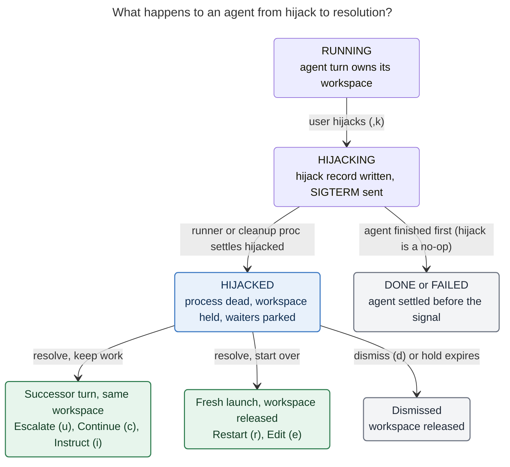

# Agent Hijack: Design Research and Recommendation

_Researcher: cld · 2026-11-02 · Scope: the sase TUI Agents tab, the agent runner, workspace
custody, and the linked `sase-core` crate._

## TL;DR

**Build it.** A stalled agent currently has only bad exits:

- `x` and `,x` kill it, dismiss the row, and release the workspace. The work in progress
  survives only as an anonymous `git stash` the next time that workspace is reused.
- `sase agent restart` is CLI-only and wipes the run's artifacts.
- No host-side path continues the work in the same workspace on a different model. Only
  the agent itself can do that, with `sase pipe`, and a stalled agent can't act.

A hijack fills that gap, and almost every building block already exists:

| Need                                           | Existing building block                                                                               |
| ---------------------------------------------- | ----------------------------------------------------------------------------------------------------- |
| Hold a workspace for a dead run                | `hold_workspace_claim` and workspace retention (failed runs already keep their workspace)             |
| Kill the agent but let the runner settle       | Durable user-kill intent marker, plus the runner's soft SIGTERM handler                              |
| Continue in the same workspace on a new model  | `launch_turn_followup` and `spawn_agent_session_successor`, used today by gate and monitor follow-ups |
| Relaunch the exact prompt under the same name  | `plan_agent_restart` / `execute_agent_restart` (already accepts a model override)                     |
| Dismiss and edit the prompt                    | `_kill_and_edit_agent` (the `,x` path)                                                                |
| Single-keypress panel on `<enter>`             | `AgentActionChooserModal` with the Enter-target resolver                                              |
| Give the successor the stalled run's history   | `#fork:` inlines the parent transcript as text, with a "did not finish" frame, across providers       |

My recommendation:

- Make the hijack a **first-class terminal settlement**: outcome `hijacked`, status
  `HIJACKED`, in the **Stopped** bucket. The workspace stays held, and waiters stay parked.
- Record each hijack in a **ledger outside the artifacts directory**, so it survives a
  restart's name wipe and can be resolved exactly once.
- Resolve it from **one panel** grouped by what happens to the work: **keep the workspace**
  (Escalate, Continue, Instruct), **fresh workspace** (Restart, Edit), or **other** (Take
  over, View changes, Dismiss).

I'm making seven adjustments to the requirements (§3). The most important ones:

- **The escalation rule as written can downgrade.** An `@xlarge` run would "escalate" to
  `@large`.
- **The rule has to read the run's *effective* alias**, not the literal prompt. A prompt
  with no `%model` runs on `default_model`, which is `@large`.
- **Add Continue (same model, keep workspace) and Instruct (edit the continuation prompt,
  keep workspace).** Many stalls are provider hangs or a user-diagnosable wrong turn, not
  a lack of model capability.
- **Let the hijack key open the same panel on a running agent.** Then hijack-and-escalate
  is one gesture (`,k` `u`), and `HIJACKED` remains the durable "decide later" state.

---

## 1. What exists today (grounding)

All paths below are relative to the sase repo unless they are prefixed `sase-core:`.

**Kill releases the workspace; failure keeps it.**

- The runner's SIGTERM handler releases the claim right away unless a staged or pending
  handoff marker exists (`src/sase/axe/run_agent_runner_signals.py`,
  `install_workspace_release_sigterm_handler`).
- At shutdown, `_should_hold_workspace` returns `False` whenever `was_killed` is true. A
  non-killed failure *keeps* its workspace so the user has a visible dismissal path
  (`src/sase/axe/run_agent_runner_lifecycle.py`).
- So a hijack is precisely a **"killed but held"** settlement, which the code doesn't model
  today.

**User-kill intent is a durable marker written before the signal.**

- `src/sase/agent/_user_kill_intent.py` writes the marker.
- `_handle_killed_iteration` in `src/sase/axe/run_agent_exec.py` reads it, discards any
  pending plan, question, monitor, gate, or pipe markers, and returns `"killed"`.
- This is the natural seam for a `mode: "hijack"` variant.

**The TUI kill path removes the row optimistically.**

- `_do_kill_agent` in `src/sase/ace/tui/actions/agents/_kill_flow.py` applies the removal
  in memory, then a `persist-cleanup` proc does the durable work.
- `request_user_kill` sends SIGTERM. `terminate_agent_processes` escalates to SIGKILL and
  verifies the process died (`src/sase/agent/user_kill.py`).
- A hijack has to **keep the row** and add a transitional overlay instead.

**Held workspaces already exist.**

- `docs/reference/agents/workspaces.md#held-workspaces` and
  `src/sase/turns/workspace_retention.py` cover them.
- The detail header already shows **"Workspace held: stranded work"**.
- `workspace.held_claim_ttl_days` (14 days) expires stale holds.
- Dismissing a terminal agent releases its claim only if the recorded ownership still
  matches.

**Same-workspace successors launched by the host exist.**

- Gate and monitor follow-ups use `launch_turn_followup(... transfer_from_pid=...)` in
  `src/sase/turns/followup.py` and `spawn_agent_session_successor` in
  `src/sase/agent/detached_child.py`.
- They degrade gracefully: transfer the claim, else claim the same number fresh, else a
  pool workspace, else `#0`.
- Attaching a successor promotes a solo agent into a session. The original turn is renamed
  `<name>--<suffix>`, and the bare name becomes the session container.

**`sase pipe` is the agent-initiated version of escalation.**

- `src/sase/main/pipe_handler.py` writes `.sase_pipe_pending` and SIGTERMs its own runner.
- The runner adopts the marker and continues as the next session member in the same
  workspace (`src/sase/axe/run_agent_exec_pipe_handoff.py`).
- By default the successor gets `#fork:<parent>`.

**Restart already exists, as a CLI.**

- `sase agent restart NAME [-m MODEL] [-y] [-j]` lives in `src/sase/agent/restart.py`.
- Planning is read-only and refuses multi-segment, fan-out, and container prompts.
- Execution dismisses a finished row (or kills a live one), wipes the name (which releases
  claims tied to that artifacts timestamp), and relaunches under the same name. It also
  writes a recovery bundle under `~/.sase/restarts/`.

**`,x` is the edit path.**

- `_kill_and_edit_agent` and `_finish_kill_and_edit_agent` are in
  `src/sase/ace/tui/actions/agent_workflow/_entry_relaunch.py`.
- Rows whose status is in `DISMISSABLE_STATUSES` skip the confirmation and are dismissed
  optimistically.
- The prompt is rewritten for identity by `prepare_kill_and_edit_prompt`.

**`<enter>` already opens a single-keypress chooser.**

- `action_act_on_agent` resolves targets: gates, Patch, and stranded beads.
- One target runs directly; several open `AgentActionChooserModal`
  (`src/sase/ace/tui/modals/agent_action_chooser_modal.py`).
- The chooser has section headers, direct hotkeys, j/k navigation, and the
  "⏎ again → primary" convention.

**The status bucket table lives in Rust.**

- `sase-core: crates/sase_core/src/agent_archive/status.rs::status_bucket_for_status`.
- **Unknown statuses fall through to `"Running"`**, so `HIJACKED` must be added explicitly
  or hijacked agents will be counted as running.
- Python maps a done outcome to a row status in two places:
  `src/sase/ace/tui/models/_loaders/_done_snapshot_loaders.py` and
  `_done_filesystem_loaders.py`.
- The Rust fleet projection (`fleet_owner_facts.rs`, `fleet_contract/projection.rs`) does
  the same for remote machine tabs.
- The published agent run state maps done outcomes too
  (`agent_run_state/observations.rs::marker_state`).

**Model provenance is recorded.**

- `agent_meta.json` stores `model_alias`, `model_alias_trail`, and `model_alias_origin`.
- When the prompt has no `%model`, `model_alias` is the **`default_model`** alias, which
  ships as `@large` (`src/sase/axe/run_agent_directives_flow.py`).

**Waits already have a "parked recovery" concept.**

- Auto-restart sets `done.json` `recovery.state ∈ {pending, deferred, launching}`, which
  keeps `%wait` targets `WAITING`.
- `find_replacement_artifacts_dir` re-points waits pinned to an identity after a
  forced-reuse wipe (`src/sase/agent/auto_restart/forward.py`).

**Nothing detects stalls today.**

- No code tracks an agent's last activity. The existing `STALLED` label belongs to the
  wait vocabulary: it means "wait target artifact is missing" (`WaitState.STALLED`).
- **Avoid using "stalled" as a status word.**

---

## 2. Is this a good idea?

**Yes. It closes a real reliability gap and fits SASE's architecture cleanly.**

Why it's good:

- **It preserves work.** The most expensive part of a stalled run is usually its partial
  diff. Every current remedy throws that away (the stash is a backup, not a workflow).
- **It's the human's move.** The glossary describes turns like a transcript: agent turns
  speak, monitor turns return tool results, gate turns are the human's move. A hijack is
  the user interrupting, and the escalated successor is the next agent turn in the same
  session. That shape already exists for `sase pipe`, gates, and monitors, so it isn't a
  new concept.
- **It respects the decisions.** Agents stay single-turn (`single-turn-agents`): the
  hijacked turn ends and nothing parks a process. Completion stays host-owned
  (`host-owned-completion`). Shared semantics go into the Rust core (`rust-core-required`).

Risks the design has to address:

1. **A held workspace can be forgotten.** HIJACKED belongs in the **Stopped** bucket (▲,
   "waiting for you"), is counted in the header, is reachable through the existing
   jump-to-next-stopped key (`,J`), and is protected by the 14-day held-claim TTL.
2. **Downstream waiters.** If `hijacked` were treated as a failure, every `%wait`
   dependent and clan wave would cascade-fail the moment you hijacked. It has to read as
   *needs input*.
3. **Race conditions.** The agent can finish between your keypress and the signal. Two
   TUIs can resolve the same hijack. A wedged runner can ignore SIGTERM. The finalizer can
   be mid-commit.
4. **Escalation without context is worse than restart.** A new model dropped into a dirty
   workspace with only the original prompt may redo, fight with, or `git checkout` the
   previous work. The successor needs a continuation frame and, preferably, the
   transcript.

---

## 3. Adjustments to the requirements (clearly called out)

> **A1: Fix the escalation rule. It can downgrade, and it reads the wrong signal.**
> As written, "`@xlarge` if `@large`, otherwise `@large`" sends an `@xlarge` run (or an
> explicit `opus@xhigh`) *down* to `@large`. It also misses the common case: a prompt with
> no `%model` silently ran on `default_model` (`@large`). Use the run's **effective**
> alias from `agent_meta.json` (`model_alias`, plus `model_alias_trail` for custom
> aliases that point at a built-in one), not the prompt text. At the top of the ladder,
> escalate **laterally**: use the first candidate in `@xlarge`'s chain whose
> provider/model differs from the one that stalled. A different model family is the most
> promising next step once size is maxed out. Details in §5.6.

> **A2: Add "Continue": same model, keep the workspace.** Many stalls are a hung provider
> stream or a stuck tool call, not a capability gap. Re-running the same model in place
> with a continuation frame is the cheapest recovery and loses nothing. It shares all of
> its mechanics with Escalate; only the model differs.

> **A3: Add "Instruct": edit the continuation prompt, keep the workspace.** Often you know
> exactly why it stalled ("stop running the full suite; run the one test"). This mounts
> the prompt bar prefilled with the continuation prompt, including an editable
> `%model:` line, and submits it as the in-place successor. It also covers "escalate to a
> model I pick", so the panel needs no separate model chooser.

> **A4: Hijack keeps the workspace *and* records a recovery diff.** At settlement, capture
> the worktree diff (the existing `snapshot_owner_worktree_diffs` does this for workspace
> retention) into a durable recovery file. Restart, Edit, and Dismiss can then release the
> workspace without a confirmation dialog, because the work is never lost, and the panel
> can show a real `+212 −31` summary.

> **A5: The hijack key opens the same panel on a running agent.** Pressing `,k` on a
> RUNNING agent opens the panel in *pre-hijack* mode. Each option hijacks and then
> resolves, `h` means "hijack only, decide later", and `Esc` means "keep running". You
> hijack because you want to do something now, so this saves a step. It also means the
> panel serves as the confirmation, with no separate "are you sure?" dialog. `<enter>` on
> a HIJACKED row opens the same panel in post-hijack mode, exactly as you specified.

> **A6: Waiters treat HIJACKED as "needs input", not failure.** `%wait` targets, clan waves,
> and `sase agent wait` stay parked while a hijack is unresolved. If you dismiss a hijack,
> it then reads as a failure (`killed`), exactly as a kill does today.

> **A7: Scope v1 to local LLM agent turns in RUNNING, STARTING, or RETRYING.** Refuse with a
> toast and a reason for: FINALIZING (the host is mid-commit), monitor and gate turns
> (they have their own stop and cancel), clan containers (pick a member), and
> remote-machine rows (the hijack must run on the owning machine; that's a later phase).

---

## 4. Glossary term (proposed)

Adding this requires `/sase_memory_write` (the glossary is a memory web). Proposed strand
text:

> **Agent Hijack** _(aka hijack, hijacked agent)_
>
> An agent hijack is a user-initiated stop of a running agent turn that keeps everything
> a recovery needs. The turn settles as `hijacked` (status `HIJACKED`, Stopped bucket)
> instead of being dismissed. Its workspace claim, uncommitted changes, bead claim, and
> name stay held, and a recovery diff is recorded. The user resolves it exactly once from
> the hijack panel (`,k` on a running agent, `Enter` on a hijacked one):
>
> - Escalate, continue, or instruct in place: the next session member runs in the same
>   workspace.
> - Restart or edit in a fresh workspace.
> - Take over by hand, or dismiss.
>
> Waiters stay parked while a hijack is unresolved. A kill (`x`) dismisses the row and
> releases the workspace; a failure is something the agent did; a hijack is the human's
> move. It is distinct from the `STALLED` wait label and from `sase pipe`, which the agent
> itself initiates.

I considered *park*, *seize*, *freeze*, *halt*, *intercept*, and *commandeer*. **Keep
"hijack".** It's vivid, `HIJACKED` is visually distinct from KILLED, STOPPED, and FAILED,
and the "Take over" option makes the metaphor literal: you take the wheel. The only
downside is a faint security connotation ("session hijacking"); the glossary entry
removes the ambiguity.

---

## 5. Design

### 5.1 Lifecycle



_A hijack ends the agent's turn without giving up its workspace. Every resolution either
continues in that workspace as the next session member or releases it, and only Dismiss or
hold expiry leaves nothing running._

### 5.2 Durable state: the hijack record and ledger

There are two records, following the pattern the auto-restart ledger uses. Its rule: "Nothing
here may live inside an artifacts directory: a forced-reuse wipe could remove it."

**1. Intent marker, in the artifacts directory.** Written before any signal. Extend the
user-kill intent with `mode: "hijack"` and a `hijack_id`, rather than adding a new marker
file. Every existing "user kill discards pending handoffs" branch then applies unchanged.

**2. Hijack ledger record, at `~/.sase/agent_hijacks/<hijack_id>.json`.** Claimed with an
exclusive create. Its shape is a Rust wire type (`AgentHijackRecordWire`, schema v1):

```json
{
  "schema_version": 1,
  "hijack_id": "hj_20261102T201544_7f2a",
  "agent_name": "sase-7f.2",
  "artifacts_dir": "…/artifacts/…/20261102193101",
  "requested_at": "2026-11-02T20:15:44Z",
  "requested_by": "tui",
  "reason": null,
  "target": {
    "pid": 41822,
    "pid_identity": "…"
  },
  "workspace": {
    "project_file": "…",
    "workspace_num": 4,
    "workspace_dir": "…",
    "workflow": "…",
    "cl_name": "…",
    "artifacts_timestamp": "20261102193101"
  },
  "model": {
    "provider": "claude",
    "model": "opus",
    "effort": "high",
    "alias": "large",
    "alias_trail": ["large"],
    "alias_origin": "default_model"
  },
  "recovery": {
    "diff_paths": ["…"],
    "files_changed": 5,
    "insertions": 212,
    "deletions": 31
  },
  "state": "held",
  "resolution": {
    "action": "escalate",
    "claimed_at": "…",
    "successor": "sase-7f.2--2",
    "successor_artifacts_dir": "…",
    "model": "@xlarge"
  }
}
```

`state` moves through `requested → held → resolving → resolved | abandoned | expired`.
Transitions are owned by the core, the same way the auto-restart ledger delegates to a
`sase-core` state machine under a file lock.

**Exactly-once resolution.** A resolution writes `state: resolving` plus `resolution.action`
under the lock *before* any mutation. Recovery after a crash works like the healer's
adopt-or-settle step: if the successor or replacement exists, mark the record `resolved`;
otherwise surface it again as HIJACKED with a toast. Two TUIs racing on the same row:
the second one sees `resolving` and gets "Already being resolved by another session".

**Wait forwarding.** Restart wipes the old artifacts directory. To keep waits that are pinned
to an identity working, the ledger feeds `find_replacement_artifacts_dir` (generalize it to
read both the auto-restart and hijack ledgers).

### 5.3 Settlement mechanics (runner plus fallback)

**Normal path: the runner stays responsive.** The provider CLI is what hangs, not the
Python runner.

1. **TUI or CLI.** Validate eligibility (A7). Create the ledger record (`requested`). Write
   the hijack intent. Submit a durable `sase agent hijack --persist <hijack_id>` proc. It
   mirrors `persist-cleanup`: it signals, verifies death, and runs the fallback below.
2. **SIGTERM handler.** `_release_workspace_claim` returns early when the intent mode is
   `hijack`.
3. **`_handle_killed_iteration`.** For a hijack intent, discard pending handoff markers
   exactly as for a user kill and return `"hijacked"`.
4. **Shutdown.** `exec_outcome = "hijacked"`. `_should_hold_workspace` returns `True` for
   `hijacked` even though `was_killed` is set. Then:
   - Write `done.json` with `outcome: "hijacked"` and
     `recovery: {state: "pending", kind: "hijack", hijack_id}`.
   - Run workspace retention with `DISPOSITION_RETAIN` and reason `hijacked`, capturing the
     recovery diff (A4).
   - Keep the held bead claim. There is no auto-dismiss and no completion notification,
     because you initiated this.
5. **Ledger.** Move to `held`.

**Fallback: the runner is wedged or was SIGKILLed.** After `terminate_agent_processes`
verifies death, the persist proc checks for `done.json`. If it's absent, the proc writes the
hijacked done marker itself and calls `hold_workspace_claim(..., expected_pid=pid)`. That
function is already "a no-op on a mismatched or replaced claim". The fallback is idempotent,
so the runner and the proc can both run it safely.

**Agent finished first.** If the process exited before the signal and its `done.json`
records a normal outcome, the hijack is a no-op. The ledger records `abandoned:
finished_first`, and the toast says "sase-7f.2 finished before it could be hijacked". The
TUI never rewrites a real outcome.

### 5.4 Status and row rendering

- **Label:** `HIJACKED`. **Bucket:** Stopped (▲). Add it to the Rust table; it must not fall
  through to Running.
- **Transitional overlay:** `HIJACKING…` while the intent exists and the process is alive,
  like the existing `FINALIZING` render-time overlay. This keeps the UI honest during the
  SIGTERM grace period.
- **Color:** a hue no other status uses. I'd propose hot pink `#FF5FAF`: it says "attention",
  but not failure red or RUNNING gold. Check it against the status palette.
- **Badge glyph:** `⏏` (eject: the agent was ejected from the driver's seat). I checked
  coverage: **⏏, ‖, and ⇧ are in the pinned Fira Code; ⚑ and ⏸ are not.** The existing
  `STOPPED_GLYPH` note warns about this exact snapshot failure.
- **Detail header:** reuse the "Workspace held: …" header:
  `Workspace held: hijacked · ws #4 · 5 files +212 −31 · ⏎ resolve`.
- **After resolution:**
  - Escalate or Continue: the hijacked turn becomes an earlier session member and settles
    to a grey `ESCALATED` or `CONTINUED` label (add both to `HANDOFF_SETTLED_STATUSES`, the
    way `ANSWERED` works). The session node shows the successor's `RUNNING`. The tree then
    reads like a story: `--1 ESCALATED claude/opus@high`, `--2 RUNNING claude/opus@xhigh`.
  - Restart: the row is replaced under the same name.
  - Edit and Dismiss: the row is dismissed.
- **Footer** (the conditional-keymap rule from the `ace` memory note): `<enter> resolve
  hijack` when a HIJACKED row is selected, and `,k hijack` in the leader footer when a
  running agent is selected.

### 5.5 The hijack panel

**Implementation.** Extend `AgentActionChooserModal` rather than writing a new modal. Add an
optional **header renderable** slot and three section kinds: `hijack_keep`, `hijack_fresh`,
and `hijack_other`. `<enter>` then remains one consistent "act on this agent" surface. A
HIJACKED row with a Patch also gets the usual `p` row in OTHER. The header is computed
off-loop (git stats, last activity) per `tui_perf` and shows `computing…` until it's ready.

**Post-hijack mode** (`<enter>` on HIJACKED):

```
╭─ ⏏ HIJACKED ─ sase-7f.2 ─────────────────────────── sase · ws #4 ─╮
│  claude/opus@high via @large          ran 47m · hijacked 3m ago   │
│  5 files changed  +212 −31            last: Bash `just check` 22m │
│                                                                   │
│  KEEP WORKSPACE · continue from these changes                     │
│  ▸ u  ⇧ Escalate     @xlarge → claude/opus@xhigh                  │
│    c    Continue     claude/opus@high, fresh turn, same workspace │
│    i    Instruct     edit the continuation prompt, then launch    │
│  FRESH WORKSPACE · changes set aside (recovery diff kept)         │
│    r    Restart      same prompt, same name                       │
│    e    Edit         prompt bar, like ,x                          │
│  OTHER                                                            │
│    t    Take over    open ws #4 in tmux · stays hijacked          │
│    v    View changes recovery diff in the pager                   │
│    d    Dismiss      release ws #4                                │
│                                                                   │
│  ⏎ again → Escalate · j/k move · Esc decide later                 │
╰───────────────────────────────────────────────────────────────────╯
```

**Pre-hijack mode** (`,k` on RUNNING): the title reads `⏏ HIJACK ─ sase-7f.2 (still
RUNNING)`, with the subtitle "Every choice stops the agent first; its workspace is kept until
you choose otherwise." The OTHER section gains `h  Hijack only  stop now, decide later`, and
`Esc` means "keep running".

Why this layout:

- **Grouping by what happens to the work** answers the question you actually care about at
  that moment: does my partial diff survive? The section headers say it in plain words, so
  no option needs a warning label.
- **The resolved target model is printed on the Escalate row** (`@xlarge →
  claude/opus@xhigh`). You see the effect of the alias ladder before you press the key.
- **Disabled rows stay visible but dimmed, with a reason**, so the panel never silently
  changes shape:
  - Restart: "multi-segment prompt: use Edit".
  - Escalate: "already on the largest model; use Continue or Instruct".
  - Escalate, Continue, Instruct, Take over: "workspace released (hold expired)".
- **Default (`⏎` again):** Escalate when the workspace has changes; Restart when it's clean
  (nothing to keep, so start over cheaply).

**Keys.** `u` is "up a size" and `+` is an alias. Don't use `x`: everywhere else on the Agents
tab `x` means destroy, and muscle memory would turn "escalate" into "kill". `e` stays Edit,
as you specified; `i` (Instruct) will feel natural to vim users. Put all panel keys in
`default_config.yml` under a new `ace.keymaps.hijack_panel` block (per the keymap gotcha),
plus `leader_mode.keys.hijack_agent: "k"`. `,k` is unbound today; "kill but keep" works as a
mnemonic.

**Discoverability.** Add one hint line to `ConfirmKillModal` when the target is a running
LLM agent: "Tip: `,k` hijacks instead: stops it and keeps its workspace." Add the panel to
the `?` help modal and the docs.

### 5.6 Option semantics, precisely

| Key | Option           | Workspace           | Mechanism                                                                                                                                                                                                                                                                                                               |
| --- | ---------------- | ------------------- | ----------------------------------------------------------------------------------------------------------------------------------------------------------------------------------------------------------------------------------------------------------------------------------------------------------------------- |
| `u` | **Escalate**     | kept, transferred   | Claim the resolution, build the continuation prompt with the escalated model, then `launch_turn_followup(transfer_from_pid=<held claim pid>, spawn=spawn_agent_session_successor)`. A solo agent is promoted to a session. Record `reason: "hijack: escalate from claude/opus@high"`, which agent lists already show.        |
| `c` | **Continue**     | kept, transferred   | Same as Escalate, keeping the stalled run's model.                                                                                                                                                                                                                                                                       |
| `i` | **Instruct**     | kept, transferred   | Mount the prompt bar prefilled with the continuation prompt. Submission goes to the same continue path, not a normal launch. Esc or cancel leaves the agent HIJACKED.                                                                                                                                                      |
| `r` | **Restart**      | released            | Claim the resolution, then run `sase agent restart NAME -y -j` as a durable proc. On a finished row it dismisses (releasing the ownership-matched claim), wipes the name, and relaunches the exact raw prompt under the same name. The planner's refusals (fan-out, multi-segment, container, disabled provider) become disabled-row reasons. |
| `e` | **Edit**         | released            | Add `HIJACKED` to `DISMISSABLE_STATUSES` (Python, and the Rust `agent_cleanup_wire` copy). The existing `_kill_and_edit_agent` path then dismisses optimistically, holds the relaunch barrier, and mounts the prompt bar. Resolution is recorded as `edit`.                                                              |
| `t` | **Take over**    | kept                | Reuse the existing `t` (open tmux) flow for the agent's workspace. This is not a resolution: the panel closes and the row stays HIJACKED.                                                                                                                                                                                |
| `v` | **View changes** | kept                | Open the recovery diff in the pager. Not a resolution.                                                                                                                                                                                                                                                                  |
| `d` | **Dismiss**      | released            | Existing dismiss (releases the claim if ownership matches). The ledger moves to `abandoned`, and waiters now read it as failed (`killed`).                                                                                                                                                                                |
| `h` | **Hijack only**  | kept                | Pre-hijack mode only: perform the hijack and stop there.                                                                                                                                                                                                                                                                |

**Escalation ladder (A1).** This belongs in `sase-core` so the CLI and TUI agree:

1. **Find the run's rung.** Scan the run's `model_alias_trail` (and `model_alias`) for the
   highest alias in `agent_hijack.escalation_ladder` (default `["@large", "@xlarge"]`). If
   none matches, compare the resolved `provider/model@effort` against each rung's candidate
   set. A run on `%model:opus@xhigh` counts as `@xlarge`.
2. **Pick the target.**
   - Below the ladder (no match): the first rung, `@large`. This is your rule for small and
     medium runs.
   - On a rung that isn't the top: the next rung up. `@large` → `@xlarge` is your rule.
   - On the top rung: **lateral**. Use the first candidate in the top alias's ordered chain
     whose provider/model differs from the run's. If there is none, disable Escalate and
     show the reason.
3. **Rewrite the prompt.** Reuse `set_prompt_model` (already used by restart's `-m`). It
   replaces `%model` and drops a conflicting `%effort`.

**Continuation prompt** (built by `sase-core`, used by Escalate, Continue, and Instruct):

```
%model:@xlarge
#fork:sase-7f.2

> **Hijack continuation.** The user stopped `sase-7f.2` (claude/opus@high) after it
> stopped making progress (ran 47m; last activity: Bash `just check`, 22m before the
> hijack). You are its successor in the same workspace. Its uncommitted changes are
> still here (5 files, +212 −31; recovery diff: <path>). Inspect `git status` and
> `git diff` before acting. Keep correct work, repair or revert wrong work, and do not
> repeat whatever stalled the previous run. The original task follows, unchanged.

<original raw prompt, minus launch-only directives>
```

- **Strip launch-only directives.** Remove workspace references (`+proj`, `#gh:`, `#git:`),
  `%id`, `%clan`, `%tab`, `%wait`, `%model`, `%effort`, and fan-out syntax. The successor
  reuses the held workspace and its session identity. This is the same hazard `sase pipe`
  documents: "% directives and # references stay live".
- **Fork or start fresh.** `#fork:` inlines the parent transcript as text, so it works when
  escalating across providers. Add a hijack-specific frame next to `format_failed_agent_body`
  in `src/sase/history/chat_fork/failure.py`: "ended with outcome `hijacked`: the user
  stopped it because it was not making progress". Make fork the default, but fall back to
  fresh context plus a transcript path when the continuation budget preflight
  (`llm_provider.continuation_budget`) says the transcript won't fit. Control it with
  `agent_hijack.successor_context`.

### 5.7 CLI parity

The CLI rules apply: alphabetical, a short alias for every option, excellent `-h`.

- `sase agent hijack NAME [-r/--reason TEXT] [-j/--json]`: hijack a running agent.
- `sase agent continue NAME [-e/--escalate] [-m/--model M] [-p/--prompt-file F] [-f/--fresh] [-j]`:
  resolve a hijack in place. `-e` uses the core ladder; `-p` is the Instruct path.
- `sase agent restart NAME`: already works. Teach it to claim the hijack resolution when the
  target is HIJACKED.
- `sase agent list` and `sase agent show`: render `HIJACKED`.

These give Telegram, mobile, and scripted callers the same semantics later, and they make
the TUI actions thin (each one submits a durable proc running the CLI, as kill persistence
already does).

### 5.8 Config fields

You said this was my call. I'd add **two fields, plus keymaps**, and reuse what exists:

```yaml
agent_hijack:
  # Ordered rungs. A hijacked run escalates to the first rung above the rung
  # it ran on; runs below the first rung escalate to it. On the top rung,
  # Escalate switches laterally to a different model in that alias.
  escalation_ladder: ["@large", "@xlarge"]
  # Context for Escalate/Continue/Instruct successors: "fork" inlines the
  # hijacked run's transcript (falls back to "fresh" when over budget).
  successor_context: fork
```

- Hold expiry reuses `workspace.held_claim_ttl_days`. No new TTL.
- Keys go in `ace.keymaps.leader_mode.keys.hijack_agent` and a new `ace.keymaps.hijack_panel`
  block.
- I would **not** add an `enabled` switch beyond the epic's temporary `beta` flag (§7), and
  I would **not** add a configurable default action yet. The "dirty → Escalate, clean →
  Restart" rule is easy to explain; make it configurable only if you find yourself fighting
  it.

### 5.9 Interactions to get right

- **Waits (A6).** Map `hijacked` with `recovery.state == "pending"` to
  `WaitState.NEEDS_INPUT`. A resolved Escalate is followed through the session. A Restart is
  followed by name, and by identity through the ledger forward. A dismissed hijack reads as
  `killed`, so `FAILURE_OUTCOMES` applies.
- **Bead claims and stranded detection.** A hijacked phase worker keeps its bead claim. The
  stranded-bead detector must treat a HIJACKED owner as *parked by the user*, not stranded;
  otherwise `<enter>` would offer a confusing "resolve stranded" row.
- **Auto-restart healer.** It must never enumerate `hijacked` rows; they aren't failures. Add
  an explicit exclusion to `healer_targets`, not just an implicit one.
- **Clans, epics, and sessions.** Hijacking a session member targets that concrete turn.
  Escalating a clan member promotes it to a session inside the clan; that needs a test.
  Selecting a clan container is refused ("pick a member").
- **Goals** (`goals-host-binds`). The successor must bind to the hijacked turn's goal, so
  verify that the session-successor spawn inherits it.
- **Runner capacity.** A hijacked agent frees its runner slot immediately; only the
  workspace stays held. In-place successors should follow the same admission as pipe and
  gate successors (the serial-session exemption), because you explicitly asked for them now.
- **Archive and agents-sync.** `archive_outcome_for_status` already turns Stopped-bucket
  statuses into `interrupted`, which is correct for a dismissed hijack. Add `hijacked` to
  `agent_run_state::marker_state` (map it to `None` or a new `parked` state, rather than
  `failed`).
- **Remote machine tabs.** v1 disables the action with a copyable `sase agent hijack NAME`
  hint for the owning host. A later phase can dispatch it.

---

## 6. Alternatives considered

| Approach                                                                         | Verdict                                                                                                                                                                                                                                                                                                                                                                                                                                                                                                                                                                                                                                                                    |
| -------------------------------------------------------------------------------- | -------------------------------------------------------------------------------------------------------------------------------------------------------------------------------------------------------------------------------------------------------------------------------------------------------------------------------------------------------------------------------------------------------------------------------------------------------------------------------------------------------------------------------------------------------------------------------------------------------------------------------------------------------------------------- |
| **A. TUI-only "hijacked" flag**                                                  | **Rejected.** It isn't durable, it's invisible to the CLI and waits, and the runner's SIGTERM handler would release the workspace anyway.                                                                                                                                                                                                                                                                                                                                                                                                                                                                                                                                   |
| **B. First-class `hijacked` settlement, with resolutions on existing primitives** | **Recommended.** It reuses the user-kill intent, held claims, the restart planner, `,x`, and turn follow-ups. A solo agent becomes a session only when you continue in place, which is the one case where "session" is the right model.                                                                                                                                                                                                                                                                                                                                                                                                                              |
| **C. Hijack as a gate turn** (a typed `hijack` gate with a `turn` block, written as `.sase_gate_pending` before SIGTERM) | **Strong runner-up, rejected for v1.** It would get durability, exactly-once answers, workspace custody, follow-up launch, and Telegram/mobile answering for free. But it forces session promotion on *every* hijack, so `foo` gets renamed `foo--<n>` even if you then Restart or Dismiss, which breaks "restart under the same name". It needs a responsive runner to adopt the marker (exactly what may be wedged). "Edit" isn't an argv command. And you'd get a notification for an action you just took. **Keep it in mind for later:** project an *unresolved* hijack as a non-turn typed gate (`kind: hijack`), so Telegram and mobile can answer it with the same CLI commands. |
| **D. One-shot actions only** (`,k` + key, no HIJACKED state)                     | **Rejected as the whole design, kept as the fast path.** Without the state you lose "decide later", Take over, and View changes. The pre-hijack panel (A5) gives you the one-shot speed anyway.                                                                                                                                                                                                                                                                                                                                                                                                                                                                           |
| **E. Freeze with SIGSTOP/SIGCONT instead of killing**                            | **Rejected.** Provider streams and API sessions time out while frozen, the runner slot stays occupied, and "resume" would be unreliable.                                                                                                                                                                                                                                                                                                                                                                                                                                                                                                                                  |
| **F. Agents escalate themselves with `sase pipe -m @xlarge` when stuck**         | **Complementary, not a replacement.** A stalled agent by definition can't act. Worth a separate idea: an agent that notices it's looping could pipe to a larger model.                                                                                                                                                                                                                                                                                                                                                                                                                                                                                                   |

---

## 7. Where the code goes (Rust/Python boundary)

**In `sase-core`,** because the litmus test applies: the CLI, TUI, and remote frontends
must agree.

- `agent_archive/status.rs`: `HIJACKED` → Stopped; `ESCALATED` and `CONTINUED` → Running
  (handoff-settled).
- Fleet projection (`fleet_owner_facts.rs`, `fleet_contract/projection.rs`) and
  `agent_run_state/observations.rs`: map the `hijacked` outcome.
- A new `agent_hijack` module:
  - `AgentHijackRecordWire` and its state transitions.
  - `escalation_target(run_model_facts, ladder, alias_candidates) -> Target | Disabled(reason)`.
  - `build_hijack_continuation_prompt(raw_prompt, facts) -> String`, including the list of
    launch-only directives to strip.
- Bindings, tests, and a bump to sase's `sase-core-revision.txt` pin.
- Ideally, move the outcome → display-status mapping duplicated in the two Python loaders
  into one core function while you're there.

**In `sase`** (Python glue, the runner, and presentation):

- Runner: `src/sase/axe/run_agent_runner_signals.py`, `run_agent_exec.py`
  (`_handle_killed_iteration`), `run_agent_runner.py`, and `run_agent_runner_lifecycle.py`
  (`_should_hold_workspace`, the done marker, retention).
- Intent and termination: `src/sase/agent/_user_kill_intent.py` and `user_kill.py`. A new
  `src/sase/agent/hijack.py` holds the ledger I/O, the persist fallback, and the
  continue-launch glue on top of `turns/followup.py`.
- Waits: `src/sase/agent/wait_watch/_classify.py`, `core/dismissed_agent_completion.py`, and
  `auto_restart/forward.py` (generalized forwarding).
- TUI:
  - `models/agent_status.py` (`DISMISSABLE_STATUSES`, colors).
  - `_loaders/_done_*_loaders.py`.
  - The `_agent_enter_*` resolver gets hijack targets.
  - `agent_action_chooser_modal.py` gets the header slot and new sections.
  - The leader-mode handler gets `,k`.
  - `keybinding_footer.py`, the help modal, and `confirm_kill_modal.py` (the hint line).
- CLI: `src/sase/agents/cli_*` for `hijack` and `continue`, and teach `cli_restart` to claim
  the hijack resolution.
- Config and docs:
  - `default_config.yml` (`agent_hijack`, keymaps).
  - `docs/reference/tui/agent-statuses.md`, `agents-tab.md` (the Enter section),
    `keymaps.md`, `agents/workspaces.md` (a new row in the held-workspaces table).
  - The glossary strand, via `/sase_memory_write`.

---

## 8. Phasing, rollout, and tests

Ship this as an **epic** with a temporary `beta` flag (`agent_hijack`) as epic scaffolding,
per the `sase_flags` memory note. Landed phases would otherwise expose half a feature, and
the land phase deletes the flag.

1. **Core and settlement.** Rust status, wire, and ladder; the hijack intent and settlement
   in the runner; the persist fallback; the ledger; wait semantics; `sase agent hijack`;
   `HIJACKED` in list and show.
2. **Resolutions as CLI.** `sase agent continue` (Escalate and Continue on turn follow-ups,
   including the continuation prompt, the fork frame, and the budget fallback) and
   restart-claims-hijack.
3. **TUI.** Row rendering and overlays, `,k`, the panel in both modes, Enter routing, all
   eight actions (Instruct may slip into phase 4), footer, help, and docs.
4. **Polish and land.** Instruct, visual snapshots (follow `tui_screenshot`), the glossary
   entry, docs, and removing the flag.

**Later, not v1:**

- A "quiet for N minutes" hint on running rows, based on the newest of the output log,
  transcript, and tool-call ledger, so hijack candidates become visible. Never auto-hijack.
- Telegram and mobile hijack, via alternative C's non-turn typed gate.
- Hijacking agents on remote machines.
- A "Salvage" option: run the commit finalizer on the held workspace as-is.

**Tests that matter most:**

- Bucket and status for `HIJACKED`. A regression test that it is *not* Running.
- Ladder cases: below ladder, `@large`, `@xlarge` lateral, explicit `opus@xhigh`, a custom
  alias whose trail contains `@large`, and a no-`%model` prompt with `default_model`
  `@large`.
- Runner: SIGTERM with a hijack intent keeps the claim, writes `outcome: hijacked`, holds
  the workspace, and drops pending handoff markers.
- Fallback after SIGKILL writes the marker and holds the claim, and is idempotent when the
  runner also settles.
- Races: the agent completes before the signal; two resolvers; a crash mid-`resolving` that
  adopts the successor.
- Waits stay `WAITING` while HIJACKED. They follow a Restart (by name and by identity) and
  an Escalate (through the session). They fail after Dismiss.
- End to end: the escalated successor sees the hijacked run's diff in the same workspace.
- TUI: panel hotkeys, disabled-row reasons, pre-hijack `Esc` doesn't kill, the
  `⏎`-again default, and visual snapshots of the panel and the `⏏ HIJACKED` row.

---

## 9. Open questions for you

1. **Default for `⏎⏎`.** I propose Escalate when the workspace is dirty and Restart when it's
   clean. Would you rather it always be Escalate?
2. **`successor_context` default.** I propose `fork`, so the successor learns what failed.
   Choose `fresh` if you'd rather pay fewer tokens and accept some re-exploration.
3. **Hijack key.** `,k` is free and the mnemonic is "kill, keep". Do you want a top-level key
   instead? Top-level keys on the Agents tab are crowded.
4. **Notification.** I propose none on hijack, since you initiated it. Should a notification
   fire when a hijack's hold is close to its 14-day expiry?

---

## 10. Recommended solution

**Implement the hijack as a first-class, durable terminal settlement, and resolve it from
one panel grouped by what happens to the work.**

1. **Hijack (`,k`, or `sase agent hijack`).**
   - Write a hijack-mode user-kill intent and a ledger record outside the artifacts
     directory, then SIGTERM.
   - The runner settles as `hijacked`: it keeps the workspace claim, records a recovery
     diff, keeps the bead claim, and doesn't notify.
   - A durable proc verifies the process died and, if the runner couldn't settle, writes the
     settlement itself with `hold_workspace_claim(expected_pid=…)`.
   - If the agent finished first, the hijack is a no-op.
2. **Show it.**
   - `HIJACKED` in the **Stopped** bucket, with a `⏏` badge and a unique accent color, plus a
     transitional `HIJACKING…` overlay.
   - Waiters stay parked.
   - The detail header shows "Workspace held: hijacked" with the diff summary.
3. **Resolve it** (`<enter>`, or `,k` again on a running agent in pre-hijack mode, with `h`
   for "hijack only").
   - **Keep workspace:** `u` Escalate (core ladder: `@large` → `@xlarge`, below the ladder
     → `@large`, top of the ladder → a different model), `c` Continue, `i` Instruct. All
     three launch the next session member in the same workspace through
     `launch_turn_followup` with a continuation prompt and `#fork:` of the hijacked run.
   - **Fresh workspace:** `r` Restart (the existing restart planner and executor: same
     prompt, same name) and `e` Edit (the existing `,x` path, once `HIJACKED` is
     dismissable).
   - **Other:** `t` Take over (tmux), `v` View changes, `d` Dismiss.
   - Resolution is exactly-once through the ledger.
4. **Put shared logic in `sase-core`:** the status table, the record wire, the escalation
   ladder, and the continuation-prompt builder. Python holds the runner, the TUI, and
   CLI glue.
5. **Configure lightly:** `agent_hijack.escalation_ladder` and
   `agent_hijack.successor_context`, plus keymaps. Reuse `workspace.held_claim_ttl_days`.
6. **Ship it as a four-phase epic** behind a temporary `beta` flag, and add the glossary term
   **Agent Hijack** through `/sase_memory_write`.
