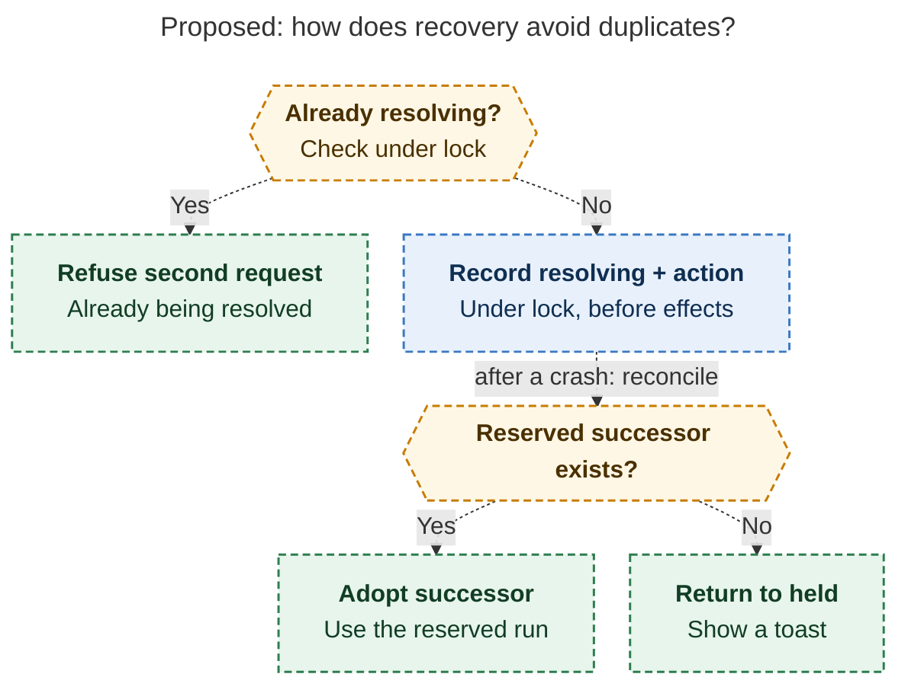

# Diagram proposals: Agent Hijack: Stop the Turn, Keep the Work

Proposals for the swarm linker, not a report. Each diagram restates only what the source
report says.

```yaml
source: research:202611/agent_hijack_held_workspace_recovery/agent_hijack_held_workspace_recovery__final.md
producer: research.33.image
check: "mmdc 12.0.0 with --no-sandbox and the PDF-mirroring config rendered 1 of 1 Mermaid diagrams; a deliberately broken diagram exited nonzero"
```

## recovery-resolution

```yaml
anchor: |-
  A resolution writes `resolving` plus its action under the
question: |-
  How does recovery prevent duplicate successors after concurrent requests or a crash?
illustrates: |-
  Exactly-once resolution locks the action before effects and reconciles a crash by adopting the reserved successor or returning to held.
caption: The resolution lock rejects concurrent recovery; after a crash, adopt the reserved successor if it exists, otherwise return to held.
review: "607.324x786 px, fit 100.0%; question, labels, arrowheads, source trace, and visual checks passed; 1 revision, 2 visual looks"
```


