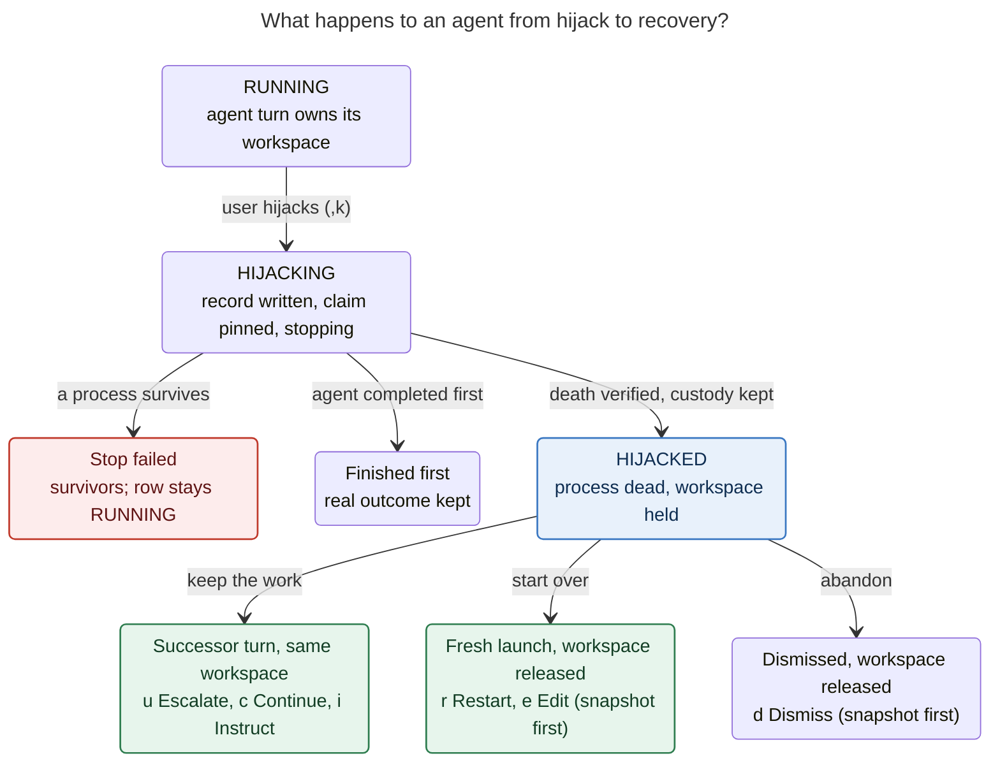

# Agent Hijack: Stop the Turn, Keep the Work

_Consolidated report · lead researcher · 2026-11-02_

**Sources.** This report merges five independent reports (`__cdx`, `__cld`, `__grk`,
`__mus`, `__gem`, all in this directory) with my own verification against sase
`84e22d98be` and sase-core `89a5bd8b`. Where the reports disagreed, I checked the code
and say which way it settles. Findings I added are marked **(new)**.

**Question.** How should SASE let the user "hijack" a stalled agent, meaning kill it
without releasing its workspace or dismissing its node? The node should then show
`HIJACKED`, and `<enter>` should open a single-keypress recovery panel. Is this a good
idea, and how should the request change?

---

## TL;DR

**Build it.** All five reports agree, and so do I. Today every way of stopping an agent
(`x`, `,x`, `sase agent restart`, mobile retry) releases the workspace. A stalled run's
partial diff survives only by accident, as a retention stash or a rescue copy. A hijack
separates **stopping execution** from **giving up the work**, and almost every building
block already exists. The risk is in **workspace custody**: every cleanup path in SASE
assumes that a dead process means its claim can be released. The panel itself is the
easy part.

What I recommend:

1. **Hijack is a first-class, durable settlement.** It writes intent and pins the claim
   *before* any signal, then stops the process tree through the existing verified
   terminator. `HIJACKED` is published only after death and custody are confirmed. The
   status lives in the Rust **Stopped** (needs-you) bucket.
2. **Enter opens one recovery panel, grouped by what happens to the work:**
   - **Keep the work** (`u` Escalate, `c` Continue, `i` Instruct). Each launches the next
     turn of the agent's session in the *same* workspace.
   - **Start over** (`r` Restart, `e` Edit). These release the workspace, but only after
     a recovery snapshot.
   - **Other** (`v` View diff, `t` Shell, `d` Dismiss).
   - `⏎⏎` runs Escalate. `Esc` leaves the agent hijacked.
3. **Ingress is `,k`**, which is unbound today. A "Hijack instead" choice is also added to
   the existing kill confirmation, so users discover the feature at the moment they
   reach for `x`.
4. **The escalation rule never downgrades.** The rung comes from launch provenance, and
   the panel shows the concrete target model before you press the key.

My twelve adjustments to the requirements are in [§2](#2-adjustments-to-the-requirements).
The full recommendation is in [§10](#10-recommended-solution).

---

## 1. Is this a good idea?

### 1.1 Why yes

- **It closes a real gap.** For a long implementation run, the workspace is the asset and
  the stalled process is the liability. Today the only choices are to wait indefinitely
  or to kill, which releases the claim and removes the node. `retain_for_retry` still
  releases the claim. `sase agent restart` deletes the run's artifacts and relaunches
  into a fresh checkout. `,x` dismisses the row *before* the prompt bar even opens (I
  verified this in `_finish_kill_and_edit_agent`). None of these means "stop the model,
  keep the tree, decide in a minute."
- **It fits SASE's decisions.** The hijacked turn ends and nothing waits on a process
  (`single-turn-agents`). Continuation is a new turn launched by the host
  (`host-owned-completion`). In the glossary's transcript metaphor, a hijack is the
  human's move, and the escalated successor is the next agent turn in the same session.
  That is the same shape `sase pipe`, gates, and monitors already have.
- **The parts exist.** The workspace pin (`hold_workspace_claim`), claim transfer
  (`transfer_workspace_claim`), same-workspace session successors
  (`spawn_agent_session_successor`), the durable user-kill intent, the verified
  terminator, the restart planner, `,x`, the single-keypress `AgentActionChooserModal`,
  `#fork:` with a "did not finish" frame, and strict workspace snapshots are all in the
  tree.

### 1.2 Where it goes wrong if done naively

| Risk | What happens | Mitigation |
| --- | --- | --- |
| **Custody leaks** (all reports) | The runner's SIGTERM handler, `_should_hold_workspace` (returns `False` when killed), kill persistence, and stale cleanup each release the claim of a dead process. | Durable intent and pin before the signal. Each of those release paths learns about hijacks. ([§6.2](#62-the-stop-protocol)) |
| **Status falls through to Running** (cld, grk, verified) | `status_bucket_for_status` maps unknown labels to `"Running"`, so a Python-only `HIJACKED` would count as live capacity. | Add a row to the Rust table in the same change. |
| **The escalation rule downgrades** (all five) | As written, an `@xlarge` run "escalates" to `@large`. | Ladder that never goes down, driven by provenance. ([§7](#7-escalation-policy)) |
| **A successor lands in the wrong workspace** **(new)** | `launch_turn_followup` deliberately falls back to a pool workspace or `#0` when transfer fails. For a hijack, that launches the bigger model into a checkout *without* the work. | Strict mode: transfer, or a fresh claim on the same number, or fail closed and stay `HIJACKED`. |
| **A bigger model is not a fix for every stall** (cdx) | A hung provider, a credential prompt, or a broken host will stall the bigger model too. | Offer Continue and Instruct next to Escalate. Show the last tool and activity as evidence. |
| **Workspace starvation** (gem, grk, mus) | Forgotten hijacks pin numbered clones. | Stopped bucket, `,J` reachability, and the existing 14-day hold TTL, with a snapshot taken before any expiry release. |
| **Accidental `⏎⏎`** (cdx) | The chooser convention is "⏎ again → primary". | The primary is always a keep-work action, never a release. |
| **Auto-detecting a stall** (all) | Slow is not the same as stuck: a 20-minute compile looks dead. | A manual action only. A read-only "quiet for N min" hint can come later. |

### 1.3 Would I take a different approach?

Not a fundamentally different one. I would change the emphasis in three ways:

1. **The novel value is continuing in place.** Two of the three requested actions
   (restart fresh, edit fresh) already exist as `sase agent restart` and `,x`. The new
   execution path, and the reason to build this, is "same workspace, new turn". That
   path deserves the top of the panel, the `⏎⏎` default, and most of the test budget.
2. **Make release safe instead of confirmable.** Take a verified recovery snapshot before
   any action that releases the workspace. Restart, Edit, Dismiss, and TTL expiry can
   then proceed without an "are you sure?" dialog, because the work is never silently
   lost.
3. **Design the way in, not only the way out.** The brief specifies Enter on a
   `HIJACKED` row but not how a row becomes hijacked (gem and grk both flagged this).

I considered and rejected these alternatives (details in [§9](#9-alternatives-considered)):

- Modelling a hijack as a gate turn.
- Freezing the agent with `SIGSTOP`.
- Turning `x` into a "fate chooser" now.
- A pre-hijack mode of the panel.

---

## 2. Adjustments to the requirements

Each of these changes the brief. The "Support" column shows which reports proposed it.

| # | Brief says | Recommended change | Why | Support |
| --- | --- | --- | --- | --- |
| A1 | Escalate: `@xlarge` if `@large`, else `@large` | **Never downgrade.** `@large` → `@xlarge`, below `@large` or unknown → `@large`. At `@xlarge`, **Switch** to the first `@xlarge` candidate with a different provider and model, or disable the action with a reason. Read the rung from launch provenance, not prompt text. | The literal rule demotes the strongest runs. A prompt with no `%model` still ran on `default_model`. | all five; Switch from cld |
| A2 | Three options | **Add Continue**: same concrete model, same workspace, new turn. | Many stalls are provider hangs or stuck tools, not missing capability. This is the cheapest recovery that loses nothing. | cdx, cld (grk's "restart here", mus "if free") |
| A3 | Edit means a fresh workspace | **Add Instruct**: keep the workspace and open the continuation prompt, including an editable `%model:` line, in the prompt bar. | "Stop running the full suite; run the one test" is the most common fix. It also covers "escalate to a model I pick". | cld, gem ("Steer"), grk ("edit in place") |
| A4 | No inspect or abandon options | **Add View diff (`v`), Shell (`t`), and Dismiss (`d`).** View and Shell keep the agent hijacked. | You need to see the diff before choosing between Restart and Escalate. Every held state needs an exit that launches nothing. | all five |
| A5 | No way in is specified | **`,k`** (unbound, verified) hijacks the selected running agent. The kill confirmation gains a third choice, `h` "Hijack instead". `x` keeps its current meaning. | Discoverable at the moment of stopping, with no muscle-memory change. | cld, gem; grk wanted `x` itself |
| A6 | Restart and Edit "dismiss and release" | **Take a verified recovery snapshot first**, covering primary, linked, and sidecar repos. If the snapshot fails, the agent stays held. | Releasing a claim makes the checkout reusable; it does not preserve anything. | cdx, cld |
| A7 | Edit is "similar to `,x`" | **Defer dismissal and release until the edited prompt is submitted.** Cancelling leaves the agent `HIJACKED`. | Today `,x` dismisses optimistically before you type (verified). | cdx |
| A8 | Kill, then render `HIJACKED` | Add a transitional **`HIJACKING…`** overlay. Publish `HIJACKED` only after verified death with custody kept. If a process survives, fail closed and keep the row `RUNNING`. | A sent signal does not prove that tools stopped writing. | all five |
| A9 | n/a | **Waiters stay parked** while a hijack is unresolved. A dismissed hijack then reads as `killed`. | Otherwise every `%wait` dependent and clan wave would fail the moment you hijack. | cld, cdx |
| A10 | n/a | **Hold expiry** reuses `workspace.held_claim_ttl_days` (14). Expiry snapshots first, and the node stays visible as "workspace released". | Bounds leaks without silently losing work. | my resolution of a five-way split ([§5](#5-where-the-reports-disagreed)) |
| A11 | Any agent | **v1 scope:** local LLM agent turns with a numbered workspace in RUNNING, STARTING, or RETRYING. The action is refused, with a reason, for FINALIZING, monitor turns, gate turns, named procs, home mode, remote machines, clan containers, and bulk marks. It is also refused for **runners launched before the feature (new)**. | Each excluded kind has its own supervisor or custody rules. An old runner's SIGTERM handler releases the claim regardless. | all five; old-runner gate from cdx |
| A12 | "Exact same prompt" | The original authored `raw_prompt.md`, relaunched through *current* launch rules. Drift (alias pool, macro expansion, HEAD) is shown, not hidden. | Aliases, macros, and repository state can change between launches. | cdx, mus |

---

## 3. Glossary term

Keep the user's word. Several alternatives were considered and rejected: *commandeer*,
*park*, *seize*, *intercept*, *salvage*, and *hold*. "Hold" in particular collides with
`sase agent hold` admission holds (`hold-pull-fail-open`). `HIJACKED` reads clearly
differently from `KILLED`, `STOPPED`, and `FAILED`. The noun form keeps it distinct from
the informal, negative "hijack" that already appears in some docs (grk). Proposed strand,
to be published through `/sase_memory_write` during implementation:

> **Agent Hijack** _(aka hijack, hijacked agent)_
>
> An agent hijack is a user-initiated stop of a running agent turn that keeps its sase
> workspace claim, its Agents-tab node, and the evidence a recovery needs, instead of
> releasing and dismissing them as a kill does. The turn settles as `hijacked`. Its node
> shows `HIJACKED`, in the Stopped bucket, until the user resolves it exactly once from
> the recovery panel. A resolution either continues in the same workspace as the next
> turn of its sase agent session (Escalate, Continue, Instruct), starts over in a fresh
> workspace after a recovery snapshot (Restart, Edit), or dismisses. Waiters stay parked
> while a hijack is unresolved. A hijack never resumes the killed process or its provider
> conversation. It is distinct from a kill, from auto-restart (which recovers failed
> runs), from `sase agent hold` (admission holds), from `sase pipe` (which the agent
> itself initiates), and from the `STALLED` wait label.

In the UI, the verb is **Hijack**, the panel is **Recover**, and the same-model option is
**Continue**. "Resume" would wrongly suggest that the dead process comes back (cdx).

---

## 4. What the code says today (verified)

| Fact | Where | Consequence |
| --- | --- | --- |
| The SIGTERM handler releases the claim unless a staged-handoff or pending-handoff marker exists. | `src/sase/axe/run_agent_runner_signals.py` | The hijack intent must exist before the signal, and the handler must check for it. This is the same pattern the staged-handoff marker uses. |
| `_should_hold_workspace` returns `False` whenever `was_killed` is true. | `src/sase/axe/run_agent_runner_lifecycle.py` | A hijack is precisely "killed but held", a settlement the code does not model today. |
| Stale cleanup keeps a **pinned dead-PID claim only if artifacts and `done.json` exist** and it is younger than the TTL. A separate `_staged_origin_retains_claim` treats *marker presence* as custody. | `src/sase/ace/scheduler/stale_running_cleanup.py` | This settles grk vs. gem/cld. A hijack must write `done.json`, **and** stale cleanup should get a hijack-record exemption modelled on the staged-origin check, so the crash window before `done.json` is also protected. |
| **(new)** The held-claim TTL is measured from the claim's **launch** stamp, not from the moment it was held. | `_held_claim_exceeds_ttl` | A hijack of a 13-day-old run would expire within a day. Measure hijack holds from `hijacked_at` instead. |
| Unknown statuses bucket as `"Running"`. The Stopped bucket is `EPIC`/`TALE`/`PLAN`/`QUESTION` (needs input), while `STOPPED` is in **Done**. | sase-core `agent_archive/status.rs` | `HIJACKED` → `"Stopped"`, explicitly, with a regression test. Do not reuse `STOPPED` (grk). |
| **(new)** `launch_turn_followup` degrades: transfer → fresh claim on the same number → pool workspace (VCS) → `#0`. | `src/sase/turns/followup.py` | Hijack recovery must allow only the first two steps. |
| The user-kill intent is a durable marker written before the signal. The verified terminator uses a 6 s grace that deliberately outlasts the tool wrapper's 5 s. | `src/sase/agent/_user_kill_intent.py`, `_user_kill_types.py` | Extend it with `mode: "hijack"`. Reuse the terminator; do not add a 0.5 s `killpg` (gem's sketch would skip wrapper cleanup). |
| `,x` dismisses optimistically and mounts the prompt bar right away, with a barrier holding the relaunch. | `src/sase/ace/tui/actions/agent_workflow/_entry_relaunch.py` | Reuse the prompt reconstruction and the barrier, but not the release timing (A7). |
| The chooser binds `j`, `k`, and `q`, assigns `g`, `1`–`9`, and `p`, and shows `⏎ again → {primary}`. | `src/sase/ace/tui/modals/agent_action_chooser_modal.py` | Panel hotkeys must avoid `j`, `k`, and `q`. The first row is what `⏎⏎` runs. |
| Leader keys `,k` and `,z` are unbound. `,h` (`agent_home`) and `,H` (`collapse_fold_by_hint`) are taken. | `src/sase/default_config.yml`, `LeaderModeKeymaps` | `,k` is free. Its mnemonic is "kill, keep". |
| Launch provenance is stored as `model_alias` (no `@`, for example `"large"`), `model_alias_trail`, and `model_alias_origin` ∈ {`directive`, `default_model`, `none`}. | `agent_meta.json`, `src/sase/llm_provider/launch_selection.py` | **(new, measured)** Across 4,330 Oct–Nov 2026 runs on this host, **59% record no alias**: they used explicit `provider/model` launches or predate provenance. Only 22 runs used `default_model`. Escalation therefore also needs a concrete-model fallback. |
| `@large` is a `\|` pool (`claude/opus@high \| codex/gpt-6.1-sol@xhigh \| grok/grok-4.7@xhigh`). `@xlarge` is an ordered `\|\|` chain (`claude/opus@xhigh \|\| codex/gpt-6.1-sol@xhigh \|\| grok/grok-4.7@xhigh`). | `src/sase/llm_provider/models.yml` | `codex/gpt-6.1-sol@xhigh` appears in both, so "escalating" can resolve to the *same* concrete model (cdx). The panel must show the resolved target and skip identical candidates. |
| The strict snapshot is `snapshot_git_repo` (verified, never mutates the source). The best-effort option is `snapshot_owner_worktree_diffs`, a text diff used by retention. | `src/sase/workspace_provider/snapshot.py`, `src/sase/monitor/worktree_recovery.py` | Use the strict snapshot before any release, and the diff for the panel's `+212 −31` summary. The snapshot depends on the remote keeping its base commits; say so in the recovery details. |
| Auto-restart never restarts killed, stopped, or cancelled runs: "user intent wins". | sase-core `agent_auto_restart/classify.rs` | Hijack inherits that, but add an explicit exclusion keyed on hijack intent so the window before `done.json` is covered too. |
| `#fork:` inlines the parent transcript as text with a "did not finish" frame, and continuation budgets exist (`llm_provider.continuation_budget`). | `src/sase/history/chat_fork/failure.py`, `default_config.yml` | Cross-provider escalation can carry history. Add a hijack-specific frame. |

---

## 5. Where the reports disagreed

| Question | Positions | Resolution |
| --- | --- | --- |
| **Way in** | `,k` (cld, gem); `,z` (cdx); `,K` (mus); `x` becomes a fate chooser with Enter = hijack (grk) | **`,k`, plus `h` in the kill confirmation.** grk's idea is the most discoverable, but it changes `x`→`y` muscle memory on the most destructive key. Revisit once hijack has soaked. |
| **Write `done.json`?** | yes (cld, gem); no, use a scan-wire marker (grk); a structured stop reason (cdx) | **Yes, plus a marker exemption.** Verified: stale cleanup releases pinned claims that have no `done.json`. `done.json` gets `outcome: "hijacked"` and `recovery: {state: "pending", kind: "hijack"}`, which matches how auto-restart already parks waits. |
| **Hold expiry** | none (cdx); 14 d reuse (cld); 14 d plus `max_concurrent` 8 (grk); 24 h auto-dismiss (mus); 48 h (gem) | **14 d via the existing TTL, measured from `hijacked_at`, snapshot before release, node stays.** No expiry contradicts finite workspace pools. 24 to 48 hours would expire over a long weekend. A concurrency cap would refuse a hijack at exactly the moment a work-destroying kill is the only other option. |
| **Escalate at `@xlarge`** | refuse (grk); keep `@xlarge` (mus, gem); lateral switch (cld); offer a model choice (cdx) | **Switch laterally, labelled honestly** (`⇄ Switch`). Disable if no candidate differs. Instruct remains the "pick any model" path. |
| **`⏎⏎` primary** | Escalate if dirty, Restart if clean (cld); Restart-here (grk); no default (cdx) | **Escalate, or Continue when Escalate is unavailable.** Never a release action. A "clean" verdict is fragile: unpushed commits and dirt in linked repos are easy to miss. |
| **Restart semantics** | fresh workspace, as the brief says (cdx, cld, mus, gem); keep the workspace (grk) | **Keep the brief's fresh Restart.** grk's "restart here" is Continue, listed first. |
| **Successor context** | `#fork` with a budget fallback (cld); a bounded evidence packet (cdx); a preamble only (gem, grk) | **A hijack frame plus `#fork`, falling back to a brief when over budget.** Configurable, because it is a real cost trade-off. |
| **New Rust status vs. a bucket override** | Rust table row (cld, grk, cdx); a `status_bucket` override (mus) | **Rust row.** CLI, web, fleet, and archive all need it. An override drifts between frontends. |
| **Colour and glyph** | hot pink `#FF5FAF` (cld, grk); coral `#FF875F` (gem); violet (cdx); amber (mus) | **`bold #FF5FAF` + `⏏`.** Verified unused. `#FF875F` already means invalid or disabled in model pickers. Violet `#AF87FF` is WAITING. Amber is RESTARTING. cld checked that `⏏` exists in the pinned Fira Code. Emoji such as `⚡` risk width and snapshot breakage. |
| **Separate modal vs. extending the chooser** | new `HijackTriageModal` (gem); extend `AgentActionChooserModal` (others) | **Extend the chooser** with a header slot and new sections. One idiom for `<enter>` everywhere. |
| **Salvage & Commit** | include (gem); later (cld) | **Later.** Committing a stalled tree needs the finalizer's baseline and inheritance guarantees. It also conflicts with the refusal to hijack during FINALIZING. |
| **Stall detector in config** | `stall_detection_seconds: 900` (gem); not in v1 (others) | **Reject for v1.** No activity tracking exists, and a wrong "stalled" badge erodes trust. |

---

## 6. Design

### 6.1 Lifecycle



_A hijack ends the agent's turn without giving up its workspace. It is resolved exactly
once: by a successor turn in the same workspace, by a fresh launch after a snapshot, or
by dismissal. A failed stop or a lost race never paints `HIJACKED`._

Two more transitional overlays follow the existing `FINALIZING` render-time overlay
pattern:

- **`HIJACKING…`** while the stop is in progress.
- **`RECOVERING…`** on the predecessor from the moment a resolution is chosen until the
  successor acknowledges.

A view, a shell, or `Esc` leaves the agent `HIJACKED`. When the hold TTL expires, the
node stays `HIJACKED` with a dim "workspace released" hint. The keep-work rows are then
omitted, and Restart, Edit, View (from the snapshot), and Dismiss remain.

### 6.2 The stop protocol

A sequence figure did not fit the page, so here is the order as a list. **The order is
the design.**

1. **Eligibility (Rust).** Resolve the exact turn, pid identity, owning host, claim, and
   lifecycle phase. Refuse anything outside A11's scope, including runners whose
   `agent_meta.json` lacks the launch-time hijack capability.
2. **Record and intent.** Create the ledger record with an exclusive create (state
   `requested`). Write the user-kill intent with `mode: "hijack"` and the `hijack_id`
   into the artifacts directory. Both must exist before any signal.
3. **Pin.** Call `hold_workspace_claim(..., expected_pid=pid)` under the claim lock. A
   mismatched or already-replaced claim is a no-op and aborts the hijack.
4. **Signal.** Submit a durable `sase agent hijack --persist <id>` proc, modelled on
   `persist-cleanup`. It runs the existing verified terminator: process-identity checks,
   descendants and registered supervisors, a 6 s grace, then SIGKILL.
5. **Runner settlement.** The SIGTERM handler sees the hijack intent and skips
   `release_workspace`. `_handle_killed_iteration` discards pending plan, question,
   monitor, gate, and pipe markers, exactly as a user kill does, and returns `hijacked`.
   `_should_hold_workspace` returns `True` for `hijacked`. The runner writes `done.json`
   with `outcome: "hijacked"` and `recovery: {state: "pending", kind: "hijack",
   hijack_id}`. It sends no completion notification and does not auto-dismiss.
6. **Fallback.** If the runner was wedged or SIGKILLed before it could settle, the proc
   writes the same `done.json` and re-asserts the pin. This step is idempotent with
   step 5.
7. **Survivors.** If any process outlives escalation, mark the record `stop_failed`,
   keep the row `RUNNING` with an attention badge, and paint nothing.
8. **Evidence.** Off the critical path, capture the diff summary, the last tool call, and
   a strict snapshot of every repo the turn touched. Record the snapshot fingerprints.
   The ledger moves to `held`, and `HIJACKED` is published.

Every other release path learns about the hijack:

- **Stale cleanup** gets `_hijack_retains_claim`. Record presence protects custody, just
  as `_staged_origin_retains_claim` does. The TTL is measured from `hijacked_at`.
- **Kill persistence** skips hijacked turns.
- **The auto-restart healer** excludes them explicitly.
- **Old-runner callbacks** check the claim owner and the operation generation before
  releasing anything, so a late callback cannot release a successor's claim (cdx).
- **Finalizer authority.** If a finalizer is already committing or publishing, refuse
  with "finalizing; try again". If the hijack wins first, fence later declarations from
  the dead turn (cdx).
- **Lost race.** If `done.json` already holds a real outcome, the ledger records
  `finished_first` and the toast says so. A real result is never rewritten.

### 6.3 Durable records

The design uses two records, following the pattern of the auto-restart ledger (cld). That
ledger's rule is that nothing may live only inside an artifacts directory, because a
forced-reuse wipe or a Restart can remove it.

- **Intent**, in the artifacts directory. This is the user-kill intent with
  `mode: "hijack"`, so every existing branch that drops pending handoffs on a user kill
  applies unchanged.
- **Ledger record**, at `~/.sase/agent_hijacks/<hijack_id>.json`. It is a Rust wire type,
  `AgentHijackRecordWire` v1, and holds:
  - identity: id, turn, session, and host;
  - target: pid and pid identity;
  - custody: project, workspace number and directory, expected claim owner and
    generation;
  - the model facts at hijack time: alias, trail, origin, provider, model, effort;
  - evidence: diff stats, snapshot references and fingerprints, last tool, survivors;
  - state: `requested → stopping → held → resolving → resolved | dismissed | expired`,
    or `stop_failed`;
  - resolution: action, reserved successor name and run id, chosen model, and
    acknowledgement.

**Exactly-once resolution.** A resolution writes `resolving` plus its action under the
lock *before* it changes anything else. A second TUI or a CLI then gets "already being
resolved". After a crash, reconciliation works like auto-restart's adopt-or-settle step:
if the reserved successor exists, adopt it; otherwise return to `held` and toast. The
ledger also feeds `find_replacement_artifacts_dir`, so waits pinned to an identity follow
a Restart (cld).

### 6.4 Rendering on the Agents tab

- **Status:** `HIJACKED`, styled `bold #FF5FAF`, with the glyph `⏏` ("ejected from the
  driver's seat"). It sits in the Rust **Stopped** bucket, so it is counted in the header
  as needing you, `,J` jumps to it, and it outranks Running in clan aggregation, next to
  `QUESTION`.
- **A session container** whose latest member is hijacked shows `HIJACKED`.
- **Detail header:** this reuses the existing "Workspace held" line:
  `Workspace held: hijacked · ws #4 · 5 files +212 −31 · ⏎ recover`.
- **Footer** (conditional chips, per the `ace` note):
  - `⏎ recover` and `x dismiss` on a `HIJACKED` row;
  - `,k hijack` in the leader footer when a running, eligible agent is selected.
- **After resolution, the tree tells the story** (cld). The predecessor settles to a grey
  `ESCALATED` or `CONTINUED`, a Running-bucket handoff-settled label like `ANSWERED`, and
  the successor shows `RUNNING`:
  `--1 ESCALATED claude/opus@high` → `--2 RUNNING claude/opus@xhigh`. Continuing a solo
  agent promotes it to a session (existing behaviour), so the node becomes a session.
- **Selection, scroll, folds, and position never jump.** The row is repainted in place,
  never removed and re-added.

### 6.5 The recovery panel

`<enter>` on a `HIJACKED` row opens this panel directly. Recovery comes first even when
the agent also has a Patch; the Patch row goes last as `p`. The panel extends
`AgentActionChooserModal` with:

- an optional header renderable, computed off the event loop and showing `computing…`
  until ready;
- three section kinds: `hijack_keep`, `hijack_fresh`, and `hijack_other`;
- disabled rows, shown dimmed with their reason.

```text
╭─ ⏏ Recover sase-7f.2 ───────────────────────────── HIJACKED · ws #4 ─╮
│ claude/opus@high via @large · ran 47m · hijacked 3m ago              │
│ 5 files +212 −31 · 1 linked repo · last tool: Bash just check (22m)  │
│                                                                      │
│ KEEP THE WORK · next turn runs in workspace #4                       │
│ ▸ u  ⇧ Escalate   @large → @xlarge · claude/opus@xhigh               │
│   c    Continue   same model · claude/opus@high                      │
│   i    Instruct   add guidance, then continue                        │
│ START OVER · snapshot saved, then workspace #4 released              │
│   r    Restart    same prompt, same name, fresh workspace            │
│   e    Edit       edit the prompt first; released on submit          │
│ OTHER                                                                │
│   v    View diff  changes in the pager · stays hijacked              │
│   t    Shell      tmux in workspace #4 · stays hijacked              │
│   d    Dismiss    snapshot saved, then workspace #4 released         │
│                                                                      │
│ ⏎ again → Escalate · j/k move · Esc decide later                     │
╰──────────────────────────────────────────────────────────────────────╯
```

At the top of the ladder, or when a planner refusal applies, the same rows change in
place rather than disappearing:

```text
╭─ ⏏ Recover epic-lander ─────────────────────────── HIJACKED · ws #9 ─╮
│ KEEP THE WORK · next turn runs in workspace #9                       │
│ ▸ u  ⇄ Switch     already @xlarge → codex/gpt-6.1-sol@xhigh          │
│   c    Continue   same model · claude/opus@xhigh                     │
│   i    Instruct   add guidance, then continue                        │
│ START OVER · snapshot saved, then workspace #9 released              │
│   r    Restart    unavailable: fan-out prompt, use Edit              │
╰──────────────────────────────────────────────────────────────────────╯
```

**Why it looks like this:**

- **Grouping by what happens to the work** answers the only question that matters at
  that moment: does my diff survive? No option needs a warning label.
- **The concrete target model is printed on the Escalate row**, so the alias ladder is
  never a surprise. If a candidate resolves to the stalled model, it is skipped, so
  Escalate never claims to be smarter while relaunching the same model.
- **Every release row says what it releases and that a snapshot comes first.**
- **One colour accent.** Red is reserved for errors, and no spinner remains once death is
  verified.
- **The panel fits 80×24.** It scrolls in short terminals and wraps long names. It was
  checked against multiple repos, a missing prompt, a disabled provider, and an expired
  hold.

**Keys.**

- `u` means "up a size". `x` is deliberately unused inside the panel, because on the
  Agents tab `x` means destroy.
- `e` stays Edit, as you asked. `i` (Instruct) will feel natural to vim users.
- `d` is Dismiss.
- `j`, `k`, and `q` are taken by the chooser, and `p` is reserved for the Patch row.
- **Opening the panel never triggers an action.** Key-repeat on the opening `⏎` must be
  swallowed, for example with a short arming delay before `⏎` selects (cdx).

### 6.6 What each option does

| Key | Option | Workspace | Mechanism | On failure |
| --- | --- | --- | --- | --- |
| `u` | **Escalate / Switch** | kept, transferred | Claim the resolution, then build the continuation prompt ([§6.7](#67-continuation-prompt)) with `%model:<target>`. Run `launch_turn_followup(transfer_from_pid=<held pid>, spawn=spawn_agent_session_successor)` in **strict mode**: transfer, or a fresh claim on the same number, and nothing else. The successor inherits the goal, the bead claim, finalizer baselines, and opened-repo obligations; inheritance is *required*, not best-effort. Reason recorded: `hijack: escalate from claude/opus@high`. | Stays `HIJACKED` with an error toast. An ambiguous spawn reconciles the reserved name; it never spawns twice. |
| `c` | **Continue** | kept, transferred | As Escalate, but pinned to the stalled run's *concrete* `provider/model@effort`. Using the alias could rotate the `\|` pool to a different model. | as above |
| `i` | **Instruct** | kept, transferred | Mount the prompt bar prefilled with the continuation prompt, including its `%model:` line. Submitting goes through the Escalate/Continue path, not a normal launch. | `Esc` or cancel leaves `HIJACKED`. |
| `r` | **Restart** | released | Claim the resolution, verify or refresh the snapshot, then run the existing restart planner and executor (`sase agent restart NAME -y`) as a durable proc: same raw prompt, same name, fresh workspace. Planner refusals (fan-out, multi-segment, container, disabled provider) appear as disabled-row reasons. | If the snapshot fails, the claim is not released. If the launch fails after release, the ledger keeps the prompt and the snapshot location. |
| `e` | **Edit** | released on submit | Open the prompt bar with the original raw prompt, reusing `,x`'s prompt reconstruction and stash. **Nothing is dismissed until you submit.** On submit, run the Restart transaction with the edited prompt. | Cancel leaves `HIJACKED`. |
| `v` | **View diff** | kept | Show the snapshot diff, or the live diff, in the pager. Not a resolution. | n/a |
| `t` | **Shell** | kept | The existing tmux flow, rooted in the held workspace. Not a resolution. If the workspace fingerprint later differs from the snapshot, the next release re-snapshots. | n/a |
| `d` | **Dismiss** | released | Verify or refresh the snapshot, then use the existing ownership-checked dismiss. The ledger moves to `dismissed`, and waiters now see `killed`. | If the snapshot fails, the claim is not released. A separately labelled "Discard without snapshot" is available only from the error state, behind a deliberate confirmation. |

### 6.7 Continuation prompt

Escalate, Continue, and Instruct share one continuation prompt. It is built in
`sase-core` so the CLI and the TUI produce identical text:

```text
%model:@xlarge
#fork:sase-7f.2

> **Hijack continuation.** The user stopped `sase-7f.2` (claude/opus@high) because it
> stopped making progress (ran 47m; last activity: Bash `just check`, 22m before the
> hijack). You are its successor in the same workspace. Its uncommitted changes are
> still here (5 files, +212 −31; recovery snapshot: <ref>). Inspect `git status` and
> `git diff` before acting. Keep correct work, repair or revert wrong work, and do not
> repeat whatever stalled the previous run. The original task follows, unchanged.

<original raw prompt, minus launch-only directives>
```

- **Strip launch-only directives:**
  - workspace references (`+proj`, `#gh:`, `#git:`);
  - `%id`, `%clan`, `%tab`, `%wait`, `%model`, and `%effort`;
  - fan-out syntax.

  This is the same hazard `sase pipe` documents (cld).
- **`#fork:` with a hijack frame.** Add a hijack-specific frame next to
  `format_failed_agent_body`: "the user stopped it because it was not making progress".
  If the continuation-budget preflight says the transcript will not fit, fall back to a
  bounded brief plus the transcript path (cld, cdx). Do not rely on a dead provider's
  native resume token.
- **Do not auto-delete lock files.** gem suggested removing `.git/index.lock`. Mention any
  stale locks in the brief and let the agent decide. A host that deletes files in a held
  workspace weakens the custody story.
- **Permissions carry over, but receipts do not.** The successor keeps the run's
  permission scope and gets a fresh finalizer context bound to its own turn. Old
  declarations and verification receipts are not inherited (cdx).

### 6.8 Interactions

- **Waits.** `outcome: hijacked` with `recovery.state == "pending"` maps to a parked or
  needs-input state, never to failure. Session-target waits follow the successor. A
  Restart is followed by name and through the ledger forward. Dismissal reads as
  `killed`.
- **Beads and stranded detection.** A hijacked phase worker keeps its bead claim. The
  stranded detector must treat a `HIJACKED` owner as parked by the user, so Enter does
  not offer a confusing "resolve stranded" row.
- **Capacity.** A hijack frees its runner slot immediately; only the workspace stays
  held. Successors follow the admission path pipe and gate successors use. If they are
  queued, custody is kept while waiting.
- **Goals.** The successor binds to the hijacked turn's goal (`goals-host-binds`).
- **Archive and sync.** A dismissed hijack archives as `interrupted`. That falls out of
  `archive_outcome_for_status` for the Stopped bucket. The published run state maps
  `hijacked` to a parked state, not `failed`.
- **Remote machine tabs.** The action is disabled, with a copyable `sase agent hijack
  NAME` hint for the owning host.

### 6.9 CLI parity

Follow `cli_rules`: alphabetized options, short aliases, and a thorough `-h`. Every TUI
action submits a durable proc running these commands, as kill persistence does today.

- `sase agent hijack NAME [-j] [-r REASON]`
- `sase agent recover NAME -a escalate|continue|restart|dismiss [-j] [-m MODEL] [-p PROMPT_FILE] [-y]`.
  `-p` is the Instruct path. Edit stays TUI-only in v1.
- `sase agent restart NAME` learns to claim the hijack resolution when the target is
  `HIJACKED`.
- `sase agent list` and `sase agent show` render `HIJACKED` without `-a`.

### 6.10 Config

You left this to me. Keep it small:

```yaml
agent_hijack:
  # Ordered size rungs for the recovery panel's Escalate action. A hijacked
  # run moves to the first rung above the one it ran on; runs below the
  # first rung (or with unknown provenance) move to it. On the top rung,
  # Escalate becomes Switch: the first candidate of that alias whose
  # provider/model differs from the stalled run.
  escalation_ladder: ["@large", "@xlarge"]
  # What Escalate/Continue/Instruct successors learn about the hijacked turn:
  # "fork" inlines its transcript (falls back to "brief" when over the
  # continuation budget); "brief" sends only the bounded evidence brief.
  successor_context: fork

ace:
  keymaps:
    leader_mode:
      keys:
        hijack_agent: "k"   # remember the default_config.yml keymap gotcha
```

- **Reuse** `workspace.held_claim_ttl_days` for hold expiry (measured from `hijacked_at`)
  and the existing 6 s terminate grace.
- **Panel hotkeys stay modal constants,** as the existing chooser's `g`, `p`, and `1`–`9`
  do.
- **Not added:**
  - an `enabled` switch (use a flag instead);
  - `retention_ttl_hours` (reuse the existing TTL);
  - `max_concurrent`;
  - `offer_on_kill`, since `x` is unchanged;
  - `stall_detection_seconds`;
  - a template for the continuation preamble (core-owned text);
  - a configurable default action.
- **Ship behind a temporary `beta` flag** (`agent_hijack`, created with `sase flag new`)
  as epic scaffolding. Landed phases would otherwise expose half a feature, and the land
  phase deletes the Off branch.

### 6.11 Rust / Python split

The litmus test from the `rust_core_backend_boundary` note applies: the CLI, TUI, web,
and fleet must agree.

**sase-core:**

- `HIJACKED` → `"Stopped"`, plus `ESCALATED` and `CONTINUED` as handoff-settled labels;
- the fleet projection and run-state mapping for `hijacked`;
- the `agent_hijack` module:
  - eligibility;
  - `AgentHijackRecordWire` and its transitions;
  - `escalation_target(model_facts, ladder, alias_candidates) -> Target | Disabled(reason)`;
  - the continuation-prompt builder and the list of directives it strips;
- a retention reason for an explicit hijack hold;
- bindings, tests, and a bump to `sase-core-revision.txt`.

**sase:**

- the runner: signal handler, `_handle_killed_iteration`, shutdown hold, and `done.json`;
- `src/sase/agent/hijack.py`: ledger I/O, the persist proc, the snapshot, and strict
  successor launch;
- stale cleanup, kill persistence, and auto-restart exclusions;
- wait classification;
- the CLI;
- the TUI: status styling, the Enter resolver, the chooser header and sections, `,k`,
  footer, help, and the kill-confirmation hint;
- docs: agent statuses, the Agents tab, keymaps, the held-workspaces table, and the
  recover-interrupted-agent guide (hijack becomes its first rung).

---

## 7. Escalation policy

1. **Find the stalled run's rung.**
   - Use the highest ladder rung that appears in `model_alias` or `model_alias_trail`,
     normalizing `large` to `@large`.
   - If there is none, match the run's concrete `provider/model@effort` against each
     rung's candidate set and take the **highest** match. This covers the 59% of runs
     that have no alias recorded; for example, `%model:claude/opus@xhigh` counts as
     `@xlarge`.
   - Never infer the rung by searching prompt text. A quoted `%model:` is not a launch
     (cdx, mus).
2. **Pick the target.**

   | Stalled run's rung | Target | Row label |
   | --- | --- | --- |
   | `@xsmall`, `@small`, `@medium`, custom or unmatched | `@large` | `⇧ Escalate  → @large · <resolved>` |
   | `@large` | `@xlarge` | `⇧ Escalate  @large → @xlarge · <resolved>` |
   | `@xlarge` (top rung) | first `@xlarge` candidate whose provider/model differs | `⇄ Switch  already @xlarge → <resolved>` |
   | Nothing differs from the stalled model | n/a | dimmed: "no different model available; use Continue or Instruct" |

3. **Resolve once.** Preview through a read-only resolver that honours provider disables
   and capacity, and skip candidates identical to the stalled run. Reserve that exact
   resolution on keypress and persist it in the ledger. Do not let the pool rotate
   between the preview and the launch (cdx).
4. **Rewrite the prompt** with the existing `set_prompt_model`, the one restart's `-m`
   uses. It replaces `%model` and drops a conflicting `%effort`.

---

## 8. Rollout and tests

**Phases** (an epic, behind the `agent_hijack` beta flag):

1. **Core.** Rust status, ledger wire, eligibility, the escalation function, and the
   prompt builder. Bump the pin.
2. **Settlement.** Intent, pin, persist proc, runner settlement, fallback, the stale
   cleanup, kill-persistence, and auto-restart exclusions, the snapshot, listing, waits,
   and `sase agent hijack`.
3. **Recovery.** The strict same-workspace successor, Continue, Escalate, Instruct (CLI
   `-p`), and Restart and Dismiss with snapshots, through `sase agent recover`.
4. **TUI.** `,k`, rendering and overlays, the panel, Enter routing, Edit with deferred
   dismissal, footer, help, the kill-confirmation hint, and visual snapshots (follow
   `tui_screenshot`).
5. **Land.** The glossary strand, docs, deleting the flag's Off branch, and decision
   records for "escalation never downgrades" and "hijack holds custody until resolved".

**Tests that matter most** (merged from all five reports):

- **Status.** `HIJACKED` buckets as Stopped. A regression test checks it is *not*
  Running. Archive outcome is `interrupted`.
- **Custody.** These must all leave the claim held:
  - a SIGTERM with hijack intent;
  - a SIGKILLed or wedged runner (the fallback settles);
  - stale cleanup with a dead pid and no `done.json` yet;
  - the TTL sweep (measured from `hijacked_at`).
- **Races.**
  - The agent completes before the signal: its real outcome is kept.
  - Two resolvers act at once: exactly one wins.
  - A crash mid-`resolving` adopts the successor.
  - A late callback from the old runner does not release the successor's claim.
  - A hijack during FINALIZING is refused.
- **Fail closed.**
  - Survivors leave no `HIJACKED` row.
  - A PID reused or owned by another host gets no signal.
  - An old runner without the capability is refused.
  - A transfer failure stays `HIJACKED` and never degrades to a pool workspace or `#0`.
- **Escalation.** Parametrized over:
  - `@medium`, `@large`, `@xlarge`;
  - an explicit `opus@xhigh`;
  - a custom alias whose trail contains `@large`;
  - a run with no alias;
  - `default_model`;
  - a resolution identical to the stalled model.
- **End to end.** Modify the primary repo and a linked repo, hijack, restart the TUI,
  Escalate, and verify that the successor sees **and** owns those changes through
  finalization.
- **Release safety.**
  - Restart, Edit, and Dismiss with staged, untracked, and binary changes and unpushed
    commits: the snapshot is verified before release.
  - A snapshot failure keeps the hold.
  - Cancelling Edit keeps the agent `HIJACKED`.
- **Waits.** They stay parked while `HIJACKED`, follow Escalate and Restart, and fail
  after Dismiss.
- **TUI.**
  - every hotkey;
  - disabled-row reasons;
  - `⏎⏎` runs Escalate, with no key-repeat leak;
  - an 80×24 snapshot;
  - long names;
  - an expired hold.
- **Flag.** Both flag states are tested.

---

## 9. Alternatives considered

| Approach | Verdict |
| --- | --- |
| **TUI-only `HIJACKED` flag** | Rejected. It is not durable, the CLI and waits cannot see it, and the runner's SIGTERM handler releases the claim anyway. |
| **Hijack as a typed gate turn** (cld's runner-up) | Rejected for v1. It would bring durability and Telegram/mobile answering for free, but it forces session promotion on *every* hijack, which renames the run even for Restart or Dismiss. It also needs a responsive runner, and "Edit" is not an argv command. Later, an *unresolved* hijack could be projected as a non-turn gate so mobile can answer it. |
| **`SIGSTOP`/`SIGCONT` freeze** | Rejected. Provider streams time out, the runner slot stays occupied, and there is no clean single-turn boundary. |
| **`x` becomes a fate chooser** (grk) | Deferred. It is the most discoverable option, but it changes muscle memory on the most destructive key. The `h` choice in the kill confirmation gets most of the benefit. Revisit after soak. |
| **Pre-hijack panel mode** (cld: `,k` on a running agent opens the panel, so `,k u` hijacks and escalates in one gesture) | Deferred. It is fast, but it gives one panel two meanings, and the brief explicitly wants a `HIJACKED` state first. `,k ⏎ ⏎` costs one more key. |
| **One-shot actions with no `HIJACKED` state** | Rejected as the whole design: it loses "decide later", View, and Shell. |
| **Agents escalate themselves** (`sase pipe -m @xlarge`) | Complementary. A stalled agent cannot act, but a looping one that notices could. |
| **Automatic stall detection or auto-hijack** | Rejected for v1. A read-only "quiet for N min" hint, based on the output log, transcript, and tool-call ledger, is a good follow-up. |
| **Salvage & Commit** (gem) | Later. It needs the finalizer's baseline and inheritance guarantees on a tree that stalled mid-edit. |

---

## 10. Recommended solution

**Ship Agent Hijack as a durable custody settlement with a single recovery panel whose
first choice continues the work in place.**

1. **Hijack** with `,k`, `h` in the kill confirmation, or `sase agent hijack NAME`.
   - The ledger record and the hijack-mode intent are written first, then the claim is
     pinned with an expected-pid check. Only then does the verified terminator run.
   - The runner, or the durable proc's fallback, settles `outcome: hijacked` with the
     claim held and waiters parked, and sends no notification.
   - Stale cleanup, kill persistence, auto-restart, and late callbacks all respect the
     record.
   - Survivors, a lost race, FINALIZING, old runners, and anything out of v1 scope fail
     closed with a clear reason.
2. **Show it** as `⏏ HIJACKED` in `bold #FF5FAF`, in the Rust Stopped bucket, with
   `HIJACKING…` and `RECOVERING…` overlays. The detail header reads
   "Workspace held: hijacked · ws #N · diff summary". After resolution the session tree
   reads like a story (`ESCALATED` → `RUNNING`).
3. **Recover with `<enter>`.** The panel extends `AgentActionChooserModal`, groups
   options by what happens to the work, and shows the concrete target model.
   - **Keep the work:** `u` Escalate or Switch, `c` Continue, `i` Instruct.
   - **Start over:** `r` Restart, `e` Edit. Edit releases nothing until you submit.
   - **Other:** `v` View diff, `t` Shell, `d` Dismiss.
   - `⏎⏎` runs Escalate (or Continue when Escalate is unavailable). `Esc` decides later.
   - Keep-work options launch the next session turn through a **strict** same-workspace
     transfer, with a hijack-framed `#fork` continuation and required inheritance of
     goal, bead, baseline, and repo obligations.
   - Release options run only after a **verified recovery snapshot**.
   - Resolution is exactly-once through the ledger.
4. **Escalate** with a core function. It reads the rung from provenance, falling back to
   the concrete model. It never downgrades, switches laterally at `@xlarge`, and skips
   identical models.
5. **Configure lightly:**
   - `agent_hijack.escalation_ladder` and `agent_hijack.successor_context`;
   - the `hijack_agent` leader key;
   - reuse of the 14-day held-claim TTL, measured from `hijacked_at`, with a snapshot
     before any expiry release.
6. **Put the shared logic in `sase-core`:**
   - status and bucket;
   - eligibility;
   - the ledger wire and state machine;
   - escalation;
   - the continuation prompt.

   Python keeps the runner, effects, CLI, and Textual presentation.
7. **Deliver it as a five-phase epic** behind a temporary `agent_hijack` beta flag. Add
   the **Agent Hijack** glossary strand through `/sase_memory_write` when it lands.

### Open questions for you

1. **`⏎⏎` default.** Is Escalate right, or should the default be the cheaper Continue?
   I chose Escalate because it is the feature's headline. Continue becomes the default
   automatically when Escalate is unavailable.
2. **`successor_context` default.** `fork` gives the successor the most context and
   costs the most tokens. `brief` is cheaper but means more re-exploration.
3. **Way in.** After soak, should `x` on a running agent become a "Hijack / Kill" fate
   chooser (grk), or should `,k` stay the only dedicated key?
4. **Expiry notice.** Should a notification fire a day before a hijack hold reaches its
   TTL?
