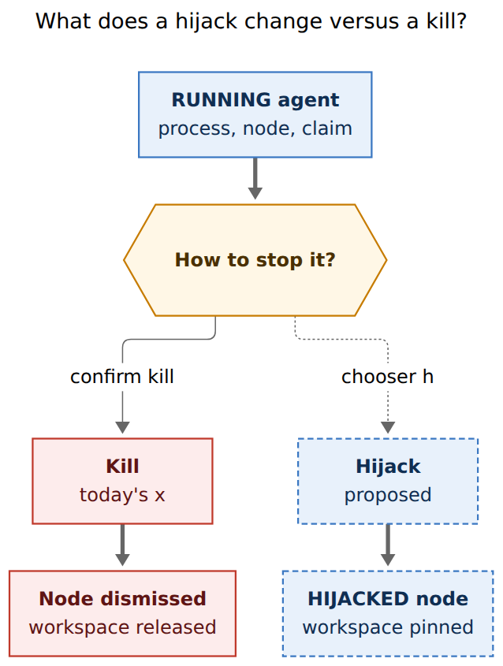
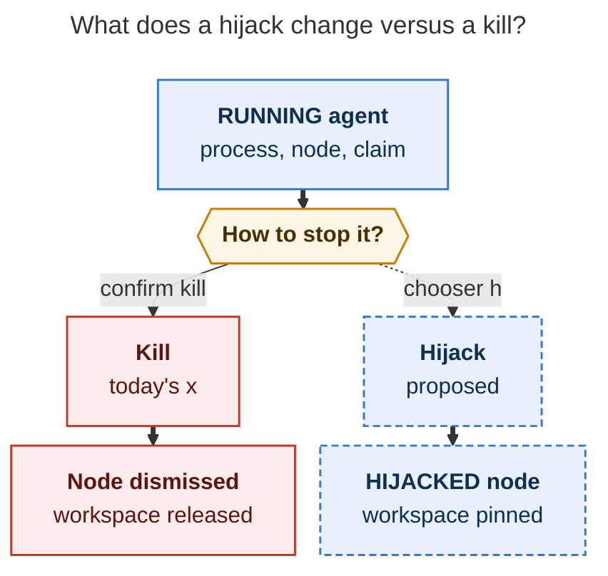
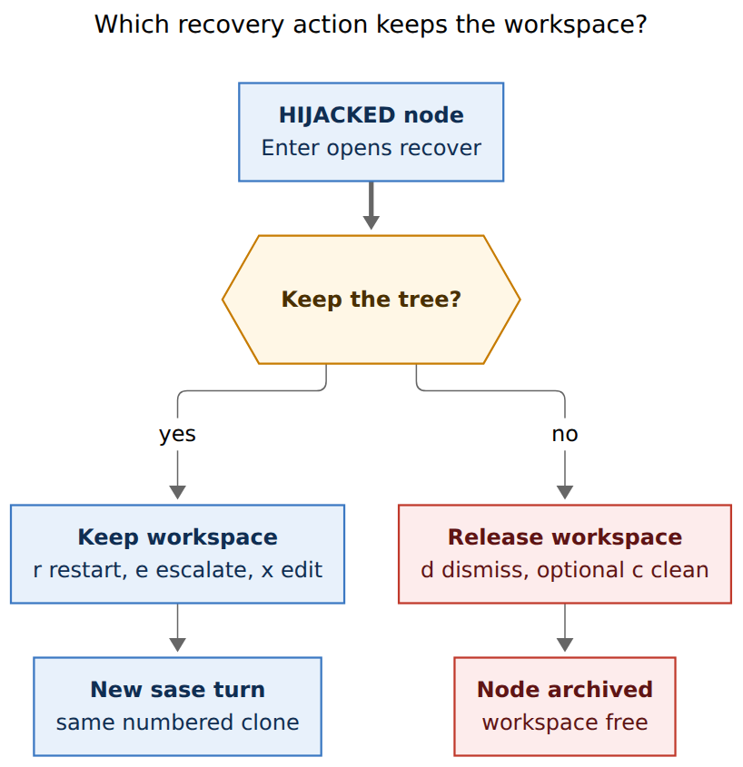
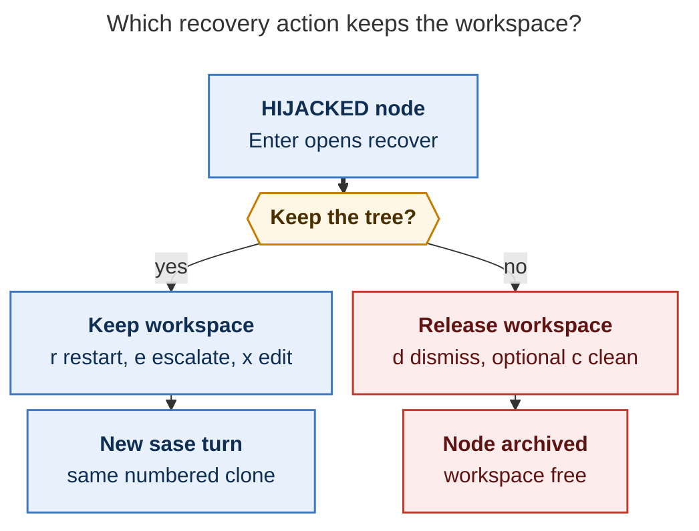

# Hijack a stalled SASE agent: design, critique, and recommended implementation

Researcher: `research.33.grk` (independent). Written 2026-11-02 from the live sase
and sase-core trees, glossary and decision memory, TUI/CLI/config seams, and
rendered mermaid figures. I did not read peer swarm reports.

**Question.** How should SASE let an operator kill a stalled agent while keeping
its Agents-tab node and numbered workspace, then recover that row with a
single-keypress panel?

**Short answer.** Build **Agent Hijack** as an operator-initiated custody state,
not a new continuation mechanism. `x` on a live sase agent opens a fate chooser
whose easy confirmation (`Enter`) hijacks: SIGTERM, pin the workspace claim,
keep the node, paint `HIJACKED`. `Enter` on that row opens a recover chooser
whose keep-tree actions (`r` restart here, `e` escalate, `x` edit in place)
launch a same-workspace session successor. Dismiss and optional restart-clean
release the claim. Put `HIJACKED` in the Stopped bucket in Rust. Escalate
`@large` → `@xlarge` and every other stored size to `@large`, and refuse when
the stored token is already `@xlarge`.

---

## 1. Verdict

This is a good idea, and SASE already has almost every primitive it needs.
Today's `x` is a combined kill-and-forget: the TUI hides the row immediately,
`sase agent persist-cleanup` SIGTERMs, `_persist_running_kill` calls
`release_workspace`, and the dismissed-agents index eats the node. Useful
in-progress files survive only when workspace-retention happens to classify the
tree as dirty (`SESSION_OWNED_DIRT` / `EVIDENCE_UNAVAILABLE` in
`sase-core` `workspace_retention/policy.rs`). That is a safety net for failed
runs, not a recovery UI.

Hijack should be the *visible* hold: operator-initiated, listed, recoverable.
It should reuse kill, `hold_workspace_claim`, session successors, and
`AgentActionChooserModal`. It should not invent a fourth continuation path
beside monitor, handoff, and gate.

The original brief's three recover actions are the right *intent*. Two of them
as specified would throw away the files the operator just hijacked to keep.
Those adjustments are in §3.

---

## 2. Critique of the brief

The need is real. A stall that has already written a useful diff is the case
`x` handles worst: the process dies, the node vanishes, the numbered clone is
released, and `sase agent restart` relaunches from the home directory into a
fresh clone after deleting the previous run's artifacts
(`src/sase/agent/_restart_execute.py`). `,x` kill-and-edit is the same
release-then-retype path. Mobile `retain_for_retry` skips the dismissed-agents
index and still releases the claim (`kill_named_agent(..., retain_for_retry=)`
in `src/sase/agent/running.py`). None of those is "stop the model, keep the
tree, decide in a minute."

A visible `HIJACKED` status is the right product shape. Silent pins already
exist (`hold_workspace_claim` rewrites the RUNNING row in place and preserves
PID). Operators cannot see them, cannot recover them with Enter, and cannot
tell a pinned failed run from a live one. Painting the node is the whole
feature.

The brief is too thin on the *stop* gesture. It specifies Enter-on-HIJACKED
and leaves how the agent *becomes* hijacked implicit. Adding a new bare `H`
collides with `hooks_or_collapse_all: H` and `,H` collapse-by-hint in
`src/sase/default_config.yml`. The beautiful place to offer hijack is the
moment the operator already presses `x`.

The brief's restart action "dismiss, release, relaunch the exact same prompt"
is today's `sase agent restart`. That is a *clean* restart. After a hijack it
is the destructive option. The default restart after a hijack should keep the
pinned clone.

The brief's edit action "similar to `,x`" has the same trap: `,x` kills and
releases, then opens the prompt bar. Edit-from-HIJACKED should open the prompt
bar against the pinned clone.

The brief's escalate heuristic — `@xlarge` if the previous prompt used
`@large`, otherwise `@large` — downgrades an `@xlarge` predecessor to
`@large`. That is a bug in the rule, not an edge case. `@xlarge` is already
the max-effort ordered fallback in `src/sase/llm_provider/models.yml`
(`claude/opus@xhigh || codex/gpt-6.1-sol@xhigh || grok/grok-4.7@xhigh`).
Escalating it must refuse, not walk down the ladder.

Auto-detecting "stalled" is out of scope and would be a bad extra. Stall is
an operator judgment (looping tool calls, a wedged provider, a model that
will not stop). SASE already has monitor-stalled glyphs and auto-restart for
*failed* runs. Hijack is a human stop with custody.

Naming: **do not call this hold.** `sase agent hold` is the admission-hold
domain (TTL 2h/12h, pull evaluation, `decisions:hold-pull-fail-open`).
`hold_workspace_claim` is the pin primitive hijack should *call*. The user
word is **hijack**. Informal "hijack" already appears in the tree as a
negative verb (prompt-panel hijack, completion-install hijack, monitor-fork
hijack). The glossary term should be the noun **Agent Hijack** so the product
sense is distinct from those warnings.

Unknown statuses in `status_bucket_for_status` fall through to `"Running"`
(`sase-core` `crates/sase_core/src/agent_archive/status.rs`). Shipping
`HIJACKED` as a Python-only label without a Rust table row would group
hijacked agents with live work, count them as running capacity, and archive
them as interrupted only by accident of the default. The status *must* land
in the core table in the same change as the TUI paint.

---

## 3. Adjustments to the requirements

These change the brief. Each is load-bearing.

1. **Restart-here keeps the workspace.** The keep-tree default is `r`: same
   prompt, same numbered clone, new sase turn. The brief's dismiss-and-relaunch
   becomes optional `c` Restart clean (today's `sase agent restart`).
2. **Edit-in-place keeps the workspace.** `x` on the recover panel opens the
   prompt bar with the stored prompt, then launches a successor that inherits
   the pin. It is `,x` without the release.
3. **Escalate never walks down.** Stored `%model` token `@large` / `large` →
   `@xlarge`. Stored `@xlarge` / `xlarge` → disable `e` with detail "already
   `@xlarge`". Every other stored token, including a missing `%model`, →
   `@large`. V1 inspects the stored token only; it does not reverse-map an
   explicit `claude/opus@high` into the `@large` pool.
4. **Hijack is offered on `x`, not a new `H`.** Live sase-agent `x` opens a
   fate chooser. `Enter` hijacks. Second `x` is kill-and-dismiss. `Esc` keeps
   the process running. Muscle memory changes from `x` then `y` to `x` then
   `Enter` (keep) or `x` then `x` (discard). Ship that behind a beta flag.
5. **Hijack is operator-initiated.** No stall detector, no auto-hijack, no
   auto-restart of a `HIJACKED` row.
6. **Keep-tree recovery is a session successor**, not `sase agent restart`.
   Restart deletes artifacts and launches from home. Successor delivery
   already transfers a claim (`transfer_workspace_claim`,
   `WORKSPACE_RETENTION_REASON_SAME_WORKSPACE_SUCCESSOR`).
7. **Phase 1 eligibility is narrow.** Standalone agent turns and session
   members with a numbered workspace. Refuse monitors, gate turns, named
   procs, home-mode (no numbered clone), remote fleet, clan containers, and
   bulk marks. Survivors after SIGTERM fail closed: the row stays live.
8. **`HIJACKED` buckets as Stopped.** Archive outcome `interrupted`. The node
   is dismissable (`x` on a `HIJACKED` row releases and archives). Footer
   shows `<enter> recover`.
9. **Pinned claims share the held-claim TTL.** Default 14 days
   (`workspace.held_claim_ttl_days`). A cap (`agent.hijack.max_concurrent`,
   default 8) refuses a new hijack when too many pins are live. TTL expiry
   releases the clone and greys keep-tree recover actions; the node stays
   until the operator dismisses it.

---

## 4. Glossary term

Add a glossary strand via `/sase_memory_write` (never by editing the file
directly):

```yaml
---
keyword: Agent Hijack
aliases:
  - hijack
  - hijacked
---
```

**Draft body.** An agent hijack is an operator-initiated stop of a live sase
agent that keeps the Agents-tab node and pins its numbered workspace claim.
The process is SIGTERM'd; the node paints `HIJACKED` in the Stopped bucket;
Enter opens a recover chooser. Keep-tree recover actions launch a new sase
turn in the same agent session on that pinned clone. Dismiss and restart-clean
release the claim. Distinct from `sase agent hold` (admission), from kill
(which dismisses and releases), and from auto-restart (which recovers a
FAILED run onto a fresh launch).

Do not alias `hold`. Do not reuse status `KILLED` (Python already special-cases
it as Failed in `aggregate_agent_group_status`).

---

## 5. What the tree already provides

Hijack is a *composition* of seams that already work.

| Seam | Path | Role in hijack |
| --- | --- | --- |
| Kill + dismiss | `src/sase/agent/running.py` `kill_named_agent` | Today's stop always releases a non-home claim and records dismissal unless `retain_for_retry` (which still releases). Hijack needs a third path: terminate, pin, skip dismissal. |
| Optimistic TUI kill | `src/sase/ace/tui/actions/agents/_kill_flow.py` `_do_kill_agent` | Hides the row immediately, then durable `sase agent persist-cleanup`. Hijack must *repaint* the row, not remove it. |
| Running-kill persist | `src/sase/ace/tui/actions/agents/_kill_persistence.py` `_persist_running_kill` | Unconditionally `release_workspace`. Hijack persist calls `hold_workspace_claim` instead. |
| Confirm kill | `src/sase/ace/tui/modals/confirm_kill_modal.py` | Yes/no only (`Kill` / `Keep running`). Too small for fate. |
| Enter chooser | `AgentActionChooserModal`; `EnterTargetKind = gate \| patch \| stranded` | Already the single-keypress panel. Add a `recover` section. On `HIJACKED`, recover is primary even when a Patch also exists. |
| Pin | `src/sase/running_field/_hold.py` `hold_workspace_claim` | Atomic in-place pin; preserves PID; `expected_pid` mismatch is a no-op. |
| Transfer | `src/sase/running_field/_transfer.py` `transfer_workspace_claim` | Hands the slot to the successor PID without a free window. |
| Retention | `sase-core` `workspace_retention/policy.rs` | `successor_takes_workspace` already classifies same-workspace successors. Session-owned dirt already retains. Hijack is the *explicit* pin *before* terminal classification. |
| Held-claim TTL | `workspace.held_claim_ttl_days` default 14; `stale_running_cleanup.py` | Already releases pinned dead-PID claims and keeps artifacts. Reuse this clock. |
| Restart (clean) | `src/sase/agent/_restart_execute.py`; CLI `sase agent restart` | Kill/dismiss, wipe name, launch from home, delete artifacts. Maps to optional `c`. |
| Kill-and-edit | `,x` / `,X`; `prepare_kill_and_edit_prompt` | Release then retype. Maps to recover `x` only after dropping the release. |
| Size aliases | `models.yml` `large` / `xlarge`; `decisions:size-alias-effort-ladder` | Escalate is a size-rung bump, not a provider pick. |
| Status buckets | `status_bucket_for_status`; Python wrapper in `status_buckets.py` | Unknown → Running. `HIJACKED` must be a table row. `KILLED` is a Python Failed special case. |
| Waiting marker | `write_waiting_marker`; scan `has_done_marker` | Live (not recently-completed) marker pattern. Hijack wants `hijack.json` plus a scan field, not a `done.json` outcome. |
| Auto-restart | `RESTARTING` `#FFAF5F` | Cousin for FAILED. Must ignore `HIJACKED`. |
| Keymaps | `kill_agent: x`, `act_on_agent: enter`, `kill_and_edit: x` (leader) | Footer shows conditional maps only (`ace.md`). `<enter> recover` belongs in the footer; a new global `H` does not. |
| CLI kill | `sase agent kill -n NAME` | Twin for `sase agent hijack -n NAME`. Restart uses positional `NAME`; keep kill's `-n` for hijack so the pair matches. |

The rust-core litmus test is satisfied: a web client, the CLI, and the TUI
must agree on eligibility, status bucket, pin/transfer/release, and the
escalate-alias function. Those belong in `sase-core`. Presentation (chooser
layout, magenta paint, footer) stays in Python.

---

## 6. Recommended lifecycle

```text
live sase agent  --x-->  fate chooser
                           Enter  -->  HIJACKED (process dead, node kept, claim pinned)
                           x      -->  today's kill (node dismissed, claim released)
                           Esc    -->  still running
HIJACKED  --Enter-->  recover chooser
                           r/e/x  -->  session successor, transfer pin, same clone
                           c      -->  sase agent restart (fresh clone)
                           d      -->  dismiss + release
                           Esc    -->  stay HIJACKED
HIJACKED  --x-->  confirm dismiss (release, archive node)
HIJACKED  --,x-->  edit in place (same as recover x)
```

**Hijack persist (durable `persist-cleanup` transaction `hijack`).**

1. SIGTERM the process group and wait, same as kill.
2. Survivors → fail closed; row stays live; no pin.
3. `hold_workspace_claim(..., expected_pid=old_pid)` so a replaced claim is a
   no-op.
4. Write `hijack.json` next to `agent_meta.json`: `hijacked_at`,
   `workspace_num`, stored `%model` token, `pid`, session name, prompt
   identity.
5. Drop `running.json` / waiting markers. Do **not** write `done.json`. Do
   **not** merge into the dismissed-agents index. Do **not** delete artifacts.
6. TUI optimistic update: keep the identity, set `status = "HIJACKED"`, keep
   selection.

**Listing.** Artifact scan grows `has_hijack_marker` / `hijack:
HijackMarkerWire` in sase-core. A hijack marker plus a dead process projects
as a live `HIJACKED` row, in the Stopped bucket, never as recently-completed
DONE/FAILED. `sase agent list` shows it without `-a`.

**Keep-tree successor.** If the hijacked turn has no session yet, attaching
the successor promotes it (`%id(<suffix>, session=<parent>)`), the same
promotion monitors and gate turns already perform. The successor inherits the
goal and bead claims. A short host preamble states that the predecessor was
hijacked and that uncommitted workspace changes remain. Launch uses
`transfer_workspace_claim` from the pinned PID. Transfer failure fails
closed and leaves `HIJACKED`.

**TTL expiry.** `stale_running_cleanup` already drops aged pinned dead-PID
claims and keeps artifacts. After expiry the node stays `HIJACKED` with a dim
hint `workspace released`; recover greys `r`/`e`/`x` and leaves `d` and `c`.

---

## 7. Figures

### 7.1 Kill versus hijack

**Reader question:** What does a hijack change versus a kill?

**Caption:** A kill dismisses the Agents-tab node and releases the workspace.
A hijack kills the process, keeps the node, and pins the workspace claim as
`HIJACKED`.



Rendered size: 424.875 × 564 px; fit scale: 100%. Mermaid CLI 12.0.0.



(The dashed `chooser h` edge is the fate-chooser hotkey for hijack. The
recommended confirmation of that chooser is `Enter` on the first row, with
`h` as the explicit hotkey — see §8.)

### 7.2 Recovery routing

**Reader question:** Which recovery action keeps the workspace?

**Caption:** Keep-tree actions start a new sase turn on the pinned workspace.
Release actions archive the node or relaunch on a fresh clone.



Rendered size: 544.609 × 564 px; fit scale: 100%. Mermaid CLI 12.0.0.



---

## 8. TUI: fate chooser and recover chooser

Reuse `AgentActionChooserModal`. It already assigns deterministic hotkeys, a
guidance line `⏎ again → {primary}`, `j`/`k`, and section headers. Add a
`recover` section (and a `fate` section for the stop gesture). Do not ship a
second modal class.

### 8.1 Fate chooser (`x` on a live, eligible sase agent)

Title: `Stop {name}?`
Guidance: `⏎ again → Hijack · or press a key`
Default index 0 = Hijack. `Esc` / `q` cancel (process keeps running).

| Key | Action | What happens |
| --- | --- | --- |
| `Enter` / `h` | **Hijack** | SIGTERM, pin claim, keep node, `HIJACKED` |
| `x` | **Kill and dismiss** | Today's kill |
| `Esc` | Keep running | No-op |

This is the beauty: the operator's existing "stop this" key (`x`) becomes a
fork, and the *easy* confirmation keeps the work. Discarding the tree takes a
second `x`. Today's `x` then `y` (ConfirmKillModal) is the Off branch of the
beta flag.

Ineligible kinds (monitor, gate, named proc, clan container, remote) keep
their current confirm modals.

### 8.2 Recover chooser (`Enter` on `HIJACKED`)

Title: `Recover hijacked {name}`
Guidance: `⏎ again → Restart here · or press a key`
Primary: **Restart here**.

| Key | Action | Workspace | Notes |
| --- | --- | --- | --- |
| `r` / `Enter` | **Restart here** | keep | Same stored prompt, session successor, transfer pin. Primary. |
| `e` | **Escalate** | keep | Alias policy in §9. Hidden when already `@xlarge`. Detail shows `@large → @xlarge`. |
| `x` | **Edit in place** | keep | Prompt bar prefilled; submit launches successor on the pin. |
| `c` | **Restart clean** | release | Optional. Today's `sase agent restart`. Detail: "new clone, artifacts wiped". |
| `d` | **Dismiss** | release | Archive the node. Same as `x` on the row after a confirm. |
| `p` | **Patch** | — | Existing chooser Patch row, last, if the agent has one. |
| `Esc` | Leave hijacked | keep pin | Node unchanged. |

**Skip.** Inspect (the Files deck already shows diffs). Resume process (it is
dead). Fork (forks allocate a new workspace). Copy prompt. Telegram. Effort-only
bumps. Auto-escalate.

Each keep-tree row's `detail` names the clone and the dirt: `workspace #12 ·
@large · dirty`. Each release row says `releases workspace #12`. After TTL
expiry, keep-tree rows are omitted (not merely dimmed-and-still-hotkeyed).

`EnterTargetKind` grows `"recover"`. Resolver: if status is `HIJACKED`,
recover choices come first; gates are impossible (process is dead); Patch
stays last. Empty-state `NO_TARGET_EMPTY_MESSAGE` is unreachable on a
hijacked row.

### 8.3 Other keys on a `HIJACKED` row

- Footer: `<enter> recover` and `x dismiss` (both conditional — they belong
  in the footer per `ace.md`).
- `x`: confirm dismiss (release + archive). Process is already dead.
- `,x`: edit in place (keep). Context-sensitive and matches recover `x`.
- `,J` jump-to-next-stopped includes `HIJACKED`.
- Auto-restart ignores `HIJACKED`.
- Clan aggregate: `HIJACKED` is a needs-user status and outranks Running in
  `aggregate_agent_group_status`, beside `QUESTION` / pending plan review.
  Phase 1 still refuses hijacking from a clan *container* row.

---

## 9. Escalate policy

Put a pure function in sase-core and bind it. Python must not re-derive it.

```text
normalize(%model token) ->
  "large"  | "xlarge" | other
"large"  -> Some("xlarge")
"xlarge" -> None          # refuse; chooser hides e
other    -> Some("large") # including missing %model
```

Accept `@large`, `large`, `@xlarge`, `xlarge`. Ignore provider-prefixed
explicit slugs in V1: an agent launched as `%model:claude/opus@high` escalates
to `@large`, which may be a lateral move. A later mapping from "this slug is
a `@large` pool member" can land once the occupancy table is a core API.
Do not special-case effort suffixes (`@large@xhigh` is not a real spelling;
effort lives on the alias or as `%effort`).

`@xlarge` is the top of `decisions:size-alias-effort-ladder` and uses `||`
max-effort fallback. Walking it to `@large` would *reduce* capability. The
brief's "otherwise `@large`" rule is kept for `@medium` / `@small` /
explicit / missing, and is closed against `@xlarge`.

The successor prompt rewrites `%model` with the existing directive rewriter
(`set_prompt_model` / restart `-m` path). Escalate does not pass
`sase agent restart -m`, because that command wipes artifacts and launches
from home.

---

## 10. Beauty

Statuses on the Agents tab are shouty single words in a parenthetical:
`RUNNING` gold `#FFD700`, `FAILED` red `#FF5F5F`, `WAITING` amethyst
`#AF87FF`, `DONE` green `#5FD75F`, `STARTING` sky `#87D7FF`, `RESTARTING`
warm `#FFAF5F`, `STOPPED` slate `#8787AF` with `Ø`. `HIJACKED` should scan as
loudly as `FAILED` and as *different* as `WAITING`.

- Paint **`HIJACKED`** in `bold #FF5FAF` (hot magenta). It is off the gold /
  red / green / amber / amethyst set already used for live, failed, done,
  restarting, and waiting.
- No extra glyph. `STOPPED` already had to swap a circled-slash for `Ø`
  because Fira Code lacked the glyph. A flag emoji would fail the same way.
- Session container whose latest member is `HIJACKED` shows `HIJACKED`, not
  a generic `STOPPED`.
- Recover chooser title `Recover hijacked {name}`, section header `RECOVER`,
  existing 68-column double `$primary` frame.
- Fate chooser title `Stop {name}?`, Hijack row first (keep-work is the easy
  path), Kill row in the risk register of the operator's mind via the `x`
  hotkey.
- Dim hint after the status when TTL is close: `· pin 2d` (optional v1.1).
  V1 can skip the countdown and still show `workspace #N` on the recover
  details.

---

## 11. Config, flag, and CLI

**Permanent config** (user-choice forever — this is not a flag):

```yaml
agent:
  hijack:
    # Days before a pinned hijacked claim is released. 0 disables
    # age-based release. Default matches workspace.held_claim_ttl_days.
    ttl_days: 14
    # Max concurrent HIJACKED rows that still hold a pin. Extra hijacks
    # refuse with a message to dismiss one first.
    max_concurrent: 8
    # When true, x on a live eligible sase agent opens the fate chooser.
    # When false, x is today's ConfirmKillModal.
    offer_on_kill: true
```

Do not config-ize the escalate mapping. That is domain policy in Rust.

**Beta flag** `agent_hijack` via `sase flag new` (epic scaffolding; remove by
deleting the Off branch):

- `--when-enabled`: eligible live sase agents can be hijacked; `HIJACKED`
  rows recover via Enter; `x` opens the fate chooser when
  `agent.hijack.offer_on_kill` is true.
- `--when-disabled`: `x` remains confirm-kill-and-dismiss; no `HIJACKED`
  status; CLI `sase agent hijack` refuses.
- `--remove-when`: hijack has soaked without workspace-starvation incidents
  and the Off branch can be deleted.

`offer_on_kill` stays as config after the flag dies, so an operator who hates
the muscle-memory change can keep `x` as hard kill.

**CLI** (follow `cli_rules.md`: sorted options, short aliases, excellent
`-h`):

```text
sase agent hijack -n NAME [-j]
sase agent recover -n NAME -a restart-here|escalate|edit|dismiss|restart-clean [-j]
```

`hijack` matches `kill`'s `-n/--name`. `recover -a edit` cannot open the TUI
prompt bar; it should print the stored prompt on stdout and refuse with
exit 2 plus a pointer to the TUI, *or* accept `--prompt-file` in a later
slice. V1 CLI can ship `hijack` + `recover -a restart-here|escalate|dismiss`
and leave edit as TUI-only.

`sase agent` already defaults bare invocation to `list`. `hijack` is not a
group. Help copy must say that hijack keeps the workspace and that
`sase agent restart` still wipes it.

---

## 12. Rust versus Python split

**sase-core (required for cross-frontend agreement):**

- `status_bucket_for_status("HIJACKED") -> "Stopped"`
- `archive_outcome_for_status("HIJACKED") -> "interrupted"`
- `escalate_size_alias(token) -> Result<alias, Refuse>`
- `hijack_eligibility(kind, workspace_num, alive, survivors, home_mode, remote, flag)`
- scan wire: `has_hijack_marker` / `HijackMarkerWire`
- retention: explicit hijack pin is `RETAIN` until recover transfers
  (`SAME_WORKSPACE_SUCCESSOR`) or dismisses (`EXPLICIT_DISMISSAL`)
- ratchet `sase-core-revision.txt` after the core commit

**Python TUI / CLI / persist-cleanup:**

- fate and recover chooser view-models
- magenta paint, footer, `,x` context
- `persist-cleanup` transaction `hijack` (pin, write marker, skip dismissal)
- optimistic keep-row
- CLI parsers
- prompt-bar edit-in-place
- successor launch + `transfer_workspace_claim`

Presentation-only Textual state stays here. The escalate function and the
bucket table do not.

---

## 13. Docs and tests

Per `docs_writing.md`:

- Reference: `docs/reference/tui/agents-tab.md` (behavior of `x` and Enter).
- Generated CLI/config/keymap pages via `just fix` from parser help,
  `default_config.yml` descriptions, and the new glossary strand.
- Guide candidate as a `PROPOSED FOLLOW-UP:` on the implementation bead, not
  a new Guide page in the same change.
- A short decision record for the escalate-alias rule and for "hijack is
  offered on `x`" once those are accepted. Do not edit decision records in
  place later.

Tests (agent default is `just check`, not `check-full`):

- Rust: bucket, archive outcome, escalate alias (including `@xlarge` refuse),
  eligibility matrix.
- Python: persist-cleanup hijack does not dismiss or release; listing shows
  `HIJACKED` without `-a`; fate/recover hotkeys; `,x` on HIJACKED keeps the
  pin; auto-restart skips HIJACKED; both flag branches.
- Visual snapshot of a `HIJACKED` row and both choosers (Fira Code, no extra
  glyph).

---

## 14. Risks

- **Workspace starvation.** Pins occupy numbered clones. Mitigate with
  `max_concurrent`, the existing 14-day held-claim TTL, and recover details
  that name `workspace #N`. Show the cap in the fate chooser when it is
  close (`3/8 pins`).
- **Muscle memory.** `x` then `y` becomes `x` then `Enter` / `x` then `x`.
  Beta flag + `offer_on_kill: false` is the escape hatch.
- **Fat-finger `x` `x`.** Discard is two taps of the same key. Acceptable:
  the operator already reached for kill. Hijack is the other-key (`Enter` or
  `h`) path.
- **Survivors.** A process that ignores SIGTERM must not paint `HIJACKED`.
  Fail closed, same as kill's `status="survivors"` path.
- **Home-mode.** No numbered clone to keep. Refuse with "hijack needs a
  numbered workspace".
- **Scan-wire cost.** `has_hijack_marker` is a real sase-core change. A
  Python-only overlay would drift from CLI/web. Pay the wire cost.
- **Informal "hijack" in docs.** Glossary noun plus careful help copy keep
  the product sense distinct from "this path hijacks another project's tree."

---

## 15. What I would not do

- Auto-detect stall, auto-hijack, or hijack-on-FAILED (auto-restart already
  owns FAILED).
- A new global `H` keymap.
- A new modal family beside `AgentActionChooserModal`.
- Reusing `sase agent hold` or the word "hold" in the status.
- Reusing `KILLED` or `STOPPED` as the paint.
- `retain_for_retry` as the implementation (it still releases the claim).
- `sase agent restart` as the keep-tree implementation (it launches from
  home and deletes artifacts).
- Escalating `@xlarge` to `@large`.
- Phase-1 clan-container, remote-fleet, monitor, or gate hijack.
- Inspect / resume / fork / copy as recover actions.
- A user-facing config for the escalate mapping.

---

## 16. Implementation sequence

1. **sase-core:** `HIJACKED` → Stopped; escalate-alias; eligibility; hijack
   marker wire; tests. Ratchet the Python pin.
2. **Persist + listing:** `persist-cleanup` transaction `hijack`; pin not
   release; live listing; TTL reuse; `max_concurrent`.
3. **TUI:** fate chooser on `x`; magenta `HIJACKED`; recover chooser on
   Enter; footer; `,x` context; visual snapshots. Behind `agent_hijack`.
4. **CLI:** `sase agent hijack` / `sase agent recover`.
5. **Docs + glossary + default_config descriptions.** `just fix`.
6. **Soak, then delete the Off branch** and close the flag bead.

Phase 1 is complete when a local standalone agent and a session member can
be hijacked, painted, restarted-here, escalated, edited in place, and
dismissed, with CLI twins for hijack / restart-here / escalate / dismiss,
and with `just check` green on both flag branches.

---

## 17. Recommended solution

Ship **Agent Hijack** as a Stopped custody state composed from kill, pin,
session successor, and `AgentActionChooserModal`.

- Glossary term: **Agent Hijack** (aliases `hijack`, `hijacked`).
- Stop gesture: `x` opens a fate chooser; `Enter`/`h` hijacks; `x` kills and
  dismisses; `Esc` cancels. Beta-flag the muscle-memory change.
- Persist: SIGTERM → `hold_workspace_claim` → `hijack.json` → keep the node.
  Fail closed on survivors. Refuse home-mode, monitors, gates, named procs,
  remote, clan containers, bulk.
- Paint: shouty `HIJACKED` in `bold #FF5FAF`, Stopped bucket in Rust, footer
  `<enter> recover`.
- Recover: `r` restart here (primary, keep tree), `e` escalate (keep tree,
  `@large`→`@xlarge`, refuse `@xlarge`, else `@large`), `x` edit in place
  (keep tree), optional `c` restart clean (today's restart), `d` dismiss.
- Continuation: session successor + `transfer_workspace_claim`, same goal
  and bead claims, host preamble about the hijack. Never `sase agent restart`
  for keep-tree paths.
- Config: `agent.hijack.{ttl_days,max_concurrent,offer_on_kill}`. Flag:
  beta `agent_hijack`. Escalate mapping stays in Rust.
- Docs: Agents-tab reference, generated CLI/config, glossary strand, later
  decision records for the `x` fate chooser and the escalate-alias rule.

That is the design I would implement: intuitive because `x` still means
stop; reliable because pin/transfer/successor already exist and unknown
statuses cannot silently bucket as Running; beautiful because the easy
confirmation keeps the work, the status is unmissable, and the recover panel
makes keep-versus-release a single obvious question.
