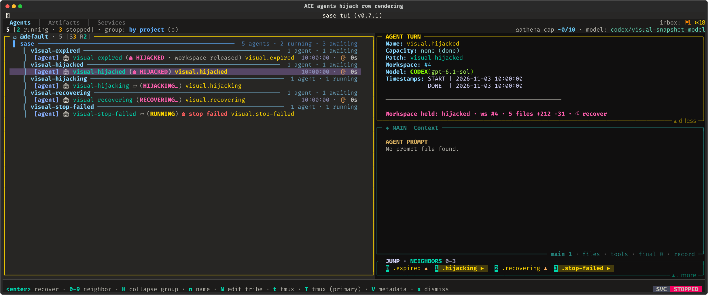
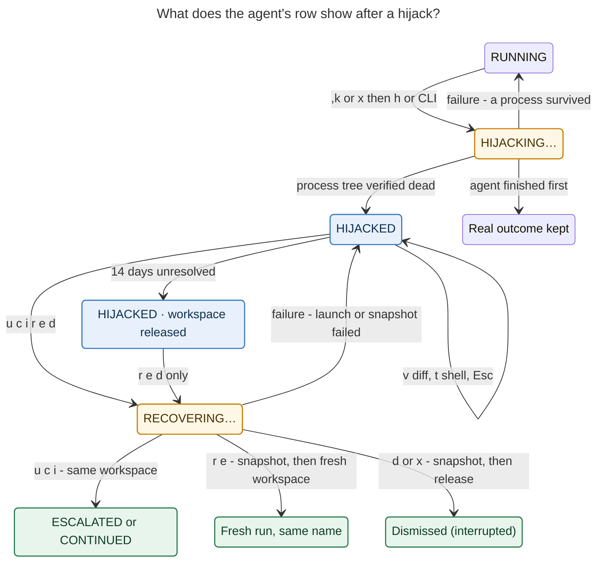

# Agent Hijack: what you'll see

**Date:** 2026-11-05 · **Epic:** `sase-1qz` · **Plan:** `plan:202611/agent_hijack.md`

> **TL;DR.** When an agent stalls, press **`,k`**. The agent's processes stop, but its
> workspace, its uncommitted diff, and its Agents-tab row are kept. The row turns
> **`⏏ HIJACKED`**. Press **`⏎`** on it to get a one-keypress recovery panel: hand the
> same workspace to a **bigger model** (`u`), **continue** (`c`), **add a hint** (`i`),
> or **start over** (`r`/`e`). Nothing is released until a snapshot of the work exists.

---

## 1. Kill vs. hijack

Every stop path you have today (`x`, `,x`, `sase agent restart`, auto-restart) gives the
workspace back to the pool. A hijack separates **stopping the agent** from **giving up its
work**.

|                                    | `x` Kill           | `,k` Hijack                                     |
| ---------------------------------- | ------------------ | ----------------------------------------------- |
| Process tree                       | stopped            | stopped, and verified dead                      |
| Workspace `#N` and its diff        | released           | **held for you**, snapshotted                   |
| Agents-tab row                     | dismissed          | **`⏏ HIJACKED`**, counted as "needs you"        |
| Agents waiting on it (`%wait`)     | see a kill         | **stay parked**, then follow the successor      |
| Bead claim                         | released           | kept, then inherited by the successor           |
| What happens next                  | nothing            | you choose, **exactly once**, from a panel      |

---

## 2. Hijacking an agent

**Three ways in.** All three do the same thing.

| Where           | How                                                                        |
| --------------- | -------------------------------------------------------------------------- |
| Agents tab      | Select the running agent and press **`,k`** (leader `,` then `k`, "kill, keep") |
| Kill dialog     | Press `x` as usual. The dialog now also offers **`h` Hijack instead · stop it but keep workspace #4** |
| CLI             | `sase agent hijack NAME [-r "why"]`                                        |

**What the row does.** It flips to `HIJACKING…` right away. It becomes `⏏ HIJACKED` only
after every process is confirmed dead and the workspace hold is confirmed. Two edge cases
are reported honestly instead of being papered over:

- **A process won't die.** The row stays `RUNNING` with a red `⏏ stop failed` badge. A
  toast lists the surviving pids. Nothing is held, so the agent finishes normally if it
  recovers.
- **The agent finished first.** Its real outcome (DONE, FAILED, …) is kept, and a toast
  says "finished before the hijack".



_Every hijack row state, from the TUI's visual-snapshot golden (fixture names): a held
row (selected) whose detail pane shows **"Workspace held: hijacked · ws #4 · 5 files +212
−31 · ⏎ recover"**; an expired hold; the `HIJACKING…` and `RECOVERING…` overlays; and a
`stop failed` badge. The footer offers `<enter> recover` and `x dismiss`._

**When `,k` says no.** It refuses with a one-line toast, and changes nothing, for:

- an agent that is **FINALIZING** ("try again in a moment");
- monitor turns, gate turns, named procs, home-mode (`#0`) agents, clan containers, and
  bulk selections;
- a **remote** fleet row: the toast names the owning host and copies
  `sase agent hijack NAME` to your clipboard;
- an agent launched **before** hijack support existed ("use x").

---

## 3. The life of a hijacked agent



_A hijacked agent waits in HIJACKED (blue) until you choose. Each choice runs exactly
once. A failed choice puts the agent back in HIJACKED; it never falls through to a
different workspace. The amber states are brief in-flight transitions, and green states are
final._

A hold lasts **14 days** from the moment of the hijack (`workspace.held_claim_ttl_days`).
After that the workspace is snapshotted and released, and the row reads
`⏏ HIJACKED · workspace released`. From then on you can only Restart, Edit, view the
snapshot diff, or Dismiss.

---

## 4. Recovering: the panel

Press **`⏎`** on a HIJACKED row. The recovery panel opens straight away; it takes
priority over every other Enter action on that row. Rows are **grouped by what happens to
the diff**, so you never need a warning label to know whether your work survives.

```text
╭─ ⏏ Recover sase-7f.2 ──────────────────────────────── HIJACKED · ws #4 ─╮
│ claude/opus@high via @large · ran 47m · hijacked 3m ago                 │
│ 5 files +212 −31 · 1 linked repo · last tool: Bash just check (22m)     │
│ ⏎ again → Escalate · or press a key                                     │
│                                                                         │
│ KEEP THE WORK · next turn runs in workspace #4                          │
│ › [u] ⇧ Escalate   @large → @xlarge · claude/opus@xhigh                 │
│   [c] ▶ Continue   same model · claude/opus@high                        │
│   [i] ↪ Instruct   add guidance, then continue                          │
│ START OVER · snapshot first, then workspace #4 is released              │
│   [r] ⟳ Restart    same prompt, same name, fresh workspace              │
│   [e] ⌨ Edit       edit the prompt; nothing is released until submit    │
│ INSPECT OR LEAVE                                                        │
│   [v] ± View diff  changes in the pager · stays hijacked                │
│   [t] $ Shell      tmux in workspace #4 · stays hijacked                │
│   [d] ⌫ Dismiss    snapshot first, then workspace #4 is released        │
│                                                                         │
│ j/k move · ⏎ select · Esc decide later                                  │
╰─────────────────────────────────────────────────────────────────────────╯
```

_The planned panel, from the epic plan. If the agent also has a Patch, it appears last as
`p`._

**Muscle memory.** `⏎⏎` (open, then Enter again) runs **Escalate**: the most common "it
was too hard for that model" case is two keystrokes. Enter is ignored for the first
300 ms, so a held-down Enter key can't trigger an action by accident. `Esc` leaves the
agent HIJACKED for later.

**Rows change in place instead of vanishing.** When an action can't run, its row stays
put, dims, and shows the reason; pressing its key toasts the reason. At the top of the
ladder, Escalate turns into **Switch**, which keeps the same size but moves to a
different provider:

```text
│ › [u] ↔ Switch     already @xlarge → codex/gpt-6.1-sol@xhigh            │
│   [r] ⟳ Restart    unavailable: fan-out prompt; use Edit                │
```

**Which key fits?**

| If…                                                    | Press   | Workspace `#4`     |
| ------------------------------------------------------ | ------- | ------------------ |
| You're not sure the diff is any good yet               | `v`, `t` | kept (look first) |
| The diff is good; the model was out of its depth       | **`u`** | kept               |
| The diff is good; it needs a nudge in a new direction  | `i`     | kept               |
| The diff is good; the stall was a fluke                | `c`     | kept               |
| The diff is bad, but the prompt is right               | `r`     | snapshot → fresh   |
| The diff is bad, and the prompt needs rewording        | `e`     | snapshot → fresh   |
| You no longer want the task                            | `d` (or `x`) | snapshot → released |

`i` and `e` open the normal prompt bar. **Instruct** is pre-filled with the successor's
prompt, an editable `%model:` line, and an empty guidance line for your cursor. **Edit**
is pre-filled with the original prompt. Cancelling either one leaves the agent HIJACKED,
and **Edit releases nothing until you submit**. (This is unlike `,x`, which dismisses
before the prompt bar opens.)

---

## 5. Escalate: which model you get

The panel always prints the concrete target model, so you never have to guess. The rung
comes from how the run was launched, never from its prompt text. The ladder is
configurable as `agent_hijack.escalation_ladder` (default `["@large", "@xlarge"]`).

| The stalled run was on…                   | `u` launches…                                         | Label       |
| ----------------------------------------- | ----------------------------------------------------- | ----------- |
| No size alias, or below `@large`          | the first `@large` model                              | ⇧ Escalate  |
| `@large`                                  | the first `@xlarge` model                             | ⇧ Escalate  |
| `@xlarge` (top rung)                      | the first `@xlarge` model from a **different** provider/model | ↔ Switch |
| `@xlarge`, with no different model left   | nothing; the row is disabled ("use Continue or Instruct") | (disabled) |

Escalation never relaunches the same model under a "smarter" label. It also never
downgrades: if a successor stalls and you hijack it too, the next `u` climbs from where
the successor was.

---

## 6. After you choose a keep-work action

The successor is a **new turn in the same agent session and the same workspace**, so it
finds the half-finished diff exactly where the stalled agent left it. The old member
settles to a grey label, and the session tree tells the story:

```text
sase-7f.2
├─ --1  ESCALATED  claude/opus@high     ← hijacked after 47m; its diff is kept
└─ --2  RUNNING    claude/opus@xhigh    ← same workspace #4, owns that diff now
```

The label is **`ESCALATED`** if the model changed (`u`, or `i` with a new `%model:`) and
**`CONTINUED`** if it didn't (`c`, or `i` with the same model).

**What the successor is told.** By default (`successor_context: fork`) it receives the
stalled turn's transcript. If that won't fit the context budget, it gets a short brief
instead. Either way, a framing paragraph comes before the original task (abridged here):

```text
%model:claude/opus@xhigh
#fork:sase-7f.2
Hijack continuation. The user stopped sase-7f.2 (claude/opus@high) because it stopped
making progress (ran 47m; last activity: Bash `just check`, 22m before the hijack).
You are its successor in the same workspace. Its uncommitted changes are still here
(5 files, +212 −31; recovery snapshot: <ref>). Inspect git status and git diff before
acting. Keep correct work, repair or revert wrong work, and do not repeat whatever
stalled the previous run. The original task follows, unchanged.
<original prompt, with launch-only directives stripped>
```

The successor also inherits the bead claim, goal binding, permission scope, and opened
repos. When the successor finishes, its finalization commits the **combined** diff.
Anything waiting on the old agent automatically follows the successor.

---

## 7. From the command line

The CLI matches the panel action for action, so you can recover an agent from a shell, a
script, or another host.

```console
$ sase agent hijack sase-7f.2 -r "looping on just check"
⏏ hijacked sase-7f.2 · ws #4 held · 5 files +212 −31 · next: sase agent recover sase-7f.2

$ sase agent recover sase-7f.2                           # print the same menu as the panel
$ sase agent recover sase-7f.2 -a escalate -n            # dry-run: show the target model
$ sase agent recover sase-7f.2 -a escalate               # u
$ sase agent recover sase-7f.2 -a continue               # c
$ sase agent recover sase-7f.2 -a continue -p hint.md    # i  (your full prompt)
$ sase agent recover sase-7f.2 -a restart                # r
$ sase agent recover sase-7f.2 -a restart -p edited.md   # e
$ sase agent recover sase-7f.2 -a dismiss                # d
```

- `sase agent hijack` exits **0** when the agent is HIJACKED, **2** when it was refused
  (nothing changed), and **1** when the stop failed. `-j` prints JSON.
- `sase agent list` shows HIJACKED agents without `-a`, with a dim `ws #N held` hint.
  `sase agent show` adds a Hijack block with the evidence, snapshot refs, and the next
  command.
- Existing commands know about hijacks. `sase agent restart NAME` means Restart, and
  `sase agent kill NAME` refuses with "already stopped (hijacked); use
  `sase agent recover NAME -a dismiss`".

---

## 8. What you can count on

- **Your diff is never lost silently.** Every action that releases the workspace (Restart,
  Edit, Dismiss, expiry) first takes or verifies a snapshot of the primary repo and every
  linked repo with changes. If the snapshot fails, nothing is released. "Discard without
  snapshot" exists only in that error state, behind its own confirmation.
- **Exactly once.** Two TUIs, or a TUI and a script, can't both resolve the same hijack:
  the second gets "already being resolved". A crash in the middle is reconciled
  automatically.
- **Closing the TUI is safe.** Hijack and recover actions run as durable background
  processes.
- **Never a surprise workspace.** Keep-work actions run in the held workspace or fail
  loudly. They never fall back to a pool workspace or `#0`.
- **Nothing else steals it.** Auto-restart, stale-claim cleanup, and late callbacks from
  the dead runner all leave a hijacked workspace alone.
- **The dead turn can't finish.** A declaration that arrives late from the killed turn is
  ignored, so it can't commit half-done work.

---

## 9. Where the build stands (as of 2026-11-05)

| Area                                                                 | Status          |
| -------------------------------------------------------------------- | --------------- |
| Core statuses, ledger, eligibility, escalation policy, config        | ✓ landed        |
| `,k`, the kill dialog's `h`, `sase agent hijack`, custody across every release path | ✓ landed (beta flag `agent_hijack`, default **off**) |
| Row rendering: HIJACKED, overlays, stop-failed, detail header, footer chips | ✓ landed  |
| Keep-work recovery (`u`/`c`) and `sase agent recover`                | in progress     |
| Restart, Edit backend, Dismiss                                       | in progress     |
| Recovery panel                                                       | in progress     |
| Instruct and Edit through the prompt bar                             | in progress     |
| End-to-end test, flag removal, docs, `Agent Hijack` glossary term    | in progress     |

Until the final phase lands, enable hijacking with `sase flag enable agent_hijack`. The
flag only gates the **ways in**: an agent that is already hijacked stays visible and
recoverable even if the flag is turned off again. Deferred to follow-ups: answering
hijacks from Telegram, a "quiet for N min" stall hint, an expiry-warning notification,
and "salvage & commit".

---

**Sources.** Epic bead `sase-1qz` and its phase beads; `plan:202611/agent_hijack.md`
(authoritative UX contract, with the reviewer decisions `enter_default = escalate` and
`successor_context = fork`); landed code in `src/sase/agent/hijack/`,
`src/sase/ace/tui/modals/confirm_kill_modal.py`, and
`src/sase/ace/tui/widgets/_agent_list_render_agent_status.py`; `sase agent hijack -h`;
`src/sase/default_config.yml` (`agent_hijack:`); the TUI golden
`tests/ace/tui/visual/snapshots/png/agents_hijack_rendering_200x40.png`. The panel, CLI
recover session, session tree, and successor prompt are illustrations taken from the plan,
not captures, because those phases have not landed yet.
