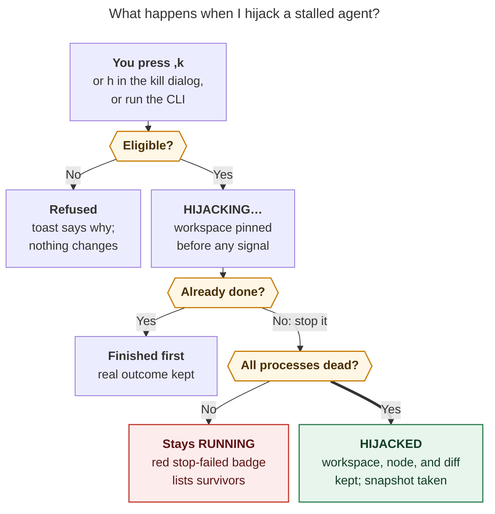
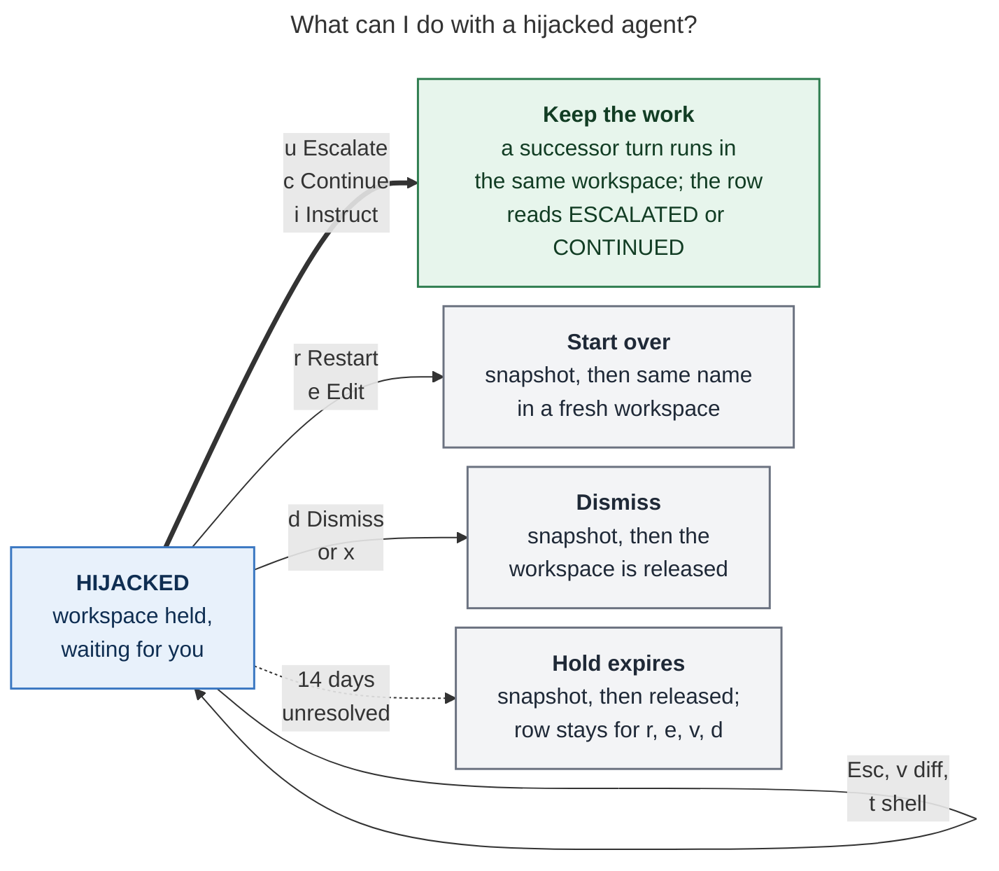
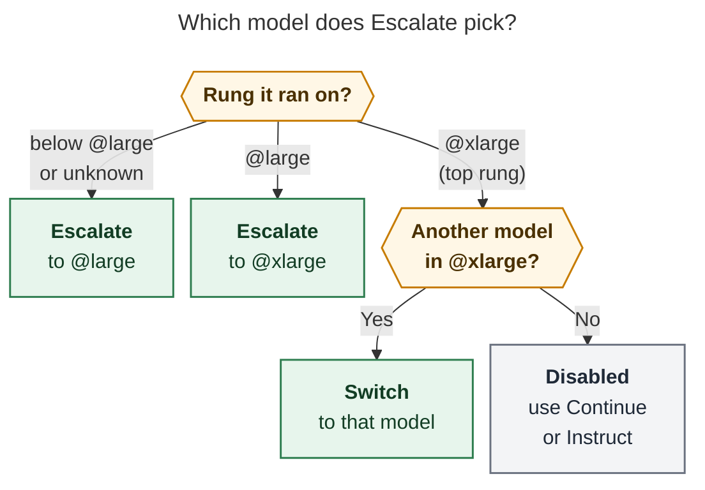

# Agent Hijack, From the User's Seat

_How stopping and recovering a stalled agent will work once epic `sase-1qz` lands._

**Sources:** epic bead `sase-1qz` and its approved plan `plan:202611/agent_hijack.md`
(including the reviewer decisions), plus the code already on `master` as of 2026-11-05.

## TL;DR

- **The problem.** When an agent stalls today, every way to stop it (`x`, `,x`,
  `sase agent restart`, auto-restart) also gives up its workspace. You lose easy access
  to its half-finished diff.
- **The fix.** A **hijack** stops the agent's processes but keeps everything else: the
  workspace claim, the Agents-tab row, and the evidence (diff stats, the last tool call,
  and a recovery snapshot). The row turns pink: **`⏏ HIJACKED`**.
- **Recovery takes one keypress.** Press `⏎` on the row, then pick one of these:
  - **Escalate** to a smarter model in the same workspace (`⏎⏎` does this by default);
  - **Continue** on the same model;
  - **Instruct**: add guidance, then continue;
  - **Restart** or **Edit** in a fresh workspace;
  - **Dismiss**.

  The work is resolved exactly once, is never silently lost, and is snapshotted before
  anything is released.

> **Status (2026-11-05):** These phases have landed:
>
> - the ledger and statuses;
> - the escalation policy;
> - runner custody;
> - the stop protocol and `sase agent hijack`;
> - release-path custody;
> - Agents-tab rendering, `,k`, and the kill dialog's `h`.
>
> These phases are still in progress:
>
> - keep-work and release recovery;
> - `sase agent recover`;
> - the recovery panel;
> - the Instruct and Edit prompt bar;
> - landing.
>
> Until the land phase, starting a hijack sits behind the **beta** feature flag
> `agent_hijack`, which is off by default. Rendering and recovery are never gated, so an
> agent hijacked while the flag was on stays recoverable after the flag is turned off.

## Kill vs. hijack at a glance

|                                | `x` Kill today                                     | `,k` Hijack                                                      |
| ------------------------------ | -------------------------------------------------- | ---------------------------------------------------------------- |
| Process tree                   | Stopped                                            | Stopped and **verified dead**                                    |
| Workspace `#N`                 | Released                                           | **Held** until you resolve it (up to 14 days)                    |
| Uncommitted diff               | Unprotected once the workspace returns to the pool | **Kept in place**, plus a recovery snapshot                      |
| Agents-tab row                 | Settles as killed                                  | **`⏏ HIJACKED`**; it counts as needing you, and `,J` jumps to it |
| Agents waiting on it (`%wait`) | See a kill                                         | **Stay parked**                                                  |
| Auto-restart                   | n/a                                                | **Never** picks it up                                            |
| Next step                      | Start from scratch                                 | One-key recovery panel                                           |

## 1. Hijacking an agent

There are three ways in:

| Where       | How                                                                                |
| ----------- | ---------------------------------------------------------------------------------- |
| Agents tab  | **`,k`** (a new leader key: "kill, but keep")                                      |
| Kill dialog | Press `x` as usual, then **`h`**: _Hijack instead · stop it but keep workspace #4_ |
| Terminal    | **`sase agent hijack [-j] [-r REASON] NAME`**                                      |



_Figure 1. A row reads HIJACKED only after every process is confirmed dead. Every other
outcome is reported honestly and leaves nothing half-done._

**What can be hijacked.** A local LLM agent turn qualifies when it meets all of these:

- it is `RUNNING`, `STARTING`, or `RETRYING`;
- it has a numbered workspace (`#1` and up);
- it was launched by a runner new enough to support hijack.

Everything else is refused with a one-line reason:

- **finalizing:** "try again in a moment";
- **a runner from before this feature:** "launched before hijack support; use x";
- **monitor turns, gate turns, named procs, home mode, clan containers, and bulk
  marks.**

On a **remote** fleet row, `,k` instead copies `sase agent hijack NAME` to the clipboard
and tells you which host to run it on.

The CLI reports its result through its exit code and a coloured result line:

| Exit | Meaning                      |
| ---- | ---------------------------- |
| `0`  | Hijacked                     |
| `2`  | Refused; nothing changed     |
| `1`  | The stop failed, or an error |

On success it prints:

```text
⏏ hijacked sase-7f.2 · ws #4 held · 5 files +212 −31 · next: sase agent recover sase-7f.2
```

## 2. What you see on the Agents tab

These are illustrative mocks of the row states. The status colour is `#FF5FAF` pink; red
is reserved for a failed stop.

```text
RUNNING                         sase-7f.2   ← before
HIJACKING…                      sase-7f.2   ← stop in progress (no spinner)
⏏ HIJACKED                      sase-7f.2   ← held; footer shows ⏎ recover · x dismiss
RECOVERING…                     sase-7f.2   ← a recovery action is running
RUNNING ⏏ stop failed           sase-7f.2   ← a process survived; the toast lists its pids
⏏ HIJACKED · workspace released sase-7f.2   ← the 14-day hold expired (snapshot kept)
```

The detail pane reuses the existing "Workspace held" line:

```text
Workspace held: hijacked · ws #4 · 5 files +212 −31 · ⏎ recover
```

HIJACKED rows sit in the **Stopped** bucket, so they show up in the header as needing
you. Rows repaint in place: selection, scroll position, and folds never jump.

## 3. The recovery panel

Press `⏎` on a HIJACKED row to open the panel directly. It takes priority over every
other Enter target; if the agent also has a Patch, the Patch is listed last as `p`.

```text
╭─ ⏏ Recover sase-7f.2 ──────────────────────────────── HIJACKED · ws #4 ─╮
│ claude/opus@high via @large · ran 47m · hijacked 3m ago                 │
│ 5 files +212 −31 · 1 linked repo · last tool: Bash just check (22m)     │
│ ⏎ again → Escalate · or press a key                                     │
│                                                                         │
│ KEEP THE WORK · next turn runs in workspace #4                          │
│ › [u] ⇧ Escalate   @large → @xlarge · claude/opus@xhigh                 │
│   [c] ▶ Continue   same model · claude/opus@high                        │
│   [i] ↪ Instruct   add guidance, then continue                          │
│ START OVER · snapshot first, then workspace #4 is released              │
│   [r] ⟳ Restart    same prompt, same name, fresh workspace              │
│   [e] ⌨ Edit       edit the prompt; nothing is released until submit    │
│ INSPECT OR LEAVE                                                        │
│   [v] ± View diff  changes in the pager · stays hijacked                │
│   [t] $ Shell      tmux in workspace #4 · stays hijacked                │
│   [d] ⌫ Dismiss    snapshot first, then workspace #4 is released        │
│                                                                         │
│ j/k move · ⏎ select · Esc decide later                                  │
╰─────────────────────────────────────────────────────────────────────────╯
```

The rows are **grouped by what happens to your diff**, so the panel answers the one
question that matters at that moment without needing warning labels:



_Figure 2. Only the keep-work keys continue in the original workspace. Every action that
releases the workspace takes a verified snapshot first, and if a recovery action fails,
the agent returns to HIJACKED with nothing lost._

| Key   | Action        | What happens                                                                                     | Workspace               |
| ----- | ------------- | ------------------------------------------------------------------------------------------------ | ----------------------- |
| `u`   | **Escalate**  | The next session turn runs on a bigger model (see §4). It becomes **Switch** at the top rung.    | Kept                    |
| `c`   | **Continue**  | The next session turn runs on the stalled run's exact `provider/model@effort`.                   | Kept                    |
| `i`   | **Instruct**  | The prompt bar opens with the continuation prompt; type guidance or edit `%model:`, then submit. | Kept                    |
| `r`   | **Restart**   | Same raw prompt and same name, in a fresh workspace.                                             | Released after snapshot |
| `e`   | **Edit**      | The prompt bar opens with the original prompt. **Nothing is released until you submit.**         | Released on submit      |
| `v`   | **View diff** | Opens the snapshot diff (or the live diff, if it is newer) in the pager.                         | Kept                    |
| `t`   | **Shell**     | Opens tmux in the held workspace.                                                                | Kept                    |
| `d`   | **Dismiss**   | Ownership-checked dismiss; waiters now see `killed`.                                             | Released after snapshot |
| `Esc` | Decide later  | The agent stays HIJACKED.                                                                        | Kept                    |

**Guard rails you'll notice:**

- **`⏎⏎` is never destructive.** The default (second Enter) is **Escalate**, or Switch
  at the top rung, or Continue when no different model exists. It is never a release
  action.
- **Opening the panel can't trigger an action.** Enter is ignored for 300 ms after the
  panel opens, so key-repeat from the opening `⏎` is swallowed.
- **Unavailable rows stay visible.** They are dimmed in place, with the reason where the
  detail would be (for example, `Restart  unavailable: fan-out prompt; use Edit`).
  Pressing their key toasts the reason.
- **`x` is unused inside the panel.** On a HIJACKED _row_, `x` means Dismiss: it
  snapshots first, then releases, with no extra dialog.
- **Slow facts load in the background.** Rows that need the model preview show
  `computing…` until it arrives; `v`, `t`, and `d` work immediately.

## 4. How Escalate picks the next model

The ladder is configurable and defaults to `["@large", "@xlarge"]`. The rung the agent
ran on is looked up from recorded facts, never guessed from the prompt text, in this
order:

1. an earlier hijack's lineage, so a second hijack keeps climbing;
2. the alias the agent ran on (its `model_alias` or `model_alias_trail`);
3. a ladder rung whose candidate list contains the agent's concrete
   `provider/model@effort`.



_Figure 3. Escalate never moves an agent down the ladder and never relaunches the same
model under a smarter-sounding label. At the top rung it moves sideways to a different
model._

The panel always prints the **concrete** target (`claude/opus@xhigh`, not just
`@xlarge`), and the keypress launches exactly that model. If that model became
unavailable after the panel previewed it, recovery fails closed: the agent stays
HIJACKED and a toast explains why.

## 5. What happens after you keep the work

The successor is the **next turn of the same agent session**, launched into the **same
workspace** (strictly: never a pool workspace and never `#0`). It inherits:

- the goal binding;
- the bead claim;
- the obligations of the repos the original turn opened;
- the permission scope;
- the original turn's finalizer baselines, so **the successor's commit owns the
  predecessor's diff**.

If any of that inheritance fails, the launch aborts and the agent stays HIJACKED.

The session tree tells the story:

```text
sase-7f.2
├─ --1  ESCALATED  claude/opus@high     (stopped by you; workspace #4 handed over)
└─ --2  RUNNING    claude/opus@xhigh    (same workspace #4, same diff)
```

The predecessor's row turns grey: **`ESCALATED`** if the model changed, or
**`CONTINUED`** if it did not. Instruct and Switch use the same rule; there is no
separate label.

With the default `successor_context: fork`, the successor's prompt looks roughly like
this. The wording is sketched from the plan; the exact text lives in sase-core.

```text
%model:claude/opus@xhigh
#fork:sase-7f.2                ← the hijacked transcript, inlined if it fits the budget

**Hijack continuation.** The user stopped sase-7f.2 (claude/opus@high) because it
stopped making progress (ran 47m; last activity: Bash `just check`, 22m before the
hijack). You are its successor in the same workspace. Its uncommitted changes are still
here (5 files, +212 −31; recovery snapshot: <ref>). Inspect git status and git diff
before acting. Keep correct work, repair or revert wrong work, and do not repeat
whatever stalled the previous run. The original task follows, unchanged.

<original prompt, minus launch-only directives such as +proj, %id, %model, %wait>
```

If the transcript would not fit the model's continuation budget, the successor gets the
evidence brief plus the transcript's path instead. Stale `index.lock` files are
mentioned in the prompt but never deleted.

**Waiters follow along.** Agents waiting on the hijacked agent stay **parked**, never
failed, while it is held. After a keep-work action they follow the successor. After a
Dismiss they see `killed`. After a Restart they follow the name.

## 6. The safety promises

| Promise                       | What it means for you                                                                                                                     |
| ----------------------------- | ----------------------------------------------------------------------------------------------------------------------------------------- |
| **Custody before the signal** | The workspace is pinned and the hijack is recorded _before_ any process is signalled, so no cleanup path can grab the workspace mid-stop. |
| **Verified dead**             | The row reads HIJACKED only after the whole process tree is confirmed gone; otherwise it stays RUNNING with a red badge.                  |
| **Exactly once**              | Two resolvers (two TUIs, or a TUI and the CLI) can't both act; the second gets "already being resolved".                                  |
| **Snapshot before release**   | Restart, Edit, Dismiss, and hold expiry all verify a snapshot of every changed repo first. If the snapshot fails, nothing is released.    |
| **Survives the TUI closing**  | TUI actions run as durable background procs, and a crashed recovery is reconciled by the next recover call or cleanup pass.               |
| **Bounded hold**              | `workspace.held_claim_ttl_days` (14) counts from the moment of the hijack, not from the agent's launch.                                   |
| **No surprise relaunches**    | Auto-restart never touches a hijacked run, and a late declaration from the dead turn is ignored.                                          |

There is one escape hatch: when a snapshot genuinely cannot be taken, Dismiss offers a
separately labelled **Discard without snapshot**. You only get it after a deliberate
confirmation (`--discard-without-snapshot` on the CLI).

## 7. CLI and config cheat sheet

```bash
sase agent hijack sase-7f.2 -r "stalled on lint"      # stop, keep workspace
sase agent recover sase-7f.2                          # print the recovery menu
sase agent recover sase-7f.2 -a escalate              # u
sase agent recover sase-7f.2 -a continue              # c
sase agent recover sase-7f.2 -a continue -p next.md   # i (your own continuation prompt)
sase agent recover sase-7f.2 -a restart               # r
sase agent recover sase-7f.2 -a restart -p edited.md  # e (relaunch an edited prompt)
sase agent recover sase-7f.2 -a dismiss               # d
sase agent recover sase-7f.2 -a escalate -n           # dry-run preview of one action
```

`-m MODEL` pins the target model for `escalate` and `continue`, and `-j` emits JSON. A
few existing commands also change on a HIJACKED agent:

- `sase agent restart NAME` runs the Restart resolution.
- `sase agent kill` refuses with a hint to use `recover -a dismiss`.
- `sase agent list` and `sase agent show` include HIJACKED agents without `-a`, with a
  `ws #N held` hint.

```yaml
agent_hijack:
  escalation_ladder: ["@large", "@xlarge"] # rungs Escalate climbs
  successor_context: fork # or "brief" (evidence only)
ace.keymaps.leader_mode.keys.hijack_agent: "k"
```

## Deliberately not in v1

These are recorded as follow-ups for after landing:

- answering hijacks from Telegram or mobile;
- a "quiet for N min" stall hint;
- an expiry-warning notification;
- a "Salvage & Commit" action;
- revisiting `x` as a fate chooser.

Hijack never resumes the killed process. Recovery is always a new turn.
