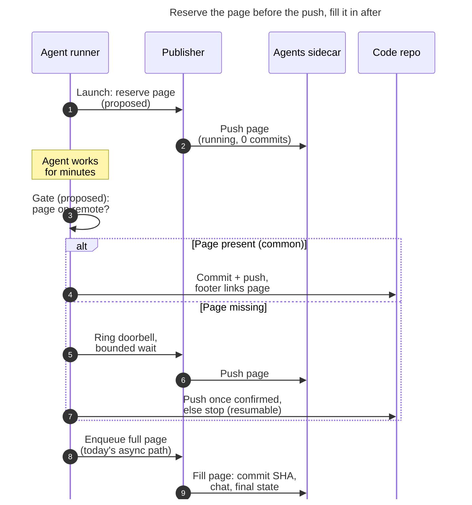

# Should agent publication go back to being synchronous?

> **Research query:** Since agent sidecar publication was made asynchronous, SASE has
> had recurring agent publication errors. The requester is considering a revert, on the
> principle that the agent page a commit links to (through its `SASE_AGENT=` footer)
> should always be live before the commit is made. Is that the right call? If the
> principle is right, how can commits stay fast while guaranteeing, with 100% certainty,
> that the page is published first? If not, what should be done instead?

## Bottom line

1. **Your principle is right. Keep it.** A commit footer is a pointer, and the agent
   page is what it points at. "Never point to a structure before it has been
   initialized" is the first of the classic ordering rules that let file systems drop
   synchronous writes without losing integrity
   ([McKusick & Ganger, 1999](https://pdos.csail.mit.edu/6.1810/2004/readings/mckusick99softupdates.pdf)).
   That paper's goal is the same as yours: get speed without giving up ordering.
2. **Reverting would not deliver it.** In both the old and new designs, the commit is
   pushed *before* any page is published (`src/sase/workflows/commit/workflow.py:295`
   dispatches commit + rebase + push; publication runs later from
   `_workflow_tracking.py:261`). On athena, under the old inline path (Oct 21–29), 37% of
   agent-linked sase commits were pushed before their page existed. Those pages appeared
   a median of 93 s later, and one took 3.1 h. Earlier in the inline era (Oct 12–20), 138
   of 265 linked commits **never got a page at all**. Bead pages are still published
   synchronously today, and 12% of bead-linked commits still pushed before their bead
   page existed.
3. **The errors are mostly old failures that are now visible, not new ones caused by
   async.**
   - **apollo:** about 10,300 error lines since Oct 30 come from a sidecar clone that
     has been wedged since **Oct 27, three days before the async change**. A stuck local
     commit conflicts on a global run counter in the shared root `README.md`. apollo has
     pushed nothing to `sase--agents` since then, and 53 sase rows (oldest 8.6 days)
     plus 617 bob-cli rows are waiting.
   - **athena:** about 4,600 lines are one withheld bob-cli run, re-reported every 15 s.
   - The inline path hid this class of failure as warnings in stitch output and about
     3,500 silently quarantined rows. The background job reports it on every tick.
4. **A page that already lists the commit cannot go live before the push.** The page
   links back to the commit SHA, and that SHA is not final until the push succeeds:
   `_push_current_branch_with_rebase_retry` rebases and retries whenever the remote
   moves. Whichever of the two pushes goes first, one link dangles. The invariant you
   can guarantee is **the page exists before the push**. Content that depends on the
   commit has to come after it.
5. **Recommendation: reserve, gate, fill.**
   - **Reserve:** publish the agent page at launch.
   - **Gate:** before `sase stitch create` dispatches, check that the exact page path in
     the footer is on the sidecar remote. This is a local ref lookup and costs
     milliseconds.
   - **Fallback:** if the page is not there, wait for the publisher for a bounded time,
     then publish just that page inline. If that also fails, stop before the push,
     leaving a resumable stitch.
   - **Fill:** after the push, today's background path adds the commit, chat, and final
     state.

   This gives the 100% ordering guarantee and keeps nearly all of the async speedup.
6. **Fix the error sources whichever way you decide.**
   - Repair apollo's clone.
   - Stop writing machine-wide aggregate counters into shared sidecar files, and make
     derived files *regenerate* on conflict instead of rebasing.
   - Park withheld rows so they stop blocking the queue, and notify once instead of
     every tick.
   - Finish the SSH retry adoption (`sase-1r7`).
7. **If you want to revert anyway,** set `commit.publication.mode: inline`
   (`src/sase/default_config.yml:2079`). The inline branch still exists as the
   configured fallback, so no code revert is needed. You would pay roughly 45–60 s more
   per committed repository and still not get the guarantee.

## What the async change was, and what it bought

Epic `sase-1pt` ("End agent commit stages at a durable publication enqueue") landed Oct
29–Nov 2. Its key commits are `4356cffaa1` (background publication job) and `e69360f49d`
(commit enqueues instead of publishing). It followed the research report
`research:202610/commit_stage_latency_synchronous_publication/...`, which found that a
no-conflict commit stage spent a median of 236 s from model-done to `done.json`. Only
2.1 s of that was `git commit` + fetch/rebase + push. The rest was three publication
passes of about 50 s each, plus a retention scan.

The installed re-prove (`sase-1pt.9`, 73 runs) measured these results against a pre-epic
baseline of 54 runs:

| Metric                              | Before epic | After epic                                    |
| ----------------------------------- | ----------- | --------------------------------------------- |
| `provider_done` → `done.json`, p50  | 346.5 s     | 101.3 s                                       |
| `provider_done` → `done.json`, p95  | 562.1 s     | 200.6 s                                       |
| Publication sub-step, median        | 255.4 s     | 38.9 s (bead pages, still synchronous, 38.2 s) |
| Hood enqueue                        | n/a         | 0.6 s                                         |
| Publisher queue age, p95            | n/a         | 547 s                                         |

Not all of that gain came from asynchrony. The epic also fixed a Referenced By loop that
could never succeed (most of pass A, about 45 s) and moved the retention scan to an
hourly job (about 28 s). Those fixes stand regardless of the async decision.

The part asynchrony removed is the inline hood drain, prompt-archive publish, and link
drain. On athena today, a successful hood drain takes a median of **46.5 s** (n=14, Nov
4):

- `inventory_build`: 25.4 s
- `prepare`: 7.0 s
- per-hood render: 0.5–8 s
- `push`: 2.4 s
- `commit`: 1.7 s
- `pull_rebase`: 0.5 s

Reverting puts that cost back in every commit stage, per committed repository. It also
brings back contention for the single per-project agents lock.

## Was the page ever live before the commit?

I matched every sase `origin/master` commit since Oct 12 that has a linked `SASE_AGENT=`
footer against the first `sase--agents` commit that added the linked page path. The lag
is the sidecar commit time minus the code commit time. A negative lag means the page
already existed.

| Era (athena commits)        | Linked commits | No page at the linked URL                      | Page existed before commit | Page appeared after commit: p50 / p95 / max                       |
| --------------------------- | -------------- | ---------------------------------------------- | -------------------------- | ----------------------------------------------------------------- |
| Inline, Oct 12–20           | 265            | **149** (138 with no page under any layout)    | 29 (11%)                   | 87 commits: 6.2 h / 4.4 d / 9.2 d                                 |
| Inline, Oct 21–29           | 216            | 0                                              | 137 (63%)                  | 79 commits (37%): **93 s** / 1,371 s / **11,194 s (3.1 h)**       |
| Async, Oct 30–Nov 4         | 155            | 0                                              | 92 (59%)                   | 63 commits (41%): **194 s** / 489 s / **1,035 s (17 min)**        |

For a control, I ran the same check on bead pages (`SASE_BEAD=` links into
`sase--beads`, Oct 24–Nov 4). Bead pages are still published synchronously after the
push. Of 240 linked commits, 28 (12%) were pushed before their bead page existed. Those
pages appeared a median of 47 s later (max 94 s).

On apollo, 13 linked commits since Oct 27 (4 inline, 9 async) have no page at all,
because apollo's publication clone is wedged (see below).

What this shows:

- **Neither design ever met the invariant.** Inline narrowed the typical gap (93 s
  against 194 s) but had a much worse tail and a period of large-scale loss. Async
  bounded the tail at about 17 min, and on athena every linked commit since Oct 21 has
  its page.
- **Most pages already exist before their commit, by accident.** A hood publish renders
  every member of the hood, including waiting and running ones. For example,
  `agents/bbugyi200.athena.sase-1r5.1.5/README.md` was first published at 07:17 EST on
  Nov 4 with `State: waiting · Commits: 0`. Its commit `8b0e640` landed at 09:50:35, and
  the page gained that commit at 09:52:12. That is the reserve-then-fill pattern this
  report recommends, already happening for epic hoods. Agents in hoods with no other
  activity (one-offs, and research swarms when the shared research hood is quiet) get
  no early page.

**Method limits.**

- I measured only sase commits.
- "First add" covers sidecar history since Oct 8.
- A code commit's committer time precedes its push by seconds.
- Some Oct 12–20 links may have pointed at an older layout that was later migrated. 11
  of them point at a `sessions/` page while the `agents/` page exists.
- The apollo clone's `origin/main` was fetched at 17:04 UTC on Nov 4.

## What the publication errors actually are

I classified the `[agent_publication]` lines in the axe error digests for Oct 30–Nov 4.
These are error lines, not distinct incidents: the job runs every 15 s and re-reports
whatever is still stuck.

| Class                                                     | apollo  | athena | Caused by async?                                                                       |
| --------------------------------------------------------- | ------- | ------ | -------------------------------------------------------------------------------------- |
| `git pull --rebase failed` in the agents clone            | ~10,300 | 0      | No. The stuck commit dates from Oct 27 and is a cross-machine counter conflict          |
| `run withheld by publication protection`, every tick      | ~5,200  | ~4,600 | No. Withholding is the scanner's call; re-reporting it every tick is the job's design   |
| SSH `Permission denied (publickey)`                       | 107     | 63     | No. Covered by `sase-1r5` (done) and `sase-1r7` (open)                                  |
| Hood drain hit its 120 s timeout (research hood)          | 0       | 18     | No. Secret-scan cost regression from Oct 26–27; fixed by `sase-1qh.3`                   |
| "did not materialize" / not acknowledged (planner scope)  | 0       | 28     | Surfaced by async. Fixed by `sase-1qh.1` and `.2`                                       |
| Git timeouts, busy lock, leftover rebase state            | ~40     | ~5     | Mostly no                                                                               |

### apollo's wedge

- apollo's machine clone
  (`~/.sase/projects/gh_sase-org__sase/repos/agents`) holds one local commit,
  `7b4d2fef9c chore(agents): sync from bbugyi200.apollo`, dated 2026-10-27 03:02 UTC.
  It is 619 commits behind `origin/main`.
- Its conflicting hunk is the root `README.md` line
  `**Owners:** 1 · **Machines:** 3 · **Hoods:** 2558 · **Runs:** 17180`, plus the
  matching users table. Since the merge base, 232 athena commits have rewritten that
  file.
- Every publish from any machine rewrites a machine-wide aggregate, so two publishing
  machines will always conflict there. A rebase can never resolve a counter conflict
  correctly; only regenerating the file can.
- The beads sidecar already learned this lesson. Its docs say the shared
  `pages/README.md` roster "is owned by `sase bead pages refresh`, so regular commits
  avoid rewriting a file every active agent could touch"
  (`docs/reference/work-units/bead-pages.md`).
- **The inline path hit the same wedge.** apollo's last sidecar pushes were on Oct 27,
  and its inline commits on Oct 27–28 have no pages. Under inline, each of these
  failures became a "deferred and will retry" warning inside a stitch log.

### Withheld rows

- In `_drain_project` (`src/sase/agents_sync/publication_job.py`), the first batch error
  ends the whole project pass. One withheld run can therefore hold back the rest of that
  project's queue.
- The withheld run is also counted as a `check_error` on every tick. On athena, bob-cli
  shows 50 active rows, the oldest 2.7 days old, with last outcome `hood_error`.
- A separate report in this directory, `agent_publication_openai_key_false_positives`,
  appears to cover why these runs are withheld. I did not read it.

### What async did add

The async design did add real complexity:

- a doorbell, hints, and a heartbeat;
- a liveness-selected branch, so behavior differs between machines;
- deferred prompt-archive parity;
- a background process that imports the editable checkout (one
  `cannot import name 'AgentRunStateDiscoveryWindowRequestWire'` error showed Python vs.
  Rust-binding skew).

The publisher also needed its own repairs: busy-loops and request-local acknowledgment
(`sase-1pt.9.1`). These costs are real, but they are not what fills your digests.

## Why "fully published before the commit" is impossible, and what is possible

- The agent page lists the run's commits and links each one to
  `github.com/sase-org/sase/commit/<sha>`.
- The completion gate
  (`decide_publication_request_completion`, called from
  `src/sase/agents_sync/publication_completion.py`) only acknowledges a revision-scoped
  row once the page's run contains that SHA.
- The SHA is unknown until the push lands, because the dispatch rebases and retries when
  the remote moves (`src/sase/vcs_provider/plugins/_git_commit_dispatch.py:345`).
- The commit and the page point at each other. With two separate pushes, whichever
  lands first carries a link to something that does not exist yet.
- Serializing pushes so the SHA can be fixed first would put a cross-machine lock on
  every commit. That would be slower and more fragile than what you have now.

The way out is to split the page's **existence** from its **content**:

- **Existence** does not depend on the commit. The footer URL is a pure function of the
  agent name (`HostedLinkResolver.agent_url`, `src/sase/sdd/hosted_links.py:159`), and
  the renderer already produces valid pages for waiting and running runs. Existence can
  therefore be made true before the commit, and checked cheaply.
- **Content** (the commit SHA, chat, and final state) is the back-pointer. It can only
  be written after the push, which the async filler already does.

## Recommendation: reserve, gate, fill

_The commit's link target is published before the push, and the page's link back to the
commit is written only after the push, so neither link ever dangles. Steps 1, 3, and 5–7
are proposed; the other steps exist today._

### 1. Reserve at launch

When a run starts, enqueue a page-only publication row and ring the doorbell. The pieces
already exist:

- `PUBLICATION_SCOPE_LINKED` acknowledges a row once its page exists. Approved-planner
  rows already use it (`sase-1qh.1`).
- The renderer already emits `State: waiting/running` pages.
- The publisher was idle 86% of the time in the re-prove sample, so it has room for one
  extra hood publish per launch. Batching coalesces launches into the same hood.

Agents usually run for minutes, so the reservation is almost always done by commit time.

### 2. Gate before dispatch

In `CommitWorkflow.run`, after the footer is composed (`apply_tracked_commit_tags`) and
before `dispatch(...)` (`workflow.py:295`):

1. Take the page path the footer actually links. `agent_url` picks between `agents/`,
   `sessions/`, and `families/` based on local files, so the gate must check that same
   path.
2. Check it against the machine publication clone's last-pushed state:
   `git cat-file -e origin/main:<path>` in `ProjectTarget.sidecar_path`. This makes no
   network call. Also confirm that the page's `meta.json` names this run, so a reused
   agent name cannot satisfy the check.

The verdict belongs in the existing Rust completion decision (linked scope), because
every frontend that relies on this invariant needs it to match (see the
`rust_core_backend_boundary` core memory).

If the page is missing:

1. Append a priority hint, ring the doorbell, and poll for up to N seconds (for example
   120).
2. Then run the existing inline drain for that one row. The inline code path is still
   shipped as the fallback.
3. If that also fails, **stop before the push**. Return a resumable stitch
   (`sase stitch create --resume`) and raise one notification. That is the 100% part.

Under this rule, apollo's agents would have stopped committing on Oct 27 instead of
silently shipping unlinked commits for eight days. That is the point of the rule: you
would have found the wedge on day one.

If you would rather commits never block on sidecar health, there is one alternative
policy, and it is already precedent in SASE. Bead pages render an agent creator "as
inline code with no link" when the page does not resolve. Applied to footers, this means
writing `SASE_AGENT=<name>` with no link destination when the gate cannot confirm the
page. Every link that is written still resolves, but some commits carry no link. Your
requirement reads as the strict version, so I recommend strict as the default.

### 3. Fill after the push

Keep today's background branch unchanged: enqueue, then the publisher adds the commit
SHA, chat, and terminal state.

### What this costs

- **Common case:** one local ref lookup on the commit path, plus one background hood
  publish per launch.
- **Rare case:** a bounded wait, then an inline publish of one hood. Today that takes
  about 46 s on athena, dominated by the 25 s `inventory_build`.
- Making inventory per-hood instead of O(project history) would cut that to a few
  seconds of git. It is already listed as an out-of-scope follow-up in the `sase-1pt`
  plan.

### What "100%" means here

The guarantee is: **the remote accepted a push containing the page before the code
commit was created.** That is the strongest fact a client can verify. I did not measure
GitHub's own read-after-write behavior for `github.com/.../blob/main/...` views.

The guarantee also has to hold over time:

- Pages that commit footers link to must never be deleted or moved without a redirect
  stub.
- This matters for hood retention (`sase-11n`). The existing `# Moved to sessions/...`
  stubs are the right pattern.

### Record it

This is a cross-cutting rule that future work could quietly break: a commit never links
a page that is not live. The `sase-1pt` plan explicitly declined a decision record
(`decision_record = no`). If you adopt this design, it deserves one. Add it through
`/sase_memory_write`.

## Fix the error sources (needed under any choice)

1. **Unwedge apollo now.** This is an operator action on a machine clone, so do it
   through a gate rather than an agent. Abort or reset the stuck local commit, re-render,
   and push. Then make the publisher self-heal:
   - when `pull --rebase` conflicts only in derived index files, abort, reset to
     `origin/main`, re-render, and push (regenerate, don't rebase);
   - stop writing machine-wide totals into the root and user `README.md` on per-run
     publishes, and give those totals to a periodic refresh owner, as the beads sidecar
     already does.
2. **Stop head-of-line blocking and per-tick repeats.**
   - A withheld or deterministically refused row should be parked, and the pass should
     continue with other rows.
   - Notify on the state transition (new withheld run, or a wedge that has lasted N
     minutes), not on every 15 s tick.
   - This keeps errors visible, as `sase-1qh` requires, without about 5,000 lines a day
     per stuck row.
3. **Finish SSH credential retries** in sidecar push and the publisher (`sase-1r7`,
   open).
4. **Guard against binding skew.** The job imports the editable checkout, so it should
   check the `sase_core_rs` version before draining instead of failing mid-hood.

## Speed levers that keep the invariant

- **Bead pages are the largest remaining publication cost on the commit path:** 38.2 s
  median, still synchronous, and still after the push. They are also the 12%
  dangling-link case above. Apply the same reserve, gate, fill model:
  - publish the page when the bead is created;
  - gate on its existence;
  - move the lineage refresh to the background.

  This would likely save more time than reverting would cost, and it would close the
  bead-link gap. It overlaps with the open latency residual `sase-1qx`.
- **Make `inventory_build` per-hood.** Today it is O(project history), 25 s per drain.
  Per-hood inventory would make the synchronous fallback, and the publisher, cheap.
- **Leave the other `sase-1pt` wins alone.** The pin resolver, scheduled retention, and
  the Referenced By fix do not depend on asynchrony.

## Sources

- SASE code at `d563b9da4d`:
  - `src/sase/workflows/commit/workflow.py`
  - `src/sase/workflows/commit/_workflow_tracking.py`
  - `src/sase/workflows/commit/workflow_publication.py`
  - `src/sase/vcs_provider/plugins/_git_commit_dispatch.py`
  - `src/sase/agents_sync/publication_completion.py`
  - `src/sase/agents_sync/publication_job.py`
  - `src/sase/sdd/hosted_links.py`
  - `src/sase/default_config.yml`
  - `docs/reference/work-units/bead-pages.md`
- Beads `sase-1pt`, `sase-1pt.8`, `sase-1pt.9` (re-prove notes), and `sase-1qh`. Plans
  `plan:202610/commit_stage_async_publication.md` and
  `plan:202610/agent_publication_notifications.md`. Report
  `research:202610/commit_stage_latency_synchronous_publication/commit_stage_latency_synchronous_publication.md`.
- Live data, read-only, collected Nov 4, 2026:
  - axe error digests on apollo and athena;
  - `~/.sase/logs/agent_publication_drains.jsonl` and `heartbeat.json` on both hosts;
  - `git log` of the `sase--agents` and `sase--beads` machine clones on apollo;
  - sase `origin/master` history since Oct 12.
- M. K. McKusick and G. R. Ganger,
  [Soft Updates: A Technique for Eliminating Most Synchronous Writes in the Fast Filesystem](https://pdos.csail.mit.edu/6.1810/2004/readings/mckusick99softupdates.pdf),
  USENIX 1999 (ordering rule 1). G. R. Ganger and Y. N. Patt,
  [Metadata Update Performance in File Systems](https://static.usenix.org/publications/library/proceedings/osdi/full_papers/ganger.a),
  OSDI 1994.
- C. Richardson, [Pattern: Transactional outbox](https://microservices.io/patterns/data/transactional-outbox),
  microservices.io. This is the durable-enqueue pattern `sase-1pt` already uses. It
  guarantees eventual delivery, not ordering against an external reader.
