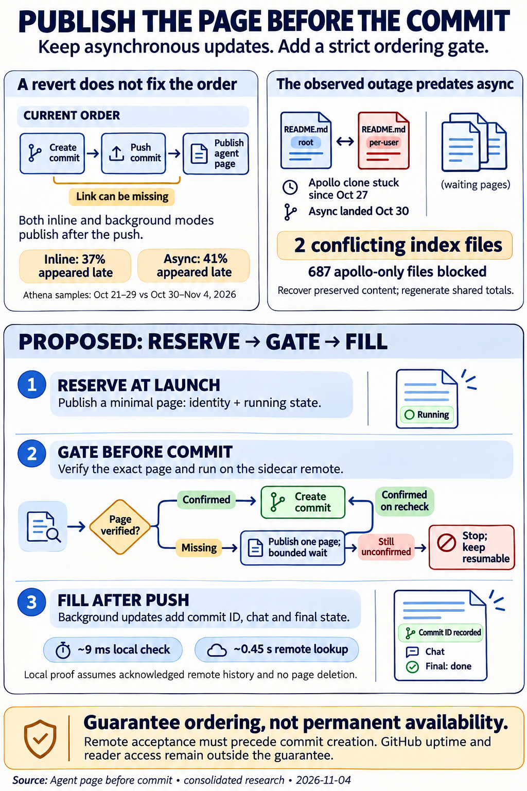
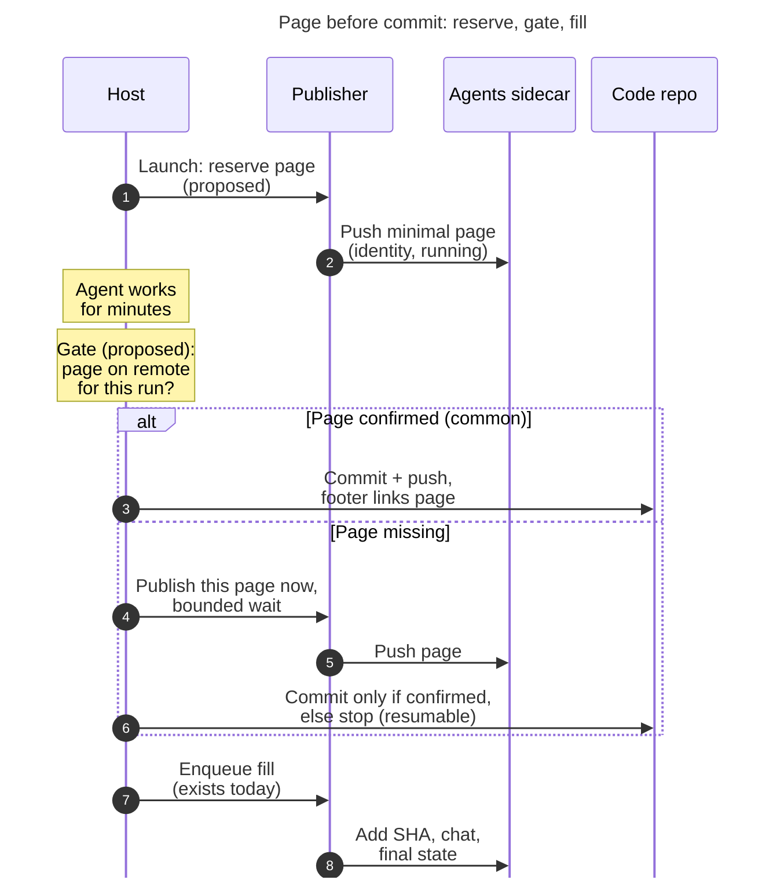

# Agent page before commit: keep the rule, don't revert to get it

> **Research query:** Agent publication errors began after agent-sidecar publication was
> made asynchronous to speed up commits. Should those changes be reverted, given the view
> that an agent page linked from a sase commit's description tags should always be live
> before the commit is made? If that view is right, how can commits be sped up while
> guaranteeing with 100% certainty that the page publishes first; if not, what should be
> done instead?

## Bottom line

1. **Your rule is right. Keep it, and record it.** A commit footer is a pointer, and the
   agent page is what it points at. "Never point at something before it exists" is the
   first ordering rule of soft updates, the file-system technique for getting speed
   without losing ordering
   ([McKusick & Ganger 1999](https://pdos.csail.mit.edu/6.1810/2004/readings/mckusick99softupdates.pdf)).
   Nothing in SASE writes this rule down today: the async epic `sase-1pt` explicitly
   declined a decision record (`decision_record = no`).
   [All five reports agree](#where-the-five-reports-agreed-and-differed) with the rule.

2. **A revert would not give you the rule, so don't revert.** Under both the old inline
   path and today's background path, the code commit is created **and pushed** before
   any publication starts. Under inline,
   [37% of athena's linked commits](#measured-page-existence-before-commit) (Oct 21–29)
   were readable before their page existed. Inline also had a worse tail than async
   (3.1 h against 17 min). In the earlier Oct 12–20 inline window, 138 of 265 linked
   commits never got a page at all.
   [Reverting would add roughly 45–60 s](#why-revert-or-flip-to-inline-falls-short) per
   committed repository and still allow dangling links. This holds for a code revert and
   for flipping `commit.publication.mode: inline`.

3. **Most of the errors come from a
   [wedged clone on apollo](#what-the-publication-errors-actually-are), not from
   asynchrony.**
   - Apollo's hidden agents clone has been stuck since **Oct 27**, three days before
     async landed on Oct 30.
   - I checked it today (17:51 UTC). It holds one unpushed commit, `7b4d2fef9c`, and is
     619 commits behind.
   - The commit touches 689 files. Only **two** of them conflict with the remote: the
     root `README.md` and `users/bbugyi200/README.md`. In both, the conflicting change is
     a machine-wide run counter that differs by one (`17180` against `17179`).
   - That one-character difference has blocked 687 files of apollo-only pages for eight
     days.
   - Today's drain log has 336 failed drains, all failing at `pull_rebase`, and **0
     published**.
   - Since Oct 27, **38 of the 39** apollo-authored linked commits I checked (sase and
     research) point at pages that do not exist, including all five reports in this
     swarm. Over the same period, **0 of the 332** athena-authored linked commits point
     at a missing page: async eventually publishes all of them.

4. **You can guarantee the page exists before the commit.
   [You cannot guarantee the page already lists the commit.](#what-100-percent-certain-can-and-cannot-mean)**
   The page links back to the commit SHA. That SHA does not exist until `git commit`
   runs, and it can change when the push has to rebase. What you can guarantee is that
   the remote has accepted the page **before `git commit` runs**. The commit-specific
   content (SHA, chat, final state) has to come after.

5. **Recommendation: [reserve, gate, fill](#recommended-reserve-gate-fill-design).**
   - **Reserve:** publish a minimal agent page when the turn launches.
   - **Gate:** immediately before `git commit`, check that the exact footer path is on
     the sidecar remote and belongs to this run. In the common case this is a local
     lookup that takes about 9 ms. If the page is missing, publish that one page and
     wait a bounded time. If that also fails, **refuse to create the commit** and leave
     a resumable stitch.
   - **Fill:** keep today's background publisher for everything that depends on the
     commit.

   This makes the ordering certain for every SASE commit path, and nearly all of the
   async speed-up is kept.

6. **[Fix the error sources first](#what-to-do-in-order), whatever you decide.**
   - Recover apollo with the documented backup-first stale-replay helper. Do **not** use
     `git reset --hard`, which would throw away the 687 unpublished files.
   - Stop per-run publishes from rewriting machine-wide aggregate counters.
   - Make "publisher is live" mean "publisher is succeeding", not just "heartbeat is
     fresh".

## What the code does today

The order is the same in both modes (`src/sase/workflows/commit/workflow.py`,
`_workflow_tracking.py`, `workflow_publication.py`):

1. **Stamp the footer.** `apply_tracked_commit_tags` writes
   `SASE_AGENT=[<global-name>][n]` into the message. `resolve_agent_commit_tag`
   (`src/sase/agents_sync/links.py`) builds the URL. That resolution is deliberately
   local-only: it never checks whether the page exists. The URL has the form
   `https://github.com/sase-org/sase--agents/blob/main/<path>`, where `<path>` comes
   from `sase_agent_page_path`. It depends only on the agent or turn name, not on any
   commit SHA.
2. **Save a checkpoint** that includes `pre_dispatch_revision`.
3. **Dispatch.** The provider's `create_commit` runs `git commit`, then fetch and rebase
   (with retries), then **push**.
4. **Write the result marker.**
5. **Publish.**
   - In `background` mode (the default, `src/sase/default_config.yml:2083`), this step
     writes a durable outbox row plus a hint and returns.
   - The background path is chosen only when axe is running and
     `publisher_is_live(15 min)` is true.
   - `publisher_is_live` (`src/sase/agents_sync/publication_doorbell.py:179`) **only
     checks the heartbeat's age**. Apollo's publisher has failed every drain today, but
     its heartbeat was 54 s old when read, so it counts as live.
   - In `inline` mode, this step publishes after the push. If the drain cannot finish,
     the commit still returns OK with a "deferred and will retry" warning. Only the
     case where the work was never queued at all fails loudly.

So **neither mode has ever enforced page-before-commit.** The acceptance test
`test_tagged_commit_publishes_and_pushes_every_sidecar_before_returning` checks
publication before the helper *returns*, not before the primary commit or push (cdx).

**History.**

- **August:** this trade has been made twice. In August, `sase-ej` made publication
  async. Then `sase-fa` (`de78052789`) reverted it after a footer to
  `families/bbugyi200.athena.t2.md` returned 404. Even that restored contract was
  weaker than your rule: it promised the URL would resolve "when stitch returns", not
  before the commit could be read (grk).
- **October:** `sase-1pt` (`4356cffaa1`, `e69360f49d`, both Oct 30) reintroduced async
  to cut commit-stage latency.

## Measured page existence before commit

cld matched every sase `origin/master` commit with a linked `SASE_AGENT=` footer to the
first `sase--agents` commit that added the linked page.

| Era (athena commits) | Linked commits | No page at the linked URL | Page existed before commit | Page appeared after: p50 / p95 / max |
| --- | --- | --- | --- | --- |
| Inline, Oct 12–20 | 265 | **149** (138 with no page under any layout) | 29 (11%) | 6.2 h / 4.4 d / 9.2 d |
| Inline, Oct 21–29 | 216 | 0 | 137 (63%) | 79 (37%): 93 s / 1,371 s / **3.1 h** |
| Async, Oct 30–Nov 4 | 155 | 0 | 92 (59%) | 63 (41%): 194 s / 489 s / **17 min** |

- **Some pages already exist by accident.** A hood publish renders every member of the
  hood, including waiting and running ones. Agents in active epic hoods therefore often
  have a page before they commit. For example, `sase-1r5.1.5` was published as
  `State: waiting · Commits: 0` about 2.5 h before its commit `8b0e640` (cld). That is
  reserve-then-fill, happening by accident.
- **Bead pages have the same gap.** `SASE_BEAD` footers into `sase--beads` are still
  published synchronously after the push. 12% of those links were readable before
  their page existed (cld).

**Lead's live check, apollo, Nov 4, 17:51 UTC.** The agents clone's `origin/main` had
been refreshed by a fetch 40 s earlier. `git ls-remote` confirmed it matched the
remote. Results for linked commits since Oct 27:

| Repository | Athena-authored: page present | Apollo-authored: page present |
| --- | --- | --- |
| `sase` master | 254 / 254 | 1 / 12 |
| `research` sidecar | 78 / 78 | 0 / 27 (includes all five `research.39` reports) |

The commit that lands this report will add one more dangling link, until apollo is
recovered.

## What the publication errors actually are

| Class (axe digest lines, Oct 30–Nov 4, from cld) | apollo | athena | Caused by async? |
| --- | --- | --- | --- |
| `git pull --rebase failed` in the agents clone | ~10,300 | 0 | **No.** The wedge dates from Oct 27. |
| Run withheld by publication protection, re-reported every 15 s tick | ~5,200 | ~4,600 | No. Withholding is the scanner's call; repeating it every tick is the job's design. |
| SSH `Permission denied (publickey)` | 107 | 63 | No. Covered by `sase-1r5` (done) and `sase-1r7` (open). |
| Hood drain hit its 120 s timeout | 0 | 18 | No. Scan-cost regression, fixed by `sase-1qh.3`. |
| Planner-scope row "did not materialize" | 0 | 28 | Surfaced by async. Fixed by `sase-1qh.1` and `.2`. |

**The apollo wedge, verified by the lead.**

- **What is stuck.** `7b4d2fef9c chore(agents): sync from bbugyi200.apollo` was
  committed 2026-10-27 03:02 UTC. Its merge base is `59518c9a57`. Since then the remote
  has changed 11,075 paths and apollo's commit has changed 689.
- **What overlaps.** The only paths both sides changed are `README.md` and
  `users/bbugyi200/README.md`, which hold machine-wide aggregate totals. Every publish
  from any machine rewrites them, and 232 remote commits have rewritten the root
  `README.md` since the merge base. A rebase can never resolve a counter conflict
  correctly; only regenerating the file can.
- **The beads sidecar already avoids this.** Its roster is owned by
  `sase bead pages refresh`, "so regular commits avoid rewriting a file every active
  agent could touch" (`docs/reference/work-units/bead-pages.md:48`).
- **Drain log since 13:29 UTC.** 505 rows: 336 `failed` at `pull_rebase` (167 sase,
  169 bob-cli), 169 `no_requests` (withheld job row), and **0 published**.
- **Heartbeat backlog.** 56 sase rows (oldest 8.6 d) and 618 bob-cli rows are waiting.
- **This class keeps coming back.** The stale-replay runbook names an earlier apollo
  bob-cli wedge (`2abeff3f9`). The Apollo recovery epic `sase-1nf.10.1.9` has been
  `IN_PROGRESS` since Oct 20, and its landing has been blocked since Oct 22.

**What async changed is visibility.** The inline path turned each of these failures
into a "deferred, will retry" warning inside a stitch log. The background job reports
them every 15 s.

**Async did add real costs** (cld, mus):

- doorbell, hints, and heartbeat machinery;
- behavior that depends on liveness, so it differs between machines;
- a background process exposed to Python and Rust-binding skew;
- several follow-up repair commits.

These costs are real, but they are not what fills your error digests.

## Why revert or flip to inline falls short

- **Same ordering.** Inline still pushes before publishing, so it shortens the typical
  dangling window but cannot close it. The measured typical window went from 93 s to
  194 s with async, about 2×. The worst case improved under async (3.1 h down to
  17 min). The "10–100×" improvement predicted for inline does not appear in the data.
- **It fails today.** On apollo, every inline commit would run a drain that fails at
  `pull_rebase`. That adds foreground time, then returns OK with the page still
  missing.
- **It costs time.** A successful hood drain on athena takes a median of 46.5 s:
  `inventory_build` 25.4 s, `prepare` 7.0 s, `push` 2.4 s (n=14, cld). Inline would put
  that back on every committed repository, plus the single per-project agents lock.
  - The historical figures of 236–255 s per stitch overstate the marginal cost of a
    revert. `sase-1pt` also fixed a Referenced By loop and moved the retention scan to
    an hourly job, and those gains do not depend on asynchrony.
- **It removes the recovery path.** The publisher, doorbell, and `sase agent sync`
  drain also recover deferred work under inline. A code revert removes that safety net
  while inline still needs it (mus, cdx).

`mode: inline` is still a valid per-machine escape hatch. Describe it honestly as
"best-effort publication after the push."

## What 100 percent certain can and cannot mean

| Condition | What it proves |
| --- | --- |
| A durable outbox row exists | Work is owed. That gives eventual delivery, not ordering ([transactional outbox](https://microservices.io/patterns/data/transactional-outbox.html)). |
| The page exists in the local sidecar checkout | Only that local rendering succeeded. |
| **The sidecar remote accepted a push containing the page** | **The page is published. This is the strongest fact a client can establish.** |
| An HTTPS GET of the footer URL returns 200 | The serving path worked for one reader at one moment. |
| Every reader can fetch it forever | Not achievable by any protocol. |

**Why "the page lists this commit" cannot come first.**

- The SHA is a hash of tree, parents, author, committer, and message. It does not
  exist before `git commit`.
- `_push_current_branch_with_rebase_retry` can rewrite it when the remote moves.
- The page links to the commit and the commit links to the page. Whichever of the two
  pushes lands first carries a link the other side cannot yet satisfy.
- Serializing the pushes behind a cross-machine lock would be slower and more fragile
  than anything in place today.

**What can come first is existence.** The footer path is a pure function of the agent
or turn name, and the renderer already produces valid `running` pages. Existence can
therefore be published before the commit. Content that refers to the commit follows it.

**The guarantee you can actually enforce:**

> No SASE-created commit or PR carries a linked `SASE_AGENT` footer unless the agents
> sidecar remote has accepted a push containing that exact page, for that run, before
> `git commit` ran.

This holds under three conditions:

1. **Every SASE commit path is gated.** That is tractable, because agents never commit
   directly: completion is host-owned and funnels through `CommitWorkflow.run` for both
   `create_commit` and `create_pull_request`.
2. **Linked pages are never deleted or moved without a redirect stub.** The existing
   `# Moved to sessions/...` stubs are the pattern to follow.
3. **Commits made outside SASE are out of scope.**

GitHub availability and a reader's access rights are outside any in-process guarantee.

## Recommended reserve-gate-fill design

_The page the footer points to is accepted by the sidecar remote before `git commit`
runs. The page's link back to the commit is written only after the push, so neither
link dangles. Steps 1, 2, and 4–6 and both notes are proposed; steps 3, 7, and 8 exist
today._

### Reserve at turn launch

- **What to enqueue.** A page-only publication row with `PUBLICATION_SCOPE_LINKED`. That
  scope is already acknowledged once the page exists; approved-planner rows use it
  (`src/sase/axe/run_agent_exec_plan_accept_sdd.py`). Then ring the doorbell.
- **What the stub contains.** Identity, project, model, state `running`, and launch
  time. Add the prompt only if publication protection clears it. This is a gap the
  individual reports left open. If the stub carries the prompt and the secret scanner
  withholds it (as happens today, including false positives), a strict gate would block
  the commit. A stub without free text cannot be withheld. That keeps protection from
  ever blocking commits, while the page still carries as much as is safe to show.
- **Why it is cheap.** The publisher was idle 86% of the time in the re-prove sample,
  and launches into the same hood batch together. Agents usually run for minutes, so
  the reservation is almost always done before the commit stage begins.

### Gate immediately before dispatch

Put the gate in `CommitWorkflow.run`, after `apply_tracked_commit_tags` and before
`dispatch(...)`. Gating before `git commit`, not only before the push, also covers
readers of the local `git log` on the same machine. That matches your wording: "before
the actual commit is made."

1. **Derive the path from the footer the message actually carries.** Path selection
   between `agents/`, `sessions/`, and member pages can vary by context.
2. **Fast check, about 9 ms measured.** Run `git cat-file -e origin/main:<path>` in the
   hidden machine clone and confirm the page's metadata names **this run**, so a reused
   name cannot pass.
   - **Why this is sound:** `origin/main` only advances after a successful fetch or
     push, and linked pages are never deleted. If the path is present, the remote has
     accepted it.
   - **Faster still:** the reserve step can record the acknowledged sidecar SHA, and
     the gate can check that record.
3. **If the page is missing,** run `git ls-remote` and a fetch (about 0.45 s measured),
   then check again.
4. **If it is still missing,** ask for a priority publish of this one page and wait a
   bounded time (for example 60–120 s).
5. **If that fails, do not create the commit.** Leave a resumable stitch
   (`sase stitch create --resume`) and send one notification. This step is what makes
   the guarantee 100%. Under this rule, apollo would have stopped committing on Oct 27
   and surfaced the wedge on day one, instead of shipping 38 dangling links over eight
   days.
6. **HTTPS probe of the exact URL: optional.** grk and cdx propose it. It confirms the
   GitHub serving path and anonymous visibility, but it adds a github.com dependency
   and proves nothing more about publication than the push acknowledgment does. Use it
   as a canary or as an opt-in stricter mode, not as the authority.

**Policy when the sidecar is unhealthy.** You have to choose one of two policies:

- **Strict (recommended default, matching your requirement):** refuse the commit.
- **Degrade (explicit opt-in):** write `SASE_AGENT=<global-name>` with **no link**.
  `resolve_agent_commit_tag` already returns an unlinked label when it cannot resolve a
  destination. No link ever dangles, but some commits carry no link.

**Where the logic belongs.** The verdict "is this page reserved for this run on the
remote" belongs in sase-core, next to `decide_publication_request_completion`. Any
frontend that relies on the rule must agree with it (see the Rust core boundary). Python
only orchestrates the git I/O.

**Paths the gate must cover:**

- `create_pull_request`, and resume;
- solo agents that turn into sessions;
- commits to several repositories in one stitch;
- linked and sidecar repositories.

Commits the publisher itself makes to the sidecar must not require the page they are
publishing.

### Fill after the push

No change. Today's background enqueue adds the commit SHA, chat, prompt archive, and
terminal state. The existing revision-scoped completion predicate (keyed to the
post-commit SHA since `02cd3b39b6`) stays as it is for this step. Do not reuse
`pre_dispatch_revision` as a reservation key, because that was the planner-scope bug.

### Optional stricter contract proposed by cdx

- **What it is.** Before committing, publish a frozen snapshot of the current turn
  (prompt and response so far, marked pending finalization). The footer then links an
  immutable `blob/<sidecar-sha>/<path>` permalink, backed by a host-authored proof
  record.
- **What it buys.** Each commit gets its own evidence of the exact agent state behind
  it.
- **What it costs.** A synchronous content publish on every commit; the added wait is
  about `max(0, P − A)`, where `P` is the publish time and `A` is how early the publish
  can start. Footer links also become frozen views instead of the living page.
- **Verdict.** Worth it only if audit-grade provenance becomes a requirement. It is not
  needed for "never follow a link to nothing."

## Making commits faster without breaking the rule

| Lever | Effect on the critical path | Keeps the rule? |
| --- | --- | --- |
| Reserve at launch | Removes page publication from the commit path; the gate costs about 9 ms | Yes; this is the design itself |
| Per-hood `inventory_build` (today O(project history), 25.4 s per drain) | The fallback publish and every background drain drop from about 46 s to a few seconds of git | Yes |
| Apply reserve, gate, fill to **bead pages** | Bead pages take a 38.2 s median and are the largest synchronous publication cost left. They are also the 12% `SASE_BEAD` dangling case. Publish at bead creation, gate, refresh lineage in the background. | Yes, and it extends the rule to bead links |
| `just fix` before-hook (21.0 s median) | The other large residual (`sase-1qx`) | Unrelated to the rule |
| Keep the non-async `sase-1pt` wins (pin resolver, hourly retention scan, Referenced By fix) | Already banked | Yes |
| Scope any synchronous fallback to the committing page only | One stale or slow neighbor row cannot tax the commit (mus, cdx) | Yes |
| Warm clones, byte-identical no-op acknowledgments, one transaction for prompt archive and page | Fewer round trips | Yes |

**Measured effect of the remaining work on the commit path:**

- Commit stage after `sase-1pt` (installed re-prove, n=73): `provider_done` →
  `done.json` is **101.3 s p50 / 200.6 s p95**, against 346.5 s / 562.1 s before.
- Hood enqueue takes 0.6 s. The remaining time is mostly bead pages and `just fix`.
- Reserve, gate, fill adds about 9 ms in the common case. The leftover latency is in
  bead pages and `just fix`, not in agent-page publication.

## What to do in order

1. **Don't revert, and don't flip the default to `inline`.**

2. **Recover apollo now. This is a host operator action, so run it through a gate, not
   from an agent.**
   - Use `tools/agents_publication_recover_replay` with report first, then apply,
     against expected HEAD `7b4d2fef9c`. Follow
     `docs/contribute/agents-sidecar-sync.md` § "Stale-replay recovery".
   - The helper backs up unique owner content (snapshots, chats, prompts,
     `files/objects`) and treats `README.md` and the other browsing pages as
     regenerable. That is exactly the shape of this conflict.
   - Do the same for bob-cli (`ce3ca4df9`).
   - **Do not** run `git rebase --abort && git reset --hard origin/main` as gem
     suggests. That discards the 687 apollo-only files, which are every apollo agent
     page since Oct 27.
   - Confirm a drain row with `outcome=published`. The 56 sase and 618 bob-cli queued
     rows should then drain, and the 38 dangling links should start to resolve.

3. **Remove the root cause of the wedge.**
   - Per-run publishes should stop writing machine-wide totals into the root and
     per-user `README.md`. Give those files a periodic refresh owner, as the beads
     sidecar does.
   - When `pull --rebase` conflicts only in derived files, the publisher should abort,
     reset to upstream, re-render, and push: **regenerate, don't rebase**. It must
     still refuse to proceed when owner content genuinely conflicts.
   - Without this, two publishing machines will keep wedging, and a strict gate would
     turn each wedge into blocked commits.

4. **Make the error surface honest and quiet.**
   - `publisher_is_live` should report false after N consecutive failed passes, so the
     fallback actually runs.
   - A withheld or deterministically refused row should be parked instead of ending
     the project pass (head-of-line blocking, cld).
   - Notify when the state changes, not on every 15 s tick.
   - Finish `sase-1r7` (SSH credential retries).

5. **Build reserve, gate, fill**, with the gate predicate in sase-core and strict as
   the default. Prove it with tests at the boundary itself:
   - at the moment the provider would run `git commit`, independently read the sidecar
     remote and verify the exact page and run;
   - inject lock, credential, timeout, protection-withhold, and push failures, and
     assert that no linked primary commit is created and the stitch can be resumed;
   - cover a sidecar push that was accepted but whose acknowledgment was lost, a crash
     between every pair of steps, a reused agent name, solo-to-session transitions,
     PRs, resume, and two machines contending for the sidecar.

6. **Write the rule down.** Add a decision record (through `/sase_memory_write`): "A
   SASE commit never links an agent or bead page that its sidecar remote has not
   accepted." Name the reopen condition, for example if audit-grade per-commit
   snapshots become a requirement. Then extend the rule to bead pages
   ([making commits faster](#making-commits-faster-without-breaking-the-rule)).

7. **Repair old commits forward.** Publish the pages that dangling commits are missing.
   Do not rewrite history to pretend those pages came first. Keep outstanding outbox
   rows keyed by primary SHA as real obligations (cdx).

## About this report

_Consolidated research report · 2026-11-04 · lead synthesis of five independent reports
(`__cdx`, `__cld`, `__grk`, `__mus`, `__gem`) plus the lead's own checks on apollo_

> **Research query, as restated by the lead.** Agent publication errors started after
> agent-sidecar publication was made asynchronous to speed up commits. Should those
> changes be reverted? The reasoning behind a revert: a commit's `SASE_AGENT` footer
> links an agent page, so that page should be live *before* the commit exists. Then
> nobody who follows the link finds an unpublished page. If that reasoning is right, how
> can commits stay fast while guaranteeing the ordering with 100% certainty? If it is
> wrong, what should be done instead?

### Where the five reports agreed and differed

| Question | Consensus | Disagreement and how it is resolved here |
| --- | --- | --- |
| Is the rule right? | All five: yes | None |
| Revert or flip to `inline`? | cdx, cld, grk, gem: no | **mus** recommends flipping the default to `inline` and predicts a "10–100×" drop in dangling windows. Measured data contradicts that prediction ([measured eras](#measured-page-existence-before-commit), [why revert falls short](#why-revert-or-flip-to-inline-falls-short)). On apollo, inline would wait on the wedge and still publish nothing. **Rejected.** |
| Is "page lists this SHA before commit" possible? | All five: no, because of the SHA cycle | None |
| Is a minimal stub page enough? | cld, grk, gem: yes | **cdx** wants a frozen snapshot of the current turn's content (prompt and response), linked by an immutable permalink. Resolved by a tiered stub: it always holds identity, and holds the prompt when publication protection allows ([reserve](#reserve-at-turn-launch)). The full cdx snapshot is offered as an optional stricter mode. |
| How should the gate check existence? | All five: check before dispatch | cld: local ref lookup. grk: HTTPS HEAD of the footer URL. cdx: remote-verified sidecar SHA, plus an optional HTTP probe. Resolved: the authority is the remote's acceptance of the page push, checked locally (about 9 ms), with `ls-remote` as a fallback (about 0.45 s). The HTTP probe is optional ([gate](#gate-immediately-before-dispatch)). |
| What causes the errors? | cdx, cld, grk, gem: the apollo clone wedge plus noise | **gem** reports "interactive rebase in progress" and an athena host. Today the clone is clean but diverged (1 ahead, 619 behind), and the host is apollo. gem's suggested `reset --hard` is unsafe ([what to do](#what-to-do-in-order)). |
| Latency after async | cld and grk: 101.3 s p50 (measured) | **gem's** "~12 s" is not a measurement. The installed re-prove (`sase-1pt.9`, n=73) measured 101.3 s p50 and 200.6 s p95. |

### Corrections to individual reports

- **gem:**
  - The "~12 s" async commit stage is not measured. The installed re-prove measured
    101.3 s p50.
  - "Interactive rebase in progress" does not match the clone's state today (clean
    tree, diverged 1/619, no `rebase-merge` directory). It may have been a transient
    observation taken mid-drain.
  - The host is apollo, not athena.
  - The suggested `reset --hard` would lose unpublished owner content.
  - The comparison matrix's "0 errors/hour" and "zero 404s" are the expected result of
    the full plan, not of the stub alone.
- **mus:**
  - The prediction that inline would be a 10–100× improvement is contradicted by the
    [measured eras](#measured-page-existence-before-commit).
  - The default flip would not publish anything on apollo while the clone is wedged.
  - mus's warning that inline is not 100% either is correct.
- **grk:** Demoted the HTTPS HEAD check from gate authority to an optional canary
  ([gate](#gate-immediately-before-dispatch)). Everything else is adopted.
- **cdx:** Adopted the requirement that the gate verify this run, not just any page at
  the path. The frozen-snapshot permalink is kept as an optional stricter mode.

## Sources

- **SASE code at `d563b9da4d`** (all under `src/sase/`):
  - `workflows/commit/workflow.py`, `workflows/commit/_workflow_tracking.py`,
    `workflows/commit/workflow_publication.py` (`_background_publication_selected`,
    inline warn-and-continue);
  - `agents_sync/publication_doorbell.py:179` (`publisher_is_live`);
  - `agents_sync/links.py` (`resolve_agent_commit_tag`), `sase_agent.py`,
    `sdd/hosted_links.py`;
  - `agents_sync/publication_job.py` (`_DONE_MARKER_GRACE_SECONDS = 600`);
  - `axe/run_agent_exec_plan_accept_sdd.py` (linked scope);
  - `default_config.yml:2079–2083`.
- **SASE docs and tools:** `docs/contribute/agents-sidecar-sync.md` § Stale-replay
  recovery; `docs/reference/work-units/bead-pages.md:48`;
  `tools/agents_publication_recover_replay`.
- **Beads:**
  - `sase-1pt.9`: installed re-prove, n=73, 101.3 s p50 / 200.6 s p95, bead pages
    38.2 s, `just fix` 21.0 s;
  - `sase-1qx`: latency residual;
  - `sase-1nf.10.1.9` and `.1`: Apollo recovery, open since Oct 20;
  - also `sase-1qh`, `sase-1r7`, `sase-fa`.
- **Lead's read-only live checks on apollo, 2026-11-04, about 17:50 UTC:**
  - publisher heartbeat;
  - `~/.sase/logs/agent_publication_drains.jsonl` (505 rows, 13:29–17:49 UTC);
  - hidden agents clone status, merge-base overlap analysis, and `ls-remote`;
  - page presence for every linked sase and research commit since Oct 27;
  - timings of `git cat-file -e` (about 9 ms) and `git ls-remote` (about 0.45 s).
- **Swarm reports in this directory:**
  - `__cld`: era table, error classes, drain stage timings;
  - `__grk`: August/October history, its figures, and the outbox histogram;
  - `__cdx`: proof conditions, the stricter snapshot design, and the test plan;
  - `__mus`: inline-mode analysis and speed levers;
  - `__gem`: SHA-cycle exposition and the progressive-publication framing.
- **External sources:**
  - McKusick & Ganger,
    [Soft Updates](https://pdos.csail.mit.edu/6.1810/2004/readings/mckusick99softupdates.pdf),
    USENIX 1999;
  - Richardson,
    [Transactional outbox](https://microservices.io/patterns/data/transactional-outbox.html);
  - [git-push `--atomic`](https://git-scm.com/docs/git-push), which is atomic within one
    repository only;
  - [GitHub permanent links to files](https://docs.github.com/en/repositories/working-with-files/using-files/getting-permanent-links-to-files).
