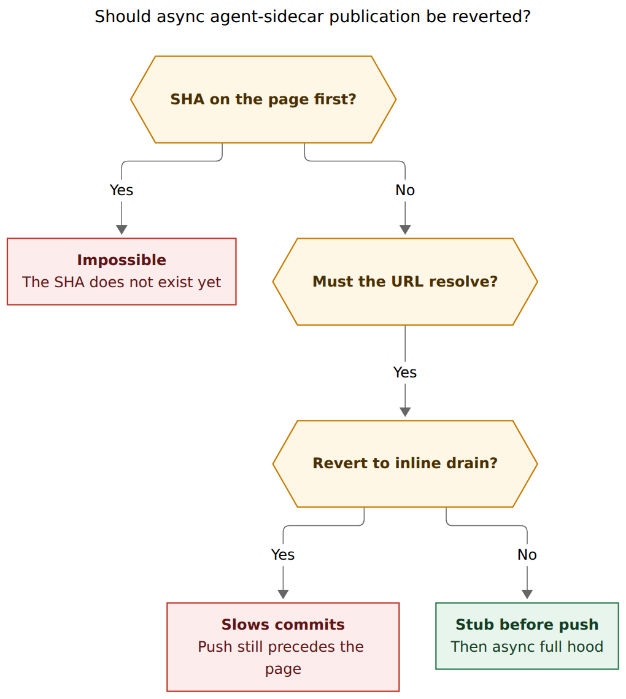
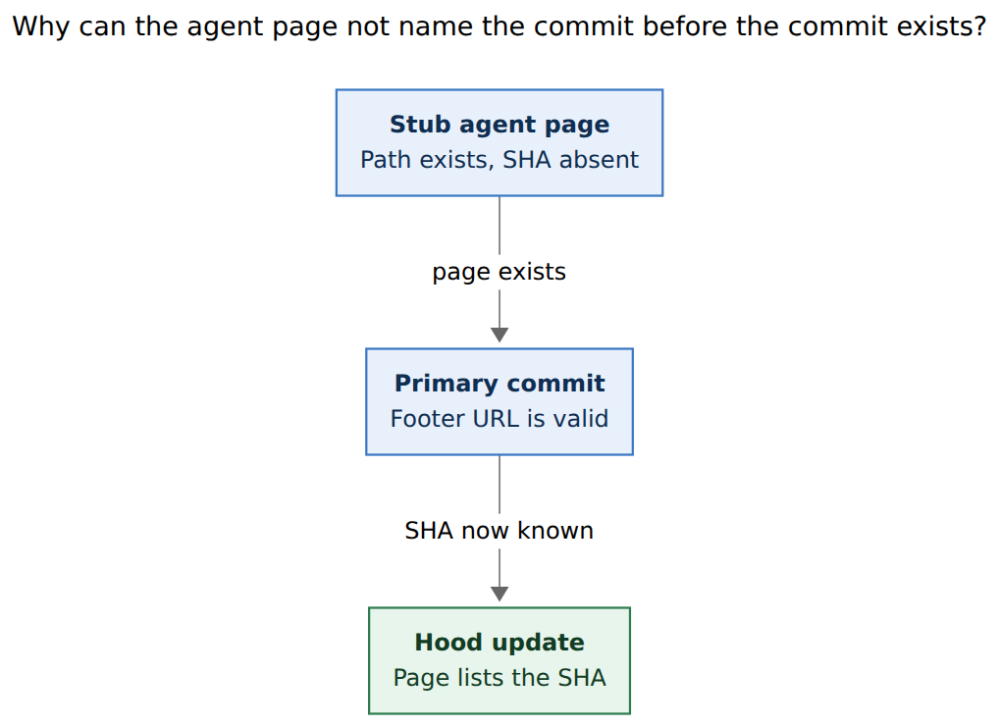

# Publish the agent page before the commit that links it

**Question.** Bryan has been dealing with agent publication errors ever since
agent-sidecar publication was made asynchronous to speed up commits. He is
considering a revert. His invariant is that a `SASE_AGENT` footer in a commit
message should already resolve to a live agents-sidecar page, so a human or
agent who follows that link never lands on a 404. Is the revert the right
move? If the invariant is right, can commits stay fast while the page is
guaranteed live before the corresponding commit? If that pairing is
impossible, what should replace it?

**Researcher.** grk. Independent swarm report. I did not read peer reports from
this swarm (`__cdx.md`, `__cld.md`, `__mus.md`, `__gem.md`).

**Method.** Read the commit workflow, footer construction, publisher liveness
gate, and hood-sync docs in this workspace; the closed epics
`sase-ej` / `sase-fa` (August 2026) and `sase-1pt` (October 2026) plus the
still-open `sase-1qh` / `sase-1qx` / `sase-1qy` beads; the approved plans
`plan:202608/revert_async_sidecar_publication.md` and
`plan:202610/commit_stage_async_publication.md`; prior latency research
`research:202610/commit_stage_latency_synchronous_publication/commit_stage_latency_synchronous_publication.md`;
live heartbeat, outbox, and drain-log state on this host on 2026-11-04; HTTPS
HEAD of four GitHub blob URLs in the same shape as a footer click.

Figures were rendered with `@mermaid-js/mermaid-cli@12.0.0`, PDF-mirroring
config, DejaVu Sans. A third comparison figure was dropped after two layout
revisions still missed the 75% Highlights-PDF fit floor.

## Bottom line

1. **The invariant is right. A full revert is the wrong tool for it.**
   A `SASE_AGENT` footer that 404s is a published lie. August already reverted
   the first async design (`sase-ej` → `sase-fa`) for that reason. The October
   redesign (`sase-1pt`) reopened the same window on purpose, to take
   publication off the stitch critical path. Reverting `sase-1pt` would put
   minutes of hood drain back on every stitch **and still push the primary
   commit before the page exists.**

2. **A page that names this commit SHA cannot exist before `git commit`.**
   The SHA does not exist yet. The footer URL does not include that SHA: it is
   a GitHub blob of `branch + path` (`sase_agent_page_path`). "The URL does not
   404" and "the page already lists this SHA" are different obligations. Only
   the first one is achievable before the commit is visible.

3. **Protocol-level certainty is available. Cosmic 100% is not.**
   Publish a stub at that path, wait for an HTTPS 200 on the exact footer URL,
   then push the primary. Fail the stitch closed if the blob is missing. That
   is a happens-before the GitHub reader can follow. Residual risks after a
   successful GET — CDN replica lag, a delete, a later rewrite — are outside
   any in-process guarantee.

4. **Commits can stay fast under that protocol.** The expensive work is the
   full hood (prompt archive, chat, SHA list, neighbor pages), historically a
   **255.4 s** median on the commit path. A stub is one small agents-sidecar
   commit. Keep the full hood on the existing background publisher. The
   remaining stitch cost after `sase-1pt` is already elsewhere:
   `publication: bead_pages` **38.2 s** median and `just fix` **21.0 s**
   (`sase-1qx`).

5. **Do not revert today even as an incident response.** This host's publisher
   heartbeat is fresh and `publisher_is_live` therefore returns true, while
   `last_outcome` is `hood_error`. The current drain file
   (2026-11-04 13:29–17:25 UTC) recorded **310 `rebase_conflict` failures and
   0 `published` outcomes**. The hidden agents clone cannot apply Apollo
   `chore(agents): sync from bbugyi200.apollo` commits `7b4d2fef9c` /
   `ce3ca4df9`. An inline restore would wait on that drain and fail the
   stitch. Unstick the clone with the existing stale-replay helper, then land
   exists-before-push.

**Recommended action.** Keep `commit.publication.mode: background`. Add an
exists-before-push gate on the commit path. Repair publisher liveness so a
failing job is not treated as live. Recover the stuck clone. Leave SHA-complete
hood refresh asynchronous.

## Decision

**Reader question:** Should async agent-sidecar publication be reverted?

**Caption:** A SHA-complete page cannot precede `git commit`. A URL that never
404s is the real invariant, and restoring inline drain still pushes the
primary first. Publish a stub, verify the remote blob, then push; fill the
hood in the background.



Rendered size: 679.826 × 760 px; fit scale: 96.0%.

## The footer is a path, not a SHA

`CommitWorkflow.run` stamps runtime tags **before** VCS dispatch
(`src/sase/workflows/commit/workflow.py`, `apply_tracked_commit_tags` for
`create_commit`). `resolve_agent_commit_tag`
(`src/sase/agents_sync/links.py`) builds a `LinkedCommitTagValue` whose
destination is `github_blob_url(..., branch, path=sase_agent_page_path(...))`.
`github_blob_url` (`src/sase/_git_remote.py`) emits
`https://<host>/<owner>/<repo>/blob/<branch>/<path>`. For a normal agent that
path is `agents/<global-name>/README.md` (`sase_agent_page_path` in
`src/sase/sase_agent.py`).

A typical footer therefore looks like the one on `e69360f49d` (the enqueue-only
landing itself):

```text
SASE_AGENT=[bbugyi200.athena.sase-1pt.7][2]

[2]: https://github.com/sase-org/sase--agents/blob/main/agents/bbugyi200.athena.sase-1pt.7/README.md
```

That URL is live for as long as `main` contains that path. It does not pin the
primary commit. A stub README at that path is enough for a click to stop
404ing. Putting *this* primary SHA into the page body can happen only after
`git commit` returns.

SASE agent names are unique per launch (`research.39.grk`, `sase-1pt.7`,
…). The first commit of a new agent is almost always a new path. That is why
the 404 is the common case rather than a rare race on a reused name.

Live check, 2026-11-04, HTTPS HEAD of those blob URLs:

| Path on `sase--agents` `main` | HTTP |
| --- | --- |
| `agents/bbugyi200.athena.sase-1pt.7/README.md` | 200 |
| `families/bbugyi200.athena.t2.md` | 200 |
| `agents/bbugyi200.athena.research.39.grk/README.md` | 404 |
| `agents/bbugyi200.athena.toobig-does-not-exist-xyz/README.md` | 404 |

This report's own agent page 404s. When the host later commits this file, the
footer it stamps will point at a path that is not on GitHub unless something
publishes a stub first. That is the failure mode Bryan is describing, observed
on this run.

## Dual-write order

**Reader question:** Why can the agent page not name the commit before the
commit exists?

**Caption:** The footer needs a live path, which a stub can provide before
`git commit`. The hood that lists the new SHA can be written only after that
SHA exists.



Rendered size: 678.734 × 494 px; fit scale: 96.2%.

The commit workflow today always takes the left-to-right order "commit+push,
then publish":

1. Stamp `SASE_AGENT` (URL already in the message).
2. `dispatch` → provider `create_commit` (commit, fetch/rebase, **push**).
3. Write the first result marker (`_run_tracking_steps` in
   `_workflow_tracking.py`).
4. `run_agent_publication_step` (`workflow_publication.py`).

Background mode (`commit.publication.mode: background`, default in
`src/sase/default_config.yml`) ends that last step after a durable enqueue plus
a publisher hint, when axe is running and `publisher_is_live(15 * 60)` is
true. Inline mode still runs `publish_committed_agent_hood` (enqueue **and**
drain) after the push. Docs state this explicitly:
`docs/reference/vcs/commit-workflows.md` ("ends an agent commit stage after
its durable hood-publication request and publisher hint are saved") and
`docs/reference/agents/hood-sync.md`.

So the GitHub reader of a freshly pushed commit can follow the footer during
the drain, during the enqueue wait, and during the `done.json` grace window
(`_DONE_MARKER_GRACE_SECONDS = 10 * 60` in
`src/sase/agents_sync/publication_job.py`). August's restored contract was
weaker than Bryan's: **when stitch returns, the URL resolves.** It never
required the page to exist *before* the commit was readable.

| Protocol | Primary push | Page exists | SHA on page | Stitch waits for full hood |
| --- | --- | --- | --- | --- |
| Today (`background`) | First | Later, if the publisher drains | Later | No (enqueue ~0.6 s) |
| Inline restore (`sase-fa` / `mode: inline`) | First | Before stitch returns, if drain succeeds | Before stitch returns | Yes (255.4 s median pre-epic) |
| Exists-before-push (recommended) | After stub 200 | Before the push | After, in background | No |

## How we got here twice

### August: first async, then a revert aimed at this exact 404

Epic `sase-ej` (commit `6e39779455`, 2026-08-03) moved sidecar publication into
a durable queue drained by an axe chop. Plan
`plan:202608/revert_async_sidecar_publication.md` rejected that design because
commit `0e40decdc`'s `SASE_AGENT` footer pointed at
`families/bbugyi200.athena.t2.md` and **404ed**. The queue was stuck
(18 quarantined requests, agents sidecar last published 2026-08-03) and the
commit path had been built so publication "must not be able to fail the
commit." Epic `sase-fa` restored inline publication (`de78052789`,
2026-08-05). Land verification recorded that the `t2` family page resolved and
`origin/main` had moved past `49bdd7996`. The scan-bound fix from `sase-ej.1`
was deliberately kept, because restoring an unbounded registry scan would have
brought multi-minute hangs back.

`sase-fa`'s target behavior, quoted from the plan: *"`sase commit` publishes
… before it returns. When it returns `OK`, the `SASE_AGENT` footer URL
resolves."* Push-then-publish was left in place.

### October: second async, for latency, with `decision_record = no`

Research
`research:202610/commit_stage_latency_synchronous_publication/commit_stage_latency_synchronous_publication.md`
measured the restored inline path. A no-conflict run spent a median **236 s**
from `provider_done` to `done.json` (Oct 22–28, n = 220); `git commit` +
fetch/rebase + push was **2.1 s**. Publication after the push was three ~50 s
passes (prompt archive / Referenced By, hood drain, artifact-link outbox).
Epic `sase-1pt` implemented that report's recommendation: durable enqueue on
the commit path, host-owned `agent_publication` job, inline fallback when axe
or the publisher heartbeat is down. Reviewer decision
`decision_record = no` — there is no accepted `decisions` strand that ending
the commit stage at enqueue is the standing design.

Landing commits:

- `4356cffaa1` (2026-10-30) — background publication job (`sase-1pt.6`)
- `e69360f49d` (2026-10-30) — enqueue on the commit path (`sase-1pt.7`)

Installed re-prove (`sase-1pt.9`, n = 73, host commit `207ded297a`):

| Metric | Pre-epic baseline (n = 54) | Installed (n = 73) |
| --- | --- | --- |
| `provider_done` → `done.json` median | 346.5 s | 101.3 s (~3.4×) |
| Publication substep median | 255.4 s | 38.9 s |
| `agent_hood_enqueue` median | (inline drain) | 0.6 s |
| `publication: bead_pages` median | in the 255 s | 38.2 s |
| `just fix` median | — | 21.0 s |
| `create_commit` median | 2.6 s | 2.6 s |
| Background branch taken | — | 73 / 73 |
| Queue-age p95 | unmeasurable | 547.4 s (under 600 s) |

The 60 s model-done and finalizer-p95 targets were missed. Residual task
`sase-1qx` (READY) records that the leftover wait is bead-page rendering and
`just fix`, not hood enqueue. Two of 73 sampled hoods stayed quarantined with
`agent-hood publication did not complete within 120s` (research-sidecar
linked scope); that class belongs to `sase-1qh.7`. Drain window Oct 30–Nov 1:
109 `published`, 18 `lock_busy`, 19 `timeout`.

`sase-1pt` improved latency and kept a fallback. It accepted eventual footer
freshness as the cost. Bryan is now rejecting that cost, which is the same
rejection `sase-fa` made, with a more precise statement of *when* the URL
must be live.

## What the current errors actually are

The errors since the second async landing are several bugs sharing one
notification surface, plus a clone that cannot publish at all.

### Publisher liveness ignores failure

`publisher_is_live` (`src/sase/agents_sync/publication_doorbell.py`) is
heartbeat-age only: a valid `heartbeat.json` newer than 15 minutes counts as
live. `_background_publication_selected` therefore stays on the enqueue path
while the job is looping on `hood_error`.

Heartbeat on this host at 2026-11-04T17:25:08Z (age ~43 s when read):

| Project | `active_count` | `last_outcome` | Oldest active |
| --- | --- | --- | --- |
| `gh_sase-org__sase` | 55 | `hood_error` | 8.6 d |
| `gh_bobs-org__bob-cli` | 617 | `hood_error`; 68 link rows retained | 7.25 d |
| `gh_bbugyi200__job` | 1 | `hood_error` | ~8.0 d |
| `gh_bbugyi200__tailnet` | 0 | `idle` | 0 |

Every new sase stitch on this machine enqueues and returns. Nothing in the
commit path notices that the publisher has not published for hours.

### The hidden agents clone is wedged on Apollo sync commits

Current `~/.sase/logs/agent_publication_drains.jsonl` (466 rows,
2026-11-04 13:29:05Z–17:25:39Z):

- 310 `outcome=failed`, `error_class=rebase_conflict`
- 156 `outcome=no_requests` with `error=run withheld by publication protection`
- **0 `published`**

The rebase text names `chore(agents): sync from bbugyi200.apollo` at
`7b4d2fef9c` (sase) and `ce3ca4df9` (bob-cli). A same-owner unpublished local
HEAD cannot rebase onto a remote that also moved. Docs already describe this
as a finite recovery, not a normal drain:
`docs/contribute/agents-sidecar-sync.md` § Stale-replay recovery,
`tools/agents_publication_recover_replay`, historically Apollo bob-cli
`2abeff3f9`.

Restoring inline drain against that clone does not publish pages. It fails
the stitch (loud, which `sase-fa` wanted) or warns and leaves the footer
dangling (if the outbox absorbs it). Either way the 404 remains until the
clone is recovered.

### Outbox residue that predates today's wedge

`~/.sase/projects/gh_sase-org__sase/agents-publication-outbox.json` (476
items): 55 active, 137 quarantined, 284 retired. Last-error histogram:
298 `manifest_mismatch`, 51 timeout / 120 s hood alarm, 42 `lock_busy`,
28 other.

`gh_bobs-org__bob-cli` (1147 items): 618 active, 529 quarantined. 388 last
errors are `rebase_conflict`.

Epic `sase-1qh` (IN_PROGRESS) already owns planner-scope / research-hood
notification noise. Phase `sase-1qh.7` (stuck-row cleanup) is blocked because
the primary checkout it targeted was behind the repair commits. Those rows
are a cleanup problem. They are not a reason to put full hood drain back on
`sase stitch create`.

## Can commits stay fast *and* make the URL live first?

Yes, if "live" means **the footer path returns 200** and the full hood is
allowed to catch up.

### Protocol (fail closed)

On the commit path, after tags are stamped and **before** provider
`create_commit` pushes:

1. Resolve the same blob URL `resolve_agent_commit_tag` already built.
2. HTTPS GET/HEAD that URL.
3. If 200, dispatch. The path already exists (prior commit or an earlier stub).
4. If 404, publish a stub page at `sase_agent_page_path` through the existing
   agents-sidecar write lane (hidden machine clone,
   `decisions:machine-link-writes-off-primary`), push it, GET again.
5. If the second GET is not 200, fail the stitch with
   `sase stitch create --resume`. Do not push the primary.
6. After a successful primary push, enqueue the full hood as today so the
   page later lists the SHA, chat, and prompt archive.

Spawn-time stub is an optional accelerator: pay the sidecar commit at launch
so step 4 is a no-op on first stitch. Pre-dispatch existence check is the
gate that actually enforces the invariant, including for agents that skip a
spawn stub.

Delaying the **full** hood until after `git commit` but **before** `git push`
also closes the GitHub 404 window and can put the SHA on the page before
GitHub sees the footer. That restores a stronger form of the `sase-fa`
contract. It also restores the 255 s-class wait and fails every first commit
while the clone is wedged. Use it only if stub-then-async-hood is rejected.

### What "100% certainty" can mean here

A fail-closed GET of the exact footer URL before the primary push is a
happens-before for any reader who can see the GitHub commit. That is the
certainty the invariant needs.

It is not certainty against:

- GitHub serving a 404 from a lagging replica after this process observed 200
- a later delete or rewrite of that path
- DNS / TLS / network failure after the check
- a local `git log` reader who opens the URL in the milliseconds between
  `git commit` (message now local) and the stub push, if the stub is sequenced
  after the local commit object exists

Closing the local-`git log` window as well means publishing the stub **before
`git commit`**, which the path-only URL allows. Spawn-time or
immediately-pre-commit stub does that. SHA-on-page before `git commit`
remains impossible.

### Where the leftover latency is

Hood enqueue is already 0.6 s. Exists-before-push adds one small sidecar
commit **only when the path 404s** (new agent, first stitch). After that, the
check is one HTTP round trip.

The stitch is still ~100 s median because bead-page publication and `just fix`
are synchronous (`sase-1qx`). Reverting hood publication does not touch those
substeps. If commit-stage time is still the pain after exists-before-push
lands, the next cuts are bead-page rendering and the before-hook, which
`sase-1pt` left on the critical path on purpose.

## What I would do, in order

1. **Recover the stuck hidden agents clone** with
   `tools/agents_publication_recover_replay` (report, then apply) for the
   sase and bob-cli projects, using the unpublished local HEADs the drain log
   cannot rebase. Work only in the clone `sase repo open` prints. Confirm a
   drain row with `outcome=published` before changing the commit protocol.

2. **Keep background full-hood publication.** Do not revert `e69360f49d` /
   `4356cffaa1`. Do not flip `commit.publication.mode` to `inline` as a
   substitute revert: inline still pushes first, and today it would fail
   closed on the wedged clone.

3. **Land exists-before-push** as a commit-path gate (pre-dispatch HEAD of the
   footer URL; stub+push+recheck on 404; fail closed). Optional spawn-time
   stub so first stitch is cheap.

4. **Treat publisher liveness as health, not heartbeat age.**
   `publisher_is_live` should go false when `last_outcome` is `hood_error` /
   `rebase_conflict` across consecutive passes, so the inline fallback (or
   the new stub gate) actually runs. A fresh heartbeat of a job that has
   published nothing since 13:29 UTC is not liveness.

5. **Finish `sase-1qh.7` cleanup** once the clone is healthy, and keep
   `sase-1qx` as the remaining commit-stage latency work. Those are separate
   from the footer invariant.

## What I would not do

- **A full revert of `sase-1pt`.** It reintroduces the 255 s hood wait, still
  pushes before the page exists, and currently fails on Apollo rebase
  conflicts. August already proved that inline publication without clone
  repair just moves the 404 from silent to loud.
- **Delaying every full hood until before `git push` as the default.** That
  satisfies a stronger "page lists this SHA before GitHub sees the commit"
  reading, at the original latency cost, on every stitch of every agent.
- **Claiming cosmic 100% including GitHub's CDN.** Fail-closed happens-before
  on the exact URL is the honest ceiling.
- **Publishing a SHA-complete page before `git commit`.** The SHA does not
  exist. The figure above is the whole argument.

The invariant Bryan stated is the one to keep. The way to keep it, and keep
the 3.4× commit-stage win, is a stub that exists before the primary push,
with the full hood remaining the background job `sase-1pt` already built.

## Sources

- `src/sase/workflows/commit/workflow.py` — tag stamp, then `dispatch`
- `src/sase/workflows/commit/_workflow_tracking.py` — publication after the
  first result marker
- `src/sase/workflows/commit/workflow_publication.py` — background vs inline
  selection, 15-minute heartbeat gate
- `src/sase/agents_sync/links.py`, `src/sase/_git_remote.py`,
  `src/sase/sase_agent.py` — footer URL shape
- `src/sase/agents_sync/publication_doorbell.py` — `publisher_is_live`
- `src/sase/agents_sync/publication_job.py` — 10-minute `done.json` grace,
  240 s drain budget
- `src/sase/default_config.yml` — `commit.publication.mode: background`
- `docs/reference/vcs/commit-workflows.md`,
  `docs/reference/agents/hood-sync.md`,
  `docs/contribute/agents-sidecar-sync.md`
- `plan:202608/revert_async_sidecar_publication.md` (bead `sase-fa`)
- `plan:202610/commit_stage_async_publication.md` (bead `sase-1pt`,
  `decision_record = no`)
- Beads `sase-1pt`, `sase-1pt.7`, `sase-1pt.8`, `sase-1pt.9`, `sase-fa`,
  `sase-1qh`, `sase-1qh.7`, `sase-1qx`, `sase-1qy`
- `research:202610/commit_stage_latency_synchronous_publication/commit_stage_latency_synchronous_publication.md`
- Commits `6e39779455`, `de78052789`, `4356cffaa1`, `e69360f49d`
- Live: `~/.sase/agent_publication/heartbeat.json`,
  `~/.sase/logs/agent_publication_drains.jsonl`,
  `~/.sase/projects/gh_sase-org__sase/agents-publication-outbox.json`,
  `~/.sase/projects/gh_bobs-org__bob-cli/agents-publication-outbox.json`
- HTTPS HEAD of four `sase-org/sase--agents` blob URLs, 2026-11-04
