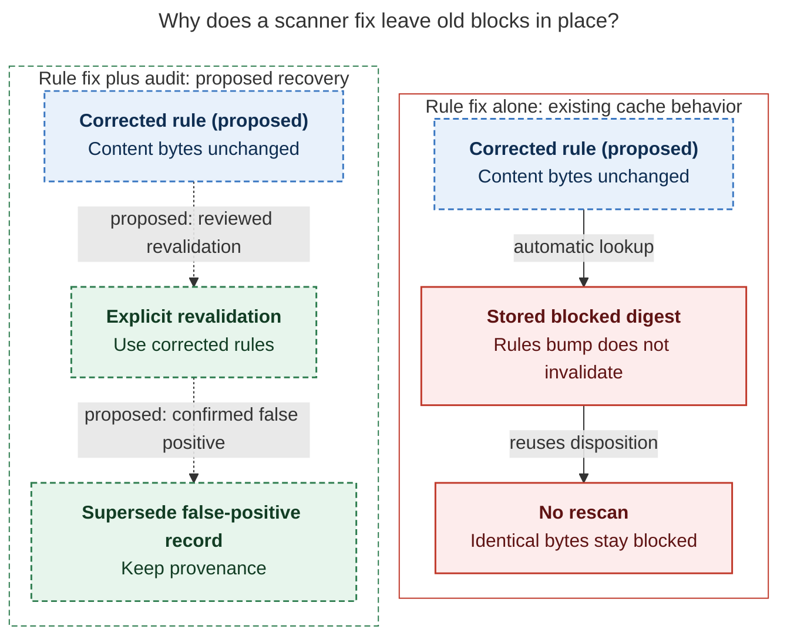
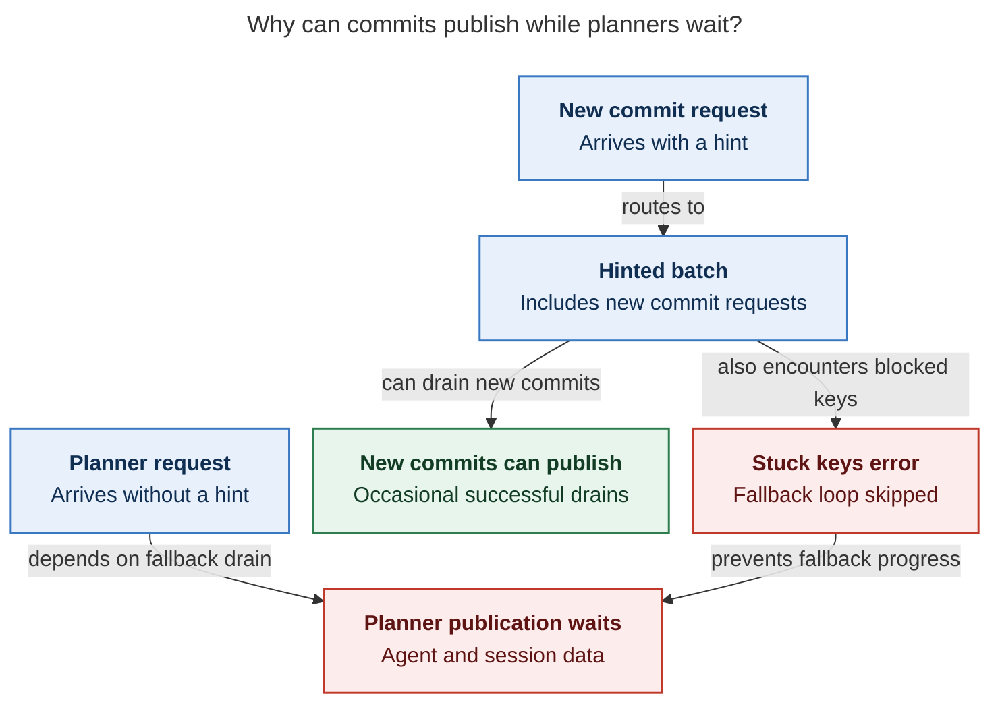

# Diagram proposals: Agent publication errors, Nov 1–2: a `task-` false positive the publisher retries forever

Proposals for the swarm linker, not a report. Each diagram restates only what the source
report says.

```yaml
source: research:202611/agent_publication_openai_key_false_positives/agent_publication_openai_key_false_positives__final.md
producer: research.5p.image
check: "mmdc 12.0.0 with the PDF-mirroring config rendered 2 of 2 Mermaid diagrams; batch passed; invalid-input check exited nonzero"
```

## ledger-revalidation

```yaml
anchor: |-
  A fixed rule alone will not
question: |-
  Why must recovery change both the scanner and the stored block?
illustrates: |-
  A fixed rule alone cannot free the four rows because their exact digests are stored as blocked, while the proposed reviewed revalidation path supersedes false-positive records with provenance.
caption: A rule correction leaves stored blocks intact; proposed audited revalidation supersedes confirmed false positives with provenance.
review: "687.219x601 px, fit 95.0%; question, source, and visual checks passed; 1 visual revision; second look passed"
```



## publication-routing

```yaml
anchor: |-
  New commits still get through: their requests arrive with a hint
question: |-
  Why do new commits publish while planner sessions stay queued?
illustrates: |-
  The hinted batch can publish new commits and report blocked-key errors in the same pass, while unhinted planner agent and session publication waits for the skipped fallback.
caption: New commits can publish despite batch errors; unhinted planner agent/session data waits, although its prompt Markdown is already published.
review: "755.297x814 px, fit 86.4%; question, source, and visual checks passed; 0 visual revisions; both conditions jointly explain the planner wait"
```


