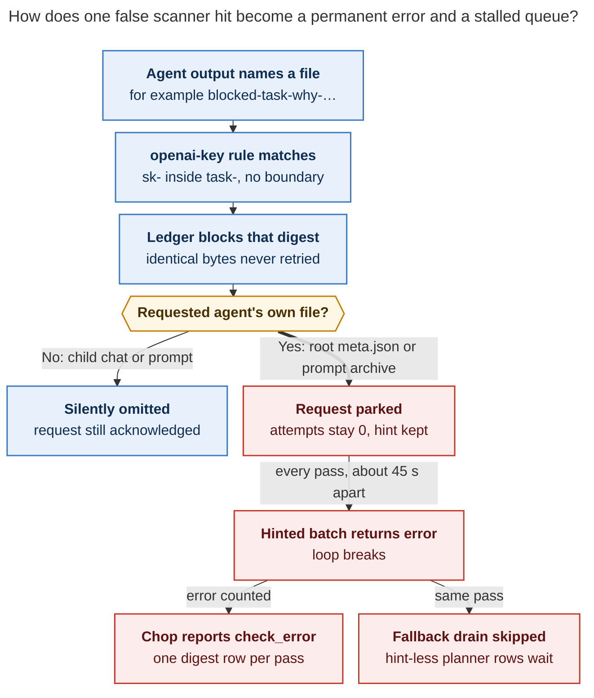
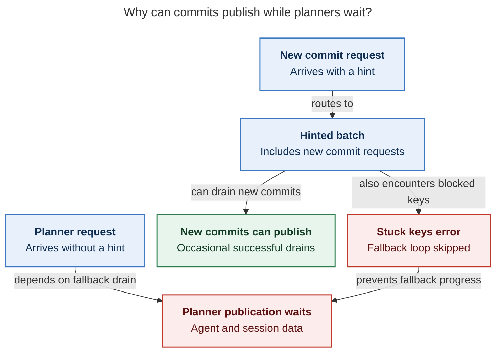
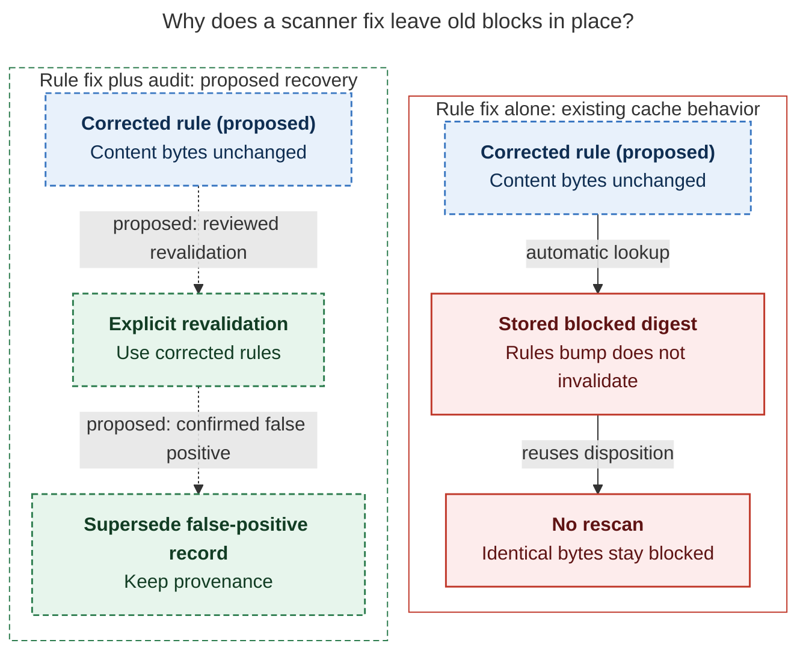

# Agent publication errors, Nov 1–2: a `task-` false positive the publisher retries forever

> **Research query:** Agent publication errors are still showing up in the axe error
> digest (`~/.sase/axe/error_digests/digest_20261102_125554.txt`). Where did these errors
> come from (for example, which sase agent introduced them), and what is causing them?
> End with a timeline of events and a summary of the root cause diagnosis.


## Bottom line

- **One stuck project is the whole digest.** [All 71 errors](#what-the-digest-shows) in
  `digest_20261102_125554.txt` come from one job (`publication / agent_publication`) and
  one project (`gh_bobs-org__bob-cli`). Each pass of the job, about every 45 s, reports the
  same four parked outbox requests as one error. The process exits 0, but the job
  status is `check_error`. The same signature has produced **1,515 entries across 18
  digests** since **2026-11-01 18:51:56 EST**. At 13:30 today the four requests were
  still being retried.
- **It is not a leaked secret. It is a false positive in the scanner.** sase-core's
  `openai-key` rule `sk-[A-Za-z0-9_-]{20,}` has no left boundary. In any long
  hyphenated name containing `task-`, the `sk-` is read as the start of an OpenAI key. I
  [reproduced all three hits](#reproduction) with the installed Rust binding, at exactly
  the lines the ledger records. Ordinary text and `task_` (underscore) names scan clean.
- **Which agents wrote the flagged bytes.** **`research.5n.mus`** (Nov 1, 18:45) named its
  report `blocked-task-why-…`. That artifact path landed in the run's `meta.json`, which
  is a structural file, so the whole run was withheld. This produced the first
  persistent error. **`bob-cli-fs.8.1.3`** (Nov 2, 08:48) and **`bob-cli-fx.2`** (Nov 2,
  11:08, primary and linked rows) quoted `scripts/test-task-status-cycler-*.cjs` paths
  in their prompts, so their prompt archives were withheld. None of these agents did
  anything wrong. See [the four stuck requests](#the-four-stuck-requests-and-the-false-positive).
- **Which agents wrote the code that turns this into an error flood.** In order (see
  [who introduced what](#who-introduced-what)):
  1. **`sase-1d5.1`** wrote the unanchored regex for note attachments (sase-core
     `7806f587`, Sep 30).
  2. **`sase-1oh.5.1.1`** reused that scanner for agent publication (Oct 26).
  3. **`sase-1oh.5.1.2`** and **`.3`** made a hit on `meta.json` or a prompt archive
     withhold the content (Oct 26–27).
  4. **`sase-1oh.5.1.land--3--code`** parked withheld requests with no attempt charge
     and no way out (`c687d8b6eb`, Oct 27).
  5. **`sase-1pt.6`** added the background job that counts that park as an error on
     every pass and then stops draining the project (`4356cffaa1`, Oct 30).
- **It is also blocking other publications.** An error in the hinted batch makes the
  job skip its "drain everything ready" fallback loop. **Ten healthy bob-cli requests**,
  all planner prompt-archive rows, have never been attempted. The oldest has waited
  7 hours. Claimed hint files have piled up to **68**. These rows have no doorbell
  hint because `sase-1qh.1` (Oct 31) enqueues planner rows without one, as part of the
  fix for last week's "did not materialize" incident. See
  [the hidden cost](#the-hidden-cost-of-a-starved-bob-cli-queue).
- **A separate error class added 3 entries (24–26).** Two `bob-cli-fs.2.1.land` requests
  failed with "could not restore deferred prompt archive" and quarantined after three
  attempts at 12:21:17. This is a long-standing name mismatch
  ([the secondary error](#the-secondary-error-with-deferred-prompt-archives)), not the
  scanner. It has quarantined 220 bob-cli rows since Oct 21, eight of them today.
- **Why it is still happening.** The publication fixes that landed Oct 31 through Nov 2
  addressed different failures: planner scope, repair deadlines, and index-lock
  cleanup. None of them touched the scanner rule, withheld-request settlement, or the
  job loop. No commit after `84e22d98be` changes them.

## Sources and verification

_Lead researcher consolidation · 2026-11-02 · Merges researcher reports `cdx`, `cld`,
`grk`, `mus`, and `gem` (sibling files in this directory) with independent, read-only
verification on athena against sase `84e22d98be`, sase-core `89a5bd8b`, and live
`~/.sase` state observed at about 13:30 EST._

> **Naming note.** The flagged filenames are written here only in shortened form (for
> example `blocked-task-why-…` or `scripts/test-task-status-cycler-*.cjs`). Two
> researchers in this swarm quoted them in full, and at 13:15:54 the sase project's
> protection ledger blocked their own `chat.md` and `prompt_steps.json` (see
> [the live side effect](#a-live-side-effect-on-anyone-who-discusses-the-bug)).

## What the digest shows

- **Window:** 2026-11-02 12:01:08 → 12:55:42 EST, 71 entries
- **Job / project:** `publication / agent_publication`, only `gh_bobs-org__bob-cli`
- **Exit code / status:** `0` / `check_error`. The chop sets `check_error` whenever `tick.errors > 0` (`src/sase/scripts/sase_chop_agent_publication.py`)
- **Message on every entry:** `run withheld by publication protection` + 3 × `prompt archive withheld by publication protection`
- **Entries 24–26 (12:20:02, 12:20:45, 12:21:27):** Also include two `could not restore deferred prompt archive … bob-cli-fs.2.1.land@{fdc34de9bf82,07e115192e51}` failures (digest lines 380–412)
- **Summary counters:** `errors=1` (one project, not one request), `active_remaining=13–15`, `lock_busy=0`, `deferred_projects=0`
- **Cadence:** Median about 44 s (cdx). The job interval is 15 s plus an fs doorbell, with a 5-minute `max_quiet` fallback (`src/sase/default_config.yml`). Each pass takes about 20 s of drain time.

Across all digests, the clause first appears at **2026-11-01 18:51:56**. It has one
clause until about 08:47 on Nov 2, two after that, and four from 11:08 onward. No digest
before Nov 1 19:51 contains "withheld" (cld checked all 576 digests; I confirmed the
first timestamp and the 1,515/18 totals).

## The four stuck requests and the false positive

From `~/.sase/projects/gh_bobs-org__bob-cli/agents-publication-outbox.json` (301 rows: 283
quarantined, 14 active, 4 terminal), at 13:30:

- **`research.5n.mus`**
  - *Scope, revision:* linked `c8a52365e5`
  - *Created (EST):* Nov 1 18:45:20
  - *Error:* run withheld
  - *Ledger destination, line:* `agents/…research.5n.mus/meta.json`, line 1 (compact JSON)
  - *What matched:* Report artifact path `…/blocked-task-why-visual__mus-…md` (`agent_meta.json` line 369, `output_variables.artifacts[0].path`)
- **`bob-cli-fs.8.1.3`**
  - *Scope, revision:* linked `f4550e2970`
  - *Created (EST):* Nov 2 08:47:14
  - *Error:* prompt archive withheld
  - *Ledger destination, line:* `prompts/202611/bob-cli-fs.8.1.3.md`, line 11
  - *What matched:* Monitor command `node --test scripts/test-task-status-cycler-*.cjs`
- **`bob-cli-fx.2`**
  - *Scope, revision:* revision `876ae775e2`
  - *Created (EST):* Nov 2 11:07:47
  - *Error:* prompt archive withheld
  - *Ledger destination, line:* `prompts/202611/bob-cli-fx.2.md`, line 141
  - *What matched:* `git status` line `modified: scripts/test-task-status-cycler-*.cjs`
- **`bob-cli-fx.2`**
  - *Scope, revision:* linked `1115a14d1e`
  - *Created (EST):* Nov 2 11:08:02
  - *Error:* prompt archive withheld
  - *Ledger destination, line:* same archive bytes
  - *What matched:* Same prompt, second repo (bob-plugins)

All four have `attempts=0`, are not quarantined, and had `updated_at` refreshed at
13:30:26. They are retried on every pass. The ledger
(`agents-publication-protection.json`) records each one as `blocked / scanner_hit`,
`credential_pattern`, `openai-key`, rules v1.

### The rule

`crates/sase_core/src/note_attachment/scanner.rs:176-179` in sase-core, unchanged since
`7806f587` (2026-09-30, `SASE_AGENT=sase-1d5.1`, "core attachment audience policy and
scanner"):

```rust
fn openai_re() -> &'static Regex {
    static RE: OnceLock<Regex> = OnceLock::new();
    RE.get_or_init(|| Regex::new(r"sk-[A-Za-z0-9_-]{20,}").unwrap())
}
```

There is nothing before `sk-`, and the suffix class allows `-` and `_`. So `ta` + `sk-` +
any kebab tail of 20 or more characters matches. bob-cli is a task manager with a
`task-status-cycler` plugin, so it hits this constantly. cld counted **1,054** matches in
bob-cli's run artifacts, and every one of them is preceded by `ta`.

### Reproduction

I ran the reproduction through `attachment_scan_file` in the installed SASE Python, with
an empty environment map so environment-secret matching could not interfere:

- **`ordinary task text`:** clean
- **`blocked_task_visual_…` (underscores, the naming the other 5n researchers used):** clean
- **Synthetic `sk-` followed by 24 letters (positive control):** hit, `openai-key`
- **`research.5n.mus` `agent_meta.json`:** **hit, `openai-key`, line 369**
- **`bob-cli-fs.8.1.3--2` `raw_prompt.md`:** **hit, line 11**
- **`bob-cli-fx.2--2` `raw_prompt.md`:** **hit, line 141**

The other ledgers show the same class. bob-cli has 40 blocked records, all `openai-key`,
starting 2026-10-26 22:40. By file: 28 `chat.md`, 4 `prompt.md`, 4 `prompt_steps.json`,
2 `meta.json`, and 2 prompt archives. tailnet has one, a `14x--code` `meta.json` blocked
2026-10-28; gem attributes it to a `disk-cleanup-…` filename. sase has three
`high-entropy-assignment` records that were not investigated. It also has the four
research-swarm records described in
[the live side effect](#a-live-side-effect-on-anyone-who-discusses-the-bug).

## Why one false hit becomes a permanent repeating error



_Caption: a `task-` filename trips the OpenAI-key rule. When the hit is in the requested
agent's own structural file or prompt archive, the block is sticky and never charged,
so every pass both reports an error and skips the drain that hint-less requests depend
on. (Rendered with mermaid-cli 12.0.0: 740 × 1100 px, PDF fit 81.2%.)_

The chain, step by step:

1. **Scan.** `_publication_protection_scan.py::scan_publication_bytes` scans rendered run
   files and prompt-archive text through the Rust scanner, and a hit becomes a `blocked`
   disposition. Wiring: `sase-1oh.5.1.1` (sase-core `416db289`, sase `f4591e9106`,
   Oct 26 17:06–17:10).
2. **Withhold scope.** `_publication_snapshot_gating.py` treats `meta`, `state`, and
   `commits` as structural (`_STRUCTURAL_RUN_KINDS`): a hit drops the whole run. A hit in
   `prompt`, `chat`, or `prompt_steps` (`_CONTENT_RUN_KINDS`) drops only that file.
   Prompt archives are withheld separately with `PROMPT_PROTECTION_BLOCKED`. Sources:
   `sase-1oh.5.1.2` (`67edb9677d`) and `sase-1oh.5.1.3` (`0f76e05de4`).
3. **The block is sticky.** The ledger keys the block on repository, destination, and
   content SHA-256. Identical bytes are never rescanned.
   `publication_protection_resolve_verified_clean` intentionally keeps confirmed blocks,
   and a later rules-version bump does not invalidate them automatically (cdx). Content
   that will never change (a filename) therefore stays blocked forever.
4. **Only a request for the agent itself errors.**
   `_publication_snapshot_hood.py::settlement_error_for_withheld_request` returns an error
   only when the requested global agent's run, or its whole hood, is withheld. That is
   why bob-cli's blocks from Oct 26 to Nov 1 were all silent: they hit child members
   such as `--mon`, `--code`, and `--N`, including a `bob-cli-f5.land--code` `meta.json`
   at Nov 1 12:42. Those runs were omitted and the request still acknowledged.
   `research.5n.mus` was the first case where the requested root agent itself was
   blocked after the background job existed (cld).
5. **Parked without charge, with no exit.** `c687d8b6eb` ("park withheld publications
   without charging quarantine", Oct 27 07:07, `sase-1oh.5.1.land--3--code`,
   grok-4.6) settles withheld requests with `increment_attempts=False,
   quarantine_threshold=None` (`_commit_publication_transaction_steps.py`).
   `should_charge_prompt_protection_failure()` does the same for prompt archives. The
   request is preserved, but nothing distinguishes "blocked: these bytes will never
   pass" from "unverified: may pass later", so the request is never retired or truly
   dormant.
6. **Reported as an error on every pass.** `_commit_publication_drain.py` joins item
   errors into `outcome.error`. `publication_job._drain_project` copies it to
   `result.error`, `summary.errors += 1`, and the chop maps that to `check_error`. The
   row is always ready (`done.json` exists), so the next pass selects it again. Source:
   `4356cffaa1` (Oct 30 00:26, `sase-1pt.6`, codex/gpt-6-luna).

## The hidden cost of a starved bob-cli queue

The hidden cost is that bob-cli's publication queue is starved.
`publication_job._drain_project` (lines 244–279, all from `4356cffaa1` except one line
from `e69360f49d`):

- **Hinted loop.** It drains keys named in claimed doorbell hints. On
  `outcome.error` it sets `result.error`, keeps the hints when the batch is still
  active, and **breaks**.
- **Fallback loop.** `if not result.lock_busy and result.error is None:` drains the
  oldest ready rows. **It never runs once the hinted batch has errored.** The job's
  own config describes the intended behavior as "processes hinted hood requests before
  the oldest remaining requests". The break defeats that.
- The four stuck requests keep their hints, so every pass re-hints them, errors, and
  skips the fallback loop.

Live evidence (13:30):

- **Untouched active rows:** **10** rows with `attempts=0`, no error, and `updated_at == created_at`: `bob-cli-fs.2` (06:30), `fs.8` (07:08), `ft.3` (07:34), `fs.2.1.land@cb729a76` (09:10), `fs.8.1.land@cb729a76` (09:22), `ft.3.1.land` (10:38), `fs.2.1.land@cba88d0d` (11:04), `fw.land` (11:21), `fx.land` (11:24), `fs.4` (12:28)
- **Ready?:** 8 have `done.json`. The other 2 are far past the 10-minute grace period. All are eligible for the fallback loop.
- **Hinted?:** None of their `(agent, revision)` keys appears in any hint file. All four stuck keys do.
- **Claimed hint files:** **68** `hints.claimed.*.jsonl` under `agent_publication/` (66 when cld looked), oldest is `research.5n.mus` from Nov 1 18:45
- **Why they lack hints:** They are planner prompt-archive rows. `prompt_archive/publish.py` enqueues them as `linked` scope (since `9409312d1e`, Oct 31, `sase-1qh.1`, the fix for the "did not materialize" incident) and never calls `append_publication_hint`. Only the commit path (`workflow_publication.py`) rings the hint.

New commits still get through: their requests arrive with a hint and ride in the hinted
batch, which explains the occasional `hood_drained=1`. The prompt-archive Markdown for
these planners is also already in the sidecar, because it is committed at approval time.
For example, `prompts/202611/relation_successor_core_closeout.md` was committed at
09:10:18. What waits in the queue is the rest of each planner row's agent and session
publication, which will not drain until the stuck rows clear. Other projects (`sase`,
`tailnet`, `actstat`) drain normally because each project is drained independently.
[The publication-routing diagram](#figure-publication-routing) shows both paths through
one pass: hinted commits can publish while blocked keys error, and unhinted planner agent
and session data waits for the skipped fallback loop.

<div id="figure-publication-routing">



_New commits can publish despite batch errors; unhinted planner agent/session data waits, although its prompt Markdown is already published._

</div>

## The secondary error with deferred prompt archives

This section covers `.land` coder runs and deferred prompt archives. Entries 24–26 add
`could not restore deferred prompt archive for
bob-cli-fs.2.1.land@fdc34de9bf82 / @07e115192e51: prompt archive is unresolved and a
missing local source does not prove there was no prompt obligation`.

Both rows were enqueued at 12:18 by the land coder commit (primary and plans repos,
artifact dir `ace-run/202611/02/20261102110455`). They were charged attempts and
quarantined at **12:21:17**, which is why they disappear after entry 26. They are
silenced, not fixed. My verification refines the researchers' explanation:

1. **No local prompt to regenerate from.** Plan-approved coder runs store their prompt
   as `followup_prompt.md`. Neither `raw_prompt.md` nor `raw_xprompt.md` exists, and
   `resolve_raw_prompt_path` accepts only those two names. This is not new: only 1 of
   the 1,415 follow-up runs in bob-cli and sase since July has a raw prompt.
2. **The archive exists, but under a different name.** `_prompt_archive_present` looks
   for a published archive whose AGENTS header lists the request's own agent
   (`bbugyi200.athena.bob-cli-fs.2.1.land`). The planner archives for this session
   (`relation_successor_core_closeout.md` and `relation_successor_core_residual.md`) are
   published, but they list `bbugyi200.athena.bob-cli-fs.2.1.land--plan`. That
   `--plan` labeling has been the norm since August: 238 such labels in October
   archives versus 27 root `.land` labels.
3. **The snapshot proves a prompt obligation.** The published session root
   `agents/…bob-cli-fs.2.1.land/` has a `prompt.md`, so `snapshot_prompt_file_present`
   is true. The Rust classifier (`agent_publication_recovery/complete.rs:88-140`) refuses
   to acknowledge when nothing was restored, no archive is recognized, and a prompt
   obligation is not ruled out.

This fail-closed policy arrived with `sase-1nf.10.1.1` and `sase-1nf.10.1.3` (Oct 20).
Since then it has quarantined **220** bob-cli rows with "missing local source". The
largest daily counts were 32 to 44 per day between Oct 23 and Oct 28, plus 8 today
(`fs.2.1.land` ×2 pairs, `fx.land`, `fw.land`). It is self-limiting: it charges attempts
and stops after three. It is independent of the scanner loop, and it is **not** caused
by the starvation: I checked that the planner archives it needs are already published.
I did not identify a single change that introduced the name mismatch, so I attribute
only the gate that exposed it.

## A live side effect on anyone who discusses the bug

The bug reaches anyone who discusses it. At **13:15:54–13:15:55** today the **sase**
project ledger recorded four new `openai-key` blocks: `agents/…research.5p.cld/chat.md`
(line 81), `…research.5p.cld/prompt_steps.json`, `…research.5p.gem/chat.md` (line 95),
and `…research.5p.gem/prompt_steps.json`. Those two researchers wrote the flagged
filenames in full. These are content kinds, so only those files are withheld. sase's
active outbox was empty when I checked, and no persistent error resulted. But any agent
that names or quotes these files, including future fixers and reviewers, will lose its
transcript from publication until the rule is fixed.

Open bead **`sase-1ot`** plans to rotate credentials and purge "27 historical
secret-scanner hits" from public `sase--agents` history. Its first step already calls
for triaging false positives. Given this finding, that triage should re-run each hit
under a corrected rule before anyone rotates a credential or rewrites history. I did not
open the private audit, so how many of the 27 are `task-` matches is unknown.

## Who introduced what

- **Scanner rule**
  - *Commit:* sase-core `7806f587`
  - *When:* Sep 30 08:51 EDT
  - *SASE agent (model):* `sase-1d5.1`
  - *Effect in this incident:* Unanchored `openai-key` regex: the root defect, latent for note attachments
- **Publication protection**
  - *Commit:* sase-core `416db289`, sase `f4591e9106`
  - *When:* Oct 26 17:06–17:10 EDT
  - *SASE agent (model):* `sase-1oh.5.1.1` (codex/gpt-6-luna)
  - *Effect in this incident:* Applies that rule to every published chat, prompt, and meta file
- **Run gating**
  - *Commit:* `67edb9677d`
  - *When:* Oct 26 20:17 EDT
  - *SASE agent (model):* `sase-1oh.5.1.2` (muse-spark-1.3)
  - *Effect in this incident:* A `meta.json` hit withholds the whole run ("run withheld")
- **Prompt-archive gating**
  - *Commit:* `0f76e05de4`
  - *When:* Oct 27 00:54 EDT
  - *SASE agent (model):* `sase-1oh.5.1.3` (grok-4.6)
  - *Effect in this incident:* Source of the "prompt archive withheld" clauses; no charge
- **No-charge park**
  - *Commit:* **`c687d8b6eb`**
  - *When:* Oct 27 07:07 EDT
  - *SASE agent (model):* **`sase-1oh.5.1.land--3--code`** (grok-4.6)
  - *Effect in this incident:* Withheld requests never quarantine or retire
- **Background job**
  - *Commit:* **`4356cffaa1`**
  - *When:* Oct 30 00:26 EDT
  - *SASE agent (model):* **`sase-1pt.6`** (codex/gpt-6-luna)
  - *Effect in this incident:* Error every pass → `check_error`; hinted-batch break skips the fallback loop
- **Commit enqueue**
  - *Commit:* `e69360f49d`
  - *When:* Oct 30 02:15 EDT
  - *SASE agent (model):* `sase-1pt.7` (codex/gpt-6-luna)
  - *Effect in this incident:* Commits enqueue and hint; publication becomes queue-dependent
- **Hint-less planner rows**
  - *Commit:* `9409312d1e`
  - *When:* Oct 31 13:18 EDT
  - *SASE agent (model):* `sase-1qh.1` (grok-4.6)
  - *Effect in this incident:* Planner rows rely on the fallback loop, which is now skipped
- **Prompt fail-closed gate**
  - *Commit:* `f9aa563c1` (core), `1a69c8947d`
  - *When:* Oct 20 EDT
  - *SASE agent (model):* `sase-1nf.10.1.1`, `sase-1nf.10.1.3`
  - *Effect in this incident:* Exposes the secondary `.land` mismatch ([the secondary error](#the-secondary-error-with-deferred-prompt-archives))
- **Trigger content**
  - *Commit:* (run)
  - *When:* Nov 1 18:45 EST
  - *SASE agent (model):* **`research.5n.mus`** (muse-spark-1.3)
  - *Effect in this incident:* First withheld root run → the flood starts
- **Trigger content**
  - *Commit:* (runs)
  - *When:* Nov 2 08:47, 11:08 EST
  - *SASE agent (model):* `bob-cli-fs.8.1.3--2` (gpt-6-luna), `bob-cli-fx.2--2` (muse-spark-1.3)
  - *Effect in this incident:* Three prompt-archive clauses

None of the onset-window commits touch these paths: `a0b00da79b`, `0547d23ce3`,
`9066546900`, `82cf081fc4`, `3e6c19ee37` (`sase-1qt.2`), and `84e22d98be`
(`sase-1qt.land`). They fixed other publication failures, so the flood is not a
regression from them.

## Where the researchers disagreed and what the evidence says

- **When did the `.land` restore errors appear?**
  - *Claims:* gem: errors 1–5, quarantined 12:01:17. cdx, cld, grk, mus: errors 24–26, quarantined 12:21:17.
  - *Resolution:* **Errors 24–26.** They are at digest lines 380–412, and the outbox `quarantined_at` is 12:21:17. gem's placement is wrong.
- **Does the `research.5n.mus` metadata really contain the hit?**
  - *Claims:* mus: no. The reconstructed `meta.json` was clean, the bytes were "transient", and the run is "still active". The other four: yes, via the artifact path.
  - *Resolution:* **Yes.** The final `agent_meta.json` hits at line 369, the artifact path. mus compared against the copy published by sidecar sync `801f02528` at **18:44:40**. That was mid-run, before the artifact was registered and before the run finished at 18:45:27 (`done.json` outcome `completed`). The stale `finished_at: null` in that published `state.json` is itself a symptom of the withhold.
- **Are the other 10 active rows just waiting?**
  - *Claims:* grk: waiting on the `done.json` grace period or a later drain. cld: starved.
  - *Resolution:* **Starved.** All are ready, none were ever touched, and none are hinted. The control flow skips the fallback loop ([the hidden cost](#the-hidden-cost-of-a-starved-bob-cli-queue)).
- **How often does the job run?**
  - *Claims:* gem: every minute.
  - *Resolution:* Interval 15 s + doorbell + 5-minute `max_quiet`. Observed about 44 s between errors.
- **Code regression or content?**
  - *Claims:* mus: content, not a code regression. Others: a code defect triggered by content.
  - *Resolution:* **Both.** No code changed in the onset window (mus is right on that). But the defect is in code from Sep 30 to Oct 30, and the content was legitimate.
- **How large is the backlog?**
  - *Claims:* mus: 220 chronic restore errors. Others: 283 quarantined.
  - *Resolution:* **Both are correct.** 220 of the 283 quarantined rows are the "missing local source" class. Most of the rest are last week's "did not materialize" planner-scope rows.

## Fix directions

Not implemented. Ordered by how much of the incident each one removes:

1. **Fix the rule in sase-core.** Require a left boundary, for example
   `(?:^|[^A-Za-z0-9_-])sk-…`, and consider matching the real key shapes. Add regression
   fixtures for `test-task-status-cycler-*` style names and the `blocked-task-why-…`
   artifact path, plus positive controls. Per the Rust-core boundary, this lands in
   sase-core and then moves sase's `sase-core-revision.txt` pin.
2. **Provide an audited way to revalidate stale blocks.** A fixed rule alone will not
   free the four rows, because their exact digests are stored as `blocked`. Add a
   reviewed revalidate-under-rules-vN path that supersedes false-positive records with
   provenance. Do not hand-edit the ledger or outbox without explicit approval; cld
   and cdx both note there is no supported override today.
3. **Give "blocked" a real parked state.** Exclude blocked requests from selection until
   the source digest or rules version changes. Do not count them as job errors; surface
   them through `sase doctor` (it already warns) instead of `check_error` every 45 s.
4. **Stop the head-of-line block.** In `_drain_project`, an item error in the hinted batch
   should exclude those keys and continue to the fallback loop. Finish or prune hint
   claims for parked keys. Have `publish_prompt_archive` append a doorbell hint like the
   commit path does.
5. **Secondary.** Make deferred-archive recognition accept the session's `--plan` member
   label, or persist and resolve the coder's `followup_prompt.md` as its prompt source.
   Then re-check, rather than blindly retry, the 220 quarantined rows.
6. **Hygiene.** Have `sase-1ot` re-scan its 27 hits under the fixed rule first. Until the
   fix lands, avoid long `task-…` kebab names in research artifact filenames.

[The ledger-revalidation diagram](#figure-ledger-revalidation) contrasts a corrected rule
alone, which leaves the stored blocked digests in place, with the proposed reviewed
revalidation that supersedes false-positive records with provenance.

<div id="figure-ledger-revalidation">



_A rule correction leaves stored blocks intact; proposed audited revalidation supersedes confirmed false positives with provenance._

</div>

## Timeline of events

Times are America/New_York. October times are EDT (−04:00); November times are EST
(−05:00, DST ended Nov 1 02:00).

- **Aug 2, 2026:** Planner prompt archives already label their agent as the `--plan` member (earliest such archive in bob-cli's sidecar).
- **Sep 30 08:51:** **`sase-1d5.1`** adds the attachment scanner with the unanchored `openai-key` regex (sase-core `7806f587`).
- **Oct 20 17:20–19:44:** `sase-1nf.10.1.1` / `.3` make deferred prompt archives fail closed when no local source exists.
- **Oct 21:** First "missing local source" deferred-restore quarantines in bob-cli's outbox. 220 by today.
- **Oct 26 17:06–17:10:** **`sase-1oh.5.1.1`** reuses the scanner for agent publication protection and the durable ledger.
- **Oct 26 20:17:** `sase-1oh.5.1.2`: a hit on `meta.json`, `state.json`, or `commits.json` withholds the whole run.
- **Oct 26 22:40:** First bob-cli `openai-key` blocks (`bob-cli-an.…` children). Silent, because they are child members.
- **Oct 27 00:54:** `sase-1oh.5.1.3`: prompt-archive withholding, no attempt charge.
- **Oct 27 07:07:** **`sase-1oh.5.1.land--3--code`** (`c687d8b6eb`): withheld requests are parked with no charge and no exit.
- **Oct 27 07:27:** `sase-1ot` filed to rotate and purge 27 historical scanner hits.
- **Oct 28 07:59:** tailnet `14x--code` `meta.json` blocked. Child member, silent.
- **Oct 30 00:26:** **`sase-1pt.6`** (`4356cffaa1`): background `agent_publication` job; error → `check_error`, hinted-batch break skips the fallback loop.
- **Oct 30 02:15:** `sase-1pt.7`: commits enqueue and hint instead of publishing synchronously.
- **Oct 31 13:18:** `sase-1qh.1` (`9409312d1e`): planner archives enqueued as `linked` rows with no hint (fix for the "did not materialize" incident).
- **Nov 1 12:42:** `bob-cli-f5.land--code` `meta.json` blocked. Child member, silent.
- **Nov 1 18:38:56:** Swarm `research.5n` launches in bob-cli.
- **Nov 1 18:44:35:** `research.5n.mus` writes its report snapshot `blocked-task-why-…md`.
- **Nov 1 18:44:40:** Mid-run sidecar sync publishes its pre-artifact `meta.json` (the copy the mus researcher later compared).
- **Nov 1 18:45:20–27:** Its publication request and hint are queued, and the run finishes.
- **Nov 1 18:49:40:** **Ledger blocks `research.5n.mus/meta.json` (`openai-key`).** The whole root run is withheld.
- **Nov 1 18:51:56:** **First digest error: `run withheld by publication protection`.** It repeats about every 45 s from here on.
- **Nov 1 19:59:** `3e6c19ee37` (`sase-1qt.2`) fixes an unrelated drain-cleanup issue.
- **Nov 2 06:30:** First hint-less planner row (`bob-cli-fs.2`) queued. Never attempted.
- **Nov 2 08:47–08:48:** `bob-cli-fs.8.1.3` prompt archive blocked. The message gains a second clause.
- **Nov 2 09:28–09:31:** First `.land` restore quarantine pair of the day (`fs.2.1.land`).
- **Nov 2 09:38:** `84e22d98be` (`sase-1qt.land`) lands an unrelated fix. It is still sase `HEAD`.
- **Nov 2 11:07–11:08:** `bob-cli-fx.2` prompt archive blocked for both rows. The message reaches four clauses.
- **Nov 2 11:50–11:53:** `.land` restore quarantines for `fx.land` and `fw.land`.
- **Nov 2 12:01:08:** Digest window opens. All four withheld clauses are already present.
- **Nov 2 12:18–12:21:** `fs.2.1.land` coder rows enqueue, appear in errors 24–26, and quarantine at 12:21:17.
- **Nov 2 12:55:42:** Last entry (71/71). Digest written at 12:55:54.
- **Nov 2 13:15:54:** sase ledger blocks `research.5p.cld` / `.gem` transcripts that quote the filenames.
- **Nov 2 13:30:26:** Four rows still retried, 10 rows starved, 68 claimed hint files.

## Root cause diagnosis

**Root cause.** The sase-core `openai-key` rule `sk-[A-Za-z0-9_-]{20,}` has no left
boundary, so it treats the `sk-` inside ordinary `task-…` filenames as an OpenAI key. It
was written by `sase-1d5.1` on Sep 30 and applied to agent publication by
`sase-1oh.5.1.1` on Oct 26. In bob-cli, every one of the more than 1,000 matches is
this false positive.

**Trigger.** On Nov 1 at 18:45 EST, `research.5n.mus` gave its report a `blocked-task-…`
filename. The artifact path landed in the run's structural `meta.json`, so the whole
requested run was withheld. That was the first block on a root request since the
background publisher existed. On Nov 2, `bob-cli-fs.8.1.3` and `bob-cli-fx.2` added
three prompt-archive blocks the same way. All of this content was legitimate.

**Why it never stops.** The ledger pins the block to unchanging bytes.
`sase-1oh.5.1.land--3--code` (`c687d8b6eb`) parks withheld requests with no attempt
charge and no exit. `sase-1pt.6` (`4356cffaa1`) re-selects them on every pass and
reports them as a job error. The result is about 80 `check_error` digest entries an
hour, indefinitely.

**Why it matters beyond noise.** The same `sase-1pt.6` control flow abandons the
project's fallback drain after any hinted-batch error. Since Nov 2 06:30, ten
legitimate planner rows have been starved. They have no hints because of the
`sase-1qh.1` scope change from Oct 31 (see
[the hidden cost](#the-hidden-cost-of-a-starved-bob-cli-queue)).

**The other three entries.** Entries 24–26 are a separate, self-limiting defect. `.land`
coder runs keep their prompt only as `followup_prompt.md`, and the planner archive
names the `--plan` member rather than the session root. The fail-closed gate from
`sase-1nf.10.1.x` therefore cannot prove the prompt was archived and quarantines the
rows after three attempts (see
[the secondary error](#the-secondary-error-with-deferred-prompt-archives)).

A complete fix needs three things: the rule change, an audited revalidation of the
existing blocks, and a scheduler that treats a confirmed block as parked rather than as
a failure. The rule change alone will not clear the four stuck rows (see
[fix directions](#fix-directions)).
