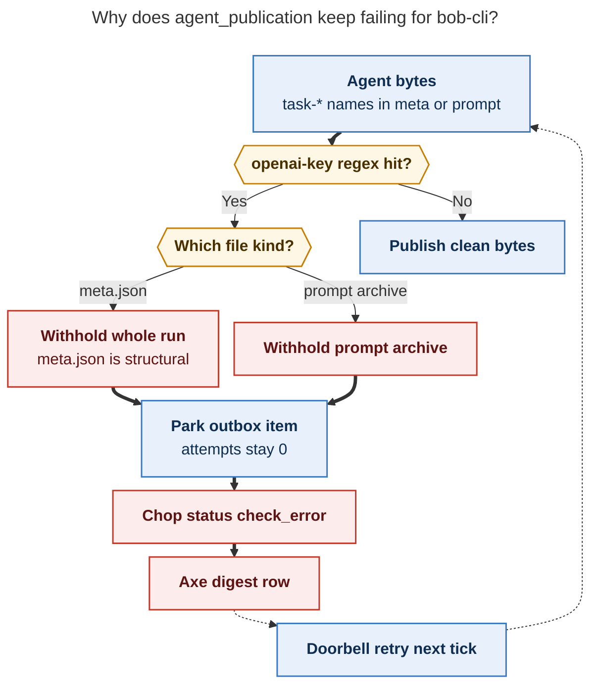

# Agent publication errors: openai-key false positives parked without quarantine

Researcher: `research.5p.grk` (independent). Written 2026-11-02 from the live
axe digest, the bob-cli publication-protection ledger, the bob-cli publication
outbox, agent artifacts, and the sase / sase-core publication-protection code.
I did not read peer swarm reports.

**Question.** The axe digest
`~/.sase/axe/error_digests/digest_20261102_125554.txt` is 71
`agent_publication` rows for `gh_bobs-org__bob-cli`. Which sase agent
introduced those errors, and what is causing them?

**Short answer.** The digest is one repeating drain of four parked outbox
items. The scanner rule `openai-key` (`sk-[A-Za-z0-9_-]{20,}`) matches kebab-case
`task-*` filenames and `ask-*` prose. Those hits withhold publication and
**do not charge quarantine**, so the `agent_publication` chop scores
`check_error` on every ~43 s tick. The flood started when `research.5n.mus`
wrote `blocked-task-why-visual__mus.md`: that path landed in structural
`meta.json`, which withholds the whole run. `bob-cli-fs.8.1.3` and
`bob-cli-fx.2` then added three prompt-archive withholds. The protection
machinery itself was landed by `sase-1oh.5.1.3` and
`sase-1oh.5.1.land--3--code`.

---

## 1. What the digest actually contains

All 71 rows are the same job:

- Routine `publication`, job `agent_publication`, exit code 0, status
  `check_error`.
- Project `gh_bobs-org__bob-cli` only. The other enabled projects drain.
- Window 2026-11-02 12:01:08 through 12:55:42 America/New_York, about one row
  every 43 seconds.
- Typical subprocess line:

  `run withheld by publication protection; prompt archive withheld by publication protection; prompt archive withheld by publication protection; prompt archive withheld by publication protection`

That semicolon list is `"; ".join(item_errors)` from
`src/sase/agents_sync/_commit_publication_drain.py`. The chop in
`src/sase/scripts/sase_chop_agent_publication.py` sets `check_error` whenever
`tick.errors > 0`. One project error becomes one digest row per tick.

Three ticks (errors 24–26, 12:20–12:21) also appended restore failures for
`bbugyi200.athena.bob-cli-fs.2.1.land@fdc34de9bf82` and
`@07e115192e51`. Those two outbox items reached `attempts=3` and quarantined
at 12:21:17. They are a second, already-settled failure class. They are not
the loop that is still firing.

The same withhold signature first appears in
`digest_20261101_195153.txt` at 18:51:56 on 2026-11-01, then in every later
hourly digest through the file the user pointed at.

---

## 2. The four live looping requests

`~/.sase/projects/gh_bobs-org__bob-cli/agents-publication-outbox.json` has 301
items. 283 are already quarantined. 14 are active. **Four** of those 14 carry
protection-withhold errors, all with `attempts=0` and `quarantined=false`:

| Global agent | Scope | Last error | First blocked (NY) | What the scanner saw |
| --- | --- | --- | --- | --- |
| `bbugyi200.athena.research.5n.mus` @ `c8a52365e525` | linked | run withheld | 2026-11-01 18:49:40 | `meta.json` line 1, rule `openai-key` |
| `bbugyi200.athena.bob-cli-fs.8.1.3` @ `f4550e297077` | linked | prompt archive withheld | 2026-11-02 08:48:05 | `prompts/202611/bob-cli-fs.8.1.3.md` line 11 |
| `bbugyi200.athena.bob-cli-fx.2` @ `876ae775e268` | revision | prompt archive withheld | 2026-11-02 11:08:36 | `prompts/202611/bob-cli-fx.2.md` line 141 |
| `bbugyi200.athena.bob-cli-fx.2` @ `1115a14d1e1f` | linked | prompt archive withheld | 2026-11-02 11:08:36 | same prompt bytes, linked-repo request |

Those four strings are exactly the digest's `1 run + 3 prompt archive`
clause. `active_remaining=14` on recent ticks is these four plus ten other
active hoods that still have empty `last_error` (newer `bob-cli-fs` /
`bob-cli-ft` / `bob-cli-fx.land` / `bob-cli-fw.land` requests waiting on
`done.json` grace or a later drain).

Protection withholds call `update_publications(..., increment_attempts=False)`
in `src/sase/agents_sync/_commit_publication_transaction_steps.py`. Prompt
archive withholds use `should_charge_prompt_protection_failure()`, which
returns false for both `PROMPT_PROTECTION_BLOCKED` and
`PROMPT_PROTECTION_UNVERIFIED`. The items stay queued forever.

---

## 3. The scanner match is kebab-case `task-*`, overlapping `sk-`

Publication protection reuses the attachment scanner in
`sase-core` `crates/sase_core/src/note_attachment/scanner.rs`:

```text
openai-key  :=  sk-[A-Za-z0-9_-]{20,}
```

The last two letters of `task` plus the following hyphen are the literal
`sk-`. Any `task-<kebab>` whose tail is 20 or more allowed characters is a
hit. The same overlay fires on English `ask-<kebab>` (`ask-an-optional-…`).

Re-running that regex on the three looping agents' artifacts produced
filename and prose overlays. It did not produce a live `sk-` + long random
token in those trees.

**`research.5n.mus` (structural, whole-run withhold).** Swarm 5n researched
how to show *why* an Obsidian task is Blocked. Mus wrote
`blocked-task-why-visual__mus.md` and registered
`file:explicit:75eef101727cd750276795a2`. The snapshot path

```text
…/blocked-task-why-visual__mus-cf5c493312ed.md
```

contains `sk-why-visual__mus-cf5c493312ed` (28 characters after `sk-`). That
path is copied into generated `meta.json` under
`output_variables.artifacts[].path`. `meta.json` is a **structural** run
file (`_STRUCTURAL_RUN_KINDS = ("meta", "state", "commits")` in
`src/sase/agents_sync/_publication_snapshot_gating.py`). A structural hit
withholds the entire run, which is why the outbox error is `run withheld by
publication protection` rather than a missing chat file.

**`bob-cli-fs.8.1.3` (prompt archive).** Continuation prompt for bead
`bob-cli-fs.8.1.3` embeds the monitor command

```text
node --test scripts/test-task-status-cycler-relation-successors.cjs
                 scripts/test-task-status-cycler-successor-wiring.cjs
```

`test-task-status-cycler-relation-successors` overlays
`sk-status-cycler-relation-successors`. Ledger destination
`prompts/202611/bob-cli-fs.8.1.3.md` line 11 is that prompt.

**`bob-cli-fx.2` (prompt archive, two scopes).** Continuation prompt includes
`git stash` / `npm test` output with many `plugins/task-status-cycler/…` and
`test-task-status-cycler-*.cjs` paths. The same prompt is queued once for the
primary revision and once for the linked `bob-plugins` checkout, which is why
the digest shows **two** prompt-archive withholds for one agent name.

A monitor chat from `15h--mon-0` (2026-10-28, `npm test` on bob-plugins) has
the same `sk-status-cycler-*` overlays. That is the historical pattern for
the `15h` / `bob-cli-e2` / `bob-cli-er` / `bob-cli-f5` / `bob-cli-ft` /
`bob-cli-fs` / `bob-cli-fx` ledger rows: agents working on the
`task-status-cycler` plugin, whose names contain `task-`.

Chat-only hits (`_CONTENT_RUN_KINDS`) omit that file and can still publish
the rest of the run. Those older rows fill the 40-record ledger and then
age into other outbox errors (often deferred prompt restore, which **does**
charge attempts and quarantines at 3). They do not keep `check_error` alive
on every tick. The flood requires a withhold that never charges: a
structural run file or a prompt archive.

---

## 4. Which agents introduced which layer

Three layers, three different agent sets.

### 4.1 Scanner and withhold policy (sase agents)

| Commit | Date (NY) | Agent | What it did |
| --- | --- | --- | --- |
| `7806f587` | 2026-09-30 | attachments work | Added `openai-key` regex `sk-[A-Za-z0-9_-]{20,}` with no leading boundary |
| `0f76e05de4` | 2026-10-27 00:54 | `sase-1oh.5.1.3` | Prompt-archive protection; skip retry/ack charges on protection blocks |
| `c687d8b6eb` | 2026-10-27 07:07 | `sase-1oh.5.1.land--3--code` | Park withheld publications **without charging quarantine** |
| `4356cffaa1` | background job | publication job epic | `agent_publication` chop maps any `tick.errors` to `check_error` |

The no-charge park is intentional: a human can sanitize the source and the
next drain should publish. When the "secret" is a filename that will not
change, that policy becomes an infinite alarm.

### 4.2 Content that started the current flood (bob-cli agents)

| Agent | When | Role in the digest |
| --- | --- | --- |
| `research.5n.mus` | 2026-11-01 18:39–18:49 | First structural withhold; first axe `run withheld` row 2 minutes later |
| `bob-cli-fs.8.1.3` (and `--2` / `--mon-0` children) | 2026-11-02 08:37–08:48 | First lasting prompt-archive withhold still in the live four |
| `bob-cli-fx.2` (revision + linked) | 2026-11-02 11:08 | Second and third prompt-archive withholds |

`research.5n.mus` is the agent that **turned a quiet ledger into a per-tick
axe error**. Before that, bob-cli already had blocked chat/prompt files;
those withholds did not keep a run-level error in the active outbox.

### 4.3 Earlier ledger population (same false-positive class)

The bob-cli protection ledger has **40 blocked records**, all
`reason=scanner_hit`, all `rule_id=openai-key`, first written
2026-10-26 22:40 EDT against
`agents/bbugyi200.athena.bob-cli-an.6.6.6.5.6.5.5.6.6.6.6.6.6.1--4/chat.md`.
That is the evening `sase-1oh.5.1` protection code started scanning live
sidecars, hours before the prompt-archive stitch landed. Later the same day
and through 2026-11-02 the ledger accumulated `15h`, `15x`, `bob-cli-e2`,
`bob-cli-er`, `bob-cli-f5`, `bob-cli-fs.*`, `bob-cli-ft`, `bob-cli-fx.*`, and
the mus `meta.json` row.

I verified the `task-*` overlay on `15h--mon`, `research.5n.mus`,
`bob-cli-fs.8.1.3`, and `bob-cli-fx.2`. The other openai-key rows sit in the
same project and filename family; I did not re-open every historical chat.

sase's own ledger is a different story: three `high-entropy-assignment` hits
on monitor chats (`sase-1q5.4--mon-2`, `sase-1qk.4--mon`,
`toobig-8y.index_queries.0--mon-0`). They are not in this digest.

---

## 5. How one withhold becomes an hourly pile of axe rows





Rendered with `@mermaid-js/mermaid-cli` 12.0.0. Size: 644 × 1026 px; PDF
fit 87.0%.

**Caption.** Kebab-case `task-*` names match `openai-key`, withhold the run or
the prompt archive without charging quarantine, and the publication chop
records `check_error` on every retry.

The doorbell stays armed because publishable-looking requests remain in the
outbox (`publication_job.py` rings when `publishable_count` is nonzero). The
next tick drains the same four keys, writes the same `item_errors`, and axe
appends another digest row. `sase doctor -C state.agent_publication_protection`
would also WARN on the 40 blocked ledger records; the digest noise is the
chop treating a parked withhold as a job failure.

---

## 6. Secondary restore failures in the same digest

Errors 24–26 of `digest_20261102_125554.txt` added:

```text
could not restore deferred prompt archive for
bbugyi200.athena.bob-cli-fs.2.1.land@fdc34de9bf82:
prompt archive is unresolved and a missing local source does not prove
there was no prompt obligation
```

and the same text for `@07e115192e51`.

`src/sase/agents_sync/prompt_archive/deferred.py` plus
`classify_deferred_prompt_obligation` fail closed when the local raw prompt
is gone and the sidecar archive is unresolved. That path **does** increment
attempts. Both items are now `quarantined=true`, `attempts=3`, last updated
12:21:17. They explain a few extra clauses in the middle of the digest and
then drop out. They are independent of the openai-key loop.

---

## 7. Timeline of events

Times are America/New_York.

| Time | Event |
| --- | --- |
| 2026-09-30 | Attachment scanner gains `openai-key` = `sk-[A-Za-z0-9_-]{20,}` (`7806f587`). |
| 2026-10-26 22:40 | First bob-cli protection ledger rows: `bob-cli-an.6.6.6.5.6.5.5.6.6.6.6.6.6.1` family, all `openai-key`. Live scanning of bob-cli publication begins during `sase-1oh.5.1` work. |
| 2026-10-27 00:54 | `sase-1oh.5.1.3` lands prompt-archive protection (`0f76e05de4`). |
| 2026-10-27 07:07 | `sase-1oh.5.1.land--3--code` lands park-without-quarantine-charge (`c687d8b6eb`). |
| 2026-10-28 17:03 | `15h--mon` / `15h--mon-0` chats blocked. Monitor was `npm test` on bob-plugins; artifacts overlay `sk-status-cycler-*`. |
| 2026-10-29 – 11-01 | Further chat/prompt hits from `bob-cli-e2`, `15x`, `bob-cli-er`, `bob-cli-f5`. Content-kind withholds; most requests later quarantine on restore or other charged errors. |
| 2026-11-01 18:39 | `research.5n.mus` launches (clan `research.5n`, muse). Prompt: visual design for why a Bob task is Blocked. |
| 2026-11-01 18:45 | Mus writes `blocked-task-why-visual__mus.md` and registers the explicit snapshot. |
| 2026-11-01 18:49:40 | Ledger records `agents/…research.5n.mus/meta.json` blocked (`openai-key`, line 1). Whole run withheld. |
| 2026-11-01 18:51:56 | First axe row: `gh_bobs-org__bob-cli: run withheld by publication protection`. `digest_20261101_195153.txt` is 83 copies of that line. |
| 2026-11-02 07:36 | `bob-cli-fs.8.1.1` chat / `prompt_steps.json` blocked. |
| 2026-11-02 08:48:05 | `prompts/202611/bob-cli-fs.8.1.3.md` blocked. Prompt-archive withhold joins the live four. Digest clause grows. |
| 2026-11-02 11:08:36 | `prompts/202611/bob-cli-fx.2.md` blocked. Two outbox scopes (revision + linked) produce two prompt-archive errors. Digest reaches `1 run + 3 prompt archive`. |
| 2026-11-02 11:51 | Latest ledger row: `bob-cli-fx.land--code` `chat.md` / `prompt_steps.json`. |
| 2026-11-02 12:01–12:55 | User-cited digest: 71 `check_error` rows, same four withholds. |
| 2026-11-02 12:19–12:21 | Transient `bob-cli-fs.2.1.land` restore failures; quarantined at 12:21:17. |
| 2026-11-02 13:11 | Same four items still `attempts=0`, still queued. Loop is live. |

---

## 8. Root-cause diagnosis

**The axe errors are a scanner false positive amplified by fail-open retry
and a chop that treats parked withholds as job failures.**

1. **Matching bug.** `openai-key` is an unanchored `sk-` prefix. `task-*`
   and `ask-*` kebab names in bob-cli (plugin `task-status-cycler`, research
   file `blocked-task-why-visual__mus.md`, and similar prose) satisfy the
   regex. I did not find a live OpenAI secret in the three looping agents'
   artifact trees.

2. **Severity bug for this project.** A hit on generated `meta.json` is
   structural, so the whole run is withheld. A hit on the prompt archive is
   parked with `increment_attempts=False`. Either condition keeps the outbox
   item active forever.

3. **Alarm bug.** `sase_chop_agent_publication` maps `tick.errors` to
   `check_error`. The publisher doorbell then retries the same keys every
   tick. One false positive becomes ~80 digest rows per hour.

4. **Introducing agents.** Policy: `sase-1oh.5.1.3` and
   `sase-1oh.5.1.land--3--code`. Current flood content: `research.5n.mus`
   (started the run-level error at 18:49 on 2026-11-01), then
   `bob-cli-fs.8.1.3` and `bob-cli-fx.2` (the three prompt-archive clauses
   still in the live digest).

**What would stop the current digest without waiting on new agent runs.**
Tighten the regex with a leading non-word boundary (so `task-` / `ask-` stop
matching), then either re-scan or drop the four blocked ledger rows after
the rule change so the next drain can publish. A second, independent lever
is to stop scoring protection withholds as `check_error` (doctor WARN is
already the right surface). Sanitizing the four source files is the wrong
lever: the "secret" is the project's own `task-*` vocabulary.

**Naming note for this swarm.** A research filename that embeds
`task-<long-kebab>` can recreate the mus failure on the next publication
drain. This report uses underscores in the path on purpose.

---

## Sources

- Axe digest `~/.sase/axe/error_digests/digest_20261102_125554.txt` and
  `digest_20261101_195153.txt`.
- Ledger `~/.sase/projects/gh_bobs-org__bob-cli/agents-publication-protection.json`
  (40 records; destinations, rule ids, timestamps only).
- Outbox `~/.sase/projects/gh_bobs-org__bob-cli/agents-publication-outbox.json`.
- Artifacts `…/ace-run/202611/01/20261101183900` (`research.5n.mus`),
  `…/202611/02/20261102084201` (`bob-cli-fs.8.1.3`),
  `…/202611/02/20261102110218` (`bob-cli-fx.2`).
- Chat index rows for those agents (`sase chat list`);
  `15h--mon` chat under `~/.sase/chats/202610/`.
- Code: `src/sase/scripts/sase_chop_agent_publication.py`,
  `src/sase/agents_sync/publication_job.py`,
  `src/sase/agents_sync/_publication_snapshot_gating.py`,
  `src/sase/agents_sync/_commit_publication_transaction_steps.py`,
  `src/sase/agents_sync/prompt_archive/protection.py`,
  `src/sase/agents_sync/prompt_archive/deferred.py`,
  sase-core `crates/sase_core/src/note_attachment/scanner.rs`.
- Stitches `0f76e05de4`, `c687d8b6eb`, `7806f587`.
