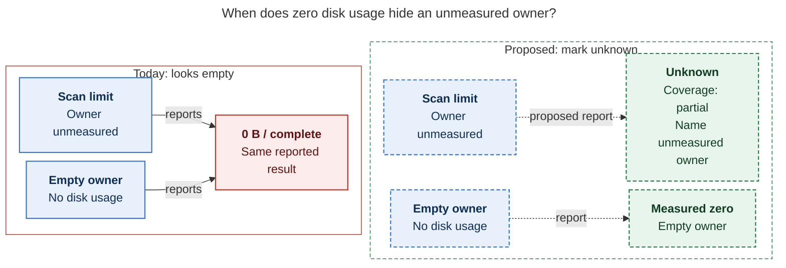
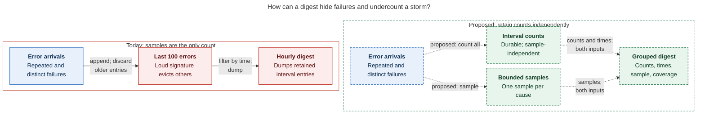

# Diagram proposals: SASE notifications and error/warning log audit: apollo + athena (consolidated)

Proposals for the swarm linker, not a report. Each diagram restates only what the source
report says.

```yaml
source: research:202611/apollo_athena_sase_notification_and_log_audit/apollo_athena_sase_notification_and_log_audit__final.md
producer: research.5e.image
check: "mmdc 12.0.0 with the PDF-mirroring config rendered 3 of 3 Mermaid diagrams; SVG/PNG review passed; broken-source control exited nonzero"
```

## disk-coverage

```yaml
anchor: |-
  reads `0 B, coverage: complete` — indistinguishable from empty.
question: |-
  When does zero disk usage hide an unmeasured owner?
illustrates: |-
  Returning unknown with coverage: partial on budget exhaustion distinguishes unmeasured owners from empty roots and lets pressure notifications name them.
caption: "Proposed unknown/partial results distinguish unmeasured owners from empty roots; either condition produces the same zero/complete result today."
review: "860×481 px, fit 75.9%; question, source, labels, arrowheads and visual checks passed; 2 layout revisions"
```



## held-workspace-loop

```yaml
anchor: |-
  because nothing records "already settled with unchanged evidence" — calls
question: |-
  Why does dismissing an alert not stop repeated settlement?
illustrates: |-
  Settling once per evidence fingerprint skips unchanged retained claims before repeated probes, snapshots and notification +1s rewrite the store.
caption: "Dismissal does not stop repeated settlement; an evidence-fingerprint check would skip unchanged work before more +1s rewrite the store."
review: "829.078×865 px, fit 78.7%; question, source, labels, arrowheads and visual checks passed; 2 layout revisions"
```



```mermaid
---
title: "Why does dismissing an alert not stop repeated settlement?"
config:
  flowchart:
    rankSpacing: 12
    nodeSpacing: 12
    wrappingWidth: 140
---
flowchart TD
  subgraph NEXT["Proposed: skip unchanged evidence"]
    C2["`**Cleanup pass**<br/>Held monitor workspace`"]
    Q2{{"`**Evidence unchanged?**`"}}
    S2["`**Skip settlement**<br/>No repeated work`"]
    P2["`**Settle once**<br/>Per evidence fingerprint`"]
    C2 -.->|"proposed check"| Q2
    Q2 -.->|"Yes"| S2
    Q2 -.->|"No"| P2
  end
  subgraph NOW["Today: unchanged evidence still repeats"]
    C1["`**Cleanup pass**<br/>Held monitor workspace`"]
    P1["`**Probe and snapshot**<br/>Git status and diffs`"]
    N1["`**Add +1 note**<br/>Fixed notification key`"]
    W1["`**Full-store rewrite**<br/>Even dismissed rows`"]
    C1 -->|"re-settles"| P1
    P1 -->|"notifies"| N1
    N1 -->|"takes exclusive lock"| W1
    W1 -->|"next unchanged pass"| C1
  end
  classDef focus fill:#E8F1FB,stroke:#3B78C2,stroke-width:1.5px,color:#0F2E52
  classDef risk fill:#FDECEC,stroke:#C0392B,stroke-width:1.5px,color:#5F1414
  classDef outcome fill:#E7F5EC,stroke:#2E7D4F,stroke-width:1.5px,color:#123D24
  classDef proposed stroke-dasharray:5 3
  class C1,P1,C2 focus
  class N1,W1 risk
  class Q2,S2,P2 outcome
  class C2,Q2,S2,P2 proposed
  style NOW fill:none,stroke:#C0392B
  style NEXT fill:none,stroke:#2E7D4F,stroke-dasharray:5 3
```

## error-counts

```yaml
anchor: |-
  and silently drops on `OSError`; the hourly digest selects entries newer than
question: |-
  How can a digest hide failures and undercount a storm?
illustrates: |-
  A durable full-interval counter separate from the bounded sample ring preserves counts when repeated errors evict distinct failures.
caption: "Group errors by routine, job and signature; combine independent interval counts with bounded samples so storms cannot erase the totals."
review: "775.562×721 px, fit 84.2%; question, source, labels, arrowheads and visual checks passed; 2 layout revisions"
```


