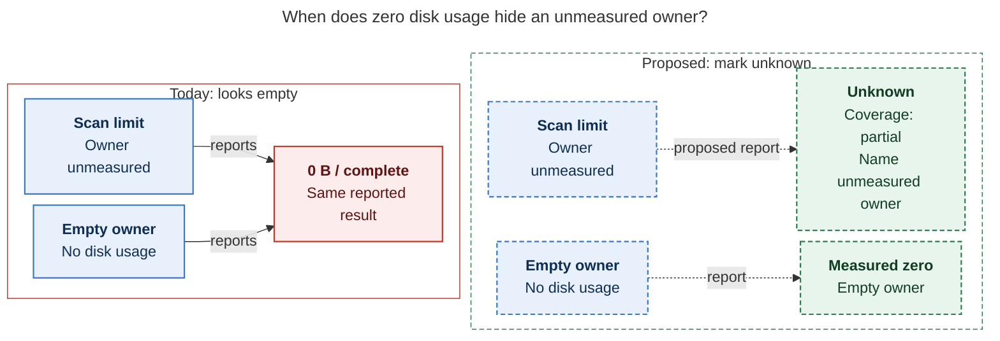
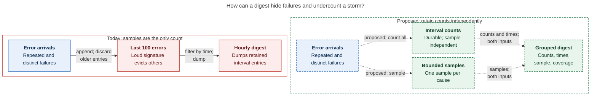

# SASE notifications and error/warning log audit: apollo + athena (consolidated)

> **Research query:** Audit the SASE notifications emitted and the SASE-related
> error/warning logs stored on this machine (apollo) and on the athena machine, to
> identify issues that should be fixed. Recommend only fixes and improvements that are
> objectively desirable, and end with a ranked list of the ones to consider.

## Bottom line

The two machines are operational, but the notification and error-log pipelines are
doing enormous amounts of work to say very little, and a handful of real defects sit
inside that noise:

- **Apollo genuinely ran out of disk on Nov 16** (1.8 MiB free at the worst sample),
  crash-looping several scheduler routines with `OSError: [Errno 28]`. Every one of
  its disk-pressure notifications blamed 150–193 GiB of "unattributed" space because
  the disk inventory's shared 5-second scan budget runs out and reports skipped
  trees as `0 B, coverage: complete`. The alert could not name an owner, and
  automatic recovery reclaimed kilobytes against a 9.6 GiB target
  ([F2](#disk-attribution-blindness-and-the-nov-16-apollo-enospc-outage)).
- **A held-workspace re-settlement loop is live on athena right now.** Dismissed
  "Workspace held: stranded work" notifications are +1'd every ~9–30 s forever; each
  +1 rewrites the whole 7.4 MB notification store under an exclusive lock. The lead
  measured **16 full-store rewrites per minute** during this audit (~170 GB/day of
  write amplification), and the responsible code paths are unchanged on master
  ([F1](#held-workspace-re-settlement-loop)).
- **`agent_publication` is the dominant error-digest storm on both hosts** (62/100
  and 44/100 of the recent-error rings; ~94–96 % of November digest entries). The
  largest historical storm (`gh_bbugyi200__nut`, 1,893 entries) was already fixed by
  commit `b0de76422d` on Nov 17; what remains is a job that re-counts parked,
  withheld, and timed-out work as a fresh hard error every tick, plus deferred
  prompt archives on athena that genuinely cannot restore ("missing local source
  does not prove there was no prompt obligation"); see
  [F3](#agent-publication-chronic-error-state).
- **The error-digest pipeline itself hides storms**: the `recent_errors.json` ring
  keeps only the last 100 entries and the hourly digest dumps it verbatim, so one
  loud job evicts every other failure and the inbox reads "100 error(s) in the last
  hour" with no true count
  ([F4](#the-error-digest-pipeline-hides-storms-and-loses-counts)).
- **Both TUIs have severe, measured responsiveness failures**: GC pauses up to
  37.9 s (apollo) and 73–324 s (athena, swap-amplified at 6.2 GB RSS), recovered
  event-loop stalls up to 116 s / 331 s, and sampled main-thread stacks naming
  specific synchronous hotspots ([F5](#tui-memory-growth-and-main-thread-stalls)).
- **Several small, code-confirmed defects** are each worth a targeted fix: the
  [`prompt_prose` Python→Rust wire mismatch](#prompt-prose-artifact-link-contract-mismatch),
  the [Telegram plain-text fallback firing on network errors](#telegram-transport), a
  [`bead_task_triage` retry that can never succeed](#bead-task-triage-retries-a-request-id-that-can-never-succeed),
  the [Codex instruction bundle exceeding its 32 KiB cap](#codex-instruction-bundle-exceeds-its-32-kib-explicit-channel)
  on every launch since Nov 17, the SDD health probe reporting timeouts as
  repository corruption ([fix already landed — verify](#already-fixed)), and a
  [gateway SQLite WAL checkpoint that errors on SQLite's legal `-1` return](#gateway-wal-checkpoint-integer-bug-and-multi-minute-fleet-snapshots).

[The ranked list at the end](#ranked-fixes-and-improvements) keeps only objectively
desirable changes: fixes for verified defects, restoration of advertised behavior
(retention horizons, accurate counts), or removal of measured waste. Preference-level
changes (e.g. capping workspace counts) are flagged as such or excluded.

## Scope and method

_Lead consolidation of five independent swarm reports (`__cdx`, `__cld`, `__grk`,
`__mus`, `__gem`, in this directory) plus the lead's own verification pass.
2026-11-19. Machines: **apollo** (this rendezvous host, 193 GiB disk at 87% used,
Python 3.12.3) and **athena** (home server, 875 GiB disk at 68% used, Python 3.14.7),
both on `sase 0.19.0+196.g065eda332` / `sase-core-rs 0.44.2+43.g6f8f016e8`. All
inspection was read-only; no notifications were dismissed and no state was repaired._

Each researcher independently read both hosts' notification stores (live +
archive), `~/.sase/axe/` (recent_errors ring, hourly `error_digests/`, lumberjack
logs), `~/.sase/logs/` (TUI logs and JSONL telemetry, `launch_failures.jsonl`,
`dev_update.jsonl`, publication drains), service proc logs, user journals,
`sase disk list`, `sase doctor` (gem), and current source in `sase`, `sase-core`,
and `sase-telegram`. Athena was reached read-only over Tailscale SSH.

### Cross-checking

The lead re-verified every load-bearing single-source claim before ranking:

| Claim (source) | Lead verification |
| --- | --- |
| Held-workspace +1 loop (cld only) | **Confirmed live.** 7 dismissed athena rows at the 500-+1 cap received +1s seconds before snapshot; store generation advanced 16 in 60 s on a 7.4 MB file. Code confirmed: `release_monitor_claim` → "retained with other dirt" → return, then `notify_retained_workspace` upserts with a fixed dedup key and `plus_one_note` on every pass (`src/sase/turns/workspace_retention_surface.py:131-144`). No commits since Nov 17 touch this path; apollo's loop went quiet Nov 18 only because its held workspaces settled. |
| `prompt_prose` wire rejection (cdx, mus) | **Confirmed.** `ArtifactLinkOriginWire` in `sase-core crates/sase_core/src/artifact_link/wire.rs` has no `PromptProse` variant; cdx additionally reproduced the rejection against the installed binding. |
| Disk scan budget returns `0`/`complete` (cld, gem) | **Confirmed.** `DiskFootprintMeter.size()` returns `0` with only a diagnostic when the shared budget is exhausted (`src/sase/core/disk_footprint_utils.py:131-137`). |
| Telegram plain-text fallback on any error (cld only) | **Confirmed.** `_send_single_message` catches bare `Exception` and resends without `parse_mode` (`sase-telegram src/sase_telegram/telegram_client.py:129`); `@_with_retry` wraps whole multi-chunk sends. |
| `bead_task_triage` unwinnable retry (cld only) | **Confirmed.** On any create failure the job logs and `continue`s without advancing `generation`, so the deterministic `request_id` repeats forever against a `request_id_conflict` (`src/sase/scripts/sase_chop_bead_task_triage.py:509-523`). |
| Gateway WAL `u64::try_from(-1)` (gem only) | **Confirmed.** `checkpoint.rs` passes SQLite's busy-checkpoint `-1` straight into `u64::try_from(...).map_err(...)` (`sase-core crates/sase_core/src/agent_scan/index/checkpoint.rs:83-86`). |
| `remote-attention` dedup key includes `request_id:revision` (gem; cld/grk called the channel healthy) | **Mechanism confirmed in code** (`src/sase/dispatch/attention_inbox.py:555-561`). gem's store evidence shows duplicate rows with identical revisions and re-created rows after dismissal; cld/grk judged only volume. Treated as a real but medium-priority defect. |
| Orphaned `interaction_requests/` backlog (gem only) | **Confirmed.** 2,397 pending `task_triage` dirs on apollo at audit time. |
| Apollo `tg_outbound` idle-but-ticking (grk only) | **Confirmed running.** The telegram lumberjack spawns `tg_outbound` ~12.7×/min on apollo today; grk's log evidence shows nothing sent from apollo since Sep 5 (athena is the live sender). |

## Baseline numbers

| Dimension | apollo | athena |
| --- | ---: | ---: |
| Filesystem | 193 GiB, 87 % used, 26 GiB free | 875 GiB, 68 % used, ~284 GiB free |
| Live / archived notification rows | 1,777 (5.1 MB) / 6,386 (41 MB) | ~2,626 (7.4 MB) / 23,551 (109 MB) |
| Unread, undismissed, non-silent | ~420 | ~420 |
| Error digest files (all time) | 436 (23.6 MB) | 726 (14.5 MB) |
| `recent_errors.json` ring | 100 rows, 62 `agent_publication` | 100 rows, 44 `agent_publication`, 25 SDD recovery |
| Pending `interaction_requests/` dirs | ~2,500 (mostly `task_triage`) | ~5,030 |
| TUI peak RSS / max GC pause | 3.88 GB / 37.9 s (116.8 s worst hitch) | 6.20 GB / 73.0 s current, 324.2 s rotated (331 s worst recovered stall) |
| Leaked `.log.lock` files (`~/.sase/procs/logs/`) | 6,716 | 13,570 |
| Orphaned `.agent_name_registry.json.*.tmp` | 3 (22.9 MB) | 9 (85.6 MB) |

Count discrepancies between reports are window artifacts, not contradictions: the
live stores hold 1,777 (apollo) / ~2,626 (athena) rows, archives add 6,386 /
23,551, and per-sender tallies differ with the 7-day vs November vs all-time
windows each researcher used.

## Findings

### Held-workspace re-settlement loop

**F1 — +1 storm and store write amplification (live on athena).**
`hooks/stale_running_cleanup` re-settles every legitimately retained ("held")
monitor workspace on every pass. Each pass re-probes `git status` in every related
repo, re-snapshots worktree diffs (5.6 MB per pass for one apollo workspace), and —
because nothing records "already settled with unchanged evidence" — calls
`notify_retained_workspace`, which upserts on a fixed dedup key with a +1 note.
In sase-core, every +1 takes the exclusive store lock, reads all rows, and rewrites
the entire file — **including for dismissed rows**.
[The held-workspace loop diagram](#figure-held-workspace-loop) traces how each
unchanged pass repeats probes and snapshots, a +1 note, and a full-store rewrite, and
where a proposed evidence-fingerprint check would skip that work.

```mermaid
---
title: "Why does dismissing an alert not stop repeated settlement?"
config:
  flowchart:
    rankSpacing: 12
    nodeSpacing: 12
    wrappingWidth: 140
---
flowchart TD
  subgraph NEXT["Proposed: skip unchanged evidence"]
    C2["`**Cleanup pass**<br/>Held monitor workspace`"]
    Q2{{"`**Evidence unchanged?**`"}}
    S2["`**Skip settlement**<br/>No repeated work`"]
    P2["`**Settle once**<br/>Per evidence fingerprint`"]
    C2 -.->|"proposed check"| Q2
    Q2 -.->|"Yes"| S2
    Q2 -.->|"No"| P2
  end
  subgraph NOW["Today: unchanged evidence still repeats"]
    C1["`**Cleanup pass**<br/>Held monitor workspace`"]
    P1["`**Probe and snapshot**<br/>Git status and diffs`"]
    N1["`**Add +1 note**<br/>Fixed notification key`"]
    W1["`**Full-store rewrite**<br/>Even dismissed rows`"]
    C1 -->|"re-settles"| P1
    P1 -->|"notifies"| N1
    N1 -->|"takes exclusive lock"| W1
    W1 -->|"next unchanged pass"| C1
  end
  classDef focus fill:#E8F1FB,stroke:#3B78C2,stroke-width:1.5px,color:#0F2E52
  classDef risk fill:#FDECEC,stroke:#C0392B,stroke-width:1.5px,color:#5F1414
  classDef outcome fill:#E7F5EC,stroke:#2E7D4F,stroke-width:1.5px,color:#123D24
  classDef proposed stroke-dasharray:5 3
  class C1,P1,C2 focus
  class N1,W1 risk
  class Q2,S2,P2 outcome
  class C2,Q2,S2,P2 proposed
  style NOW fill:none,stroke:#C0392B
  style NEXT fill:none,stroke:#2E7D4F,stroke-dasharray:5 3
```

_Dismissal does not stop repeated settlement; an evidence-fingerprint check would skip unchanged work before more +1s rewrite the store._

Evidence: cld counted ~107k (apollo) and ~124k (athena) +1 arrivals since Nov 5
(the per-row list caps at 500, rolling); the lead confirmed 7 dismissed athena rows
still ticking at the cap and measured 16 full rewrites of the 7.4 MB store per
minute (~170 GB/day). Athena's hooks log shows 5,500+ "retained with other dirt"
lines per workspace over just Nov 17–19. The same routine (`stale_running_cleanup`)
is one of apollo's chronic timeout offenders, so this is wasted work inside an
already-overbudget job. A related, separately-fixed-looking defect: one apollo
workspace was held for 14 days by a probe error naming a path in a *different*
workspace (check that closed bead `sase-1rg.3` covers starter-inherited repo
lists).

Fix (three independent layers, all objectively desirable): settle at most once per
evidence fingerprint (skip claims whose retention record is recent/unchanged);
+1 only when the retention reason changes (optionally an hourly heartbeat); and add
a sase-core store guard that coalesces identical +1s within a window and never
rewrites the store for a +1 to a dismissed row without caller opt-in.

### Disk attribution blindness and the Nov 16 apollo ENOSPC outage

**F2.** Apollo hit 1.8 MiB free on Nov 16–17; routines (`telegram`, `agent_waits`,
`sidecar_sync`, wait scheduler, …) crash-looped on `Errno 28`, and recovery
reclaimed ~9.7 KiB against a 9.6 GiB target (`reason=recovery_blocked`). All 119
all-time `disk_pressure` notifications lead with "Unattributed 150–193 GiB", so the
operator (and reaper) had no owner to act on.

Root cause (code-confirmed): one shared `InventoryScanBudget` (5 s / 50k nodes)
covers the whole inventory pass; once large trees (artifact runs, cargo targets,
uv tools) exhaust it, `size()` returns `0` for every remaining row, which then
reads `0 B, coverage: complete` — indistinguishable from empty. On apollo, 38
workspace rows read 0 B while `du` finds ~54 GiB of workspaces and ~24 GiB under
`~/.sase`; athena shows the same pattern (43/43 workspace rows at 0 B, ~567 GiB
unattributed). cld identifies this as a regression of closed bead `sase-1bf.4`
("cover every registered root and every workspace checkout before the stray walk").
Athena has a secondary cleanup impediment: ~195 recent "could not fully inspect"
warnings preserve one agent-tmp dir whose liveness evidence is unreadable.
[The disk-coverage diagram](#figure-disk-coverage) contrasts today's single
`0 B, coverage: complete` result for unmeasured and empty owners alike with the
proposed unknown, `coverage: partial` report that names unmeasured owners.

_Proposed unknown/partial results distinguish unmeasured owners from empty roots; either condition produces the same zero/complete result today._

Fix: return unknown (not `0`) on budget exhaustion and mark rows
`coverage: partial`; give workspace/owner roots their own budget or measure them
first (a `du -skx` per workspace root is cheap); decouple the managed-temp reaper
from inventory completeness so blocked attribution can never block reaping; name
unmeasured owners in the pressure notification; and escalate clearly when recovery
cannot reach its target. Blind deletion and treating protected artifacts as
disposable remain out of scope.

### Agent publication chronic error state

**F3 — `agent_publication`: no backoff, impossible budgets, unrecoverable
obligations.** Publication is the top error source on both hosts, in three
distinguishable parts:

1. **No per-(project, signature) backoff.** Every tick, parked/withheld/missing
   targets and per-project failures increment `summary.errors` (even with exit
   code 0), refill the 100-slot ring, and re-trigger digests. `sase doctor` has
   accumulated 1,546 (apollo) / 5,202 (athena) `agent_publication_outbox` issues.
2. **Budget exhaustion with recorded waste.** Apollo's drain ledger shows
   `inventory_build` alone eating 96–115 s of the 120 s drain budget, and cleanup
   failing its hard 1 s budget; lock waits were <3 ms, so this is bounded-work
   design, not contention. One hood publish moved 3.86 MB of chat bytes across 29
   runs and still timed out.
3. **Deferred prompt archives that cannot restore (athena).** 32 recent digest
   records say "a missing local source does not prove there was no prompt
   obligation" — the refusal to fabricate success is correct, but the obligation
   has no protected source left to fulfill it and no terminal recovery state, so it
   retries forever and strands workspaces ("Workspace held … sdd:agents prompt
   archive", 25 recent notices).

Fix: convert repeat identical publication failures to a standing alert with
backoff and a true attempt count (notify on state transition, not every ~15–18 s);
make the drain do bounded incremental work with verifiable cleanup (the 1 s cleanup
budget failing closed after a 120 s timeout is the worst combination); audit the
deferred-prompt source lifecycle so durable obligations keep their source bytes
through completion/cleanup, and add one explicit terminal state for genuinely
unreconstructable archives. Do not mark obligations successful to clear queues.

### The error-digest pipeline hides storms and loses counts

**F4.** `append_error` keeps only the last 100 errors
(`src/sase/axe/_state_scheduler.py`) and silently drops on `OSError`; the hourly
digest selects entries newer than `max(now−1h, last_digest_ts)` and dumps them
verbatim. Consequences, all observed: 93 apollo digests are capped at exactly 100
entries; one signature fills the ring and evicts distinct failures (disk, SDD,
retention) during exactly the windows when they matter; >100 errors/hour or a
delayed digest silently lose events (apollo's publication log holds 3,005 recent
error lines vs 1,900 digest records of the same family); and digest files are never
pruned. [The error-counts diagram](#figure-error-counts) shows today's 100-entry ring
serving as the only count, beside the proposed durable interval counter that would
keep totals when one loud signature evicts others.

_Group errors by routine, job and signature; combine independent interval counts with bounded samples so storms cannot erase the totals._

Fix: aggregate by `(routine, job, normalized signature)` with count, first/last
timestamps, and one sample; keep a durable full-interval counter separate from the
bounded sample ring so the header can say "≥312 errors (100 sampled)" with a
truthful coverage interval; prune digest files. Tests: >100 errors between drains,
delayed digest, write failure.

### TUI memory growth and main-thread stalls

**F5 — TUI memory growth, multi-minute GC pauses, and main-thread stalls.** Both
TUIs log watchdog-recovered event-loop stalls (apollo max ~116 s; athena max
331 s, of which 324 s was GC at `pause_depth=0`). Athena's live TUI measured
2.5–6.2 GB RSS with ~0.5 GB swapped; its worst pauses show 100k+ major page faults
(swap-amplified gen-2 collections over ~16.5M blocks). Apollo's worst stall had
only 0.4 s GC overlap — its sampled stack sits in synchronous filesystem work
(`_launchable_mru_tick` → `Path.stat`) — so a GC-only fix will not cover both
machines. Sampled main-thread hotspots: `aggregate_clan_runtime`,
`list_project_records`/`_project_record_has_spec`, `_canonical_path`,
`agent_share_fingerprint`, `compile_query_profile`. Related hygiene: apollo's
`tui_stalls.jsonl` is 18 MB while sibling JSONL logs rotate near 2 MB, it contains
3 torn lines, and `tui_faults.log` records only session headers (305–351 lines,
zero faults ever) — misnamed noise. Existing triage beads (`sase-1nc`, `sase-1gf`,
`sase-lx`) already cover parts of this.

Fix: investigate heap retention/allocation driving multi-GB RSS (athena), move the
sampled synchronous hotspots off the main loop behind mtime/TTL caches, cap or
politick gen-2 collections, and separately fix the low-GC blocking-I/O stalls on
apollo. Keep `tui_stalls.jsonl` as the acceptance metric; rotate it like its
siblings; write `tui_faults.log` headers only on actual faults.

### Prompt prose artifact-link contract mismatch

**F6 — `prompt_prose` Python→Rust artifact-link contract mismatch
(reproducible).** Host code produces artifact-link citation events with origin
`prompt_prose` (`src/sase/agents_sync/referenced_by_planning.py` and three other
call sites); the Rust wire enum accepts only
`manual|migrated|prompt_ref|read|derived|projected`. Athena's citations for
`plan:202611/research_commit_gap.md` fail on every pass with "unknown variant
`prompt_prose`", and cdx reproduced the rejection with a read-only probe of the
installed `sase_core_rs.artifact_link_validate_row`. Launch-failure logs show the
same drift class elsewhere ("artifact-reference wire is stale: expected 3, got 4",
missing bindings).

Fix: add the variant (with intended provenance semantics) to the Rust wire in
sase-core, move sase's `sase-core-revision.txt` pin past it, add a contract test
that round-trips every host-produced origin through the real binding, and verify
the pending event family drains once. Silently relabeling as `prompt_ref` would
erase deliberately-recorded provenance.

### Runtime update races

**F7 — Runtime updates race running jobs, launches, and native code.**
Update-adjacent breakage recurs on both hosts: SIGBUS (`exit code -7`) in
`sidecar_auto_sync`/`agent_auto_restart`/`pending_checks_poll` within seconds of
recorded updates; `ModuleNotFoundError: sase_core_rs`; missing job scripts
(`sase_job_tg_outbound`, `sase_job_agent_auto_restart`); and a launch failure
importing `BeforeSpawnCallback` 36 s after an update that passed its binding
checks. Partial guards already landed (`ea7916d7a7` classifies scripts that vanish
mid-swap as retryable; `1ccd5c0579` queues dev updates behind in-flight epic
launches). Additional noise: the dev-update "Install prebuilt Rust dev artifacts"
step reports exit 1 on every cache miss (`hit:false, reason:commit-mismatch`) —
18/37 apollo records — which is a miss, not a failure.

Fix: extend the existing guards so a running job/launch/finalizer sees a coherent
runtime across an update (defer "script not found"/"binding missing" while the
code-swap lock is held; build a small update-overlap reproducer before choosing
between narrower guards and versioned runtime instances); make prebuild cache
misses exit 0/`hit:false`. Investigate SIGBUS separately only if it reproduces.

### Telegram transport

**F8 — Telegram transport: wrong fallback trigger, whole-message retries,
credential traceback spam, idle apollo loop.** Code-confirmed:
`_send_single_message` falls back to plain text on *any* exception, so the 143
observed fallbacks on athena followed `TimedOut`/`NetworkError`, not Markdown parse
errors — and since a timeout doesn't prove non-delivery, users can receive
duplicate, unformatted messages. `@_with_retry` wraps multi-chunk sends, re-sending
already-delivered chunks (up to 8 HTTP sends per failing chunk). Separately: a
Nov 14–15 gpg outage produced 408 identical `TelegramCredentialError` tracebacks
(one degraded-state notice would do); transient `TimedOut`/Bad Gateway events log
full multi-frame tracebacks; and apollo runs the 5 s outbound lumberjack
(~12.7 spawns/min, confirmed today) despite having sent nothing since Sep 5 —
athena is the live sender. Receiver crash-loop notices with exit 75 are the
credential-unavailable retry path, not delivery loss.

Fix: fall back only on entity-parse `BadRequest` (checked before its `NetworkError`
parent), let network errors reach the retry wrapper, retry per chunk; collapse
repeated credential/network failures into rate-limited degraded-state logs; scope
`tg_outbound` to the machine that sends (matching `telegram_receiver`).

### Bead task triage retries a request ID that can never succeed

**F9 — `bead_task_triage` retries a request ID that can never succeed.** 1,517
identical failures on athena in a week ("request id already belongs to a different
gate specification") and the affected bead never got its triage gate.
Code-confirmed: the deterministic `_request_id(project, bead, generation, kind)` is
never advanced on failure, and the gate journal rejects a reused ID whose spec
fingerprint changed. Fix: on `request_id_conflict`, bump the generation (or adopt
and cancel the journaled request), then recreate; test with a bead whose body
changes between a failed and retried create.

### Codex instruction bundle exceeds its 32 KiB explicit channel

**F10.** Every Codex launch since Nov 17 falls back to legacy delivery (~60–75/day
across both hosts; daily deduped notifications with dozens of +1s). Code- and
data-confirmed: `codex.py` fixes `max_bytes: 32*1024`; the compiled `bob-cli`
bundle measures 36,186 bytes (sase: 22,105, under), and apollo's newest
instruction snapshots are 34 KB vs 25–26 KB in early November — the always-inlined
memory sections grew past the cap around Nov 16–17. Fix: bring the oversize
bundle(s) back under the cap (trim the inline decisions/glossary listings or move
content to reference memory), and add a doctor/`just check` gate that renders each
provider's root bundle and fails over `max_bytes`, so growth is caught at
authoring time. If Codex genuinely accepts more, raise the cap with a delivery
test instead.

### Gateway WAL checkpoint integer bug and multi-minute fleet snapshots

**F11 — Gateway: WAL checkpoint integer bug and multi-minute fleet snapshots.**
Code-confirmed: `PRAGMA wal_checkpoint(TRUNCATE)` legally returns `(-1,-1,-1)`
when busy, and `checkpoint.rs` fails `u64::try_from` on it, so every blocked
checkpoint logs "out of range integral type conversion attempted" and the
checkpoint never happens. Operationally, apollo's gateway logged presentation
snapshot builds of 158 s and ~30 min, starving waiters into `504 Gateway Timeout`s.
Fix: handle `-1` as "busy/skipped" (clamp or `Option<u64>`), use passive
checkpoints on read paths, and serve cached snapshots stale-while-revalidate.

### Notification hygiene

**F12 — Notification hygiene (verified mechanisms, lower individual stakes).**

- **`remote-attention` dedup**: key includes `request_id:revision`, so re-emissions
  and edits create new unread rows (1,615 all-time on athena; duplicate pairs with
  identical revisions observed). Key by stable gate/bead identity instead.
- **`wait_checks` amplification**: dedup works per waiter, but one failed blocker
  fans out to every downstream waiter and +1s to the 500 cap (4,590 +1s across
  athena's last 50 rows; 412 "can never self-resolve" rows). Key by root blocker,
  freeze +1s once terminal, and offer/perform auto-expiry of waiters whose blocker
  is terminally failed.
- **Orphaned `interaction_requests/`**: ~2,500 (apollo) / ~5,030 (athena) pending
  dirs — mostly `task_triage` whose notification was dismissed or bead resolved —
  are never reconciled. Add a reconciliation pass. (This pairs with the
  `quiet-task-beads` user rule, which documents the triage-volume fix as owed.)
- **Oversized inline blobs**: `action_data`/`notes` embed 170–218 KB prompts and
  error dumps; over half the active store is `action_data`. Store >8 KB payloads as
  sidecar files; prune the 314/522 broken `files` references.
- **Success toasts and missing dedup keys**: 210 of 212 apollo `file-hooks` rows
  are ✅ successes; `workspace-rescue` (117/135 rows) and `disk_pressure` (101+
  rows) have no dedup key; ACE-prune priority nudges fire for 873 KiB on a host
  with 283 GiB free. Make successes silent, add dedup keys, add a size floor.
- **`agent_state_refresh` re-logging**: ~1,000 redundant warning lines/day/host
  re-examining unchanged terminal agents (up to 246 repeats per agent). Persist
  verdicts with an evidence fingerprint.
- **`workspace_claims.jsonl` no-op rows**: "already pinned (no-op)" recorded as an
  error thousands of times per night (`src/sase/running_field/_hold.py`). Skip the
  write when nothing changed.

### Log and state retention gaps

**F13.** Advertised horizons are not applied and known garbage persists: athena's
`tools/logs` holds 489 MiB older than 30 days against a stated 14-day
post-settlement horizon; error-digest files are never pruned (436/726 files);
a 222 MiB `agent_artifact_index.sqlite...bak` from Sep 26 persists; 12 orphaned
`.agent_name_registry.json.*.tmp` files hold 108 MB; and ~20,300 stale `.log.lock`
files sit in `~/.sase/procs/logs/`. On apollo (the 193 GiB host that hit ENOSPC)
these overlap with [F2](#disk-attribution-blindness-and-the-nov-16-apollo-enospc-outage).
One-time cleanup plus age-based reapers for each class, and unblock
`artifact_run_prune` ("2 protection sources are unreadable", 19 +1s — partially
addressed by `b0de76422d`; verify).

## Already fixed

Verify, don't reimplement.

| Issue | Evidence it's over |
| --- | --- |
| `gh_bbugyi200__nut: no usable agents publication target` storm (1,893 digest entries, ~92 % of apollo's recent digest errors) | Stopped Nov 17 07:36, one minute after commit `b0de76422d` (silence unmanaged-project noise in retention/publication) |
| SDD health probe reporting git deadline expiry as "not a valid Git worktree … recovery failed" on healthy repos | Commit `637a70a0f1` (Nov 18) adds timeout-as-unknown handling with tests; flagged apollo clones verified healthy; latest captured examples predate the fix. Residual: back off per clone after N identical failures |
| Athena `bob-cli/sase/repos/plans` empty git objects (23–108 log lines, Nov 14–15) | Repo verified healthy now (`git fsck` clean); a genuinely different defect from the timeout misclassification — keep an eye out for recurrence |
| TUI `gate_input_panel._fit_body_scroll` NoMatches crash (Nov 17) | `dd56fe2075` wraps it; the crashed TUI predated the fix. Sibling: guard `#notification-indicator` poll (athena, 2 hits) similarly |
| `AgentWorkspaceRetention is not JSON serializable` (Nov 4 cluster) | `c6282f75b2` omits retention from agent bundles |
| `#gh` docs-refresh rejecting `owner/repo` (11 notifications, Nov 13–14) | sase-github `5f85ceb` binds `gh_ref` as `line` |
| September telegram `pass` token storms (5,356 digest lines) | Outbound now reads `~/.sase/telegram_bot_token`; residue is covered by digest pruning ([F13](#log-and-state-retention-gaps)) |

Historical log patterns (PROJECT_NAME warnings, screenshot-export timeouts,
Oct 11 index.lock burst) are resolved; `tui.log`'s lack of age rotation is why
they still dominate all-time counts.

## Ranked fixes and improvements

Ranked by (outage risk, measured ongoing waste, user-visible impact) ×
confidence in the diagnosis. Shared backend changes belong in `sase_core` with
binding coverage and the revision pin moved; items 1–2 are closest to outage
prevention, 3–5 are the big noise/waste generators, 6–10 are high-confidence
targeted defects, 11–13 are hygiene that keeps the rest visible.

1. **Make disk attribution honest and decouple recovery from it
   ([F2](#disk-attribution-blindness-and-the-nov-16-apollo-enospc-outage)).**
   Unknown ≠ 0 B/`complete`; per-owner budgets with workspace roots measured first;
   reaper independent of inventory completeness; pressure notifications that name
   unmeasured owners; clear escalation when recovery misses its target. Reopen or
   follow up `sase-1bf.4`. _Apollo hit ENOSPC on Nov 16 while 119 alerts pointed at
   "unattributed"; it is at 87 % again._
2. **Stop the held-workspace re-settlement loop
   ([F1](#held-workspace-re-settlement-loop)).** Settle once per evidence
   fingerprint; +1 only on change; sase-core store guard coalescing identical +1s
   and never rewriting for +1s to dismissed rows. _Live now: ~230k redundant +1s,
   16 full 7.4 MB store rewrites/min on athena (~170 GB/day), repeated git probes
   inside a routine that already times out on apollo._
3. **De-flap `agent_publication` and make its obligations finish
   ([F3](#agent-publication-chronic-error-state)).** Per-(project, signature)
   backoff with standing alerts and true counts; bounded incremental drain work
   with a cleanup budget that can actually complete after a timeout; protected
   source lifecycle plus an explicit terminal recovery state for deferred prompt
   archives. _62/100 and 44/100 of both error rings; 1,546/5,202 doctor outbox
   issues; athena archives that can never restore._
4. **Aggregate the error ring and digests by signature with true counts and
   coverage ([F4](#the-error-digest-pipeline-hides-storms-and-loses-counts)).** One
   line per cause with count/first/last/sample; durable counter beside the
   100-sample ring; truthful coverage interval; prune digest files. _Prevents the
   next loud job from recreating the "100 error(s)" inbox and evicting distinct
   failures — do this even after fixing item 3._
5. **Attack the measured TUI stalls
   ([F5](#tui-memory-growth-and-main-thread-stalls)).** Heap-retention work for
   athena's swap-amplified 73–324 s GC pauses; move the sampled synchronous hotspots
   off the main thread; fix apollo's low-GC blocking-I/O stalls separately; rotate
   `tui_stalls.jsonl`; make `tui_faults.log` honest. _Worst user-visible defect;
   profile-guided, with existing telemetry as the acceptance metric._
6. **Fix the `prompt_prose` wire contract
   ([F6](#prompt-prose-artifact-link-contract-mismatch)).** Add the variant in
   sase-core, bump the pin, contract-test every host-produced origin through the
   real binding, verify the stuck events drain once. _Smallest high-confidence fix;
   breaks citation publication on every pass today._
7. **Close the remaining update races ([F7](#runtime-update-races)).** Defer
   "script not found"/"binding missing" while the code-swap lock is held;
   update-overlap reproducer before bigger designs; prebuild cache miss exits 0.
   _SIGBUS, import, and missing-script errors cluster within seconds of recorded
   updates on both hosts._
8. **Fix Telegram transport semantics and scope ([F8](#telegram-transport)).**
   Entity-parse-only fallback, per-chunk retries, rate-limited credential/network
   diagnostics, outbound only on the sending machine. _Stops duplicate/unformatted
   user-facing messages and 8× send amplification; removes an idle 5 s loop from the
   ENOSPC-prone host._
9. **Keep provider instruction bundles under their caps
   ([F10](#codex-instruction-bundle-exceeds-its-32-kib-explicit-channel)).** Shrink
   the oversize bundle(s); add a render-size gate per provider in doctor/`just check`.
   _Restores the documented explicit-delivery path for every Codex launch._
10. **Advance the generation on `request_id_conflict` in `bead_task_triage`
    ([F9](#bead-task-triage-retries-a-request-id-that-can-never-succeed)).** _An
    affected bead currently never gets its triage gate; 1,517 doomed retries in a
    week._
11. **Gateway WAL `-1` handling + stale-while-revalidate snapshots
    ([F11](#gateway-wal-checkpoint-integer-bug-and-multi-minute-fleet-snapshots)).**
    _Checkpoints currently never succeed when busy; 30-minute snapshot builds
    produced 504s._
12. **Notification hygiene bundle ([F12](#notification-hygiene)).** remote-attention
    stable dedup key; wait_checks keyed by blocker with frozen +1s and auto-expiry
    of terminally blocked waiters; interaction_requests reconciliation (plus the
    owed triage-volume fix the `quiet-task-beads` rule documents); externalize >8 KB
    blobs; silent success hooks; dedup keys for workspace-rescue/disk_pressure; a
    size floor on prune nudges; memoized `agent_state_refresh` verdicts; skip
    no-op claim-ledger writes.
13. **Retention and clutter sweep ([F13](#log-and-state-retention-gaps)).** Apply
    the advertised `tools/logs` horizon; prune error digests; delete the sqlite
    `.bak`, registry tmps, and `.log.lock` piles via age-based reapers; verify
    `artifact_run_prune` is unblocked. _Stated policies and identified garbage,
    concentrated on the host that ran out of disk._

Two consciously excluded items: capping bob-cli workspace counts (a preference,
not a defect — item 1 is what makes the tradeoff visible), and changing
`sase.service` kill policy on the strength of eight "Failed to kill control
group" warnings (first prove an owned child survived incorrectly; agent scopes
intentionally outlive some host lifecycle operations).
