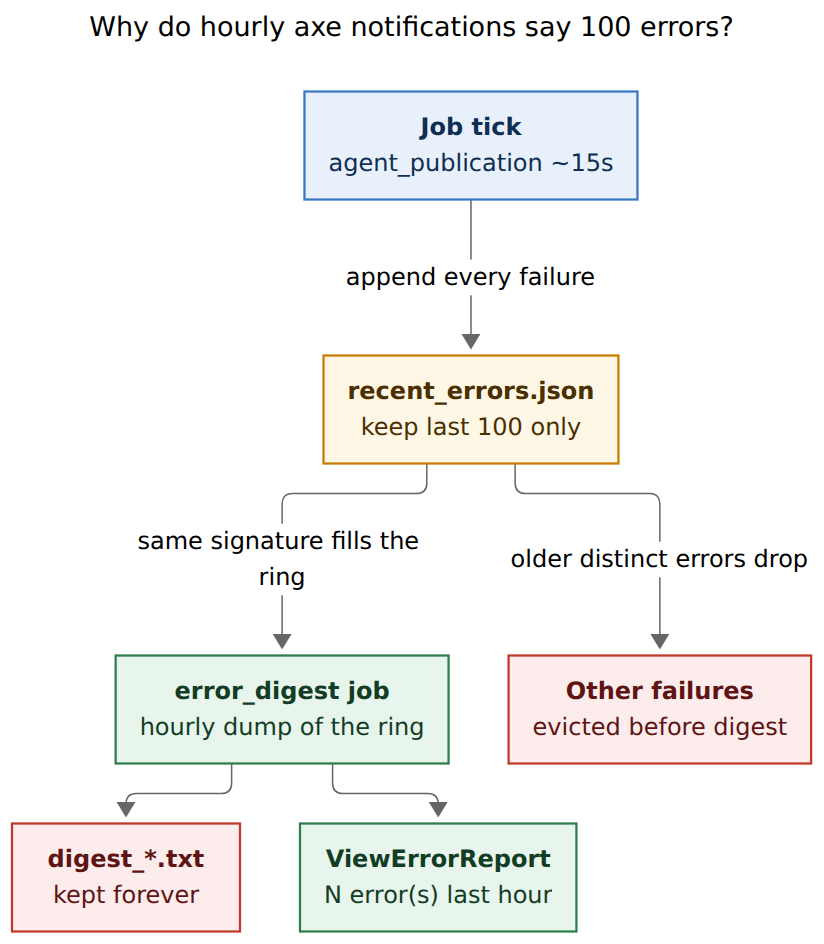
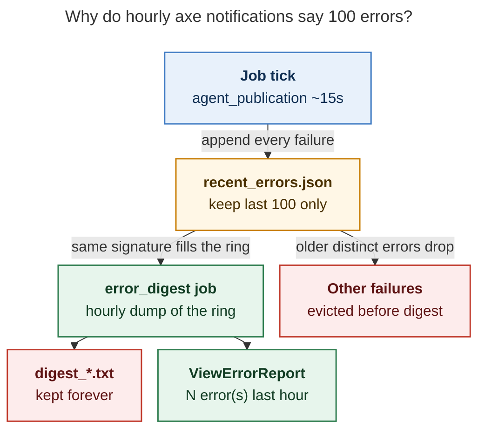

# SASE notifications and error-log audit (apollo + athena)

_Independent swarm draft (`__grk`). Snapshot taken 2026-11-19 05:00–10:16 EST from
live stores on **apollo** (this DigitalOcean rendezvous host) and **athena** (home
server). No code was changed._

## Bottom line

Both machines are emitting more scheduler noise than signal. The live inbox is
dominated by repeating job failures that the error-digest pipeline then
re-publishes as “100 error(s) in the last hour,” while a handful of real
operational defects (publication timeouts, SDD clone recovery, disk-inventory
blind spots, ENOSPC crash loops, stranded waits) sit in the same firehose.

The ranked list at the end is restricted to fixes that are objectively
desirable: they restore missing failure diversity, stop a store from growing
without a horizon, or make an existing alert name the actual owner of the bytes
or the job.

## Method

Read-only inspection of the local notification CLI, the JSONL stores, AXE
`recent_errors.json`, hourly `error_digests/`, lumberjack and TUI logs,
`journalctl --user -u sase.service` (14 days), `sase disk list`, and the same
paths over SSH on `athena`. Counts come from `sase notify list -j -l 20000 --all`
(the CLI returned the full live store: 1,777 rows on apollo, 2,624 on athena).

| Source | apollo | athena |
| --- | ---: | ---: |
| Live notifications (`notifications.jsonl`) | 1,777 rows / 5.1 MiB | 2,624 rows / 7.1 MiB |
| Archived notifications | 6,386 rows / 41 MiB | 23,551 rows / 104 MiB |
| Unread / dismissed / silent | 859 / 452 / 85 | 887 / 636 / 249 |
| AXE error digest files | 436 (23.6 MiB, Aug 31–Nov 19) | 726 (16 MiB, Jul 6–Nov 18) |
| `recent_errors.json` ring | 100 rows (Nov 17 07:20–Nov 19 01:24) | 100 rows (Nov 14 17:35–Nov 18 20:57) |
| Lumberjack logs (`~/.sase/axe/logs`) | ~450 MiB, 11 files at the 50 MiB cap | 527 MiB, 19 files |
| `~/.sase/tools/logs` | 0.86 GiB inventoried | 1.20 GiB / 15,607 files |
| `~/.sase/chats` | (in the unattributed gap) | 1.70 GiB / 63,822 files |
| Filesystem | 193 GiB, 87% used, 26 GiB free | 875 GiB, 68% used, 283 GiB free |
| `sase.service` memory | 1.8 GiB, peak 3.9 GiB | 2.3 GiB, peak 9.9 GiB |
| Runtime | sase 0.19.0+196, Python 3.12.3 | sase via uv, Python 3.14.7 |

Host clocks: apollo `2026-11-19T10:02:53+00:00`; athena `2026-11-19T05:05:21-05:00`.

## 1. The error-digest pipeline hides everything except the loudest job

**Reader question:** Why do hourly axe notifications say 100 errors?

**Caption:** Repeating job failures fill a 100-slot ring; the hourly digest dumps
that ring verbatim, so other failures disappear and the inbox sees “100 error(s)
in the last hour.”



Rendered size: 548.8 × 630 px; fit scale: 100%. Mermaid CLI `@mermaid-js/mermaid-cli@12.0.0`.



This is implemented as written:

- `append_error` in `src/sase/axe/_state_scheduler.py` keeps `errors[-100:]`.
- `sase_chop_error_digest.py` selects every ring entry newer than
  `max(now-1h, last_digest_ts)` and calls `notify_axe_error_digest`.
- `notify_axe_error_digest` writes one `digest_YYYYMMDD_HHMMSS.txt` per firing
  and a `ViewErrorReport` row whose only note is `"{n} error(s) in the last hour"`.
  There is no signature rollup, no per-job cap, and no prune of old digest files
  (grep of the tree finds the writer and no reaper).

Live consequences:

| Observation | apollo | athena |
| --- | ---: | ---: |
| AXE `ViewErrorReport` notifications | 335 | 380 (all-sender ViewErrorReport) |
| Notes matching `100 error(s) in the last hour` | 89 | 21 |
| Digests whose listed error count is exactly 100 | 93 of 436 | 8 of the last 80 |
| Listed errors inside all digest files | 18,818 | (last 80 files: 884 publication rows alone) |
| `agent_publication` share of `recent_errors.json` | 62 / 100 | 44 / 100 |
| `agent_publication` share of all digest `Job:` lines | 10,128 / ~18.8k | 882 / last-80 |

On apollo the all-time digest `Error:` lines are:

| Signature (digits normalized) | Count |
| --- | ---: |
| `agent_publication: projects=N … errors=N` (two field variants) | 10,090 |
| `could not resolve chop env SASE_TELEGRAM_BOT_TOKEN` / pass unread | 5,356 |
| `Chop script not found: sase_chop_tg_inbound/outbound` | 2,108 |
| `timed out after Ns` | 637 |
| `exit code N` / `exit code -N` | 564 |
| SDD “not a valid Git worktree” / git deadline | dozens |
| `[Errno 28] No space left on device` | 2 digest files; crash-loop notifications and telegram log are larger |

The telegram-token and missing-chop-script storms are **historical** (September
2026, while outbound still used `pass`/`telegram_sase_bot_token`). The current
loud signature on both machines is `agent_publication` with
`agent-hood publication did not complete within 120s` and
`publication cleanup did not complete within 1s`. Constants:
`DEFAULT_PUBLICATION_DRAIN_TIMEOUT_SECONDS = 120.0` in
`src/sase/agents_sync/_commit_publication_drain.py`; cleanup is a hard one-second
Rust-owned budget (`publication_cleanup.py`).

A current apollo digest (`digest_20261119_013903.txt`) is one row:

```text
[agent_publication] gh_bobs-org__bob-cli: agent-hood publication did not complete
within 120s; publication cleanup also failed: publication cleanup did not
complete within 1s
agent_publication: projects=9 … active_remaining=3 parked=3 … errors=1
```

The job records `exit_code: 0` on that run and still appends an error. Parked
requests therefore fail the tick forever, refill the 100-slot ring, and starve
`artifact_link_backfill`, SDD recovery, and retention errors out of the digest.
This matches the mechanism in the Nov 2/4 publication research
(`202611/agent_publication_errors_still_occurring.md`); the live wording has
shifted from the openai-key “withheld” clause to the 120s/1s timeout, with
`parked=3` still on the summary line.

By this morning’s ticks the job is often taking the quiet path (`Job skipped:
watched paths unchanged and within max_quiet` on both hosts). The ring and the
unread `ViewErrorReport` rows still describe the earlier storm.

## 2. Inbox composition: three senders crowd out everything else

### apollo live store (1,777)

| Sender | n | unread | notes |
| --- | ---: | ---: | --- |
| `bead` | 486 | **486** | All `TaskTriage` (471) or snooze/stale. User rule `quiet-task-beads` already hides the toast because “triage is too noisy.” |
| `axe` | 352 | 12 | Almost all priority `ViewErrorReport`. |
| `user-agent` | 283 | 255 | Completions and auto-restart resurface. |
| `file-hooks` | 212 | 18 | **210 success** (`✅ research-highlights: …`), 4 failure-ish. |
| `workspace-rescue` | 117 | 3 | No `dedup_key`. |
| `disk_pressure` | 101 | 2 | No `dedup_key`. Lead line is unattributed 150–193 GiB. |
| `wait_checks` | 77 | 18 | 67 “can never self-resolve”; plus-ones up to 417 on one stranded bead. |
| others | 149 | | plan, sudo, epic, instructions/oversize, gates, quarantine. |

Age mix: 103 <1d, 544 1–7d, 465 7–30d, **665 >30d**. Compaction
(`sase_job_notification_store_compact`) only archives *dismissed* rows older
than three days, so unread TaskTriage and old error reports stay in the live
file indefinitely.

### athena live store (2,624)

| Sender | n | distinctive |
| --- | ---: | --- |
| `bead` | 493 | Same unread-triage pile as apollo. |
| `wait_checks` | **419** | **412** “Wait dependency can never self-resolve.” Last 50 rows carry **4,590** plus-ones, max **1,003** on one key. |
| `axe` | 351 | Same 100-error digest pattern. |
| `user-agent` | 315 | Includes `workspace-held` / stranded work. |
| `file-hooks` | 169 | Same research-highlights success toasts. |
| `remote-attention` | 161 | Tagged `apollo` — federation attention, working as a channel. |
| `ci_watch` | 144 | Repair proposals and CI failures, plus-oned. |
| `workspace-rescue` | 135 | Includes “Failed to publish sidecar before workspace cleanup: plans” (12). |
| `summarize-hook` / `fix-hook` | 84 / 73 | Mix of completed and failed hook runs. |
| `poseidon-cache-watch` | 19 | Storage watcher. |
| `disk_pressure` | 6 | Far quieter than apollo (athena has 283 GiB free). |

`wait_checks` already upserts with
`dedup_key=wait_checks:terminal-blocked:{waiter_dir}` and plus-ones on repeat
ticks (`_chop_wait_checks_terminal.py`). Dedup is doing its job; the remaining
defect is that a waiter that can never self-resolve is corroborated a thousand
times instead of being closed, relaunched, or folded into a single standing
alert.

## 3. Disk pressure, ENOSPC, and an inventory that cannot name 95% of the disk

On 2026-11-16 apollo hit genuine ENOSPC. Crash-loop notifications from that
window quote `OSError: [Errno 28] No space left on device` while writing
lumberjack pid files and Patch JSON. `lumberjack-telegram.log` still ends its
error lines on that date. `df` now shows 26 GiB free (87% of 193 GiB).

`sase disk list -j` on apollo:

- Filesystem used: **179.25 GiB**
- Inventoried rows on that filesystem: **7.48 GiB**
- `unattributed` exclusive size: **159.5 GiB** (171.21 × 10⁹ bytes)
- Diagnostics: `filesystem used 179246870528 bytes; inventoried rows on this filesystem attribute 8033959936 bytes`

So **about 95% of used bytes have no owner**. `disk_pressure` therefore leads
with “Unattributed 152–193 GiB … see `sase disk list`,” repeated **101** times
without a dedup key. The alert cannot tell an operator what to delete. Top
*named* owners are modest (`rust_prebuild_cache` 5.3 GiB, `managed_tmp` agent-tmp
1.1 GiB, `tools` 0.8 GiB). Git checkouts, workspaces, uv toolchains, chats, and
most of `~/.sase` sit in the gap.

Athena is not in ENOSPC danger (283 GiB free) but holds large SASE-adjacent
trees that the same inventory style will under-count: `tools/logs` 1.20 GiB,
`chats` 1.70 GiB, `axe/logs` 0.50 GiB, `agent_artifact_index.sqlite` 359 MiB
plus a **222 MiB** leftover
`agent_artifact_index.sqlite.pre-matched-deploy-20260927T064040Z.bak` dated
2026-09-26.

`tool_run_retention` advertises `logs 14d after settlement`. On athena
`tools/logs` still has **6,122 files / 489 MiB older than 30 days**. Either
runs never settle, or reap does not apply the advertised horizon. The
`artifact_run_prune` notification on apollo (“ACE run pruning is paused / 2
protection sources are unreadable,” 19 plus-ones since Nov 16) is a concrete
blocker on one cleanup path.

Lumberjack logs *are* bounded (`DEFAULT_LUMBERJACK_LOG_MAX_BYTES = 50 MiB`).
Eleven routines at the cap is ~550 MiB by design. That bound is large relative
to apollo’s 193 GiB disk once chats, tools, and the unattributed remainder are
included.

## 4. Success and housekeeping events use the same inbox as failures

`src/sase/file_hooks/runner.py` always `append_notification`s, with `❌` and
`ViewErrorReport` on failure and `✅` and no action on success. On apollo that
produced **210 success toasts** for `research-highlights` (one per research
markdown write) and 4 failure-ish rows. None are `silent`. The Beads-tab
workaround (`quiet-task-beads` in `~/.config/sase/sase.yml`) already shows the
operator treating volume as a defect; success hooks have no such rule.

`workspace-rescue` (117 apollo / 135 athena) reports leftover bundles before
heal (`linked-sase-core`, `plans`, gastown checkouts, …) with **no dedup_key**.
Healing is useful; repeating the same sidecar’s leftover as a new row each time
is not.

Codex instruction fallback is already deduped per host/day
(`instructions:fallback:{host}:codex:oversize:{day}`) and plus-oned. Apollo has
three daily rows (Nov 17–19) with 42, 59, and 15 plus-ones. The notify path is
fine; the underlying oversize fallback is firing dozens of times per day.

## 5. SDD clone recovery and sidecar git health

Athena `recent_errors.json` (100 rows) is **25**
`workspace_sdd_clone_recovery` and **19** `artifact_retention` after
publication. Recurring text:

- `SDD repository …/sase/repos/plans is not safe to write: not a valid Git worktree`
- `detached HEAD`
- `could not list unmerged index entries: deadline expired before git operation`
- one cluster on bob-cli’s plans clone citing a missing `.git/objects/…` file

A direct `git status` on
`/home/bryan/projects/github/bobs-org/bob-cli/sase/repos/plans` at snapshot time
showed a clean `main...origin/main`, so some of these are transient races
during machine-managed recovery. They still occupy a quarter of the error ring
and 33 of the last 80 digest job lines on athena. Apollo’s ring has the same
class against `body`, `job`, `love`, `tailnet`, and bob-cli beads/research
clones.

Related: this turn’s `sase repo open research` printed
`Refusing to replace mismatched SDD sidecar clone at …/sase/repos/plans`.
Sidecar health is an active source of both notifications and open-path
refusals.

## 6. Logs that grow, rotate poorly, or do not say what their names claim

| Log | Finding |
| --- | --- |
| `~/.sase/logs/tui_stalls.jsonl` (apollo) | **18 MiB** current + 2.1 MiB `.1` from Nov 16. Peer JSONL files rotate near 2 MiB; this one did not. Last 300 lines: `tui_gc_pause`, `tui_hitch`, `tui_pump_hitch`. |
| `~/.sase/logs/tui.log` stall watchdog (apollo) | 1,288 “stall detected”; 1,268 recoveries; p50 **8.0 s**; **143 ≥ 30 s**; **109 ≥ 60 s**; max **5,818 s**. Examples from Nov 18: event loop recovered after 72 s, 116 s. |
| `~/.sase/logs/tui_faults.log` | Session pid/version heartbeats only. The name promises faults; the file does not record them. |
| `lumberjack-telegram.log` on apollo | 48 MiB, last_sent_ts **2026-09-05**. Routine still runs every 5 s (user `sase.yml`). Tick overruns: 6.4 s, 115 s, **428 s**. Athena outbound is the live sender (`sent=1` this morning). |
| `lumberjack-publications.log` (athena, plural) | Extra 7.8 MiB file beside `lumberjack-publication.log` — leftover name from a routine rename. |
| `journalctl --user -u sase.service` | Application errors do not go here. 14-day apollo journal is 475 lines, 20 at priority 4, **6** “Found left-over process (sase_job_*) in control group while starting unit.” Unit is `KillMode=mixed`. Athena journal had no warning-priority lines in 14 days. |
| Stale tmp/lock files | apollo: three `.agent_name_registry.json.*.tmp` (22 MiB, Sep–Oct). athena: 9 such tmps; `~/.sase/notifications.jsonl.lock` at the *old* root (Aug 7); `axe/ensure_failure_notification.json` from Sep 22 (“Axe start process exited before publishing a PID (code 2)”). |

`sase.service` currently has leftover jobs only in the historical journal, not
in the live cgroup (snapshot after a 04:43 EST restart). The restart warning is
still a real supervisor defect: jobs survive the previous unit and get ignored
on the next start.

## 7. Telegram, Python, and update races

- **Telegram outbound is configured globally** in `~/.config/sase/sase.yml`
  (`interval: 5`, `tg_outbound`). `sase_apollo.yml` correctly disables
  `telegram_receiver` (one `getUpdates` consumer) and does **not** disable
  outbound. Apollo has not sent since 2026-09-05 and still runs the 5 s
  routine, producing 48 MiB of logs and multi-minute tick overruns.
  Athena’s outbound is healthy.
- **Job script vanishing during updates** still appears in athena’s recent
  ring: `No such file or directory: '…/bin/sase_job_tg_outbound'`,
  `Job script not found: sase_job_agent_auto_restart`. A 5 s telegram tick
  concurrent with `uv` replacing the tool tree will always lose this race.
- **Python 3.12.3 (apollo) vs 3.14.7 (athena)** is an environment skew worth
  keeping in mind for any “works here” diagnosis. The live error signatures
  above reproduce on both interpreters.

## 8. Gates and one-off operational rows

Worth fixing if cheap; they are not the firehose:

- apollo `GateExecutionFailed` Nov 16: custom gate `option create` exit 1
  (still unread, dismissed).
- athena `GateExecutionFailed` Nov 16: custom `option install` →
  `invalid_command_output`; three September rows are SSH `publickey` failures
  during plan archive (stale, still in the live store).
- apollo workspace `#10` (`gh_bbugyi200__tailnet`) quarantined: nested
  preservation of `…/external/gh/bbugyi200/nut` failed (`git rev-parse HEAD`
  needed a single revision). New launches skip the slot until that nested repo
  is cleaned.
- Historical launch_failures.log on apollo (September): missing
  `~/.sase/machine_name` and `research.0` colliding with the reserved
  `research` owner namespace. `machine_name` is present now (`apollo`).

## Ranked fixes / improvements

Restricted to changes that restore missing signal, apply an advertised
retention horizon, or make an existing alert name a real owner. Effort is a
rough guess for sequencing, not a commitment.

| Rank | Fix | Why it is objectively desirable | Evidence | Effort |
| ---: | --- | --- | --- | --- |
| **1** | **Signature-aggregate `recent_errors` and the hourly digest.** Keep one row per `(routine, job, normalized error)` with `count`, first/last timestamps, and a sample traceback. Digest notes should read like `agent_publication × 96 (120s hood timeout); sdd-sidecar × 4`. Cap digest files and prune them. | Today the ring is a duplicate buffer. 62–96 copies of one timeout evict every other failure and produce 89 apollo notifications that only say “100 error(s).” Operators cannot see SDD, retention, or backfill while publication is loud. | Ring code keeps `[-100:]`; 93 apollo digests at the cap; 10,128 publication `Job:` lines. | M |
| **2** | **Stop counting a parked/timed-out `agent_publication` drain as a fresh hard error every ~15 s.** Charge attempts, quarantine, or emit one standing alert with plus-ones (the wait_checks pattern). Raise or share the 1 s cleanup budget so timeout cleanup does not fail closed. | The current signature is `120s drain + 1s cleanup` with `parked=3` and `exit_code 0`. It has filled both rings for days and is the parent of rank 1. | `digest_20261119_013903.txt`; 62/100 apollo and 44/100 athena recent errors; drain timeout constant 120 s. | M (behavior) + S (cleanup budget) |
| **3** | **Close the disk inventory gap and dedup `disk_pressure`.** Attribute workspaces, git checkouts, uv tools, chats, and the rest of `~/.sase`, or stop leading with “unattributed 160 GiB.” One upserted row per mount/threshold. On ENOSPC, lumberjacks should skip writes and surface one crash-loop, not 50 MiB of identical tracebacks. | 95% of apollo’s used disk is unnamed, so 101 pressure rows cannot drive a reap. Nov 16 ENOSPC was real and crash-looped several routines. | `sase disk list -j` 179 GiB used vs 7.5 GiB inventoried; 101 `disk_pressure` rows; telegram/hooks crash-loops quoting errno 28. | M |
| **4** | **Apply advertised log/retention horizons, and delete known leftovers.** Reap `tools/logs` past 14 d post-settlement (489 MiB >30 d on athena); prune error_digests; drop the 222 MiB sqlite `.bak` (Sep 26); drop stale registry `.tmp` files; rotate `tui_stalls.jsonl` like the other JSONL logs (18 MiB vs 2 MiB siblings). Unblock `artifact_run_prune` (`protection_unavailable`, 19 plus-ones). | These are stated policies and identified garbage. They are also the bytes that push apollo toward ENOSPC. | athena tools/logs age histogram; 436+726 digest files with no reaper; sqlite bak 222 MiB; prune notification `d06eb302-…`. | S–M |
| **5** | **Make success file-hooks silent (or omit them).** Keep failure rows with `ViewErrorReport`. | 210/212 apollo file-hook rows are `✅ research-highlights`. They are audit events using the operator inbox. | `file_hooks/runner.py` always appends; 212 apollo / 169 athena rows. | S |
| **6** | **Cap wait_checks plus-ones and escalate once.** After N corroborations, freeze the row and recommend kill/relaunch (the note already says this) without +1 on every tick. Optionally auto-fail waiters whose target is terminal. | Dedup already works; 1,003 plus-ones on one athena waiter and 412 “never self-resolve” rows mean the scheduler is documenting a deadlock, not paging a new one. | athena last-50 wait_checks: 4,590 plus-ones, max 1,003; 412 identical first notes. | S (cap) / M (auto-resolve) |
| **7** | **Land the task-bead triage volume fix the user rule already names.** `quiet-task-beads` says “Remove this rule once the triage-volume fix is in.” Until then, 486 unread priority `TaskTriage` rows occupy the live store because compact ignores unread. | Dual-tracking the same bead as an unread notification and a Beads-tab row is why the operator muted toasts. Compact cannot archive them. | 486/486 unread on apollo; config comment in `sase.yml`; compact job description (dismissed + 3 days only). | M |
| **8** | **Machine-scope telegram outbound.** Run `tg_outbound` on athena only, matching `telegram_receiver`. On apollo, the 5 s routine has not sent since 2026-09-05 and still overruns (428 s) and sits at the 50 MiB log cap. Guard missing job scripts during `uv` replace (skip, don’t error-digest). | Duplicate-capable outbound on two hosts is a footgun; an idle 5 s loop on the smaller disk is waste; “script not found” during updates is a known race on athena. | apollo `last_sent_ts` Sep 5; athena sending today; athena recent_errors missing `sase_job_tg_outbound`. | S |
| **9** | **Dedup `workspace-rescue` per sidecar/reason** (upsert + plus-one). | 117/135 rows, zero dedup keys, same sidecars repeating (`linked-sase-core` 20× on apollo). | Notification dump. | S |
| **10** | **SDD recovery: treat detached-HEAD + git-deadline as one standing alert per clone**, and fail the recovery path before it appends 25 ring slots. Investigate the bob-cli plans missing-object episode even though `git status` is clean now. | A quarter of athena’s ring is this class; it also refused a research open this turn. | 25/100 athena recent_errors `workspace_sdd_clone_recovery`; open-research refusal. | M |
| **11** | **`KillMode` / job lifetime on `sase.service`.** Six leftover `sase_job_*` processes in 14 days of apollo journals, with systemd’s “unclean termination / service implementation deficiencies” text. Jobs started by the service should die with it. | Restarts currently ignore leftover jobs in the cgroup. | `journalctl` leftover-process lines; unit `KillMode=mixed`. | S–M |
| **12** | **TUI stall log rotation and a bound on stall-watchdog spam.** 18 MiB `tui_stalls.jsonl` and 109 recoveries over 60 s (max 5,818 s) are a performance defect with a logging defect on top. Rename or actually write `tui_faults.log`. | The stall file outgrew its rotation peers; the faults file is misnamed. | File sizes; `tui.log` recovery histogram. | S (logs) / existing TUI perf work (stalls) |
| **13** | **Codex instruction-bundle oversize.** Dozens of fallbacks per day (59 plus-ones on Nov 18). Keep the daily upsert; shrink the bundle or raise the Codex cap so the fallback is rare. | Fallback is already the well-behaved notifier; the rate says the primary path is the wrong size for that provider. | Three daily rows, plus-ones 42 / 59 / 15. | M |
| **14** | **Clear stale gate-failure and ensure-failure rows** (September SSH publickey, Sep 22 axe PID file) and the quarantined tailnet workspace `#10` nested `nut` repo. | They occupy the live inbox and a launch slot with no remaining operator action. | GateExecutionFailed timestamps; `ensure_failure_notification.json`; quarantine notification `3a59a2f3-…`. | S (ops) |

## What I would *not* spend time on from this corpus

- **Remote-attention (161 on athena)** — tagged `apollo`, looks like the
  federation channel doing its job.
- **Silent `plan-decisions` (85 on apollo)** — already `silent: true`.
- **CI-watch plus-ones** — they name a SHA and a repair; volume is lower than
  publication/waits.
- **Re-fixing the September telegram `pass` token errors** — outbound now reads
  `~/.sase/telegram_bot_token`; those digest files are historical residue
  (rank 4 prune covers them).

## Suggested sequencing

Ranks 1–2 are the same fire: publication fills the ring, the digest lies. Ship
aggregation even if the publication timeout stays, because the next loud job
will recreate the “100 errors” inbox. Rank 3–4 are why apollo hit ENOSPC on
Nov 16 and will again. Ranks 5–9 are inbox hygiene that makes ranks 1–4 visible
to a human. Ranks 10–14 are real but secondary to the firehose.

## Appendix: commands used

```bash
sase notify list -j -l 20000 --all
sase notify rules
sase disk list -j
journalctl --user -u sase.service --since '14 days ago'
python3  # classify ~/.sase/axe/recent_errors.json and error_digests/digest_*.txt
ssh athena 'sase notify list -j -l 20000 --all; …'
```

Primary local paths: `~/.sase/notifications/`, `~/.sase/axe/{recent_errors.json,error_digests,logs}`,
`~/.sase/logs/`, `~/.config/sase/sase.yml`, `~/.config/systemd/user/sase.service`.
