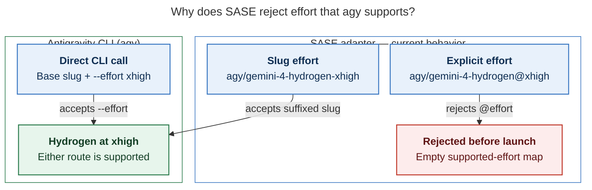

# Diagram proposals: Google Argon and Hydrogen support in SASE — consolidated research

Proposals for the swarm linker, not a report. Each diagram restates only what the source
report says.

```yaml
source: research:202611/argon_hydrogen_completion_and_swarm/argon_hydrogen_completion_and_swarm__final.md
producer: research.4k.image
check: "mmdc 12.0.0 with the PDF-mirroring config rendered 1 of 1 Mermaid diagrams; Puppeteer --no-sandbox; broken-chart control exited nonzero"
```

## effort-routing

```yaml
anchor: |-
  SASE's adapter still passes an empty supported-effort map
question: |-
  Why does SASE reject effort that agy supports?
illustrates: |-
  SASE's adapter rejects `@effort` before launch, while slug variants work today and
  upstream `agy` supports base slugs with `--effort`.
caption: "SASE rejects @effort before launch; encode effort in the model slug, even though Antigravity’s CLI accepts --effort directly."
review: "652.953×812 px, fit 100.0% rounded; question, source trace, and visual checks passed; 1 revision across 2 look rounds"
```


