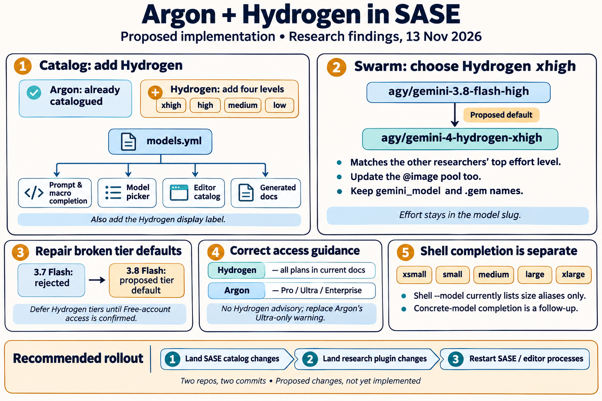
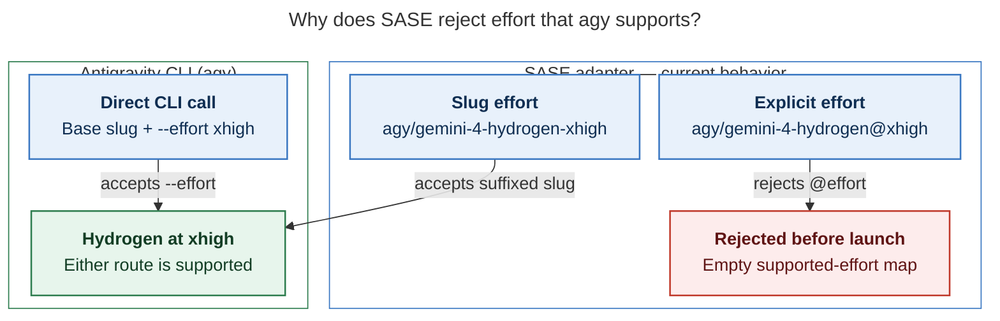

# Google Argon and Hydrogen support in SASE — consolidated research

> **Research query:** What is the best way to add sase support for Google's new Argon and
> Hydrogen models — updating every model completion surface to include them and
> switching the `#research_swarm` macro from its current Gemini model to Hydrogen — and
> which solution is recommended?



## Bottom line

**Argon is already catalogued; Hydrogen is the new work, and it is mostly one YAML
edit.** Commit `4d8940d4b7` (2026-10-14) added `gemini-4-argon-{high,medium,low}` to the
agy section of `src/sase/llm_provider/models.yml`, and that manifest is the documented
single edit point that feeds nearly every completion surface automatically. The
recommended implementation is **[two commits in two repos](#implementation-plan)**:

1. **sase** — add the four verified Hydrogen slugs
   (`gemini-4-hydrogen-{xhigh,high,medium,low}`) with short aliases and
   **[no advisory](#entitlements)**; correct the now-stale Argon "Ultra-only" advisory to
   Pro/Ultra/Enterprise; fix the
   **[live-broken agy tier defaults](#the-agy-tier-defaults-are-broken-today)** (3.7 Flash
   is Enterprise-only and rejected on this account) by moving them to 3.8 Flash; add
   `"hydrogen"` to the hand-kept `short_model_name` keyword list; regenerate docs.
2. **sase-research-artifacts** — change `#research_swarm`'s `gemini_model` default from
   `agy/gemini-3.8-flash-high` to **[`agy/gemini-4-hydrogen-xhigh`](#swarm-default)**,
   update the `@image` pool's agy member to match, and update the plugin's docs and
   pinned tests.

Land sase first so the plugin default resolves in doctor and `type: model` completion.
Defer to [follow-up beads](#follow-up-beads): `agy --effort` passthrough,
Carbon/Orchestrator, agy catalog drift (Claude 5.5 slugs; stale
3.7/3.6/3.5/3.1-pro/claude-4-6 rows), concrete models in shell `--model` completion,
promoting Hydrogen into tiers/size aliases, and the stale 3.7-Flash pins in
`sase/macros/reads.md`, doc examples, and chezmoi snippets.

## Verified ground truth

### Model slugs

Source: live `agy models`, v1.5.8, verified six times independently.

All five researchers and the lead ran `agy models` on this host and got byte-identical
listings. The relevant slugs, in CLI order:

```text
gemini-4-argon-medium / -high / -low          (already in sase's catalog)
gemini-4-hydrogen-high / -xhigh / -medium / -low   (MISSING from the catalog)
gemini-pro-orchestrator-g1-pro                "Orchestrator (Argon)" (exclude)
gemini-3.8-flash-high / -medium / -low        (in the catalog)
claude-opus-5-5-* , claude-sonnet-5-5-*       (served, uncatalogued — drift)
gpt-oss-120b-medium
```

These are Antigravity CLI slugs, not Gemini API IDs. SASE talks to `agy`, effort is
baked into the slug suffix, and explicit selectors use the `agy/` prefix. Hydrogen's
`-xhigh` is the first agy slug at the xhigh rung; Argon has no xhigh variant. The CLI no
longer lists Gemini 3.7/3.6/3.5 Flash, 3.1 Pro, Claude 4.6, all still in `models.yml`.

### Entitlements

Source: fresh fetch of antigravity.google/docs/models, 2026-11-13.

The researchers disagreed here, so the lead re-fetched the current docs table:

| Model | Free & AI Plus | AI Pro | AI Ultra | Enterprise |
| --- | --- | --- | --- | --- |
| Gemini 4 Hydrogen | ✅ | ✅ | ✅ | ✅ (no footnote) |
| Gemini 4 Argon | ❌ | ✅† | ✅ | ✅ |
| Gemini 3.8 Flash | ✅ | ✅ | ✅ | ✅ |
| Gemini 3.7/3.6 Flash, 3.1 Pro | ❌ | ❌ | ❌ | ✅ |

† "Available with paid Google AI Pro plans or on trial with eligible premium devices."
Claude Sonnet 4.6, Opus 4.6, and GPT-OSS-120b are starred "Will be removed on
November 18, 2026." The Nov-12 launch blog said Hydrogen was "rolling out to paid Pro
and Ultra," but the current docs table supersedes that rollout language.

Consequences:

- **Hydrogen gets no advisory.** The all-plans row with no footnote resolves the
  grk/mus proposals (Pro-gated or Ultra-mirrored advisories) against them; cld and gem
  were right. A wrong advisory is lasting noise on every completion row; a missing one
  costs only a clear `agy` error.
- **Argon's existing advisory is stale.** `models.yml` says "needs Google AI Ultra …
  (not Free, AI Plus, or AI Pro)". Rewrite as `info` / "needs Google AI Pro or Ultra"
  with the paid-Pro/trial-device detail.

### The agy tier defaults are broken today

Lead-verified live.

`models.yml` sets `tiers: large: gemini-3.7-flash-high, small: gemini-3.7-flash-low`.
A live probe confirms cld's finding:

```text
$ agy --model gemini-3.7-flash-high -p "Reply with exactly: OK"
error: invalid model selection … model gemini-3.7-flash-high is not recognized …
```

3.7 Flash is now Enterprise-only, so any launch that resolves the bare `agy` tier fails
on Free/Plus/Pro/Ultra accounts. The guard test
`test_agy_tier_mapping_never_routes_to_an_advisory_model` ("tiers must work for every
account") still passes while the invariant is violated in reality.

### Shell model completion is not manifest-driven

**Shell `--model` completion is NOT manifest-driven (lead-verified).**

mus and gem reported shell completion as automatic; that is wrong.
`src/sase/completion/candidates/catalog_build.py:184` returns a compiled-in
`_BUILTIN_MODEL_ALIASES` tuple (the five size aliases only), `model_source_path()`
returns `None` (no cache invalidation), and
`tests/completion/test_candidates_providers.py::test_model_candidates_are_the_builtin_size_aliases`
pins exactly `xsmall, small, medium, large, xlarge`. `--next-model` is listed among
generic non-completable kinds in `completion/kinds.py`. This surface lists no concrete
model for **any** provider — a deliberate, test-pinned design, and the one surface a
manifest edit cannot reach (see
[the shell completion decision](#shell-model-completion-is-deferred)).

## Current wiring

### The model manifest is the single edit point

`src/sase/llm_provider/models.yml` (agy section, lines ~25–95) holds the model list,
`argon4h/m/l`-style short aliases, tier defaults, and advisories.
`model_manifest.py` validates it; `AgyProvider` serves it through the
`llm_known_model_names` / `llm_model_short_aliases` / `llm_model_advisories` hooks; the
registry fans it out. A catalog row flows automatically into:

| Surface | Mechanism |
| --- | --- |
| ACE prompt `%model:` / `%m:` completion | `build_model_completion_catalog()` ← registry |
| Macro `type: model` arguments (incl. `gemini_model=`) | same catalog |
| Concrete `==model` shortcut; provider-scoped filtering | same catalog + Rust `sase_core` filters (data-driven, no Gemini IDs hard-coded) |
| ACE model picker rows, jump hints, advisory badges | registry maps |
| Rust macro LSP → editors (sase-nvim etc.) | JSON payload materialized from the same catalog; picked up on LSP restart |
| Bare-name resolution and model-validity snapshot | `model_to_provider_map()` (note: `agy/<anything>` already passes validity; bare `gemini-4-hydrogen-*` resolves only once catalogued) |
| agy usage probe / usage-window applicability | `gemini-` prefix family match — automatic |
| Generated docs tables (`docs/reference/providers/models.md`, agy tier table) | `just fix` → `tools/render_model_docs` |

Surfaces needing a hand edit: the `short_model_name()` keyword tuple in
`src/sase/ace/tui/widgets/_agent_list_helpers.py` (without `"hydrogen"`, rows render as
`gemini`), the hand-written Argon prose in `docs/reference/providers/agy.md`, and shell
completion ([not manifest-driven](#shell-model-completion-is-not-manifest-driven)).
**No sase-core change and no `sase-core-revision.txt` ratchet** — the Rust side consumes
data, and no wire schema moves.

### The research swarm macro lives in the plugin

`#research_swarm` lives in the plugin. The authoritative definition is
`sase-research-artifacts/src/sase_research_artifacts/xprompts/research_swarm.md`
(verified against the installed macro via `sase macro show`). The Gemini researcher is
opt-in (`gemini: false`) and reads:

```yaml
- name: gemini_model
  type: model
  default: "agy/gemini-3.8-flash-high"
  description:
    Model for `<clan>.gem`. Antigravity (`agy`) rejects explicit `@effort`
    suffixes; choose effort through the model slug (`-high`/`-medium`/`-low`).
```

The other researchers default to top rung: `codex/gpt-6.1-sol@xhigh`,
`claude/opus@xhigh`, `grok/grok-4.6@xhigh`, `muse/…@xhigh`. The plugin's
`default_config.yml` `@image` pool also carries `agy/gemini-3.8-flash-high` (verified in
the linked checkout). The old default string appears in `README.md` (1×),
`docs/configuration.md` (1×), `docs/macros.md` (2×), `tests/test_macro_loading.py` (4×),
and `tests/test_default_config.py` (2×); `CHANGELOG.md` is release-please-managed — do
not edit. The user's chezmoi `rsa` snippet invokes `#research_swarm` without overriding
`gemini_model`, so the plugin default is the only value that needs to change; there is
no live second copy of the macro.

## Decisions with researcher disagreements resolved

### Catalog entries order and aliases

- **Insert the four Hydrogen slugs after the Argon block, effort-descending**
  (`xhigh, high, medium, low`), before 3.8 Flash. Keeping Argon first preserves
  `tests/test_model_picker_jump.py`'s pin (`__default__, gemini-4-argon-high,
  gemini-4-argon-medium` for the "gemini" filter) and the models-panel PNG waits.
  mus's "prepend Hydrogen" would force re-pinning for no benefit. The manifest header
  comment claims "keep CLI ordering" but Argon already violates it (CLI prints medium
  first); fix the comment to say families in CLI order, levels effort-descending.
- **Short aliases** `hydrogen4x`, `hydrogen4h`, `hydrogen4m`, `hydrogen4l` — the
  existing `<family><gen><level-initial>` pattern (`argon4h`, `flash38h`), with `x` for
  xhigh (first-letter convention; no existing xhigh alias sets a different precedent;
  no collision in the manifest). gem's `hydro4*` breaks greppability; `hydrogen4xh`
  (grk/cdx) is acceptable but two-letter level initials have no precedent.
- **No Hydrogen advisory** ([entitlements](#entitlements)). **Rewrite the three Argon
  advisories** and the agy header comment: "needs Google AI Pro or Ultra", detail
  covering paid-Pro/eligible trials, Ultra, Enterprise, and `agy models` as the check.

### Fix the broken tier defaults

**Target: 3.8 Flash** (scope addition, recommended).

This is beyond the literal request, but it is a two-line edit in the same YAML block
repairing a failure that exists today
([broken tier defaults](#the-agy-tier-defaults-are-broken-today)), and the new docs
paragraph must describe the tiers anyway. Options:

| Option | Assessment |
| --- | --- |
| **A. `gemini-3.8-flash-{high,low}` (recommended)** | All plans per the docs table, longest-established availability, no advisory question. Restores the "tiers work for every account" invariant. |
| B. Hydrogen high/low (gem's pick) | Now defensible — the current docs table shows Hydrogen on all plans — but one day post-launch the table and the launch blog still conflict, and a wrong promotion recreates today's break for Free users. Follow up once a Free-account `agy models` confirms it. |
| C. Leave broken | Bare `agy`-tier launches keep failing. Rejected. |

Moves pinned assertions in `tests/llm_provider/test_agy_provider_core.py` and
`tests/test_agy_integration_polish.py` (`flash37h/l` → `flash38h/l`). Keep the shipped
size aliases (`@xsmall`'s `agy/gemini-3.8-flash-high`) unchanged — ladder changes are a
separate policy call under `decisions:size-alias-effort-ladder`.

### Swarm default

**Default: `agy/gemini-4-hydrogen-xhigh`.**

Researchers split 3–2 (xhigh: cld, grk, gem; high: cdx, mus). **xhigh wins** on the
swarm's own design: every other researcher defaults to its provider's top rung, Hydrogen
is the first agy family that can reach that rung, research swarms are rare and
depth-first, and Google's own numbers favor it (AA index 54 at xhigh vs 51 at high;
xhigh was added specifically for hard multi-step work). The cost difference is plan
quota on infrequent runs. `gemini_model=agy/gemini-4-hydrogen-high` remains one
argument away. Keep the `gemini`/`gemini_model` names, `.gem` identity, and `__gem.md`
suffix — Hydrogen is still a Gemini model; renaming is churn (unanimous).

Also update the `@image` pool's agy member to `agy/gemini-4-hydrogen-xhigh`. This is a
judgment call (cld: optional; grk: defer; gem: include): the pool member is "the current
Gemini model we use for that macro swarm" just as much as `gemini_model`, the edit is
one line in the same commit, and it removes the swarm's last 3.8 Flash reference. Strip
it from the commit if you want the researcher-only reading.

Update the description to name the `-xhigh` suffix and to say **SASE's agy adapter**
rejects `@effort` (the old text implies Antigravity itself has no effort mechanism,
which is no longer true — see [`agy --effort` passthrough](#deliberately-out-of-scope)).

### Shell model completion is deferred

**Shell `--model` completion: defer, with a known design.**

A manifest edit cannot truthfully claim "all completion surfaces" — shell candidates are
compiled-in size aliases
([not manifest-driven](#shell-model-completion-is-not-manifest-driven)). But this
surface excludes concrete models for **every** provider by pinned design, so Hydrogen is
treated exactly like Claude and Codex models here. **Recommend deferring to a feature
bead** (majority position) rather than folding a design change into a catalog add.
cdx's sketch is the right implementation when picked up: project the packaged manifest
into candidates via
`importlib.resources.files("sase").joinpath("llm_provider", "models.yml")` (the fast
path forbids importing `sase.llm_provider`/`sase.macro`), keep the five aliases, offer
bare and `agy/`-qualified forms, update `model_source_path()` for cache invalidation,
and reclassify `--next-model` as `ValueKind.MODEL` in the same change.

### Deliberately out of scope

- **`agy --effort` passthrough.** cdx and cld verified upstream `agy` 1.5.8 now has
  `--effort low|medium|high|xhigh|max` working with base slugs
  (`--model gemini-4-hydrogen --effort xhigh` succeeds; conflicting slug+effort
  errors). SASE's adapter still passes an empty supported-effort map, so `@effort` fails
  before launch. Supporting it needs per-model level maps (Argon has no xhigh), base
  slugs in the catalog, a CLI version gate, and a decision record partly superseding
  `size-alias-effort-ladder`. Hydrogen works today through slug variants — separate
  feature bead. Do not catalog the bare `gemini-4-hydrogen` slug meanwhile (its level
  floats with the CLI default).
- **Orchestrator (Argon)** (`gemini-pro-orchestrator-g1-pro`): opaque slug, no effort
  levels, untested planner/executor handoffs under SASE's no-progress guard, and its
  display name would fail the completion catalog's inline-value regex. **Carbon**: not
  requested, no slug visible from this account. Both are follow-ups.
- **Catalog drift**: agy serves Claude Opus/Sonnet 5.5 (uncatalogued) and no longer
  serves five catalogued families; Claude 4.6 and GPT-OSS are removed upstream
  2026-11-18. File one drift bead; don't bundle.
- **Stale 3.7-Flash pins elsewhere** (verified live-broken class): sase's
  `sase/macros/reads.md:45`, `docs/reference/macros/directive-syntax.md:34` and other
  doc examples, plus chezmoi's `m_agy*`, `m_swarm`, and `tmux_ai_window`. Follow-up
  beads / a chezmoi task, not this change.

[The effort-routing diagram](#figure-effort-routing) separates the routes to Hydrogen at
xhigh: SASE's adapter rejects `@effort` before launch, while the `-xhigh` slug and
upstream `agy`'s base slug plus `--effort` both work.

<div id="figure-effort-routing">



_SASE rejects @effort before launch; encode effort in the model slug, even though Antigravity’s CLI accepts --effort directly._

</div>

## Implementation plan

### Commit 1 in sase

Commit title: "catalog Gemini 4 Hydrogen on Antigravity".

1. `src/sase/llm_provider/models.yml` (agy section): four Hydrogen slugs after Argon
   (xhigh→low); `hydrogen4x/h/m/l` short aliases; no Hydrogen advisory; rewrite the
   three Argon advisories ("needs Google AI Pro or Ultra") and header comment; tiers →
   `gemini-3.8-flash-high` / `gemini-3.8-flash-low`.
2. `src/sase/ace/tui/widgets/_agent_list_helpers.py`: add `"hydrogen"` to the
   `short_model_name` keyword tuple (nothing else matches hydrogen slugs, so position is
   free; put it beside `"argon"`).
3. Tests: extend `_AGY_MODELS` + alias map (`tests/llm_provider/test_agy_provider_core.py`),
   `_GEMINI_IDS` (`test_agy_usage_probe.py`, `test_agy_usage_indicator_default.py`),
   advisories (`test_model_advisories.py`: rename/retext the Argon-Ultra test, add a
   `_HYDROGEN_SLUGS` no-advisory assertion), tier assertions
   (`test_agy_provider_core.py`, `test_agy_integration_polish.py`), picker membership
   (`test_model_picker_options.py`), and a
   `short_model_name("gemini-4-hydrogen-xhigh") == "hydrogen"` case
   (`test_agent_list_helpers.py`). `test_model_picker_jump.py` stays green with Argon
   first. The tier guard test stays green (3.8 Flash carries no advisory).
4. `just fix` to regenerate `docs/reference/providers/models.md` and the agy tier table;
   hand-edit the Argon paragraph in `docs/reference/providers/agy.md` (Argon
   Pro/Ultra/Enterprise; Hydrogen's four slugs incl. `-xhigh`, all plans; why tiers sit
   on 3.8 Flash). Read the `docs_writing` memory first.
5. Verify with `sase tool run check` (guarded recipe — never raw `just check` in an
   agent; `check-full` is explicit-only). If agy picker rows shifted PNG snapshots,
   regenerate under the `tui` memory rules. Optional live smoke: `%m:agy/hydrogen4x` on
   a trivial prompt plus one bare agy-tier launch (now expected to succeed).

### Commit 2 in sase-research-artifacts

Commit title: "default the gemini researcher to Hydrogen".

1. `xprompts/research_swarm.md`: `gemini_model` default →
   `"agy/gemini-4-hydrogen-xhigh"`; description → "SASE's `agy` adapter rejects explicit
   `@effort` suffixes; choose effort through the model slug
   (`-xhigh`/`-high`/`-medium`/`-low`)".
2. `default_config.yml`: `@image` pool agy member → `agy/gemini-4-hydrogen-xhigh`
   (optional; see [the swarm default](#swarm-default)).
3. Update `README.md`, `docs/configuration.md`, `docs/macros.md`,
   `tests/test_macro_loading.py` (default, rendered `%m:` segments, keep the
   no-`@`-suffix and explicit-override assertions), `tests/test_default_config.py`.
   Leave `CHANGELOG.md` alone.
4. Verify with the plugin's `sase tool run check`; confirm with
   `sase macro show research_swarm`. Optionally run a throwaway
   `#research_swarm(gemini=true, codex=false, claude=false, grok=false)`.

### Deployment notes

- Land/install sase before the plugin so the new default resolves everywhere it is
  displayed; the plugin needs **no sase version floor** (the validity classifier accepts
  any `agy/<rest>` value and `agy` validates the slug at launch).
- After installing, restart long-running SASE/editor processes: the macro LSP serves a
  JSON catalog snapshot materialized at launch and cannot discover new rows from an old
  snapshot.
- Both repos changed → two stitches, two commit obligations in the final declaration.

### Follow-up beads

File via `/sase_new_task` at implementation time; don't bundle.

1. feature: `agy --effort` passthrough with per-model level maps
   ([out of scope](#deliberately-out-of-scope)).
2. bug: agy catalog drift refresh — add Claude 5.5 slugs, prune/mark Enterprise-only
   and removed rows after 2026-11-18.
3. feature: concrete models in shell `--model` completion + `--next-model`
   reclassification ([deferred design](#shell-model-completion-is-deferred)).
4. bug: migrate stale `agy/gemini-3.7-flash-high` pins in `sase/macros/reads.md` and doc
   examples; chezmoi task for `m_agy*`, `m_swarm`, `tmux_ai_window`.
5. policy: promote Hydrogen into agy tiers and/or the size-alias ladder once Free-plan
   access is confirmed from a Free account; decide on Carbon/Orchestrator cataloguing.

## Sources and method

**Lead researcher consolidation, 2026-11-13.** Merges five independent reports (`cdx`,
`cld`, `grk`, `mus`, `gem`, in this directory) plus the lead's own verification of every
contested claim: live `agy` CLI probes, the sase and plugin source at the current
revisions, and a fresh fetch of Google's Antigravity model documentation.

- Live `agy models`, `agy --help`, and `--model`/`--effort` probes on this host
  (agy 1.5.8, 2026-11-13; identical output across six independent runs).
- Lead fetch of <https://antigravity.google/docs/models> (2026-11-13): Hydrogen
  all-plans/no-footnote, Argon ✅†-Pro/Ultra/Enterprise, Nov-18 removals, 3.7/3.6/3.1
  Enterprise-only.
- Google launch posts: [Introducing Gemini 4 Hydrogen](https://blog.google/innovation-and-ai/models-and-research/gemini-models/introducing-gemini-4-hydrogen/)
  (2026-11-12), [Gemini 4 Hydrogen and Orchestrator in Antigravity](https://antigravity.google/blog/gemini-4-hydrogen-in-google-antigravity),
  [agy effort docs](https://antigravity.google/docs/cli/commands/effort). Benchmarks
  (AA index 51/54, Terminal-Bench 57% vs 18.2%, $1.50/$7.50 per M tokens) are Google
  launch claims, not an independent bake-off.
- sase @ `9285c4f55e`: `src/sase/llm_provider/models.yml`, `model_manifest.py`,
  `agy.py`, `macro/model_completion.py`, `_model_completion_catalog.py`,
  `completion/candidates/catalog_build.py`, `completion/kinds.py`,
  `ace/tui/widgets/_agent_list_helpers.py`, `modals/model_picker_rows.py`,
  `integrations/macro_lsp.py`, pinned tests listed in the
  [implementation plan](#implementation-plan); Argon template commit `4d8940d4b7`.
- sase-research-artifacts linked checkout: `xprompts/research_swarm.md`,
  `default_config.yml`, old-default mention counts; installed macro via
  `sase macro show research_swarm`.
- Five researcher reports in this directory (`__cdx`, `__cld`, `__grk`, `__mus`,
  `__gem`); grk's figures accompany its report here. cdx's in-memory manifest probe
  (Hydrogen rows resolve through catalog, Rust filters, and LSP wire rows) and cld's
  live effort/error probes were adopted as evidence; mus/gem's "shell completion is
  automatic" claims were disproven by direct inspection
  ([shell completion](#shell-model-completion-is-not-manifest-driven)).
