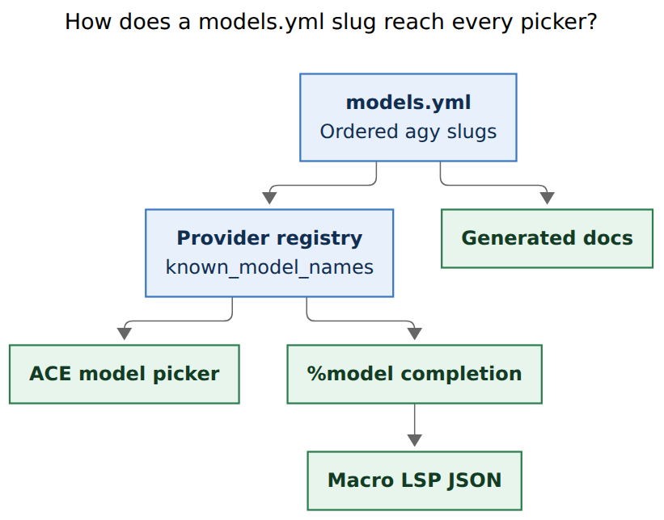
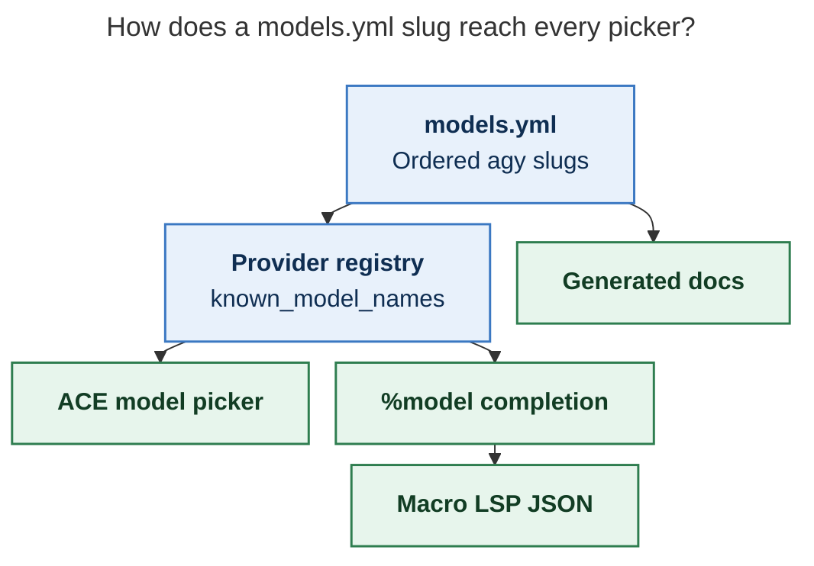
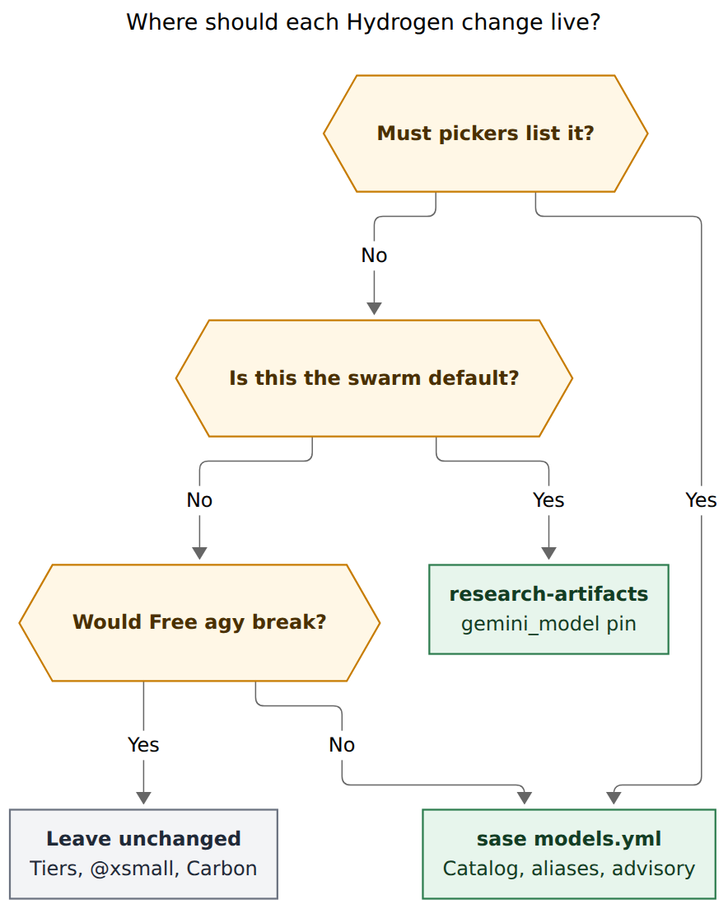
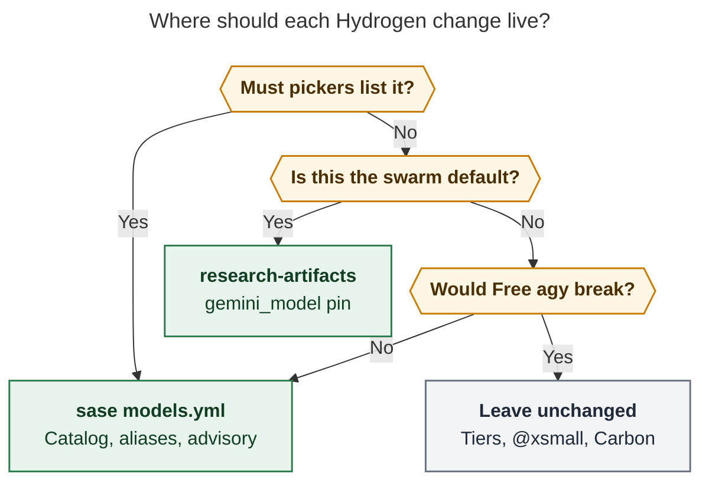

# Adding Gemini 4 Argon and Hydrogen to SASE

> **Research query:** How should SASE add Google's Gemini 4 Argon and Hydrogen
> models to every model-completion surface, and how should `#research_swarm`
> switch its Antigravity researcher from the current Gemini model to Hydrogen?

**Date:** 2026-11-13
**Researcher:** grk
**Host evidence:** live `agy models` on this machine; sase `models.yml`; plugin
`#research_swarm`; Google's 2026-11-12 Hydrogen launch docs.

## Bottom line

Treat this as a **Hydrogen catalog add plus a plugin pin**, following the
existing Argon recipe.

1. **Argon is already catalogued.** `feat(llm): catalog Gemini 4 Argon on
   Antigravity` (`4d8940d4b7`, 2026-10-14) added
   `gemini-4-argon-{high,medium,low}`, `argon4h/m/l` short aliases, and an
   Ultra-only advisory. Live `agy models` still reports those three slugs.
   Argon needs no new catalog rows for this request.
2. **Hydrogen is the missing work.** Live `agy models` already reports four
   slugs: `gemini-4-hydrogen-{high,xhigh,medium,low}`. SASE's bundled
   `models.yml` does not. Adding those four rows is what makes every
   catalog-driven completion surface list Hydrogen.
3. **`#research_swarm` lives in the `sase-research-artifacts` plugin**, not in
   the sase package. Its Gemini researcher currently pins
   `agy/gemini-3.8-flash-high`. Change that default to
   `agy/gemini-4-hydrogen-xhigh` so it matches the other researchers' `xhigh`
   effort and uses the slug form Antigravity requires.
4. **Leave shipped size aliases and agy tier defaults on Flash.** Hydrogen is
   Pro/Ultra in Antigravity. Putting it on `@xsmall` or on `large`/`small`
   would fail Free accounts the same way Argon would. The Argon commit kept
   those defaults on Flash on purpose.
5. **Do not add Carbon or Orchestrator in this change.** Google's strongest
   Gemini 4 model, Carbon, has no standalone slug in `agy models`. This host
   reports `gemini-pro-orchestrator-g1-pro` as "Orchestrator (Argon)". That is
   a follow-up, not this request.

Land the sase catalog first, then the plugin pin, so doctor and `%model`
completion already know the Hydrogen slug when the swarm default changes.

## What Google shipped

Google's Gemini 4 family is three API models with one request schema and a
unified 1,048,576-token window:

| Model | API ID | Role | Thinking levels | Antigravity (agy) |
| --- | --- | --- | --- | --- |
| Gemini 4 Carbon | `gemini-4-carbon` | Strongest frontier model | `low`, `medium` (default), `high` | No standalone slug on this host |
| Gemini 4 Argon | `gemini-4-argon` | Efficient frontier reasoning | `low`, `medium` (default), `high` | `gemini-4-argon-{high,medium,low}`; Ultra |
| Gemini 4 Hydrogen | `gemini-4-hydrogen` | Fast agentic execution; successor to 3.8 Flash | `low`, `medium`, `high` (default), `xhigh` | `gemini-4-hydrogen-{high,xhigh,medium,low}`; Pro and Ultra |

Hydrogen launched 2026-11-12. Google prices it at $1.50 / $7.50 per million
input/output tokens across the full 1M window, with a rate-limited Gemini API
free tier. Argon and Carbon stay at the $2 / $10 introductory price through
2026-11-30, then $4 / $20.

Google's own positioning, which matches how SASE should expose them:

- **Hydrogen** for everyday coding, tool loops, and parallel subagents. Google
  calls it the recommended upgrade from Gemini 3.8 Flash.
- **Argon** for advanced long-horizon work at lower token spend than Carbon.
- **Carbon** for the hardest architecture, debugging, science, and security
  work.

Hydrogen is the first Gemini 4 model with an `xhigh` thinking level. At
default `high` Google reports 51 on the Artificial Analysis Intelligence
Index versus Argon's 50; at `xhigh` Hydrogen reaches 54. Terminal-Bench 4.1
is 57% versus 3.8 Flash's 18.2%. Those numbers are Google's launch claims,
useful for routing, not an independent bake-off.

Antigravity access (what SASE actually invokes through `agy --model`):

- Hydrogen: paid Google AI Pro and Ultra.
- Argon: Google AI Ultra and eligible Gemini Enterprise (already documented
  in SASE's Argon advisory).
- Orchestrator (Carbon) and Orchestrator (Argon): Ultra; Orchestrator (Argon)
  also for paid Pro. This host's CLI lists one orchestrator slug,
  `gemini-pro-orchestrator-g1-pro` ("Orchestrator (Argon)").

SASE talks to Antigravity, not to the Gemini API directly. Catalog IDs must
be the `agy models` slugs (`gemini-4-hydrogen-xhigh`), not the API IDs
(`gemini-4-hydrogen`). Effort is baked into the slug. `AgyProvider` rejects
an explicit `@effort` suffix.

## Current SASE state

### Argon is already on the completion surfaces

`src/sase/llm_provider/models.yml` is the bundled manifest and the documented
single edit point for routine model maintenance. The agy section already
has:

```yaml
models:
  - gemini-4-argon-high
  - gemini-4-argon-medium
  - gemini-4-argon-low
  - gemini-3.8-flash-high
  # ... older flash / pro / claude-4-6 / gpt-oss ...
short_aliases:
  gemini-4-argon-high: argon4h
  gemini-4-argon-medium: argon4m
  gemini-4-argon-low: argon4l
advisories:
  gemini-4-argon-*:
    severity: info
    label: needs Google AI Ultra
```

Tier defaults stay on `gemini-3.7-flash-{high,low}`. No shipped size alias
routes to Argon. `short_model_name("gemini-4-argon-high")` already returns
`argon`. Completions, the ACE picker, and generated docs already list Argon.

### Hydrogen is absent

A live `agy models` on this host (2026-11-13) reports, in CLI order:

```
gemini-4-argon-medium
gemini-4-argon-high
gemini-4-argon-low
gemini-4-hydrogen-high
gemini-4-hydrogen-xhigh
gemini-4-hydrogen-medium
gemini-4-hydrogen-low
gemini-pro-orchestrator-g1-pro
gemini-3.8-flash-high
gemini-3.8-flash-medium
gemini-3.8-flash-low
claude-opus-5-5-low
claude-opus-5-5-medium
claude-opus-5-5-high
claude-sonnet-5-5-low
claude-sonnet-5-5-medium
claude-sonnet-5-5-high
gpt-oss-120b-medium
```

The SASE catalog has Argon and 3.8 Flash. It does not have Hydrogen, the
orchestrator slug, or the Claude 5.5 slugs. It still lists Gemini 3.7 / 3.6 /
3.5 Flash, Gemini 3.1 Pro, `claude-sonnet-4-6`, and
`claude-opus-4-6-thinking`, which this CLI no longer prints.

The Argon add already chose **effort-descending family order**
(high, medium, low) over the CLI's medium-high-low listing. Keep that
convention for Hydrogen: `xhigh`, `high`, `medium`, `low`, placed after Argon
and before 3.8 Flash.

### `#research_swarm` pins 3.8 Flash in the plugin

The macro is not a sase package default. Changelog notes that
`#research_swarm` was removed from package defaults; the live definition is
`plugin:sase_research_artifacts/research_swarm.md`.

Current Gemini researcher input:

```yaml
- name: gemini_model
  type: model
  default: "agy/gemini-3.8-flash-high"
```

The researcher is opt-in (`gemini: false` by default). Codex and Claude
default to `codex/gpt-6.1-sol@xhigh` and `claude/opus@xhigh`. The plugin
docs already warn that agy rejects `@effort` and that effort is the slug
suffix (`-high`/`-medium`/`-low`). That suffix list is now incomplete:
Hydrogen adds `-xhigh`.

The plugin's `@image` pool also still includes
`agy/gemini-3.8-flash-high`. That pool is a separate default from
`gemini_model` and is outside the swarm-pin request.

## Completion surfaces

A Hydrogen row in `models.yml` is enough for every catalog-driven picker.
Python provider hooks read the manifest; the ACE picker, `%model`
completion, macro-argument model completion, and the macro LSP JSON all
consume that registry. Generated provider docs come from `just fix` /
`tools/render_docs`.



_One catalog edit feeds the provider registry. The ACE picker and `%model`
completion read that registry; the macro LSP consumes the same completion
payload as JSON. Generated provider docs render from `models.yml` directly._



Surfaces that pick up a `models.yml` add automatically:

| Surface | Mechanism |
| --- | --- |
| ACE model picker | `model_picker_rows` reads `known_model_names` |
| `%model` / `%m` in the prompt bar | `build_model_completion_catalog` |
| Macro argument `type: model` (including `gemini_model=`) | same catalog |
| sase-macro-lsp `%model` | JSON payload from `model_completion_catalog_payload()` |
| Bare-name resolution (`gemini-4-hydrogen-xhigh`) | registry `model_to_provider` |
| Short aliases (`hydrogen4xh`) | `short_aliases` in the manifest |
| Advisory chip in completions | `advisories` in the manifest |
| Generated `docs/reference/providers/models.md` and `agy.md` tiers | `just fix` / `docs-gen` |

Surfaces that need a **small extra edit** besides the YAML:

| Surface | Extra edit |
| --- | --- |
| Agents-tab compact label | Add `"hydrogen"` to `short_model_name` **before** `"flash"` |
| `#research_swarm` Gemini default | Plugin `research_swarm.md` plus its docs/tests |
| Hand-written Argon paragraph in `docs/reference/providers/agy.md` | Add a matching Hydrogen paragraph (tiers table is generated) |

Surfaces that stay unchanged in this work:

| Surface | Why |
| --- | --- |
| CLI `--model` shell completion | Completes the five size aliases (`@xsmall` … `@xlarge`) only |
| agy `large` / `small` tiers | Still Flash, by the Argon Ultra/Pro gating precedent |
| Shipped `@xsmall` member `agy/gemini-3.8-flash-high` | Hydrogen is Pro-gated in Antigravity |
| sase-core | LSP and alias-shortcut filters are data-driven; no Gemini IDs are hardcoded |
| OpenCode `google/gemini-3-flash-preview` | Separate provider catalog; no evidence this host's OpenCode ID is `gemini-4-hydrogen` |

Tests that duplicate the agy model list and must move with the YAML:

- `tests/llm_provider/test_agy_provider_core.py` (`_AGY_MODELS` and short-alias map)
- `tests/llm_provider/test_agy_usage_probe.py` (`_GEMINI_IDS`)
- `tests/llm_provider/test_model_advisories.py` (add a Hydrogen slug tuple beside `_ARGON_SLUGS`)
- `tests/test_model_picker_jump.py` (filtered "gemini" order still starts at Argon if Hydrogen is inserted **after** Argon)
- `tests/ace/tui/widgets/test_agent_list_helpers.py` (new `hydrogen` label assertion)

ACE visual snapshots that wait for `gemini-4-argon-high` should keep passing
if Argon stays first in the Gemini family. If a snapshot encodes the full
agy list, regenerate it under the TUI snapshot rules.

## Options

### A. Manifest add + plugin pin (recommended)

Follow commit `4d8940d4b7` for Hydrogen, then change the swarm default in
the plugin.

**sase**

- Insert after the Argon block:

  ```yaml
  - gemini-4-hydrogen-xhigh
  - gemini-4-hydrogen-high
  - gemini-4-hydrogen-medium
  - gemini-4-hydrogen-low
  ```

- Short aliases: `hydrogen4xh`, `hydrogen4h`, `hydrogen4m`, `hydrogen4l`.
- Info advisory on all four slugs: `needs Google AI Pro`, with detail that
  Antigravity serves Hydrogen to paid Google AI Pro and Ultra (not Free).
- `short_model_name`: add `"hydrogen"` to the keyword tuple.
- Keep agy tiers and shipped size aliases on Flash.
- Run `just fix` so generated model tables update. Run `model-policy-check`.

**sase-research-artifacts**

- `gemini_model` default: `agy/gemini-4-hydrogen-xhigh`.
- Update the effort-suffix prose to include `-xhigh`.
- Update `docs/macros.md`, README, and
  `tests/test_macro_loading.py` (it asserts the exact default string and
  that the rendered `%m:` line has no `@`).

**Why xhigh for the swarm.** Codex, Claude, Grok, and Muse researchers
already launch at `xhigh`. Google's Hydrogen `xhigh` is the extra thinking
level added for hard multi-step work. A research swarm is that class of
work. `high` is Google's interactive default and is still available by
passing `gemini_model=agy/gemini-4-hydrogen-high`.

**Landing order.** Merge the sase catalog before the plugin pin. A plugin
default that names an unknown model will look like a typo in doctor and in
`type: model` completion until the catalog exists.

### B. Also move `@xsmall` (and maybe agy tiers) onto Hydrogen

Google recommends Hydrogen as the 3.8 Flash replacement, and Hydrogen is
the first Gemini slug with a true `xhigh` rung, so the size-alias effort
ladder could place `agy/gemini-4-hydrogen-xhigh` in `@xsmall`.

Cost: Antigravity Hydrogen is Pro/Ultra. `@xsmall` is the alias that must
work on every agy account that can run Flash. The Argon commit left aliases
and tiers on Flash for that reason. Do this only as a follow-up after
confirming which plans still receive 3.8 Flash.

### C. Catalog Carbon / Orchestrator in the same change

Carbon is Google's strongest Gemini 4 model, and Orchestrator is how
Antigravity pairs Carbon or Argon with Hydrogen. This host has no
`gemini-4-carbon-*` slug. Inventing one would fail at `agy --model`.
Cataloging `gemini-pro-orchestrator-g1-pro` is a product decision about a
router, not a model, and it is outside the Argon/Hydrogen request.

### D. Drive the agy catalog from live `agy models`

Completions would always match the signed-in CLI. That is a new mechanism
(auth-dependent, host-dependent, and a change to "the YAML is the single
edit point"). This request is two new slugs plus a swarm pin. Keep the
manifest.

### E. Pin the swarm at Hydrogen `high`

`high` is Google's default and is cheaper/faster than `xhigh`. The other
four researchers still run at `xhigh`, so the Gemini member would be the
only one on a lower rung. Prefer `xhigh` for the default; callers can pass
`gemini_model=` to drop to `high` or `medium`.

## Recommended solution

Use **option A**.



_Picker listing is a sase `models.yml` edit. The swarm default is a
research-artifacts pin. Size aliases, agy tiers, and Carbon stay off this
change because Hydrogen is Pro-gated in Antigravity and Carbon has no agy
slug._



### Concrete catalog patch (sase)

In `src/sase/llm_provider/models.yml`, under `providers.agy`:

```yaml
models:
  - gemini-4-argon-high
  - gemini-4-argon-medium
  - gemini-4-argon-low
  - gemini-4-hydrogen-xhigh
  - gemini-4-hydrogen-high
  - gemini-4-hydrogen-medium
  - gemini-4-hydrogen-low
  - gemini-3.8-flash-high
  # existing remainder unchanged
short_aliases:
  gemini-4-hydrogen-xhigh: hydrogen4xh
  gemini-4-hydrogen-high: hydrogen4h
  gemini-4-hydrogen-medium: hydrogen4m
  gemini-4-hydrogen-low: hydrogen4l
advisories:
  gemini-4-hydrogen-xhigh:
    severity: info
    label: needs Google AI Pro
    detail: Antigravity offers Gemini 4 Hydrogen on paid Google AI Pro and
      Ultra subscriptions. Free accounts do not get it. Run `agy models`
      to check access.
  # repeat for -high, -medium, -low
```

Add `"hydrogen"` to the keyword list in
`src/sase/ace/tui/widgets/_agent_list_helpers.py` so
`short_model_name("gemini-4-hydrogen-xhigh") == "hydrogen"`. Place it above
`"flash"` and `"argon"` is already present for the Argon family.

Mirror the four slugs and four aliases in `_AGY_MODELS` /
`llm_model_short_aliases` assertions. Add Hydrogen to the advisories test
the same way Argon is tested. Insert Hydrogen after Argon so
`test_model_picker_jump` can keep expecting Argon as the first two Gemini
rows.

Hand-written prose in `docs/reference/providers/agy.md` should mention
Hydrogen the way it already mentions Argon: catalogued as four slug
variants, effort in the slug, Pro/Ultra, reachable by name, not a tier
default. Generated tables update via `just fix`.

No sase-core change and no `sase-core-revision.txt` ratchet. The LSP reads
whatever catalog JSON sase materializes.

### Concrete swarm pin (sase-research-artifacts)

In `src/sase_research_artifacts/xprompts/research_swarm.md`:

```yaml
- name: gemini_model
  type: model
  default: "agy/gemini-4-hydrogen-xhigh"
  description:
    Model for `<clan>.gem`. Antigravity (`agy`) rejects explicit `@effort`
    suffixes; choose effort through the model slug
    (`-xhigh`/`-high`/`-medium`/`-low`).
```

Keep `gemini` default `false`. Update `docs/macros.md` (default table, the
agy effort paragraph, and the `<clan>.gem` bullet), the README default
list, and `tests/test_macro_loading.py` assertions for the default and for
`%m:agy/gemini-4-hydrogen-xhigh` with no trailing `@`.

### Implementation sequence

1. Confirm `agy models` still lists the four Hydrogen slugs on the
   implementing host (the CLI order can change; the slugs are the contract).
2. Patch sase `models.yml`, `short_model_name`, and the duplicated test
   lists.
3. `just fix` then `just check` in sase (model-policy, generated docs,
   picker tests, optional ACE PNG snapshots).
4. After that catalog is on the branch the plugin will build against, patch
   `research_swarm.md` and its docs/tests.
5. `just check` in sase-research-artifacts.

Two repositories, two stitches. The plugin depends on sase listing the
slug; it does not need a sase-core bump.

### What to hold for later

- Moving `@xsmall` or agy `large`/`small` onto Hydrogen, once Free-plan
  Flash availability is measured.
- Cataloging `gemini-pro-orchestrator-g1-pro` and any future Carbon slugs.
- Refreshing the agy catalog for Claude 5.5 and dropping stale 3.7 / 3.6 /
  3.5 / 3.1-pro / claude-4-6 rows that this CLI no longer prints. The
  Argon add kept older rows; this change should too.
- Switching the plugin `@image` pool off 3.8 Flash.
- Expanding CLI `--model` completion from size aliases to concrete slugs.
- Adding Hydrogen to OpenCode without a live OpenCode model ID.

## Sources

- Google, [Introducing Gemini 4 Hydrogen](https://blog.google/innovation-and-ai/models-and-research/gemini-models/introducing-gemini-4-hydrogen/), 2026-11-12, updated 2026-11-13.
- Google AI Studio, [What's new in Gemini 4 Hydrogen](https://aistudio.google.com/docs/whats-new-gemini-4-hydrogen) and [gemini-4-hydrogen](https://aistudio.google.com/docs/models/gemini-4-hydrogen).
- Google AI Studio, [Models](https://aistudio.google.com/docs/models) and [gemini-4-argon](https://aistudio.google.com/docs/models/gemini-4-argon).
- Google Antigravity, [Gemini 4 Hydrogen and Orchestrator](https://antigravity.google/blog/gemini-4-hydrogen-in-google-antigravity), 2026-11-12.
- Live `agy models` on this host, 2026-11-13.
- sase `src/sase/llm_provider/models.yml` and commit `4d8940d4b7`.
- sase `src/sase/macro/_model_completion_catalog.py`, ACE model picker, `short_model_name`.
- Decision record `size-alias-effort-ladder`.
- Plugin `sase-research-artifacts` `xprompts/research_swarm.md` and `docs/macros.md`.

## Figures

Mermaid CLI `@mermaid-js/mermaid-cli@12.0.0`, PDF-mirroring config, DejaVu
Sans, no-sandbox Puppeteer.

| Figure | File | Measured SVG | Fit |
| --- | --- | --- | --- |
| Ownership routing | `gemini_4_argon_hydrogen_catalog__grk_ownership.svg` | 588.718 × 736 px | 100% |
| Catalog completion flow | `gemini_4_argon_hydrogen_catalog__grk_catalog_flow.svg` | 546.02 × 430 px | 100% |
