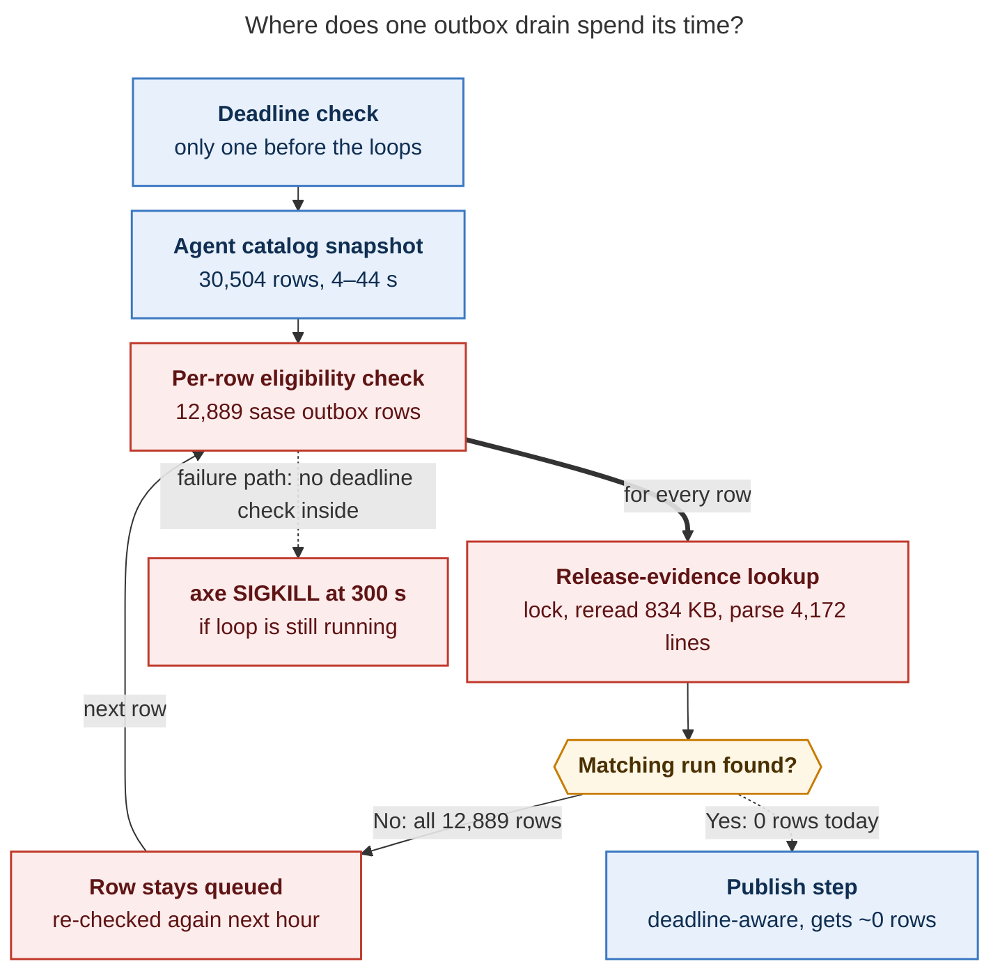

# Why `artifact_link_backfill` keeps timing out

_Research report · 2026-11-07 · source: `~/.sase/axe/error_digests/digest_20261107_084222.txt`_

## TL;DR

- **What happened:** the hourly `housekeeping/artifact_link_backfill` job was SIGKILLed at
  its 300 s axe timeout while it was draining the **sase** project's artifact-link outbox.
  The job has hit this timeout 21 times since 2026-10-29, and every one of those runs was
  killed in the same place.
- **Root cause (confirmed by benchmark):** the drain checks each queued outbox row against
  the release-evidence file by **re-reading and re-parsing that whole file once per row**.
  For sase that is 12,889 rows × 4,172 evidence lines. It takes **≈108 s**, and **0 rows
  match**. With an in-memory index the same check takes **25 ms**.
- **Why the budget doesn't help:** the job has a 240 s soft budget, but the drain checks
  it only once, before its two slow loops. A slow tick therefore runs straight into the
  300 s SIGKILL instead of stopping early. Even successful runs already take **240–262 s**,
  so a ~40 s hiccup anywhere (07:42: bob-cli's drain took 154 s instead of ~30 s) is enough
  to kill the run.
- **It gets worse every day:** nothing ever leaves the queue. Rows from read-only agents
  never earn evidence and are only dropped 90 days after the agent finishes. The cost grows
  roughly with the *product* of two files that are both growing, so every tick should time
  out within about 2–4 weeks.

---

## 1. What the failure looks like

The 07:42 run compared with a normal successful run from an hour later
(1 character ≈ 5 s, timings taken from the run logs):

```text
                  0s        50s       100s      150s      200s      250s      300s
                  |.........|.........|.........|.........|.........|.........|
08:59 run (ok)    ░░░░░▒▒▒▒▒▒▒▒▒▒▒▒▓▓▓▓▓▓▓▓▓▓▓▓▓▓▓▓▓▓▓▓▓▓▓▓▓▓▓▓▓▓▓▓▓▓▓  262 s ✓ (sase reconcile skipped)
07:42 run (fail)  ░░░░░▒▒▒▒▒▒▒▒▒▒▒▒▒▒▒▒▒▒▒▒▒▒▒▒▒▒▒▒▒▒▒▒▒▒▒▒▒▓▓▓▓▓▓▓▓▓▓▓▓▓▓▓▓▓▓✖ 300 s SIGKILL
                                                                  ▲ 240 s soft budget

░ 5 small projects (~26 s)   ▒ bob-cli (60 s normal, 185 s at 07:42)   ▓ sase (drain alone 113–168 s)
```

| Fact | Value |
| --- | --- |
| Projects per run, always in this order | actstat, body, job, love, tailnet, bob-cli, **sase (always last)** |
| Successful run durations today | 240, 247, 246, 257, 261, 254, 251, 262 s (every one at or over the 240 s budget) |
| sase reconcile/repair skipped for lack of budget | 3 of the last 5 successful runs (05:00, 08:42, 08:59) |
| Outbox rows drained per run | 0 in six runs, 5 in two runs (out of ~18,800 queued) |
| 07:42 run: when the sase drain started | ≈216 s, so it passed the `< 240 s` check, then needed ~110–170 s more |
| Timeouts since 2026-10-29 | 21, every one killed during `gh_sase-org__sase: drain` |

The earlier wave of timeouts (September) died mostly in reconcile or at startup. Commit
`1785ea5d16` (2026-09-28) fixed that wave. Since then the drain has grown into the dominant
cost.

## 2. Why the drain is slow



_Figure 1. Almost all of the drain's time goes to a per-row loop that rereads the whole
evidence file for every row, finds no match, and has no deadline check that could stop it._

The code path:

- `drain_artifact_link_outbox` checks the deadline once
  (`src/sase/sdd/_artifact_link_outbox_drain.py:124`). It then calls
  `_terminal_agent_finished_times` (`:138`, which builds the full agent catalog at `:446`)
  and `_partition_publishable` (`:146`). Neither of these checks the deadline.
- `_partition_publishable` calls `_entry_is_eligible` (`:383`) for each row, and that calls
  `artifact_link_run_has_release_evidence`. On every call, that function takes a shared
  `flock`, reads the whole JSONL file, and `json.loads` each line until it finds a match
  (`src/sase/sdd/artifact_link_release_evidence.py:98-105`). A miss scans every line, and
  every row is a miss.

Measured on athena (load average ~10–13 on 64 cores):

| Project | Outbox rows | Evidence lines | Rows with evidence | Per-row lookup | Full pass today | Same check with a set index | Observed drain |
| --- | ---: | ---: | ---: | ---: | ---: | ---: | --- |
| **sase** | 12,889 | 4,172 | **0** | 8.39 ms | **108 s** | **25 ms** | 113–168 s |
| bob-cli | 5,923 | 1,623 | **0** | 3.13 ms | 18.6 s | 7 ms | ~30 s normally, 154 s at 07:42 |
| tailnet | 23 | 26 | 0 | — | ~0 s | — | 4–5 s normally, up to 66 s |
| love | 1 | 19 | 0 | — | ~0 s | — | 5 s normally, up to 39 s |

The rest of each drain is mostly the **agent catalog snapshot**. It is rebuilt from scratch
once per project (up to 7 times per run), only to find rows old enough to drop. It measured
**44.3 s cold, 21.2 s, and 4.1 s warm** in back-to-back runs. Nearly all of tailnet's and
love's drain time is this snapshot, which explains why their tiny queues still swing from
5 s to 35–66 s.

## 3. Why it gets worse every day

The queue only grows:

- **99.9 % of rows are `read` observations** (12,881 of 12,889 for sase). They are published
  only if *that exact run* records release evidence, and evidence is recorded only for a
  qualifying commit. Read-only agents (research, questions, reviews) never get evidence.
- A row is dropped only once its agent has been **finished for longer than 90 days** (the
  artifact-retention max age). The oldest row is 58.8 days old, so **nothing can be dropped
  before 2026-12-08**. After that, the queue levels off at about 90 × 340 ≈ **30,600 rows**
  for sase.
- Over the last 14 days, sase gained **≈340 outbox rows/day** and **≈45 evidence lines/day**.
  bob-cli gained ≈263 and ≈52.

Because the lookup cost is proportional to *rows × evidence lines*, the sase drain grows
faster than linearly:

| When | sase rows | Evidence lines | Lookup work | Projected sase lookup time |
| --- | ---: | ---: | ---: | ---: |
| Today | 12,889 | 4,172 | 53.8 M line parses | 108 s (measured) |
| +7 days | 15,269 | 4,487 | 68.5 M | ~138 s |
| +14 days | 17,649 | 4,802 | 84.8 M | ~171 s |
| +30 days | 23,089 | 5,522 | 127.5 M | **~257 s, more than the whole budget by itself** |

The projection is linear in measured cost per line parse and excludes the catalog snapshot,
reconcile, and bob-cli, so it is a lower bound.

## 4. Why 07:42 in particular

On a normal tick there is only ~40–60 s of slack before the SIGKILL. At 07:42 the
**bob-cli drain took 154 s instead of its usual ~30 s**, which pushed the start of the sase
drain to about 216 s. That was still under the 240 s check, so the drain started, and the
unguarded loop then ran into the 300 s kill. The earlier timeouts look the same. In 16 of
the 21, an earlier project ran long first (bob-cli taking 65–194 s in total, or a tailnet
drain of 26–66 s), and the sase drain that followed could not finish. In the other 5, the
sase drain was too slow on its own.

The *trigger* (why bob-cli was slow at 07:42) is **plausible but not proven**: the logs do
not time the steps inside the drain. The likely candidates are a cold agent-catalog rebuild
(measured at up to 44 s) and CPU contention on the evidence loop, which runs entirely in
Python. Either way, the trigger matters less than the missing slack. With a working index,
the same hiccup would leave room to spare.

## 5. Recommended fixes (highest leverage first)

| # | Fix | Effect |
| --- | --- | --- |
| 1 | **Load the release evidence once per drain** into a `set[(run_id, agent_id)]` and test each row against it, instead of calling `artifact_link_run_has_release_evidence` per row. | sase 108 s → 25 ms; bob-cli 18.6 s → 7 ms. That removes ~125 s per run, about half of today's runtime. |
| 2 | **Skip the agent catalog when no row can be stale.** An agent finishes after it creates a row, so a row created after the 90-day cutoff should never be dropped. Build the snapshot at most once per chop run, not once per project. | Saves 4–44 s × up to 7 projects per run. Until 2026-12-08 the snapshot can be skipped entirely. |
| 3 | **Check the deadline inside the drain loops** (for example every ~250 rows) and return `deferred=True`. | Makes the 240 s budget real: a slow tick becomes a logged deferral instead of a SIGKILL. |
| 4 | **Stop re-scanning dead rows.** Move rows whose run is terminal without evidence (after a grace window) out of the hot queue, for example onto a cold ledger like the parked file. | Hot-queue size tracks active agents instead of 90 days of history. |
| 5 | *(Minor bug)* **Persist parked-row recheck times.** `_requeue_ready_parked_entries` only rewrites the file when something is requeued (`_artifact_link_outbox_drain.py:499`), so the in-memory touch is lost. | bob-cli's 20 and tailnet's 5 parked rows (last checked 2026-11-05 and 2026-10-21) are rechecked every hour instead of daily. Small cost, but the 24 h throttle is not working. |

Fixes 1 and 3 together fix both the timeouts and the reconcile/repair runs that sase
silently skips. Fixes 2 and 4 keep the problem from coming back as history grows.

## Method and evidence

- **Digest and run history:** all 10 retained runs under
  `~/.sase/axe/lumberjacks/housekeeping/chops/artifact_link_backfill/runs/`, using
  per-project and per-step timings from the logs plus the result counters. Also scanned
  every `artifact_link_backfill` entry across all error digests (72 errors since 2026-08-26,
  of which 70 were timeouts).
- **Queue state:** `~/.sase/projects/<project>/artifact-link-outbox.jsonl`,
  `…-outbox-parked.jsonl`, and `artifact-link-release-evidence.jsonl`. Joined outbox rows to
  evidence on `(run_id, agent_name)`: 0 matches in either large project.
- **Benchmarks:** called the installed `artifact_link_run_has_release_evidence` on a random
  sample of 300 rows per project and extrapolated, then compared against a one-pass set
  index. Timed `build_agent_catalog_snapshot()` three times. All reads were read-only (shared
  locks only).
- **Confidence:** the root cause (O(rows × evidence) scan, no deadline inside the drain, a
  queue that only grows) is **confirmed** by code reading plus measurements that match the
  logged drain times. The exact trigger for 07:42's slow bob-cli drain is **plausible**, not
  proven.
