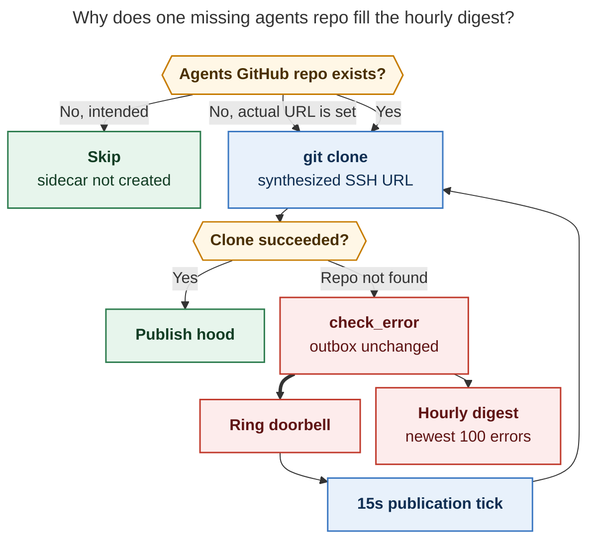

# Athena AXE error notifications: root causes

**Researcher:** grk (independent swarm report)
**Date:** 2026-11-08
**Primary evidence:** `athena:~/.sase/axe/error_digests/digest_20261108_064118.txt`
**Also examined:** Athena digest corpus for 2026-11 (109 files), Athena `recent_errors.json` and publication heartbeat/outbox, Apollo axe notifications and `recent_errors.json`, SASE source on current master (`35e4d88ef`), sase-core publication-failure accounting, GitHub repo existence for `sase-org/sase-spotify*`

## Verdict

The notification the user pointed at is not a mixed bag of unrelated failures. `digest_20261108_064118.txt` contains **100/100** `agent_publication` records, every one the same failure: Athena cannot clone `sase-org/sase-spotify--agents` because that GitHub repository does not exist.

That missing clone is a real project-onboarding gap. The reason it fills the inbox is a retry amplifier in the publisher: repository-scope clone failures do not charge, park, or quarantine the outbox, the project doorbell is rung again, and the `publication` routine runs every 15 seconds. The hourly `error_digest` job then ships up to 100 stored errors (the `recent_errors.json` cap) as one `ViewErrorReport` notification.

Two other families have been generating the same class of axe error notifications in the last week. They are smaller than the current storm, and they share a theme: a persistent or slow condition is classified as `check_error` on a short cadence.

| Family | Where / when | Live? | Root cause in one line |
| --- | --- | --- | --- |
| Missing agents sidecar clone | Athena, from 2026-11-07 23:35 EST, 100 errors/hour through this morning | **Yes** | `sase-spotify--agents` was never created; publisher treats a synthesized SSH URL as a cloneable remote |
| ACE-run prune `protection_unavailable` | Athena hourly since at least 2026-11-07; Apollo too | **Yes** | Split `plans`/`beads` sidecars are not connected (on Athena: `sase-spotify`; earlier `body`; on Apollo: `love`) |
| Artifact-link backfill SIGKILL | Athena and Apollo, several hourly ticks | Intermittent | Chop work budget is 240s; axe timeout is 300s; a hung project still eats the SIGKILL |
| Gate-turn reclaim lock wait | Athena 2026-11-07 17:27; Apollo 2026-11-07 14:09 | Transient | 5s wait on a live `.gate_followup.lock` is reported as `check_error` |
| Workspace SDD clone recovery | Athena Nov 2/4; Apollo Nov 7–8 | Transient | Git probe deadline expires (lock/contention); recovery reports a compound “not a valid worktree / detached HEAD” |
| Sidecar auto-sync / stale-running cleanup timeouts | Athena 2026-11-06 14:00 | Past | `sidecar_auto_sync` SIGKILL at 120s; `stale_running_cleanup` died on GitHub DNS failure |
| Bob-cli publication protection withhold | Athena Nov 1–4, ~5,000 digest rows | Mitigated 2026-11-04 17:21 EST | Secret-scan protection withheld a bob-cli hood; the same no-charge retry loop ran until parking landed |
| Agents-sidecar rebase conflicts | Apollo Nov 6 (and some Athena Nov 1–4 SSH `publickey` denials) | Mitigated 2026-11-06 | `git pull --rebase` conflict / auth; diverged-replay parking now covers the rebase path |

Recommended fix: create or stop targeting the missing agents sidecar, and teach the publisher to treat “agents repo does not exist” the way launch already does — a skip, not a 15-second `check_error`.

## 1. What the cited digest actually contains

File: `athena:~/.sase/axe/error_digests/digest_20261108_064118.txt` (130,491 bytes, 2,099 lines, 100 records, window 2026-11-08 06:08:52 to 06:40:59 EST).

Parsed facts:

- Routine: `publication` (100)
- Job: `agent_publication` (100)
- Process exit code: `0` (100). AXE still records `check_error` because `sase_chop_agent_publication.py` sets `result.status = "check_error"` whenever `tick.errors` is nonzero.
- Every subprocess excerpt names `gh_sase-org__sase-spotify` and `could not clone configured agents sidecar`.
- Every excerpt includes GitHub’s `ERROR: Repository not found.` / `fatal: Could not read from remote repository.`
- Inter-error spacing is ~17 seconds (clone time plus the 15-second publication interval).
- Heartbeat at 06:50 EST still showed `gh_sase-org__sase-spotify.last_outcome = repository_error`, `active_count = 2`, `parked_count = 0`.

The 100-record size is the store cap, not the true rate. `append_error` in `src/sase/axe/_state_scheduler.py` keeps only the last 100 errors. At one failure per ~17s the publisher produces ~210 failures/hour; the digest shows the newest 100.

Athena’s previous same-sized files (`digest_20261108_00{38,42,43,45,47,49,54}*.txt`, each 130,491 bytes) are the same clone error. The storm started at 23:35 EST on 2026-11-07 (`digest_20261107_233611.txt`, 2 records) and has been filling the hourly cap ever since.

## 2. Immediate cause: `sase-spotify--agents` does not exist

Live Athena state for `gh_sase-org__sase-spotify`:

- Project enabled 2026-11-07 11:32 EST. Primary GitHub repo `sase-org/sase-spotify` exists (private, created 2026-11-07 11:32 EST). `sase/sase.yml` is a single line: `is_sase_managed: true`.
- Machine clone dir `~/.sase/projects/gh_sase-org__sase-spotify/repos/` has **no** agents checkout, only `.sase-agents-sync-clone.lock`. Each failed tick mkdirs a temp `.sase-agents-clone-*` and deletes it.
- SDD store record at `{primary}/.sase/sdd-store.json` is schema 1, `storage: "separate_repo"`, remote `git@github.com:sase-org/sase-spotify--sdd.git`, `probed_at` 2026-11-07 17:32:42 EST. That matches GitHub: `sase-org/sase-spotify--sdd` exists (public, created 17:32 EST).
- GitHub does **not** have `sase-org/sase-spotify--agents`, `--plans`, `--beads`, or `--research` (`gh repo view` returns “Could not resolve to a Repository”).

Two publication-outbox rows have been active since the first enqueue, with **`attempts: 0`**, **`last_error: null`**, **`parked_reason: null`**, **`quarantined: false`**:

| Enqueued (EST) | Agent | Run | Primary revision |
| --- | --- | --- | --- |
| 2026-11-07 23:34:46 | `bbugyi200.athena.chop.refresh_docs.sase-spotify.2_471527.1` | `20261107120335` | `37c9ca82…` |
| 2026-11-08 02:34:28 | `bbugyi200.athena.chop.refresh_docs.sase-spotify.2_471527.2` | `20261107120457` | `ae2c3c31…` |

Those are `refresh_docs` chop agents. They launched around 12:03 EST on 2026-11-07 — **before** the `--sdd` sidecar existed — committed later, and enqueued hood publication. Launch is allowed to continue when the agents sidecar is missing (see below). The publisher is not.

The clone URL is not read from a user-authored remote. Hidden agents sidecars are auto-injected for every SASE-managed project (`src/sase/_linked_repo_config_defaults.py`), with `SIDECAR_REMOTE_URL_KEY` set to the derived identity `git@github.com:sase-org/sase-spotify--agents.git`. Inventory tests encode that: `agents.remote_url == "git@github.com:acme/widget--agents.git"` even when `agents.exists is False`.

`resolve_sync_targets` (`src/sase/agents_sync/targets.py`) is supposed to skip a sidecar that “has not been created”:

```152:159:src/sase/agents_sync/targets.py
            if not agents.remote_url:
                outcomes[project_key] = SyncOutcome(
                    project_key,
                    project,
                    skip_reason="agents sidecar has not been created",
                    diagnostics=tuple(issues),
                )
                continue
```

That skip is dead for GitHub-managed projects. The synthesized URL is never empty, so the publisher always gets a `ProjectTarget` and calls `ensure_agents_clone`, which runs `git clone` against a repo GitHub will never serve.

This contradicts the launch-time contract in `docs/contribute/sdd-storage.md`:

> The agents sidecar is the one exception: a missing agents repository prints a warning naming it and continues with the remaining roles, because creating it needs the interactive authorization described above.

Launch warns and continues. `refresh_docs` therefore ran, committed, and queued publication. Publication then tries to clone the unauthorized, uncreated `--agents` repo forever.

The project’s SDD layout is the unmigrated GitHub default (`separate_repo` / `--sdd`), not the split `sidecar_repos` layout (`--plans` / `--beads`) that `sase repo init` is supposed to materialize. That is why prune also reports `sase-spotify:plans` and `sase-spotify:beads` as unconnected. The agents sidecar is a third, independently injected hidden role; it is not created as a side effect of `--sdd`.

## 3. Why one missing repo becomes 100 notifications per hour

Three independently reasonable behaviors compose into a retry storm.

### 3.1 Clone failure is repository-scope and does not charge the outbox

`ensure_agents_clone` (`src/sase/agents_sync/_git_sync_ops_git.py`) returns `could not clone configured agents sidecar: …`. `_commit_publication_drain.py` records that as `failure_scope=REPOSITORY_FAILURE_SCOPE`, stage `ensure_clone`.

sase-core `decide_publication_failure_accounting` **refuses to charge any row unless the scope is `hood`**:

```40:48:sase-core crates/sase_core/src/agent_publication_recovery/accounting.rs
    if scope != PUBLICATION_FAILURE_SCOPE_HOOD {
        return Ok(PublicationFailureAccountingResponseWire {
            schema_version: PUBLICATION_RECOVERY_WIRE_SCHEMA_VERSION,
            scope: scope.to_string(),
            charge: false,
            error_class: error_class.to_string(),
            charges: Vec::new(),
        });
    }
```

The Python drain honors `charge: false` by leaving the outbox untouched (`attempts` stay 0, no quarantine, no park). The test `repository_and_unknown_scope_do_not_charge_rows` locks that in. It is the right policy for a busy lock. It is the wrong policy for “the remote repository does not exist.”

### 3.2 The doorbell keeps ringing

After a repository-scope stop, `_drain_project` still sees two ready outbox rows. `run_publication_job` then rings the project doorbell whenever `publishable_count > 0`. The `publication` lumberjack is configured as `interval: 15` with an fs trigger on `*/agent_publication/doorbell` and `max_quiet: 5m` (`src/sase/default_config.yml`). Observed spacing on Athena is ~17s.

Diverged-replay parking is the one path that *does not* re-ring. Clone-not-found is not on that path. Protection-withhold parking (added 2026-11-04, see §6) is also not on that path.

### 3.3 Every tick is a user-visible `check_error`

`sase_chop_agent_publication.py`:

```python
if tick.errors:
    result.status = "check_error"
```

AXE’s lumberjack treats `check_error` like a failure (`src/sase/axe/lumberjack.py`) and appends it to `recent_errors.json`. Housekeeping `error_digest` (hourly) dumps everything newer than the last digest watermark into `~/.sase/axe/error_digests/digest_<ts>.txt` and sends a priority `ViewErrorReport` notification (`notify_axe_error_digest`). There is no dedup by error signature, no backoff, and no distinction between “this is still the same missing repo” and “a new failure happened.”



*Caption: Launch already knows a missing agents sidecar is skippable. The publisher synthesizes a clone URL anyway, fails without parking, rings its own doorbell, and the hourly digest reports the capped 100 repeats.*

## 4. `artifact_run_prune` `protection_unavailable` is the same onboarding gap

Athena `artifact_run_prune` has been `check_error` / `protection_unavailable` on the hourly housekeeping tick. Latest run (`20261108T064117_560573.log`):

- `sase-spotify:beads` and `sase-spotify:plans` unavailable
- 2,634 run dirs selected, 1.26 GiB reclaimable, 21,673 protected
- Trash purge blocked with `blocked=protection_unavailable`

Earlier the same day (17:27 EST) the digest spelled the note: `sase-spotify:beads (sidecars not connected on this machine)`. Before `sase-spotify` existed, the 07:08 EST prune named `body:beads` and `body:plans` instead.

This is documented, not mysterious. `docs/contribute/sdd-storage.md` says artifact-run retention needs every enabled project’s beads and plans sidecars as protection sources, and until they are connected it reports `<project>:<role> (sidecars not connected on this machine)` and refuses to purge. `sase_chop_artifact_run_prune.py` turns any unavailable source into `check_error`. The connect-only backstop is `sidecar_auto_sync` (30s interval, 120s timeout, at most one project per tick, never creates a missing remote). It cannot create `--plans`/`--beads` that do not exist on GitHub, and on 2026-11-06 14:00 it itself SIGKILL’d at 120s with empty output.

Apollo’s prune is the same pattern against `love:beads` and `love:plans` (12 of Apollo’s current 100 `recent_errors`). Machine-level clones for those roles exist and are on `main` *now*; the errors are from ticks when protection lookup still saw them unconnected, or from a path/record mismatch. The user-visible effect is the same: hourly `check_error` plus a prune-preview notification (Apollo also has a separate non-error axe row for 170 MiB / 391 old ACE runs, plus-oned 15 times).

## 5. Other current error families (not the cited digest, still in the inbox)

These are real, but they are not what `digest_20261108_064118.txt` contains.

### 5.1 `artifact_link_backfill` timed out after 300s (exit -9)

Athena examples: `digest_20261107_084222.txt`, several Nov 5–6 files. Chop timeout in default config is `5m`. Internal work budget is 240s (`_CHOP_WORK_BUDGET_SECONDS`) so a slowdown is supposed to defer instead of dying. Observed logs finish two small projects in ~4s each, then hang inside a later project’s `reconcile` until SIGKILL. The 240s budget does not cancel a blocking git/IO call, so axe’s 300s killer still fires. Apollo’s 2026-11-06 14:40 sample got through `sase` in 156.73s (drain 89.88s + reconcile 53.54s) and was mid-`bob-cli` when the excerpt cut off.

### 5.2 `gate_turn_reclaim` `reclaim_errors`

Athena 2026-11-07 17:27: snapshot of 24,378 records / 1,787 gate turns; `GateError: timed out waiting 5s for lock on …/20261107170346/.gate_followup.lock; held by pid 2356907`. Apollo 14:09: 6,815 records / 754 gate turns; same 5s lock wait on a bob-cli run. A live gate follow-up holding its lock is expected. The chop treats that one timeout as `check_error` (`reason=reclaim_errors`) even when the rest of the pass succeeded.

### 5.3 `workspace_sdd_clone_recovery`

Apollo 2026-11-07 19:06 (`tailnet/repos/plans`) and 2026-11-08 06:44 (`love/repos/research`): “not a valid Git worktree; detached HEAD; could not list unmerged index entries: deadline expired before git operation.” Inspecting those clones minutes later showed attached `main` and a clean index. The compound diagnostic is what you get when every git probe hits the deadline (likely a lock held by another fetch). Athena had two of these in early November as well.

### 5.4 2026-11-06 14:00 cluster (DNS + SIGKILL)

`digest_20261106_142457.txt`: `artifact_run_prune` SIGKILL at 300s, `sidecar_auto_sync` SIGKILL at 120s with empty output, `stale_running_cleanup` SIGKILL at 90s after `ssh: Could not resolve hostname ssh.github.com: Temporary failure in name resolution` while fetching a workspace plans clone. That is a host DNS blip promoted to three error-digest rows.

## 6. The November 1–4 storm was a different `agent_publication` bug, already mitigated

Athena’s November digest corpus is 109 files and ~5,850 job records. **5,809 are `agent_publication`.** Most of those are *not* the sase-spotify clone:

| Day | `agent_publication` rows | Dominant diagnostic |
| --- | ---: | --- |
| 2026-11-01 | 354 | bob-cli publication protection withhold |
| 2026-11-02 | 1,831 | same |
| 2026-11-03 | 1,671 | same |
| 2026-11-04 | 1,215 | same, plus 57 `Permission denied (publickey)` rebase pulls |
| 2026-11-05 | 0 | parking fix in place |
| 2026-11-06 | 0 | — |
| 2026-11-07 | 4 | first sase-spotify clones at 23:35 |
| 2026-11-08 (through 06:50) | 734 | sase-spotify clone-not-found (capped) |

Nov 1–4 diagnostic, 3,627 occurrences in the sampled files:

`[agent_publication] gh_bobs-org__bob-cli: run withheld by publication protection; prompt archive withheld by publication protection; …`

That is the secret-scan gate (`RUN_WITHHELD_BLOCKED` / `PROMPT_PROTECTION_BLOCKED`). Prompt-protection failures **also** do not charge quarantine (`should_charge_prompt_protection_failure` returns false), so they used the same 15-second retry loop. `feat(agent-publication): park protection-withheld requests` (`1b62dfb9bd`, 2026-11-04 17:21 EST) parks those rows and rechecks at most hourly (`PUBLICATION_PARK_RECHECK_INTERVAL_SECONDS = 3600`). Athena’s `agent_publication` errors dropped to zero the next day.

The clone-not-found path was not included in that parking change. That is why a structurally identical storm came back on 2026-11-07 the moment `sase-spotify` queued publication against a missing `--agents` remote.

Apollo’s leftover `recent_errors` (84 `agent_publication` rows from 2026-11-06) are a third variant: `git pull --rebase failed` on `bob-cli` and `sase` (`Could not apply … chore(agents): sync from bbugyi200.apollo`), with `active_remaining` falling 825 → 2 as other projects drained. `fix(agents-sync): recover publication rebase conflicts and clean pass commits` (`b313400ebd`, 2026-11-06 11:14 EST) parks that path as `diverged_replay` and does not re-ring. Apollo’s heartbeat this morning is idle for `sase` and `bob-cli` (one bob-cli row still `awaiting_done_marker` / parked).

## 7. Recommended solution

### 7.1 Stop the live Athena storm (operations, today)

Do these in order. (1) and (2) alone stop the notifications; (3) is the durable project state.

1. **Create the missing agents sidecar**, interactively, from the sase-spotify checkout:
   `cd /home/bryan/projects/github/sase-org/sase-spotify && sase repo init`
   Authorize `sase-org/sase-spotify--agents` when prompted. That is the documented way to create an agents sidecar; non-interactive `--yes` cannot grant it.
2. **While that is pending, stop the 15-second loop** by parking or acknowledging the two outbox rows (`~/.sase/projects/gh_sase-org__sase-spotify/agents-publication-outbox.json`) and removing `agent_publication/doorbell`. Disabling the project also works. Leaving the rows active with no `--agents` repo will refill the digest within one hour.
3. **Finish SDD onboarding** for `sase-spotify`. The store is still schema-1 `separate_repo` (`--sdd` only). Split `sase repo init` so `plans` and `beads` exist remotely and are connected on Athena. That clears `artifact_run_prune` `protection_unavailable` for this project and makes retention willing to purge.
4. Optionally run `sase doctor` on Athena and confirm the agents sidecar state is no longer `missing`.

If the intent is that `sase-spotify` should not publish agent hoods yet, skip (1) and do (2), then do not run `refresh_docs` / commits that enqueue publication until init has happened.

### 7.2 Product changes (so the next new project does not repeat this)

The launch path already has the right policy. The publisher, inventory, and chop status should match it.

**A. Treat “agents repo does not exist” as skip, not `check_error`.** In `resolve_sync_targets` / `ensure_agents_clone`:

- If the hidden clone has no `.git` and `git clone` / GitHub API says the derived `--agents` repo is absent, return `skip_reason="agents sidecar has not been created"` (the branch that already exists but is unreachable because `remote_url` is always filled in).
- Do not increment `tick.errors` for that skip. Do not ring the doorbell.

**B. Stop synthesizing a cloneable URL for a repo that has never been created.** Keep `SIDECAR_REMOTE_URL_KEY` empty (or a non-clone sentinel) until `sase repo init` actually creates the GitHub repository. Inventory already documents `exists is False`; publication should look at that, not only at a derived SSH URL.

**C. Park persistent repository-scope failures the way protection-withhold is now parked.** Classify `Repository not found` / `could not clone configured agents sidecar` as non-retryable (or hourly-recheck at most). Today only `hood` scope charges, and only protection-withhold and diverged-replay park. Clone-not-found is the remaining hole in that triangle; Nov 1–4 proved what the hole does.

**D. Dedup axe error digests by signature.** A 15-second identical `check_error` should `+1` an existing notification (the prune-preview path already does this) instead of minting a 100-error file every hour.

**E. Do not enqueue publication when the agents target is unusable.** Commit publication already warns when a request stays queued; it should refuse or defer enqueue if `ensure_agents_clone` would hit “repo not found,” matching the launch warning.

Smaller, same-theme follow-ups:

- `artifact_run_prune`: unavailable *unconnected* sources on a project whose split remotes do not exist should be `no_op` / warning, not `check_error`, until `sase repo init` has been run. Refuse-to-purge can stay.
- `artifact_link_backfill`: make the 240s budget cancel blocking git, or lower the axe timeout to match; one hung reconcile should not SIGKILL the chop.
- `gate_turn_reclaim`: a 5s lock wait on a live follow-up pid is contention, not `reclaim_errors`.
- `workspace_sdd_clone_recovery`: a probe deadline should retry next tick as skip, not a user-facing error, unless the clone is still wedged after N passes.

### 7.3 What not to do

- Do not create `sase-spotify--agents` by raw `gh repo create` and hope the hidden clone path matches. Use `sase repo init` so identity, visibility, and the store record stay consistent.
- Do not `git clone` into `~/.sase/projects/gh_sase-org__sase-spotify/repos/` by hand. `ensure_agents_clone` owns that path.
- Do not raise `PUBLICATION_PARK_RECHECK_INTERVAL` as the only fix. Parking is the right *backoff*; the skip in (A) is the right *classification*.
- Do not disable the whole `publication` lumberjack. Other projects on Athena are `last_outcome: idle` with empty outboxes.

## 8. Confidence and residual gaps

**High confidence.** The cited digest is homogeneous; the outbox, heartbeat, empty clone dir, and GitHub 404 all agree; the retry loop is visible in source and in the 17-second spacing.

**Medium confidence** on why `sase-spotify` landed on schema-1 `--sdd` instead of split `sidecar_repos`. GitHub’s provider policy is `separate_repo`; explicit init is supposed to resolve that into configured sidecars. The `--sdd` repo was created at the probe timestamp (17:32 EST), so some init/connect path wrote the legacy record. I did not replay that command.

**Not verified here:** the exact secret that bob-cli’s Nov 1–4 protection scanner flagged (the withhold messages are deliberately value-free). Parking stopped that storm; the underlying scan hit may still be parked on Athena.

**Apollo vs Athena:** this report treats Athena as the source of the cited digest. Apollo has its own `recent_errors` (rebase leftovers, love prune, two SDD-recovery transients) and does not have `sase-spotify` enabled. Inbox notifications on Apollo from Nov 4–7 are that machine’s own axe store, not a copy of Athena’s files (digest timestamps differ by a few seconds).
