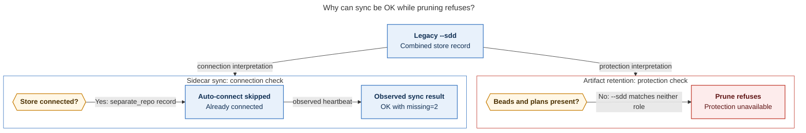

# Diagram proposals: Athena error digests: a half-onboarded `sase-spotify` project in a retry loop with no backoff

Proposals for the swarm linker, not a report. Each diagram restates only what the source
report says.

```yaml
source: research:202611/athena_error_digest_spotify_sidecar_storm/athena_error_digest_spotify_sidecar_storm__final.md
producer: research.3n.image
check: "mmdc 12.0.0 with Puppeteer --no-sandbox and the PDF-mirroring config rendered 1 of 1 Mermaid diagrams"
```

## connected-without-protection

```yaml
anchor: |-
  So **"connected" and "has every required capability" are different states.**
question: |-
  Why can sidecar sync report OK while artifact cleanup refuses to delete?
illustrates: |-
  The legacy `--sdd` store is connected for sidecar sync but lacks the `beads` and `plans` roles required for retention protection.
caption: "The legacy store passes sync's connection check but lacks retention's required protection roles, so an OK sync result does not make pruning safe."
review: "714.455x751 px, fit 91.4%; named-question, source-trace, labels, arrowheads and visual checks passed; 1 revision"
```


