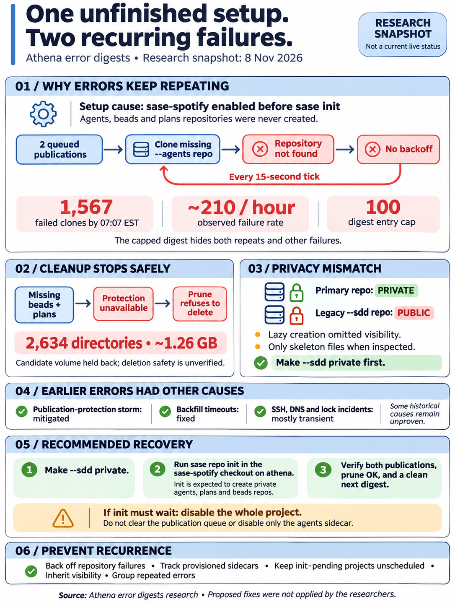
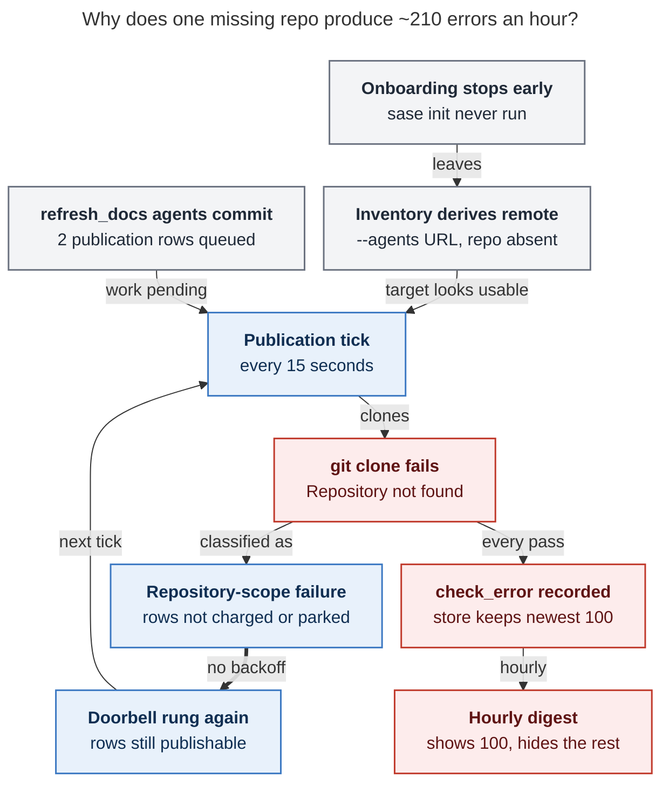
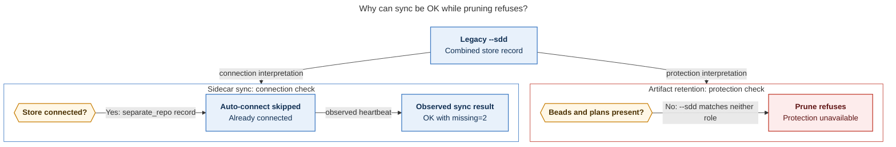

# Athena error digests: a half-onboarded `sase-spotify` project in a retry loop with no backoff

> **Research query:** What are the root causes of the error notifications sase has been
> sending lately, such as athena's `~/.sase/axe/error_digests/digest_20261108_064118.txt`
> digest, and what solution do you recommend?



## Bottom line

- **The example digest (`athena:~/.sase/axe/error_digests/digest_20261108_064118.txt`)
  has one cause, repeated 100 times.** Every entry is the
  `publication / agent_publication` job failing to clone
  `git@github.com:sase-org/sase-spotify--agents.git`. GitHub answers
  `ERROR: Repository not found` because that repository was never created. All five
  researchers agree, and the lead re-verified it.
- **This is still happening.** At 07:06 EST, 81 of 81 publication cycles since the
  06:41 service restart had errored. Athena's git-operation log shows **1,567** failed
  clones of that repository through 07:07 EST, about **210 per hour**. Restarting
  sase does not fix it.
- **Root cause: `sase-spotify` was only half onboarded.** On Nov 7 an agent created it
  through a gated `sase project create --setup`. That command creates the remote, the
  checkout, the identity, and the managed `sase.yml`. The step that creates sidecars,
  `sase init`, needs a terminal, so it was left for you as a "PROPOSED FOLLOW-UP" (bead
  `sase-1rs.1`, note #3) and has not been run. Without it, the project has no
  `agents`, `beads`, or `plans` repositories ([root cause](#root-cause)).
- **Three code behaviors turn that one gap into a flood** ([the retry
  loop](#why-one-missing-repository-becomes-about-210-errors-per-hour)):
  1. The inventory builds an agents remote URL from the naming convention even when the
     repository doesn't exist. This makes the publisher's "agents sidecar has not been
     created → skip" branch unreachable.
  2. A clone failure is classed as a *repository-scope* failure. These are never charged
     to the queued rows, never parked, and never backed off, and the job rings its own
     doorbell again. The `publication` routine runs every 15 seconds.
  3. Every pass records a `check_error`. The error store keeps only the newest 100, so
     each hourly digest is a [capped, truncated
     sample](#the-digest-under-counts-and-hides-other-jobs).
- **The same gap causes your other recurring error.** `housekeeping/artifact_run_prune`
  fails every hour with `protection_unavailable`, because the `sase-spotify:beads` and
  `sase-spotify:plans` protection sources don't exist. It refuses to purge **2,634 run
  directories (~1.26 GB)**. Since midnight those errors have mostly been pushed out of
  the digests by the publication flood ([the prune
  failure](#same-root-cause-makes-pruning-refuse-to-purge)).
- **[Adjacent privacy defect](#adjacent-defect-in-the-lazy-sdd-path):**
  `sase-org/sase-spotify--sdd` is **public**, but its primary `sase-org/sase-spotify` is
  **private**. A lazy store-materialization path created it without applying the
  primary's visibility. Today it holds only skeleton files.
- **The earlier Nov 1–7 notifications had other causes, now mostly fixed:**
  - a [bob-cli publication-protection retry storm](#bob-cli-publication-protection-storm),
    stopped by parking in `1b62dfb9bd`;
  - [`artifact_link_backfill` timeouts](#timeouts), fixed by `5692321a2e`, with recent
    runs `ok`;
  - plus one-off SSH-auth, DNS, lock-contention, and SDD-integration incidents ([other
    error families](#other-error-families-in-recent-digests)).
- **[Recommended solution](#recommended-solution):**
  1. Make `--sdd` private.
  2. In a terminal on athena, run `sase repo init` in the `sase-spotify` checkout. It
     will create **private** `--agents`, `--plans`, and `--beads` sidecars.
  3. Check that the two queued rows publish and that the next prune succeeds.
  4. Then fix the publisher's backoff and error accounting, the inventory's
     declared-vs-provisioned distinction, the onboarding "init pending" state, the lazy
     path's visibility, and the digest's grouping ([code
     changes](#code-changes-so-the-next-new-project-cannot-do-this)).

## Scope and conventions

_Consolidated research report · 2026-11-08 · lead synthesis of five independent reports
(`cdx`, `cld`, `grk`, `mus`, `gem`) plus lead verification on athena and apollo ·
sase checked at `master` `35e4d88efc` (the revision athena's editable install runs) ·
times are EST (UTC−05:00) unless marked Z._

## What the notifications contain

### The example digest

| Fact | Value |
| --- | --- |
| Entries | 100 (the store cap). All are `Routine: publication`, `Job: agent_publication` |
| Window | 06:08:52 → 06:40:59, **32 minutes**, though the notification says "last hour" |
| Distinct failures | 1: `gh_sase-org__sase-spotify: could not clone configured agents sidecar … ERROR: Repository not found.` |
| Varying text | Only the random temp-dir suffix `.sase-agents-clone-<rand>` |
| Exit code | 0 every time. The structured result is `check_error` because `tick.errors=1` |
| Cadence | Median ~17 s (15 s interval plus clone time) |
| Other projects | Healthy. Occasional `hood_drained` / `link_drained` > 0 come from the other 7 enabled projects |

### The digest series since the storm began

| Digest | `agent_publication` | Other |
| --- | ---: | --- |
| Nov 7 23:36 | 2 (first failures at 23:35:49 and 23:36:05) | — |
| Nov 8 00:38, 01:42, 02:43, 03:45, 04:47, 05:49 | 100 each (capped) | 0. Pushed out by the flood |
| Nov 8 05:59 (10-minute window) | 34 | 1 × `artifact_run_prune` |
| Nov 8 06:41 (your example) | 100 (capped) | 0 |
| Live `recent_errors.json` at 07:06 | 99 | 1 × `artifact_run_prune`. Covers only 06:35 → 07:06 |

### November as a whole

`cdx` classified all 109 athena digests from Nov 1 through the example: **5,848**
retained entries, 5,809 of them `agent_publication`. `grk` reproduced the same split by
day. These are *retained* rows, not a census, because of the 100-row cap ([how the
digest under-counts](#the-digest-under-counts-and-hides-other-jobs)).

| Error family | Entries | Dates | Status |
| --- | ---: | --- | --- |
| `agent_publication`: sase-spotify `--agents` clone 404 | 736 retained (~1,567 actual) | Nov 7 23:35 → now | **Live**: [root cause](#root-cause) and [retry loop](#why-one-missing-repository-becomes-about-210-errors-per-hour) |
| `agent_publication`: bob-cli run/prompt withheld by publication protection | 5,005 | Nov 1–4 | Stopped by parking (`1b62dfb9bd`, Nov 4 17:21). Unpublished backlog remains: [bob-cli storm](#bob-cli-publication-protection-storm) |
| `agent_publication`: `Permission denied (publickey)` | 62 | Nov 4 | Past: [credentials and DNS](#credentials-and-dns) |
| `agent_publication`: requested revision absent from page | 2 (+2 mixed) | Nov 1–4 | Past: [bob-cli storm](#bob-cli-publication-protection-storm) |
| `agent_publication`: timeouts (300 s job, 120 s hood drain) | 3 | Nov 1–7 | Sporadic: [timeouts](#timeouts) |
| `agent_publication`: missing import `AgentRunStateDiscoveryWindowRequestWire` | 1 | Nov 1 | Past: [module skew](#module-skew) |
| `artifact_run_prune`: `protection_unavailable` | 11 retained (hourly in reality) | Nov 7 → now | **Live**: [prune failure](#same-root-cause-makes-pruning-refuse-to-purge) |
| `artifact_link_backfill`: 300 s SIGKILL | 14 | Nov 4–7 | Fixed by `5692321a2e`: [timeouts](#timeouts) |
| `external_issue_mirror` / `toobig_split`: SSH auth | 7 | Nov 4 | Past: [credentials and DNS](#credentials-and-dns) |
| `workspace_sdd_clone_recovery`: upstream ancestry check failed | 2 | Nov 2, 4 | Past: [lock contention and integration races](#lock-contention-and-integration-races) |
| `gate_turn_reclaim`: 5 s `.gate_followup.lock` wait | 2 | Nov 5, 7 | Transient: [lock contention and integration races](#lock-contention-and-integration-races) |
| `sidecar_auto_sync` / `stale_running_cleanup` / prune timeouts | 3 | Nov 6 ~14:00 | DNS outage: [credentials and DNS](#credentials-and-dns) |

## Root cause

**`sase-spotify` was created but never initialized.**

### What onboarding did and skipped

The evidence comes from the onboarding journal
(`~/.sase/project_onboarding/journals/sase-org-sase-spotify-f569eb64b274.json`) and from
bead `sase-1rs.1`, which the lead read:

- **Nov 7, 11:21.** Planning found that, under a gate, `sase project create --setup`
  runs `create_remote`, `checkout`, `identity`, and `manage`. *"The TTY-only init step
  is a handoff that apply never runs under `--json`; it only returns next_argv
  `sase init -p gh_sase-org__sase-spotify`."*
- **11:32** (16:32Z). The private primary `sase-org/sase-spotify` is created and
  `sase/sase.yml` gets `is_sase_managed: true`. The journal records the setup as
  `complete`, and the project is enabled and launchable.
- **12:07.** Verification (note #2) records that the agents sidecar is "only an
  auto-injected declaration (… exists=false, no local clone)". The same is true for
  `--attachments`, `--attachments-private`, and `--beads`. Note #3: *"PROPOSED
  FOLLOW-UP: Bryan runs sase init -p sase-spotify in a terminal."*
- **17:32** (22:32Z). A lazy SDD materialization ([adjacent
  defect](#adjacent-defect-in-the-lazy-sdd-path)) creates the legacy single-repo store
  `sase-org/sase-spotify--sdd` as **public**. It writes a schema-1
  `storage: separate_repo` record to `.sase/sdd-store.json`.
- **Nov 8, 06:04.** Acceptance bead `sase-1rs.11` (per `cld`) re-checks that
  `sase-org/sase-spotify--agents` "still does not exist".

The lead's GitHub check at 07:06 on Nov 8:

| Repository | Exists | Visibility |
| --- | --- | --- |
| `sase-org/sase-spotify` | yes (Nov 7 16:32Z) | private |
| `sase-org/sase-spotify--sdd` | yes (Nov 7 22:32Z) | **public** ⚠ |
| `--agents`, `--beads`, `--plans`, `--research`, `--attachments`, `--attachments-private` | **no (404)** | — |

`sase-spotify` is the only one of athena's 8 enabled projects in this state. `body` and
`love` were onboarded the same morning, and their `--agents` repositories appeared 7–16
minutes later, which fits a terminal `sase init` run straight afterwards (`cld`).

### What init will do now

The lead ran a read-only check on athena: `sase init -p gh_sase-org__sase-spotify -c`.
It matches `cld` and `gem`. The `init repo` step would:

- update `sase/sase.yml` to *"declare the managed plans, beads, research, and agents
  sidecars (private: sase-org/sase-spotify is private)"*;
- create or connect `sase/repos/plans` and `sase/repos/beads`;
- *"create or connect the provider agents sidecar repository with private visibility at
  the machine-level hidden path"* `~/.sase/projects/gh_sase-org__sase-spotify/repos/agents`.

The same check also reports two other pending steps. `init memory` would create 16
memory files and provider shims. `init service` would refresh the service environment.
That one is machine-wide and unrelated to these errors.

### What filled the queue

`refresh_docs` schedules a `refresh_docs[sase-spotify]` chop like it does for every
enabled project. Launch deliberately warns and continues when an agents sidecar is
missing (`docs/contribute/sdd-storage.md`). Those agents committed, and each commit
queued a publication request:

| Row | Agent | Commit | Enqueued |
| --- | --- | --- | --- |
| 1 | `chop.refresh_docs.sase-spotify.2_471527.1` | `37c9ca8`, "docs: complete command and configuration references" | Nov 7 23:34:46 |
| 2 | `chop.refresh_docs.sase-spotify.2_471527.2` | `ae2c3c3`, "docs: correct and clarify command and configuration references" | Nov 8 02:34:28 |

Both rows have `attempts: 0`, `last_error: null`, no park reason, and are not
quarantined. The first digest error came 63 seconds after row 1 was queued.

Before row 1 existed, the same clone had already failed silently 5 times, about every
76 minutes, from 18:20 to 23:26. None of those produced a `check_error`; the caller is
unidentified. The flood started only once there was queued work.

## Why one missing repository becomes about 210 errors per hour



_Caption: The loop needs both a usable-looking target and queued work; the two arrows
into the tick both have to hold. Once both did, every 15-second pass cloned a missing
repo, failed without being charged or parked, re-armed itself, and logged an error
that the capped digest under-reports._

### A derived URL makes the not-created skip unreachable

For every `is_sase_managed: true` project, `inject_default_linked_repos`
(`src/sase/_linked_repo_config_defaults.py`) adds hidden `agents`, `attachments`, and
`attachments-private` rows. Their `remote_url` comes from
`resolve_sidecar_repo_identity` (`<owner>/<repo>--<role>`), without checking that the
repository exists. Inventory tests encode this: `remote_url` is set while
`exists is False`.

`resolve_sync_targets` (`src/sase/agents_sync/targets.py:152-159`) skips a target only
`if not agents.remote_url`. For managed GitHub projects that never happens, so
sase-spotify becomes a full `ProjectTarget` and the publisher calls
`ensure_agents_clone`. Launch already treats a missing agents repository as "warn and
continue". The publisher has no equivalent.

### Repository-scope failures are uncharged, unparked, and re-armed

- `drain_agent_publications` (`_commit_publication_drain.py`) records the failure with
  `failure_scope=REPOSITORY_FAILURE_SCOPE`, stage `ensure_clone`.
- The Rust policy `decide_publication_failure_accounting` (in sase-core
  `agent_publication_recovery/accounting.rs`) returns `charge: false` for any scope
  other than `hood`, and the test `repository_and_unknown_scope_do_not_charge_rows`
  locks that in. Not charging is right: a broken remote shouldn't quarantine valid
  requests. The problem is that nothing *else* backs off.
- `run_publication_job` sees publishable rows and rings the project doorbell. The
  lumberjack runs every 15 s, with an fs trigger on `*/agent_publication/doorbell` and
  `max_quiet: 5m` (`default_config.yml`).
- Exactly two failure types already park their rows: protection-withheld requests
  (`1b62dfb9bd`, rechecked hourly via `PUBLICATION_PARK_RECHECK_INTERVAL_SECONDS =
  3600`) and diverged replays (`b313400ebd`). Clone-not-found is the remaining gap.
  The Nov 1–4 bob-cli storm was the same loop with a different trigger ([bob-cli
  storm](#bob-cli-publication-protection-storm)).

### Each pass is a user-visible error

`sase_chop_agent_publication.py` sets `result.status = "check_error"` whenever
`tick.errors` is non-zero. AXE appends each one to `recent_errors.json`, and the hourly
`error_digest` job writes the digest and a priority `ViewErrorReport` notification.
Nothing remembers that the last N clones failed identically, and nothing turns a 404
into a durable "not created" state with a single human-actionable notice.

### The digest under-counts and hides other jobs

`append_error()` (`src/sase/axe/_state_scheduler.py`) truncates the store to its newest
100 rows. The digest reads the rows newer than its last checkpoint. At one error per
~17 s, the store holds only about 30 minutes, so:

- "100 error(s) in the last hour" is roughly half the real count (~210/hour);
- the flood evicts other jobs' errors before the digest reads them. Every
  `artifact_run_prune` failure from 00:38 to 05:49 is missing from the digests.

Identical rows are not grouped by signature.

## Same root cause makes pruning refuse to purge

The latest `artifact_run_prune` run log (`20261108T064117_560573`) says:

```text
artifact_run_prune protection source unavailable: sase-spotify:beads
artifact_run_prune protection source unavailable: sase-spotify:plans
candidates=24307 selected=2634 bytes=1258243043 protected=21673 unavailable=2 reason=protection_unavailable
```

Artifact-run retention needs every enabled project's `beads` and `plans` roles as
protection sources, and fails closed without them. That refusal is correct and should
stay: the 1.26 GB is the preview's candidate volume, not proof that it is safe to
delete. Timeline: `body:beads/plans` on Nov 7 at 07:42, until `body` was initialized.
Then `sase-spotify:beads/plans` every hour from 12:03, invisible in the digests
overnight, and visible again at 05:59 and 06:41.

`cdx` found a deeper compatibility gap. This is why the `sidecar_auto_sync` backstop
can't recover, even apart from the repositories being absent:

- The inventory treats the legacy `--sdd` record as a materialized `separate_repo`
  store, so `sdd_store_connected()` is true and `_unconnected_candidates()` /
  `auto_connect_sdd_store()` skip the project.
- Retention's `_record_has_role()` matches a role name or a `--beads` / `--plans`
  suffix, and a combined `--sdd` row matches neither.

So **"connected" and "has every required capability" are different states.**
`sidecar_auto_sync` reports `missing=2 … status ok` while protection coverage is
incomplete. A green sync job doesn't prove coverage. Commit `5922991bcf` (Nov 7)
improved first-use auto-connect and labels, but it only connects existing remotes for
unconnected projects. [The connection-versus-protection
diagram](#figure-connected-without-protection) shows one legacy `--sdd` record taking
two paths: connected for sidecar sync, yet missing the `beads` and `plans` roles that
retention requires.

<div id="figure-connected-without-protection">



_The legacy store passes sync's connection check but lacks retention's required protection roles, so an OK sync result does not make pruning safe._

</div>

## Adjacent defect in the lazy SDD path

**The lazy SDD path created a public repository.**

`materialize_sdd_store()` (`src/sase/sdd/_store_materialization.py`) authorizes remote
creation for any managed repository unless the caller passes
`sdd_creation_authorized=False`. Its `_provider_options()` sends the provider no
visibility. Only `repo_init_handler.py` calls `apply_primary_visibility_policy`.

Because explicit init never ran, the provider's `separate_repo` policy made a lazy
caller create the legacy `--sdd` repository with the provider's default visibility,
which is public. `cld` traced the caller through bead `sase-1rs.11` note #7: an agent's
`sase repo open sase-spotify` at 22:32Z. That bead's note is the only record of it; no
tracking bead exists.

The lead listed the repository's tree. It holds only skeleton content: READMEs, two
directory-map PNGs, `.gitignore`, and an empty `beads/config.json`, across two commits.
Nothing sensitive has leaked. But it breaks the onboarding epic's premise that a private
primary gets private sidecars, and the next project could leak real content the same
way.

## Other error families in recent digests

### bob-cli publication-protection storm

_Nov 1–4. Mitigated, backlog remains._

Most Nov 1–4 rows read `gh_bobs-org__bob-cli: run withheld by publication protection;
prompt archive withheld by publication protection`, sometimes along with an unresolved
deferred prompt. Prompt-protection failures were not charged to rows either, so they
ran the same 15-second loop. `1b62dfb9bd` (Nov 4 17:21) parks them with an hourly
recheck, and athena's `agent_publication` errors dropped to zero on Nov 5.

Two things remain (from `cdx`, metadata only):

- The protection ledger still holds 46 blocked records (43 `openai-key`, 2
  `env-dump-window`, 1 `structured-env-dump`). Another 15 were superseded after a clean
  rescan under scanner rules v2.
- The bob-cli outbox holds **297 quarantined and 5 terminal** requests: 234 with
  unresolved prompts, 63 with missing pages, and a few revision or digest mismatches.

An idle heartbeat means "not retrying", not "published". Earlier research
(`202611/agent_publication_errors_still_occurring.md`) attributes many of those hits to
an `openai-key` false positive on `task-` filenames. The withhold messages contain no
values, so this synthesis can't confirm that every remaining hit is false.

### Timeouts

_Backfill fixed, the rest unattributed._

- **`artifact_link_backfill`**: all 14 retained timeouts died in the
  `gh_sase-org__sase: drain` step after slow bob-cli passes (98–190 s). Causes were
  per-row rereads of release evidence, too few inner deadline checks, and full queue
  rewrites. `5692321a2e` (Nov 7) fixes exactly these. Three inspected Nov 8 runs end
  `ok`, with 8 projects reconciled and 0 failed or deferred.
  - `grk` called this intermittent, citing pre-fix Apollo samples and the 240 s work
    budget not cancelling blocking git calls. The latter remains a valid robustness
    point, but the observed failures are resolved.
- **bob-cli 120 s hood-drain alarm** (Nov 7): timing shows 61 s in `inventory_build`
  and 32 s in `hood_publish:research`. That points to catalog and render cost.
- **300 s publication and prune timeouts, 120 s `sidecar_auto_sync` timeout**: their
  output is empty, so the stalled operation can't be identified. Capture stage timing
  or stack evidence before the next SIGKILL rather than guess.

### Credentials and DNS

_Nov 4 and Nov 6._

- **Nov 4: `Permission denied (publickey)`.** The publication, `external_issue_mirror`
  (tailnet, actstat, bob-cli), and `toobig_split` errors all failed while preparing an
  operational workspace. The likely cause is a service process whose SSH agent socket
  was dead or empty; that's unproven, because the old environment wasn't preserved.
  Athena authenticates to GitHub fine today.
- **Nov 6 ~14:00: DNS failure.** `stale_running_cleanup` failed with `Could not
  resolve hostname ssh.github.com`; `sidecar_auto_sync` and prune were SIGKILLed in
  the same window. These were transient.

### Lock contention and integration races

_Transient._

- **`gate_turn_reclaim`** (Nov 5 `18i--gate`, Nov 7 `sase-1rs.11--gate`): a 5 s wait
  for a `.gate_followup.lock` held by a live follow-up. The reconciler wraps that wait
  as a `GateError` and reports `reclaim_errors`. This is ordinary contention reported
  as an error.
- **`workspace_sdd_clone_recovery`** (athena, Nov 2 and 4): `completed SDD integration
  does not contain upstream`. The code fetches before taking its write lock and verifies
  against the symbolic upstream ref, which a concurrent fetch can move. That's a
  plausible race, but the logs don't prove it. Apollo's Nov 7–8 instances are a
  different signature: a compound "not a valid worktree / detached HEAD" error after
  every git probe hit its deadline.

### Module skew

_Nov 1._

One import error for `AgentRunStateDiscoveryWindowRequestWire` landed the same day
`a0b00da79b` added it. It fits an editable checkout changing under a running
interpreter. It is historical and unrelated.

### Apollo

Apollo doesn't have `sase-spotify` and is unaffected by the [root cause](#root-cause),
[retry loop](#why-one-missing-repository-becomes-about-210-errors-per-hour), and [prune
failure](#same-root-cause-makes-pruning-refuse-to-purge) above. Its own recent rows are:

- Nov 6 `git pull --rebase` conflicts, fixed by `b313400ebd`;
- `love:beads/plans` prune failures until those sidecars connected;
- two SDD-recovery deadline transients.

## Where the reports disagreed and how each was resolved

| Question | Claims | Resolution |
| --- | --- | --- |
| Retry cadence | `gem`: "~every minute, 60–100/hour". Others: 15 s | **15 s interval, ~17 s observed, ~210/hour.** From `status.json` `interval: 15` and the git-op log (lead) |
| Visibility of the new `--agents` repo | `mus`: public (hidden-sidecar default) | **Private.** The read-only init check says so explicitly, because the primary is private (lead, `cld`, `gem`) |
| Why the store is legacy `--sdd`, not split sidecars | `grk`: medium confidence, unexplained | **A lazy `materialize_sdd_store` call** under the provider's `separate_repo` policy, before init declared any sidecars ([adjacent defect](#adjacent-defect-in-the-lazy-sdd-path)) |
| When the primary was created | `mus`: Nov 7 17:32 | **11:32** (16:32Z). 17:32 is when `--sdd` was created |
| Stopgap: disable the agents sidecar or set `default_linked_repos: false` | `gem`, `mus` suggest it | **Doesn't work.** `publication_job.py:160-164` adds `summary.errors += 1` and rings the doorbell for any enabled project with no target, every tick, queued work or not. Only the message changes (`no usable agents publication target`). Lead verified (`cld`'s finding) |
| Stopgap: clear the outbox (`acknowledge_agent_publications`, deleting the doorbell) | `gem`, `grk` suggest it | **Avoid.** Acknowledging records the two `refresh_docs` hood pages as published when they weren't. The doorbell file is rewritten on the next pass anyway. If init must wait, `sase project disable sase-spotify` is the clean stopgap, since the job lists only enabled projects |
| `is_sase_managed: false` as a fix | `gem` alternative | **Not recommended.** It reverses a deliberate onboarding to suppress a symptom |
| Backfill timeouts still live? | `grk`: intermittent. `cdx`, `cld`: fixed | **Fixed for now** ([timeouts](#timeouts)). Keep watching recurrence |
| Does init migrate the `--sdd` data? | `cdx`: preserve legacy data before rerouting | **No real data at risk.** The `--sdd` tree is skeleton-only (lead). Still check the record flips to `sidecar_repos` after init |

## Recommended solution

### Clear the live errors

_Human, terminal on athena, about 5 minutes._

```bash
# 1. Close the accidental public repo first.
gh repo edit sase-org/sase-spotify--sdd --visibility private \
  --accept-visibility-change-consequences

# 2. Finish the onboarding that `project create --setup` left pending.
cd ~/projects/github/sase-org/sase-spotify
sase repo init            # accept the prompts to create private --plans/--beads/--agents
#   (or `sase init -p sase-spotify` to also generate the project memory files;
#    note it additionally proposes a machine-wide service-env refresh)

# 3. Verify.
gh repo view sase-org/sase-spotify--agents --json visibility    # expect PRIVATE
sase repo list -p gh_sase-org__sase-spotify                     # agents/beads/plans present
cat ~/projects/github/sase-org/sase-spotify/.sase/sdd-store.json  # expect storage: sidecar_repos
```

**Expected result.** The two queued rows were never charged, so they're still eligible.
Within about 15 s the publisher should clone `--agents` and publish both, and the
heartbeat should go `idle` with `active_count=0`. The next hourly `artifact_run_prune`
should find both protection sources and reclaim the ~2,634 run directories.

**Acceptance** is the two rows published, prune `ok`, and no `sase-spotify` rows in the
next digest. A quieter inbox alone doesn't count. If the record still says
`separate_repo` after init, stop and investigate before retiring `--sdd`. Otherwise,
archive or delete `--sdd`; it holds only skeleton commits.

**If you can't run init right away,** use `sase project disable sase-spotify` as the
stopgap, then re-enable it after init. Don't disable only the agents sidecar (it moves
the flood), and don't acknowledge the outbox rows (it loses the publications); see
[where the reports disagreed](#where-the-reports-disagreed-and-how-each-was-resolved).

### Code changes so the next new project cannot do this

_Priority order._

Per the Rust-core boundary, the shared retry and readiness policy belongs in
`sase_core` (where `accounting.rs` already lives), with thin Python orchestration.

1. **Back off persistent repository failures in the publisher** (F1; `cld`, `grk` C,
   `cdx` 2).
   - Keep rows uncharged.
   - Persist a per-project/remote marker: reason, first and last seen, `next_retry_at`,
     and a capped exponential backoff (for example 1 min → 1 h).
   - Classify `Repository not found`, or better the provider preflight's `not_found`,
     as `remote_missing`.
   - Ring the doorbell immediately when `sase repo init` finishes for that project, and
     reset the marker on any config or remote change.
   - Report the condition **once**, with the fix (`sase repo init` in the checkout).
     Don't report it every tick.
   - Generalize: any repository-scope failure whose normalized text repeats should back
     off.
2. **Count only real errors in `run_publication_job`** (F2; `cld`). A `skip_reason`
   outcome should show as `target_unavailable` in the heartbeat, not add to
   `summary.errors`. Don't ring the doorbell when nothing is queued. Without this, the
   natural form of fix 1 (return a skip) just moves the flood. This branch has no test.
3. **Distinguish declared from provisioned sidecars in the inventory** (F3; `cld`,
   `grk` B, `cdx` 2).
   - Add a `provisioned` flag, set by `sase repo init` or the store record, so
     `targets.py`'s "not created" skip can actually fire.
   - Don't simply null the URL: the declared URL is still needed, for example by
     sase-spotify's privacy guard, which fails closed on a 404.
   - Extend this into a capability-aware readiness result. Its states: unconfigured,
     disabled, missing remote, disconnected, legacy combined store, ready. This closes
     the [prune failure's](#same-root-cause-makes-pruning-refuse-to-purge) "connected ≠
     has required roles" gap.
4. **Make "init pending" a real state** (F4; `cld`, `grk` E).
   - `sase project create --setup` currently marks onboarding `complete` and the project
     launchable while required init is outstanding.
   - Show it persistently: a `sase doctor` WARN, a TUI badge, and one notification with
     the exact command.
   - Don't schedule per-project chops (`refresh_docs[...]`) or enqueue publication
     until the sidecars are recorded.
5. **Apply the primary's visibility on every sidecar-creation path** (F6; `cld`).
   - Pass visibility through `_provider_options()`, or call
     `apply_primary_visibility_policy`, in the lazy `materialize_sdd_store` path.
   - Better: make lazy callers default to `sdd_creation_authorized=False`, so that only
     explicit init creates remotes.
   - Add a regression test for `sase repo open` on a private, uninitialized project.
6. **Make digests honest** (F5; all reports).
   - Group by `(job, project, normalized error)`, excluding temp-dir names, with count,
     first and last seen, and one sample per signature.
   - Retain enough history for a full window, or print a truncation indicator.
   - Count accurately: "100 errors in the last hour" now means "store full".
7. **Smaller hardening** (`cdx`, `grk`):
   - Treat `gate_turn_reclaim` contention as deferred, and escalate only when there's no
     progress.
   - Pin the fetched upstream commit inside SDD integration, and log both the intended
     and the current commit on failure.
   - Pass the remaining job deadline into nested git, catalog, and reconcile work, and
     capture stage evidence before SIGKILL.
   - Check unattended SSH credentials in the service environment.
   - Roll out Python/core changes together so running processes can't mix module
     generations.

### Separate historical cleanup

Review bob-cli's 297 quarantined and 5 terminal outbox rows apart from live
publication:

- use the existing report-first revision repair for stale revisions;
- recover prompts and pages only from verified sources;
- rescan exact bytes under the current scanner rules before publishing.

Keep scanner protection and prune's fail-closed refusal as they are.

## Confidence and open questions

- **High:** the live storm's cause and mechanism. The digest, outbox, heartbeat, the
  missing clone directory, the GitHub 404s, the onboarding bead, the init plan, and the
  source code all agree.
- **High:** prune shares the root cause. The disable-the-sidecar workaround moving the
  flood is verified in source but not exercised; no test covers that branch.
- **Medium:** that `sase repo init` replaces the legacy `separate_repo` record with
  `sidecar_repos` for this project. The plan and docs say so, but it hasn't been run.
  Verify as in [Clear the live errors](#clear-the-live-errors).
- **Open:**
  - the caller behind the five silent clone attempts (about every 76 minutes) before
    the queue filled;
  - the stalled operation in the three empty-output timeouts;
  - whether each remaining bob-cli scanner hit is a false positive.
- **Not done:** no task beads were filed and nothing was changed on athena or GitHub.
  Lead bead searches found nothing tracking [fixes
  1–6](#code-changes-so-the-next-new-project-cannot-do-this). Fix 5 exists only as a
  PROPOSED FOLLOW-UP on `sase-1rs.11`.

## Sources

- **Researcher reports:** `athena_error_digest_spotify_sidecar_storm__{cdx,cld,grk,mus,gem}.md`
  in this directory.
- **Lead checks on athena:**
  - `recent_errors.json` (07:06);
  - `axe/lumberjacks/publication/status.json`;
  - `logs/tui_git_ops.jsonl*` (1,567 failed `agents_sync.clone`);
  - `sase init -p gh_sase-org__sase-spotify -c`;
  - `sase-spotify/.sase/sdd-store.json` and its clone.
- **Lead checks on GitHub:** `gh repo list sase-org` and `gh api repos/sase-org/sase-spotify--*`
  for existence and visibility; the `--sdd` tree and commits.
- **Lead source reading at `35e4d88efc`:**
  - `src/sase/agents_sync/publication_job.py:96-200`;
  - `src/sase/agents_sync/targets.py:100-175`;
  - `src/sase/sdd/_store_materialization.py:61-230, 433-452`;
  - `src/sase/main/repo_init_handler.py:95-130`;
  - `docs/contribute/sdd-storage.md`.
- **Beads:** `sase-1rs.1` notes #1–#3.
- **Commits:** `1b62dfb9bd`, `b313400ebd`, `5692321a2e`, `5922991bcf`, `a0b00da79b`.
