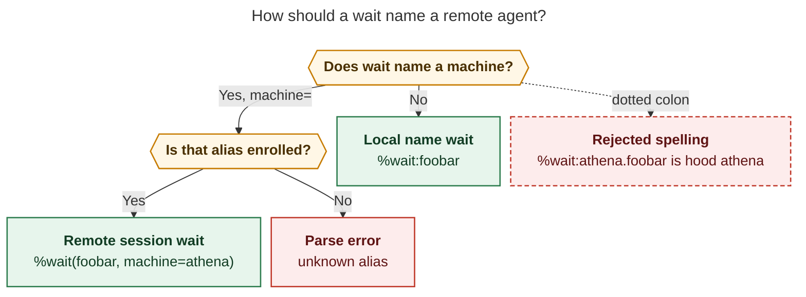
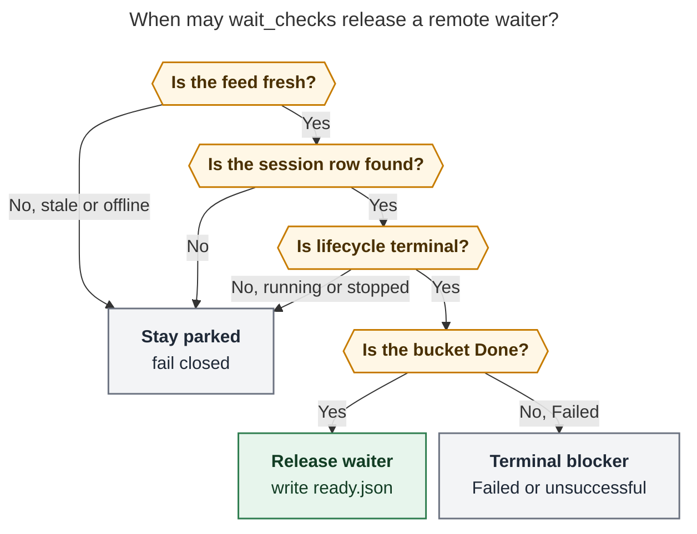

# Cross-machine `%wait` for enrolled remote agents

_Research report · 2026-11-07 · researcher: grk_

**Query.** How should SASE let an agent launched on this machine (apollo) wait for a named agent running on an enrolled remote (athena), as in `%wait:athena.foobar`? Is that a good idea, and what should change?

## Bottom line

Do this. Admission-time `%wait` is the right SASE primitive for "do not start until that other agent finishes," and the fleet stack already has the read path a remote target needs: enrollment via `sase machine init`, a bounded catalog, logical locators, and a viewer-local follow store.

Do not implement the dotted colon spelling `%wait:athena.foobar`. Dots already mean hoods. `%wait:athena.foobar` today looks up a *local* agent named `athena.foobar`. The core fleet locator comments already warn against deriving origin identity from machine-hood names. Use an explicit keyword that matches `bead=`, `hood=`, and `target=`:

```text
%wait(foobar, machine=athena)
```

Keep v1 remote wait *session-scoped*, *fail-closed* on stale or offline feeds, and *narrower* than local wait: no remote epic-follow, no remote hijack-follow, no silent all-machine name search. Park the waiter on apollo. Observe athena through `followed_batch` / logical-key lookup, not by polling SSH or sharing `waiting.json` over git.

Treat "lift `%dispatch` + `%wait` on the same prompt" as a separate, cheaper epic. That feature makes the *target* resolve waits locally. It does not give apollo a waiter for athena's `foobar`.

## Verdict on the idea

The idea is good. The proposed spelling is not.

A SASE agent cannot poll in-turn. `decisions:single-turn-agents` already forces every durable wait through host infrastructure: park before spawn, or hand off to a monitor. `%wait` already parks. The missing piece is that `WaitDependencyIndex` only walks *this* machine's artifact directories, while the Agents tab already mixes local rows with a remote catalog. Presentation federated; wait resolution did not.

That gap is real and worth closing. The user example is a controller-side wait on a remote *session*, which is the common "athena finished compiling, now apollo can review" shape. It is not a substitute for clans that should run entirely on athena.

**Requirement adjustments** (justified, called out as such):

1. **Reject `%wait:athena.foobar` as the primary grammar.** Colon form stays a local name, including names that contain dots.
2. **Default remote waits to `target=session`.** Do not treat one member turn's `Terminal` row as the session finishing. Local `%wait:foobar` already waits on the session; remote must not be looser. Prior research on `11q.w0` shows how easy it is to release at plan-gate approval instead of session end.
3. **Fail closed on stale, cached-invalid, or offline feeds.** Do not release from a `WAS RUNNING` / `Stopped` row. Owner liveness `Dead` without `Terminal`/`Failed` is not completion. Athena reboot stranding (`sase-1qj`, and `research:202611/athena_silent_agent_failures_live_update_skew.md`) is the cautionary case.
4. **V1 completion is the fleet status bucket, not local `done.json` semantics.** No remote `for_epic` default, no hijack successor chase, no planner-row-as-done exception. Compose an explicit `%wait(bead=…)` on the waiter host when bead closure is the real barrier.
5. **Do not lift the v1 `%dispatch` + `%wait` ban in the same change.** That is a different feature (target-local waits after dispatch).
6. **Do not search every enrolled machine for a bare `%wait:foobar`.** Local names stay local. Remote must name a machine.
7. **Wake `wait_checks` from federation follow updates.** Today's fs trigger watches `projects/*/artifacts/.ace_refresh_pulse` on the waiter host. Athena finishing does not touch that file. `max_quiet: 120s` is too slow for "within seconds of completion."

## What exists today

### Enrollment is viewer-local, and `sase machine init` is the path

`sase machine init` (also `add` / `repair`) is the canonical enrollment from the controller. It discovers, records the alias and credential, optionally applies the chezmoi overlay, and runs an authenticated hello. Memory `dispatch.md` and `docs/reference/integrations/remote-dispatch.md` agree: tailnet membership is not authorization; a one-time bootstrap secret is.

After enrollment, apollo can:

- launch on athena with `%dispatch:athena`
- list athena's recent agents in the Agents tab (`machine:athena`)
- stop / retry / fork them with `sase machine agent …`, matching `AGENT` exactly against remote `agent_id`, `agent_session_id`, or `agent_label`

Athena does not need to have enrolled apollo for apollo to *read* athena's catalog. Waiting is a controller read. The reverse wait (athena waiting on apollo) needs the reverse enrollment.

### `%wait` is rich, local, and admission-time

Supported wait keywords today (`src/sase/macro/_directive_collect_main.py`): `agent`, `bead`, `for_epic`, `hood`, `proc`, `target`, `time`, `unit`. Unknown keywords already error. `machine=` would be a clean addition.

Resolution (`src/sase/core/wait_dependency_resolution/`) indexes this host's artifact dirs. Named waits stay parked until a candidate exists *and* is resolved+done (missing name does not auto-succeed). Hood waits are the opposite: an empty hood *resolves* with a diagnostic. Copying hood semantics to a missing remote name would be a footgun.

Parked waiters write `waiting.json` with `waiting_for`, `wait_for_artifacts`, `wait_for_fork_sources`, `wait_for_epics_of`, `wait_for_beads`, `wait_for_hoods`. `wait_checks` (AXE routine `agent_waits`, interval 2s, fs trigger on `.ace_refresh_pulse`, `max_quiet: 120s`) walks those markers and writes `ready.json`. The runner also re-resolves as a fallback so a chop outage cannot strand a waiter forever (`src/sase/axe/run_agent_wait_deps.py`).

`sase agent wait` is the CLI twin: local snapshot, same name resolution order (clan, then session, then workflow, then exact name), `-T session|turn`, `-t` timeout. It has no machine flag.

Default agent wait follows launched epics (`for_epic` default on). `target=session` is the implicit default for a bare name; `target=turn` pins the current member.

### `%dispatch` and `%wait` cannot share a prompt

V1 remote launch refuses `%wait`, `%queue`, `%clan`, and `%hold` on the same prompt (`scan_dispatch_directive`, `validate_dispatch_combinations`). The controller strips only `%dispatch`; remaining directives would run on the target *if they were allowed through*. They are not.

So today you cannot even dispatch a two-agent chain onto athena with `%wait` between them. That is a separate hole.

### Fleet already has the observation APIs wait needs

sase-core's fleet contract (`crates/sase_core/src/fleet_contract/`) already distinguishes:

- **Identity:** `LogicalAgentLocatorWire` (origin installation id, project id, `agent_id`, optional `agent_session_id`). Human names are labels, not keys. Owner display names exist "so machine-hood names [stay] useful for lookup … without deriving the origin identity from those names."
- **Lifecycle vs liveness vs freshness:** `FleetLifecycleWire` (Starting/Running/Waiting/Asking/Terminal/Failed/Unknown), `OwnerLivenessWire` (Alive/Dead/NotProcess/Unknown), `ObservationFreshnessWire` (Fresh/Aging/Stale/Unknown), `ConnectionHealthWire`.
- **Status buckets:** `bucket_for_lifecycle` maps Terminal→Done, Failed→Failed, and maps Dead/NotProcess *away from* Running even if the lifecycle label still says Running (the "WAS RUNNING" presentation).
- **Catalog:** query by string, `include_terminal`, `project_ids`, Presentation vs History scopes. Presentation is the bounded window (seven days, at most 200 completed rows).
- **Follows:** viewer-local `follows.json`, `created_by: explicit|dispatch`, pending→active, session promotion. Dispatch pre-writes a follow so the controller can watch a launch whose catalog row has not arrived yet. `followed_batch` and `FleetLogicalBatchRequestWire` look up specific logical keys. Unresolved keys stay listed rather than being invented as Done.

The federation worker is the local cache/proxy in front of those owner gateway reads. TUI fleet refresh already uses it. `wait_checks` does not.

### Artifact `awaits` links are bead-only

Projected `awaits` / `awaited-by` rows come from `wait_for_beads`. There is no projected link for agent-to-agent waits, local or remote. Do not build remote wait on artifact links.

## Critique of `%wait:athena.foobar`

### The collision is not theoretical

Dot-separated names define hoods: `foo.bar` is in hood `foo`. `%wait:athena.foobar` is therefore already a legal *local* wait for agent `athena.foobar`, and `%wait(hood=athena)` waits for every current local member of hood `athena`. Shipping dotted machine.agent as colon form would silently retarget existing prompts the day someone names a local hood after a machine.

The TUI query language already uses `machine:athena` as a *filter*, not a name prefix. `%dispatch:athena` uses colon for the alias because dispatch has a single positional machine. `%wait` already has a multi-keyword parenthesized form. Put the machine there.



*Colon form stays local. Name a remote through `machine=` on an enrolled alias. Dotted `%wait:athena.foobar` is the hood spelling, not a machine spelling.*

A later shorthand `%wait:athena/foobar` (slash, not dot) is optional sugar. Do not ship it in v1.

Derived waiter names are another trap. A single explicit `%wait:<name>` can allocate `<name>.w0`. If colon form were `athena.foobar`, the waiter would be named `athena.foobar.w0` and look like a remote row. `machine=` keeps the derived name `foobar.w0`.

### Fleet rows are not `done.json`

Local wait chases hijack successors, treats a submitted `--plan` row as done while the plan is in review, follows epics the target launched, and aggregates session members including successors that appear *after* the wait is armed. Fleet summaries do not carry that graph.

Releasing a remote waiter because a member row flipped to `Terminal` would replay the `11q.w0` early-release bug across the tailnet: the plan gate looks finished, the coder does not exist yet, the waiter starts. Bind `agent_session_id` when known, honor follow session-promotions (`fleet_followed_batch_agent_session_promotions`), and release only when the *session* summary is terminal.

### Stale catalogs will lie if wait is fail-open

Holds are fail-open on a broken store so admission never strands work (`decisions:hold-pull-fail-open`). Wait is the opposite: launching because "we could not see athena" is how you review a still-running compile.

Release policy:



*Stay parked on stale, missing, running, or dead-without-terminal rows. Release only on a fresh Done session. Failed is a terminal blocker, matching local wait.*

`Asking` (pending remote question/gate) should surface as blocked-on-human, like local `needs_input`, not as success. Use the existing remote attention inbox; do not infer from row-follow state (the dispatch runbook already forbids that for answers).

### Bounded catalog vs name waits that start late

If `foobar` finished on athena eight days ago and aged out of the presentation window, a name lookup will miss it and the waiter will sit forever. History scope exists on the catalog. V1 should: bind and follow as soon as a matching row is seen; if arm-time lookup misses, query History once; if still missing, park on the unbound name (same as a local name that has not launched). Followed logical keys must not depend on staying inside the 200-row window.

### `wait_checks` will not notice remote completion

Remote completion does not write apollo's `.ace_refresh_pulse`. Without a federation-driven pulse, the waiter waits for `max_quiet: 120s` or the runner's own fallback poll. That breaks the `agent_waits` contract ("within seconds of completion"). The federation worker should nudge the same pulse when a followed row's lifecycle or freshness changes. Reuse the follow store; do not have `wait_checks` open a new catalog page per waiter per tick.

## Three features that look like one

| Feature | Prompt | Who resolves the wait | Need federation wait? |
| --- | --- | --- | --- |
| **A. Target-local wait after dispatch** | `%dispatch:athena` `%wait:builder` `%id:review` | athena | No. Lift the v1 combination ban; leave `%wait` in the forwarded prompt. |
| **B. Controller wait on a remote agent** (this request) | `%wait(foobar, machine=athena)` `%id:review` | apollo's `wait_checks` | Yes. Follow + fleet batch. |
| **C. Controller wait *before* dispatch submit** | `%wait:planner` `%dispatch:athena` `%id:worker` | apollo, then submit | Yes, but it is "don't call launch until local wait resolves," not a remote target. |

A is the cheapest unblocking of remote clans and should be its own epic. B is the requested feature. C falls out of B plus keeping dispatch+wait banned: a *local* `%wait` on a local prompt is already legal; adding `%dispatch` to that same prompt is what v1 rejects. If C is wanted later, resolve local waits on the controller, then submit dispatch without forwarding `%wait`.

The user example is B.

## Alternatives considered

**Monitor + `sase agent wait --machine`.** A monitor that polls, then a successor agent. Fits single-turn rules, ships the observation path first, and is a good *slice*. It does not compose with clan waves, derived `.w0` names, or the Agents-tab WAITING row. Use it as step 1 of the same design, not as the product.

**SSH `sase agent wait foobar` on athena.** Bypasses the fleet contract, the bootstrap credential, freshness, and locators. The sudo path already has a separate SSH target for a different job. Reject.

**Shared sidecar / git wait graph.** Cross-machine git lag is minutes; wait_checks wants seconds. Machine artifact-link writes already stay off the primary (`decisions:machine-link-writes-off-primary`). Reject as the wait transport.

**Push events from the owner gateway.** Right long-term complement to followed_batch polling. Not required for v1 if the federation worker already refreshes follows and pulses `wait_checks`.

**Bare `%wait:foobar` searches all machines.** Silent cross-machine match when both hosts have a `foobar`. Reject.

**Copy hood semantics for a missing remote name.** Empty hoods resolve. Missing named waits must not. Reject.

## Recommended solution

### Grammar

```text
%wait(foobar, machine=athena)
%wait(foobar, machine=athena, target=session)   # default
%wait(foobar, machine=athena, target=turn)      # pin current member at bind time
%wait(foobar, machine=athena, for_epic=false)   # v1 only value; true is a typed error
```

- `machine=` is required for a remote target. Value is a viewer-local enrolled alias (same regex as `%dispatch`: `^[A-Za-z0-9][A-Za-z0-9_.-]{0,63}$`). `machine=local` is reserved and means "omit the keyword."
- Unknown alias, quarantined enrollment, or federation disabled: parse/arm error, fail closed.
- `machine=` cannot combine with `hood=`, `proc=`, `unit=`, or `@tribe` in v1.
- Multiple `%wait` occurrences still union. `%wait(foo, machine=athena) %wait:bar` waits on remote foo and local bar.
- Colon form never gains a machine prefix.

CLI twin, same resolver:

```text
sase agent wait --machine athena foobar
sase agent wait -M athena -T turn foobar
```

### Bind, then follow, then resolve

1. **Arm (launch on apollo).** Parse `machine=` + agent name. Confirm the alias is enrolled and not quarantined. Catalog-query that host (`include_terminal: true`, current project id, History once if Presentation misses) with the same exact identity set `sase machine agent` uses: `agent_id`, `agent_session_id`, `agent_label`. Prefer a session locator when `target=session`.
2. **Pin.** If a row exists, write an explicit follow (`created_by: explicit` in v1; avoid a fleet-contract bump for a new `wait` created_by) and persist `wait_for_remote` on `waiting.json`: alias, pinned installation id, logical locator / logical key, target session|turn, original name. This is the remote analog of `wait_for_artifacts`.
3. **Unbound name.** If no row yet, persist the unbound name+alias and keep parking (local named-wait behavior). Each `wait_checks` tick retries bind until a row appears, then pins the follow. Do not succeed on "not found."
4. **Observe.** `wait_checks` and the runner fallback ask the federation worker `followed_batch` (and only then a name catalog query for still-unbound waits). Require `ObservationFreshnessWire::Fresh` or `Aging` and host `status` healthy. `Stale`, `cached` invalid feed, `unresolved_logical_keys`, or worker unavailable: stay parked, show `athena: feed …` in the wait modal the same way the Agents tab already shouts feed errors.
5. **Release.** Session summary `FleetStatusBucketWire::Done` with owner-authoritative `Terminal` → write `ready.json`. `Failed` → terminal blocker (do not start the waiter; notify like local failed deps). `Stopped` / WAS RUNNING / `Asking` / `Waiting` / `Queued` / `Running` → stay parked.
6. **Pulse.** Federation worker, on a followed lifecycle or freshness change, touches the waiter project's `.ace_refresh_pulse` so `wait_checks` runs in seconds, not 120s.
7. **Scope.** Default to the waiter's project id in the locator. Cross-project remote wait is out of v1 (or an explicit `project=` later).
8. **Core boundary.** Pure function in sase-core: given normalized host summaries + freshness + a `wait_for_remote` record, return parked / released / terminal-blocked. Python/AXE supplies the federation I/O. Extend `WaitTargetWire` with a `remote_agent { name, machine }` variant so typed launch plans, the TUI wait modal, and the CLI share one key. This matches `docs/contribute/rust-backend.md` / the rust-core-required decision: TUI, CLI, and AXE must agree.

### What v1 will not do

- Remote epic-follow, hijack follow, or planner-row-as-done.
- Remote hood / tribe / clan aggregates (`machine=` + `hood=`).
- `%dispatch` combined with `%wait` on one prompt.
- Auto-unwait on timeout. (`time=` remains a floor, as today.)
- Push-based owner events.

### Implementation order

1. sase-core: `WaitTargetWire` remote variant + pure release function over fleet summaries. Tests for freshness, Stopped≠Done, session vs member, Failed blocker.
2. Observation slice: `sase agent wait -M/--machine` using `followed_batch` / catalog bind. This is immediately useful from a monitor and proves the resolver before parking agents on it.
3. `waiting.json` `wait_for_remote` + follow pin + `wait_checks` / runner fallback. Federation pulse on followed changes.
4. Directive: `machine=` keyword, TUI wait modal machine chip, `blocked_on` labels like `athena:foobar`.
5. Separate epic: lift `%dispatch` + `%wait` so forwarded prompts may contain *target-local* waits (feature A).

### Tests that must exist before calling it done

- `%wait:athena.foobar` still binds the local name `athena.foobar`, never machine `athena`.
- `%wait(foobar, machine=athena)` errors when athena is not enrolled.
- Unbound remote name stays parked (unlike empty hood).
- Stale feed does not release.
- Member `Terminal` does not release a session wait.
- Failed remote is a terminal blocker.
- Followed logical key still resolves after the row leaves the presentation window.
- `wait_checks` fires from a federation pulse without a local artifact change.
- Typed launch plan round-trips the new wait kind.
- `sase agent wait -M athena foobar` matches `%wait` bind rules.

## Risks

- **False completion** from a cached Terminal row. Mitigate with freshness fail-closed and session locators.
- **Permanent park** when the remote agent died without `done.json` (athena reboot). Surface WAS RUNNING / last-seen in the wait modal; do not auto-release. Local recovery of those remote rows is `sase-1qj`, not this epic.
- **Name reuse** on the owner. Bind the locator at first sight; `target=turn` for a single member. Session wait follows promotions, not a later unrelated `foobar`.
- **wait_checks latency and load.** Followed_batch is the hot path; never N catalog pages per tick. Federation request timeout is 5s; keep remote eval inside the 2m job timeout.
- **Version skew.** `%tab` + `%dispatch` already refuses fleet contract older than v7 from cache. Remote wait should similarly refuse owners whose contract cannot serve logical batch / session role, with an upgrade hint.
- **Trust.** Waiting on Done does not mean the remote work is *correct*. Callers who need a bead or an artifact should `%wait(bead=…)` as well.

## Source map

- Wait grammar: `src/sase/macro/_directive_collect_main.py`, `sase/memory/macros.md`, `docs/reference/macros/directive-launch.md`
- Local resolution: `src/sase/core/wait_dependency_resolution/`, `src/sase/axe/run_agent_wait_markers.py`, `src/sase/scripts/sase_chop_wait_checks.py`, `src/sase/default_config.yml` (`agent_waits`)
- CLI wait: `src/sase/agents/cli_wait.py`, `docs/reference/agents/agent-sessions.md`
- Dispatch ban: `src/sase/macro/_directive_scan.py`, `crates/sase_core/src/agent_launch/plan_resolution.rs` (`validate_dispatch_combinations`)
- Enrollment and fleet UX: `sase/memory/dispatch.md`, `docs/reference/integrations/remote-dispatch.md`, `src/sase/dispatch/machine_init.py`, `src/sase/ops/commands/machine.py`
- Follows and federation: `src/sase/dispatch/follow_store.py`, `src/sase/dispatch/federation/_facade.py`, `crates/sase_core/src/fleet_contract/{status,catalog,locators,follows,projection,federation}.rs`
- Prior wait/fleet incidents: `research:202610/11q_w0_early_wait_release.md`, `research:202611/athena_silent_agent_failures_live_update_skew.md`
- Decisions: `single-turn-agents`, `handoffs-end-through-host-completion`, `hold-pull-fail-open`, `rust-core-required`, `machine-link-writes-off-primary`

## Recommended solution (one paragraph)

Ship **controller-side remote session wait** as `%wait(name, machine=<enrolled-alias>)` plus `sase agent wait --machine`, implemented as a pinned fleet follow whose release function lives in sase-core and whose I/O is `followed_batch`. Keep colon-form `%wait` local-only. Fail closed on stale or dead-without-terminal rows. Leave `%dispatch` + `%wait` banned until a separate epic forwards waits for the *target* to resolve. That is the smallest design that matches SASE's single-turn parking model, the existing fleet contract, and the hood/machine name split the locator types already encode.
