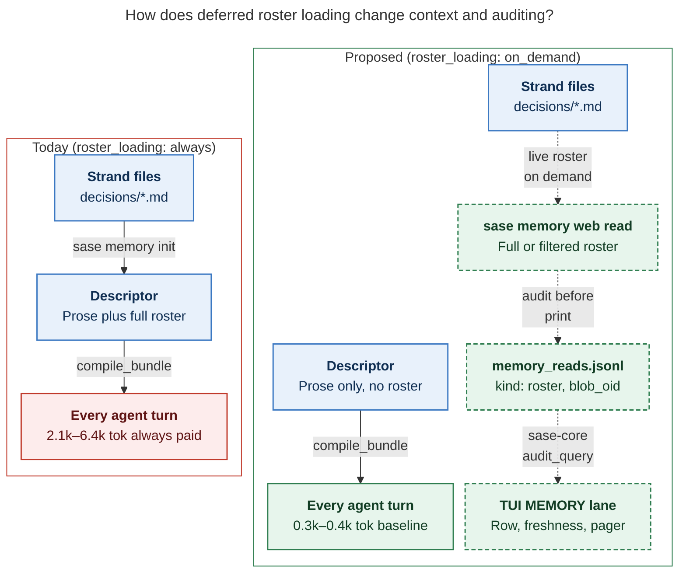
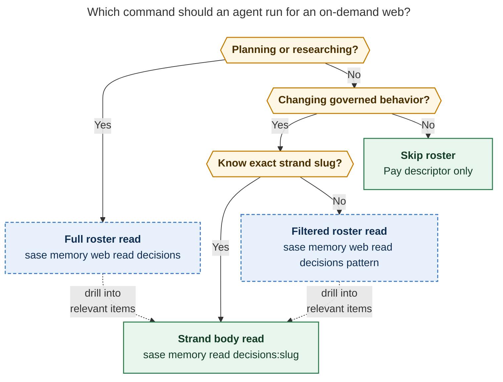

# Deferred Memory Web Rosters: Design, Critique, and Implementation Plan

**Date:** 2026-11-25
**Scope:** `sase-core`, `sase`, and `bob-cli`
**Subject:** Reducing per-turn context bloat from large `roster: list` memory webs (starting with `decisions` in `sase` and `bob-cli`) via generic on-demand roster loading, audited CLI retrieval, and TUI surfacing.

---

## Executive Summary

Your core diagnosis is backed by hard numbers, and your proposed architecture — a generic web-level opt-out from always-inlined rosters, paired with an audited `sase memory` roster command, TUI display, and descriptor-level usage instructions — is **the right architectural direction**. It cleanly satisfies the exact reopen condition written into `decisions:webs-render-in-their-own-section` without reviving `type:` on web descriptors or prematurely building E7 audience machinery (`decisions:corpus-before-mechanism`).

In live measurements across all enabled projects:

- In **`sase`**, `decisions` (31 strands) consumes **8,408 bytes (~2,102 tokens)** — **38.3%** of the entire root instruction bundle (21,972 bytes).
- In **`bob-cli`**, `decisions` (77 strands) consumes **25,641 bytes (~6,394 tokens)** — **69.1%** of the entire root instruction bundle (37,090 bytes). Worse, `bob-cli` already exceeds Codex's 32,768-byte explicit root cap by **4,516 bytes**, forcing compile-time `superseded_summaries` compaction on every single Codex turn with only **1,935 bytes** of headroom remaining.
- Deferring the `decisions` roster cuts per-turn root instruction context by **~33% in `sase`** (~7.2 KiB / ~1,810 tokens saved per turn) and **~65% in `bob-cli`** (~24.2 KiB / ~6,020 tokens saved per turn, restoring ~19.6 KiB of Codex headroom with zero compaction).

However, inspecting the codebase and **10,002 historical audited memory reads** (`2,831` in `sase`, `7,171` in `bob-cli`) surfaces **six justified adjustments** to the initial requirements:

1. **Broaden the mandatory audience beyond `/sase_plan`:** Research agents (`research.*`) are the **#1 consumer** of `decisions` in both repos (**77.9%** of decision reads in `sase`, **45.8%** in `bob-cli`) and never invoke `/sase_plan`. Direct non-plan coders account for another **27.4%** in `bob-cli`. Descriptor instructions should require full roster reads for **planners (`/sase_plan`) and architectural/design researchers**, and support **keyword-filtered roster reads** for non-plan implementers changing governed behavior.
2. **Use an orthogonal `roster_loading: always | on_demand` frontmatter key (not `roster: none`):** Preserves `roster: inline | list` as the formatting/validation axis so `roster: list` continues enforcing required strand `summary:` fields and formatting on-demand output identically to `AGENTS.md`.
3. **Omit `<!-- sase:strands -->` from `sase/memory/<web>.md` on disk as well as `AGENTS.md`/bundles:** Eliminates descriptor git churn and merge conflicts, keeps `sase memory list` / `README.md` / Memory Panel token metrics accurate, and guarantees project-over-home scope merging at read time.
4. **Add a fail-safe guard against bare `sase memory read <web>` context bombs:** Production audit logs show 6+ real agents in `bob-cli` running `sase memory read decisions` trying to inspect the index and accidentally dumping **142–205 KiB (~36k–51k tokens)** of all 77 strand bodies. Bare `sase memory read <web>` on an `on_demand` web should refuse with a direct pointer to the roster command unless `-a/--all-strands` is explicitly passed.
5. **Pair `sase memory web read` with `sase memory web show` (symmetric `read`/`show`) and coordinate `sase-core` first:** `sase_core::audit_query::memory_row_from_mapping` strictly whitelists `kind` to `"note" | "web" | "strand"` and silently drops unknown kinds — so `sase-core` must accept `"roster"` and be ratcheted before `sase` emits roster audit rows, or the TUI will drop them.
6. **Optional low-friction reliability boosts:** Add one project-agnostic sentence in `/sase_plan` Step 1 ("honor any project-specific planning requirements in `## Memory Webs`"), measure real planner compliance in `memory_reads.jsonl` before considering mechanical `sase plan validate` warnings, and consider promoting 1–2 universal `bob-cli` guardrails (like the scheduled release train rule) to a tiny `gotchas.md` core note (~80 tokens).

---

## 1. Empirical Baseline: Context Cost & Read Telemetry

### 1.1 Memory Web Inventory Across All Enabled SASE Projects

Scanning every enabled project checkout and `~` (`discover_memory_webs`) shows that only two projects currently carry non-generated memory webs:

| Project | Memory Webs (`strands`, `roster`, on-disk descriptor bytes) |
| --- | --- |
| `sase` | `decisions` (31, `list`, 8,641 B), `glossary` (73, `inline`, 2,330 B), `task_types` (5, `list`, 1,239 B) |
| `bob-cli` | `decisions` (77, `list`, 25,873 B), `glossary` (63, `inline`, 2,824 B), `task_types` (5, `list`, 1,239 B) |
| `body`, `cash`, `dev`, `job`, `love`, `tailnet` | `task_types` (5, `list`, 1,239 B) only |
| Home (`~`) | None |

`glossary` stays compact (~30–43 B/strand) because `roster: inline` prints only terms and aliases; `task_types` is bounded at 5 strands. `decisions` is uniquely expensive for two structural reasons:

1. **`roster: list` includes multi-line summaries and supersession markers** (~252 B/strand in `sase`; ~321 B/strand in `bob-cli`).
2. **Decision webs are append-only:** Records are immutable once accepted, so strands are never deleted — superseded records stay in the roster and grow longer as `_[partly superseded by ...]_` links accumulate (`bob-cli`: 44 active, 29 partly superseded, 4 superseded; `sase`: 23 active, 6 partly superseded, 2 superseded).

### 1.2 Measured Root Instruction Bundle Cost (Live `compile_bundle`)

Compiled with `compile_bundle(..., home_root=Path.home(), use_cache=False)` against current checkouts:

| Metric | `sase` (Claude) | `sase` (Codex, cap 32,768 B) | `bob-cli` (Claude) | `bob-cli` (Codex, cap 32,768 B) |
| --- | ---: | ---: | ---: | ---: |
| Total bundle bytes (uncompacted) | 21,972 B | 22,166 B | 37,090 B | **37,284 B (+4,516 B over cap)** |
| Delivered bytes (with marker) | 22,067 B | 22,261 B | 37,185 B | **30,833 B (compacted)** |
| Compaction triggered | None | None | None | **`superseded_summaries`** |
| `proj.web.decisions` bytes / tokens | 8,408 B (~2,102 tok) | 8,408 B | 25,641 B (~6,394 tok) | 19,095 B (compacted) |
| `decisions` share of root bundle | **38.3%** | **37.9%** | **69.1%** | **62.1% (even after compaction)** |
| `proj.web.glossary` bytes / tokens | 2,172 B (~542 tok) | 2,172 B | 2,694 B (~673 tok) | 2,694 B |
| `proj.web.task_types` bytes / tokens | 1,155 B (~289 tok) | 1,155 B | 1,155 B (~289 tok) | 1,155 B |
| **Projected bundle with `on_demand`** | **~14.7 KiB (~3,680 tok)** | **~14.9 KiB (17.9 KiB headroom)** | **~12.9 KiB (~3,230 tok)** | **~13.1 KiB (19.6 KiB headroom)** |
| **Per-turn savings** | **~7.3 KiB (~33%)** | **~7.3 KiB (~33%)** | **~24.2 KiB (~65%)** | **~24.2 KiB (eliminates compaction)** |

For `AGENTS.md` (used natively by Antigravity `agy`, Qwen, OpenCode, and fallback delivery), `decisions.md` is **41.5%** of `sase/AGENTS.md` (2,161 of 5,207 tokens) and **72.3%** of `bob-cli/AGENTS.md` (6,469 of 8,943 tokens).

### 1.3 Who Actually Reads `decisions`? (Historical Audit Log Analysis)

Analyzing `memory_reads.jsonl` for both projects (excluding the current `research.6e.*` swarm) classifies agents into three groups: **researchers** (`research.*`), **planners** (agents that read `sase_sizes.md` or have `plan` in their name), and **other** (direct coders, epic phase workers, reviewers, ad-hoc agents):

| Project | Total Memory Reads | `decisions` Read Events | Researchers (`research.*`) | Planners (`sase_sizes.md` / plan-named) | Other (Coders / Phase Workers / Reviewers) |
| --- | ---: | ---: | ---: | ---: | ---: |
| **`sase`** | 2,831 (1,226 agents) | 217 (7.7% of reads; 170 agents) | **169 events (77.9%)** / 132 agents | **27 events (12.4%)** / 21 agents | **21 events (9.7%)** / 17 agents |
| **`bob-cli`** | 7,171 (3,055 agents) | 1,412 (19.7% of reads; 1,055 agents) | **646 events (45.8%)** / 499 agents | **379 events (26.8%)** / 259 agents | **387 events (27.4%)** / 297 agents |

### 1.4 Production Footgun Already Observed: Bare `sase memory read decisions`

Today, passing a bare web name to `sase memory read <web>` reads **every full strand body** in the web: **63.5 KiB (~15,886 tokens)** for `sase`'s `decisions` and **202.6 KiB (~50,645 tokens)** for `bob-cli`'s `decisions`.

In `bob-cli`'s audit log, multiple real agents already tried to fetch an index by calling `sase memory read decisions` and accidentally blew 35k–51k tokens in one command:

- `bob-cli-gb.4.1.3` (`2026-11-03`): `sel=['decisions']`, **149,789 bytes** — reason: *"Need decision web list"*
- `research.4s.gem` (`2026-11-15`): `sel=['decisions']`, **183,558 bytes** — reason: *"check decisions index for bank/album/record naming or link rules"*
- `bob-cli-ms.8.3.1.1--1` (`2026-11-18`): `sel=['decisions']`, **192,787 bytes** — reason: *"Find the specific Record Card Properties and inline title decisions..."*
- `bob-cli-gb.5` (`2026-11-03`): `sel=['decisions']`, **141,979 bytes** — reason: *"Locate the authorized capture clock-tag decision strand"*
- `bob-cli-ji.5` (`2026-11-10`): `sel=['decisions']`, **177,318 bytes** — reason: *"Find the authorized private event notes decision..."*

Once the roster is removed from `AGENTS.md`, this footgun will become **far more frequent** unless we both provide an obvious roster read command and guard bare `sase memory read <web>` on deferred webs.

---

## 2. Critique of the Proposed Plan & Alternative Approaches

### 2.1 Is the Overall Direction a Good Idea?

**Yes — strongly.** Separating a memory web's *standing descriptor* (always inlined in `## Memory Webs`, ~290–370 tokens) from its *strand roster* (loaded on demand through an audited CLI command) is the cleanest possible solution for SASE's architecture:

- It preserves `decisions:webs-render-in-their-own-section` (descriptors stay tier-free in `## Memory Webs`, never reviving `type: reference`).
- It respects `decisions:corpus-before-mechanism` (a single declarative opt-out driven by a proven 108-strand corpus and active Codex cap overflow, with no speculative retrieval engine).
- It works identically across **every** provider — both explicit instruction bundles (Claude, Codex, Grok, Muse) and native `AGENTS.md` readers (Antigravity `agy`, Qwen, OpenCode, and legacy fallbacks).
- It turns invisible passive context consumption into **explicit, auditable evidence** in `memory_reads.jsonl` and the TUI `MEMORY` lane, so reviewers can immediately verify whether a planner or researcher consulted the project's decisions.

### 2.2 Why Four Major Alternatives Fall Short

| Alternative | Idea | Why It Is Worse |
| --- | --- | --- |
| **A. Audience-gated bundle compilation (E7 `when:`)** | Detect planners in `compile_bundle` and auto-inline `decisions` only for planner turns. | `InstructionFacts` has no task-role fact; many agents decide *mid-turn* to invoke `/sase_plan`; `agy`/Qwen/OpenCode read static `AGENTS.md` natively so they would either still pay 25 KiB or lose decisions completely; builds heavy E7 predicate machinery ahead of a wider corpus. |
| **B. Revive `type: reference` on web descriptors** | Move `decisions.md` into `## Reference Memory` as a one-line bullet read via `sase memory read decisions.md`. | Explicitly rejected by `decisions:webs-render-in-their-own-section`. Squeezes immutability rules, domain guidance, and strand-reading syntax into one `Reference Memory` bullet, conflates descriptor prose with generated rosters, and breaks project-over-home scope merging. |
| **C. Always-inline compact roster (title + slug only, or hide superseded)** | Keep the roster in `AGENTS.md`, dropping summaries or superseded records. | In `bob-cli`, excluding fully superseded strands saves only **4.8%** (4 of 77). Dropping *all* summaries (`compaction="all"`) still costs **6,871 B (~1,717 tok)** on every turn, continues growing O(N) forever, and strips the summaries that tell agents whether a decision actually governs their task. |
| **D. Rely solely on existing `sase memory web show`** | Tell agents to run `sase memory web show decisions`. | `web show` is **unaudited**, has no `markdown` roster format, drops supersession markers, and renders a narrow 5-column Rich box table that truncates slugs (`gates-never-bl…`) and cuts summaries off at 72 characters. |

### 2.3 Justified Adjustments to the Requirements

Here are the **six specific adjustments** warranted by codebase inspection and audit telemetry:

1. **Adjustment 1 — Widen the target readership in `decisions.md` beyond `/sase_plan`:**
   - *Original premise:* "These decisions should probably only be read by planner agents (i.e. agents that use the `/sase_plan` skill)."
   - *Evidence:* Researchers (`#research` / `#research_swarm`) make **77.9%** of decision reads in `sase` and **45.8%** in `bob-cli`, and `sase-research-artifacts/src/sase_research_artifacts/xprompts/` contains zero mentions of `decisions`. Direct non-plan coders make **27.4%** of decision reads in `bob-cli`.
   - *Adjustment:* Require full roster reads for **both planners (`/sase_plan`) and architectural/design researchers**, and instruct **non-plan implementers changing behavior in governed domains** to run a **filtered roster read** (`sase memory web read decisions <pattern> -r "<why>"`). Meanwhile, **epic/tale phase coders implementing an approved plan** do *not* need the full roster — the planner cites governing `decisions:<slug>` strands in the plan so coders read only those 1–3 strands directly.
2. **Adjustment 2 — Make `roster_loading` orthogonal to `roster` (format):**
   - *Adjustment:* Keep `roster: inline | list` as the format & validation contract (`list` still requires `summary:` on strands) and add `roster_loading: always | on_demand` (default `always`). Avoid naming the key `roster_inlined` or `roster_placement: inline`, because `roster: inline` already uses the word `inline` to mean semicolon-separated paragraph formatting.
3. **Adjustment 3 — Omit the managed roster region from `sase/memory/<web>.md` on disk, not only from `AGENTS.md`:**
   - *Adjustment:* When `roster_loading: on_demand`, `sase memory init` strips `<!-- sase:strands -->...<!-- /sase:strands -->` from the descriptor file itself, and strand creation/deletion (`web/mutation.py`) no longer dirties the descriptor. Keeps `sase memory list`, `sase/memory/README.md`, and Memory Panel token counts honest (~290–370 tokens, not ~6,469), eliminates descriptor merge conflicts, and ensures read-time rosters merge project-over-home scopes. (Human GitHub readers already have `sase/memory/decisions/` and, in `sase`, generated `docs/reference/design-decisions.md`.)
4. **Adjustment 4 — Fail-safe guard on bare `sase memory read <web>` for `on_demand` webs:**
   - *Adjustment:* Refuse bare `sase memory read decisions` by default with a clear, actionable stderr message directing the caller to `sase memory web read decisions -r "<why>"` (or `-a/--all-strands` if they genuinely want all full bodies). Keeps `sase memory read glossary` (`roster_loading: always`) 100% backward compatible while eliminating 50k-token accidental dumps.
5. **Adjustment 5 — Reliability defense-in-depth without hardcoding `decisions` in `/sase_plan`:**
   - *Honest compliance critique:* `/sase_plan` has a concrete 6-step checklist (Step 1 explicitly tells the agent to run `sase memory read sase_sizes.md`). Relying *solely* on prose back in `## Memory Webs` creates a real risk that planners follow `/sase_plan`'s checklist and forget to run `sase memory web read decisions`.
   - *Adjustment:* Add one **completely project-agnostic** sentence to Step 1 of `src/sase/macros/skills/sase_plan.md`: *"Also honor any project-specific planning requirements in `## Memory Webs` or `## Reference Memory` (such as reading an on-demand web roster required before planning)."* It never mentions `decisions`, costs ~25 tokens inside `/sase_plan` only, and works for any project's custom web. Then **measure actual compliance** after rollout (comparing agents that read `sase_sizes.md` against agents that recorded `roster:decisions` in `memory_reads.jsonl`); only add a mechanical `sase plan validate` warning later if empirical compliance drops below ~90%.
6. **Adjustment 6 — Audit universal guardrails in `bob-cli` before dropping the inline roster:**
   - *Evidence:* `bob-cli/sase/memory/decisions.md` currently states *"Each roster summary is a rule to follow as written"*, and small unplanned bug-fix agents will no longer see those 77 rules automatically.
   - *Adjustment:* Keep the ~8 governed domains listed in one compact line inside `bob-cli/sase/memory/decisions.md` so direct coders know when to run a filtered lookup, and evaluate promoting the 1–2 truly universal, turn-wide process rules (such as `bob-cli-releases-ride-a-daily-train`: never edit `Cargo.toml` version or `CHANGELOG.md`) into a tiny `sase/memory/gotchas.md` core note (~80 tokens, mirroring `sase`'s 68-token `gotchas.md`).

---

## 3. Recommended Design

### 3.1 Architecture Overview



*Figure 1: Setting `roster_loading: on_demand` decouples strand files from the descriptor and every-turn instruction bundle, serving the live roster on demand through an audited CLI path surfaced in the TUI `MEMORY` lane. Dashed nodes and arrows mark proposed additions.*

### 3.2 Generic Descriptor Frontmatter & Lifecycle

Add one optional frontmatter key to memory web descriptors (parsed in `src/sase/memory/web/frontmatter.py`, stored on `MemoryWeb` in `models.py`):

```yaml
---
web: true
description: >-
  Architectural decision records — accepted choices, their rejected alternatives, and
  what would reopen them.
roster: list                # inline | list (default: inline) — format & summary rule
roster_loading: on_demand   # always | on_demand (default: always) — context loading
roster_label: DECISIONS
strand_noun: decision
---
```

**Behavioral contract when `roster_loading: on_demand`:**

1. **Validation (`web/frontmatter.py`, `web/validation.py`):**
   - Reject any value other than `"always"` or `"on_demand"` fail-closed (`roster_loading must be always or on_demand`).
   - Continue enforcing `summary is required for roster: list` regardless of `roster_loading`.
   - Continue rejecting unbalanced or duplicated `<!-- sase:strands -->` markers.
2. **Convergence & `sase memory init` (`web/roster.py`, `main/init_memory/root_planning.py`):**
   - `render_web_body_with_roster` / `render_web_descriptor_with_roster`: when `web.roster_loading == "on_demand"`, remove any existing `<!-- sase:strands -->...<!-- /sase:strands -->` block (plus redundant blank lines) and never insert one.
   - `sase memory init` therefore converges `sase/memory/decisions.md` in one pass — removing the managed roster from `decisions.md`, `AGENTS.md`, `CLAUDE.md`, and updating `sase/memory/README.md` with the true descriptor line/token counts.
3. **Strand mutation (`web/mutation.py`):**
   - `create_memory_strand` and `delete_memory_strand` only write `web.path` when `descriptor_content != web.raw_text` — so adding/deleting a strand in an `on_demand` web leaves the descriptor untouched (zero descriptor diff!).
4. **Bundle compilation & compaction (`instructions/compile.py`, `instructions/compaction.py`, `amd/memory_units.py`):**
   - Only `web.roster == "list" and web.roster_loading == "always"` webs enter `compactable_webs`.
   - In `memory_units.py`, an `on_demand` web's `strand_files` does not feed the rendered bundle block, so its manifest `sources` lists only the descriptor file.
   - Update `_WEB_MEMORY_INTRO` (`src/sase/amd/memory_units.py`) and `src/sase/main/init_memory/templates/memory-sase.template.md` with one crisp phrase noting that a web's strand roster is either inlined in its subsection or read on demand with `sase memory web read <web> -r "<why>"`.

### 3.3 CLI Design: Symmetric `sase memory web read` & Upgraded `sase memory web show`

#### Why `sase memory web read` Beats Alternative Command Shapes

| Candidate | Example | Assessment |
| --- | --- | --- |
| **`sase memory web read` + `web show` (Recommended)** | `sase memory web read decisions [PATTERN] -r "<why>"` | **Best fit.** Mirrors SASE's exact `read` (audited) ↔ `show` (unaudited) symmetry inside the already-existing `sase memory web` group (`{list,read,show}` sorted alphabetically per `cli_rules.md`). Supports optional `PATTERN` + `-b/--bodies` filtering natively. Zero magic selector syntax, zero keyword collisions, clean audit record. |
| `sase memory read roster:<web>` | `sase memory read roster:decisions -r "<why>"` | Allows mixing in one variadic batch with `sase_sizes.md`, but inverts `<web>:<strand>` grammar by turning the left-hand side into a magic reserved verb, cannot accept per-selector `PATTERN`/`-b` filtering, and orphans `sase memory web show`. |
| `sase memory read <web> --roster` | `sase memory read decisions --roster -r "<why>"` | Ambiguous in mixed variadic batches (`sase memory read sase_sizes.md decisions --roster`), and dropping `--roster` silently triggers the 50k-token full-web bomb. |
| `sase memory read <web>:roster` | `sase memory read decisions:roster -r "<why>"` | Collides with any web strand whose slug, keyword, or alias is `roster`. |
| `sase memory roster <web>` | `sase memory roster decisions -r "<why>"` | Duplicates `sase memory web show` and still needs an unaudited twin so humans can run it without `SASE_AGENT_NAME`. |

#### Exact Command Specifications (Compliant with `cli_rules.md`)

1. **`sase memory web read` (NEW — audited agent command):**
   ```text
   usage: sase memory web read [-h] [-b] [-f {json,markdown,rich}] [-p REF] -r REASON
                               WEB [PATTERN]
   ```
   - Positional arguments: `WEB` (memory web slug), optional `PATTERN` (case-insensitive substring filter over `keyword`, `slug`, `aliases`, and `summary`).
   - Options (alphabetical, every public long flag has a short alias):
     - `-b, --bodies`: Extend `PATTERN` matching into strand bodies.
     - `-f, --format {json,markdown,rich}`: Output format (default: `markdown`, matching `sase memory read`).
     - `-p, --project REF`: Project to resolve memory webs from (default: infer from cwd).
     - `-r, --reason REASON` *(required)*: Non-empty audit reason.
   - **Audit-before-print:** Validates agent identity (`require_agent_identity()`) and non-empty reason, resolves project-over-home `ScopedMemoryWeb`, filters if `PATTERN` given, renders bytes, computes `git_blob_oid(rendered_markdown_bytes)`, appends one `MemoryReadEvent` to `memory_reads.jsonl`, and **only then** prints to stdout.
   - **Default `markdown` output** reuses `render_strand_roster()` directly so it looks virtually identical to the roster previously rendered in `AGENTS.md`:
     ```markdown
     ---------- MEMORY WEB ROSTER: decisions (31 decisions · 23 active, 6 partly superseded, 2 superseded)

     1. **A Gate Never Blocks An Agent** (`gates-never-block`)
        - _[partly superseded by `handoffs-end-through-host-completion`]_ Creating a gate
          from inside an agent ends that agent's turn; continuation is a gate shell's
          follow-up, never a wait.
     ...

     Read any decision in full with `sase memory read decisions:<keyword> -r "<why>"`.
     ```
     When `PATTERN` is supplied, the header shows the filter and counts (`6 of 77 decisions matching "capture"`), and if zero strands match, prints a clean message (still auditing the lookup so reviewers see the agent checked!).
   - **`rich` output:** Styled terminal roster with bold cyan header (`MEMORY WEB ROSTER  decisions`), right-aligned active/superseded counts, bold keywords, dim ``(`slug`)``, yellow supersession notices, and full wrapped summaries (no 72-char truncation).
   - **`json` output:** Deterministic JSON containing `web`, `project`, `roster`, `roster_loading`, `strand_noun`, `pattern`, `bodies`, `matched_count`, `total_count`, `strands` (with `slug`, `keyword`, `aliases`, `summary`, `scope`, `supersession`), and `roster_markdown`.

2. **`sase memory web show` (UPGRADED — unaudited human/tooling twin):**
   ```text
   usage: sase memory web show [-h] [-b] [-f {json,markdown,names,rich,table}] [-p REF]
                               WEB [PATTERN]
   ```
   - Adds `markdown` and `rich` formats using the **exact same** roster renderer as `web read`, while keeping default `table` for 100% backward compatibility.
   - Extends `PATTERN` matching to also search `strand.slug` and `strand.summary` (currently `web/cli.py:128` searches only `keyword` and `aliases` unless `-b` is passed!).

3. **`sase memory web list` (UPGRADED):**
   - Adds a `Roster` column (`list`, `list (on-demand)`, `inline`, `inline (on-demand)`) and `"roster"` / `"roster_loading"` fields in `-f json`.
   - Fixes the stale `--help` description (`parser_memory.py:373`) that still mentions `"rendering (core/reference)"`.

4. **`sase memory read` / `sase memory show` Bare-Web Safety Guard:**
   - Add `-a, --all-strands` to `sase memory read` and `sase memory show`.
   - When a bare `WebSelector` (`decisions`) targets a web with `roster_loading == "on_demand"` and `--all-strands` is not set, fail fast before logging or printing:
     ```text
     sase memory read: 'decisions' uses on-demand roster loading (77 decisions; full body read is ~50,645 tokens).
     Read its roster with `sase memory web read decisions -r "<reason>"`, read one strand with `sase memory read decisions:<keyword> -r "<reason>"`, or pass `-a/--all-strands` to read every strand body.
     ```

#### Agent Consultation Routing



*Figure 2: Agents pick full roster reads during planning/research, filtered roster reads for exploratory changes in governed domains, direct strand reads when a slug is already cited (e.g., from an approved plan), or skip the roster entirely on routine tasks. Any arrow converging on "Strand body read" suffices independently.*

---

### 3.4 Audit Event Schema & Rust Core Boundary

#### Event Representation in `memory_reads.jsonl`

Extend `MemoryReadEvent` (`READ_LOG_SCHEMA_VERSION = 4`, readers accept `1..=4`) with a fourth `kind`: `"roster"`, and four optional fields (all defaulted so v1–v3 rows and non-roster rows remain unchanged):

```json
{
  "schema_version": 4,
  "id": "a1b2c3d4e5f6",
  "timestamp": "2026-11-25T19:30:00+00:00",
  "project": "sase",
  "cwd": "/path/to/workspace",
  "canonical_path": "roster:decisions",
  "resolved_path": "",
  "agent_name": "sase-1ab.plan",
  "agent_source": "SASE_AGENT_NAME",
  "artifacts_dir": "/path/to/artifacts",
  "reason": "Need architectural decisions before writing plan",
  "byte_count": 7820,
  "frontmatter_stripped": false,
  "kind": "roster",
  "selectors": ["decisions"],
  "resolved_targets": ["roster:decisions"],
  "included_targets": [],
  "depth": null,
  "scope_origin": [["decisions", "project"]],
  "blob_oid": "9f8e7d6c5b4a...",
  "included_blob_oids": [],
  "filter_pattern": null,
  "filter_bodies": false,
  "roster_matched_count": 31,
  "roster_total_count": 31
}
```

**Why each design choice matters:**

- **`canonical_path = "roster:<web>"` and `resolved_targets = ["roster:<web>"]` (single target, NOT all 77 strand slugs):**
  - Prevents inflating the Agents tab header to `1 read · 77 files` when the agent only read the index.
  - Prevents polluting `sase memory log` and Memory Panel `Last audited read` across all 77 strands (so you can still tell which individual decision records were actually read in full!).
  - Aggregates both full and filtered roster reads under `roster:decisions` in `sase memory log` and `sase_core::agent_stats::activity` (which scans `canonical_path` generically without code changes!).
  - Enables shell-friendly filtering: `sase memory log --path roster:decisions`.
- **`blob_oid = git_blob_oid(rendered_roster_markdown_bytes)`:**
  - Captures an exact content fingerprint of the roster the agent actually saw, enabling live freshness detection (`≡ now` vs `⟲ roster changed`) in the TUI without needing the roster committed as a file on disk.
- **`filter_pattern`, `filter_bodies`, `roster_matched_count`, `roster_total_count`:**
  - Lets the TUI and `sase memory log --id` show at a glance whether the agent read the **full** roster (`31 decisions`) or a **filtered** slice (`6/77 · "capture"`), and lets `memory_read_report.py` reproduce the exact `sase memory web show` command when the user opens the hint in the pager.

#### Critical `sase-core` Requirement

In `sase/repos/linked/sase-core/crates/sase_core/src/audit_query.rs`:

- Line 425 currently rejects `schema_version` outside `1..=3`.
- Line 449 currently rejects `kind` outside `"note" | "web" | "strand"` by returning `None` — **silently dropping rows from the TUI**.

Per `decisions:rust-core-required` and `sase-core/AGENTS.md`, `audit_query.rs` must be updated **first** to accept `schema_version` in `1..=4`, accept `"roster"`, and deserialize the four optional fields with `#[serde(default, skip_serializing_if = ...)]` on `MemoryReadWire` (which has no `deny_unknown_fields`, so `MEMORY_AUDIT_QUERY_WIRE_SCHEMA_VERSION` can stay at `1` without a breaking bump). After `sase-core` lands, ratchet `sase-core-revision.txt` in `sase` and update `src/sase/memory/_read_log_query_facade.py` to accept `"roster"` and forward the optional fields.

---

### 3.5 TUI Design: Intuitive, Scannable, and Beautiful

Audited web roster reads surface across **two TUI locations** (plus two CLI dashboards):

#### 1. Agents Tab → Agent Detail Panel → `SASE CONTEXT` → `MEMORY` Lane (Primary)

Roster reads belong inside the existing **`MEMORY`** lane (`_agent_memory_reads.py`), never in a separate lane (no lane sprawl; `GLOSSARY` is strictly legacy pre-web logs). That way they participate seamlessly in session-aggregated views (with `plan`/`research` role badges), chronological ordering, and `v` hint paging:

```text
▸ MEMORY · 3 reads · 2 files · 1 roster · Instructions as launched
  launch    ◇ [1] Instructions as launched · a3f8c12e  claude · 14,120 · bytes match
  19:17:13  plan   👁 [2] sase_sizes.md  ↩ frontmatter  ≡ now
                     ↳ Need SASE size guidance before authoring a plan
  19:17:19  plan   ☰ [3] decisions  roster · 31 decisions  ≡ now
                     ↳ Need architectural decisions before authoring a plan
  19:17:24  plan   👁 [4] decisions:rust-core-required, decisions:webs-render-in-their-own-section  ≡ now
                     ↳ Verify Rust core boundary and web descriptor rules
```

When filtered by a coder:

```text
  19:22:08  coder  ☰ [5] decisions  roster · 6/77 · "capture"  ≡ now
                     ↳ Check capture sigil and bullet rules before parser fix
```

**Design details:**

- **Header summary:** Distinguish rosters from files only when roster reads are present (`3 reads · 2 files · 1 roster`; zero change to existing `N reads · M files` wording when no roster reads occurred).
- **Glyph & palette:** Add `ROSTER_GLYPH = "☰"` (U+2630, 1-cell monospace width matching `MEMORY_GLYPH` so `CONTEXT_REASON_INDENT` stays pixel-aligned) in `COLOR_MEMORY_GLYPH` (`bold #5FD7FF`).
- **Inline metadata tag:** Render web slug in `COLOR_MEMORY_PRIMARY` (`#87D7FF`), followed by a subtle dim tag (`  roster · 31 decisions` or `  roster · 6/77 · "capture"`). At a glance, a reviewer can confirm whether a planner scanned the full roster or only a filtered slice.
- **Freshness chip (`_agent_memory_versions.py`):** On the existing enrichment worker thread, recompute the live roster's `git_blob_oid` for `event.kind == "roster"` and compare against `event.blob_oid`:
  - Matching → dim `≡ now` (`CHIP_NOW_STYLE`)
  - Drifted → purple `⟲ roster changed` (`CHIP_PAST_STYLE`)
  - Omit `MemoryVersionPin` so no broken git-ordinal lookup fires.
- **Hint paging (`v` + `[3]`):** `memory_read_file_paths(event)` returns `()` for `kind == "roster"` (never attempting to open 77 strand files), routing straight to `write_memory_read_report(spec)` (`src/sase/memory/memory_read_report.py`), which materializes a clean Markdown report containing the reproduced `sase memory web show -p <project> decisions [pattern] [-b] -f markdown` command, recorded metadata (including filter & matched/total counts), and the full rendered Markdown roster inside the pager.

#### 2. TUI Memory Panel (`gm` / `Ctrl+G m`)

In `src/sase/ace/tui/modals/memory_panel_web_rendering.py`:

- **Badges:** Show `WEB` `ON-DEMAND ROSTER` `COLLAPSED`/`EXPANDED` on descriptors with `roster_loading == "on_demand"`, immediately explaining why the descriptor card body contains prose rather than a long list.
- **Property grid:**
  - `Roster`: `list · on-demand` (or `list · always`, `inline · always`), mirroring the two-part `Links: explicit · reference` style directly beneath it.
  - `Last roster read`: look up `snapshot.read_summaries.get(f"roster:{web.slug}")` and render `<agent> · <reason> · <relative_time>` (plus read count when > 1), giving web descriptors read-audit visibility for the first time.

#### 3. CLI Dashboards (`sase memory log` & `sase memory list`)

- **`sase memory log`:** `roster:decisions` appears cleanly in `Memory Paths`, supports `sase memory log --path roster:decisions`, and `sase memory log --id <id>` prints `Kind: roster`, `Filter` (when set), and `Matched strands: 6 / 77`.
- **`sase memory list`:** Adds a `Roster` column to the `Memory Webs` table (`list (on-demand)`, `inline`, `list`), and `Context Files` automatically reflects the true small loaded size of `decisions.md` and `AGENTS.md`.

---

### 3.6 Proposed `decisions.md` Updates for `sase` and `bob-cli`

#### `sase/memory/decisions.md` (~1,150 B / ~288 tokens vs. 8,408 B today)

```markdown
---
web: true
description:
  Architectural decision records — accepted choices, their rejected alternatives, and
  what would reopen them.
roster: list
roster_loading: on_demand
roster_label: DECISIONS
strand_noun: decision
---

# Decisions

This project maintains immutable architectural decision records in the `decisions`
memory web. Its strand roster is not inlined here to save context.

- **When authoring a SASE plan (invoking `/sase_plan`) or conducting architectural or
  design research**, you **MUST** read the full decisions roster first:

  ```bash
  sase memory web read decisions -r "<why>"
  ```

- **When changing behavior or weighing design trade-offs without an approved plan**,
  check relevant decisions with a filtered lookup (`sase memory web read decisions
  <pattern> -r "<why>"`) or the full roster above.
- **To read a specific record in full**, run `sase memory read decisions:<keyword> -r
  "<why>"`. Each record states the claim, why it beat credible alternatives, what it
  costs, and what would reopen it.

A decision record is not a design doc or a subsystem overview — those go stale as the
code changes underneath them. A record is immutable once accepted: if the project
changes course, write a new record and mark the old one superseded with
`metadata.status` plus `superseded_by` and a `[[...]]` back-link, never edit it in
place.
```

#### `bob-cli/sase/memory/decisions.md` (~1,480 B / ~370 tokens vs. 25,641 B today)

```markdown
---
web: true
description:
  Accepted architecture and policy decisions for bob-cli, bob-plugins, Bob Mac Capture,
  and the Bob vault — the choice, its rejected alternatives, and what would reopen it.
roster: list
roster_loading: on_demand
roster_label: DECISIONS
strand_noun: decision
---

# Decisions

Accepted architecture and policy decisions spanning bob-cli, bob-plugins, Bob Mac
Capture, and the Bob vault. Its strand roster is not inlined here to save context; each
roster summary is a rule to follow as written.

- **When authoring a SASE plan (invoking `/sase_plan`) or conducting architectural or
  design research**, you **MUST** read the full decisions roster first:

  ```bash
  sase memory web read decisions -r "<why>"
  ```

- **When changing behavior in a governed domain without an approved plan** (capture,
  walk/review, tasks/lanes/decay, gcal/meetings, refs, themes/relations, releases, or
  Mac Capture), check relevant decisions with a filtered lookup (`sase memory web read
  decisions <pattern> -r "<why>"`) or the full roster above.
- **Before changing behavior a record governs or proposing a rejected alternative**,
  read the record in full with `sase memory read decisions:<keyword> -r "<why>"`. Each
  record states where it applies, the claim, why it beat credible alternatives, what it
  costs, and what would reopen it.

A record is not a design doc, runbook, command contract, or keymap — those live in
`docs/` and each repo's README. Records cite checkable evidence (a commit, doc, plan, or
research ref); when no source records the reason, ask Bryan rather than infer one. A
record is immutable once accepted: if course changes, write a new record and mark the
old one with `metadata.status` plus `superseded_by` and a `[[...]]` back-link, never
edited in place.
```

---

## 4. Phased Implementation & Rollout Blueprint

Because `sase-core` owns `audit_query.rs` and `bob-cli` depends on an installed `sase` supporting `roster_loading: on_demand`, work lands cleanly in **three ordered stages**:

### Stage 1: `sase-core` (Audit Query Support)
- `crates/sase_core/src/audit_query.rs`: accept `schema_version` `1..=4`, accept `kind = "roster"`, add serde-defaulted `filter_pattern`, `filter_bodies`, `roster_matched_count`, `roster_total_count` to `MemoryReadWire`, add unit tests.
- `crates/sase_core_py/src/memory_history/tests.rs`: add PyO3 round-trip tests for `"roster"` rows (both full and filtered).
- Verify with `sase tool run check` in `sase-core`.

### Stage 2: `sase` (Generic Feature + TUI + `sase` `decisions.md`)
1. Ratchet `sase-core-revision.txt` past Stage 1's commit.
2. **Web model, frontmatter, roster, validation, mutation:** `src/sase/memory/web/{models,frontmatter,roster,validation,mutation}.py`, `src/sase/instructions/{compile,compaction}.py`, `src/sase/amd/memory_units.py`, `src/sase/main/init_memory/templates/memory-sase.template.md`.
3. **CLI & safety guard:** `src/sase/main/{parser_memory,memory_handler}.py`, `src/sase/memory/web/cli.py`, `src/sase/memory/{cli_list,selector_web}.py`.
4. **Audit log, CLI log & report materializer:** `src/sase/memory/{_read_log_models,_read_log_events,_read_log_query_facade,cli_log,memory_read_report}.py`.
5. **TUI surfaces:** `src/sase/ace/tui/widgets/prompt_panel/{_agent_context_common,_agent_memory_reads,_agent_memory_versions}.py`, `src/sase/ace/tui/modals/memory_panel_web_rendering.py`.
6. **Skills, docs, and `sase` memory:**
   - Update `src/sase/macros/skills/sase_memory_read.md` (and optionally 1 generic sentence in `sase_plan.md`; deploy generated skills only after landing per `generated_skills.md`).
   - Update `sase/memory/decisions.md` (`roster_loading: on_demand`) and add `sase/memory/decisions/web-rosters-can-defer-on-demand.md` (marking `decisions/webs-render-in-their-own-section.md` as `superseded-in-part` with a `[[...]]` back-link).
   - Run `sase memory init` and update `docs/reference/memory/memory.md` + regenerated `docs/reference/cli/memory.md`.
   - Verify with `just check` (and live TUI screenshot verification of the `MEMORY` lane and Memory Panel card).

### Stage 3: `bob-cli` (After Updated `sase` Is Installed)
1. Update `bob-cli/sase/memory/decisions.md` with `roster_loading: on_demand` and the updated instructions.
2. Optionally add a ~80-token `bob-cli/sase/memory/gotchas.md` (`type: core`) if Bryan wants universal non-plan guardrails (like the scheduled release train policy) always in context.
3. Run `sase memory init` in `bob-cli` to regenerate `decisions.md`, `AGENTS.md`, `CLAUDE.md`, and `sase/memory/README.md`; verify `sase doctor --deep` (`instructions.bundle_size`) flips from `WARN` (Codex compacted) to `OK` with ~19.6 KiB headroom!

---

## 5. Open Decisions for Bryan

Before writing an implementation plan, four small design choices are worth confirming:

1. **Generic 1-line nudge in `/sase_plan`?** Should Step 1 of `src/sase/macros/skills/sase_plan.md` include one project-agnostic sentence reminding planners to check `## Memory Webs` for required on-demand rosters, or should `/sase_plan` stay completely untouched while we first measure compliance from `memory_reads.jsonl`? *(Recommended: include the 1-line project-agnostic nudge.)*
2. **Bare `sase memory read <web>` guard on `on_demand` webs?** Should bare `sase memory read decisions` fail closed with a pointer to `sase memory web read decisions` (requiring `-a/--all-strands` for full-body dumps), or keep reading all bodies? *(Recommended: fail closed with `-a/--all-strands` escape hatch, given 6+ observed 142–205 KiB incidents in `bob-cli`.)*
3. **Research agents & filtered coder lookups in `decisions.md`?** Confirm expanding the descriptor trigger from planners-only to planners + researchers (full roster) and governed-domain non-plan coders (filtered roster). *(Recommended: yes, backed by audit data showing researchers account for 46–78% of decision reads.)*
4. **Universal guardrails in `bob-cli`?** Should `bob-cli` promote `bob-cli-releases-ride-a-daily-train` (never edit `Cargo.toml` version / `CHANGELOG.md`) into a tiny `sase/memory/gotchas.md` core note when deferring the `decisions` roster? *(Recommended: yes — ~80 tokens protects every unplanned turn.)*
