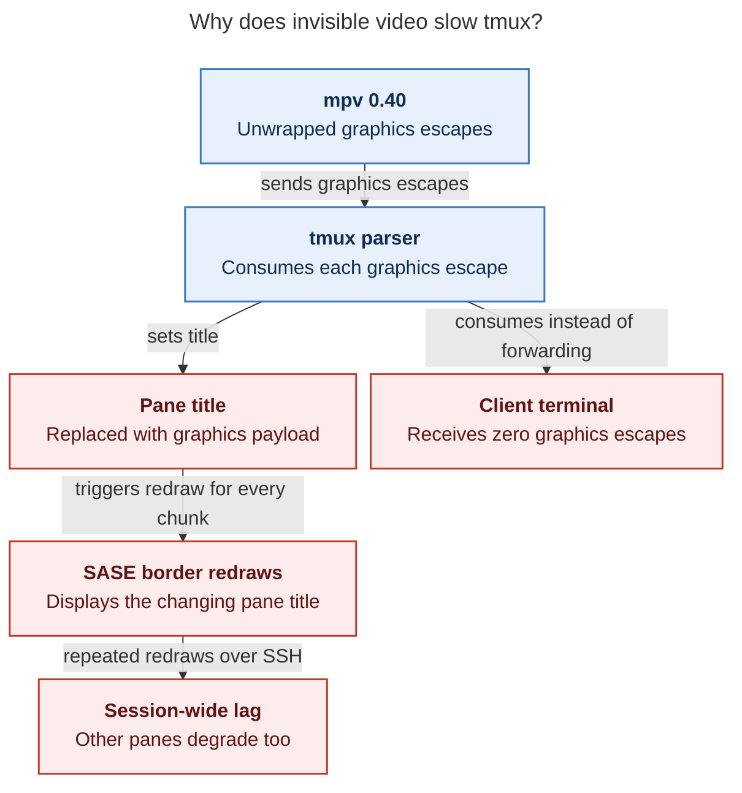
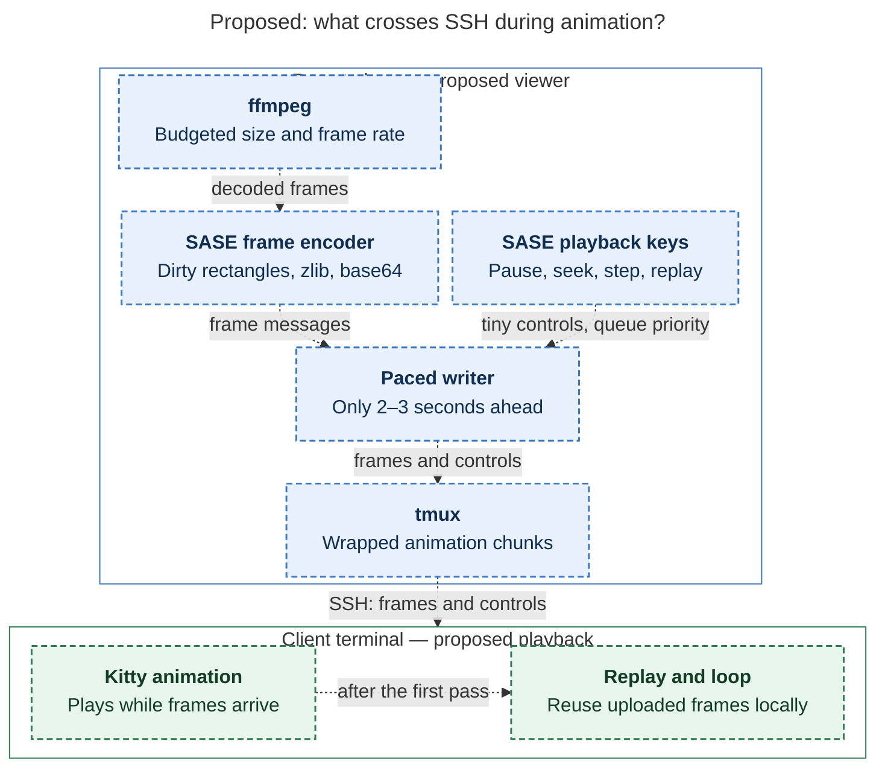

# Diagram proposals: Fast Video Artifacts in the tmux Pane: Consolidated Findings and Recommendation

Proposals for the swarm linker, not a report. Each diagram restates only what the source
report says.

```yaml
source: research:202611/fast_video_artifact_pane/fast_video_artifact_pane__final.md
producer: research.54.image
check: "mmdc 12.0.0 with the PDF-mirroring config rendered 2 of 2 Mermaid diagrams; Puppeteer --no-sandbox"
```

## title-redraw

```yaml
anchor: |-
  tmux's `input_exit_apc()` calls `screen_set_title()` on **every** APC
question: |-
  Why does invisible video slow the tmux session?
illustrates: |-
  Unwrapped kitty graphics become pane-title changes that trigger SASE border redraws over SSH, so other panes degrade while no video graphics reach the client.
caption: "Unwrapped kitty graphics become pane titles, so SASE redraws borders while no video reaches the terminal."
review: "630.836×942 px, fit 94.8%; question, source trace, labels, arrows and visual checks passed; 1 revision"
```



## animation-ownership

```yaml
anchor: |-
  frames onto one reused image ID, played by kitty in loading mode;
question: |-
  What crosses SSH, and why is replay almost free?
illustrates: |-
  The proposed streamer carries frame messages and priority controls through a shared paced writer while kitty plays client-side and replays without new frame uploads.
caption: "Proposed: SASE sends paced frames and priority controls; kitty reuses uploaded frames for replay and looping."
review: "614.07×1138 px, fit 78.5%; question, source trace, labels, arrows and visual checks passed; 2 revisions"
```


