# Make the Agents-tab tmux video pane fast by inspecting stills first

**Question.** Video artifacts opened from the Agents tab (`a`, then a video row) play in a right-hand tmux pane and feel incredibly slow. What is the best way to make that path fast? Critique the idea of keeping full-motion playback in that pane. Adjust requirements where justified. End with a recommended solution.

**Researcher.** grk (`research.54.grk`). Independent report. I did not locate, open, read, or otherwise consult peer reports from this swarm.

## Bottom line

**Keep the tmux pane. Stop treating live `mpv --vo=kitty` playback as the default inspect path.** The pane is the right container: the TUI stays up, `l` focuses the viewer, `a` closes it. What runs in the pane is the problem. Today every video cold-starts a fat Python module, then streams uncompressed RGB24 kitty frames through tmux and usually SSH. That is a slideshow, and no amount of TUI polish will make it feel like a player.

The success criterion should be **time-to-first-useful-pixel under 300 ms**, with motion as an opt-in second step. File managers already settled this: ranger, lf, and yazi preview video as a cached still. SASE already does the same thing for images (`kitten icat` of one PNG). Videos should join that path.

**Recommended solution:** still-first (ffmpeg frame or contact sheet + `kitten icat`) in the existing pane; `r` / space starts a *capped* mpv play; local kitty gets `--vo-kitty-use-shm=yes` plus `--sws-fast`; SSH sessions cap resolution and fps, with a GUI/local-open escape hatch. A same-day config experiment can try the mpv flags through `ace.artifact_file_viewer.video.extra_mpv_args` while that lands.

## Verdict on the idea

Making this faster is a good idea. The current video path is the one media surface that cannot show a pixel until a video output driver is pumping frames.

The *plan as implied* — keep playing the file with mpv in a tmux pane, and somehow make that play fast — is only a good idea for the local, same-machine case, and only after mpv is given the flags its own docs call mandatory. It is a bad idea as the default on this host topology. This research session is itself an SSH login (`SSH_CONNECTION` from `100.108.201.99` to `100.76.155.98`, Tailscale), with `TERM=xterm-256color` inside tmux 3.4. That is the TUI's normal home: apollo (or athena) inside tmux, kitty on the Mac. Shared-memory kitty transfer cannot work across that hop. Uncompressed RGB24 base64 can.

I would take a different approach than "tune mpv until 24 fps looks okay in the pane." I would copy the image viewer. Images in the same pane are already fast because they send **one** compressed PNG. A video's useful first answer is also one PNG (or a six-frame sheet). Motion is a second question.

## Requirement adjustments

These are justified changes to the implied requirements. Each one is a requirement, not a preference.

1. **Keep the right-hand tmux pane and its Agents-tab contract.** Collapse the Agents list while the pane is live, guard row-changing navigation, `l` focuses, `a` toggles close. That design is sound (`docs/reference/tui/agents-tab.md`, `src/sase/ace/tui/actions/agents/_panel_artifact_pane.py`). The slowness is the child process, not the split.

2. **Split inspect from play.** Inspect means "what did the agent produce?" Play means "run the timeline." Default open is inspect. Play is `r` or space, matching today's replay key.

3. **Budget time-to-first-useful-pixel, not playback fps.** Target p95 first still under 300 ms for a typical 6 s 480p clip on a warm disk. Playback fps is a secondary metric and only after the user asked for motion.

4. **Cap motion in the pane.** Default play is at most ~480 px on the long edge and ~8–12 fps, with `--sws-fast=yes` / `--sws-scaler=bilinear` (mpv's kitty VO documents `--profile=sw-fast` as required for decent performance). Full-resolution 24 fps in a tmux pane is out of scope.

5. **Detect local kitty versus SSH.** `--vo-kitty-use-shm=yes` is local-only (mpv man: it does not work over SSH). Enable it when `SSH_CONNECTION` / `SSH_CLIENT` are unset and `KITTY_WINDOW_ID` or `TERM=xterm-kitty` is set. Over SSH, skip shm and keep the pixel/fps cap, or offer local-open.

6. **Do not change the image, PDF, Markdown, or text viewer modes in this work.** The sequence loop already branches on `artifact_file_view_mode`. Video gets a still renderer that reuses `kitten_icat_command`. Mixed selections keep working.

7. **Keep this in the Python TUI.** Terminal layout, tmux splits, and mpv argv are presentation. They fail the rust-core litmus (a web app would not need them to match). No sase-core change.

8. **Do not feature-flag the mpv flag pack.** Shipping `--sws-fast`, explicit pixel size, and a scale/fps cap is repairing an incomplete player command. Flag only a later local-open or ingest-time poster if those need a beta period.

9. **Add a GUI/local-open key from the Agents picker.** Files-pane `E` already sends media to `xdg-open`. Agents-tab `a` always uses the terminal viewer. An `o` / `E` on the picker (and in the viewer footer) is the correct escape hatch when a real display exists.

10. **Measure on the real hop.** `tui_perf.md` says perceived causes are usually wrong. Instrument time-to-first-frame, first icat, and mpv `drop`/`vo` in the pane. A local micro-benchmark will lie about SSH.

## Current path

**Reader question:** Where does time go when opening a video from the Agents tab?

**Caption:** The tmux split is cheap. The Python cold start is hundreds of milliseconds. The pane then streams uncompressed RGB24 kitty frames through tmux and SSH, which is what makes playback a slideshow.



Rendered size: 598 × 702 px; fit scale: 100.0%.

### What `a` actually does

On the Agents tab, `a` is `action_open_artifact_files` (`src/sase/ace/tui/actions/agents/_panel_artifact_actions.py`). If a tracked artifact pane is live, `a` closes it. Otherwise it opens `ArtifactFileSelectionModal`. Choosing a video calls `_open_artifact_file`, which inside tmux runs `view_registered_artifact_file_in_tmux_pane`.

That helper (`src/sase/ace/tui/graphics/_viewer_tmux.py`) always:

1. `tmux split-window -h -P -F #{pane_id}`
2. Starts a **new** process: `sys.executable -m sase.ace.tui.graphics.viewer [--kind …] PATH`
3. Decorates pane titles and collapses the Agents list

There is no persistent viewer pane and no mpv IPC. Every open is a cold start. `r` in the viewer re-runs the whole mpv command (`tests/ace/tui/artifact_file_viewer/test_sequence_loop.py`).

Byte-free VCS rows materialize off the UI thread (`_open_artifact_files_materializing` + `spawn_pump_free_task`). That protects the TUI event loop. It is not the thing the user is staring at in the pane. Automatic `video_paths` captures from agent finalization already have a filesystem path.

### What the child process runs

`python -m sase.ace.tui.graphics.viewer` imports Markdown-to-PDF, PDF paging, and the full sequence loop even for a single `.mp4`. Measured cold import on this host:

| Command | uv-tools sase Python | workspace venv |
| --- | --- | --- |
| `python -c pass` | 24 ms | 24 ms |
| `import sase.ace.tui.graphics.viewer` | 396 ms | 664 ms |
| `python -m sase.ace.tui.graphics.viewer --help` | 389 ms | 445 ms |

~400 ms is a visible tax. It is not "incredibly slow" by itself. It is paid **before** mpv draws a pixel, and it is paid for a module that videos do not need (`from sase.attachments.markdown_pdf import render_markdown_pdf` at the top of `viewer.py`).

For `mode == "video"`, `run_artifact_sequence_loop` then calls `display_video_artifact`, which clears the terminal, prints a Rich header, and blocks on:

```text
mpv --no-config --vo=kitty --keep-open=yes
    --vo-kitty-alt-screen=no --vo-kitty-config-clear=no
    --vo-kitty-left=… --vo-kitty-top=…
    --vo-kitty-cols=… --vo-kitty-rows=…
    --mute=yes
    -- <path>
```

(`src/sase/ace/tui/graphics/_viewer_loop_media.py`, locked by `test_artifact_video_player_command_targets_image_area`.)

`--no-config` is intentional so user mpv profiles cannot break the pane. It also means **none** of mpv's documented kitty-VO performance flags are on unless SASE passes them. Config already has `ace.artifact_file_viewer.video.extra_mpv_args` for that; the default is `[]`.

Missing from the default argv, all documented by mpv:

| Flag | Why it matters |
| --- | --- |
| `--profile=sw-fast` / `--sws-fast=yes --sws-scaler=bilinear` | Kitty VO is a software scaler. mpv's own `vo.rst`: "You may need `--profile=sw-fast` to get decent performance." |
| `--vo-kitty-width` / `--vo-kitty-height` | Pixel size. SASE sets cell cols/rows only. Pixel 0 means "query the terminal, else 320×240." Query over tmux/SSH is unreliable; a large query encodes huge frames. |
| `--vo-kitty-use-shm=yes` | POSIX shm instead of escape-code base64. "Much faster." Local machine only. |
| `--vo-kitty-auto-multiplexer-passthrough=yes` | Wrap kitty APC in tmux DCS. This host already has `allow-passthrough all`; wrapping is still the mpv-side equivalent. |
| scale / fps filter | Hard cap on bytes per second. |

`--keep-open=yes` is correct for holding the last frame after mpv exits. A still-first inspect gives that last-frame *job* immediately, before mpv starts.

### Why playback is a slideshow

mpv's kitty VO (`vo_kitty.c`) sends **uncompressed RGB24** (`f=24`) as base64 APC, chunked at 4 KiB. It does not use PNG (`f=100`) or zlib (`o=z`). Shared memory (`t=s`) is the only fast path, and it requires kitty and mpv on the same machine.

Bandwidth for 24 fps RGB24 + base64 (4/3):

| Output size | Per frame | At 24 fps | At 8 fps |
| --- | --- | --- | --- |
| 320×240 (mpv fallback) | ~0.29 MiB | ~7.0 MiB/s | ~2.3 MiB/s |
| 480×270 | ~0.46 MiB | ~11 MiB/s | ~3.7 MiB/s |
| 100 cols × 33 rows at ~10×20 px cell (1000×660) | ~2.5 MiB | ~60 MiB/s | ~20 MiB/s |

Tailscale SSH plus tmux parsing APC is not a 60 MiB/s pipe. 7 MiB/s at the 320×240 fallback is already enough to drop to a slideshow. This research hop is SSH; shm is unavailable. `DISPLAY=localhost:10.0` is forwarded X11, which is the same class of mistake (bitmaps over SSH).

This agent environment has `kitten` 0.32.2, `ffmpeg` 6.1.1, and tmux 3.4 with `allow-passthrough all`. It does **not** have `mpv` on PATH, so I did not time `--vo=kitty` here. The protocol math and mpv's own source/docs do not depend on that binary.

### The in-TUI surface makes the slow pane the only way to see the clip

The Agents file panel and notification attachments render images as cell-block previews. Videos render a text placeholder:

```text
▶ video
<name>
<path>

use the view key to play
```

(`src/sase/ace/tui/widgets/file_panel/_display.py`, `_video_file_placeholder`.) So the user **must** take the tmux path to see any frame. That is why the pane's slowness is the whole product failure, not a secondary player.

This path landed as `e49c4e1369` (2026-07-06, `feat(ace): preview video artifacts with mpv`) by routing video suffixes through the existing isolated viewer subprocess. It reused the image/PDF pane. It never added a still renderer or a kitty-VO performance profile.

## Alternatives considered

**Reader question:** Which viewer path should a video artifact take?

**Caption:** Inspect with a still or contact sheet first. Play motion only on demand, using shared memory when kitty is local and a hard cap or local open when the TUI is over SSH.



Rendered size: 680 × 650 px; fit scale: 96.0%.

| Option | What it is | Verdict |
| --- | --- | --- |
| **A. mpv flag pack only** | Keep autoplay; add sw-fast, pixel size, scale/fps cap, local shm, tmux passthrough wrap | Necessary, not sufficient. Local kitty becomes watchable. SSH remains a capped slideshow. Ship as phase 0 under the existing command builder. |
| **B. Launch mpv directly in the pane** | `tmux split-window` argv is `mpv …` instead of `python -m viewer` | Saves ~400 ms and the Markdown/PDF import. Loses header, `n`/`p`, `tab` return, SIGUSR1 close notify unless a 30 ms wrapper remains. Use for the play step, not as the only process. |
| **C. Still-first + optional play** | ffmpeg one frame or contact sheet, `kitten icat` in the existing area, `r`/space starts capped mpv | **The product.** Same pane, same icat path as images. First useful pixel in ~200 ms on a 6 s 480p clip (measured below). |
| **D. Contact sheet as the inspect document** | `fps=1,scale=384:-1,tile=3x2` (or duration-aware grid), then icat | Best inspect for agent clips (demo recordings, generated 6–10 s videos). Page `j`/`k` if the sheet is multi-image. |
| **E. GUI / local-open** | `xdg-open`, local `mpv --vo=gpu`, or copy-back to the Mac | Correct for "I want to watch this." Files pane `E` already does xdg-open. Do not X11-forward (`DISPLAY=localhost:10.0`) as the implementation. |
| **F. Persistent pane + mpv IPC** | One mpv with `--input-ipc-server`, `loadfile` on the next video | Worth it after still-first, for `n`/`p` across several videos. Do not build IPC before the default inspect path is a still. |
| **G. Custom ffmpeg \| icat loop** | Pipe PNG frames to `kitten icat` at 8 fps | Reimplements a worse mpv. Skip. |
| **H. `--vo=sixel` / `--vo=tct`** | Other terminal VOs | tct is cell-colored text. sixel is another uncompressed-ish stream; tmux 3.4 can carry it, and it does not beat kitty+shm locally or a still over SSH. |
| **I. Embed playback in Textual** | Kitty graphics from the app process | Fights the TUI event loop (`tui_perf.md` rule 1) and tmux's cell buffer. The isolated pane exists to avoid this. |
| **J. In-panel first-frame cell preview** | Extract a poster, reuse the image cell renderer | High value so `a` is optional. Phase 2. Needs a cache keyed by path+mtime so highlight movement stays off ffmpeg. |

Terminal file managers independently converged on C/D: lf's preview script uses `ffmpegthumbnailer` then the image drawer; ranger's `scope.sh` does the same; yazi previews with ffmpeg stills, and a common plugin steps through cached timeline frames. They treat **open** as a GUI player (ranger rifle `mpv` with a fork flag). SASE should treat the pane like their preview column, and optional play like their opener.

### Still-extract timings (this host, ffmpeg 6.1.1)

Generated 6.0 s 854×480 H.264 test clip (48 KiB):

| Step | Wall time | Output |
| --- | --- | --- |
| First frame PNG | 0.21 s | 43 KiB |
| 6-frame 3×2 contact sheet JPEG | 0.19 s | 34 KiB |
| 320×180 H.264 proxy | 0.41 s | 18 KiB |

A contact sheet is as cheap as a single frame for the clips agents actually produce, and it answers "what happens in this video" in one icat. Cache under the existing `sase-artifact-viewer-` temp dir, keyed by `(path, mtime, area)`.

## Recommended solution

Three phases. Phase 0 is a same-command repair. Phase 1 is the product change. Phase 2 removes the need to open the pane to know what the clip is.

### Phase 0 — repair the mpv command (keep autoplay)

Change `artifact_video_player_command` only. Tests already pin the argv (`test_artifact_video_player_command_targets_image_area`); update them.

Always pass:

- `--sws-fast=yes --sws-scaler=bilinear` (and `--profile=sw-fast` if builtin profiles still load under `--no-config`; pass the explicit sws flags because `--no-config` is in the command)
- `--vo-kitty-width` / `--vo-kitty-height` from `TIOCGWINSZ` xpixel/ypixel scaled to the image area, with a **hard cap** (recommend 480 on the long edge) when the ioctl is 0 or huge
- `--vf=scale=W:H,fps=12` (or `fps=8` over SSH) so the cap is in the filter graph, not hoped-for
- `--really-quiet` so OSD does not fight the kitty stream
- `--vo-kitty-auto-multiplexer-passthrough=yes` when `TMUX` is set

Conditionally pass:

- `--vo-kitty-use-shm=yes` when the session is local kitty (no `SSH_CONNECTION`/`SSH_CLIENT`, kitty markers present)

Keep `--no-config`, `--keep-open=yes`, mute default, placement cols/rows, and `extra_mpv_args` appended last so a user can still override.

**Same-day workaround** without waiting for the code, in merged config:

```yaml
ace:
  artifact_file_viewer:
    video:
      extra_mpv_args:
        - --sws-fast=yes
        - --sws-scaler=bilinear
        - --vf=scale=480:-2,fps=8
```

Do not add `--vo-kitty-use-shm=yes` in user config on the SSH hop; mpv will fail or show nothing. This workaround still autoplays; it only makes the slideshow cheaper.

### Phase 1 — still-first inspect in the same pane (the actual fix)

For `mode == "video"` in `run_artifact_sequence_loop`:

1. ffmpeg-extract a contact sheet (clips ≤ ~15 s) or a representative frame (`-vf thumbnail` or seek 10%) into the viewer temp dir.
2. Display it with the existing `kitten_icat_command` and the existing image area. Header already has `▶ Video`.
3. Footer: `r`/`space` play, `q` quit, `tab` return to ACE, `n`/`p` for sequences, `o` GUI-open when available. `j`/`k` page extra sheet images if any.
4. Play launches the phase-0 mpv command **in that pane**, blocking as today. On mpv exit, restore the still (keep-open last frame is optional; the sheet is better).
5. Single-video opens may use a slim entry point that does not import `markdown_pdf`. Mixed sequences keep the current module.

Doctor: `ffmpeg` becomes a video-inspect dependency alongside `mpv` as a play dependency. Missing ffmpeg still allows phase-0 play; missing mpv still allows inspect. That matches today's "warn, don't fail the TUI" rule.

This stays inside `src/sase/ace/tui/graphics/`. No rust-core, no new feature flag, no change to artifact identity.

### Phase 2 — poster in the TUI so `a` is optional

Reuse the image cell preview for videos: lazy ffmpeg poster, cache by path+mtime, render with the existing Pillow cell sampler. Highlight movement must not wait on ffmpeg (`tui_perf.md` rules 7 and 8: debounce detail, cache by mtime). Optional later: write a poster next to `video_paths` at agent finalize so the first Agents-tab glance is free. That finalize hook is the only piece that might later touch shared attachment code; it is still presentation cache, not core backend.

### What I would not do

- I would not try to make 24 fps 720p in a tmux pane the acceptance test.
- I would not X11-forward mpv to `DISPLAY=localhost:10.0`.
- I would not replace kitty with sixel or tct.
- I would not move this into sase-core.
- I would not drop the tmux pane in favor of suspending the TUI; outside tmux, today's suspend path can keep using the same still-first helper.

### Implementation sketch (phase 1 shape)

```text
Agents a → picker → view_*_in_tmux_pane
                 → slim viewer (or current module)
                 → if video: ffmpeg sheet → kitten icat → key loop
                 → r/space: artifact_video_player_command (phase 0 argv)
                 → o: xdg-open / local hint
```

Acceptance:

- Opening a 6 s 480p clip from Agents `a` shows a sheet or frame in the right pane in under 300 ms p95 on apollo local disk, SSH hop included.
- `r` starts motion; over SSH, `mpv` `drop` is acceptable, size is capped, shm is off.
- On a local kitty TUI, shm is on and motion is watchable at the cap.
- Image/PDF/Markdown/text in the same pane are unchanged.
- `just check` covers argv tests, mode branch, and "ffmpeg missing ⇒ still skipped, mpv still offered."

## Critique summary

The tmux pane is a good idea. Autoplaying uncompressed kitty video in it, on a TUI that usually lives behind SSH, is not. Repair the mpv flags so play is less wasteful, then make inspect as fast as images. That is the approach I would take.

## Sources

- `src/sase/ace/tui/graphics/_viewer_tmux.py` — `tmux split-window -h` + `python -m sase.ace.tui.graphics.viewer`
- `src/sase/ace/tui/graphics/_viewer_loop_media.py` — `artifact_video_player_command` / `display_video_artifact`
- `src/sase/ace/tui/graphics/_viewer_loop_sequence.py` — video branch of the page loop
- `src/sase/ace/tui/graphics/viewer.py` — fat module entry point, Markdown PDF import
- `src/sase/ace/tui/actions/agents/_panel_artifact_actions.py` — Agents `a`
- `src/sase/ace/tui/actions/agents/_panel_artifact_open.py` — tmux vs suspend
- `src/sase/ace/tui/actions/agents/_panel_artifact_pane.py` — pane tracking, collapse, SIGUSR1
- `src/sase/ace/tui/widgets/file_panel/_display.py` — in-TUI `▶ video` placeholder
- `src/sase/default_config.yml` — `ace.artifact_file_viewer.video` defaults
- `docs/reference/agent-attachments.md` — Video Preview
- `docs/reference/tui/agents-tab.md` — pane keymap contract
- `src/sase/doctor/checks_deep_terminal.py` — kitty graphics + tmux ≥ 3.3 passthrough
- `tests/ace/tui/artifact_file_viewer/test_rendering.py` — pinned mpv argv
- mpv `DOCS/man/vo.rst` (`kitty` driver) and `video/out/vo_kitty.c` (`f=24`, shm, multiplexer passthrough)
- mpv `etc/builtin.conf` `[sw-fast]` profile
- git `e49c4e1369` (2026-07-06) — original mpv preview
- lf wiki Previews; ranger `scope.sh`; yazi ffmpeg still preview
- Measured on this host: viewer import ~400 ms; ffmpeg still 0.21 s; contact sheet 0.19 s; `allow-passthrough all`; SSH hop present; mpv absent from the agent PATH
