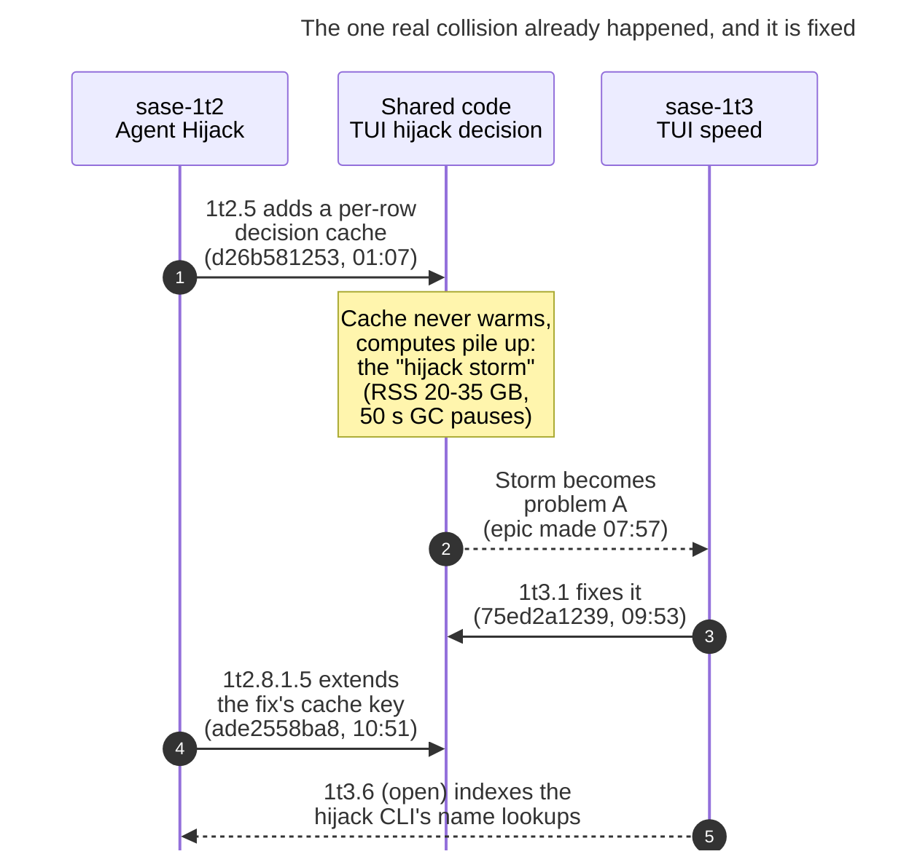
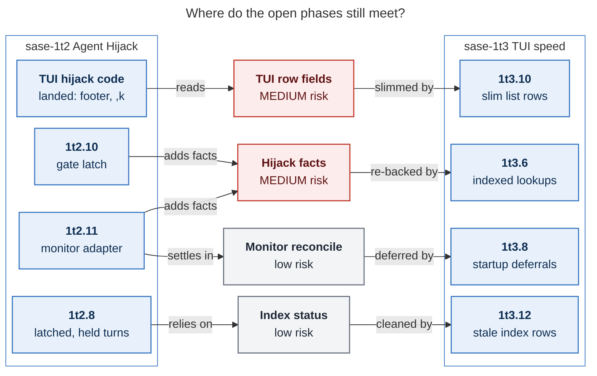

# Do epics `sase-1t2` and `sase-1t3` conflict?

_Agent Hijack dependability (`sase-1t2`) vs. Recover TUI speed (`sase-1t3`), checked on
2026-11-16 at sase `master` `dc09b5eba3`._

**Sources:** both epic beads and their approved plans
(`plan:202611/agent_hijack_dependability.md`,
`plan:202611/tui_storm_trust_heap_recovery.md`), the child plan
`plan:202611/indexed_agent_lookups.md`, the phase beads and notes, and the 22 commits
both epics landed between Nov 15 20:00 and Nov 16 11:12 EST.

## Verdict

> **No real conflict, and no need to worry.** The epics want compatible things: a
> hijack that works, and a TUI that stays fast. Their one collision has already
> happened and been fixed: `sase-1t2`'s TUI phase _caused_ the "hijack storm", and
> `sase-1t3`'s first phase fixed it. The hijack epic then built on that fix rather than
> fighting it. **Two seams are worth watching** before specific open phases start (see
> [Recommendations](#recommendations)).

- **Goals line up.** `sase-1t3` names `sase-1t2` in its plan: "rebase onto its commits,
  and keep its ingress semantics, but do not wait for it."
- **There is a safety net.** The TUI's hijack decision only drives the footer chip and
  the toast. The `persist-hijack` process re-resolves the target authoritatively before
  it stops anything. If the TUI side drifts, users see a wrong chip or toast, but the
  wrong agent is never stopped.
- **No other overlap.** Reviewer decisions, memory edits, and docs do not overlap (see
  [Where they cannot collide](#where-they-cannot-collide)).

## The two epics at a glance

```text
                          phases closed
sase-1t2  Agent Hijack    ■■■■■■■■■□□□□□   9 / 14   (open: 1t2.8 latch, .10 gate, .11 monitor, .13 chaos, .14 docs)
sase-1t3  TUI speed       ■■■■□□□□□□□□□□   4 / 14   (closed: storm hotfix, telemetry, trust memo, trust root)
```

| Area             | `sase-1t2` Agent Hijack                                        | `sase-1t3` Recover TUI speed                               |
| ---------------- | -------------------------------------------------------------- | ---------------------------------------------------------- |
| Goal             | `,k` hijacks the session's occupying turn, or latches          | Usable Agents list in about 6-7 s; bounded heap; fast j/k  |
| Main code        | `sase.agent.hijack`, runner hand-offs, monitor and gate settle | TUI loaders, config/trust, agent artifact index (sase-core) |
| sase-core module | `agent_hijack/` (eligibility, ledger)                          | `agent_scan/index/` (lookups, maintenance, slim DTO)       |

## What has collided so far



_Figure 1. The epics' history is cause, fix, then cooperation, not a tug-of-war. All
times are Nov 16, EST._

The storm fix (`75ed2a1239`) gave the TUI decision a single worker, a cache key that
roster refreshes no longer invalidate, and resolution from the in-memory roster instead
of archive walks. An hour later, the hijack latch overlay (`ade2558ba8`) kept the fix's
"the footer never schedules a compute" rule and added the latch `boundary` to its cache
key. So the hijack epic is now writing _inside_ the speed epic's guardrails.

**Shared files are rare, and all of them come from the fix:**

```text
files touched by sase-1t2 commits   ████████████████████████████  141
files touched by sase-1t3 commits   ███████                        35
touched by both                     ██                              9
                                      └ 8 = the one storm-fix commit 75ed2a1239
                                      └ 1 = sase-core-revision.txt (the pin)
```

## What could still collide



_Figure 2. Four seams remain. The two red ones have a test gap; the two grey ones are
already covered by the plans' own rules._

| Risk          | Seam                                         | What could go wrong                                                                                                                                                                                                                                                                                                                       | Guard today                                                                                                                                                           | Gap                                                                                                                                                                    |
| ------------- | -------------------------------------------- | ----------------------------------------------------------------------------------------------------------------------------------------------------------------------------------------------------------------------------------------------------------------------------------------------------------------------------------------- | --------------------------------------------------------------------------------------------------------------------------------------------------------------------- | ---------------------------------------------------------------------------------------------------------------------------------------------------------------------- |
| 🟥 **Medium** | TUI row fields: 1t3.10 vs landed hijack TUI  | The row-local hijack resolver reads about 24 row fields (`pid`, `workspace_num`, `agent_session`, `monitor_state`, container flags, …) plus the `hijack_*` overlays. If slim list rows stop filling one of them, `,k` quietly refuses or offers the wrong mode. That brings back the "not eligible" behavior `sase-1t2` set out to remove. | Parity test `tests/ace/tui/test_agent_hijack_tui_parity.py`                                                                                                           | That test builds rows **by hand** with `Agent(...)` (line 33), not through the loader, so it cannot see a loader that drops a field. 1t3.10's plan never mentions hijack. |
| 🟥 **Medium** | Hijack facts: 1t2.10/1t2.11 vs the storm fix | Gate and monitor facts that come from a **new** lookup outside the `StopDeps` seams would make TUI decisions slow again. A full storm cannot return, because the single worker caps the damage at slow, stale decisions.                                                                                                                  | The row-local archive guard (`test_agent_hijack_tui_parity.py:497-507`)                                                                                               | The guard patches exactly five named lookup functions. A new archive-wide lookup passes it unnoticed.                                                                 |
| ⬜ Low        | Index status: 1t3.12 vs latched/held turns   | Terminalizing stale "running" index rows could mark a latched turn that is waiting for dead-owner reconcile as finished.                                                                                                                                                                                                                  | 1t3.12 requires real witnesses (done marker, PID liveness, live claims). A held hijack keeps its claim pinned. 1t3.6 forbids inferring liveness from cached `status`. | None worth acting on now                                                                                                                                               |
| ⬜ Low        | Monitor reconcile: 1t3.8 vs 1t2.11           | Deferring the TUI's startup monitor reconcile delays settling a hijacked monitor. The monitor settles late but correctly, through `settle_claim_and_followup` in `monitor/reconcile.py`.                                                                                                                                                  | The deferral only skips when "nothing can settle"                                                                                                                     | None                                                                                                                                                                   |
| ⬜ Friction   | `sase-core-revision.txt` and `just check`    | Merge churn: both epics moved the pin five times in 14 hours. Also, one epic's half-landed state can fail the other's check. **This already happened once:** a `sase-1t2` canary agent's check failed on unused trust symbols left behind by 1t3.4 (`sase-1t3` note #1).                                                                  | Both plans: "the pin only moves forward; keep the newer commit". The trust symbols are gone at HEAD.                                                                  | None; expect rebases, not bugs                                                                                                                                         |

1t3.6 (indexed lookups) sits under the authoritative hijack path, but it is **well
guarded**. Its child plan requires the same mode, code, and occupant with the scanners
patched to fail, and a safe refusal when a lookup is incomplete. It also requires
preserving "StopDeps seams, row-local TUI resolver, latches, and stop custody". Its last
phase is literally titled "…with hijack parity".

## Where they cannot collide

| Dimension          | `sase-1t2`                                                   | `sase-1t3`                                                                 | Overlap |
| ------------------ | ------------------------------------------------------------ | -------------------------------------------------------------------------- | ------- |
| Reviewer decisions | `glossary_strand = yes`                                      | `hotfix_reinstall = yes`, `trust_ack_compat = cutover`, `tui_perf_memory = no` | none    |
| Memory edits       | `glossary:agent-hijack` only                                 | none                                                                       | none    |
| Docs               | `docs/reference/{tui,agents,automation}/…`                   | `docs/contribute/perf-runbook.md`                                          | none    |
| sase-core          | `agent_hijack/` (eligibility, ledger, continuation)          | `agent_scan/index/` (lookups, maintenance, slim DTO)                       | pin only |

## Recommendations

Both gaps are cheap to close, and both phases involved have not started coding yet.
1t2.10 and 1t2.11 wait on 1t2.8, and 1t3.10 follows the heap census.

1. **Before 1t3.10 (slim list rows) starts**, add one acceptance line: _TUI hijack
   decisions are unchanged on real loader rows._ The simplest version builds the
   hijack parity fixtures through the real loader, or asserts that the hijack snapshot
   and fingerprint fields survive the slim DTO.
2. **For 1t2.10 and 1t2.11**, send any new gate or monitor fact lookup through a
   `StopDeps` seam and add it to the archive guard's patch list. Then extend the parity
   fixtures with a running monitor and an executing gate.
3. **Nothing else needs action.** Let the two epics keep running in parallel.
