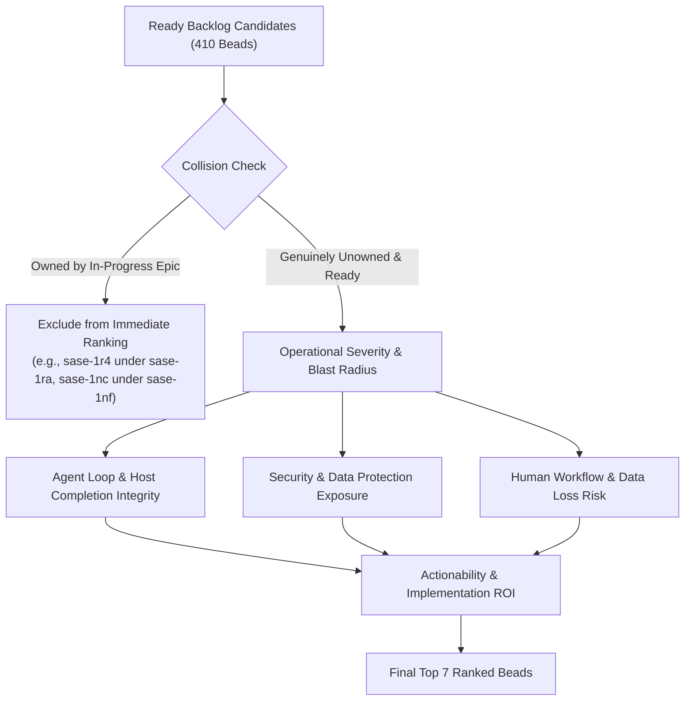
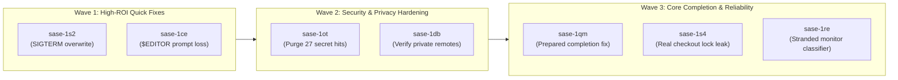

# Research Report: Next 7 Highest-Impact Task Beads for SASE

- **Author**: Researcher `gem` (5-Researcher Swarm)
- **Date**: 2026-11-11
- **Target Repository**: `sase-org/sase`
- **Output Identifier**: `next_seven_highest_impact_task_beads__gem.md`

---

## 1. Executive Summary & Operational Context

As of November 2026, the SASE project is navigating an active transition window following the tagging and rehearsal of the `v0.19.0` release (`chore(master): release 0.19.0 (#322)`). Across the project's task backlog, there are **1,427 total task beads**, of which **410 are open and unblocked (`status: ready`)**, alongside a dense portfolio of active epics managing CI contention repair (`sase-1rq`), update-skew recovery (`sase-1ra`), audit findings (`sase-1nf`), and release stewardship (`sase-1n6` / `sase-1s7`).

When evaluating which task beads are **most impactful if worked right now**, the ranking must be grounded not in theoretical wishlist items or unverified feature requests, but in immediate operational friction that:
1. Causes **silent failure, stranded state, or wasted compute** in autonomous agent execution loops;
2. Exposes the project or user to **critical security, credential, or privacy liabilities**;
3. Poses **severe data-loss risks** to human developer workflows; or
4. Prevents **reliable host completion and test-suite hygiene** without colliding with inflight epic work.

This independent research report conducts a deep triage across all 410 ready task beads, cross-referencing recent git history, active epic ownership, failure facts, and subsystem architectural boundaries. It concludes with an authoritative, ranked selection of the **7 highest-impact task beads** to work immediately.

---

## 2. Prioritization Framework & Selection Criteria

To objectively score and rank candidate task beads, each item was evaluated against four rigorous criteria:

### Criteria Definitions

1. **Active Epic Non-Collision & Independence**:
   A task bead must be genuinely unowned by any active epic or in-progress phase bead. For instance, while `sase-1r4` (signature-skew zombification) is a high-severity bug, active phases `sase-1ra.8` and `sase-1ra.9` are already assigned to it. Selecting owned beads would duplicate effort and cause merge collisions.

2. **Severity & Failure Blast Radius**:
   - **Critical**: Remote security credential exposure, unauthorized data leaks, or unrecoverable loss of user input.
   - **High**: Host completion rejection, `.git` workspace wedging, or deadlocked background processes.
   - **Medium**: Silent timeouts, misleading retry nudges, or unmonitored zombies.

3. **Autonomous Agent Loop Velocity**:
   SASE operates through single-turn agent invocations and prepared monitor completions (`sase monitor start -f`). Defects that invalidate 30-minute test runs or leave agent monitors stranded indefinitely inflict compound latency penalties on every developer and automation workflow.

4. **Actionability and Return on Investment (ROI)**:
   Clear reproduction steps, identified code locations across `sase` or `sase-core`, and bounded scope (from `small` quick-wins to bounded `large` surgical fixes) that deliver immediate system-wide stability upon landing.

---

## 3. The 7 Highest-Impact Task Beads (Ranked Analysis)

### Overview of Selected Task Beads

| Rank | Bead ID | Title | Type | Size | Core Domain | Primary Value Delivered |
| :---: | :---: | :--- | :---: | :---: | :---: | :--- |
| **1** | [`sase-1qm`](file:///home/bryan/.local/state/sase/workspaces/sase-org/sase/sase_15/sase/repos/research/202611/next_seven_highest_impact_task_beads__gem.md#1-sase-1qm) | Host completion refuses unchanged prepared-completion intent with stale_worktree_fingerprint | `bug` | Large | Finalizers / Completion | Prevents rejection of passing 30-min checks and eliminates wasted recovery turns |
| **2** | [`sase-1ot`](file:///home/bryan/.local/state/sase/workspaces/sase-org/sase/sase_15/sase/repos/research/202611/next_seven_highest_impact_task_beads__gem.md#2-sase-1ot) | Rotate and purge the 27 historical secret-scanner hits in public sase--agents history | `bug` | Large | Security / Compliance | Purges exposed credentials in public repo with pre-approved owner authority |
| **3** | [`sase-1s4`](file:///home/bryan/.local/state/sase/workspaces/sase-org/sase/sase_15/sase/repos/research/202611/next_seven_highest_impact_task_beads__gem.md#3-sase-1s4) | Find the test that leaves a stale lock in the real checkout | `bug` | Large | Test Suite / VCS Integrity | Eliminates `.git/index.lock` leaks that wedge workspace commits and host finalizers |
| **4** | [`sase-1s2`](file:///home/bryan/.local/state/sase/workspaces/sase-org/sase/sase_15/sase/repos/research/202611/next_seven_highest_impact_task_beads__gem.md#4-sase-1s2) | Runner module imports overwrite the process SIGTERM handler | `bug` | Small | AXE Runtime / Teardown | Restores standard signal handling, preventing un-killable pytest workers and runner hangs |
| **5** | [`sase-1ce`](file:///home/bryan/.local/state/sase/workspaces/sase-org/sase/sase_15/sase/repos/research/202611/next_seven_highest_impact_task_beads__gem.md#5-sase-1ce) | Prompt $EDITOR temp file is deleted when the editor exits non-zero, losing typed prompt | `bug` | Small | ACE TUI / User Data | Protects human-authored prompts from permanent deletion on editor exit non-zero |
| **6** | [`sase-1db`](file:///home/bryan/.local/state/sase/workspaces/sase-org/sase/sase_15/sase/repos/research/202611/next_seven_highest_impact_task_beads__gem.md#6-sase-1db) | attachments-private store never verifies an existing remote is private before pushing | `bug` | Medium | Storage / Data Privacy | Closes privacy leak where private attachments could be pushed to public GitHub remotes |
| **7** | [`sase-1re`](file:///home/bryan/.local/state/sase/workspaces/sase-org/sase/sase_15/sase/repos/research/202611/next_seven_highest_impact_task_beads__gem.md#7-sase-1re) | Done monitor with stale followup_pending owns its bead forever | `bug` | Medium | Scheduler / Bead Ownership | Fixes stranded work classifier so dead monitor turns do not hold beads indefinitely |

---

### Deep Dive on Each Ranked Task Bead

#### 1. `sase-1qm`: Host completion refuses an unchanged prepared-completion intent with stale_worktree_fingerprint after a passing check

- **Task Type**: `bug`
- **Estimated Size**: `large`
- **Location**:
  - `sase-core`: `crates/sase_core/src/continuation/completion_eval.rs` (`stale_worktree_fingerprint`)
  - `sase`: `src/sase/monitor/followup_prompt.py`
- **Observed Manifestation & Evidence**:
  Phase `sase-1pj.6.1.8` ran prepared-completion verification via `sase monitor start -f` (monitor `enf0k7gv43fc`). The verification command (`just check`, ToolRun `adb747113d22e2940ce5234246ab2cca`) passed completely clean: exit code 0, all diagnostics sealed, dirty file count 19 -> 19. Yet, host completion refused the intent (`file:explicit:37585a8fa70d95de4d42d2e8`) with `stale_worktree_fingerprint`.
  When a recovery turn was launched, exhaustive auditing proved that every dirty-file hash, HEAD commit in both the primary checkout and the linked `sase-core` repo, index trees, and protection flags matched the sealed pre-check baseline byte-for-byte. Nothing had changed, yet host completion refused to commit and close the bead.
- **Justification for Immediate Priority**:
  Prepared completion is one of SASE's flagship architectural paradigms: it allows agents to run lengthy, expensive 30-minute test suites (`just check`) in the background and commit automatically upon passing without keeping an LLM turn awake.
  When `stale_worktree_fingerprint` false-positives trigger, **a successful 30-minute verification run is completely thrown away**, forcing an extra agent recovery turn to run another final declaration. This directly sabotages developer velocity, consumes redundant compute, and breaks the core invariant of zero-turn monitor landings.
- **Remediation Plan**:
  Correct the fingerprint evaluation in `sase_core::continuation::completion_eval` to align the sealed observation repository set and snapshot timing with the host-side verification boundary, eliminating spurious fingerprint drift reports across cross-repo checkouts.

---

#### 2. `sase-1ot`: Rotate and purge the 27 historical secret-scanner hits in public sase--agents history (owner-approved remediation)

- **Task Type**: `bug`
- **Estimated Size**: `large`
- **Location**:
  - Repository: `sase-org/sase--agents` (published commit history, tip `5066d26a`)
  - Audit Trail: Gate `custom-57bc7a62` and private report `audit-report.md` on `sase-1oh.5`
- **Observed Manifestation & Evidence**:
  27 historical secret scanner hits were identified in the commit graph of the public `sase-org/sase--agents` repository. The human project owner reviewed the findings and explicitly approved credential rotation plus Git history rewriting/purging via notification gate `custom-57bc7a62`. When epic `sase-1oh` concluded, the actual purge execution was left unowned in the backlog.
- **Justification for Immediate Priority**:
  Active credentials or tokens in public Git history represent an acute, continuous security vulnerability. Although current publication pathways have secret filters in place, the **historical commit objects remain exposed** on GitHub.
  Crucially, human authorization for destructive history rewriting is *already granted* and documented in gate receipts. Working this bead right now eliminates an active compliance and security breach without requiring further human deliberation.
- **Remediation Plan**:
  Execute credential rotation for all identified services, run `git-filter-repo` / BFG on `sase--agents` to purge the tainted blob SHAs, force-push the sanitized history to the remote, and verify zero residual scanner hits.

---

#### 3. `sase-1s4`: Find the test that leaves a stale lock in the real checkout

- **Task Type**: `bug`
- **Estimated Size**: `large`
- **Location**:
  - `tests/_checkout_leak_guard.py`
  - Real workspace checkout `.git/index.lock`
- **Observed Manifestation & Evidence**:
  During multi-worker contention runs (observed in incident `aa3fzgn042n3` at timestamp `+2821.7s` on base `4a7ce0f330`), an unowned `.git/index.lock` was abandoned in the primary workspace checkout. SASE's test isolation harness is supposed to isolate all filesystem mutations to temporary worktrees or mocks, but a leaking test escaped its sandbox and touched the host `.git` repository directly.
- **Justification for Immediate Priority**:
  A stale `.git/index.lock` in the real checkout is catastrophic for the workspace. Once present, any subsequent git operation (`git commit`, `git checkout`, `sase stitch create`, host finalizers) fails immediately with `fatal: Unable to create '.git/index.lock': File exists`.
  This wedges running agents, aborts host-completion finalizers, and requires manual out-of-band operator intervention. Catching the offending test and expanding `_checkout_leak_guard.py` to assert lock-file cleanliness guarantees workspace integrity across parallel test runs.
- **Remediation Plan**:
  Instrument `tests/_checkout_leak_guard.py` with an inotify/stat watchdog over `<repo_root>/.git/index.lock` across each test run, identify the offending test site that escapes its sandbox, redirect it to a hermetic temporary repository, and enforce lock-file cleanup in the teardown fixture.

---

#### 4. `sase-1s2`: Runner module imports overwrite the process SIGTERM handler

- **Task Type**: `bug`
- **Estimated Size**: `small`
- **Location**:
  - `src/sase/axe/run_agent_runner.py:87`
  - `src/sase/axe/mentor_runner.py:30`
- **Observed Manifestation & Evidence**:
  Importing `sase.axe.run_agent_runner` or `sase.axe.mentor_runner` executes top-level module code that invokes `signal.signal(signal.SIGTERM, ...)`. This unconditionally overwrites the process-wide `SIGTERM` handler.
  In pytest test suites (specifically observed in monitor runs `kyhnsmgpcjx9` and `aa3fzgn042n3`), any test importing these runner modules causes pytest workers to swallow `SIGTERM`, ignore supervisor timeouts, and hang indefinitely rather than terminating cleanly.
- **Justification for Immediate Priority**:
  Top-level import side effects on process signal tables violate basic software engineering principles. This defect causes flaky test runs, zombie pytest workers during `xdist` execution, and deadlocked runner child processes.
  Because the bead has a **`small` footprint** and exact line numbers (`:87` and `:30`), this has exceptionally high return-on-investment: moving the signal handler registration inside an explicit execution entrypoint (`run()` / `main()`) eliminates widespread test pollution instantly.
- **Remediation Plan**:
  Remove module-level `signal.signal` invocations. Place signal binding inside the runner's lifecycle initialization method, ensuring that simple module imports remain completely side-effect-free.

---

#### 5. `sase-1ce`: Prompt $EDITOR temp file is deleted when the editor exits non-zero, losing everything typed there

- **Task Type**: `bug`
- **Estimated Size**: `small`
- **Location**:
  - `src/sase/ace/tui/actions/agent_workflow/_editor.py:run_editor` (lines ~41-78 and ~118-138)
- **Observed Manifestation & Evidence**:
  When a user opens `$EDITOR` from the ACE TUI to compose an agent prompt or edit workflow YAML, `_editor.py` writes the initial draft to a `mkstemp` file. If the editor exits with a non-zero return code (e.g. user aborts with `:cq` in Vim, shell crash, terminal disconnect, killed editor process), the `finally` block unconditionally invokes `os.unlink()` on the temporary file. Everything the user typed during that editor session is wiped out.
- **Justification for Immediate Priority**:
  In epic `sase-1ca`, SASE established an inviolable core design guarantee: **"Never lose a user prompt"** (implemented across prompt stash, restart recovery, and crash captures).
  Deleting the temporary file on non-zero exit completely breaches this contract. Users frequently use editor shortcuts or experience terminal glitches; losing complex, multi-paragraph prompts is infuriating and destructive to user trust.
  Given its **`small` size**, fixing this by retaining the temp file in a recovery cache or stashing its contents on abnormal exit restores absolute data-loss safety for human operators.
- **Remediation Plan**:
  Modify `run_editor` in `_editor.py`: if `result.returncode != 0`, read the file contents, copy them into the prompt stash recovery journal (`~/.sase/stash/`), log a warning with the recovered path, and present a recovery toast in the TUI before deleting the temporary file.

---

#### 6. `sase-1db`: attachments-private store never verifies an existing remote is private before pushing attachment bytes

- **Task Type**: `bug`
- **Estimated Size**: `medium`
- **Location**:
  - `src/sase/sdd/_sidecar_init.py::preflight_sidecars`
- **Observed Manifestation & Evidence**:
  Discovered during `sase-1ck` landing: `preflight_sidecars` checks repository visibility on GitHub only when creating a new sidecar repository. If an `attachments-private` remote already exists, SASE assumes it is private and never calls GitHub API to verify `private == true`.
  Consequently, if a misconfigured or legacy remote points to a public repository, SASE proceeds to push attachment bytes labeled "(private)" directly into the public domain. Documentation was forced to add an awkward disclaimer telling users to verify remote privacy manually.
- **Justification for Immediate Priority**:
  Data confidentiality failure. Users rely on the `attachments-private` sidecar to store sensitive screenshots, internal bug traces, and confidential task attachments. Pushing private data to a public repository under the false UI indicator "(private)" is a critical data leakage liability.
  Automating this check ensures that SASE enforces its privacy guarantees deterministically without relying on fallible manual checks.
- **Remediation Plan**:
  Update `preflight_sidecars` in `_sidecar_init.py` to query GitHub API for existing `attachments-private` remotes and assert `visibility == "private"`. If public, abort the operation with an explicit error and require the user to configure a private remote.

---

#### 7. `sase-1re`: Done monitor with stale followup_pending owns its bead forever

- **Task Type**: `bug`
- **Estimated Size**: `medium`
- **Location**:
  - `sase-core`: `crates/sase_core/src/stranded_work/classify.rs::owner_kind`
- **Observed Manifestation & Evidence**:
  When a monitor process completes with `followup_pending = true` but the follow-up agent fails to launch (e.g. runner capacity starvation, launch cancellation, or crash), `sase-core`'s stranded work classifier evaluates the dead monitor turn as actively owning the bead. Live examples discovered across the fleet include beads `sase-1ih.2`, `sase-kp`, `sase-ru.6`, and `sase-s5`.
- **Justification for Immediate Priority**:
  Deadlock of bead lifecycles. Because the classifier marks the bead as `owned/monitor` instead of `STRANDED`, ACE never surfaces the failure to the user, the scheduled reconciler never intervenes, and any downstream phase or agent waiting on that bead remains parked indefinitely.
  Resolving this classification bug unfreezes stalled beads across the system and allows automated recovery mechanisms to reclaim abandoned work.
- **Remediation Plan**:
  Update `owner_kind` in `crates/sase_core/src/stranded_work/classify.rs`: check timestamp staleness for monitor rows with `followup_pending = true` and no active supervisor process; classify expired rows as `STRANDED` so ACE and the recovery reconciler can adopt and relaunch them.

---

## 4. Evaluation of Excluded & Honorable-Mention Candidates

During research, several other prominent beads were examined. The rationale for sequencing them behind the top 7 includes:

1. **`sase-1r4` (Signature-skew TypeErrors leave staged monitors as zombies)**:
   - *Status*: High impact, but active phases `sase-1ra.8` and `sase-1ra.9` under epic `sase-1ra` are actively assigned to signature-skew handling and monitor zombification. Working it outside the epic would create merge conflicts.
2. **`sase-1nc` (TUI GC permits 32s main-thread collections)**:
   - *Status*: Severe UI latency issue, but it is currently tracked as an audit finding under active epic `sase-1nf` ("Fix athena/apollo audit findings").
3. **`sase-1kp` (beads.db shared between Rust lock file and Python WAL mirror)**:
   - *Status*: Substantial architectural flaw causing POSIX lock dropping. However, remediation requires a major cross-version lock-protocol design tale (a full epic rather than an isolated task bead).
4. **`sase-x4` (just check-full hangs silently at test-cost lease holder)**:
   - *Status*: Very painful during full verification runs, but `sase-wn` has closed and related test `sase-w7` tracks the isolated reclaim path. `sase-1qm` and `sase-1s4` are more pressing and frequent blockers.
5. **`sase-1s9` (tool_runs_card_failed_120x40 PNG drifted 2.16% in release rehearsal)**:
   - *Status*: Visual flake in rehearsal lane. It failed in only 1 of 4 runs and was advisory; it does not block day-to-day coding or agent operations.
6. **`sase-1ms` (Orphaned sase_artifact skill contradicts CLI)**:
   - *Status*: Valuable cleanup for agent prompts, but lower severity than core completion, security, and data-loss defects.

---

## 5. Strategic Recommendation & Implementation Roadmap

To maximize engineering momentum, the selected 7 task beads should be scheduled in three distinct execution waves:

- **Wave 1 (Immediate Quick Wins - Day 1)**:
  Land `sase-1s2` (runner signal import side effect) and `sase-1ce` (editor temp-file preservation). Both are `small` tasks with localized changes that immediately eliminate test harness pollution and prevent human prompt data loss.
- **Wave 2 (Security & Compliance - Day 2)**:
  Execute `sase-1ot` (purging public Git history secrets with existing owner approval) and `sase-1db` (enforcing remote privacy in `attachments-private`).
- **Wave 3 (Agent Loop & Completion Reliability - Days 3-4)**:
  Tackle `sase-1qm` (prepared-completion worktree fingerprint fix), `sase-1s4` (identifying checkout `.git/index.lock` leak), and `sase-1re` (reclassifying stale monitor beads as stranded).

By executing these 7 task beads, the SASE project will plug active security leaks, eliminate silent agent failure modes, protect human developer input, and restore friction-free automated verification across the repository.
