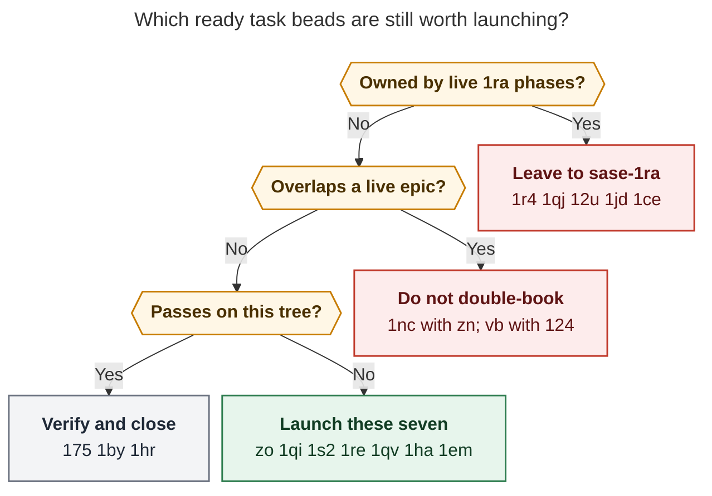

# The next seven task beads to work now (post sase 0.19.0)

> **Research query:** Which seven existing task beads would be most impactful if
> worked right now? Rank them with strong justification.
>
> Researcher: `grk` (independent swarm member). Snapshot: 2026-11-11 evening,
> sase master `671ff5bde0` (`chore(master): release 0.19.0 (#322)`).

## Bottom line

Work these seven ready task beads next. They are unowned by a live epic
phase, still defective on this tree or corroborated in the last few days,
and they pay down production correctness or landing-tax rather than
re-opening the November 4 next-ten epic.

| Rank | Bead | Type · size | Why now |
| --- | --- | --- | --- |
| 1 | [sase-zo](#1-sase-zo) | bug · small · +10 | `-p sase` still exits 2 on this checkout; the closed 1ra.1 phase did not land |
| 2 | [sase-1qi](#2-sase-1qi) | bug · medium | Agent Hijack is closed; `sase agent restart` still skips crash-killed agents |
| 3 | [sase-1s2](#3-sase-1s2) | bug · small | Importing the runner overwrites `SIGTERM`; reproduced in a fresh interpreter |
| 4 | [sase-1re](#4-sase-1re) | bug · medium · +1 | Done monitors with stale `followup_pending` hold beads open forever |
| 5 | [sase-1qv](#5-sase-1qv) | bug · medium · +1 | Slot-refusal policy is still 448 lines of Python after a claimed Rust move |
| 6 | [sase-1ha](#6-sase-1ha) | bug · large | Check-run triage still attaches no owners; landers rediscover known beads |
| 7 | [sase-1em](#7-sase-1em) | flake · large · +6 | Same registry-rebuild node failed the 0.19.0 landing check today |

Do **not** relaunch the November 4 next-ten seeds as new task workers.
`sase-1ra` already owns them. Several of those *task* beads are still
`ready` only because the epic has not closed; the code for `sase-1ce` is
already fixed, and `sase-175` / `sase-1by` / `sase-1hr` pass focused on
this tree.

_Caption: After dropping 1ra-owned seeds, live-epic overlaps, and beads that
already pass here, the remaining launch set is zo, 1qi, 1s2, 1re, 1qv, 1ha,
and 1em._

## Method

Ranking is the **marginal impact of starting the remaining work on this
tree today**, not lifetime +1 count and not “was it in last week’s top
ten.”

Inputs:

- `sase bead list -t task -s ready -f json` (410 ready tasks) and
  `-s all` (1,427 tasks).
- Audited `sase bead read` of `sase-1ra` (and `.1`), `sase-1s7`,
  `sase-1rq`, `sase-1s5`, `sase-1qz`, `sase-1r8`, `sase-1qh`, `sase-zn`,
  `sase-j0`, and the candidate task beads named below.
- Live agents: `sase agent list -j` on apollo (this swarm only) and
  `ssh athena 'sase agent list -j'` (38 rows). SASE work still alive on
  athena is the `sase-1rq` CI-repair chain, `sase-1n6.11` steward wait,
  `sase-1r2.land` wait, plus docs chops. **No `sase-1ra` agent is
  running.**
- Code probes on this checkout at `671ff5bde0`, using `.venv/bin/python`.
- Prior *unrelated* research read through `sase artifact read`:
  `research:202611/next_ten_task_beads_live_epic_screen/next_ten_task_beads_live_epic_screen.md`
  (2026-11-04 next-ten),
  `research:202611/task_backlog_cleanup_chain_review/task_backlog_cleanup_chain_review.md`,
  and
  `research:202610/task_bead_48h_impact_ranking/task_bead_48h_impact_ranking.md`.
  Peer reports from this swarm were not opened.

Scoring, in order:

1. Still broken on this tree, or corroborated after 2026-11-01.
2. User-visible or host-correctness failure (CLI, restart, signals,
   stranded beads, workspace policy).
3. Unowned by an in-progress epic *phase*.
4. Clear root cause and a size that can start without a new legend.
5. Corroboration (+1s, recency) as a tie-break, not as a vote.

The empty goal ledger (`sase goal list` returned no unsettled goals) did
not supply a competing objective. The binding constraint is the same one
named in `decisions:check-full-is-explicit` and `decisions:ci-two-speed-split`:
host capacity. Beads that steal lander turns or strand epics outrank
dormant flakes.

## Live context that changes the ranking

**sase 0.19.0 is on this master.** `git log -1` is
`671ff5bde0 chore(master): release 0.19.0 (#322)`. The live release epic
`sase-1s7` is still `in_progress`; its remaining value is proof artifacts
and leftover CI, not a reason to freeze the backlog.

**The November 4 next-ten epic is still open and already owns its
seeds.** `sase-1ra` closed phases `.1`–`.7` and still has `.8`–`.12`
`in_progress` (update-skew zombies, core classifier, `sase-1jd` CI
ratchet, reboot reconciler `sase-1qj`, zombie-epic `sase-12u`). No 1ra
agent is in the athena list. The reviewer also set `next_epic = yes`,
which is what this ranking is for: the *next* seeds, not a second worker
on the same files.

**Agent Hijack is closed.** `sase-1qz` is `closed`. The 2026-11-04 report
deferred `sase-1qi` until hijack restart/crash-repair landed. That deferral
has expired.

**Overlapping in-progress epics still on the board** (do not double-book):

- `sase-zn` — ACE TUI typing lag (keeps `sase-1nc` out).
- `sase-124` (+ nested freshness follow-ups) — Agents-tab archive
  freshness (keeps `sase-vb` / `sase-vc` / `sase-11n` out).
- `sase-1qh` — publication error notifications (keeps `sase-1rb` out).
- `sase-1rq` / `sase-1s7` — GitHub CI and 0.19.0 proof (do not steal
  their remaining phases).

**`sase-j0` is a dead `in_progress` claim, not a launch.** +38, assignee
`sase-j0`, holder gone. `just check-full` is no longer the agent default
(`decisions:check-full-is-explicit`). Reclaim or close it; do not start a
second cost-budget worker beside it.

## Independent checks on this tree

| Claim | Result on `671ff5bde0` |
| --- | --- |
| `sase repo list -p sase` works after 1ra.1 | **Still fails.** Exit 2: `Project 'sase' has no WORKSPACE_DIR in /home/bryan/.sase/projects/sase/sase.sase.` Same result from `/home/bryan/.local/bin/sase` and `.venv/bin/python -m sase`. There is no `~/.sase/projects/sase`; the live spec is `~/.sase/projects/gh_sase-org__sase`. `tests/main/test_project_ref_canonicalization.py` is **absent**. `resolve_project_context` still calls `get_project_file_path(project_name)` with the raw `-p` token. |
| Failed `$EDITOR` deletes the draft (`sase-1ce`) | **Fixed in source.** `522b07a009 fix(ace): preserve failed editor drafts`; `_editor.py` recovers changed content on non-zero exit. Close the task; do not relaunch. |
| Runner import overwrites `SIGTERM` (`sase-1s2`) | **Reproduced.** Fresh interpreter: `signal.getsignal(SIGTERM)` is `0` (`SIG_DFL`); after `import sase.axe.run_agent_runner` it is `install_sigterm_handler.<locals>._handler`. `run_agent_runner.py:87` and `mentor_runner.py:30` still install at import. |
| `sase-175` / `sase-1hr` / `sase-1by` still fail focused | **All three passed** with `-p no:randomly` on this tree (1.44s / 8.52s / 53.32s). Treat as verify-and-close, not launch. |
| Slot-refusal moved to Rust (`sase-1qv`) | **Not on master.** `git log -- src/sase/workspace_provider/slot_refusal.py` is still only `01dcc2e5f5`. The module has no `sase_core_rs` import. |
| `find_named_agent` can restart a dead agent (`sase-1qi`) | **Still skips.** `_lookup_named.py` lines 148–150 `continue` when `not is_done` and `not is_process_alive(...)`. That is correct for wait resolution and wrong for `sase agent restart`. |

## Ranked list

### 1. sase-zo

**sase repo open rejects configured sidecars when inventory uses the project display name** · bug · small · +10 · ready.

**Why it is #1.** The project-label rule (`decisions:project-labels-never-keys`)
says every surface shows `PROJECT_NAME`. The display name of this project
is `sase`. On this tree, `sase repo list -p sase` still exits 2 because
`resolve_project_context` treats the token as a directory key and looks
for `~/.sase/projects/sase/sase.sase`. The live project lives under
`gh_sase-org__sase`. Phase `sase-1ra.1` closed as `done` on 2026-11-04
claiming “`sase repo list -p sase` now works” and seven regressions in
`tests/main/test_project_ref_canonicalization.py`. That test file is not
on master. The remaining 1ra phases do not touch project resolution, so
a new small worker will not collide with `.8`–`.12`.

**Impact.** Every agent and human invocation that follows the documented
display-name contract (`-p sase`, aliases, `sase repo open` of configured
sidecars) fails closed. +10 is the highest corroboration among remaining
unowned bugs. Size is small; the seam is one resolver
(`get_project_file_path` / `resolve_project_context`) plus inventory
`RepoRecord.project` vs `project_key`.

**Done when:** `sase repo list -p sase`, `-p SASE`, and
`-p gh_sase-org__sase` resolve the same inventory; ambiguity prints
candidates and exits 2; a regression lives in-tree (the missing
canonicalization module or an equivalent). Then close the *task* bead,
which 1ra.1 never did.

### 2. sase-1qi

**sase agent restart cannot find crash-killed agents without done marker** · bug · medium · ready.

**Why it is #2.** A reboot or a kill that does not write `done.json`
leaves the TUI showing FAILED and `sase agent restart <name>` returning
not-found. The 2026-11-01 incident named 27 stranded waiters (16 land +
11 phase). The 2026-11-04 next-ten report parked this behind Agent
Hijack. `sase-1qz` is now **closed**. `sase-1ra.11` will relaunch
reboot-stranded *epics*; it still needs restart to find the dead runner.
On this tree, `find_named_agent` prefers running records and then
`continue`s any non-done record whose PID is dead
(`src/sase/agent/names/_lookup_named.py`). The comment is explicit: the
liveness skip exists so parent-phase artifacts do not look “running.”
Restart must use a different lookup (include dead-without-done, or a
FAILED/exit-without-error class), not delete the skip for waiters.

**Impact.** Without this, reboot recovery and Hijack’s “recover in one
keypress” cannot target the agents the TUI already lists. It is the
user-facing half of the stranded-work problem; `sase-1re` is the
monitor-ownership half.

**Keep away from:** `sase-1ra.11` files (`wait_dependency_resolution`,
boot reconciler). Coordinate if both are in flight; the lookup change is
in `names/_lookup_named.py` / restart CLI, which 1ra.11 should not need
to rewrite.

### 3. sase-1s2

**Runner module imports overwrite the process SIGTERM handler** · bug · small · ready.

**Why it is #3.** Confirmed today in a fresh interpreter on this
checkout. `src/sase/axe/run_agent_runner.py:87` calls
`install_sigterm_handler("agent", soft=True)` at import;
`mentor_runner.py:30` does the same for `"mentor"`. Pytest workers, tool
runs, and any process that imports those modules inherit a soft agent
handler. The contention epic (`sase-1rq.2.1.4.1`) saw swallowed SIGTERM
in monitors `kyhnsmgpcjx9` and `aa3fzgn042n3`. Root cause is one line
moved from import to the owned runner entry (already present as
`run_agent_runner_signals.py` installing at lifecycle with claim
release). Size small, files disjoint from 1ra remaining phases.

**Impact.** Agent kill, worker teardown, and contention tests become
order-dependent. A passing isolated test can hide a handler the full
lane just installed. This is production signal semantics, not a flake
baseline candidate.

**Done when:** a fresh-interpreter import of `sase.axe.run_agent_runner`
leaves `SIGTERM` at `SIG_DFL` (or the caller’s handler); the real runner
entry still installs the soft handler; mentor likewise.

### 4. sase-1re

**Done monitor with stale followup_pending owns its bead forever** · bug · medium · +1 · ready.

**Why it is #4.** The fleet currently shows **127 in-progress plans**
against 1 open plan. Some of that is real work (`sase-1s7`, `sase-1rq`,
`sase-1ra.8`–`.12`). A second, mechanical source is documented on this
bead: a monitor member that is already `done` but still has
`followup_pending = true` (stale `next_action`, no `followup_outcome`)
keeps `owner_kind()` on the monitor branch in
`sase-core` `crates/sase_core/src/stranded_work/classify.rs`. ACE never
shows STRANDED; waiters stay parked. The +1 on 2026-11-05 named four
live holders after the staged-handoff fix (`sase-1ih.2`, `sase-kp`,
`sase-ru.6`, `sase-s5`). That is independent of `sase-12u` (follow-up
epic close does not cascade), which 1ra.12 already owns.

**Impact.** Every stranded monitor occupies a bead, a TUI row, and often
a waiter. Capacity is the binding constraint. Clearing this class is
host-owned classification, not another LLM lander walking ancestors.

**Done when:** a done monitor with stale `followup_pending` does not own
the bead; STRANDED/repair listing includes the four named examples or an
equivalent fixture; waiters are not parked on that member.

### 5. sase-1qv

**sase-1pn landing repairs never landed: slot-refusal policy still lives in Python** · bug · medium · +1 · ready.

**Why it is #5.** Shared workspace-slot refusal (record, upsert,
conditional clear, skip-set, quarantine) is core backend behavior under
`rust_core_backend_boundary`. Epic 2’s lander *wrote that it had moved*
the policy behind a Rust binding, then proposed epic 3 and lost the
edits — the same `/sase_plan`-ends-the-turn failure later seen on epic
5. `sase-1p9` and `sase-1pn` are closed on a claim the code does not
support. This tree still has a single commit on
`src/sase/workspace_provider/slot_refusal.py` (`01dcc2e5f5`) and no
`sase_core_rs` call. The +1 from `sase-1pj.7.1.land` also notes that
`epic_symbols.load_epic_symbol_scan` still blindly unions local and
upstream rows, which held a child unclosable for ~53 hours.

**Impact.** Any non-TUI frontend must reimplement admission policy.
Close-time union of stale upstream rows can pin a finished phase
unclosable. The bead history currently lies, which will keep generating
duplicate “move this to Rust” follow-ups.

**Scope:** slot-refusal decision policy into sase-core; Python keeps I/O,
locks, notifications, rendering. Confirm whether the upstream-row close
refusal is still live after `5585fadefd`; fix it here or name the owner.
Do not treat the closed 1pn closeout as evidence.

### 6. sase-1ha

**Check-run failure triage attaches no possible owners on athena** · bug · large · ready.

**Why it is #6.** The 2026-10-07 audit found 0 of 897 triage items with
`possible_owners` across 117 check runs, including exact `node_id`
matches to open ci/flake beads. `gather_owner_candidates` itself
returned the right beads in 0.75s, so the loss is settle/matching or the
timeout path (`tool_run_triage_settle` in sase-core). Plan `sase-18j.10`
was supposed to prove owner matching on athena and is closed. This is
not a new measurement today, but a 2026-11-01 +1 on `sase-1oy` still
says `possible_owners empty` on a KNOWN node. Every lander in the last
month has paid duplicate `/sase_new_task` reads and +1s to rediscover
beads the ledger already has (`sase-1em` is the current example: 1s7.land
routed a KNOWN registry flake today only because humans already knew the
id).

**Impact.** This is the multiplier on the other six. While owners stay
blank, deterministic reds are labeled NEW, agents treat them as their
own regression, and the ready list grows. Size is large because the
matcher/timeout path needs a measured fix, not a comment. It is still
cheaper than another unbounded backlog chain.

**Done when:** a failed check run on athena whose open task `node_id`
equals the item locator lists that bead under `possible_owners`; the
timeout diagnostic no longer dominates; a regression covers the
`sase-13p`-style exact path match (even though 13p itself is closed).

### 7. sase-1em

**test_registry_rebuild_keeps_live_identity_pending_claim fails under the full parallel lane** · flake · large · +6 · ready.

**Why it is #7.** This is the hottest *live* full-lane flake that is not
already owned. +6, and the newest +1 is **today** (2026-11-11T08:13Z)
from `sase-1s7.land` while landing 0.19.0: ToolRun `87fdcdeb…` failed
`tests/test_agent_name_registry_rebuild_pending.py::test_registry_rebuild_keeps_live_identity_pending_claim`
(`rebuild.call_count 1 vs 0`) under the parallel lane; the diff was
release-watch transport only. The same signature has been relayed by
`sase-1h3`, `sase-1j6`, `sase-1kj.8.1`, `sase-1le`, `sase-1pj.4.1`, and
`sase-1lh.7.5.4.3.3`. It passes in isolation. The 2026-11-02 cleanup
review already marked it “needs its own epic” if the mechanism stays
unknown; that is still the right size call (`large`), and it is still
the right seed because every scoped/full check that touches names pays
the triage tax.

**Impact.** It is not user-visible the way zo/1qi/1s2 are. It *is* the
failure that is actively interrupting the release lander on the day 0.19.0
merged. Fix the shared registry/process-global state (the bead already
points at the `sase-u7` neighborhood) or hermeticize the test so a
rebuild from another worker cannot increment `call_count`. Do not xfail
or raise the flake baseline.

**Done when:** the node is green in a loaded full/scoped lane on athena
and apollo, with a regression that reproduces the foreign-rebuild
increment and asserts isolation.

## What this ranking deliberately leaves out

| Bead | Why it is not in the seven |
| --- | --- |
| `sase-1r4`, `sase-1qj`, `sase-12u`, `sase-1jd` | Live 1ra phases `.8`–`.12`. Finish or reclaim that epic; do not file a parallel worker. |
| `sase-1ce` | Source already recovers failed-editor drafts (`522b07a009`). Close the task. |
| `sase-1q3`, `sase-1qe`, `sase-1pw`, `sase-1qu`, `sase-172`, `sase-1i6`, `sase-1al` | 1ra phases `.3`–`.6` closed as done. Close the tasks after a lander verifies, or reopen on 1ra if a probe fails. |
| `sase-175`, `sase-1by`, `sase-1hr` | Focused tests **passed** on this tree today. Verify-and-close. |
| `sase-j0` | Dead `in_progress` +38. Reclaim the claim; check-full is no longer the agent default. |
| `sase-1nc` | Overlaps in-progress `sase-zn` (TUI lag / GC). |
| `sase-vb`, `sase-vc`, `sase-11n` | Overlap in-progress `sase-124` freshness / archive index. |
| `sase-1rb`, `sase-1rc`, `sase-1ot` | Publication/secret-history; `sase-1qh` is still in_progress; `sase-1ot` is an owner-gated history rewrite. |
| `sase-1oy` | Note #2: taken over by `sase-1r2.3`. |
| `sase-1qi`’s sibling `sase-1qr` | Real PID-reuse hole in the Rust scan, and a good ride-along with #2. Kept out of the seven to avoid two identity beads crowding out 1em. |
| `sase-1s4` | One contention incident (stale `.git/index.lock`). Severe when it hits; mechanism unknown; large investigation. First honorable mention. |
| `sase-v6` | Justfile now builds `sase-macro-lsp` via `CARGO_TARGET_DIR` + wheel cache. Original `sase-xprompt-lsp` / checkout-local `target/` story is stale. Remaining `cp`/`chmod`/`mv` without `set -e` is a smaller leftover. |
| `sase-lk` (+13) | Oldest monitor-supervise flake, four close/reopen cycles, last update 2026-09-26. Recurrence not shown on this tree today. |
| Feature and memory beads | Out of scope for a defect-capacity ranking (`sase_beads.md` / cleanup-chain charter). |
| Open flags (`sase-1kb` …) | None are due (`sase bead stats`: Due Flags 0). |

## Suggested launch shape

Do not launch all seven at once. Athena already carries the 1rq/1n6/1r2
wait graph, and pytest worker tokens are still a shared bottleneck
(`sase-1pw` was the previous next-ten’s #5).

| Batch | Beads | Notes |
| --- | --- | --- |
| A | `sase-zo` | One small CLI worker. Disjoint from 1ra.8–.12. |
| B | `sase-1s2` | One small signal-handler worker. Fresh-interpreter tests only. |
| C | `sase-1qi` (+ ride-along `sase-1qr` if the same worker has budget) | After confirming 1ra.11 is not editing `names/_lookup_named.py`. |
| D | `sase-1re` | Needs the linked `sase-core` scan/classify path. |
| E | `sase-1qv` | Needs linked `sase-core` plus a Python adapter. Medium, not a cleanup-chain sequel. |
| F | `sase-1ha` | Large; plan-first. Can overlap A/B. |
| G | `sase-1em` | Full-lane flake; run after B so SIGTERM import noise is gone. |

Before launching C–E, refresh `sase agent list -j` on athena. If a 1ra
agent has returned, let it finish `.8`–`.12` and close the seeds it
already claimed (`sase-1ce` at minimum).

## Limits

- ToolRun ledger and selection-health full-run histograms were **not**
  re-aggregated for this report. Recency uses bead `updated_at` / +1
  timestamps and the 1s7 landing +1 on `sase-1em`.
- `sase-1ha` was not re-scanned across 100 check runs today; the Nov 1
  `possible_owners empty` line on `sase-1oy` is the freshest corroboration.
- Focused pytest for 175/1by/1hr was this workspace only, with `CI`
  set (inline-snapshot disabled). A different host or a cold catalog
  could still fail `sase-175`; that is why the recommendation is
  verify-and-close, not silent ignore.
- `sase-zo` was reproduced through `sase repo list -p sase`. The original
  sidecar-open diagnostic may have shifted; the remaining defect is
  still “display name does not resolve to the directory key.”
- No beads were edited, launched, or closed.

## Sources

- Bead store: `sase bead list` / `sase bead ready` / audited
  `sase bead read` of the ids named above; `sase bead stats`
  (8,466 issues, 410 ready tasks, 238 in_progress, 0 due flags).
- Agents: `sase agent list -j` (apollo); `ssh athena 'sase agent list -j'`
  (38 rows, 2026-11-11).
- Checkout: sase `671ff5bde0`;
  `src/sase/main/workspace_handler_context.py`,
  `src/sase/axe/run_agent_runner.py:87`,
  `src/sase/axe/mentor_runner.py:30`,
  `src/sase/agent/names/_lookup_named.py:148-150`,
  `src/sase/workspace_provider/slot_refusal.py`,
  `src/sase/ace/tui/actions/agent_workflow/_editor.py`,
  `Justfile` `rust-lsp-install`.
- Commands: `.venv/bin/python -m sase repo list -p sase` (exit 2);
  fresh-interpreter SIGTERM probe; focused pytest of
  `test_same_body_in_different_projects_does_not_coalesce`,
  `test_macro_string_literals_avoid_xprompt_terms`,
  `test_tracked_marker_path_passing_sites_are_reviewed`.
- Prior research (artifact reads only): next-ten live-epic screen
  (2026-11-04), task-backlog cleanup chain review (2026-11-02), 48h
  impact ranking (2026-10-07).
