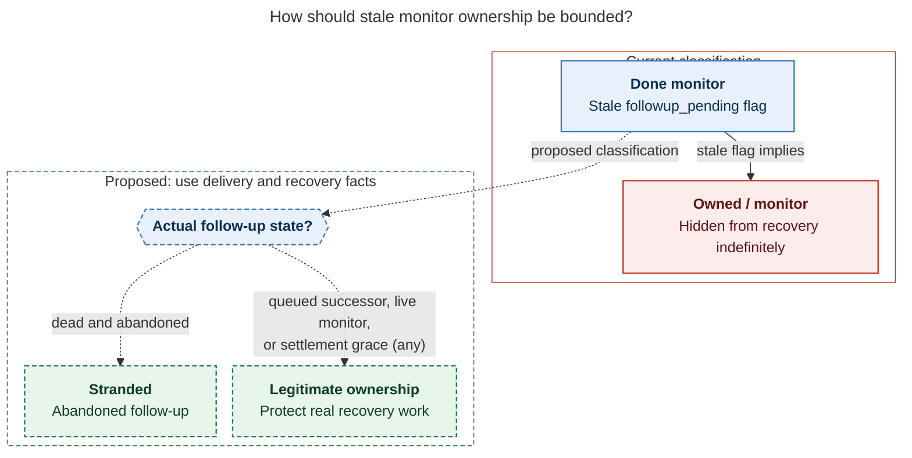
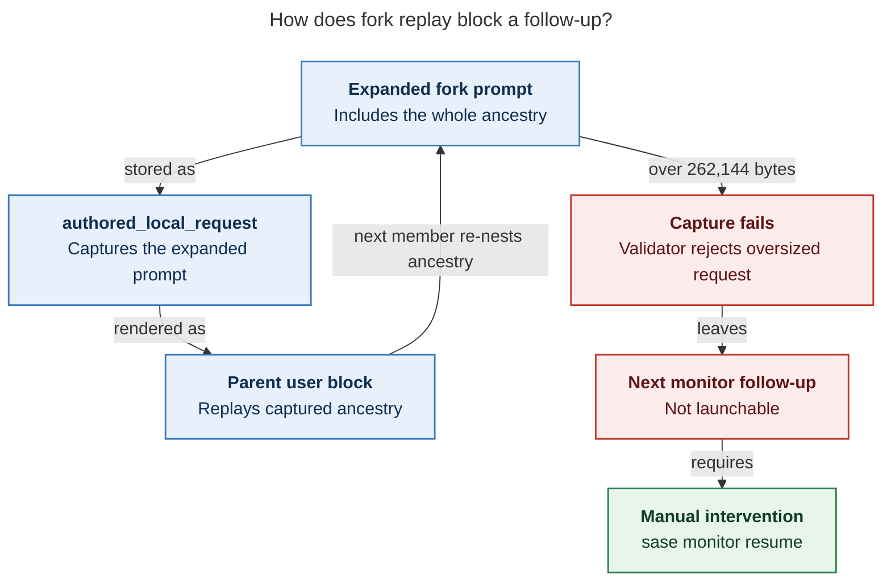

# Diagram proposals: The next seven task beads: salvage what already landed-in-name, then unstrand the fleet

Proposals for the swarm linker, not a report. Each diagram restates only what the source
report says.

```yaml
source: research:202611/next_seven_task_beads_salvage_and_unstrand/next_seven_task_beads_salvage_and_unstrand__final.md
producer: research.4a.image
check: mmdc 12.0.0 with the PDF-mirroring config rendered 2 of 2 Mermaid diagrams; Puppeteer --no-sandbox
```

## monitor-ownership

```yaml
anchor: |-
  bound ownership using actual delivery/recovery facts, distinguishing a dead abandoned
question: |-
  How should stale monitor ownership be bounded?
illustrates: |-
  The proposed repair bounds monitor ownership using actual delivery/recovery facts, distinguishing a dead abandoned follow-up from a real queued successor, a live monitor, and legitimate settlement grace.
caption: The proposed repair distinguishes abandoned follow-ups from queued successors, live monitors, and settlement grace before classifying bead ownership.
review: 585.539x990 px, fit 90.2%; question, source trace, and visual checks passed; 0 revisions
```



## continuation-growth

```yaml
anchor: |-
  so every session member re-nests its whole ancestry
question: |-
  How does fork replay block a follow-up?
illustrates: |-
  Capturing the fork-expanded prompt and replaying it as the parent user block re-nests ancestry until an over-cap request fails capture and leaves the next monitor follow-up not-launchable.
caption: Fork replay re-nests ancestry; exceeding the 262,144-byte cap fails capture and leaves the next monitor follow-up not-launchable until manual resume.
review: 800x718 px, fit 81.6%; question, source trace, and visual checks passed; 0 revisions
```


