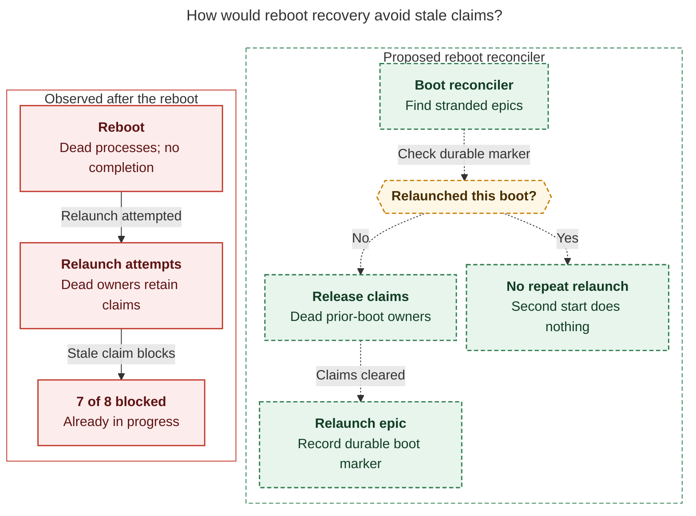
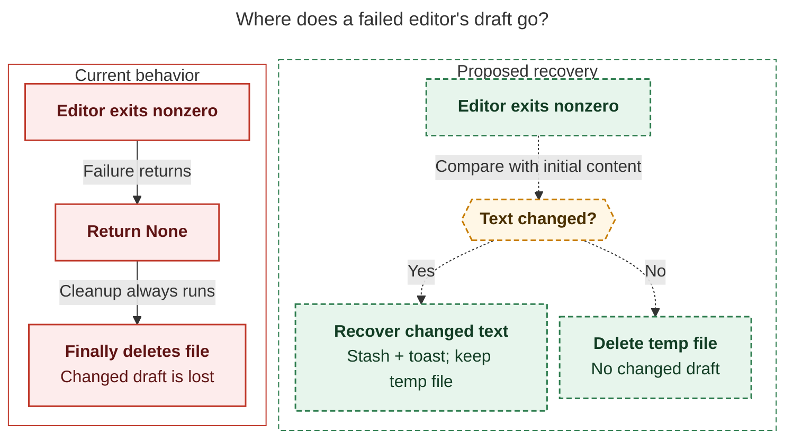

# Diagram proposals: The ten task beads to work next, screened against live epics on apollo and athena

Proposals for the swarm linker, not a report. Each diagram restates only what the source
report says.

```yaml
source: research:202611/next_ten_task_beads_live_epic_screen/next_ten_task_beads_live_epic_screen__final.md
producer: research.3a.image
check: "mmdc 12.0.0 with the PDF-mirroring config rendered 2 of 2 Mermaid diagrams; Puppeteer --no-sandbox"
```

## reboot-recovery

```yaml
anchor: |-
  Release claims held by dead owners from the previous boot, or
question: |-
  Why can a relaunch fail after reboot, and what would prevent repeat failures?
illustrates: |-
  The proposed boot reconciler releases dead claims and uses a durable marker to relaunch each stranded epic once per boot, avoiding the stale-claim failure seen in the reboot relaunches.
caption: "The proposed reconciler clears dead claims and relaunches each stranded epic once per boot; repeat scheduler starts do nothing."
review: "773.714x668 px, fit 84.4%; question, source, unique-anchor, and visual checks passed; 1 layout revision; 2 look rounds"
```



## editor-recovery

```yaml
anchor: |-
  and then the `finally` blocks unlink the temp file
question: |-
  What happens to changed prompt text when the editor fails?
illustrates: |-
  On a non-zero editor exit, the proposed recovery compares the file with its initial content and stashes changed drafts, preserving the text that current finally cleanup deletes.
caption: "The proposal stashes changed drafts without auto-submitting, retains their temporary files, and deletes only unchanged text after editor failure."
review: "715.201x535 px, fit 91.3%; question, source, unique-anchor, and visual checks passed; 1 layout revision; 2 look rounds"
```


