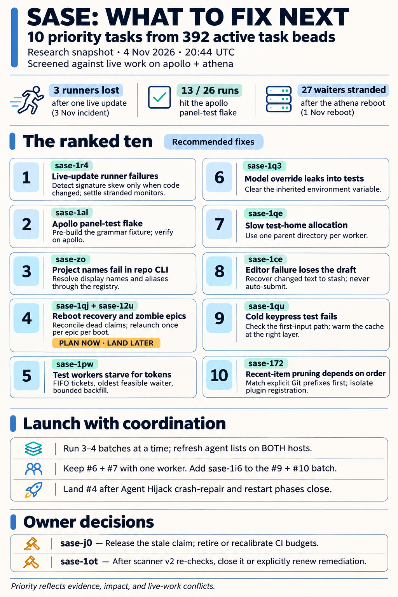
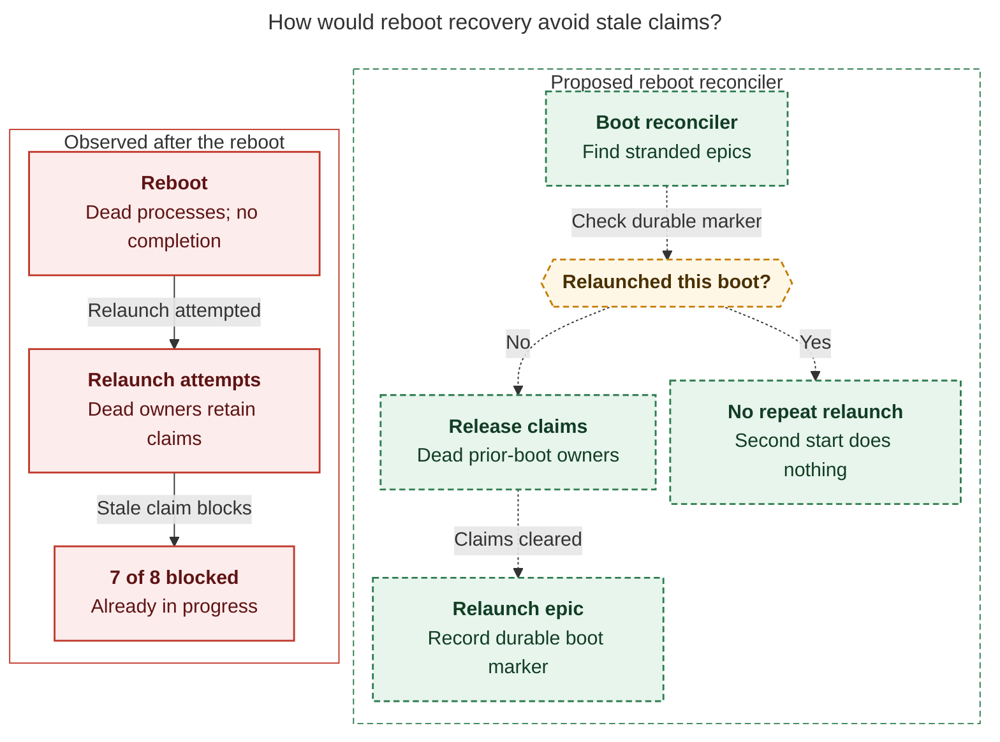
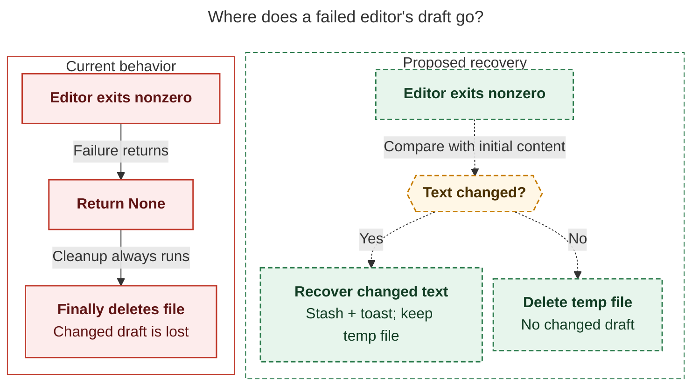

# The ten task beads to work next, screened against live epics on apollo and athena

> **Research query:** Which of this project's task beads are the 10 most important and
> impactful to work next (or fewer, if fewer than 10 actually need work), after reviewing
> the SASE agents running on this machine and on athena so that no ongoing epic conflicts
> with them? Rank the recommended beads, with a justification and a recommended solution for
> each.



## Bottom line

There are **392 non-closed task beads**: 376 ready, 12 open, 3 snoozed, and 1 in progress.
Ten of them are worth working now. Seven of the ten can start immediately. One (sase-1qj)
should be planned now and landed after the Agent Hijack epic's restart and crash-repair
phases close.

| #   | Bead         | Type · size     | Why it matters                                                                                         | Start                                  |
| --- | ------------ | --------------- | ------------------------------------------------------------------------------------------------------ | -------------------------------------- |
| 1   | [**sase-1r4**](#sase-1r4-signature-skew-typeerrors-after-a-live-update) | bug · large     | A live `sase update` that changes a signature kills runners silently and leaves zombie staged monitors   | Now                                    |
| 2   | [**sase-1al**](#sase-1al-command-line-panel-pilot-trio-fails-on-apollo) | flake · large   | Fails in every red apollo full run since 11-03, including a clean-base run                              | Now                                    |
| 3   | [**sase-zo**](#sase-zo-project-display-name-fails-for-repo-commands)  | bug · small     | +10. `sase repo … -p sase` (the display name) still exits 2                                              | Now                                    |
| 4   | [**sase-1qj**](#sase-1qj-recover-what-a-host-reboot-strands) | bug · large     | A reboot strands every waiter and land agent; 27 stalled on 11-01, still unrecovered 2.5 days later   | Plan now; land after sase-1qz.6.1 and sase-1qz.7 |
| 5   | [**sase-1pw**](#sase-1pw-pytest-worker-token-waiters-starve) | bug · medium    | Pytest worker-token waiters starve for 45 minutes, then exit with no tests run                          | Now                                    |
| 6   | [**sase-1q3**](#sase-1q3-model-override-leaks-into-pytest) | ci · small      | `SASE_MODEL_OVERRIDE` leaks into pytest; agents running on a fallback model see 7 false failures        | Now (same worker as #7)                |
| 7   | [**sase-1qe**](#sase-1qe-quadratic-per-test-home-allocation) | bug · small     | The per-test home allocation scans the base temp dir, so its cost grows quadratically across a full run | Now (same worker as #6)                |
| 8   | [**sase-1ce**](#sase-1ce-a-failed-editor-deletes-the-typed-prompt) | bug · small     | A non-zero `$EDITOR` exit deletes everything typed into the prompt                                       | Now                                    |
| 9   | [**sase-1qu**](#sase-1qu-the-update-shortcut-test-fails-cold) | ci · small      | Fails deterministically when run cold; **reproduced today**                                             | Now (false-red batch)                  |
| 10  | [**sase-172**](#sase-172-the-mru-pruning-test-is-order-dependent) | ci · large      | +4. Fails deterministically when run alone; **reproduced today**; possibly a product bug as well           | Now (false-red batch)                  |

**Cheap ride-along:** add [**sase-1i6**](#sase-172-the-mru-pruning-test-is-order-dependent)
to the #9/#10 batch. It reproduced today with `OSError: AF_UNIX path too long` under the
agent temp directory. Any agent check that selects those tests gets a false failure. The fix
is about ten lines.

**Two owner decisions, not agent work:** **sase-j0** and **sase-1ot**. See
[Owner decisions](#owner-decisions).

## Conflict screen of what is running now

The researchers' snapshots were taken 19:30–20:20 UTC. Four things changed before the lead's
20:44 recheck:

- Athena `18a` and `18b` moved from planning to coding.
- `cd--code` on apollo was succeeded by `ce`.
- Agent Hijack phase sase-1qz.6.1.4 started running.
- A new bead, **sase-1r9**, was filed at 20:36 from the `18b` area.

| Host   | Live owner                                                                                  | What it is changing                                                                                     | Keep these beads away                                                         |
| ------ | ------------------------------------------------------------------------------------------- | ------------------------------------------------------------------------------------------------------- | ----------------------------------------------------------------------------- |
| apollo | `ce` (Codex coder for `plan:202611/codex_exec_final_answer_integrity.md`)                    | `_subprocess_codex.py`, `codex.py` final-answer integrity                                                | sase-1e2 (same Codex stream parser)                                           |
| apollo | `research.3a.*`, `research.3b.*`, bob-cli h0/h2                                             | Research swarms; another project                                                                        | none                                                                          |
| athena | **sase-1qz** Agent Hijack: `.6.1.4` running; `.6.1.5–.7`, `.7`, `.9`, `.10`, `.11`, and land waiting | Stop/custody, recovery launch, crash repair, wait resolution following `recovery.successor`, `sase agent restart` on hijacked targets, `_prompt_bar_*` stash | sase-1qi, sase-1me, sase-1jf, sase-1cg (prompt-bar stash); sase-1qj lands after this |
| athena | **sase-1r8** publication false blocks: `.4--1` running; `.5`, `.6`, and land waiting                          | Scanner rules v2, drain loop, parking protection-withheld rows                                           | sase-1or, sase-187, sase-1ot (re-scan under v2 first)                          |
| athena | **sase-1r2** Green Full CI + v0.19.0: `.5--mon` waiting on PyPI; `.7`, `.8`, and land waiting              | Full CI on GitHub, core pin publication, release                                                        | Flakes it took over (sase-1ql, 1ny, 1oy, 1mu, 1gg, xh); anything needing a new core pin |
| athena | **sase-1n6.11** steward: `.4--mon` waiting on GitHub                                                     | Release steward train                                                                                    | Release/install beads (sase-1qw, sase-1r0)                                     |
| athena | `18a--code`, implementing `plan:202611/sase_core_release_cut_resilience.md`                    | The sase-core release-cut workflow                                                                       | Core release CI                                                               |
| athena | `18b--code`, implementing `plan:202611/cleanup_workspace_retention_serialization.md`           | `AgentWorkspaceRetention` serialization in kill/dismiss cleanup                                           | sase-1r9 (new), sase-vb, sase-1ds, sase-1pr                                   |
| athena | `toobig-9b` (queued)                                                                        | Splits `tests/agents_sync/test_deferred_prompt_archive.py`                                              | none                                                                          |

The lead grepped both hijack plans and the publication plan for every file each pick touches.
`_editor.py`, `workspace_handler_context.py`, `_conftest_environment.py`, `_suite_gate_lease.py`,
the command-line panel tests, and `runner_failure_facts.py` appear in none of them. The two
adjacencies are handled in the picks below:

- [sase-1r4](#sase-1r4-signature-skew-typeerrors-after-a-live-update) sits next to the
  hijack plan's staged-handoff and claim-retention helpers.
- [sase-1qj](#sase-1qj-recover-what-a-host-reboot-strands) sits next to
  `wait_dependency_resolution` and restart.

**Refresh before launching.** Re-run `sase agent list -j` locally and via `ssh athena`, and
re-read the bead. Don't launch all ten at once: athena already carries 32 agent rows, and
pytest worker tokens are the shared bottleneck
([#5](#sase-1pw-pytest-worker-token-waiters-starve)).

## Suggested launch batches

| Batch | Beads                         | Shape                                    | When                                         |
| ----- | ----------------------------- | ---------------------------------------- | -------------------------------------------- |
| A     | sase-1r4 (then sase-1jd)      | One epic, about two phases               | Now                                          |
| B     | sase-zo, sase-1ce             | Two small fixes with disjoint files      | Now                                          |
| C     | sase-1q3 + sase-1qe           | One worker, one file                     | Now                                          |
| D     | sase-1qu, sase-172, sase-1i6  | False-red batch                          | Now                                          |
| E     | sase-1al, sase-1pw            | Test-infra work, verified on apollo      | Now; run sase-1pw after C to limit lease churn |
| F     | sase-1qj + sase-12u           | Epic: host-owned epic liveness           | Plan now; land after sase-1qz.6.1 and sase-1qz.7 close |

Batches A–E share no files with each other or with the
[live epics](#conflict-screen-of-what-is-running-now). Run three or four at a time rather
than all at once.

## Where the five reports disagreed and how it was resolved

Only **sase-1r4** was picked by all five researchers. Three beads got three votes each:
sase-zo, sase-1q3, and sase-1pw. Twenty-eight others were picked by only one or two
researchers. The lead resolved the conflicts with fresh evidence:

| Question                                    | Positions                                                       | Resolution and evidence                                                                                                                                                                                                                                                                                  |
| ------------------------------------------- | --------------------------------------------------------------- | -------------------------------------------------------------------------------------------------------------------------------------------------------------------------------------------------------------------------------------------------------------------------------------------------------- |
| Is **sase-1ot** (purge 27 historical secret-scanner hits) the top pick?  | gem #1; cdx: wait for sase-1r8                                     | **Not agent work now.** The bead's +1 records an **owner reject** on 2026-10-28 (gate `custom-b52a9f2c`, `owner_reject`, `rewrite_attempted=false`): "future work only if the owner requests renewed remediation." The sase-1r8 plan also requires re-scanning the 27 hits under rules v2 before any rotation or purge. |
| Is **sase-1db** (private-store visibility) the top pick?                  | cdx #1; cld runner-up                                              | **Latent, so runner-up.** `gh repo view sase-org/sase--attachments-private` reports `isPrivate: true`, and an anonymous fetch returns 404. The missing guard is real, but no exposure is happening today.                                                                                             |
| Does **sase-1qj** (reboot recovery) collide with Agent Hijack?           | cld #2, mus #2; cdx and grk defer                                   | **Distinct scope, shared files.** The hijack crash-repair phase only reconciles *hijack recovery records* whose resolver died. It does not cover generic reboot-stranded waiters. However, it extends `src/sase/core/wait_dependency_resolution/`, and sase-1qz.7 rewrites `sase agent restart`. So plan sase-1qj now and land it after those phases close.                         |
| Is **sase-1r7** (credential retries) owned by sase-1r8?                  | grk defers; cdx and gem pick it                                     | **Not owned.** The sase-1r8 plan says "the SSH publickey retry stays out of scope" and hands it to sase-1r7 as a follow-up. Its four call sites are outside the drain. It ranks #11 because GitHub SSH incidents are rare and the job cadence already retries.                                                                            |
| Should **sase-1al** wait for sase-1r2.6?                  | cld #4; grk defers                                                 | **No.** sase-1r2.6 measures *GitHub* Full CI. The trio fails on *apollo* local full runs, and sase-1r2.3 did not take it over. The lead's recount: it failed in 13 of 26 apollo full-run records since 10-21, in all 9 red runs since 11-03, and in the only clean-base run (`20261104T034217Z`, 0 changed files).            |
| Is **sase-15o** (agy allowlist) top-10?            | grk #5, gem #5                                                       | **Real but low impact.** agy is now 1.5.0 on both hosts, against the `{1.0.10}` allowlist. However, agy ran only **17 of ~1,730** agent runs since 11-01 (13 on apollo, 4 on athena). Fix it opportunistically.                                                                                                |
| Is sase-zo already fixed?                  | gem described the `match_repo_record` half                         | That half was fixed in `e57d76c79b`. **The `-p` half still fails:** `sase repo list -p sase` exits 2 with "Project 'sase' has no WORKSPACE_DIR in …/projects/sase/sase.sase".                                                                                                                           |
| Is sase-v6 (+5) a quick win?                         | gem #4                                                              | **Half fixed.** The recipe now builds into `sase-core/target/uv-tool-lsp`. The residual bug is that the `;`-chained `cp`, `chmod`, and `mv` still print "installed" after a failed build. That is a two-line change; fold it into the next Justfile edit.                                                                    |

Smaller factual corrections:

- gem placed sase-1r4 in `src/sase/monitor/` and `update_skew.py`. The code is actually in
  `src/sase/axe/runner_failure_facts.py` and `source_skew.py`.
- gem's sase-1i6 test has moved to `tests/test_dispatch_federation_ipc.py`.
- mus called sase-zn and sase-126 "fully closed". Both are still `in_progress` epics whose
  children are all closed, which makes them zombies (see
  [#4](#sase-1qj-recover-what-a-host-reboot-strands)).
- mus's sase-x4 has status `open` and dates from September. `check-full` is now explicit-only
  (decision `check-full-is-explicit`), and the bead overlaps sase-j0 and sase-1pw.

## What did not make the top ten

### Next up at ranks 11 to 16

| #   | Bead(s)                    | Why not top ten                                                                                                                         | Start when                                     |
| --- | -------------------------- | --------------------------------------------------------------------------------------------------------------------------------------- | ---------------------------------------------- |
| 11  | sase-1r7, plus sase-167     | Real resilience gap: four git sites abort on transient `publickey` denials. Incidents are rare, and the job cadence already retries. Waits must sit outside sidecar locks. | After sase-1r8 lands, so publication stays quiet |
| 12  | sase-1jd                   | CI ratchet against post-provider first imports, the cause of the 11-03 deaths                                                                      | As phase 2 of [#1](#sase-1r4-signature-skew-typeerrors-after-a-live-update)                               |
| 13  | sase-1cg                   | Same draft-loss class as [#8](#sase-1ce-a-failed-editor-deletes-the-typed-prompt)                                                                                                              | After sase-1qz.10 lands                        |
| 14  | sase-1db                   | Missing guard, but the store is verified private today                                                                                  | Any time                                       |
| 15  | sase-1kp                   | `beads.db` is both the Rust mutation lock and the Python mirror. cdx proved the POSIX close-releases-lock hazard, but no corruption has been seen | Needs a lock-protocol decision                 |
| 16  | sase-15o                   | The agy allowlist is stale, but agy runs only about 1% of agents                                                                                    | Opportunistic                                  |

Second-wave candidates with real but smaller impact:

- mus: sase-11d (lost comment-suffix updates), sase-1hk (33-second claim scans), sase-1qx
  (commit-stage finalizer latency).
- grk: sase-va, sase-1ct, sase-u3.

### Owner decisions

_Not agent work._

- **sase-j0 (+38, `in_progress`, holder dead since 10-26).** CI Telemetry is red on **all 7
  completed runs since 11-01**. The latest run (`41789161504`) had three red jobs:
  - `test-cost` was cancelled at the 3-hour cap.
  - `coverage-contexts` failed after 69 minutes.
  - `contention-test` failed (sase-11b).

  That is about 4.5 runner-hours a run with no data out. Agents must not hand-edit the status,
  so you need to:
  1. Release the claim.
  2. Choose between retiring the hard budgets (keep `just test-cost` as a report) and
     recalibrating on per-worker, CPU-normalized keys with a sharded job.
  3. Fold in sase-11b and the coverage-contexts xdist crash.

- **sase-1ot.** You rejected the history rewrite on 10-28. After sase-1r8 installs scanner
  rules v2 and re-scans the 27 hits, either close the bead or renew remediation explicitly.

### Not now

_Owned, blocked, or unproven._

- **Owned by live work:**
  - sase-1qi, sase-1me, sase-1jf: sase-1qz.
  - sase-1or, sase-187: sase-1r8.
  - sase-1r9, sase-vb, sase-1ds: `18b` and sase-1qz.7.
  - sase-1ql, 1ny, 1oy, 1mu, 1gg, xh: sase-1r2.3.
  - sase-1qw, sase-1r0: the release epics.
  - sase-1e2: `ce`.
- **Need a new sase-core pin while sase-1r2.5 waits on PyPI:** sase-1mb, sase-1qv, sase-yn.
- **Unproven or needing remeasurement:**
  - sase-1qm: one incident, root cause unknown.
  - sase-1nc: re-soak after the index-lock fix.
  - sase-x4: open, from September, and overlaps sase-j0/sase-1pw.
  - sase-lk (+13): dormant since August.
- **The 132 feature, memory, and flag beads** are not seeds for this wave.

## The ranked list

### sase-1r4 signature-skew TypeErrors after a live update

_Rank 1._

**Justification.** `sase update` fast-forwards the editable checkout under running processes.
On 2026-11-03 at 10:56, update `a1a07efff8 → ced5901dd5` removed the `require_capture` and
`persist_chat` keyword arguments.

- Three runners (`sase-1n6.11.1`, `178.w0--plan`, and `17a--3`) died within 2.5 minutes on
  `TypeError: … unexpected keyword argument` during staged-handoff adoption.
- Their successors never launched, and 13 bob-cli files were left uncommitted.
- The auto-restart healer logged `nothing_eligible` for about six hours.
- A staged monitor sat with `pid=null`, still appearing to run.

All five researchers ranked it, and nobody owns it. In the current code,
`runner_failure_facts.py` (lines 45–59) still recognizes only import-shaped patterns:
`cannot import name`, `no module named`, and `partially initialized module`. cdx called
`facts_look_like_update_skew` directly on an unexpected-keyword TypeError, and it returned
`False`.

**Recommended solution (one epic, about two phases):**

1. **Classify narrowly.** Add the signature-mismatch shapes: `unexpected keyword argument`,
   `missing N required … argument`, and `takes N positional arguments but M were given`.
   Count one as skew only when the runner's boot `code_identity` differs from the current
   checkout. A same-revision TypeError must stay an application failure. Keep the predicate
   where the existing skew facts live. If it has to move into sase-core, move the core pin
   only after sase-1r2.5 publishes.
2. **Explain it.** Extend `source_skew.code_swap_explanation()` so the failure notification
   says the checkout moved under the runner.
3. **Settle failed adoptions honestly.** A staged monitor whose adopter died should reach a
   terminal failed or held state. Preserve custody, the accepted declaration, and dirty-repo
   obligations, and keep the row visible in `sase agent list -a`.
4. **Stay out of hijack territory.** Do not edit the hijack plan's
   `_has_staged_handoff`-style checks or `_staged_origin_retains_claim`. Tell the
   sase-1qz.6.1 lander if staged adoption changes. sase-1jd (the import-recording ratchet)
   is a good follow-on phase. sase-1jf (resume in place) and sase-1je (per-process releases)
   stay separate.

**Done when:**

- A fixture replaying the 11-03 signature change classifies as skew and the healer admits it.
- A same-revision TypeError stays ineligible.
- An orphaned staged monitor settles within one healer pass.
- No completed provider work reruns.

### sase-1al command-line panel pilot trio fails on apollo

_Rank 2._

**Justification.** These three tests in
`tests/ace/tui/command_line/test_panel_shell_pilot.py` fail together:

- `test_empty_panel_semicolon_hops_to_palette_and_back`
- `test_empty_panel_escape_follows_the_hide_panel_binding`
- `test_panel_escape_keeps_draft_across_reopen`

The lead's recount covers 26 apollo full-run records since 10-21. The trio failed in 13 of
them, including **every red run since 11-03 (9 of 9)**. One of those was a clean-base run
with 0 changed files. On athena it failed in 1 of 625 runs (cld). So every apollo
verification that hits it is red for a reason unrelated to the change being verified, and
hijack phase workers keep proposing it as a follow-up. It has 5 +1s, and sase-1ew was already
merged into it as a duplicate.

**Recommended solution:**

1. Reproduce on apollo under `-n 8` alongside `tests/ace/tui/`.
2. cld's unverified hypothesis: the tests wait 5 seconds for
   `is_command_line_grammar_pending()` to clear, while the grammar spec (about 0.5 MB) is
   built in a subprocess. That can exceed 5 seconds on the slower host.
3. Give the trio a session-scoped, pre-built grammar fixture. Keep async-load coverage in
   the loader-specific test.
4. Do not raise timeouts.
5. If `;` genuinely cannot hop while the grammar is pending, treat that as product lag on
   slow hosts. Let the hop proceed and fill in completion later.

**Done when** the three tests pass 20 times serially and 3 times under `-n 8` with
`tests/ace/tui/`, **on apollo**.

### sase-zo project display name fails for repo commands

_Rank 3._ `-p <display name>` fails for repo commands.

**Justification.** This is the most-corroborated open bug (+10). Agents are told to use
`sase repo`, and decision `project-labels-never-keys` makes the display name what every
surface shows them. The command still exits 2 today:

```text
$ sase repo list -p sase
Project 'sase' has no WORKSPACE_DIR in /home/bryan/.sase/projects/sase/sase.sase.
```

`resolve_project_context` in `src/sase/main/workspace_handler_context.py` passes `-p` straight
to `get_project_file_path`, which only understands the directory key.

**Recommended solution:**

- Canonicalize `-p` through the project registry, accepting a display name, an alias, or the
  key. This is the same resolver `sase project show` uses.
- When a name is ambiguous, list the candidates.
- Add a regression test where the display name differs from the key.
- Audit the other `-p/--project` callers of the same helper.

### sase-1qj recover what a host reboot strands

_Rank 4, with sase-12u._

**Justification.** This has the largest blast radius per event of anything in the backlog.

- The 11-01 athena reboot left 27 waiters FAILED (16 land, 11 phase), with dead PIDs and
  no `done.json`.
- The +1 records that they were still unrecovered 2.5 days later.
- 7 of 8 `.f0` relaunches died with "already in_progress and assigned", because the dead
  owners still held their bead claims.
- The only mitigation is a per-epic crontab watchdog (sase-1r2.1). Athena's crontab has
  exactly one, for sase-1r2.
- **39 of 120 `in_progress` epics have every child closed** (the lead's recount matches
  cld's). Examples include sase-zn, sase-126, sase-j7, sase-kp, and sase-1q4. These zombies
  hide real stalls.

Athena has been up since 11-01, so this is not urgent today, but the next reboot repeats the
whole loss.

**Recommended solution.** Write the plan now. Implement after sase-1qz.6.1 (crash repair and
successor-following waits) and sase-1qz.7 (restart) land.

1. **Boot reconciler.** Build a host-owned reconciler, with the policy in sase-core and the
   I/O in Python. Run it at AXE start after a `boot_id` change. It finds in-progress epics
   whose phase, land, or `%w` rows have dead PIDs and no `done.json`.
2. **Release dead claims.** Release claims held by dead owners from the previous boot, or
   scope claims to the boot, so that relaunches cannot die on "already in_progress".
3. **Relaunch.** Use the existing `sase bead work <epic>` path, once per epic per boot,
   with a durable marker. Post one inbox notice per epic. Retire the crontab-watchdog
   template.
4. **sase-12u phase.** Produce a report-only list of zombie epics and their last land
   outcomes, and decide each row yourself (relaunch the land agent or close). Don't
   cascade-close. Then add the invariant: when all of a parent's children are closed and no
   land agent is live, relaunch the parent's land agent.

[The reboot-recovery diagram](#figure-reboot-recovery) follows the stale-claim path that
blocked relaunches, then the proposed reconciler's path: release dead claims and relaunch
each stranded epic once per boot.

<div id="figure-reboot-recovery">



_The proposed reconciler clears dead claims and relaunches each stranded epic once per boot; repeat scheduler starts do nothing._

</div>

**Done when:**

- A simulated reboot relaunches each stranded epic exactly once.
- A second scheduler start does nothing.
- No relaunch dies on a stale claim.
- The zombie count is 0, or every remaining zombie has a recorded decision.

### sase-1pw pytest worker-token waiters starve

_Rank 5._

**Justification.** A four-token waiter timed out after **45 minutes** and exited 4 without
running a test, while younger holders received freed tokens. cld counted 2 of 622 athena tool
runs hitting this in the last week, and each one costs an agent a full verification cycle.
`WorkerTokenLease.acquire` in `tests/_suite_gate_lease.py` (lines 121–163) still polls with no
arrival ticket and grows greedily.

**Recommended solution:**

- Add FIFO arrival tickets under the pool lock.
- Let the oldest feasible waiter reserve freed tokens up to its floor. Allow only bounded
  backfill by later requests.
- Reclaim dead waiters.
- Keep the non-blocking `try_acquire` contract and crash-safe ownership.
- Prove it with a fake-clock test of the bead's starvation sequence.
- Do not lengthen the 45-minute timeout.

### sase-1q3 model override leaks into pytest

_Rank 6._ `SASE_MODEL_OVERRIDE` leaks into pytest.

**Justification.** The runner sets this variable whenever an agent falls back to another
model. With it set, the bead's control run had 7 failures and 44 passes. Without it, the
unchanged tree passed all 51. `_clear_agent_env_vars` in `tests/_conftest_environment.py`
scrubs `SASE_MODEL_ALIAS_OVERRIDES` (lines 478 and 497) but not `SASE_MODEL_OVERRIDE`.

**Recommended solution:**

- Add the variable to the autouse scrub.
- Keep explicit per-test `monkeypatch.setenv` working.
- Add a subprocess-level regression test where an inherited override and a clean
  environment produce identical results.

### sase-1qe quadratic per-test home allocation

_Rank 7._

**Justification.** Every test passes through `_isolate_sase_home`, which calls
`tmp_path_factory.mktemp("home")` (line 286). The bead records a worker with 27,816 base-temp
entries during a check that ran over two hours. cdx's isolated probe measured the cost per
allocation:

| Existing entries | Median cost per allocation |
| ---------------- | -------------------------- |
| 100              | 0.54 ms                    |
| 1,000            | 2.3 ms                     |
| 10,000           | 21.5 ms                    |

That is a microbenchmark, not a measured speedup for the whole suite.

**Recommended solution:**

- Allocate one parent directory per worker, then create each test's home with
  `tempfile.mkdtemp(dir=parent)`.
- Keep homes unique per test and outside the test's own `tmp_path`.
- Check before and after with a benchmark at 1k, 10k, and 30k entries.
- Give [#6](#sase-1q3-model-override-leaks-into-pytest) and #7 to **one worker**, because
  both edit `_conftest_environment.py`.

### sase-1ce a failed editor deletes the typed prompt

_Rank 8._ A failed `$EDITOR` deletes the typed prompt.

**Justification.** This is direct user-data loss. In
`src/sase/ace/tui/actions/agent_workflow/_editor.py`, a non-zero exit returns `None` (lines 68
and 129), and then the `finally` blocks unlink the temp file (lines 76 and 136). So exiting
with `:cq`, an editor crash, or a kill loses the draft. The workflow-YAML editor has the
same shape. No live plan touches `_editor.py`.
[The editor-recovery diagram](#figure-editor-recovery) sets today's path, where the `finally`
cleanup deletes a changed draft, beside the proposed compare-then-stash path that keeps it.

<div id="figure-editor-recovery">



_The proposal stashes changed drafts without auto-submitting, retains their temporary files, and deletes only unchanged text after editor failure._

</div>

**Recommended solution:**

- On a non-zero exit or a read failure, compare the file with its initial content.
- If it changed, save it through the existing Stash path, tagged as recovered, and show a
  toast saying where it went. Never auto-submit it.
- Unlink only on success or when nothing changed. Apply the same fix to the YAML editor.

Its sibling **sase-1cg** (restart drops the draft when the stash write fails) touches
`_prompt_bar_stash.py`. The hijack prompt-bar phase sase-1qz.10 edits that file, so 1cg waits
until that phase lands.

### sase-1qu the update-shortcut test fails cold

_Rank 9._

**Justification.** Reproduced today: run alone, the test fails with
`AssertionError: keypress dispatch must stay in-memory`. It passes only after another test
has warmed the keymap-defaults cache. So any scoped selection that puts it first on a fresh
worker goes red.

**Recommended solution.** First decide whether the cold read is real product behavior:
does the first keypress read keymap defaults from disk on the UI thread?

- **If it does,** warm the keymap at app mount. That fixes the product and the test together.
- **If the app always warms before input,** warm the cache in the test before patching
  `Path.read_text`.

Either way, keep the "no disk or subprocess work" assertion.

### sase-172 the MRU pruning test is order-dependent

_Rank 10._

**Justification.** Reproduced today when run alone:
`assert ['#gh:sase'] == ['#gh:sase', '#git:otherproj']`. It passes inside the full suite, so
it surfaces only in scoped selections; four landers re-hit it between 10-03 and 10-14 (+4).
The narrowing in the bead points at `_vcs_prefix_provider_mismatched` and
`_workflow_and_ref_for_prefix`, which iterate `get_ref_patterns()` in plugin order. If that is
the cause, it is also a **product bug**: on a host with sase-github installed, genuine
`#git:<proj>` MRU entries get pruned.

**Recommended solution:**

- Match the explicit `#git:` or `#gh:` sigil before falling back to pattern iteration.
- Make the test hermetic about which plugins are registered.
- Add a variant with sase-github's patterns registered first.

**Ride-along: sase-1i6.** `tests/test_dispatch_federation_ipc.py` binds sockets under
`tmp_path`. Under the agent temp root that path exceeds the 108-byte AF_UNIX limit; the
lead's run of that module gave 2 failures and 5 passes. Bind under a short `/tmp`
`mkdtemp` directory and clean it up in teardown.

## Evidence and limits

_Consolidated report from research swarm `3a` (researchers cdx, cld, grk, mus, and gem, plus
the lead's own checks). Snapshot: 2026-11-04, final live-agent check 20:44 UTC on apollo and
athena. Code state: sase master `34b09fa219`; master has not moved since the researchers
started._

- **Inventory.** `sase bead list -t task -f json -n 0` (392 rows) and the plan/phase list
  (zombie recount). Audited `sase bead read` of the epic phase trees (sase-1qz, sase-1qz.6.1,
  sase-1r8, sase-1r2), plus sase-1ot, sase-1db, sase-1qj, and sase-1r2.1.
- **Plans** read with `sase artifact read`:
  - `plan:202611/agent_hijack.md`
  - `plan:202611/hijack_keep_work_recovery.md`
  - `plan:202611/agent_publication_errors.md`
- **Live agents.** `sase agent list -j` locally and via `ssh athena` at 20:44 UTC, plus
  `sase agent show` for the new coders.
- **Reproductions in the lead's checkout:**
  - `sase repo list -p sase` exited 2.
  - The sase-1qu node failed cold.
  - The sase-172 node failed alone.
  - `test_dispatch_federation_ipc.py` gave 2 failures and 5 passes on AF_UNIX path length.
  - `agy --version` returned 1.5.0 on both hosts.
  - `gh repo view` confirmed the private store is `PRIVATE`.
  - `gh run list`/`view` showed the CI Telemetry state.
  - Apollo `~/.sase/test-selection` full-run records gave the sase-1al counts.
  - Agent `agent_meta.json` files since 11-01 gave the provider mix.
- **Taken from researchers without re-measuring:**
  - cdx's allocation and POSIX-lock probes.
  - cld's athena selection-health counts and the sase-1pw frequency.
  - The incident narratives recorded in the beads.
- **Not done.** No full suites ran, no beads were edited or launched, and no private
  attachments were opened.
