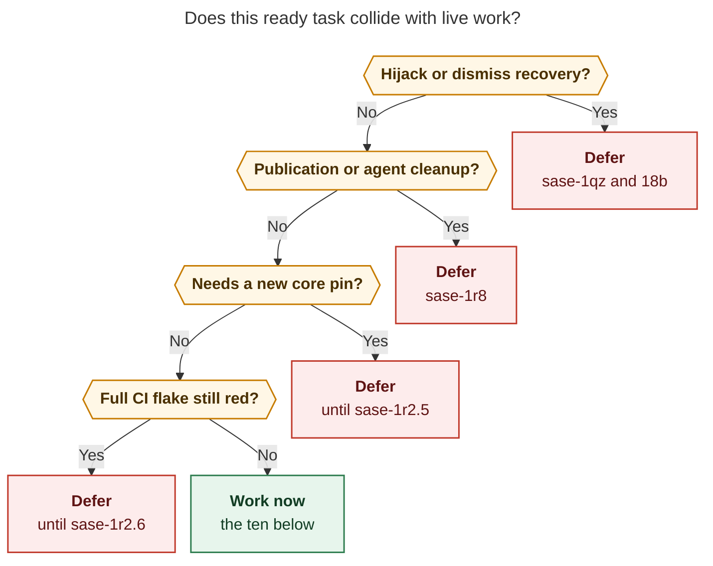

# Ranked task beads to work next

Work these ten ready task beads, in this order. They are the highest-impact items that can start without colliding with the live sase epics on athena and apollo. Several higher-impact beads exist and should wait; they are listed after the ranking.

| Rank | Bead | Type | Size | +1 | Why now |
| --- | --- | --- | --- | --- | --- |
| 1 | `sase-zo` | bug | small | 10 | Display-name project flags still miss the real project; confirmed 2026-11-04 |
| 2 | `sase-1qu` | ci | small | 0 | Deterministic cold-start failure; helps Full CI without racing flake workers |
| 3 | `sase-1r4` | bug | large | 0 | Nov 3 live-update TypeErrors stranded a release-steward phase and a commit |
| 4 | `sase-1jd` | feature | large | 1 | CI ratchet that stops the same post-provider import class from recurring |
| 5 | `sase-15o` | bug | large | 2 | Every agy run still drops tool-call rows; allowlist is still `{1.0.10}` |
| 6 | `sase-va` | bug | small | 2 | Referenced-by drain crashes on `bytes` instead of showing the git error |
| 7 | `sase-1ct` | bug | small | 1 | `sase lsp` exec-loops when the override command is `sase lsp` |
| 8 | `sase-u3` | bug | large | 2 | Artifact doctor treats an uncloned sidecar as dangling link breakage |
| 9 | `sase-167` | bug | medium | 0 | Deploy-key refusals still miss Python credential handling after the core marker landed |
| 10 | `sase-1qm` | bug | large | 0 | Host completion refuses a passing prepared intent on a stale fingerprint |

Do not start `sase-j0` as a new campaign. It is already `in_progress` (+38) and is a check-full cost-budget umbrella, while `sase-1r2` is the live Full CI / v0.19.0 epic.

## How this ranking was built

1. Dump the current project's task beads by status and type (`ready` 375, `open` 12, `snoozed` 3, `in_progress` 1).
2. List live agents on this machine (apollo) and on athena over Tailscale SSH (`ssh athena -- sase agent list -j`).
3. Read the live sase epic beads and their phases (`sase-1qz`, `sase-1qz.6.1`, `sase-1r8`, `sase-1r2`, `sase-1n6.11`, plus apollo `cd--code` and athena `18b`).
4. Drop any ready task whose files, symptoms, or recovery path sit on a surface those live runs already own.
5. Prefer user-visible or agent-workflow breakage over parallel-lane flakes, because `sase-1r2.3` already closed "blocking test lanes stop flaking" and `sase-1r2.6` is waiting to prove one green Full CI run after the core pin publishes.
6. Prefer work that does not need a new sase-core publish while `sase-1r2.5` is waiting on PyPI for a containing `sase-core-rs`.
7. Re-check a few top candidates in this checkout (`sase repo list -p sase`, the agy allowlist, `rust-lsp-install`, `sase lsp` exec).

Ready-task mix: 141 bug, 99 feature, 89 flake, 30 memory, 12 ci, 4 untyped. Flakes dominate +1 counts because Full CI keeps rediscovering them. That is evidence of pain, and it is also a trap: launching ten flake workers tonight races the live release epic.

**Caption.** Live hijack, publication-cleanup, core-pin, and Full CI owners already cover those surfaces, so the work-now list is the high-impact remainder.

## Live work that the next ten must not fight

### Apollo (this machine)

| Agent | Status | Owns |
| --- | --- | --- |
| `research.3a.{cdx,cld,grk,mus,gem}` plus `final` / `image` / `linker` | running / waiting | This ranking swarm |
| `cd--code` | running | Approved plan `plan:202611/codex_exec_final_answer_integrity.md` |
| `research.3b.*` | running | Separate bob-cli ranking swarm |

bob-cli epics `bob-cli-h0` and `bob-cli-h2` are also live here. They do not own sase task beads.

### Athena (SSH `athena`, `sase agent list -j`)

| Clan / agent | Status | Owns |
| --- | --- | --- |
| `sase-1qz` + nested `sase-1qz.6.1` | land waiting; `.6.1.2--plan` running; phases 7/9/10/11 waiting | Agent Hijack: stop, keep work, recover. Phase `.6.1.5` is crash repair and successor waits. Phase `.7` is Restart / Edit / Dismiss |
| `sase-1r8` | land waiting; `.4--mon` installing | Agent-publication false blocks, parked-row floods, drain starvation |
| `sase-1r2` | land waiting; `.5--mon` waiting PyPI | Green Full CI, containing published core, sase v0.19.0 on PyPI |
| `sase-1n6.11` | land waiting; `.4--mon` waiting GitHub | E2 steward: merge, start the train, contained core pins |
| `18b` | running | Diagnose and fix "unable to cleanup sase agents after killing/dismissing them" |
| `18a` | done during this research | sase-core activity-stats plan (`#actstat:sase-core`) |

`sase machine list` on apollo reports no enrolled remotes, so athena was inspected over Tailscale SSH rather than `sase machine agent`.

### In-progress beads that look live and are not

| Bead | Status | Treat as |
| --- | --- | --- |
| `sase-j0` | in_progress task, +38 | Cost-budget umbrella. Last triage 2026-10-26. No live worker. Do not duplicate |
| `sase-j7` | in_progress epic | All five phases closed. Residual flakes belong to land/follow-up, not a new flake swarm |
| `sase-1i5` | in_progress epic | October "top ten task beads" run. Phases 1–8 closed. Phase `.9` is a leftover release, superseded by `sase-1r2` / `sase-1n6.11` |
| `sase-1q2` / `sase-1q2.9` | in_progress | Prior v0.19.0 attempt; `sase-1r2` is the live successor |
| `sase-1qh` | in_progress | Publication notifications; `sase-1r8` is the live successor |
| `sase-kp` | in_progress | Monitor-as-family-member. Last note 2026-10-28. No live agent |
| Flag retires `sase-1kb`…`sase-1r1` | open drafts | Windows still open (`⧗`). `sase-1r1` (retire `agent_hijack`) must wait for `sase-1qz` |

`sase-1i5` already closed `sase-1h6`, `sase-1h2`, `sase-10d`, `sase-13p`, `sase-1gx`, `sase-14o`, `sase-1h1`, `sase-1f0`, `sase-1br`, and `sase-18v`. Those are done.

## Ranked beads

Each item is `ready` and unblocked in `sase bead ready`. Launch path: answer the TaskTriage gate, then `sase bead work <id>`.

### 1. `sase-zo` — display-name project flags still miss the project

**Impact.** Ten independent +1s. Agents and humans pass `-p sase` (display name) while inventory is keyed `gh_sase-org__sase`. That breaks repo listing and used to break `sase repo open` for sidecars and `sase-core`.

**Still true today.** In this checkout:

- `sase repo open sase-core` succeeds (the `match_repo_record` half was fixed; `record_belongs_to_host_project` now accepts key or display name).
- `sase repo list -p sase` still exits 2: `Project 'sase' has no WORKSPACE_DIR in /home/bryan/.sase/projects/sase/sase.sase`.
- `sase repo list -p gh_sase-org__sase` lists primary, sidecars, and linked repos.

The remaining bug is `_resolve_project_context` in `src/sase/main/workspace_handler_context.py`: `-p sase` is treated as a directory key, so it looks at the wrong `sase.sase`.

**Solution.** Resolve `-p` through the same display-name map `project_display_name_for` already uses on the log path. Add a regression that `sase repo list -p sase` and `-p gh_sase-org__sase` return the same inventory. Audit other `-p/--project` CLIs that call `_resolve_project_context` (`sase bead -P`, workspace commands). Size stays small.

**Conflict.** None with live epics.

### 2. `sase-1qu` — update-shortcut test fails whenever it runs cold

**Impact.** Filed 2026-11-02 from the `sase-1qt` landing tale. The node `tests/ace/tui/test_log_panel_keymap.py::test_update_shortcut_dispatch_performs_no_disk_or_subprocess_work` fails in a fresh process and passes only after another test warms the keymap-defaults cache. That is a CI failure, not a flake. `sase-j7`'s last discovered-issue note is this same node. `sase-1r2.6` still has to produce one green Full CI run.

**Solution.** Load keymap defaults (or otherwise warm the cache) before the test monkeypatches `Path.read_text` / `subprocess`. Keep the "dispatch performs no disk or subprocess work" assertion. Prove the node in isolation and as the first test on a fresh xdist worker.

**Conflict.** None. This is a one-file test fix. It does not reopen the `sase-j7` leak-class epic and it does not race `sase-1r2.3` (already closed on four other races).

### 3. `sase-1r4` — live `sase update` TypeErrors escape update-skew classification

**Impact.** On 2026-11-03 at 10:56, automatic `sase update` fast-forwarded `a1a07efff8` → `ced5901dd5` and removed `require_capture` / `persist_chat` from functions that already-running processes later imported. Three runners died with signature-skew `TypeError`. The healer and swap explainer ignored that shape, so:

- `17a--3` left 13 dirty bob-mac-capture files and a zombie staged monitor.
- `sase-1n6.11.1` lost in-flight sase-core release-steward edits.
- `178.w0--plan` died the same way.

Evidence: bead description plus `research:202611/athena_silent_agent_failures_live_update_skew.md`.

**Solution.** Classify this `TypeError` shape as update-skew. Heal or fail closed with the existing skew path instead of leaving staged monitors as zombies. Keep the change inside the update-skew classifier / staged-adopter import path (`run_agent_exec_staged_adopters`, the skew healer, the swap explainer). Do not edit hijack recovery UI, the HIJACKED panel, or `sase agent hijack`.

**Conflict.** Adjacent to `sase-1qz.6.1` (keep-work recovery, currently running `.6.1.2--plan`) and to `18b` (cleanup after kill/dismiss). Those runs own stop/dismiss/hijack. This bead owns *classification of live-update signature skew*. Tell the `sase-1qz.6.1` lander if you touch staged-handoff adoption; otherwise start it.

### 4. `sase-1jd` — CI forbids first imports after the provider returns

**Impact.** Same Nov 3 incident. The three deaths were post-provider first imports of `run_agent_exec_monitor` / `run_agent_exec_gate`. `sase-1j6` made post-provider deaths notify-only; this follow-up is the test that keeps new lazy imports off that path. +1 on 2026-11-03 from the same live incident.

**Solution.** Add a CI import-recording test that fails when a module needed after the provider returns is imported for the first time there. Enforce `preload_post_gate_modules` (or the current equivalent hook). Pair the worker with `sase-1r4` in one TaskTriage launch or run `sase-1jd` immediately after `sase-1r4` so the classifier fix cannot regress.

**Conflict.** Test-only relative to hijack UI. Same coordination note as `sase-1r4` if the preload list lives next to staged-handoff code.

### 5. `sase-15o` — agy trajectory extraction is still silently off

**Impact.** `_SUPPORTED_AGY_TRAJECTORY_VERSIONS = frozenset({"1.0.10"})` in `src/sase/llm_provider/_subprocess_agy.py` is unchanged in this checkout. Installed agy has been ≥1.2.7 since September; this swarm's gem researcher is on `agy/gemini-3.8-flash-high`. Every agy run therefore skips `tool_calls.jsonl` and structural no-progress detection, with no log line. +2.

**Solution.** Probe `agy --version` on athena, confirm the conversation DB schema under `~/.gemini/antigravity-cli/conversations/` still matches the extractor, then allowlist the current major/minor (or switch to a schema probe instead of a pinned version set). Restore tool-call JSONL and structural no-progress on a live agy run. Update the stale `agy.py` docstring that still claims `--output-format` / `--effort` do not exist if that is still wrong.

**Conflict.** None with live epics. agy-only Python.

### 6. `sase-va` — referenced-by write-back raises `TypeError` on git failure

**Impact.** `_pull_rebase_if_remote` stores undecoded `bytes` from `run_sdd_git` (`text=False`). The drain path then does `"; ".join(issue.message ...)` and raises `TypeError: sequence item 0: expected str instance, bytes found`. Operators see a TypeError instead of the git error. Two +1s, including every successful stitch on 2026-09-06 printing the TypeError while publication was deferred.

**Solution.** Pass `text=True` (or decode with replacement) in `sase.sdd.referenced_by_refresh._pull_rebase_if_remote` and any other `run_sdd_git` caller that interpolates stderr into a string. Add a test that a failed `git pull --rebase` surfaces the git text. Do not change drain policy, batch isolation, or secret-scan replay (`sase-1r8` / `sase-1or` own those).

**Conflict.** Same publication *pipe* as `sase-1r8`, different defect (encode vs scanner false positives). Keep the diff to decoding.

### 7. `sase-1ct` — `sase lsp` re-execs forever when the override is `sase lsp`

**Impact.** `handle_macro_lsp_command` does `os.execvp(argv[0], argv)`. If `SASE_MACRO_LSP_CMD` or the legacy `SASE_XPROMPT_LSP_CMD` is `sase lsp`, `_parse_lsp_override` builds `('sase', 'lsp', ...)` and the process re-enters itself. Reproduced as 24 nested spawns. Editor clients never initialize.

**Solution.** In `src/sase/integrations/macro_lsp.py`, refuse an override whose resolved argv is this same `sase lsp` wrapper (compare to `sys.argv[0]` / the `lsp` subcommand). Error with the install hint that already exists. Test both `SASE_MACRO_LSP_CMD=sase lsp` and the legacy env name.

**Conflict.** None. `sase-v6` is related LSP *install* and should be re-verified separately (see deferred).

### 8. `sase-u3` — artifact doctor counts uncloned sidecars as dangling breakage

**Impact.** `sase artifact doctor` reports every `research:` ref as dangling in a workspace that has not cloned the research sidecar (2 dangling with the clone, 33 without in the original report). Link health becomes workspace-dependent, so agents file false breakage and skip real dangling rows.

**Solution.** Split "sidecar not cloned in this workspace" from "ref is broken". Doctor should emit an uncloned/missing-checkout status that does not fail closed as dangling. Audited `sase artifact read` already materializes via `sase repo open`; doctor should recommend that instead of counting the rows as broken. Cover with two fixtures: clone present vs absent, same refs.

**Conflict.** None. This report's own `research:` registration is the daily path.

### 9. `sase-167` — GitHub deploy-key refusals are still not credential failures in Python

**Impact.** Filed 2026-11-04. `ERROR: Write access to repository ... denied to deploy key` is not in the Python git-failure classifiers. The service-host readiness warning words it wrongly. Note on the bead: sase-core commit `55532e2d` (phase `sase-1r5.1.1`) already added `DEPLOY_KEY_MARKER` as permanent authentication. Remaining work is Python sites that do not consult that verdict: `src/sase/workspace_provider/_lease_git.py` (`_with_ssh_agent_hint`) and `src/sase/bead/_sync_logs.py`.

**Solution.** Thread the core classifier result through those two Python sites. Keep deploy-key refusals permanent (do not retry as publickey). Prove with a fixture that contains `denied to deploy key`. Do not expand into the four extra retry sites on `sase-1r7` while `sase-1r8` is rewriting publication drain.

**Conflict.** Core marker already on the pin `sase-1r2.5` is publishing. This leftover is Python-only.

### 10. `sase-1qm` — host completion refuses a passing prepared intent as `stale_worktree_fingerprint`

**Impact.** Phase `sase-1pj.6.1.8` lost a passing prepared-completion check even though every observed repository fingerprint matched, and had to submit a fresh final declaration by hand. That burns a whole land turn after the work is done. No live epic is rewriting host-completion fingerprints.

**Solution.** Reproduce from the `sase-1pj.6.1.8` evidence: unchanged tree, passing verification, `stale_worktree_fingerprint`. Stop refusing when the observed fingerprints match the prepared intent. If the mismatch is a clock/path canonicalization bug, fix that comparison; do not weaken the check into "always accept." Add a regression around `sase final prepare` / host completion.

**Conflict.** None with hijack or publication. Adjacent in spirit to `sase-1qj` (stranded waiters after reboot), which remains deferred because `sase-1qz.6.1.5` owns crash repair and successor waits.

## Deferred on purpose (high impact, wrong time)

These are the beads that lost the ranking because a live epic already owns the surface, or because they need a new core publish during `sase-1r2.5`.

| Bead | Why it is hot | Why not tonight |
| --- | --- | --- |
| `sase-1qj` / `sase-1qi` | Host reboot left 27 FAILED waiters; still unrecovered 2.5 days later | `sase-1qz.6.1.5` is crash repair and successor-following waits. `sase-1r2.1` already added a per-epic watchdog. Generalize after hijack recovery lands |
| `sase-1jf` | Resume-in-place after update-skew, not notify-only | Same "keep the held workspace" path as `sase-1qz.6.1`. Do `sase-1r4` first |
| `sase-1qv` | Slot-refusal policy still 448 lines of Python after a closeout claimed a Rust binding | Needs sase-core while `sase-1r2.5` is publishing the current pin. First integrity item after 0.19.0 |
| `sase-yn` / `sase-15g` / `sase-1mb` | sase-core LockTimeout, gateway flakes, git batch deadlock | Same core-pin freeze |
| `sase-vb` / `sase-1ds` / `sase-wz` | Dead agents stay active in the index; dismiss hits the UI thread | Athena `18b` plus `sase-1qz.7` (Dismiss) plus `sase-1r8` (parked rows) |
| `sase-1or` / `sase-187` / `sase-1r7` | Secret-scan replay, ref-lock race, SSH publickey retries on push | `sase-1r8` is rewriting publication drain now |
| `sase-lk` (+13), `sase-1em` / `sase-1al` / `sase-t6` (+5), `sase-lx` (+5) | Chronic full-lane flakes and TUI benches | `sase-1r2.6` must first attempt a green Full CI after the pin. Reopen the flake list against that run's reds |
| `sase-j0` (+38, in_progress) | check-full cost budgets still red | Umbrella, already claimed, and `just check-full` is explicit-only (`decisions:check-full-is-explicit`). Do not start a parallel cost epic during v0.19.0 |
| `sase-1qw` / `sase-1r0` | install-canary red; macos `install_broken` | Open GitHub mirrors, not `ready`. Owned by `sase-1n6.11` / `sase-1r2` |
| `sase-1r1` | Retire `agent_hijack` flag | Flag window still open; epic `sase-1qz` is landing the feature |
| `sase-1el` | Phase agents cannot hand off (`missing_gate_turn_row`, `NameCollisionError`) | Tree already calls `normalize_gate_spec_block`. Re-reproduce before relaunching |
| `sase-v6` (+5) | `rust-lsp-install` used to copy from the checkout-local target and print success after `cp` failed | Recipe now uses `sase-core/target/uv-tool-lsp` and a wheel cache. Re-verify fail-closed `cp`; do not spend a worker until that check fails |
| `sase-1nc` | 32-second TUI GC hitches | Note says re-soak after `sase-1q5` (index-lock) landed. Measure first; it may already be closed by that epic |
| `sase-1qx` | Commit-stage finalizer still ~101s median vs 60s target | Performance leftover after publisher repair; wait for `sase-1r8` drain work to settle |
| `sase-1bw` | Launch-scratch liveness fails closed on SSH sessions, so reap preserves hundreds of dead launches | Real ops bug on apollo/athena, needs design, not a first-wave worker |
| `sase-vh` | Epic phase commits leak the launcher's `SASE_PLAN` | Launch-env inheritance is in flight in `sase-1qz.6.1.3` (closed) / `.6.1` (running) |
| Memory tasks (30 ready) | Stale glossary/docs | Low product impact versus the ten above |

## Suggested launch order for a human

1. Triage and launch `sase-zo` and `sase-1qu` immediately (small, no coordination).
2. Launch `sase-1r4` and `sase-1jd` as one package; ping the `sase-1qz.6.1` lander if the diff touches staged-handoff adoption.
3. Launch `sase-15o`, `sase-va`, `sase-1ct`, `sase-u3` in parallel (disjoint files).
4. Launch `sase-167` and `sase-1qm` next.
5. After `sase-1qz.6.1` and `sase-1r8` close, promote `sase-1qj` and `sase-1jf`.
6. After `sase-1r2.5` publishes the core pin, promote `sase-1qv`.
7. After `sase-1r2.6` posts a Full CI result, work only the flakes that run still red, starting with `sase-lk` if it is among them.

## Evidence snapshot

- Bead store (this project): 8325 beads, 375 ready, 231 in_progress (almost all epic/phase), 12 open, 3 snoozed, 1 in_progress *task* (`sase-j0`).
- Ready task types: bug 141, feature 99, flake 89, memory 30, ci 12, untyped 4.
- Apollo `sase agent list -j` and athena `ssh athena -- sase agent list -j` captured during this turn (2026-11-04).
- Audited bead reads: `sase-j0`, `sase-1i5`, `sase-1i5.9`, `sase-1r2`, `sase-1r2.3`, `sase-1r2.6`, `sase-j7`, `sase-1qz`, `sase-1r8`, `sase-1n6.11`, `sase-1q2`, `sase-1qh`, `sase-kp`, and each ranked/deferred candidate above.
- Live confirmation in this checkout: `sase repo list -p sase` (fail), agy allowlist still `{1.0.10}`, `os.execvp` still unguarded in `macro_lsp.py`.

Peer reports from this swarm were not read.
