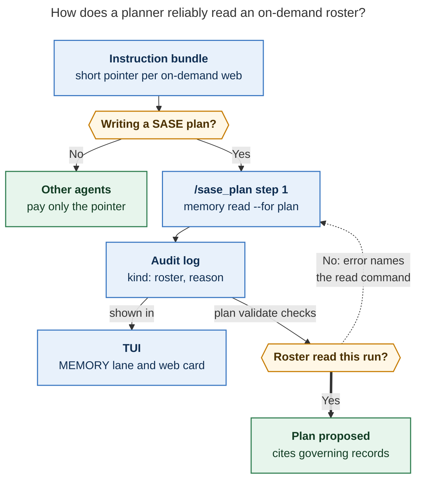

# On-Demand Memory Web Rosters: Planner-Scoped Decisions Without Decisions-Specific Code

_Researcher: cld · 2026-11-25 · sase `df9ce4ef55`, sase-core `71944fb4`, bob-cli `2b626d01`_

## Bottom line

**The idea is right. It needs four changes to be reliable.** The decisions roster is the
single largest item in both projects' agent instructions. It takes about **38% of
sase's bundle** and about **68% of bob-cli's**. Most agents never use it: in the last 30
days only 19% (sase) and 33% (bob-cli) of memory-reading agents read even one decision.
bob-cli is also close to a hard limit. Its Codex bundle is already being compacted to fit
Codex's 32 KiB cap, with about 2 KB of headroom left, and bob-cli adds about 30 decisions
a month.

The four adjustments:

1. **Make it a generic web feature, configured with two descriptor keys.**
   `roster_loading: on_demand` and `roster_required_for: [plan]`. SASE renders a short,
   uniform pointer in place of the roster. Authors don't hand-write instruction prose
   in the descriptor.
2. **Make the roster command the bare web read: `sase memory read decisions`.** Agents
   already guess this command. Today it dumps every strand body: up to ~190 KB per read
   in bob-cli. The full dump moves behind `-a/--all-strands`.
3. **Don't rely on an AGENTS.md sentence alone.** Add a *generic* hook to `/sase_plan`
   (`--for plan`). It reads whatever the current project requires for planning, which is
   nothing in most projects. Back it with a `sase plan validate` host check that rejects
   a plan when a required roster wasn't read in the same run. This changes the "don't
   touch `/sase_plan`" requirement; the change is called out and justified below.
4. **Close the gap for non-planners.** Planners cite the records that govern their plan
   as `decisions:<keyword>`. Implementers then read only those records. bob-cli has to
   explicitly accept that its rules stop being ambient for unplanned work.

The result: every non-planning agent pays about 110 tokens instead of about 2,000 (sase)
or about 6,300 (bob-cli) per turn. Planners pay one audited roster read, which shows in
the TUI. A plan can't be proposed without that read.

## 1. What the evidence says

### 1.1 Size: the roster dominates the bundle

| Measure | sase | bob-cli |
| --- | ---: | ---: |
| Decision strands (wholly / partly superseded) | 31 (2 / 6) | 77 (4 / 29) |
| Committed `AGENTS.md` | 20.8 KB | 35.8 KB |
| Decisions section in `AGENTS.md` | 8.3 KB (**40%**) | 25.4 KB (**71%**) |
| Claude runtime bundle (`sase instructions render -f provider=claude -s`) | 21,972 B (~5.5k tok) | 37,090 B (~9.3k tok) |
| Codex runtime bundle (cap 32,768 B) | 22,166 B | **30,738 B after compaction** (uncompacted 37,284 B, step `superseded_summaries`) |
| Full roster / titles-only roster (`render_strand_roster`, `compaction="all"`) | 7,820 B / 2,370 B | 24,656 B / 6,871 B |
| Strands added per month (git `--diff-filter=A`) | 13 → 6 → 1 (Sep–Nov) | 2 → 33 → 30 (Sep–Nov) |

bob-cli gains about 9–10 KB of roster each month. Codex runs are already on the first
compaction rung. They will reach the second rung (titles only) and then the `oversize`
native-delivery fallback within weeks. **So in bob-cli this is a reliability problem as
well as a cost problem.**

### 1.2 Usage: most agents never touch the roster

From `~/.sase/projects/<project>/memory_reads.jsonl`, last 30 days, counting only agents
that made at least one audited memory read (so these are upper bounds):

| | sase | bob-cli |
| --- | ---: | ---: |
| Agents with any memory read | 165 | 2,057 |
| …of which read any `decisions:` record | 32 (**19%**) | 670 (**33%**) |

Who reads decision records (all time, by agent-name shape):

| Reader | sase | bob-cli |
| --- | ---: | ---: |
| Research agents (`research.*`) | **78%** | 46% |
| Epic phase / land workers | 10% | **37%** |
| Other / ad-hoc | 9% | 16% |
| Tale coders (`--code`) | 3% | 2% |

Planners can't be identified from names: a planner only gets its `--plan` row name after
`sase plan propose`. They fall under "other" and "research". **The heaviest readers today
are research agents and epic phase workers, not planners.** Section 3 explains why that
matters.

### 1.3 The bare web read is a footgun that agents already use as "show me the roster"

`sase memory read decisions` (a bare web name) currently prints **every strand body**:
69 KB in sase and up to ~190 KB (~48k tokens) in bob-cli. Of the 13 bare `decisions`
reads in bob-cli, most reasons ask for an index:

- "Need decision web list" (149,789 B)
- "check decisions index for bank/album/record naming or link rules" (183,558 B)
- "Find the specific Record Card Properties and inline title decisions…" (192,787 B)
- "Locate the authorized capture clock-tag decision strand" (141,979 B)
- "Find the authorized private event notes decision…" (177,318 B)

Only the research reads that were studying the web's format actually wanted every body.
**Agents already expect `sase memory read <web>` to return the roster.**

### 1.4 The repo's own decision record anticipated this

`decisions:webs-render-in-their-own-section` lists this exact cost: "A web descriptor's
body is now always paid for on every turn; there is no longer a way to make one
read-on-demand." Its reopen condition fits today exactly: "A project accumulates enough
memory webs that unconditionally inlining every descriptor becomes a real token-budget
problem. That would need a **new, explicitly scoped opt-out mechanism** designed for
that purpose — **not a revival of `type:` on descriptors**." The design below is that
mechanism. It needs a new record that partly supersedes the old one.

`decisions:readable-agents-md` (via the instruction-bundle research of 2026-10-14) also
records the principle for E7 "audiences": **hard rules and read triggers stay
unconditional.** The pointer is the unconditional read trigger. Only the roster body
becomes conditional.

## 2. How it works today

| Concern | Where | Notes |
| --- | --- | --- |
| Descriptor parsing (`roster`, `roster_label`, `strand_noun`) | `src/sase/memory/web/frontmatter.py` (`parse_web_descriptor`) | Unknown keys are ignored, so older sase versions degrade gracefully |
| Roster rendering | `src/sase/memory/web/roster.py` (`render_strand_roster`, compaction styles `superseded` / `all`) | The same renderer feeds `AGENTS.md`, bundles, and the on-disk `<!-- sase:strands -->` region |
| Bundle assembly | `src/sase/instructions/sections_assemble.py`, `sections_units.py` (`web_section`), `amd/memory_units.py` (`_WEB_MEMORY_INTRO`) | Webs always render in the Memory Webs section |
| Byte-cap compaction | `src/sase/instructions/compaction.py` | Ladder `superseded_summaries` → `list_rosters`, only when a provider declares `max_bytes` (codex 32,768; grok 122,880) |
| Selector reads | `src/sase/memory/selector.py`, `selector_web.py` | Bare web resolves to **every strand** |
| Audit events | `src/sase/memory/_read_log_models.py` (`MemoryReadKind = note\|web\|strand`, schema v3) | Events carry `artifacts_dir` (per run) and `blob_oid` |
| Audit queries | **Rust**: `sase-core/crates/sase_core/src/audit_query.rs`, line 449 | **Drops any event whose kind is not `note`/`web`/`strand`** |
| TUI MEMORY lane | `src/sase/ace/tui/widgets/prompt_panel/_agent_memory_reads.py` | One row per audited read, with a report hint (`memory_read_report.py`) |
| TUI memory panel web card | `src/sase/ace/tui/modals/memory_panel_web_rendering.py` | Shows `Roster: list` and "Last audited read" |
| Plan validation host checks | `src/sase/main/plan_validate_handler.py` (`_apply_decision_host_checks`, `in_agent_context`, `artifacts_dir_from_env`) | Precedent for agent-aware checks |
| `/sase_plan` | `src/sase/macros/skills/sase_plan.md` | Step 1 already runs an audited `sase memory read sase_sizes.md` |

## 3. Critique of the proposed plan

### What's right

- **Scoping the roster to planning is the right cut.** A roster's value is surfacing
  unknown unknowns. That matters most when choosing an approach, which is planning.
  Once a plan exists, implementers need specific records, not the whole index.
- **Generic, not decisions-specific.** It's correct that any web should be able to do
  this. A third corpus is likely to need it (bob-cli's glossary grows fast too).
- **Audit plus TUI.** The read becomes evidence the reviewer can see, not just a hope.

### Where it falls short

1. **A sentence in AGENTS.md is read at the wrong time.** The agent reads its
   instructions at turn start. It decides to plan later, and then follows the
   `/sase_plan` steps, which say nothing about decisions. "MUST" in a standing
   instruction that applies to a moment much later in the turn is the weakest kind of
   trigger. The repo already learned this: `/sase_plan` step 1 explicitly runs
   `sase memory read sase_sizes.md` instead of trusting an AGENTS.md line. **The read
   needs to sit inside the skill (generically) and be checked by the host.**
2. **"Planners only" drops today's biggest consumers without a replacement.** Research
   agents make 78% of sase's decision reads, and epic phase workers make 37% of
   bob-cli's. Phase workers usually work from a plan, so the fix is to have planners
   **cite governing records** in the plan. Research agents recommend designs, so their
   prompts should opt in to the same read.
3. **bob-cli's roster is explicitly normative.** Its descriptor says: "Each roster
   summary is a rule to follow as written." Moving the roster on demand means an
   unplanned bob-cli fix no longer sees those rules. That's a policy change for bob-cli,
   not just a token optimization. Accept it deliberately and record it.
4. **"Add a `sase memory` command" understates the problem.** The intuitive command
   (`sase memory read decisions`) already exists and does the wrong thing at enormous
   cost. Fixing its meaning is better than adding a second command beside it.
5. **Hand-written instruction prose won't stay consistent across webs or projects.**
   With structured keys, SASE renders one consistent pointer and can validate it and
   enforce it.
6. **Hidden cross-repo dependency.** A new "roster" read kind would be silently dropped
   by the Rust audit query (`audit_query.rs`). The TUI would never show the read unless
   sase-core changes first.

## 4. Adjusted requirements (called out)

| # | Original | Adjusted | Why |
| --- | --- | --- | --- |
| A1 | Don't modify `/sase_plan` | **Add one *generic* flag** to its existing step-1 read: `--for plan`. It resolves the current project's plan-required rosters, and resolves to nothing elsewhere. No decisions-specific text. | Puts the read at the moment of planning. Costs zero tool calls and zero output in projects without such webs. |
| A2 | Descriptor renders instructions saying planners MUST read | **SASE generates** the pointer from frontmatter (`description`, count, `roster_required_for`). Authors don't write it. | Consistent, beautiful, validatable, and enforceable. |
| A3 | Add a `sase memory` command if none exists | **Repurpose the bare web read** as the roster read. Add `-a/--all-strands` for the old dump, behind a `sunset` feature flag while callers migrate. | Matches what agents already try; removes 150–190 KB mis-reads. |
| A4 | (implicit) Instructions are enough | **`sase plan validate` errors** inside agent runs when a required roster wasn't read in this run | Turns "MUST" into a guarantee. The fix is one command. |
| A5 | Only planners read decisions | Planners read the roster **and cite governing records** as `<web>:<keyword>`. Research prompts opt in with `--for plan`. | Keeps implementers and researchers connected to the records that matter. |
| A6 | Update both projects' decisions memory | Also write a **new sase decision record** that partly supersedes `webs-render-in-their-own-section`. Update the `glossary:memory-web` definition, the generated SASE Memory core text, the Memory Webs intro, the memory skills, and docs. Optionally add a **bob-cli record** accepting the policy. | Existing text would otherwise state something false. |

## 5. Options considered

| Option | Bundle saving (sase / bob) | Verdict |
| --- | --- | --- |
| **A. Do nothing; let the compaction ladder handle it** | 0 for Claude; Codex only | ❌ Doesn't address context. bob-cli hits the Codex fallback soon. |
| **B. Titles-only roster for everyone** (existing `compaction="all"` style as a mode) | ~5.4 KB / ~17.8 KB | ⚠️ Keeps ambient awareness but still costs 1.7k tokens/turn in bob-cli and grows linearly. Titles are less useful than summaries, so agents read more strands. **Fallback if A5 proves insufficient.** |
| **C. Drop superseded entries** | ~1 KB / ~6.5 KB | ⚠️ Worth doing as a cleanup, but doesn't solve growth. |
| **D. Audience-scoped rendering (E7 `when:`)**: full roster only in planner bundles | Same as E | ❌ The host doesn't know at launch whether an agent will plan. Planning is a mid-turn skill choice. Revisit when a reliable planner role fact exists. |
| **E. On-demand roster + generic plan hook + validator** (recommended) | **~7.9 KB / ~24.9 KB** | ✅ Biggest saving, bounded growth, generic, enforceable, auditable. |
| **F. Search instead of roster** (`sase memory web show decisions <pattern> -b`) | Same as E | ❌ Search can't surface unknown unknowns. Also runs against `decisions:corpus-before-mechanism`. |
| **G. Revive `type: reference` on descriptors** | Same as E | ❌ Explicitly rejected by `webs-render-in-their-own-section`. |

## 6. Recommended design



_Every agent sees only a short pointer. A planner reads the roster at `/sase_plan` step
1. The read is audited and shown in the TUI, and `sase plan validate` refuses a plan until
the read exists in the same run. Rendered with mermaid-cli 12.0.0 at 623×748 px (100%
fit)._

### 6.1 Descriptor frontmatter: two new keys

```yaml
---
web: true
description:
  Architectural decision records — accepted choices, their rejected alternatives, and
  what would reopen them.
roster: list
roster_label: DECISIONS
strand_noun: decision
roster_loading: on_demand # new; default: always
roster_required_for: [plan] # new; optional; closed vocabulary: plan
---
```

- **`roster_loading: always | on_demand`** reuses the vocabulary the memory README
  already uses ("always-loaded", "read on demand"). It is scoped to webs and is not
  `type:`, so it respects `webs-render-in-their-own-section`. `roster` stays the *style*
  (list or inline). Loading is a separate axis, because an on-demand roster still needs
  a style when it's read.
- **`roster_required_for: [plan]`** is a closed vocabulary of moments the host can
  check. Only `plan` exists today. It is a list, so later moments (for example bead
  creation) can be added without a schema change.
- **What "on demand" means:** the descriptor then behaves like a reference note. The
  bundle carries its `description` plus a generated pointer. The *whole body*, meaning
  the author's prose plus the managed roster, comes from the roster read. This rule
  matches what authors already know about reference notes, and it gives the largest
  saving. Anything that must stay always-on belongs in `description` or a core note.
- **Fail-closed validation** in `sase memory init` and `sase doctor`
  (`memory/web/validation.py`):
  - `roster_loading` must be `always` or `on_demand`.
  - `roster_required_for` requires `on_demand`, and its values must come from the
    vocabulary.
  - An on-demand web must have a `description`, because the pointer has nothing else to
    say.
- The on-disk `<!-- sase:strands -->` region is **still maintained** by
  `sase memory init`. Humans browsing `sase/memory/decisions.md` on GitHub keep the full
  roster, and the descriptor's git blob version-pins what a planner read.

### 6.2 What every agent sees (bundle and committed `AGENTS.md`)

The web stays in the **Memory Webs** section, so placement is still decided by kind:

```markdown
### Decisions (decisions)

Architectural decision records — accepted choices, their rejected alternatives, and what
would reopen them. **31 decisions · roster read on demand.**

**Required before you write a SASE plan** (any agent that invokes `/sase_plan`): read the
roster with `sase memory read decisions -r "<why>"`, read each decision that governs your
plan, and cite it in the plan as `decisions:<keyword>`.
```

- The second paragraph appears only when `roster_required_for` is set. Without it, the
  paragraph reads "Read the roster on demand with `sase memory read <web> -r "<why>"`."
  Every phrase comes from `web.slug`, `roster_label`, `strand_noun`, and the count, so
  the wording is identical for every web in every project.
- About 420 bytes, against 7.8 KB / 24.7 KB today. The count changes when a record is
  added. That causes one line of `AGENTS.md` churn instead of a whole roster entry.
- On-demand webs are not compaction candidates (`compaction.py` skips them because
  there's nothing left to compact).
- Update the Memory Webs intro (`_WEB_MEMORY_INTRO`) and the generated SASE Memory core
  text. Both currently promise that "a web's descriptor is always inlined".

### 6.3 The roster read: `sase memory read <web>`

```text
$ sase memory read decisions -r "Planning the stranded-work split: find governing decisions"
---------- MEMORY WEB ROSTER: decisions · 31 decisions · on demand

# Decisions

A decision record is not a design doc or a subsystem overview — … (descriptor prose)

1. **A Gate Never Blocks An Agent** (`gates-never-block`)
   - _[partly superseded by `handoffs-end-through-host-completion`]_ Creating a gate
     from inside an agent ends that agent's turn; …
…
31. **Verification Is Two-Speed** (`two-speed-verification`)
    - _[superseded by `check-full-is-explicit`]_ …

Read records with `sase memory read decisions:<keyword> [decisions:<keyword> …] -r "<why>"`.
```

- **It is the same renderer** (`render_strand_roster`) as today's `AGENTS.md` section, so
  the entries are byte-for-byte what agents see today.
- **The bare web name means "roster" for every web**, whether always or on demand. Two
  meanings that depend on configuration would be surprising.
- **`-a/--all-strands`** keeps the old "every strand" dump. Put the semantic switch
  behind a `sunset` feature flag (default on) per `sase_flags.md`. The Off branch keeps
  the old meaning while the help text, the `sase_memory_read` skill, and
  `docs/reference/memory/memory.md` migrate.
- `sase memory read decisions.md` becomes an alias for the roster read. It currently
  errors with "is an always-loaded memory web descriptor…".
- `sase memory show <web>` prints the same view without an audit entry.
  `sase memory web show <web>` stays the filterable table for humans.
- **`-F/--for MOMENT`** (new): adds every roster whose `roster_required_for` contains
  MOMENT to the batch, resolved project-over-home. It adds nothing when there are none.
  The whole batch is still one audited event.

### 6.4 Audit

- Add `MemoryReadKind` **`roster`** and bump the read-log schema to v4. Record:
  - `selectors=("decisions",)`
  - `resolved_targets=("sase/memory/decisions.md",)`
  - `blob_oid` = the descriptor blob, plus a `roster_digest` (sha256 of the rendered
    roster) in case the on-disk region is stale before `init`
  - `included_targets` = the strand files that fed the roster
- **sase-core first**: accept `roster` in `audit_query.rs` (currently
  `matches!(kind, "note" | "web" | "strand")`), add tests, then move sase's
  `sase-core-revision.txt` pin. Without this the TUI silently loses roster reads.
- Old `kind: web` events keep meaning "every strand". The read report
  (`memory_read_report.py`) must re-resolve them with `--all-strands` semantics, not the
  new bare meaning, so history stays truthful.
- `sase memory log` gains `roster` in its kind column. `--path decisions.md` finds
  roster reads.

### 6.5 Plan-time hook and validator backstop

- **`/sase_plan` step 1** (generic; the only skill change):

  ```bash
  sase memory read sase_sizes.md --for plan --reason "Need SASE size guidance and this project's planning memory before authoring a plan"
  ```

  In projects with no plan-required rosters, output is identical to today.
- **`sase plan validate` host check**: add `_apply_required_memory_checks`, next to the
  existing `_apply_decision_host_checks`.
  - When `in_agent_context()` is true and a resolved web declares
    `roster_required_for: [plan]`, require a `roster` read event for that web with this
    run's `artifacts_dir`.
  - If none exists, emit an error diagnostic. Example:

    ```text
    error[required_roster_unread]: this project requires planners to read the DECISIONS
    roster before proposing a plan.
      run: sase memory read decisions -r "<what you are planning>"
    ```

  - Skip the check outside agent runs (humans running `validate`).
  - Fail open, with a warning, if the read log can't be read. This matches the
    fail-open stance in `hold-pull-fail-open` for store reads.
  - `sase plan propose` inherits the check through validation.
- **Why both layers.** The skill hook reads at the right moment. The validator turns a
  forgotten read into one extra command instead of a silently uninformed plan. Feedback
  replanners and epic sub-planners read again in their own runs. That's correct, because
  records may have changed.
- **If you veto A1**, the pointer plus the validator still guarantee the read. The only
  cost is that the read happens after the first validate rather than before drafting.

### 6.6 TUI ("the appropriate place" is three places, in priority order)

1. **Agent MEMORY lane**, where every audited read already lives. A roster read gets a
   distinct row:

   ```text
   MEMORY  3 reads · 4 files · Instructions as launched
     launch    ◇ [1] Instructions as launched
     14:02:11  ◉ [2] decisions roster · 31 decisions · plan
                  Planning the stranded-work split: find governing decisions
     14:05:40  ◉ [3] decisions:host-owned-completion, decisions:rust-core-required
                  Both govern the finalizer change
   ```

   - The hint (`[2]`) opens the roster report, pinned to the recorded descriptor blob,
     so you see exactly what the planner saw.
   - The `plan` tag appears when the read was the plan-required one, which is easy to
     detect: the web has `required_for` and the agent proposed a plan.
2. **Memory panel web card** (`memory_panel_web_rendering.py`):
   - New badge `ON DEMAND`.
   - `Roster` row: `list · on demand · required for plan`.
   - New `Bundle cost` row: `~110 tokens (roster ~2,000 tokens when read)`.
   - "Last audited read" includes roster reads keyed to the descriptor path.
3. **Plan approval modal** (recommended follow-up). A "Consulted" line, using the 🧠 glyph
   the decision cards already use, lists the planner run's roster read and the records
   it read. The reviewer sees *which* decisions informed the plan, which is the most
   useful place for this audit trail.

### 6.7 Memory updates

**sase** (through `/sase_memory_write`, then `sase memory init`):

- `sase/memory/decisions.md`: add `roster_loading: on_demand` and
  `roster_required_for: [plan]`. Keep the body prose, which now appears only in the
  roster read.
- **New record** `decisions:rosters-load-on-demand`, titled "A Web Roster May Load On
  Demand":
  - **Claim:** the two keys, the generated pointer, the bare-web roster read, and
    host-enforced moments.
  - **Why:** the measurements in §1.
  - **Rejected:** options B, D, F, and G.
  - **Cost:** planners pay one read; unplanned work loses ambient awareness; the meaning
    of the bare-web read changes.
  - **Reopens when:** the host gains a reliable planner fact at launch (render the
    roster directly into planner bundles), or unplanned changes measurably contradict
    records (fall back to a titles-only mode).
- Mark `webs-render-in-their-own-section` as `status: superseded-in-part`,
  `superseded_by: rosters-load-on-demand`. Add an inline note retiring its Cost sentence
  about having no read-on-demand path. Its placement claim still stands.
- `glossary:memory-web`: today it says the descriptor's "body always renders… and
  carries a roster naming every strand". Change it to "unless its roster loads on
  demand".
- Generated text: the SASE Memory section of `sase.md`, the Memory Webs intro, the
  `sase_memory_read` / `sase_memory_write` skill sources, `docs/reference/memory/memory.md`,
  and the README frontmatter schema.

**bob-cli** (in the bob-cli repo):

- `sase/memory/decisions.md`: add the same two keys. Replace "Each roster summary is a
  rule to follow as written" with: "Each roster summary is a rule to follow as written.
  Planners read the roster before planning and cite the records that govern their plan,
  so implementers read the records they must honor." Regenerate `AGENTS.md`. The Codex
  bundle drops from ~37 KB uncompacted to ~12 KB.
- **Optional record** `decisions:decisions-are-consulted-at-planning`. It records that
  rules are no longer ambient for unplanned work, and says it reopens if unplanned bob
  changes contradict a record. Recommended, because the current descriptor promises the
  opposite.

### 6.8 Rollout

| Phase | Repo | Size |
| --- | --- | --- |
| 1. Accept the `roster` read kind in the memory audit query, add tests, bump the pin | sase-core → sase | small |
| 2. Descriptor keys, validation, doctor, pointer rendering, README stats, compaction skip | sase | medium |
| 3. Bare-web roster read (sunset flag), `-a/--all-strands`, `-F/--for`, `roster` audit kind, report re-resolution | sase | medium |
| 4. `sase plan validate` host check, `/sase_plan` step-1 flag, skill/doc/generated-text updates | sase | small |
| 5. TUI MEMORY lane row and memory-panel card (plan approval "Consulted" line as a follow-up) | sase | medium |
| 6. Memory: sase descriptor, new record, supersession mark, glossary; bob-cli descriptor (+ optional record); `sase memory init` in both | sase, bob-cli | small |

Phase 6 must land **after** a sase release containing phases 2–4. Older sase ignores the
unknown keys and would keep rendering the full roster, so `memory init --check` drift
gates would disagree across versions.

## 7. Expected effect

| | sase today → after | bob-cli today → after |
| --- | --- | --- |
| Decisions cost per non-planning turn | ~2,000 → **~110 tokens** | ~6,300 → **~110 tokens** |
| Claude bundle | ~22.0 KB → **~14.1 KB (−36%)** | ~37.1 KB → **~12.2 KB (−67%)** |
| Codex bundle | 22.2 KB, uncompacted | 30.7 KB compacted → **~12 KB, no compaction, ~20 KB headroom** |
| Planner cost | 0 extra (roster already loaded) | one ~2k (sase) / ~6.4k (bob-cli) token read per planning run, audited |
| Growth per new record | +~250–320 B on every turn | +0 B on every turn (count digit only) |
| Index lookups via bare read | 69–190 KB dumps | roster (8–25 KB) |

## 8. Risks and mitigations

| Risk | Mitigation |
| --- | --- |
| Unplanned agents violate a record they no longer see (mostly a bob-cli risk) | Plans cite records (A5). bob-cli accepts the policy explicitly. Watch the read log for a drop in non-planner `decisions:` reads alongside rework. If that happens, set bob-cli to a titles-only mode (option B), which the existing compaction style already supports. |
| Agents or scripts relying on bare-web "every strand" | Sunset flag, `-a/--all-strands`, and help, skill, and doc updates. Old `kind: web` events re-resolve with the old semantics. |
| The validator blocks a planner when the audit store is broken | Fail open with a warning. Skip outside agent context. The fix is one command. |
| Roster reads disappear from the TUI | Phase 1 (Rust `audit_query.rs`) is a hard prerequisite, with the pin bump. |
| Research agents stop consulting decisions | The `#research*` macros (sase-research-artifacts) add `--for plan` to their first read, or say it in the prompt. That is generic, because projects without plan-required rosters get nothing. |
| Over-generalizing too early (`corpus-before-mechanism`) | Two real corpora need it today. The vocabulary is closed (`plan` only). `required_for` on flat reference notes is explicitly deferred. |

## 9. Open questions for Bryan

1. **bob-cli policy:** are you OK with unplanned bob agents no longer seeing decision
   rules? Or do you want a titles-only roster for everyone in bob-cli, at ~1.7k tokens a
   turn? I recommend on demand plus citation, with an explicit bob-cli record.
2. **Validator severity:** error (recommended) or warning?
3. **The bare-web meaning change:** accept it (recommended, with the sunset flag), or
   keep bare = every strand and add `<web> --roster`?
4. **Research swarms:** should `#research*` macros opt in with `--for plan`? Research
   agents make 78% of sase's decision reads.

## 10. Recommended solution

Ship **on-demand memory web rosters** as a generic feature:

- **Two descriptor keys:** `roster_loading: on_demand` and `roster_required_for: [plan]`.
- **Generated pointer:** SASE renders a uniform pointer of about 110 tokens in the Memory
  Webs section, replacing the roster in every bundle and in `AGENTS.md`.
- **Roster read:** `sase memory read <web>` (bare name) becomes the audited roster read.
  It produces the same entries agents see today. It is recorded as a new `roster` audit
  kind, which needs a sase-core change first, and it shows in the agent MEMORY lane and
  the memory-panel web card.
- **Planning guarantee:**
  - A generic `--for plan` flag on `/sase_plan` step 1 makes the read happen at the
    moment of planning.
  - A `sase plan validate` host check rejects a plan when a required roster wasn't read
    in that run.
  - Planners cite governing records as `<web>:<keyword>`, so implementers read exactly
    what binds them.
- **Adopt in both projects:**
  - sase gets a new decision record that partly supersedes
    `webs-render-in-their-own-section`.
  - bob-cli gets a descriptor rewrite that states the policy change openly, plus an
    optional record.

This removes 36–67% of each bundle, stops bob-cli's runaway growth before it breaks
Codex delivery, and makes "planners read the decisions" a guarantee you can see.

## Evidence

- Code: the paths in §2, read at sase `df9ce4ef55` and sase-core `71944fb4`.
- Measurements:
  - `sase instructions render -f provider={claude,codex} -s` in both checkouts.
  - `render_strand_roster` with each compaction style, via `.venv/bin/python`.
  - `git log --diff-filter=A` on the decisions directories.
- Usage: `~/.sase/projects/gh_sase-org__sase/memory_reads.jsonl` (2,839 events since
  2026-09-01) and `~/.sase/projects/gh_bobs-org__bob-cli/memory_reads.jsonl` (7,171
  events since 2026-09-03).
- Memory (audited reads):
  - `decisions:memory-webs`, `webs-render-in-their-own-section`,
    `corpus-before-mechanism`, `readable-agents-md`
  - `glossary:memory-web`, `cli_rules.md`, `sase_flags.md`
- Prior research:
  `research:202610/instruction_bundles_vs_readable_agents_md/instruction_bundles_vs_readable_agents_md__final.md`
  (E7 audiences; "read triggers stay unconditional").
