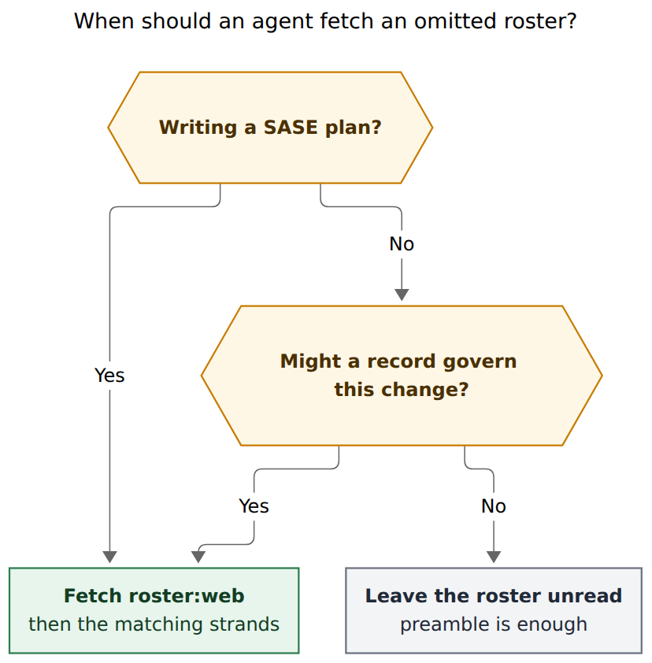
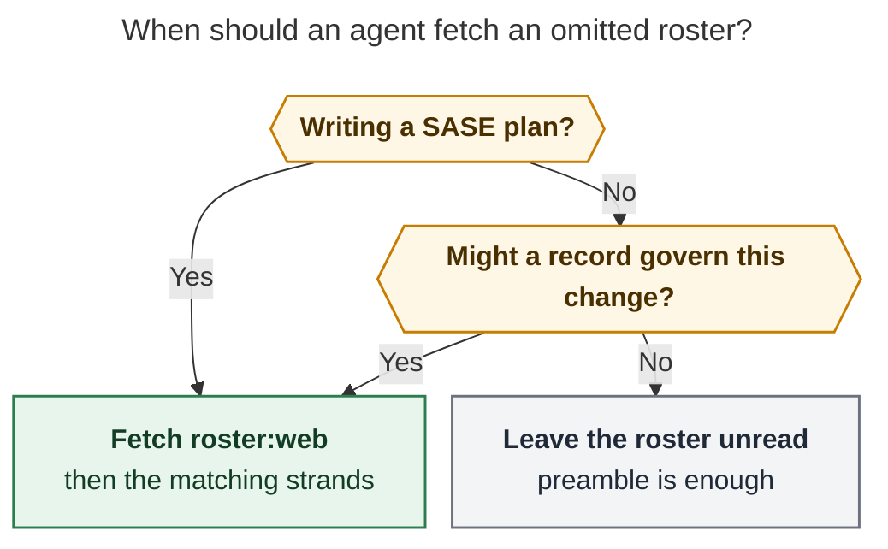
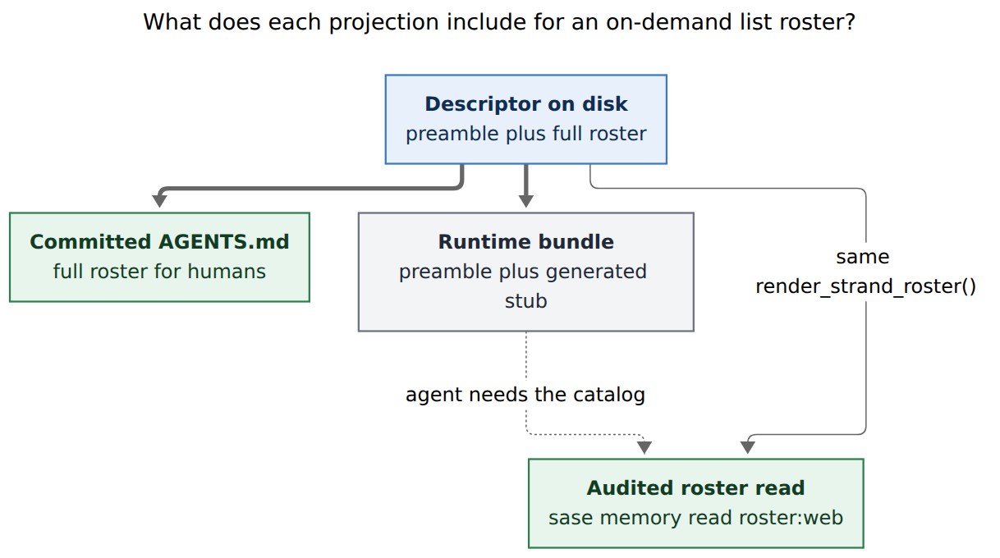
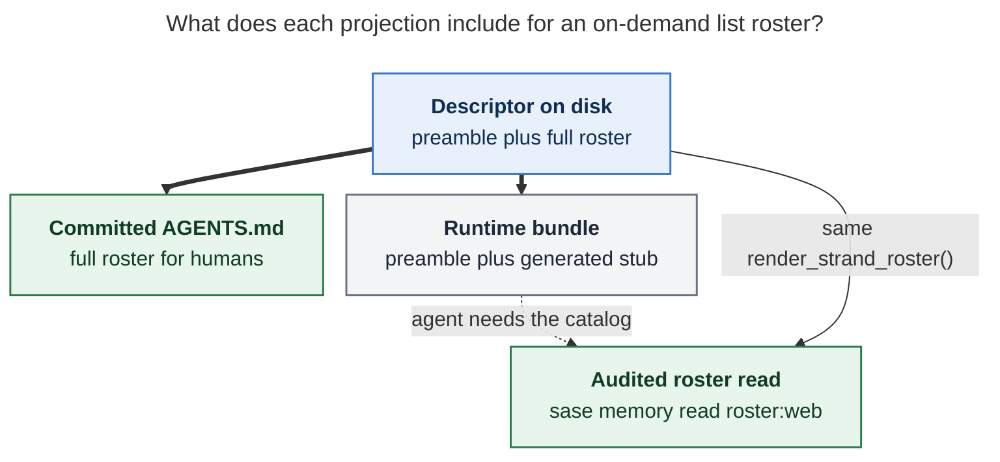
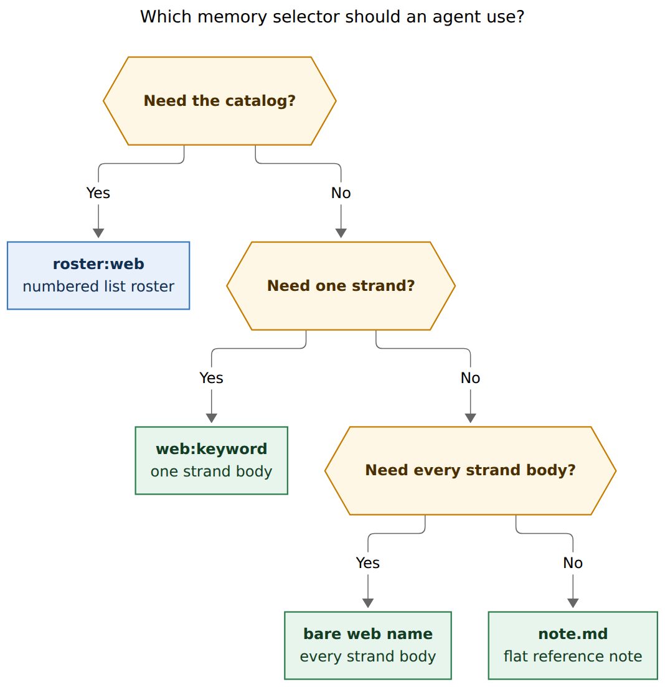
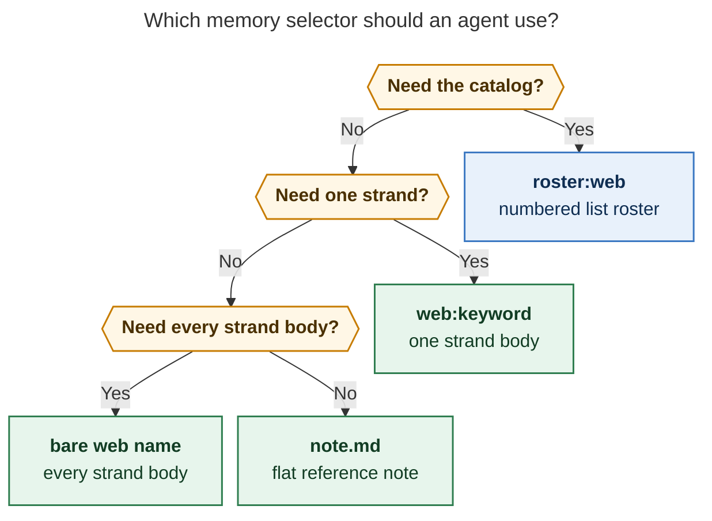

# On-demand memory-web rosters

**Date:** 2026-11-25
**Question:** How should SASE stop paying the decisions-web roster on every agent turn, without special-casing that web, without editing the shared `/sase_plan` skill, and without losing a beautiful audited catalog for the agents that actually need it?
**Snapshot:** sase workspace `sase_14` (decisions web: 31 strands) and the opened bob-cli checkout (decisions web: 77 strands). Bundle sizes from `sase instructions render` / `compile_bundle` against an empty home.

---

## Bottom line

The request is a good idea, and it is the exact reopen condition of `decisions:webs-render-in-their-own-section`. Do it as a **generic roster-inclusion axis** on any memory web, not as decisions-specific machinery.

**Recommended shape:**

1. Add `roster_load: always | on_demand` to web-descriptor frontmatter. Default `always` keeps today's behavior for every project that does not opt in.
2. Runtime instruction bundles honor `on_demand` by replacing the managed roster region with a generated stub. The committed `AGENTS.md` projection keeps the full roster.
3. Add a fourth `sase memory read` selector, `roster:<web>`, that prints the same numbered catalog currently inlined into `AGENTS.md`, records an audited read, and surfaces in the existing TUI **MEMORY** lane.
4. Opt the sase and bob-cli `decisions` webs into `on_demand`. Leave `glossary` (`roster: inline`) and `task_types` (small list) always-loaded.
5. Broaden the "when to fetch" rule past planner-only: fetch before writing a SASE plan, **and** before changing behavior a record might govern.

The largest justified adjustments to the original request are (a) planner-only is too narrow, (b) keep the full roster in committed `AGENTS.md`, (c) extend `sase memory read` rather than adding `sase memory web roster`, and (d) do not modify `/sase_plan` in v1.

---

## The cost is real, and bob-cli already hits a cap

`tokens_est` in instruction manifests is `ceil(len/4)`. The decisions web is the dominant always-loaded section in both projects.

| Surface | sase | bob-cli |
| --- | ---: | ---: |
| Decisions descriptor on disk | 8,645 B · ~2,161 tok · 31 strands | 25,941 B · ~6,485 tok · 77 strands |
| Decisions subsection in `AGENTS.md` | 8,308 B · ~2,077 tok | 25,425 B · ~6,356 tok |
| Compact titles-only (compaction step `list_rosters`) | 2,076 B · ~519 tok | 5,381 B · ~1,345 tok |
| `proj.web.decisions` in a root bundle | 8,408 B · 2,102 tok | 25,641 B · ~6,410 tok |
| Whole root bundle, empty home | 22,166 B · no compaction | 36,911 B uncapped |

sase's decisions section is **38% of the root bundle** and the single largest included section, ahead of `pkg.sase.repos` (2,273 B) and `proj.web.glossary` (2,172 B).

bob-cli's decisions section is **70% of the uncapped root bundle**. Codex's explicit-delivery cap is 32 KiB. Compiling bob-cli for Codex already fires the compile-time compaction ladder:

- uncapped delivered: **36,911 B**
- after `superseded_summaries`: **30,365 B** (fits)
- Grok's 120 KiB cap: no compaction, so Grok/Claude/Muse still pay the full ~25 KB roster on every turn

That last point matters. Today's compaction is a **cap brake**, not a standing policy. It only rewrites list rosters when a provider would otherwise fall back with `oversize`. Claude and Muse have no cap. Grok's cap is 120 KiB. The user-visible problem is "every agent pays this," not "Codex is about to fail closed."

The reopen clause of `decisions:webs-render-in-their-own-section` is already satisfied:

> A project accumulates enough memory webs that unconditionally inlining every descriptor becomes a real token-budget problem. That would need a new, explicitly scoped opt-out mechanism designed for that purpose — not a revival of `type:` on descriptors.

bob-cli's 77-entry list roster *is* that corpus. sase's 31-entry list is the same shape at smaller scale. `decisions:corpus-before-mechanism` is satisfied: two real catalogs need a fetch path that plain `sase memory read <web>` cannot serve, because a bare web name dumps **every strand body** (74,502 B on sase, 233,439 B on bob-cli).

---

## What already exists (do not rebuild it)

The feature is 80% designed. The missing piece is a **standing inclusion policy** plus an **audited catalog selector**.

**Roster layout is already generic.** Web descriptors declare `roster: inline | list`, plus `roster_label` and `strand_noun`. `glossary` is inline (`**GLOSSARY TERMS:** …`). `decisions` and `task_types` are list (numbered title, slug, summary, supersession marker). `src/sase/memory/web/roster.py` owns `render_strand_roster()` and the managed `<!-- sase:strands -->` region. Descriptor writers always persist the full roster. Compaction is a compile-time projection that never writes the descriptor.

**Bundle compaction already knows how to shrink list rosters.** `INSTRUCTION_MANIFEST_COMPACTION_STEPS = ("superseded_summaries", "list_rosters")`. Step 2 is the titles-only catalog, ending with `_Entry summaries omitted to fit the provider budget; read one with sase memory read <web>:<keyword>._` Inline rosters ignore compaction, which is correct: the glossary term line *is* the discovery index and is already cheap (~2.1–2.7 KB).

**`sase memory web show WEB` is the wrong command for this.** It is an unaudited, filterable *table* (keyword, slug, aliases, mention-count, summary). Help text is explicit: "This is the index; `sase memory show <web>:<keyword>` is the content read." Agents must not use `show` when consulting memory to do work. It does not look like the `AGENTS.md` roster.

**`sase memory read` already audits, already batches, already feeds the TUI.** Schema v3 events carry `kind` (`note` / `web` / `strand`), `selectors`, `resolved_targets`, `included_targets`, and `byte_count`. For a batch, `resolved_path` is empty, so the Agents-tab MEMORY lane's numbered hint pages a generated report from `sase.memory.memory_read_report` rather than opening a raw file. That is the right TUI home. The legacy `GLOSSARY` lane is retired-command history; do not add a `DECISIONS` lane.

**Descriptor reads are rejected today.** `sase memory read decisions.md` fails with "always-loaded memory web descriptor; read its strands with `sase memory read decisions:<keyword>`." That rejection is why a new selector is required: the omitted catalog is no longer always-loaded, and the existing three selector shapes cannot name it.

**Planner identity is not knowable at render time.** Instruction bundles are frozen per invocation (`decisions:instructions-per-invocation`, R4). Facts include `purpose: ordinary | declaration_recovery | conflict_repair` — there is no planner purpose. `/sase_plan` sets `log_skill_use: false`. An agent decides to plan *during* the turn. An E7 `when:` audience cannot drop the roster for "non-planners" at spawn. The fetch has to be a read the agent issues after it decides it needs the catalog.

**`/sase_plan` already has a "Plan Decisions" section** that is about *plan-file* reviewer choices (`decisions:` frontmatter), not the decisions memory web. Hardcoding "read the decisions web" into that skill would be both a naming collision and a lie for the majority of SASE projects, which have no such web.

---

## Critique of the original plan

The original plan is directionally right: stop inlining the full roster, teach a fetch, keep the mechanism generic, audit the read, update both projects' descriptors. Several details should change.

### 1. Planner-only is too narrow — **justified adjustment**

A decision roster is a *discovery index*. It exists so an agent can see that "CI is two-speed" or "a task move never advances the walk" before it proposes the rejected alternative. Restricting the fetch to agents that invoked `/sase_plan` hides that index from implementers, reviewers, and memory authors.

bob-cli's own preamble already states the better rule: "Before changing behavior a record governs, or proposing one of its rejected alternatives, read it." sase's operational rules (host-owned completion, single-turn agents, rust-core-required) are duplicated into core memory and skills, so some implementers would survive without the roster. The records that are *only* in the web would start getting violated.

**Adjustment:** the stub's when-clause is "writing a SASE plan, **or** changing behavior a record might govern." Planner-only remains the *primary* reminder, not the exclusive one.



*Fetch the roster before planning, and before a change a record might govern. Leaving it unread is correct when the preamble alone is enough.* Rendered size: 551 × 562 px; fit 100%.



### 2. Keep the full roster in committed `AGENTS.md` — **justified adjustment**

The request says "stop rendering the full decisions roster in agent instruction bundles." That is the right target. The committed `AGENTS.md` is a different projection: `decisions:readable-agents-md` makes it the human-readable standing catalog and the per-invocation fallback for agy, Qwen, and OpenCode.

Compaction already established the split: descriptors on disk stay full; a runtime bundle may project a smaller roster. Standing `on_demand` should use the same split.

If `AGENTS.md` also stubbed the roster, GitHub readers and fallback providers would lose the catalog. agy loads `AGENTS.md` natively with no suppression switch. That is an acceptable remaining cost for a low-traffic fallback; it is a bad cost for the document humans actually read.

**Adjustment:** `roster_load: on_demand` is interpreted by the **bundle compiler**. `sase memory init` continues to inline the full managed roster into `AGENTS.md`.



*The descriptor is the source of truth. Committed `AGENTS.md` keeps the full roster. Runtime bundles replace it with a stub. The audited `roster:<web>` read reuses `render_strand_roster()`.* Rendered size: 811 × 454 px; fit 80.5%.



### 3. Extend `sase memory read`; do not add `sase memory web roster` — **justified adjustment**

The original plan is unsure whether an appropriate command exists. Three shapes were considered:

| Shape | Why it loses |
| --- | --- |
| `sase memory web show` | Unaudited, table, already defined as "not the content read" |
| `sase memory web roster WEB -r` | New verb for agents who already know `sase memory read`; splits audit across two families |
| `sase memory read decisions.md` | Conditional allow/deny based on `roster_load` is confusing; `.md` still looks like a flat note |
| Bare `sase memory read decisions` | Already means *every strand body*. Changing that breaks `sase memory read glossary` |
| `--roster` flag | Works, but a selector batches with other selectors more cleanly |

**Adjustment:** add selector kind `roster:<web>`.

```bash
sase memory read roster:decisions -r "Need the decisions catalog before planning"
sase memory show roster:decisions          # humans, no audit
```

`classify_selector` currently treats any `foo:bar` as a strand. Special-case the prefix `roster:` before that, and reserve `roster` as a web slug via the existing `reserved_memory_web_names()` set (`assets`, `README`, plus artifact-ref kinds). No current web uses that slug.

The printed body is `render_strand_roster(web)` — the same numbered list as `AGENTS.md`, including summaries and supersession markers — wrapped with the existing `---------- MEMORY WEB ROSTER: decisions` batch header. Do not reprint the preamble (it is still in the bundle). Do not dump strand bodies.



*Four selector shapes. `roster:<web>` is the new catalog fetch; a bare web name remains "every strand body."* Rendered size: 712 × 736 px; fit 91.7%.



### 4. Do not modify `/sase_plan` in v1 — agrees with the request

A decisions-specific sentence in the shared skill would fire on every SASE project. A *generic* extra step ("read every `roster_load: on_demand` web") would be a no-op for projects without such webs, and would be more reliable than a stub buried in Memory Webs.

Defer that skill change. `decisions:corpus-before-mechanism` applies: ship the stub and the selector first. If planners measurably skip the stub, add the generic skill step then. The skill's existing first step already models the pattern (`sase memory read sase_sizes.md` before choosing a plan size).

**v1 teaching surfaces, all generic:**

- Generated per-web stub in the bundle (exact command, strand count, `strand_noun`).
- One sentence on the Memory Webs frame intro: a web may omit its roster; the subsection names the fetch.
- Descriptor preamble stays projection-neutral (no "the catalog below", no "this document omits").

### 5. Do not special-case `decisions`, and do not revive `type:`

`roster_load` is a second axis next to `roster: inline | list`. It is inclusion, not kind, and not a rendering tier. That is the opt-out `webs-render-in-their-own-section` asked for.

`type:` on a descriptor is explicitly forbidden as the solution. `roster_load` never moves a web into Core or Reference Memory. The preamble still always inlines into `## Memory Webs`. Only the managed roster region is eligible to drop.

Inline-roster webs (`glossary`) should stay `always`. A doctor/init **warning** (not a blocker) if `roster: inline` combines with `on_demand` is enough: that combination throws away a cheap discovery line and replaces it with a stub that is usually larger.

`task_types` is a five-entry list (~1.2 KB) plus a "file discovered work" trailer. Leave it `always`. Opt-in is authorial, per web.

### 6. No feature flag

`sase_flags.md`: flags are for temporary user-reaching routes. Default `always` *is* today's behavior. `on_demand` is a web-local config field, the same family as `roster: list`. Rollback is reverting the frontmatter on the two descriptors.

### 7. Stay in Python

Roster render, selector resolution, bundle compilation, and the MEMORY lane are all Python. `decisions:instructions-per-invocation` keeps composition in Python until a non-Python frontend needs to preview a render. The TUI displays the audit event, not a second roster renderer. This does not cross the rust-core backend boundary.

---

## Alternatives considered

**Standing compact (titles and slugs only, always).** Reuse compaction step `list_rosters` as a third `roster_load: compact`. sase would drop from ~2,077 tok to ~519 tok; bob-cli from ~6,356 tok to ~1,345 tok. Discovery survives. The user asked to stop paying the roster, and 77 compact lines are still a lot of always-loaded context. Ship `always | on_demand` first. Add `compact` later if stub compliance is poor and a middle rung is wanted. Do not make compact the v1 default for these two webs.

**Always run the existing compaction ladder, ignore caps.** Would shrink summaries for every `roster: list` web on every provider, including `task_types`. Cap-driven compaction would stop being a last resort. Wrong default, and it still leaves the titles.

**E7 audience `when:` at compile time.** Cannot see `/sase_plan` from spawn. Would require a second render mid-turn, which breaks "one frozen bundle per invocation."

**Change bare-web `sase memory read decisions` to mean the roster.** Inconsistent with `sase memory read glossary`. Agents already copy that glossary example from the skill.

**Hide the roster from `AGENTS.md` too.** Saves fallback-provider tokens. Costs the human-readable projection `readable-agents-md` exists to protect.

**New TUI `DECISIONS` lane.** Special-casing. MEMORY already shows `sase memory read` events; a roster selector of `roster:decisions` is a clear primary label. Keep `resolved_path` empty so the hint pages the generated report (pretty catalog) rather than the raw descriptor with YAML and HTML markers.

---

## Recommended solution

### Frontmatter

```yaml
web: true
description: ...
roster: list
roster_label: DECISIONS
strand_noun: decision
roster_load: on_demand   # new; default always
```

Parse next to `roster` in `src/sase/memory/web/frontmatter.py`. Valid values: `always`, `on_demand`. Unknown values fail closed like `roster must be inline or list`.

### Bundle compiler

After memory units are collected and before the cap ladder:

- For each included `proj.web.*` / `home.web.*` section whose web has `roster_load: on_demand`, replace the managed roster region with a generated stub. Reuse `render_web_body_with_roster` with a new inclusion style, then `strip_managed_roster_markers` as today.
- Record a per-section note analogous to compaction (`inclusion: on_demand`, `uncompacted_length`) so `sase instructions render -s` and the manifest can show it. Do **not** overload `bundle.compaction.step`; this is authorial, not cap-driven.
- Cap compaction then runs on whatever list rosters remain (`task_types`, any `always` list web that still overflows).

Stub, generated from web metadata so authors never hand-write it:

```markdown
The **DECISIONS** roster (31 records) is omitted from this runtime bundle.
Read it before writing a SASE plan, and before changing behavior a record
might govern:

    sase memory read roster:decisions -r "Need the decisions catalog"

Then read one record with `sase memory read decisions:<keyword> -r "<why>"`.
```

Swap in `roster_label`, strand count, `strand_noun` pluralization, and slug. Beautiful, generic, copy-pasteable.

Frame intro (`_WEB_MEMORY_INTRO` in `src/sase/amd/memory_units.py`) gains one sentence: a web may omit its roster from the runtime bundle; when it does, the subsection names the `sase memory read roster:<web>` fetch.

### Selector, audit, TUI

- `RosterSelector(raw, web_slug)` in `selector_models.py`.
- `classify_selector`: if the string starts with `roster:`, require a non-empty web slug and return `RosterSelector`. Empty `roster:` stays `invalid_syntax`.
- Resolve against the scoped web catalog. Unknown web fails the whole batch, same as today's fail-closed read.
- Render through `memory_selector_batch_markdown` as `---------- MEMORY WEB ROSTER: <slug>` plus `render_strand_roster(web)` (the web's configured `inline` or `list` style, never compacted).
- `build_memory_read_batch_event(kind="web", selectors=("roster:decisions",), resolved_path="", included_targets=<strand slugs>, byte_count=<roster bytes>)`. Extending `MemoryReadKind` with `"roster"` is optional polish; `kind="web"` plus the selector prefix is enough for v1 and keeps old MEMORY-lane consumers working.
- TUI MEMORY lane already joins `event.selectors` when `resolved_path` is empty, so the row reads `roster:decisions`. The numbered hint pages the generated report. `sase memory log` lists the same event. No new lane.

### Descriptor and glossary updates (both projects)

**sase `sase/memory/decisions.md` and bob-cli `sase/memory/decisions.md`:**

- Set `roster_load: on_demand`.
- Keep the managed roster region. `sase memory init` still synchronizes it.
- Add one projection-neutral sentence to the preamble: the numbered catalog is also a `roster:decisions` read. Do not say "below" or "omitted from this document."

**New sase decision strand** (this change *is* a decision; it partly supersedes the Cost clause of `webs-render-in-their-own-section`):

- **Claim.** A memory web may declare `roster_load: on_demand`. Runtime bundles then omit the managed roster and teach `sase memory read roster:<web>`. The descriptor preamble stays always-loaded in `## Memory Webs`. Committed `AGENTS.md` keeps the full roster. This is a roster-inclusion axis, not a revival of `type:` on descriptors.
- **Why.** The reopen condition of `webs-render-in-their-own-section` is met. Compaction is cap-only and still leaves most of the catalog in uncapped providers. Planner-only compile-time dropping is impossible under a frozen bundle.
- **Cost.** Agents may skip the stub. Fallback providers still load the full `AGENTS.md` roster. `roster` becomes a reserved web slug. Bundle text diverges further from `AGENTS.md` (already true under compaction).
- **Reopens when.** Stub compliance is measurably poor (then add a generic `/sase_plan` step or `roster_load: compact`); or fallback/`AGENTS.md` token cost becomes the constraint.

Mark `webs-render-in-their-own-section` `superseded-in-part` with a `[[...]]` back-link, same convention as other partial supersessions. Do not edit its claim in place.

**Glossary `memory-web`:** today's "its body always renders … and carries a roster naming every strand" becomes false for `on_demand` webs. Update the strand: the preamble always renders; the roster renders in the bundle iff `roster_load` is `always` (the default).

**bob-cli** does not need its own copy of that architecture decision unless bob wants to record the opt-in as a bob-local policy. The descriptor frontmatter plus preamble sentence is the bob-cli memory change.

### Docs and skill

- `docs/reference/memory/memory.md` — document `roster_load`, the new selector, the AGENTS.md vs bundle split, and that `web show` remains the table index.
- `docs/reference/memory/instruction-bundles.md` and `docs/contribute/instruction-bundle-internals.md` — standing omission vs cap compaction.
- `src/sase/macros/skills/sase_memory_read.md` — fourth selector shape. This is a generated skill: change the source, land, then `sase skill init` from the landed tree.
- CLI help for `sase memory read` / `show`. `just fix` regenerates `docs/reference/cli/memory.md`.

### Tests worth naming

- Frontmatter parse / reject unknown `roster_load`.
- Reserved web slug `roster`.
- `classify_selector("roster:decisions")` vs `classify_selector("glossary:stitch")`.
- `sase memory read roster:decisions` markdown equals `render_strand_roster` of that web; audit event recorded; `show` does not record.
- Bundle compile with `on_demand`: section omits summaries, contains the stub command, still contains the preamble.
- `sase memory init` / committed `AGENTS.md` still contains the full numbered roster.
- Compaction still applies to remaining `always` list webs; an `on_demand` web is not compacted (already stubbed).
- `test_sase_root_bundle_fits_every_capped_provider_without_compaction` keeps passing, with `proj.web.decisions` no longer the largest section.
- MEMORY-lane display uses the selector string; hint path is the generated report.
- Inline + `on_demand` warns.

### What "beautiful" means here

- One new word in frontmatter (`roster_load`), one new selector prefix (`roster:`), zero new subcommands, zero new TUI lanes, zero flags, zero `/sase_plan` edits.
- The catalog an agent fetches is byte-for-byte the catalog a human already sees in `AGENTS.md`, because both call `render_strand_roster()`.
- The stub is generated, copy-pasteable, and counts the records, so the omission is honest rather than a vague "see also."
- Default is unchanged. Opt-in is the two descriptors that actually hurt.

---

## Risks

**Stub non-compliance.** Agents ignore MUST-lines in long instruction bundles. Mitigation: exact command in the stub; frame-intro sentence; later a generic `/sase_plan` step if needed. Do not try to enforce the read mechanically in v1.

**Bare-web footgun.** A planner who runs `sase memory read decisions` instead of `roster:decisions` dumps 74 KB (sase) or 233 KB (bob-cli) of strand bodies. Mitigation: stub shows only the roster command; optional later warning when a bare-web read exceeds a byte threshold. Out of v1 scope.

**Fallback providers.** agy/Qwen/OpenCode still load the full `AGENTS.md` roster. Acceptable under `readable-agents-md`. Revisit if those providers become the common path.

**Parity checks.** `sase instructions render -p` asserts that every web *path* maps to a section, not that section text equals `AGENTS.md`. Standing omission stays compatible. Confirm the parity tests do not grow a byte-identity assertion.

**Helper bundles.** Root bundles carry Memory Webs; helper bundles should inherit the same stubbed section if they include it. Do not re-expand the roster for helpers.

---

## Implementation order

1. Frontmatter + models + reserved slug + `render` stub helper.
2. `roster:<web>` selector, markdown, audit event, tests.
3. Bundle compiler standing omission + manifest field + size-gate expectations.
4. Frame intro sentence; docs; `sase_memory_read` skill source.
5. sase descriptor `roster_load: on_demand` + preamble sentence + new decision strand + glossary `memory-web` update; `sase memory init`.
6. bob-cli descriptor `roster_load: on_demand` + preamble sentence; `sase memory init` in that project.
7. TUI/report confirmation (MEMORY lane + generated report). Snapshot goldens only if the row shape actually changes.

Phase-size guess: this is an **epic** if split (selector/audit, bundle projection, the two memory updates), or a **large tale** if one implementer owns it. The memory updates need accepted memory decisions in the plan, because they change always-loaded instructions.

---

## Recommendation

Implement **on-demand list-roster inclusion** as specified above. It is the scoped opt-out `webs-render-in-their-own-section` already promised, it is generic, it reuses the roster renderer and the MEMORY-lane audit path, and it turns bob-cli's 25 KB always-loaded catalog into a ~1 KB stub for every explicit-delivery agent that is not actually using it.

Do not hide the catalog from committed `AGENTS.md`. Do not make `/sase_plan` decisions-aware. Do not treat planner-only as the exclusive fetch rule. Do not add a new command family or a new TUI lane.
