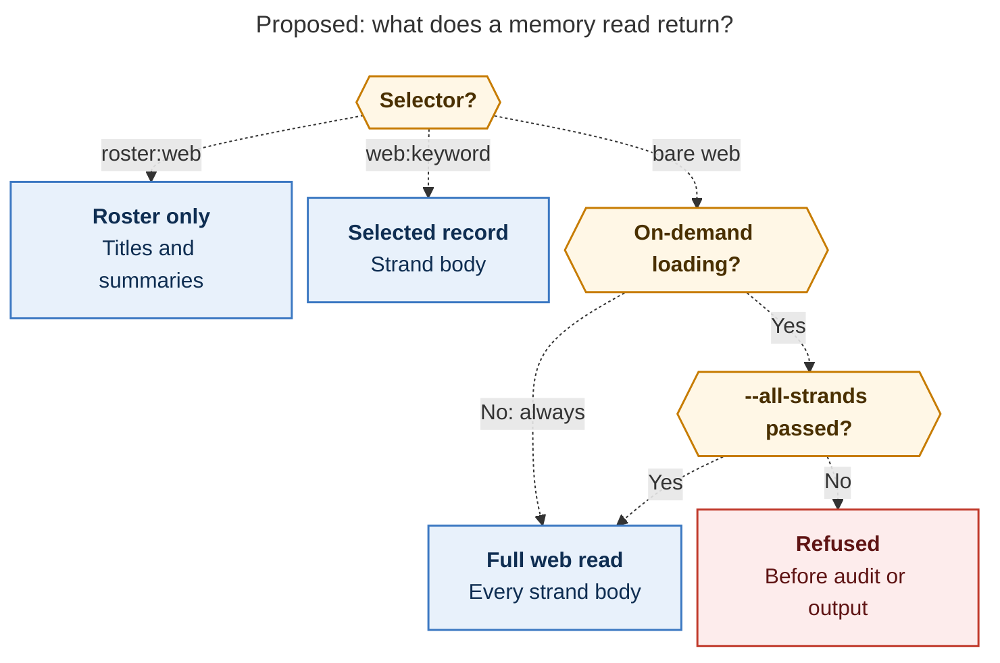
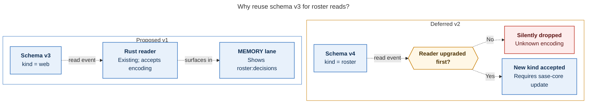

# Diagram proposals: On-demand memory web rosters: consolidated research and recommended design

Proposals for the swarm linker, not a report. Each diagram restates only what the source
report says.

```yaml
source: research:202611/on_demand_web_rosters/on_demand_web_rosters__final.md
producer: research.6e.image
check: mmdc 12.0.0 (--no-sandbox) with the PDF-mirroring config rendered 2 of 2 Mermaid diagrams
```

## selector-routing

```yaml
anchor: |-
  Bare-web guard per §3.5, with `-a/--all-strands` added to `read` and `show`.
question: |-
  Which content does a read return, and when is an accidental full-web dump refused?
illustrates: |-
  The roster selector returns the catalog without strand bodies, while the bare-web guard refuses on-demand full-web reads without --all-strands.
caption: Bare web reads return all strand bodies for either always-loaded webs or an explicit --all-strands request;
  roster selectors return the catalog.
review: 810.448x808 px, fit 80.5%; question, visual and source checks passed; 1 revision
```



## audit-compatibility

```yaml
anchor: |-
  shrinks the change to pure Python, and the MEMORY lane renders it correctly today.
question: |-
  Why can v1 surface roster reads without upgrading the Rust audit reader?
illustrates: |-
  Schema-v3 web events use the existing MEMORY lane, whereas a new roster kind requires sase-core to land first to avoid silently dropped reads.
caption: Reusing schema v3 avoids the Rust-reader dependency; a new roster kind must wait for a reader upgrade.
review: 748x635 px, fit 87.3%; question, visual and source checks passed; 1 revision
```


