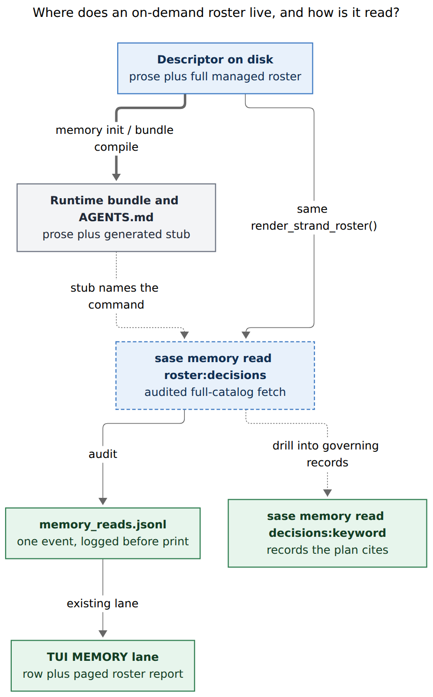
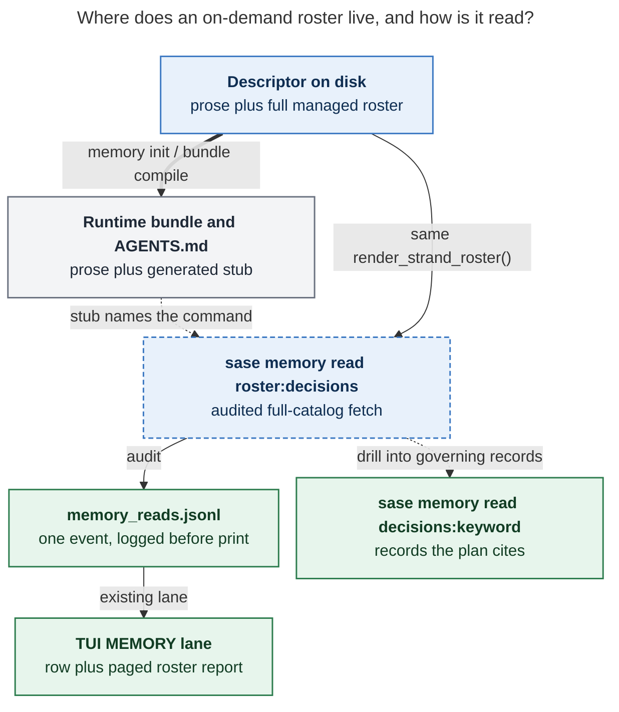

# On-demand memory web rosters: consolidated research and recommended design

**Date:** 2026-11-25 · **Lead consolidation** of five independent researcher reports
(`__cdx`, `__cld`, `__grk`, `__mus`, `__gem`, in this directory) plus the lead's own
verification against sase `df9ce4ef55`.

**Request:** stop paying the `decisions` memory-web roster in every sase and bob-cli
agent instruction bundle; scope it to planners; keep the mechanism generic to any memory
web; make the roster retrievable by an audited `sase memory` command; show the read in
the TUI; update both projects' decisions memory.

## Verdict

All five researchers independently reached the same conclusion, and the lead concurs:
**the idea is right, the architecture already anticipates it, and it should ship as a
generic per-web roster-loading axis** — not decisions-specific machinery, and not a
revival of `type:` on web descriptors. The reopen clause of
`decisions:webs-render-in-their-own-section` names this exact situation ("a real
token-budget problem … a new, explicitly scoped opt-out mechanism"), and
`decisions:corpus-before-mechanism` is satisfied by two real catalogs that plain reads
cannot serve.

Two of the original requirements need adjustment, and both changes are called out and
justified below:

1. **Planner-only is too narrow** (unanimous across all five reports). Telemetry shows
   researchers — not planners — are the top consumers of decision records, and some
   records constrain implementers. The fix is "planners and design researchers MUST read
   the roster; plans cite governing records; implementers read what their plan cites;
   direct architectural changes consult the roster first."
2. **One project-agnostic sentence should be added to `/sase_plan`** (adjusting the
   "don't modify `/sase_plan`" requirement in a way consistent with its rationale). The
   constraint was "no decisions-specific instructions in the shared skill"; a generic
   "honor any project-declared planning-required rosters" sentence is a no-op for every
   project without one, and it fires at the moment the agent actually decides to plan —
   which a standing AGENTS.md sentence does not.

## 1. The evidence

### 1.1 Size: the roster dominates both bundles, and bob-cli is already over a cap

Measurements were taken independently by four researchers with live
`sase instructions render` / `compile_bundle` runs and agree to the byte:

| Measure | sase | bob-cli |
| --- | ---: | ---: |
| Decision strands | 31 (2 superseded, 6 partly) | 77 (4 superseded, 29 partly) |
| `proj.web.decisions` in the root bundle | 8,408 B (~2,102 tok) | 25,641 B (~6,394 tok) |
| Share of root bundle | **38%** (of 21,972 B) | **69%** (of 37,090 B) |
| Share of committed `AGENTS.md` | 41.5% | **72.3%** |
| Codex bundle (cap 32,768 B) | 22,166 B, no compaction | **37,284 B → over cap by 4,516 B**; `superseded_summaries` compaction fires on every Codex turn, leaving ~1.9 KB headroom |
| New records per month (Sep–Nov) | 13 → 6 → 1 | 2 → 33 → **30** |

bob-cli adds roughly 9–10 KB of roster per month and will reach the titles-only
compaction rung and then the `oversize` native-delivery fallback within weeks (cld). So
for bob-cli this is a **reliability** problem, not only a cost problem. Today's
compaction ladder is a cap brake, not a standing policy: Claude and Muse have no cap and
pay the full roster on every turn forever (grk).

### 1.2 Usage: most agents never touch it, and planners are not the top readers

From `memory_reads.jsonl` (cld: last 30 days; gem: all time, 10,002 events — the two
analyses agree):

- Only **19% (sase)** and **33% (bob-cli)** of memory-reading agents read even one
  decision record, and those are upper bounds (agents with zero reads aren't counted).
- Decision reads by agent class: **research agents 78% (sase) / 46% (bob-cli)**; epic
  phase and land workers 10% / 37%; tale coders 3% / 2%. Planners cannot be reliably
  identified by name, but gem's `sase_sizes.md`-correlated estimate puts them at roughly
  12% (sase) / 27% (bob-cli) of decision-reading activity.

This is the decisive fact behind adjustment 1: **a planner-only rule would orphan the
web's heaviest actual consumers** (researchers recommending designs) while saving
nothing extra.

### 1.3 The bare-web read is an observed footgun

`sase memory read decisions` (bare web name) prints **every strand body**: ~69 KB in
sase, 142–205 KB (~36k–51k tokens) in bob-cli. gem found 6+ real incidents where agents
ran it *looking for an index* ("Need decision web list", "check decisions index for …")
and accidentally paid ~50k tokens. Once the roster leaves the standing instructions,
index-seeking bare reads will become more common, so the design must catch them.

### 1.4 Architecture fit (verified by the lead via audited reads)

- `decisions:webs-render-in-their-own-section` — Cost: "A web descriptor's body is now
  always paid for on every turn; there is no longer a way to make one read-on-demand."
  Reopens when: "unconditionally inlining every descriptor becomes a real token-budget
  problem. That would need a new, explicitly scoped opt-out mechanism designed for that
  purpose — not a revival of `type:` on descriptors." This feature is that mechanism; a
  new record must partly supersede this one.
- `decisions:readable-agents-md` — "The repo commits the **full runtime projection**
  (`AGENTS.md` plus a byte-identical `CLAUDE.md` copy)." AGENTS.md mirrors what runtime
  bundles deliver. This settles the swarm's one genuine 4-against-1 dispute (§3.2):
  when bundles stub the roster, AGENTS.md stubs it too, or the "readable projection"
  becomes a misleading one.
- `decisions:corpus-before-mechanism` — mechanism follows corpus. Two real catalogs (31
  and 77 records) that a bare read cannot serve are the corpus; speculative extras
  (enforcement vocabularies, retrieval engines, snapshot stores) stay out of v1.

### 1.5 Mechanics verified in code by the lead

These load-bearing claims from the reports were independently confirmed at
`df9ce4ef55`:

- `classify_selector` (`src/sase/memory/selector_models.py:150`) parses `anything:rest`
  as a strand selector, so a `roster:` prefix must be special-cased before that branch,
  and `reserved_memory_web_names()` (`src/sase/memory/web/validation.py:39`) exists to
  reserve `roster` as a web slug. grk's selector design drops in exactly as described.
- The TUI MEMORY lane (`_agent_memory_reads.py:66–83, 235–238`) **already** joins
  selector strings for display when `resolved_path` is empty and routes the numbered
  hint to a generated memory-read report. A roster read that records
  `selectors=("roster:decisions",)` and an empty `resolved_path` gets a correct row and
  a paged report with zero new TUI machinery.
- `/sase_plan` step 1 already runs an audited `sase memory read sase_sizes.md` — the
  precedent that skill-step reads, not standing sentences, are how SASE makes
  moment-of-planning reads actually happen.
- `_VALID_ROSTERS = {"inline", "list"}` fails closed on unknown values, while unknown
  frontmatter *keys* are ignored (`parsed.frontmatter.get(...)`), so an older installed
  sase renders a `roster_loading:` descriptor with the full roster rather than crashing
  — which drives the rollout sequencing in §4.8.
- Three reports (cdx, cld, gem) independently confirmed the Rust audit reader
  (`sase-core` `audit_query.rs`) whitelists `kind ∈ {note, web, strand}` and
  `schema_version 1..=3` and **silently drops** anything else. Any design that emits a
  new kind or schema version requires sase-core to land first — which is why v1 avoids
  both (§3.3).

## 2. Critique: is this a good idea?

Yes. It is the single largest cheap context win available in both projects, it is
permanent rather than cap-dependent, and the project's own decision records anticipated
it. The honest costs, which the design accepts deliberately:

1. **Ambient discovery degrades for unplanned work.** An agent doing a quick fix no
   longer trips over "CI is two-speed" in its standing instructions. Mitigations: the
   always-inlined descriptor preamble carries the read trigger; plans must cite
   governing records so implementers inherit constraints; safety-critical rules in sase
   (host-owned completion, the Rust boundary, guarded recipes) are already duplicated
   into core memory and skills. For bob-cli, whose descriptor says "each roster summary
   is a rule to follow as written," this is a real policy change that must be accepted
   explicitly and recorded, not slipped in as a token optimization (cld, gem).
2. **Compliance is social in v1.** A "MUST read" in the preamble plus a generic
   `/sase_plan` sentence has the force of every other memory MUST — strong but not
   mechanical. The audit log makes misses *observable*; a mechanical `sase plan
   validate` backstop is specified but deferred until compliance is measured (§6).
3. **One more projection divergence.** Bundle text already diverges from the on-disk
   descriptor under compaction; standing omission widens that. The committed AGENTS.md
   stays byte-consistent with bundles, and the descriptor on disk stays the complete
   human-readable catalog.

Alternatives every researcher rejected, with the strongest single reason each:

| Alternative | Why it loses |
| --- | --- |
| Rely on the existing compaction ladder | Cap-driven only; Claude/Muse pay full price forever, and bob-cli still hits the Codex fallback soon |
| Titles-only roster for everyone | Still ~1.7k tokens/turn in bob-cli, grows O(records) forever, and strips the summaries that say whether a record governs the task; keep as a fallback mode if on-demand compliance proves poor |
| Revive `type: reference` on descriptors | Explicitly rejected by `webs-render-in-their-own-section`; loses keyword resolution, per-strand audit, and scope merging |
| Planner-audience bundles (E7 `when:`) | The host cannot know at spawn whether an agent will plan; planning is a mid-turn decision under frozen per-invocation bundles |
| Convert decisions to a flat reference note | Strictly worse discoverability; loses the web machinery entirely |
| Semantic search instead of a roster | Retrieval misses on 31/77-record catalogs; `corpus-before-mechanism` violation |

## 3. Resolving the swarm's disagreements

The five reports agree on the direction and on most of the spec. They split five ways on
the command shape and meaningfully on three other points. Lead resolutions:

### 3.1 Config key: `roster_loading: always | on_demand` (new orthogonal axis)

Proposals: `roster_delivery: on-demand` (cdx), `roster_loading: on_demand` (cld, gem),
`roster_load: on_demand` (grk), `roster: deferred` (mus). Four of five keep loading
orthogonal to the existing `roster: inline | list` *style* axis, and cdx states the
decisive reason: `roster: deferred` conflates formatting with delivery and leaves the
on-demand render style undefined. **Adopt `roster_loading: always | on_demand`**,
default `always`, parsed next to `roster` in `web/frontmatter.py`, failing closed on
unknown values exactly like `roster must be inline or list`. The `roster_required_for:`
vocabulary (cld) is deferred with the validator (§6). A doctor/init warning (not a
blocker) flags `roster: inline` + `on_demand`, which would replace a cheap one-line
index with a larger stub (grk).

### 3.2 Delivered projections: stub the bundle **and** committed AGENTS.md; keep the full roster in the on-disk descriptor

- **AGENTS.md** (grk alone said keep the full roster there): stubbed, 4–1. The
  tiebreaker is `readable-agents-md`'s own text — AGENTS.md is "the full runtime
  projection," i.e. a mirror of what bundles deliver, and it is also live delivery for
  native-discovery providers (agy, Qwen, OpenCode) and the oversize fallback, where the
  decisions roster is 72% of bob-cli's file. Keeping it there would quietly exempt those
  providers from the entire fix.
- **On-disk descriptor `<!-- sase:strands -->` region** (gem alone said strip it):
  kept, 4–1. It preserves the complete human catalog on GitHub, keeps
  `sase memory init` convergence unchanged, and lets the descriptor blob version-pin
  what a read returned. gem's churn/merge-conflict argument is real but describes
  today's status quo, not a regression; stripping stays available as a follow-up if
  bob-cli's ~30-records-a-month descriptor churn starts biting.
- One implementation trap flagged by cdx and mus: `strip_managed_roster_markers()`
  removes only the marker *lines*, not the roster content. The projection must replace
  the whole managed region (and handle the marker-absent case where the renderer would
  normally append a roster).



*The descriptor on disk keeps its full managed roster; every delivered projection
(runtime bundle and committed AGENTS.md) carries a generated stub naming the exact
command; the audited `roster:<web>` read renders the same catalog through
`render_strand_roster()`, logs one event before printing, surfaces in the existing TUI
MEMORY lane, and leads to strand reads of the records a plan cites. Dashed elements are
proposed additions.* Rendered with mermaid-cli 12.0.0; 614 × 990 px; fit 90.2%.



### 3.3 Command shape: the `roster:<web>` selector wins

Five researchers proposed five shapes. The decision matrix:

| Shape (proposer) | Fatal or deciding objection |
| --- | --- |
| Bare `sase memory read <web>` becomes the roster (cld) | Changes the meaning of `sase memory read glossary`, which agents copy from the skill today; needs a sunset flag and a migration; two of five explicitly rejected it |
| `sase memory read <web> --roster` (cdx) | Ambiguous in mixed variadic batches (`read sase_sizes.md decisions --roster`), and dropping the flag silently detonates the full-body dump (gem) |
| `sase memory web roster <web>` (mus) | New verb outside the `read`/`show` family agents already know; splits the audit surface across two command families (grk) |
| `sase memory web read <web> [PATTERN]` (gem) | Best runner-up: clean read/show symmetry and native pattern filtering, but a second audited command family plus new report/TUI wiring for marginal v1 benefit |
| **`sase memory read roster:<web>` selector (grk)** | **Adopted** |

The selector wins on four concrete grounds: (a) **zero new commands** — it extends the
one audited read agents already use and the `/sase_memory_read` skill already teaches;
(b) **batching** — `sase memory read roster:decisions decisions:rust-core-required -r
"…"` is one command and one audit event, and any future plan-step hook composes the
same way; (c) **existing audit and TUI plumbing applies verbatim** (verified, §1.5);
(d) `sase memory show roster:<web>` falls out as the unaudited human twin. Its two
costs are accepted: `roster` joins `reserved_memory_web_names()` (no current web uses
it), and audited *pattern-filtered* roster reads don't exist in v1 — a full roster read
is 8–25 KB, affordable for the rare governed-domain lookup, and the unaudited
`sase memory web show <web> <pattern>` table still serves keyword hunting before an
audited strand read. If Bryan wants audited filtered roster reads in v1, that is the one
fact that would flip this choice to gem's `web read` shape.

Output: a `---------- MEMORY WEB ROSTER: decisions` batch header plus
`render_strand_roster(web)` — byte-for-byte the catalog agents see in AGENTS.md today,
including summaries and supersession markers, computed from the live discovered strands
(project-over-home merged), never from the possibly-stale on-disk region (cdx). No
preamble reprint, no strand bodies, no link expansion. A footer names the strand-read
command.

### 3.4 Audit encoding: stay on schema v3 in v1; no sase-core change

cdx, cld, and gem wanted a new `roster` kind (schema v4, sase-core first); grk and mus
showed v3 suffices: `kind="web"`, `selectors=("roster:decisions",)`, empty
`resolved_path`, `included_targets=()` (a full-web read has non-empty
`included_targets`, so the two stay distinguishable), `byte_count` = rendered roster
bytes, and `blob_oid` = digest of the rendered roster bytes (gem's freshness trick,
reused without schema changes). **Adopt the v3 encoding.** It eliminates the one hard
cross-repo dependency (the Rust whitelist that silently drops unknown kinds/schemas),
shrinks the change to pure Python, and the MEMORY lane renders it correctly today.
Promoting to a first-class `kind="roster"` (with `audit_query.rs` + pin ratchet +
`sase memory log` kind column) is queued as v2 polish, sequenced sase-core-first exactly
as cld and gem specified.

cdx's immutable-snapshot concern (the paged report re-resolves against current files,
so "roster as read" can silently show tomorrow's roster) is valid but applies equally
to every existing batch read today; fixing report fidelity is separate work. v1 records
the digest so drift is at least *detectable*, and the report is labeled as a current
render.

### 3.5 Bare-web guard: adopt, scoped to on-demand webs

gem's observed 142–205 KB accidents justify a fail-closed guard now rather than grk's
"optional later warning": when a bare `WebSelector` targets a web with
`roster_loading: on_demand` and `-a/--all-strands` was not passed, refuse before
logging or printing, with an error naming the roster command, the strand-read command,
and the escape hatch. `sase memory read glossary` (an `always` web) is untouched, so no
existing caller breaks and no feature flag is needed — the old branch stays reachable
for every web that hasn't opted in (per `sase_flags.md`, rollback is reverting two
descriptors' frontmatter).

### 3.6 Who must read it: broaden beyond planners (unanimous)

The consolidated audience rule, generated into the stub's trigger line and elaborated in
each descriptor's authored preamble:

1. **Before writing or revising a SASE plan** (any agent invoking `/sase_plan`): MUST
   read the full roster, then the records that govern the plan, and **cite them in the
   plan as `decisions:<keyword>`** so implementers inherit the constraints without
   ambient exposure (the plan-citation obligation; cdx, cld, mus, gem independently).
2. **Architectural or design research**: MUST read the full roster before recommending a
   design (researchers are the top consumers; gem).
3. **Direct changes to governed behavior without a plan**, or departures from a plan's
   design: consult the roster first (grk's broadened when-clause; bob-cli's preamble
   already states this rule).
4. **Implementers working from a plan**: read the records the plan cites; no roster
   read required. Routine work pays only the ~110–420 B pointer.

## 4. Recommended solution (consolidated spec)

### 4.1 Frontmatter

```yaml
web: true
description: >-
  Architectural decision records — accepted choices, their rejected alternatives, and
  what would reopen them.
roster: list
roster_label: DECISIONS
strand_noun: decision
roster_loading: on_demand   # new; always | on_demand; default always
```

Fail-closed value validation in `web/frontmatter.py` + `validation.py`; an on-demand web
must still have a `description` and a non-empty authored body outside the managed
region (the pointer needs prose to anchor to); summary-required rules for `roster: list`
stay in force regardless of loading (the roster read still renders them).

### 4.2 Projection and stub

In `memory_web_root_plan()` / the bundle compiler path (`root_planning.py`,
`amd/memory_units.py`, `instructions/sections_units.py`): when
`roster_loading == "on_demand"`, the rendered web body replaces the entire managed
roster region with a generated stub; the on-disk descriptor keeps the full region. The
authored preamble carries the project's "when" policy (it stays always-inlined); SASE
generates the "how" so it is uniform, correct, and copy-pasteable across webs and
projects (the cdx split, resolving cld's hand-written-prose objection):

```markdown
The **DECISIONS** roster (31 decisions) is omitted from standing instructions.
Read it before writing a SASE plan, before design research, and before changing
behavior a record might govern:

    sase memory read roster:decisions -r "<why>"

Then read one record with `sase memory read decisions:<keyword> -r "<why>"`.
```

On-demand webs leave the `CompactableWeb` set (nothing left to compact); the cap ladder
still runs on remaining `always` list webs. Record the omission in the section notes /
manifest as authorial inclusion, not a `bundle.compaction.step` (grk). Update
`_WEB_MEMORY_INTRO` and the generated SASE Memory core text, both of which currently
promise every descriptor is fully inlined. Helper bundles inherit the stubbed section
unchanged.

### 4.3 Roster read, show twin, and guard

- `RosterSelector` in `selector_models.py`; `classify_selector` special-cases the
  `roster:` prefix ahead of the strand branch; empty `roster:` stays `invalid_syntax`;
  `roster` added to `reserved_memory_web_names()`.
- `sase memory read roster:<web> -r "<why>"` — audited, batches with other selectors,
  one event per batch, audit-before-print, fail-closed on unknown webs. Works for
  `always` webs too (loading is a prompt policy, not an access restriction — cdx).
- `sase memory show roster:<web>` — same output, no audit (read/show symmetry).
- Bare-web guard per §3.5, with `-a/--all-strands` added to `read` and `show`.
- `sase memory read <web>.md` keeps rejecting descriptors, with its error text updated
  to name `roster:<web>` for on-demand webs.
- `sase memory web show` remains the unaudited human table; its help links to the
  roster selector.

### 4.4 Audit event and TUI

Event per §3.4 (schema v3, `kind="web"`, selector prefix, empty `included_targets`,
rendered-bytes digest in `blob_oid`). Surfaces:

1. **Agent MEMORY lane** (primary; no new lane — `GLOSSARY` is retired history): the
   existing selector-join path renders `roster:decisions`; the numbered hint pages the
   generated report. Optional polish: a dim `roster · 31 decisions` tag and gem's
   freshness chip (`≡ now` / `⟲ roster changed`) comparing the live render's digest.
2. **Memory panel web card** (`memory_panel_web_rendering.py`): `ON-DEMAND` badge,
   `Roster: list · on-demand` row, and "Last audited read" covering roster reads.
3. **CLI**: `sase memory log` lists the event; `--path`/selector filtering finds roster
   reads.

### 4.5 Memory updates — sase (via `/sase_memory_write`, then `sase memory init`)

- `sase/memory/decisions.md`: add `roster_loading: on_demand`; keep the managed region;
  add one projection-neutral preamble sentence stating the catalog is available as a
  `roster:decisions` read (never "below" or "omitted from this document" — the
  descriptor renders in multiple projections).
- **New decision record** (e.g. `rosters-load-on-demand`): claim (the axis, the stub,
  the selector, the guard; descriptor preamble stays always-loaded; AGENTS.md mirrors
  the bundle), why (§1 measurements; frozen bundles make planner-scoped compilation
  impossible), rejected alternatives (§2 table), cost (ambient discovery lost for
  unplanned work; agents may skip the stub; `roster` reserved as a web slug), reopens
  when (compliance measurably poor → add the validator or a titles-only `compact` mode;
  a reliable planner fact at spawn → revisit audience bundles). Mark
  `webs-render-in-their-own-section` `superseded-in-part` with a `[[...]]` back-link;
  never edit it in place.
- `glossary:memory-web`: the descriptor body "always renders … and carries a roster
  naming every strand" becomes "the preamble always renders; the roster renders inline
  iff `roster_loading` is `always` (the default)."

### 4.6 Memory updates — bob-cli (via `/sase_repo`, same pattern)

- Same frontmatter change; rewrite the preamble so it no longer claims every roster
  summary is ambiently visible: planners read the roster and cite governing records;
  governed-domain direct changes consult the roster first. Keep the compact
  governed-domains list (capture, walk/review, tasks/lanes/decay, gcal/meetings, refs,
  themes/relations, releases, Mac Capture) in the preamble so direct coders know when
  to look (gem).
- **Recommended** (gem): promote the 1–2 truly universal unplanned-work guardrails
  (e.g. the release-train rule — never hand-edit `Cargo.toml` version or
  `CHANGELOG.md`) into a tiny `sase/memory/gotchas.md` core note (~80 tokens), since
  they protect every turn and will no longer be ambient.
- Optional but recommended: a short bob-cli record accepting that decision rules are
  consulted at planning time rather than ambient, with its own reopen condition
  (unplanned changes measurably contradicting records).

### 4.7 Skill, docs, and the `/sase_plan` sentence

- `src/sase/macros/skills/sase_memory_read.md`: fourth selector shape (generated skill —
  edit source, land, then redeploy per `generated_skills.md`).
- `src/sase/macros/skills/sase_plan.md` step 1 gains one project-agnostic sentence:
  "Also honor any project-declared planning requirements in your instructions' Memory
  Webs section (such as reading an on-demand roster required before planning)." This is
  the adjusted requirement from the verdict; it never names decisions and is a no-op
  elsewhere.
- Docs: `docs/reference/memory/memory.md` (the axis, the selector, the
  AGENTS.md-vs-descriptor split, `web show` stays the table),
  instruction-bundle reference/internals (standing omission vs cap compaction),
  CLI help regeneration, `memory-initialization.md` (currently documents the inline
  behavior verbatim — mus).

### 4.8 Rollout order (version-skew aware)

1. **sase, mechanism:** frontmatter + models + reserved slug + projection/stub;
   selector + audit + guard + show twin; TUI confirmations; docs + skill sources;
   tests. No sase-core work, no feature flag.
2. **Release/install the updated sase.** Critical sequencing fact (cld): an older
   installed sase ignores the unknown key and renders the full roster, so flipping
   descriptors before the release would make `sase memory init --check` drift gates
   disagree across machines.
3. **sase, adoption:** descriptor + new record + supersession + glossary update;
   `sase memory init`; confirm the Codex/size gates and that `proj.web.decisions` is no
   longer the largest section.
4. **bob-cli, adoption:** descriptor + preamble rewrite (+ gotchas promotion + optional
   record); `sase memory init`; confirm the Codex bundle drops to ~13 KB with ~19.6 KB
   headroom and zero compaction.
5. **Post-rollout measurement:** watch `memory_reads.jsonl` for (a) planner runs
   lacking a `roster:` read before `sase plan propose`, (b) a drop in non-planner
   decision reads correlated with rework. Trigger the deferred items (§6) on evidence.

### 4.9 Tests that matter (consolidated from grk, cdx, mus)

- Frontmatter: accept/reject values; inline+on_demand warns; generic behavior proven on
  an arbitrarily named test web (not decisions).
- Selector: `roster:decisions` vs `glossary:stitch` vs bare web vs `.md`; reserved slug.
- Read: output byte-equals `render_strand_roster`; audit event shape (empty
  `included_targets`, selector recorded); `show` logs nothing; guard fires only on
  on-demand webs and `-a` bypasses; empty web yields a labeled empty roster, not an
  unknown-web error; scope merging (project-over-home) matches existing read semantics;
  roster output never contains strand bodies or expanded links.
- Projection: bundle and AGENTS.md contain preamble + stub and zero roster entries;
  on-disk descriptor keeps the full region; `init` idempotent; `init --check` clean;
  absent key and explicit `always` preserve legacy output byte-for-byte; compaction
  skips on-demand webs but still runs on remaining list webs; stale-region case (strand
  edited, no init) — the read shows current content.
- TUI: MEMORY lane row text and report hint; no extra audit event from opening the
  report; provider size-gate tests keep passing with decisions no longer the largest
  section.

### 4.10 Expected effect

| | sase | bob-cli |
| --- | --- | --- |
| Decisions cost per non-planning turn | ~2,100 tok → **~110 tok** | ~6,400 tok → **~110 tok** |
| Root bundle | ~22.0 KB → **~14.3 KB (−35%)** | ~37.1 KB → **~12.9 KB (−65%)** |
| Codex | headroom grows ~7 KB | over-cap + compaction every turn → **~19.6 KB headroom, zero compaction** |
| Growth per new record | +~300 B every turn | **+0 B every turn** (count digit only) |
| Planner/researcher cost | one audited ~2.1k-tok read per planning run | one audited ~6.4k-tok read per planning run |
| Accidental index dumps | 69 KB possible | 142–205 KB observed → **refused with the right command** |

## 5. Risks

| Risk | Mitigation |
| --- | --- |
| Planners skip the stub (compliance is social) | Stub carries the exact command; `/sase_plan` generic sentence fires at the planning moment; audit log makes misses observable; validator (§6) is the measured escalation |
| Unplanned bob-cli agents violate rules they no longer see | Plan-citation obligation; governed-domains line stays inlined; gotchas promotion for universal rules; explicit bob-cli record; fallback is a titles-only standing mode |
| Report shows current roster, not as-read bytes | Digest recorded for drift detection; full snapshot fidelity deferred (it equals the existing limitation for all batch reads) |
| Fallback providers (agy/Qwen/OpenCode) read stubbed AGENTS.md and never fetch | Accepted: they are low-traffic fallbacks; the stub names the command; revisit if they gain real usage (`readable-agents-md` reopen clause) |
| Version skew during rollout | Mechanism-first sequencing (§4.8); old sase ignores the key gracefully |
| Parity/size gates assume current section sizes | Named test updates in §4.9 |

## 6. Deliberately deferred (v2 candidates, each with its trigger)

1. **`sase plan validate` host check + `roster_required_for:` vocabulary** (cld's
   strongest idea): reject a plan when a required roster wasn't read in the same run,
   fail-open on store errors, skipped outside agent context. Trigger: measured planner
   compliance below ~90% after rollout.
2. **First-class `kind="roster"` audit events** (schema v4, sase-core
   `audit_query.rs` + pin ratchet). Trigger: wanting roster-typed queries/columns; pure
   polish until then.
3. **`roster_loading: compact`** (standing titles-only middle rung, reusing the
   existing compaction style). Trigger: on-demand compliance poor in bob-cli but full
   omission too aggressive.
4. **Audited pattern-filtered roster reads.** Trigger: governed-domain coders in
   bob-cli demonstrably needing filtered audited lookups (would have favored gem's
   `web read` shape).
5. **Stripping the on-disk managed region** (gem's adjustment 3). Trigger: descriptor
   merge conflicts measurably slowing bob-cli landings.
6. **Immutable roster snapshots for as-read report fidelity** (cdx). Trigger: an actual
   dispute over what a planner saw; belongs to a general batch-read-report fix.
7. **Research-macro opt-in** (`#research*` prompts instructing the roster read).
   Trigger: researcher roster reads dropping after rollout; coordinate in
   `sase-research-artifacts`.

## 7. Open questions for Bryan

1. **bob-cli policy:** accept that decision rules stop being ambient for unplanned
   work (recommended, with the citation obligation + gotchas promotion), or prefer a
   standing titles-only roster there (~1.7k tok/turn)?
2. **The `/sase_plan` sentence:** approve the one generic sentence (recommended), or
   ship v1 with zero skill changes and measure first?
3. **gotchas promotion:** which 1–2 bob-cli rules, if any, are universal enough to
   always load (~80 tokens)? The release-train rule is the candidate all evidence
   supports.
4. **Filtered audited roster reads in v1?** If yes, the command choice flips from the
   `roster:<web>` selector to `sase memory web read <web> [PATTERN]` (§3.3).

## Provenance

- Five swarm reports in this directory (suffixes `__cdx`, `__cld`, `__grk`, `__mus`,
  `__gem`), each independently researched; measurements cross-agree at sase
  `df9ce4ef55`, sase-core `71944fb4`, bob-cli `2b626d01`/`e6eb52a1`.
- Lead verification: audited `sase memory read` of
  `decisions:webs-render-in-their-own-section`, `decisions:readable-agents-md`,
  `decisions:corpus-before-mechanism`; code inspection of
  `src/sase/memory/selector_models.py`, `src/sase/memory/web/{frontmatter,validation}.py`,
  `src/sase/ace/tui/widgets/prompt_panel/_agent_memory_reads.py`, and
  `src/sase/macros/skills/sase_plan.md` at `df9ce4ef55`.
- External context (via cdx): Anthropic's progressive-disclosure guidance
  ([Effective context engineering for AI agents](https://www.anthropic.com/research/effective-context-engineering-for-ai-agents))
  and Nygard's ADR rationale
  ([Documenting Architecture Decisions](https://www.cognitect.com/blog/2011/11/15/documenting-architecture-decisions)).
