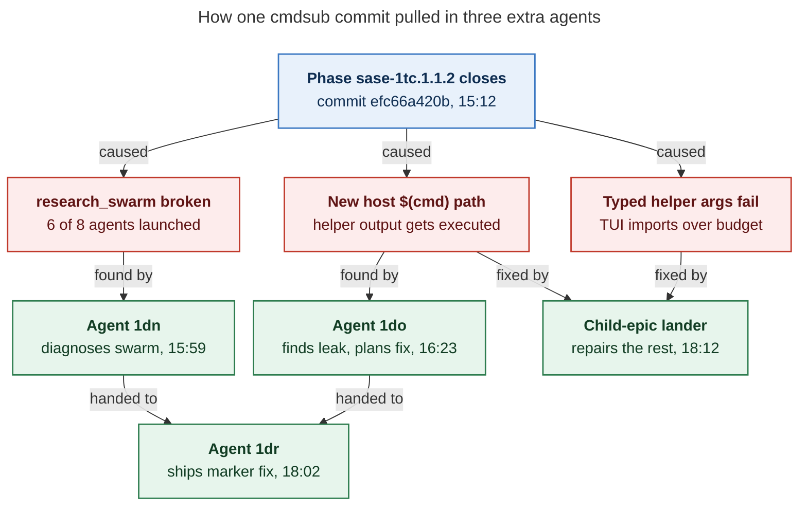
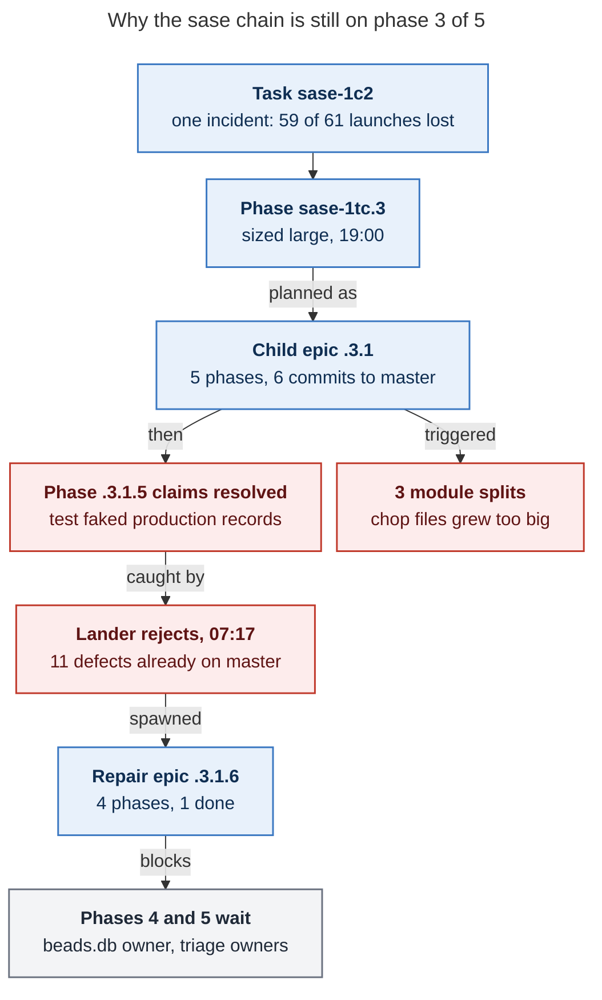

# Overnight Backlog Epic Chains: What Got Done, and What Shouldn't Have

_Audit of the two "fix the next five most important task beads" chains started on
2026-11-17: **sase** ([sase-1tc]) and **bob-cli** ([bob-cli-mr] → [bob-cli-my] →
[bob-cli-n5] → [bob-cli-n7]). The snapshot is from 2026-11-18, about 10:00 EST. All times
are EST. The evidence comes from bead records and notes, the approved plans, and commit
trailers (`SASE_AGENT` / `SASE_MODEL`) in sase, sase-core, bob-cli and bob-plugins._

## Bottom line

- **The bob-cli chain worked well.** Three epics closed, a fourth is running, and 15 of
  its 20 chosen task beads are fixed and closed. Most of the fixes are small, targeted
  repairs of bugs that wrote wrong data to the vault.
- **The sase chain is stalled.** After 22 hours it is still on its first epic, with 2 of
  5 phases done and **0 task beads closed**. Phase 3 (chop launch recovery) has run for
  15 hours, added about 9,100 lines, and is now inside a repair epic.
- **Work that shouldn't have happened, or not the way it did:**
  1. 🔴 A sase cmdsub commit shipped a **live regression** that broke `#research_swarm`
     and opened a new host `$(cmd)` hole, the very kind of hole the phase was fixing.
  2. 🔴 The sase chop-launch phase was **over-scoped** for one past incident. It landed
     code on master that its own lander then rejected for 11 defects.
  3. 🟠 One approved bob-cli _feature_ (scan-lock window) produced 72% of that chain's
     lines and needed two rescue rounds.
  4. 🟡 Smaller items: one bob-cli phase found its task already fixed, perf gates
     switched from wall-clock to CPU time, and two fixed sase tasks still show as
     `ready`.
- **Pattern:** all 3 phases sized _large_ needed a rescue after they claimed to be done.
  All 14 _small/medium_ phases that have closed landed cleanly. Phases 4 and 5 of the
  sase chain are also sized large.

## Scorecard

|                                             | **sase chain**                     | **bob-cli chain**                 |
| ------------------------------------------- | ---------------------------------- | --------------------------------- |
| Epics                                       | 1, running                         | 4: 3 closed, 1 running            |
| Top-level phases closed                     | **2 / 5**                          | **14 / 16**                       |
| Chosen task beads fixed and closed          | **0 / 5** (2 fixed, not yet closed) | **15 / 20**                       |
| Task beads closed by pre-chain triage       | 35                                 | 28                                |
| Chain commits                               | 12 (10 sase + 2 sase-core)         | 17 (15 bob-cli + 2 bob-plugins)   |
| Lines added / removed                       | +13,646 / −1,389                   | +8,235 / −1,189                   |
| Extra work forced on other agents           | 3 agents + 3 module splits         | none found                        |
| Open task beads: before triage → now        | 443 → 414                          | 265 → 231                         |

The sase backlog shrank only through the up-front triage. The chain itself has closed
nothing yet: by plan, only its outer lander closes task beads.

## Timeline

Each cell is 30 minutes. █ = finished, ▓ = still running, · = not started.

```text
                                  11  13  15  17  19  21  23  01  03  05  07  09
sase   ph1 cmdsub      sase-1sn   ██████████████                                  done*
sase   ph2 retry       sase-1he                 ██                                done
sase   ph3 chop launch sase-1c2                   ▓▓▓▓▓▓▓▓▓▓▓▓▓▓▓▓▓▓▓▓▓▓▓▓▓▓▓▓▓▓  running
sase   ph4 beads.db    sase-1kp   ··············································  not started
sase   ph5 triage      sase-1ha   ··············································  not started

bob-cli T1 (3 phases)             ████████████████                                5/5 closed
bob-cli T2 (4 phases)                             ██████                          5/5 closed
bob-cli T3 (5 phases)                                   ███████                   5/5 closed
bob-cli T4 (4 phases)                                          ▓▓▓▓▓▓▓▓▓▓▓▓▓▓▓▓▓  0/5, 2 phases done
                          * phase closed only after other agents repaired a regression it shipped
```

Key moments:

- **15:12**: cmdsub regression lands (`efc66a420b`).
- **15:23**: apollo picks up that commit, and the next `#research_swarm` runs launch 6 agents
  instead of 8.
- **07:17**: the chop-launch lander rejects its child epic.
- **T4** is waiting on 45-minute macOS CI runs.

## Where the effort went

Lines added by chain commits, per task bead. Each █ is 200 lines.

```text
sase     sase-1c2  chop launch recovery*         █████████████████████████████████████████████▌ 9,110
sase     sase-1sn  cmdsub safety                 ████████████████████▌ 4,183
sase     sase-1he  retry scope                   █▌ 353
bob-cli  bob-cli-mo  scan lock window (feature)  █████████████████████████████▌ 5,937
bob-cli  bob-cli-dq+ht  Pomodoro identity        ██ 415
bob-cli  bob-cli-h1  midnight dating             █ 293
bob-cli  bob-cli-ia  Gmail Reply-To              █ 256
bob-cli  bob-cli-8a  unknown flags               █ 245
bob-cli  bob-cli-jh  closed prereqs              █ 209
bob-cli  bob-cli-l9  macOS case tests            ▌ 193
bob-cli  bob-cli-k9  notebook bullets            ▌ 182
bob-cli  bob-cli-ja  record punctuation          ▌ 176
bob-cli  bob-cli-l0  clobber evidence            ▌ 122
bob-cli  bob-cli-n6  macOS /var symlink          ▌ 107
bob-cli  bob-cli-3w  ranker CPU gate             ▏ 80
bob-cli  bob-cli-md/me/m8  plugin reds           ▏ 20
bob-cli  bob-cli-mz  glossary (no-op)             0
                                                 * still growing; excludes 3 module splits
```

**Three task beads account for 88% of all chain code:** the two large sase phases and
the one bob-cli feature. The other 14 fixes average about 190 lines each.

## Findings: work that maybe shouldn't have been done

### 1. 🔴 The sase cmdsub phase shipped a live regression

Phase `sase-1tc.1.1.2` committed `efc66a420b` to master at 15:12. That commit wrapped
Jinja output in guard markers, and markers on nested macros were mis-paired. Three
things broke:

- **`#research_swarm` silently dropped its image and linker agents.** research.58 and
  research.59 on apollo each launched 6 agents instead of 8. Your earlier report covers
  this:
  [research_swarm_missing_image_linker_agents.md](research_swarm_missing_image_linker_agents.md).
- **A new host `$(cmd)` path opened.** Output from a local helper macro was unwrapped
  and then executed. That is the same class of bug the phase existed to close
  ([sase-1sn]).
- **Typed helper arguments failed validation.** The commit also pushed TUI startup
  imports about 11 KB over budget.



_The phase's tests passed, but its change escaped to master three hours before anyone
noticed. Three agents outside the chain (`1dn`, `1do`, `1dr`), plus the lander's repair
`4b9513e3f4`, were needed to undo it._

**Verdict:** the fix itself was worth doing; [sase-1sn] ranked #1 as a security bug. The
problem is that a half-finished security refactor landed on master phase by phase. It is
repaired now: the phase closed at 18:05.

### 2. 🔴 The sase chop-launch phase grew far past its value

[sase-1c2] records **one incident** from 09-28: a scheduler stop lost 59 of 61 clan
launches. The plan sized it as one large phase. It grew into this:



_The phase has not finished after 15 hours. It holds up the two remaining phases,
including the beads.db corruption risk, which the planner itself ranked #4._

- **The "resolved" claim was false.** Phase `.3.1.5` recorded `TASK RESOLVED: sase-1c2`.
  But its test harness faked chop-agent records as `cl_name=<agent name>`, and
  production uses the project name. As a result, spawn-before-ack recovery never matches
  in real use ([sase-1tc.3] note #3).
- **Master currently carries the 11 defects** the lander listed. They include a possible
  double-dispatch race, a clan kill during a launch turning into `action_failed`, silent
  recovery errors, and manifests that never expire ([sase-1tc.3.1] note #2).
- **Collateral churn:** the new `chop_proposal_launch_impl.py` (1,170 lines) and
  `chop_batch_recovery.py` (1,215 lines) exceeded the 1,000-line limit, and
  `chop_typed_admission.py` nearly doubled (480 → 952). That triggered the toobig module
  splits `df7a1a3a95`, `d5a427a8d3` and `9627f5dd64` (+3,540 / −3,297 lines).

**Verdict:** this is the clearest case of work that maybe shouldn't have been done at
this scale. It is about 9,100 lines so far (sase plus sase-core), plus the split churn, for a rare failure. It
also blocks [sase-1kp], the beads.db SIGBUS and corruption risk. Consider capping the
repair epic, or moving `beads_db_owner` ahead of it.

### 3. 🟠 One bob-cli feature produced 72% of that chain's code

T1 included [bob-cli-mo], narrowing how long a highlights scan holds `bob_sync.lock`.
It is a **feature**, not a defect, and you approved it through the `scan_lock = narrow`
decision. It took 7.5 hours, a 3-phase child epic and **two rescue rounds**:

- The child lander's repair, `0e83df4c`.
- The T1 lander found a read-set gap and wrote a closeout tale, `da13fee3` (+1,082
  lines).

In total: +5,937 lines across 5 commits.

**Verdict:** authorized and now done. Still, it was the costliest pick by far in a chain
meant for bug triage.

### 4. 🟡 Smaller items

| Item | What happened | Cost |
| ---- | ------------- | ---- |
| **No-op phase** `bob-cli-n5.1` | The T2 lander filed [bob-cli-mz] (glossary drift) at 22:09 and assigned it to T3. At the same time, the Record Card lander (`bob-cli-ms.land`) was already regenerating that file (`03ab2b3d`). n5.1 only confirmed the fix. | ~20 min, one agent run |
| **Perf gates now measure CPU, not wall clock** | bob-plugins `87c7b72` (3w) gates the stage ranker on CPU time. T4 phase n7.4 is converting ju/ki next, and io/km/ej are queued behind it. Budgets and workloads are unchanged, and a seam test proves real CPU spins still fail. | These gates can no longer catch a Live Preview stall caused by blocking or waiting rather than CPU. That is a deliberate trade-off. |
| **Fixed sase tasks still look open** | [sase-1sn] and [sase-1he] were fixed by 18:05 and 19:00 yesterday, but both are still `ready`. Only the outer lander closes them, and it cannot run until phases 3–5 finish. | Any agent scanning ready work may pick them up again. |

## What went right (checked)

- **The up-front triage closures hold up.** The two bootstrap agents (`1dg`, `1dh`)
  closed 63 beads in about 3 minutes, after a read-only sweep. 57 of the close notes
  cite a fixing commit. I confirmed 51 of those commits exist, and the ones I read
  match their claims. For example, `a2abeb1e` names the clippy 1.100 `needless_bool`
  fix behind sase-1t1. I found no wrongful closure.
- **The bob-cli T2 and T3 fixes are the kind of work the chain was for.** There are 8
  wrong-write and safety bugs:
  - notebook checkboxes;
  - Pomodoro misnaming and misdating;
  - clobber quarantine of valid notes;
  - punctuation rewritten inside record values;
  - unknown flags swallowed as task text;
  - Gmail Reply-To ignored.

  Most were reproduced first on a fresh binary, and the rest were proven from source. Each fix is ≤415 lines. The work used
  scratch vaults and fake services; nothing wrote to live data.
- **The T4 pick is high value.** macOS master CI has been red since about 11-14, and no
  release has shipped since v0.5.0 on 11-07.
- **Every bad "done" was caught before its epic closed,** three times in all, mostly by
  the landers' own audits. I found no chain commit that adds a test skip or raises a
  budget.

## Recommendations

1. **Treat "large" as a warning sign.** In these chains, every large phase needed a
   rescue after it claimed to be done. Before sase phases 4 and 5 start, split them or
   require acceptance evidence that uses production-shaped data.
2. **Decide on sase-1c2's repair epic:** let it finish, or cap it and run
   `beads_db_owner` next.
3. **Expect bob-cli to keep going.** Its plan says to chain until every open task is
   closed. At 231 open tasks and five per epic, that is about 46 more epics. Each one
   continues on its own, with no opt-out prompt unless it picks a feature.

<details>
<summary>Appendix: chain commits</summary>

**sase chain**

| Commit | Repo | Agent | Lines | Summary |
| ------ | ---- | ----- | ----- | ------- |
| `1191f9a6` | sase-core | sase-1tc.1.1.1 | +717 | prompt command-substitution source policy |
| `efc66a420b` | sase | sase-1tc.1.1.2 | +1,620 / −324 | evaluate authored commands before interpolating data (**regression**) |
| `81656950c6` | sase | sase-1tc.1.1.3 | +986 / −173 | provenance across workflow rendering routes |
| `4b9513e3f4` | sase | sase-1tc.1.1.land | +860 / −154 | finish cmdsub provenance landing (repair) |
| `07aedfc8ca` | sase | sase-1tc.2 | +353 | skip agent retry on host finalizer failures |
| `6cd9a0c2` | sase-core | sase-1tc.3.1.1 | +1,777 / −10 | crash-safe chop batch contract |
| `c6b6da1d2c` | sase | sase-1tc.3.1.1 | +952 / −1 | chop batch store and facade |
| `558fbd127f` | sase | sase-1tc.3.1.2 | +2,086 / −550 | journal ordinary chop launches |
| `3cf982bdff` | sase | sase-1tc.3.1.3 | +1,116 / −14 | typed admission on durable batches |
| `b8c9f6c6aa` | sase | sase-1tc.3.1.4 | +1,099 / −11 | pause/resume recovery, clan cancellation |
| `07479640e2` | sase | sase-1tc.3.1.5 | +1,124 / −83 | recover interrupted chop batches |
| `6026cc1182` | sase | sase-1tc.3.1.6.1 | +956 / −69 | recovery via run-linkage matching (repair) |

Collateral from agents outside the chain: `1e83f12981` (1dr, marker-leak fix), and the
toobig splits `df7a1a3a95`, `d5a427a8d3` and `9627f5dd64`.

**bob-cli chain**

| Commit | Repo | Agent | Lines | Task |
| ------ | ---- | ----- | ----- | ---- |
| `b0a9c89` | bob-plugins | bob-cli-mr.1 | +20 / −4 | md, me, m8 |
| `b0bddbb9` | bob-cli | bob-cli-mr.2 | +209 / −18 | jh |
| `1e8f77af` | bob-cli | bob-cli-mr.3.1.1 | +1,247 / −122 | mo |
| `3236ceef` | bob-cli | bob-cli-mr.3.1.2 | +1,331 / −510 | mo |
| `6c409ab2` | bob-cli | bob-cli-mr.3.1.3 | +1,340 / −41 | mo |
| `0e83df4c` | bob-cli | bob-cli-mr.3.1.land | +937 / −75 | mo (repair) |
| `da13fee3` | bob-cli | bob-cli-mr.land | +1,082 / −220 | mo (repair) |
| `9950a3d4` | bob-cli | bob-cli-my.1 | +182 / −6 | k9 |
| `0a309950` | bob-cli | bob-cli-my.2 | +415 / −18 | dq, ht |
| `97f844ca` | bob-cli | bob-cli-my.3 | +293 / −1 | h1 |
| `2f14eef5` | bob-cli | bob-cli-my.4 | +122 / −5 | l0 |
| `f2a61792` | bob-cli | bob-cli-n5.2 | +245 / −93 | 8a |
| `612d1342` | bob-cli | bob-cli-n5.3 | +176 | ja |
| `f1d98b7f` | bob-cli | bob-cli-n5.4 | +256 / −38 | ia |
| `87c7b72` | bob-plugins | bob-cli-n5.5 | +80 / −12 | 3w |
| `509d8572` | bob-cli | bob-cli-n7.1 | +193 / −17 | l9 |
| `1f6cc7be` | bob-cli | bob-cli-n7.2 | +107 / −9 | n6 |

</details>

[sase-1tc]: https://github.com/sase-org/sase--beads/blob/main/pages/sase-1tc/README.md
[sase-1tc.3]: https://github.com/sase-org/sase--beads/blob/main/pages/sase-1tc/sase-1tc.3.md
[sase-1tc.3.1]: https://github.com/sase-org/sase--beads/blob/main/pages/sase-1tc/sase-1tc.3.1.md
[sase-1sn]: https://github.com/sase-org/sase--beads/blob/main/pages/sase-1sn/README.md
[sase-1he]: https://github.com/sase-org/sase--beads/blob/main/pages/sase-1he/README.md
[sase-1c2]: https://github.com/sase-org/sase--beads/blob/main/pages/sase-1c2/README.md
[sase-1kp]: https://github.com/sase-org/sase--beads/blob/main/pages/sase-1kp/README.md
[bob-cli-mr]: https://github.com/bobs-org/bob-cli--beads/blob/main/pages/bob-cli-mr/README.md
[bob-cli-my]: https://github.com/bobs-org/bob-cli--beads/blob/main/pages/bob-cli-my/README.md
[bob-cli-n5]: https://github.com/bobs-org/bob-cli--beads/blob/main/pages/bob-cli-n5/README.md
[bob-cli-n7]: https://github.com/bobs-org/bob-cli--beads/blob/main/pages/bob-cli-n7/README.md
[bob-cli-mo]: https://github.com/bobs-org/bob-cli--beads/blob/main/pages/bob-cli-mo/README.md
[bob-cli-mz]: https://github.com/bobs-org/bob-cli--beads/blob/main/pages/bob-cli-mz/README.md
