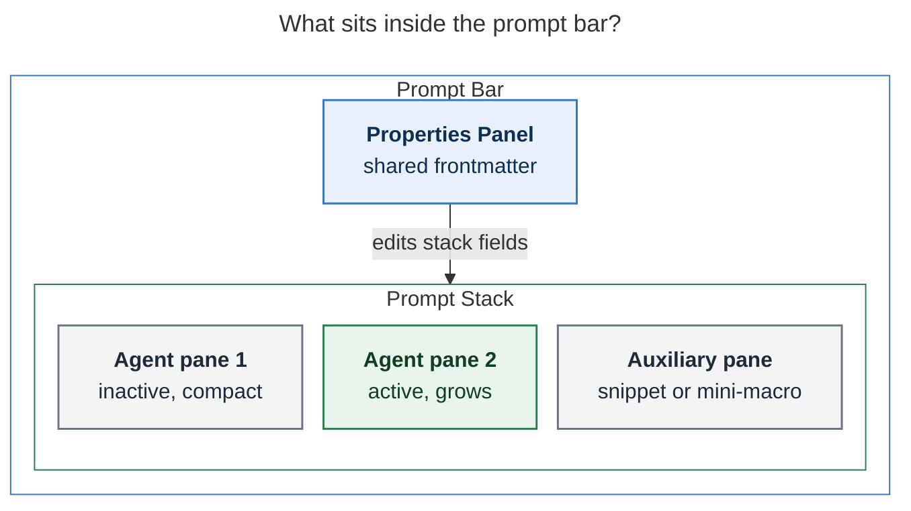

# Naming the prompt input widget

**Question.** What is the best glossary name for what docs currently call the
"prompt input widget", covering the widget itself, how its stacks work, and the
property panel above those stacks?

**Researcher.** grk (`research.5s.grk`). Independent report. I did not read peer
reports from this swarm, their transcripts, or their filenames' contents.

## Bottom line

Canonize **Prompt Bar**. Do not invent a third marketing name, and do not keep
"prompt input widget".

The surface already has an informal name that operators, guides, tests, and
`PromptInputBar` agree on. The glossary's job is to teach that this "bar" is no
longer a one-line box: it is a bottom-docked composition surface that always
holds a **prompt stack** of panes and, in prompt mode, an optional **Properties
Panel** for shared frontmatter. One term can cover all three if its body names
the parts.

A coined name such as Composer would be semantically nicer and would match Slack
and older Cursor usage. It would also split today's vocabulary three ways
(widget / bar / composer), collide with Cursor's model line, PHP Composer, and
SASE's own pager "composer", and cost every future agent a lookup. Coral-style
naming research in this sidecar already rejected clever metaphor when a close,
typeable, already-used name exists.

Kill the current heading. Both of its words fail: **widget** is Textual jargon,
and **input** collides with typed `input:` fields, raw `<placeholder>` tags,
`ace.prompt_inputs`, and the post-submit **Prompt Inputs** panel.

## What the thing actually is

Three nested objects, one mount.

| Layer | Code | Operator-visible role |
| --- | --- | --- |
| Surface | `PromptInputBar` in `src/sase/ace/tui/widgets/prompt_input_bar.py` | Bottom-docked editor. Border title `Prompt`, or `Plan Feedback` / `Coder Prompt` in those modes. |
| Stack | `PromptStackState` / `PromptStackItem` in `src/sase/ace/tui/widgets/prompt_stack.py` | Ordered panes plus shared YAML frontmatter. Always at least one pane. Whole-stack submit joins top-to-bottom. |
| Properties | `FrontmatterPanel` in `src/sase/ace/tui/widgets/frontmatter_panel.py` | Structured editor for that shared frontmatter, rendered above `#prompt-stack`. |

The bar composes, in prompt mode, a hidden-until-needed `FrontmatterPanel` and
then a `Vertical(id="prompt-stack")` of `PromptTextArea` panes
(`_prompt_input_bar_lifecycle.py`). Feedback and coder-prompt bars reuse the
same widget class as a single pane with no properties panel; they are not
multi-agent surfaces.

A stack item has a role: `agent`, `snippet`, or `mini_macro`. Auxiliary panes
author a snippet or a local helper without launching as agents. Inactive agent
panes stay compact (capped around four content rows); the active pane takes the
remaining height. The bottom pane is active by default so the newest segment is
the one being drafted. Pane separators read `agent N` and carry that pane's
cursor readout.

The properties panel is the visible editor over `PromptFrontmatter`. It is the
same field set a macro `.md` file supports: `name`, `description`, `tags`,
`input`, `macros`, `skill`, `snippet`. `g=` / `Ctrl+G =` shows or focuses it;
in the panel's rows mode the same chord returns to the originating pane. `a`
opens the property picker (the panel posts `AddRequested`; `property_picker_modal.py`
is the shared picker). `R` is a live-validated raw-YAML escape hatch. Local
`macros:` helpers declared here light up as `#_name` in every pane. Typed `---`
is passive: it never opens the panel and never splits a pane. Extra panes are
`g-` / `Ctrl+G -` only.

Loading paths differ, and the glossary has to say so:

- History or editor-file text with real top-level `---` separators splits into
  panes and lifts leading frontmatter into the panel.
- A single history item with leading frontmatter and no separator stays one
  verbatim pane and does **not** auto-open the panel.
- Stash restore and marked-agent `,x` seed one pane per draft or agent; they do
  not re-parse each pane's text.
- A `#name` macro swarm stays one pane until launch.

The live chrome around this trio includes completion, search, the `g` prefix
hint row, the submit chooser, dispatch context, and the post-submit Prompt
Inputs / "Fill in this prompt" panel. Those are child panels of the bar, not
the bar itself, and not the properties panel.



**Caption.** The prompt bar docks at the bottom of sase's TUI and holds an
optional Properties Panel above an ordered prompt stack of panes.

That partonomy is the naming constraint. The glossary term has to name the
outer surface. Stack and properties panel are parts, not synonyms.

## The current name split

Docs, code, and changelog already disagree. Counted from this checkout's `docs/`
and `src/` Markdown plus the widget tests:

| Name in the wild | Where it lives | Verdict |
| --- | --- | --- |
| prompt bar | Guides (`run-agents-in-parallel.md`, `find-and-replay-prompt.md`, `reuse-prompt-with-macros.md`), most TUI reference prose, changelog | Dominant informal name. Maps to `PromptInputBar`. |
| prompt input widget | `docs/reference/tui/prompt-input.md` H2, `docs/README.md`, `prompt-modes.md`, blog `prompt-widget-and-nvim.md` | Docs heading. Almost unused in operator guides. |
| prompt widget / prompt input | Mixed reference sentences | Softenings of the heading. |
| Prompt (border title) | `_prompt_input_bar_title.py` `_base_title` | What the operator sees on the chrome. Too overloaded as a glossary noun. |
| home prompt bar | Tests and mount helpers | The prompt-mode instance, as opposed to feedback / coder-prompt bars. |
| prompt stack | Own reference page, `PromptStackState`, changelog epic `sase-4p` | Inner structure. Keep. |
| Frontmatter Panel | Widget docstring, `multi-agent-prompts.md` H3, visual snapshots | Current code/docs name for the child panel. |
| properties panel / property panel / macro properties panel | Changelog (`xprompt properties panel`, `,f` era), `_prompt_input_bar_frontmatter.py` (`toggle_frontmatter_panel` docstring), stack lifecycle comment, tests, `directive-composition.md` ("prompt properties panel") | Older and still-live name for the same child. Matches `g=` and the property picker. |

`PromptInputBar` appears in a few hundred Python files. That is the
implementation identity. Glossary terms in this project name operator concepts
(`Prompt Stash`, `Deck Panel`, `Node Panel`), not class names, but they stay
grep-close to the class when they can.

The child panel's identity is the same kind of split the parent has. The
widget is `FrontmatterPanel`; `g=` is documented as "macro frontmatter panel";
the toggle method is still described as "the macro properties panel"; adding a
field is adding a **property**. The user prompt's "property panel" is this
object, not a fourth widget.

## Why "prompt input widget" is a bad glossary term

**Widget** is a Textual implementation word. SASE glossary entries for TUI
surfaces use operator nouns: panel, card, deck, tab, overlay, stash. Agents
reading "widget" will search widget classes and miss the operator docs.

**Input** is already a dense cluster:

- `PromptInputRequest` / `src/sase/agent/prompt_inputs.py` — declared typed
  inputs in prompt text.
- Frontmatter `input:` — the structured field the properties panel edits.
- Raw `<placeholder>` tags — ad hoc inputs highlighted in the bar.
- The **Prompt Inputs** panel / "Fill in this prompt" — post-submit collection
  UI, a different panel, opened after whole-stack submit.
- `ace.prompt_inputs` config, including `macro_placeholder_args`.

Keeping "prompt input" as the name of the *surface* guarantees future agents
will mix up the bar, the `input:` tree, and the fill-in panel. That is the
single strongest reason to change the heading even if the replacement is the
already-common "prompt bar".

**It does not name the stack or the properties panel.** The heading describes
a multiline `TextArea`. The product is a stack plus a header inspector. A
glossary term whose body never mentions those parts will keep being rewritten
in every TUI prompt.

## Criteria

Taken from this project's glossary style (`Prompt Stash`, `Deck Panel`,
`Node Panel`) and from the coral-subcommand naming note in
`202606/coral_subcommand_naming_consolidated.md`: stay close to what the
thing does, easy to say in daily TUI talk, no private metaphor required.

For this term, add agent-specific tests:

1. Survives the sentence "open the X" / "type in the X" / "the X's stack" /
   "focus the X's properties panel".
2. Distinct from [[glossary:prompt-stash]], [[glossary:raw-prompt]], the
   Prompts overlay, Deck Panel, and the Prompt Inputs fill-in panel.
3. Grep-close to `PromptInputBar`, `PromptStackState`, and the TUI docs.
4. Does not force a three-way rename of widget / bar / new-coinage.
5. Completes the existing Prompt-* family: Raw Prompt (payload), Prompt Bar
   (live surface), Prompt Stash (parked drafts).
6. Two words or fewer, Title Case heading, `aka` aliases, dense body that
   names keybindings agents actually need (`g=`, `g-`, `gj`/`gk`).

Clever one-word SASE names (Stitch, Smack, Bead) earn their keep when they
name a new domain object. This is a TUI surface that already has a working
informal name. Coining is a cost, not a virtue here.

## Analogues

External names were checked as naming pressure, not as things to copy.

- **Slack** still calls the message box a composer in 2026 agent-messaging
  docs ("threads shown in a timeline above the composer"). Linear's issue
  create UI and Superhuman's mail UI use the same word: a place you write
  before sending, often with headers above a body.
- **Cursor** used Composer for the multi-file agent pane (`Cmd+I`). By 2025
  that pane merged into Agent; by 2026 "Composer" is a **model line**
  (Composer 2 / 2.5), not a pane. Shipping a SASE glossary term called
  Composer would collide with a competitor's model name that agents already
  see in model pickers.
- **Cursor's current docs** call the typing surface "the chat input" or
  "prompt input". That is the generic name SASE should leave.
- **Figma / JetBrains / CSS inspectors** call the structured field editor a
  **properties panel**. SASE's own changelog used "xprompt properties panel"
  before the Frontmatter Panel widget landed. The add-field UI is already a
  property picker.
- **Email / Obsidian / macro files** all use the same shape SASE implemented:
  a header block (To/Subject, YAML frontmatter, macro frontmatter) above a
  body. The panel is a header inspector. The stack is multiple bodies sharing
  one header.
- **npm `composeai`** (2026) markets itself as "the modern React composer for
  AI applications" — evidence that "composer" has become the generic
  component name for a chat/prompt box. That genericization cuts both ways:
  it is recognizable, and it is no longer distinctive.

None of these analogues names a *stack of agent panes with shared
frontmatter*. That shape is SASE-specific. The name has to come from SASE's
own vocabulary, then the glossary body teaches the stack and the panel.

## Ranked names

### 1. Prompt Bar — recommended

Already the name in operator guides, the class (`PromptInputBar`), and most
changelog lines. Fits the TUI noun ladder this codebase already uses:

- **Bar** — docked composition surface (this term).
- **Stack** — ordered panes plus shared frontmatter.
- **Pane** — one editor in the stack (`agent` / `snippet` / `mini_macro`).
- **Panel** — auxiliary structured UI attached to the bar (properties,
  completion, search, submit chooser, Prompt Inputs).
- **Overlay** — Prompts overlay (History / Stash / Trash).

"Bar" slightly undersells a multi-pane editor. That is a real cost, and it is
smaller than introducing a new word. The glossary body repairs it in one
sentence: the prompt bar is the surface; it contains a stack and a properties
panel. Agents already see "prompt bar" in `docs/guides/run-agents-in-parallel.md`
("write the first task in the prompt bar", "Press `Ctrl+G -` in the prompt
bar"). Canonizing it is a documentation heading change, not a teaching
campaign.

Sits next to [[glossary:prompt-stash]] and [[glossary:raw-prompt]] without
inventing a new family.

### 2. Prompt Composer

Best *semantic* alternative. Composition is exactly what the surface does:
one or more agent prompts, shared properties, bindings, launch targets,
snippet and mini-macro side-panes. Slack still uses the word. The properties
panel becomes a natural "composer header".

Cost: it is not used for this widget today. Adopting it creates widget / bar /
composer as three names for one thing, which is the problem this glossary
entry is supposed to end. Cursor's model line and PHP Composer are real grep
collisions. SASE's pager and hijack-preview code already use "composer" for
renderers. Reject unless the project is willing to rename `PromptInputBar`
and rewrite the guides in the same change.

### 3. Composer

One-word, SASE-voice, nice in "open the composer". Same collisions as #2,
worse because there is no "Prompt" qualifier. The pager's body composer would
keep confusing agents. Skip.

### 4. Prompt Dock

Accurate about bottom docking and expansion. Collides with macOS Dock and
Docker. Does not say "this is where you write the launch". Weaker than Bar
because it is not already in the docs.

### 5. Prompt Stage

Evokes staging work before launch, which matches submit-chooser behavior.
Fatal collision with the bar's own `_auto_staged_inputs` / "auto-staged"
inline expansions, and with git staging. Agents would misread "stage the
input" vs "the prompt stage".

### 6. Prompt Pad

Friendly scratch-pad metaphor. Undersells the stack, the properties panel,
and targeting/save-as. Sounds disposable, which the bound-macro targeting
loop is not.

### 7. Prompt Book

Theater prompt-book: the master copy with cues and properties, scenes as
panes. Distinctive in the Stitch/Bead sense. Too literary. Agents cannot grep
existing docs for it. Violates the "no private metaphor" bar.

### 8. Launch Bar

Wrong scope. The same widget hosts Plan Feedback, Coder Prompt, macro
targeting, snippet authoring, and stash restore. Launch is one of its jobs.

### 9. Prompt Surface

Accurate and empty. Every TUI region is a surface. Unsearchable.

### 10. Prompt Rack

Cute for the vertical stack of panes. Ugly for the whole object, and it
leaves the properties panel unnamed. If anything, "rack" could nickname the
stack, which already has a better name.

### 11. Prompt Workbench / Prompt Studio / Prompt Forge

Product-y, long, IDE-ish. Not how this glossary talks.

### 12. Prompt Input Widget — reject

Current docs heading. Both words fail, as above. Keep it only as a retired
`aka` so old docs and the blog post still resolve.

Also-rans worth recording so they are not rediscovered: **Brief** (collides
with the adjective and with legal brief), **Slate**, **Well**, **Prompt
Ledger** (collides with Goal Ledger), **Prompt Deck** (collides with Agent
Data Deck), **Prompt Panel** (the bar *contains* panels; it should not *be*
one), **Omnibox** / **Command Bar** (single-line search, not a vim markdown
stack).

## Child names, not extra glossary terms

The user asked for **one** new glossary term whose body covers the widget,
the stacks, and the property panel. Do not add three strands on day one.
Name the parts inside Prompt Bar:

| Part | Agent-facing name | Implementation alias | Why |
| --- | --- | --- | --- |
| Outer surface | **Prompt Bar** | `PromptInputBar`, retired "prompt input widget" | This report's #1. |
| Ordered panes + shared frontmatter | **prompt stack** | `PromptStackState` | Already a reference page and a code type. Do not rename. |
| One editor in the stack | **pane** (`agent` / `snippet` / `mini_macro`) | `PromptStackItem`, `PromptTextArea` | Already in the stack docs. |
| Header inspector | **Properties Panel** | `FrontmatterPanel`, "frontmatter panel" | Matches `g=`, the property picker, changelog history, and the user's "property panel". "Frontmatter" is the serialization, not the job. |

Keep `FrontmatterPanel` as the class. Glossary and docs prose should say
Properties Panel, with frontmatter panel as `aka`, the same way Routine still
accepts Lumberjack. If the Prompt Bar entry later bursts its budget, split
**Properties Panel** and **Prompt Stack** into their own strands; they are
already fully specified in
`docs/reference/tui/prompt-stacks.md` and
`docs/reference/macros/multi-agent-prompts.md`.

Plural **Properties** matches Figma, the changelog ("properties panel"), and
the fact that the panel edits many fields. Accept "property panel" as an
alias so the user's phrase and the singular test comments keep resolving.

## How future agents should talk

Use:

- "The prompt bar is open."
- "Add a pane to the prompt stack with `g-`."
- "Focus the properties panel with `g=`."
- "Stash the prompt bar with `gs` / `Ctrl+S`."
- "Restore from the prompt stash into the prompt bar."

Avoid:

- "prompt input widget"
- "frontmatter panel" in new prose (say properties panel, mention YAML
  frontmatter as the data)
- "composer" unless a later rename of `PromptInputBar` lands
- "prompt input" for the surface (that phrase belongs to the fill-in panel
  and typed inputs)

## Recommended glossary term entry

Keyword: `prompt-bar`. Aliases: `prompt bar`, `prompt input widget`,
`prompt widget`, `prompt input`.

````markdown
# Prompt Bar

aka prompt bar, prompt input widget, prompt widget, prompt input

A prompt bar is the bottom-docked TUI surface where the operator writes,
stacks, and launches prompts. The class is `PromptInputBar`; the border title
is `Prompt`, or `Plan Feedback` / `Coder Prompt` in those modes. In prompt
mode the bar always holds a **prompt stack**: an ordered list of panes plus
shared YAML frontmatter, with at least one pane. Loading literal `---`
multi-agent text splits into panes labeled `agent 1`, `agent 2`, and so on;
`g-` / `Ctrl+G -` adds an empty bottom pane; `gj`/`gk` move focus and
`gJ`/`gK` reorder. Inactive panes stay compact, the active pane takes the
height, and whole-stack submit joins panes top-to-bottom. Auxiliary snippet
and mini-macro panes can sit in the same stack without launching as agents.
A `#name` macro swarm stays one pane until launch. Typed `---` never splits a
pane and never opens the properties panel.

The **Properties Panel** (implementation: `FrontmatterPanel`; also called the
frontmatter panel) sits above the stack and edits that shared frontmatter as
structured fields (`name`, `description`, `tags`, `input`, `macros`, `skill`,
`snippet`). `g=` / `Ctrl+G =` shows or focuses it; in the panel's rows mode
the same chord returns to the originating pane. `a` adds a property from the
core schema picker, `R` opens a live-validated raw-YAML escape hatch, and
local `macros:` helpers declared here are usable as `#_name` in every pane.
The panel auto-shows when leading frontmatter is lifted (multi-agent load,
editor-file return, targeted macro edit) and stays closed for a single
history item that has frontmatter but no segment separator.

The prompt bar is distinct from the [[glossary:prompt-stash]] (parked
drafts), the Prompts overlay (History / Stash / Trash), the
[[glossary:raw-prompt]] (what an agent receives at launch), and the
post-submit Prompt Inputs panel that fills raw `<placeholder>` tags and
required `input:` values. Feedback and coder-prompt bars reuse the same
widget without a stack or properties panel.
````

That entry is the whole recommendation: one term, two named parts, aliases
that keep old docs resolvable, and the collisions agents actually hit.

## What this report is not

It does not edit `sase/memory/glossary/`, docs headings, or `PromptInputBar`.
It does not propose renaming `FrontmatterPanel`. It does not recommend a
second glossary strand until Prompt Bar is in use and still feels cramped.

## Sources

- `src/sase/ace/tui/widgets/prompt_input_bar.py`
- `src/sase/ace/tui/widgets/prompt_stack.py` and `_prompt_stack_state.py`
- `src/sase/ace/tui/widgets/frontmatter_panel.py`
- `src/sase/ace/tui/widgets/_prompt_input_bar_lifecycle.py`
- `src/sase/ace/tui/widgets/_prompt_input_bar_frontmatter.py`
- `src/sase/ace/tui/widgets/_prompt_input_bar_stack_lifecycle.py`
- `src/sase/ace/tui/widgets/_prompt_input_bar_title.py`
- `src/sase/ace/tui/modals/property_picker_modal.py`
- `docs/reference/tui/prompt-input.md`
- `docs/reference/tui/prompt-stacks.md`
- `docs/reference/tui/prompt-modes.md`
- `docs/reference/macros/multi-agent-prompts.md` (Frontmatter Panel section)
- `docs/reference/macros/directive-composition.md` ("prompt properties panel")
- `docs/guides/run-agents-in-parallel.md`
- `docs/blog/posts/prompt-widget-and-nvim.md`
- Changelog lines for `sase-4p` (prompt stack) and `sase-4r` / `sase-4s`
  (Frontmatter Panel, `g=` / `g-` migration, retired `Ctrl+Shift+=` /
  properties-panel chords)
- Glossary style: Prompt Stash, Deck Panel, Node Panel, Raw Prompt
- `202606/coral_subcommand_naming_consolidated.md` (close-to-behavior naming)
- Slack agent-messaging docs (composer); Cursor 2026 prompting docs and
  Composer-as-model; Figma-style properties panel analogue
