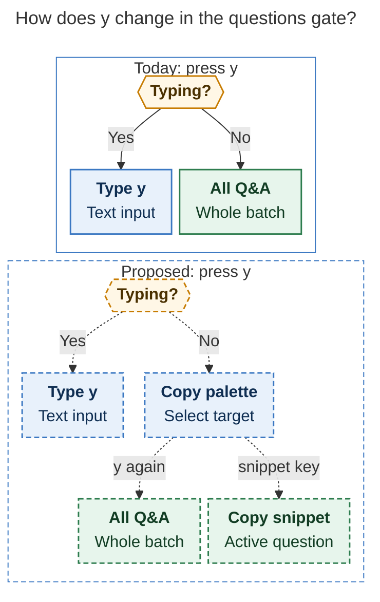
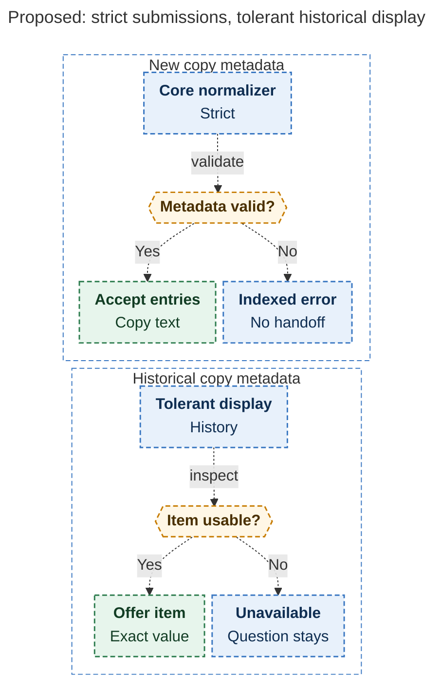

# Diagram proposals: Copying specific parts of agent questions

Proposals for the swarm linker, not a report. Each diagram restates only what the source
report says.

```yaml
source: research:202611/question_copy_items/question_copy_items__final.md
producer: research.6j.image
check: "mmdc 12.0.0 with Puppeteer --no-sandbox and the PDF-mirroring config rendered 2 of 2 Mermaid diagrams"
```

## question-copy-routes

```yaml
anchor: |-
  `y` (outside input mode) always opens the panel
question: |-
  How does y behave before and after the proposal, including while typing?
illustrates: |-
  Outside input mode, y opens the copy panel and yy copies the whole batch, while y remains ordinary typing in an answer or note.
caption: The proposed chooser preserves ordinary typing and the copy-all chord while adding a current-question snippet route; copying never answers.
review: "465.634x735 px, fit 100.0%; question, source-trace, and visual checks passed; two look rounds, two revisions"
```



## strict-input-tolerant-history

```yaml
anchor: |-
  normalizer; tolerant at display so malformed historical metadata never breaks the
question: |-
  How can new copy metadata be strict while historical questions remain usable?
illustrates: |-
  Strict submission validation reports indexed errors before the handoff, while tolerant display keeps historical questions usable and reports unavailable items instead of guessing values.
caption: Reject malformed new metadata before handoff; keep historical questions usable and never copy guessed or truncated values.
review: "512.851x868 px, fit 100.0%; question, source-trace, and visual checks passed; two look rounds, two revisions"
```


