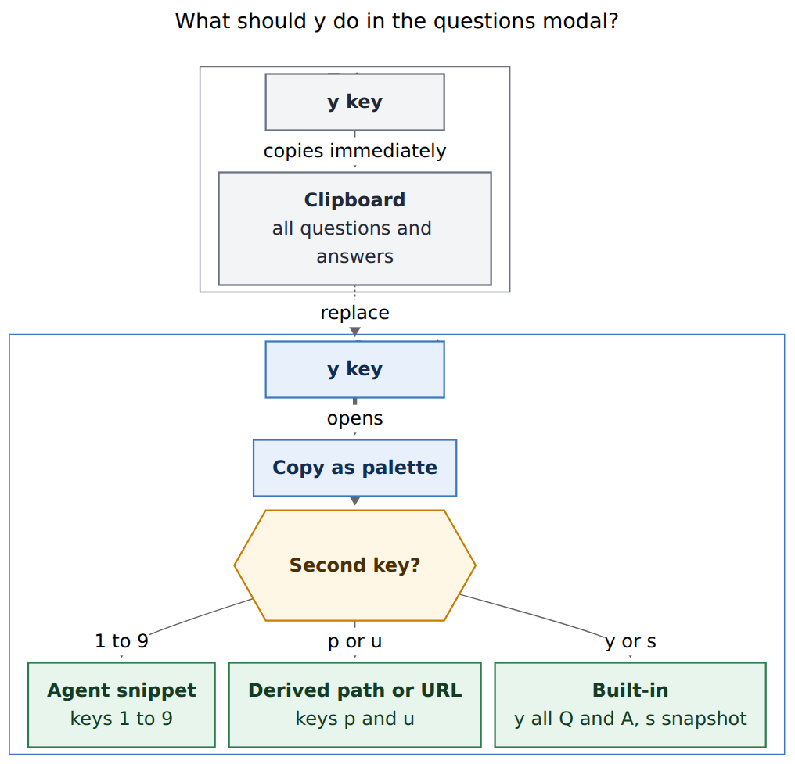
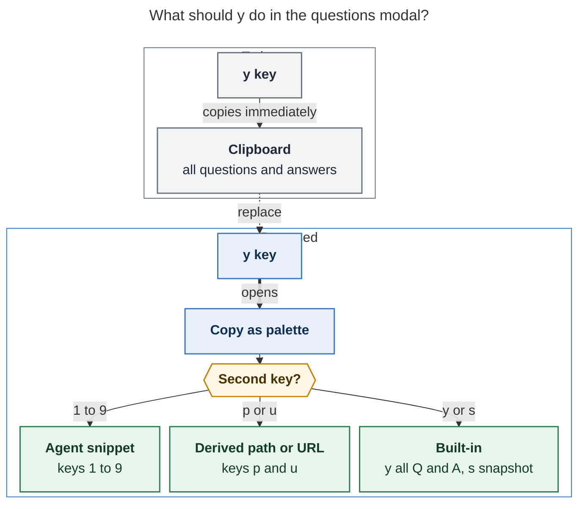
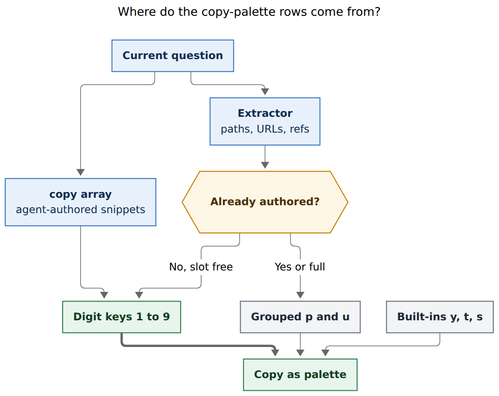
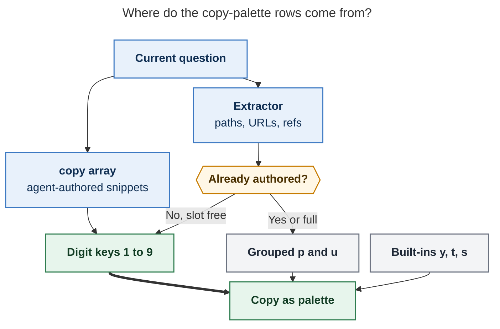

# Questions-gate copy palette

**Date:** 2026-11-26
**Question:** How should SASE make it easy to copy specific pieces of a questions-gate prompt — including agent-authored snippets — from the TUI, and is a new `y` pop-up the right shape?
**Snapshot:** sase workspace checkout of `UserQuestionModal` (`src/sase/ace/tui/modals/user_question_modal.py`), the Copy as palette (`copy_as_modal.py`, `artifact_files_modal_copying.py`), `validate_user_questions`, `/sase_questions`, and the live screenshot `~/tmp/screenshots/20261126_092327.png` (TUI v0.19.0+372). Independent report. I did not locate, open, read, or otherwise consult peer reports from this swarm.

---

## Bottom line

The request is a good idea. The screenshot is the proof: `y` currently dumps a 1,500-character Q&A blob, and the human needed seven Spotlight folder paths plus `chrome://settings/performance`. That is a picker problem, and SASE already has the picker.

**Recommended shape:**

1. Pressing `y` in the questions modal opens the existing **Copy as…** palette (`CopyAsModal`), stacked over the questions gate the same way it already stacks over artifact-file and preview modals.
2. Agents declare copiable snippets as a structured per-question `copy` array in the `sase questions` JSON. The host assigns digit keys `1`–`9`. Teach this in `/sase_questions`.
3. The palette also offers derived tokens extracted from the current question (paths, `chrome://` and `https://` URLs, `plan:` / artifact refs), plus three built-ins: `y` = all questions & answers (today’s payload), `t` = current question text, `s` = TUI snapshot.
4. `yy` restores today’s one-shot copy. A one-line chip strip under the question text advertises `1`–`n` so the human can yank a snippet without opening the palette.

The largest justified adjustments to the original request are (a) reuse `CopyAsModal` rather than inventing a questions-only pop-up, (b) make a JSON `copy` array the canonical agent syntax rather than `copy[<label>]: <text>` in the question body, (c) auto-extract paths and URLs so the Spotlight example works even when the agent forgets to declare snippets, and (d) stop `%` on this modal from opening the Agents-tab copy palette underneath.

---

## Verdict on the idea

Making specific pieces of a question independently copiable is the right product move. Questions are the one SASE surface where the agent routinely pastes **instructions the human must re-type into another app**: Spotlight privacy folders, `chrome://` URLs, shell commands, record paths, `plan:` refs. The current `y` binding copies the whole ballot as markdown (`build_qa_markdown` → `schedule_copy_delivery(..., copied_label="questions & answers")`). That toast in the screenshot — “Copied questions & answers” — is exactly the wrong grain.

A pop-up that resolves with a **single follow-up keypress** is also the right interaction. SASE already trained that muscle: `%` opens Copy as… on Agents / Artifacts / AXE; artifact-file pickers push the same modal. Vim Peekaboo, tmux-picker / tmux-fingers, and yanky.nvim all settle on “open a labelled list, press one key.” The questions gate should join that family.

The implied plan — a new questions-only widget plus an inline `copy[label]: text` DSL — would work, and would still be better than today. It would also fork a second copy UI and put markup in the sentence the human is trying to read. The better design is to feed the questions modal into the Copy as palette that already exists, and to keep agent-authored snippets as data on the question object.

Governing decisions: `decisions:rust-core-required` (the picker is presentation; the `copy` array is payload on a Python-owned question schema), `decisions:gates-never-block` / `decisions:single-turn-agents` (copy happens on the human’s gate turn, never as an agent wait), `decisions:instructions-per-invocation` (teach the field in `/sase_questions`, which is regenerated per provider).

---

## Requirement adjustments

These are justified changes to the implied requirements. Each one is a requirement, not a preference.

1. **Reuse `CopyAsModal`.** Do not add a third copy widget. The questions modal already inherits `CopyModeForwardingMixin` and already calls `schedule_copy_delivery`. The missing piece is a local `CopyAsContext` builder, copied from `ArtifactFileCopyingMixin.action_open_copy_as`. Title stays “Copy as…”. Subtitle is `Q{n} · {header}`. Category headers, teal key column (`#00D7AF`), dim previews, `enter` / `j` `k` / `q` `esc` footer stay identical.

2. **Canonical agent syntax is a JSON `copy` array, not inline `copy[label]:` markup.** `sase questions` already takes structured JSON (`question`, `header`, `options`, `multiSelect`). A sibling field keeps the displayed question clean (`markup=False` on `#user-question-text` would otherwise show the DSL), keeps follow-up `qa_markdown` free of yank instructions, and gives Telegram / mobile the same data later. Validation belongs in `validate_user_questions`.

3. **Auto-extract paths, URLs, and artifact refs.** The motivating screenshot would have been solved *without* any agent syntax: seven `/Users/bbugyi/...` folders, `mac/busy-processes-2026-11-26.md`, `plan:202611/mac_busy_process_fixes.md`, and `chrome://settings/performance`. Reuse `sase.pager.path_hints` plus `scan_artifact_refs`, and add a scheme matcher that includes `chrome://` (today’s `HTTP_URL_PATTERN` is `https?://` only). Dedup against agent-authored texts.

4. **`y` opens the palette; `yy` copies today’s blob.** Changing `y` from an immediate yank is a real muscle-memory break (plan approval `y`/`Y`, artifact files `y`/`Y`, questions `y`). Mapping the *second* `y` inside the palette to “all questions & answers” makes `yy` the compatibility chord. Highlight the first agent snippet when any exist, otherwise the `y` row, so `y` then `Enter` is also the old behavior when the agent declared nothing.

5. **Digit keys `1`–`9` yank immediately from the questions modal as well.** Plan approval already uses `1`–`9` for a second action (submit). Questions leave digits unbound. When the chip strip is visible, pressing `1` copies snippet 1 without opening the palette. `y` remains the discovery path and the home of built-ins.

6. **`%` on this modal opens the same questions palette.** `CopyModeForwardingMixin` currently forwards `%` to `AceApp.action_start_copy_mode()`, which builds an *Agents-tab* Copy as context for the row underneath. That is a footgun: `%n` from a question would copy the agent name. Intercept `%` the way `ArtifactFileSelectionModal.on_key` does.

7. **Keep this in the Python TUI plus the existing Python question validator.** Palette layout, key dispatch, and clipboard delivery fail the rust-core litmus: a web or Telegram client would not need them to match. The `copy` array is question payload; `validate_user_questions` already owns that schema in Python (`src/sase/user_question_actions.py`). Do not open a sase-core change for v1. Do not feature-flag: this is additive UX plus one rebound key with a compatibility chord.

8. **Cap agent snippets at nine per question, fail closed at `sase questions`.** The palette is a single-keypress widget. Ten-plus rows that share the digit row become a scrolling list. A clear CLI error beats silently dropping extras the agent thought it sent.

9. **Document in Reference and in the skill template.** Behavior of an existing feature (`y` on the questions modal) updates `docs/reference/tui/agent-workflows.md`. The new `copy` field is a user-visible capability taught from `src/sase/macros/skills/sase_questions.md` (generated skills; land the template, then `sase skill init`). Footer copy changes from `y=Copy` to `y=Copy as…`. Visual snapshot of the palette stacked on the questions modal is required (`tui_screenshot.md`).

10. **Unify the two question validators.** `questions_command_handler._validate_questions` and `validate_user_questions` currently duplicate the schema and both pass unknown keys through. The CLI handler must call the shared validator so a bad `copy` field fails at staging, not at TUI open.

---

## What exists today

### The questions modal copies one blob

`UserQuestionModal` (`src/sase/ace/tui/modals/user_question_modal.py`) is a two-pane gate: left list of `Q{n} {header}`, right question text plus `_WrappingSelectionList` options, footer

`Space=Toggle  j/k=Up/Down  Enter/S=Submit all  g=Global note  y=Copy  d=Debug  q=Cancel  Ctrl+D/U=Scroll`.

`action_copy_questions` saves the current answer, renders `build_qa_markdown(...)`, and schedules clipboard delivery with label `"questions & answers"`. Delivery is already correct: `schedule_copy_delivery` → `spawn_pump_free_task` → system clipboard plus OSC 52, fallback modal if both fail (`_delivery.py`, `tui_perf.md` rule 3). There are **no tests** for this action.

Question text is a `Static` with `markup=False`. Paths are not hinted, not clickable, not numbered. The human’s only yank is the whole ballot.

### Copy as… is already the product language

`CopyAsModal` is a 72-column, double-bordered, category-grouped picker. Rows are `key | label | preview`. Configured accelerators win over `j`/`k` navigation (`test_configured_accelerators_win_over_modal_navigation`). Unknown printable keys toast `Unknown copy key (context: …)` and keep the palette open. Disabled rows toast their `disabled_reason`. Mouse click works.

Two invocation styles already exist:

| Surface | Opener | Context builder |
| --- | --- | --- |
| Agents / Artifacts / AXE | `%` (`copy_mode.prefix`) | `build_copy_as_context` + `default_config.yml` keymap groups |
| Artifact-file modal | `%` (and `y`/`Y` still one-shot contents/path) | **Local** `CopyAsContext` in `artifact_files_modal_copying.py`, keys hardcoded |

Questions are closer to the artifact-file modal: the set of rows is **dynamic** (agent snippets, extracted paths). A new `copy_mode` group in `default_config.yml` cannot enumerate `1`–`9` in advance. Follow the artifact-file pattern: local context, no keymap-group change.

Visual goldens already cover the palette stacked on another modal (`copy_as_over_artifact_files_modal_dark_120x40.png`, `copy_as_over_preview_panel_dark_120x40.png`). Questions need the same golden.

### The question schema is closed enough to extend

`validate_user_questions` requires a non-empty list of objects with a non-blank `question` string, unique option labels (not `"Other"`), and optional boolean `multiSelect`. Extra keys are **kept** (`normalized.append(question)`). A `copy` field would already survive to the TUI; it would not be checked. `qa_markdown` ignores unknown keys, so successor prompts stay clean without extra stripping.

`/sase_questions` currently documents only `question`, `header`, `options`, `multiSelect`. Adoption lives or dies on that skill.

### `%` on the questions modal is the wrong palette

`UserQuestionModal.on_key` handles `escape` in input mode and `enter` to advance/submit, then calls `super().on_key`, which is `CopyModeForwardingMixin.on_key`. That mixin starts app-level copy mode. `build_copy_as_context` sees `current_tab == "agents"` and offers chat path, agent name, prompt, `@` ref, JSON, artifacts dir, tool-run id, snapshot — none of which is the Spotlight folder the human is staring at.

---

## The motivating screenshot, reconstructed

The 2026-11-26 Mac GUI question asks the human to add seven folders to Spotlight privacy and to open Chrome Memory Saver. Independently copiable pieces, in the order a human would actually paste them:

| Need | Text | How it gets a key |
| --- | --- | --- |
| Spotlight folder | `/Users/bbugyi/.sase` | agent `copy` **or** derived |
| Spotlight folder | `/Users/bbugyi/Library/Application Support/sase` | same |
| Spotlight folder | `/Users/bbugyi/.cargo` | same |
| Spotlight folder | `/Users/bbugyi/.rustup` | same |
| Spotlight folder | `…/bob-cli/target` | same |
| Spotlight folder | `…/sase-core/target` | same |
| Spotlight folder | `…/bob-mac-capture/.build` | same |
| Chrome | `chrome://settings/performance` | derived URL (new scheme matcher) |
| Record | `mac/busy-processes-2026-11-26.md` | derived relative path-with-extension |
| Plan | `plan:202611/mac_busy_process_fixes.md` | `scan_artifact_refs` |
| Whole ballot | markdown Q&A | built-in `y` |
| Snapshot | current TUI | built-in `s` |

If the agent declares the seven folders (and maybe Chrome) in `copy`, they occupy `1`–`8` with **labels** (“`.sase`”, “Chrome Memory Saver”). Derived extraction still fills `p` (all paths, newline-joined) and `u` (all URLs) and skips duplicates. If the agent declares nothing, digits `1`–`9` are the derived tokens in document order and the screenshot is still solved.

That is why auto-extract is a requirement, not a nicety. Agents will forget the new field the first week. The human still has to paste seven paths.

---

## Agent syntax: structured `copy` array

### Canonical payload

```json
[
  {
    "header": "Mac GUI",
    "question": "Two steps in System Settings and Chrome. Spotlight: add each folder to Search Privacy. Chrome: open Memory Saver. What did you do?",
    "copy": [
      {"label": ".sase", "text": "/Users/bbugyi/.sase"},
      {"label": "Application Support", "text": "/Users/bbugyi/Library/Application Support/sase"},
      {"label": "Chrome", "text": "chrome://settings/performance"}
    ],
    "options": [
      {"label": "Done, both", "description": "…"},
      {"label": "Skip for now"}
    ]
  }
]
```

Validation rules (all fail at `sase questions`, before the gate is staged):

- `copy` is optional. If present it is a non-empty array of objects.
- Each entry has `label` (stripped, 1–32 chars, no control characters) and `text` (stripped, non-empty, ≤ 8 KiB).
- At most 9 entries per question.
- Labels need not be unique (two folders can share a prefix). Texts may repeat; the palette still shows what the agent sent.
- Optional `id` is ignored for key assignment (the host owns `1`–`9`) and may be stored for tests.
- Unknown extra keys on a copy entry are rejected, so agents cannot smuggle a private key binding.

The skill’s JSON schema block grows this field, with the Spotlight example as the worked case. Put recommended options first stays unchanged. Copy entries are **not** answers; they never appear in `qa_markdown`.

### Why the inline DSL is the wrong canonical form

The prompt suggested `copy[<optional_label>]: <some_text_to_be_copied>` in the question body. Treat that as sugar, not the stored shape.

- The question body is what the human reads. Seven `copy[…]:` lines in the Mac GUI paragraph would bury the actual question.
- `#user-question-text` is `markup=False`. Unless the parser strips the DSL before render, the human sees the syntax. Stripping is a second language with false positives (`copy[0]: 1` in a code sample).
- Follow-up agents receive `qa_markdown` of the question text. A DSL that is not stripped leaks yank instructions into the successor prompt.
- `sase questions` is already JSON. Teaching one more field is cheaper than teaching a line-oriented grammar inside a string inside JSON.
- Telegram and mobile cannot turn an inline DSL into tappable chips without the same parser. A JSON array is already the chip list.

A later parse-time sugar that **compiles** `copy[label]: text` lines into the array and strips them from `question` is compatible with this design. Do not ship it in v1. The skill example is enough of a teaching surface.

---

## Palette contents (only rows that earn a key)

CopyAsModal forbids using `j`, `k`, `q`, `enter`, `escape` as copy keys if we want those to keep navigating/cancelling. Configured accelerators **win** over navigation, so a snippet bound to `j` would steal cursor-down. Digits and the letters below are free.

### Snippets (new category, first in this palette only)

| Key | Label | Payload |
| --- | --- | --- |
| `1`–`9` | agent `label`, else a truncated `text` | agent `text`, then leftover derived tokens in document order |

Default highlight: first snippet row. Parameterize `CopyAsContext` with an optional `category_order` so this palette can put `Snippets` above Identity/Location/Content without reshuffling every other Copy as palette. Add `"Snippets"` to `CopyTargetCategory`, or pass the category as a string on `CopyAsRow` and let `CopyAsModal` accept a per-context order. Do not change the global `_CATEGORY_ORDER` default.

### Location

| Key | Label | When |
| --- | --- | --- |
| `p` | All extracted paths | ≥1 unique path after dedup; preview `"7 paths"` |
| `u` | All extracted URLs | ≥1 URL including `chrome://`; preview first URL truncated |

Individual derived tokens that already occupy `1`–`9` do not also get letter keys. Overflow derived tokens (more than remaining digit slots) exist **only** in `p` / `u`. That keeps the palette short.

### Content

| Key | Label | Payload |
| --- | --- | --- |
| `y` | Questions & answers | today’s `build_qa_markdown` |
| `t` | Current question | `question` string of the focused item |

### Actions

| Key | Label | Payload |
| --- | --- | --- |
| `s` | Snapshot | existing tmux-pane snapshot path used by every other Copy as group |

### Rows that do **not** earn a key

These sounded plausible and failed the “would I press this while answering the Mac GUI question?” test:

- Options list / recommended option — those are answers, toggled with Space, not paste targets.
- Current answers / global note — the human just typed or selected them.
- Question header — too small; it is already the palette subtitle.
- Request JSON / debug dump — `d` already opens Gate Debug.
- Agent name, chat path, `@` ref, artifacts dir — that is the leaked Agents-tab palette.
- Markdown link / handoff — questions are not artifacts.
- “All snippets joined” — Spotlight is one path per paste; `p` already joins paths.

`t` (current question text) stays because it is the right yank when the human wants the instruction paragraph without the option list, for a chat reply or a note. `s` stays because every Copy as palette offers it and it is how TUI bugs get reported.

---

## Interaction design

**Reader question:** What should `y` do in the questions modal?

**Caption:** Today `y` copies the whole ballot. The proposal opens the existing Copy as palette; a second key copies an agent snippet, a derived path or URL, or a built-in such as all Q&A (`yy`) or a snapshot.



Rendered size: 676.5 × 652 px; fit scale: 96.5%.



### Key chords

- `y` — push `CopyAsModal` with a warm-only context (strings already in memory; no disk). Ignore `y` while Other / global-note input is focused, same as today.
- `y` then `1`–`9` / `p` / `u` / `y` / `t` / `s` — copy and dismiss. Toast `Copied {label}` through the existing delivery seam.
- `y` then `Enter` — copy the highlighted row (first snippet, else `y`).
- `y` then `q` / `Esc` — dismiss, questions modal still open, nothing copied.
- `1`–`9` on the questions modal itself — copy that snippet immediately when the chip strip is showing. No-op (no toast) when there is no snippet for that digit, so a stray `1` does not steal from option navigation that does not use digits.
- `%` — same palette as `y`.

Footer: `y=Copy as…`. Chip strip under the question text, only when there is at least one snippet or derived token:

```text
Copy  1 .sase  2 Application Support  3 Chrome  ·  y more
```

Teal digits, dim labels, matching the Copy as key column. Truncate to the first four chips plus `+N` when needed. This strip is a `Static`, not markup inside the question body.

Switching questions with `n`/`p` or the left list rebuilds both the chip strip and the next palette context. Copy is always **current-question** for snippets and derived tokens; `y` (all Q&A) remains the whole ballot.

### Beauty constraints

Match the existing Copy as visual contract rather than restyling it:

- Title `Copy as…` in accent; subtitle `Q1 · Mac GUI` muted, ellipsis at 92 chars (`copy_as_types.CopyAsContext` already shortens).
- Category headers `SNIPPETS` / `LOCATION` / `CONTENT` / `ACTIONS` in dim uppercase.
- Key column 9-wide, bold `#00D7AF`; preview is a truncated payload, not a description of the key.
- Narrow class at width ≤ 90 (`CopyAsModal.-narrow`) already exists; keep it.
- Do not put emoji in copy toasts or row labels. The questions title bar already uses the gate’s identity; the palette does not need a second icon.

---

## How rows are assembled

**Reader question:** Where do the copy-palette rows come from?

**Caption:** Agent-authored `copy` entries take digit keys first. Derived paths, URLs, and refs fill remaining digits and always feed grouped `p`/`u` rows. Built-ins `y`, `t`, and `s` are always present.



Rendered size: 758.6 × 604 px; fit scale: 86.0%.



Precompute the row list in `_load_question` / `on_mount` (question bodies are small; a regex over a few kilobytes is fine on the UI thread). Rebuild on question change. Do not touch the disk. Clipboard write stays on `spawn_pump_free_task`.

Extractor sources, in order, skipping spans already claimed by an earlier match:

1. Agent `copy[].text` (exact).
2. `scan_artifact_refs` (`plan:…`, `@file:…`, …).
3. Scheme URLs: `\b[a-z][a-z0-9+.-]*://\S+` so `chrome://settings/performance` counts. Strip trailing `.,;:)` .
4. `iter_file_path_matches` from `sase.pager.path_hints` (absolute, `~/`, `./`, `dir/file.ext`).

---

## Implementation sketch

Stay inside this repo. New module `src/sase/ace/tui/modals/user_question_copying.py` (mirrors `artifact_files_modal_copying.py`) so the already-large `user_question_modal.py` does not grow another 250 lines of clipboard policy.

| Layer | Change |
| --- | --- |
| Schema | `validate_user_questions` grows `copy` rules. CLI handler calls it. |
| Skill | `src/sase/macros/skills/sase_questions.md` schema + Spotlight example. |
| Extractor | Pure function `question_copy_tokens(question) -> tuple[CopyToken, …]` with tests against the Mac GUI paragraph. |
| TUI mixin | Build `CopyAsContext`, `action_copy_questions` pushes `CopyAsModal`, dispatch calls `schedule_copy_delivery`. Bind `%` and `1`–`9`. Chip `Static`. |
| Copy as types | Optional `category_order` and `highlight_target` on `CopyAsContext` so Snippets lead and the first snippet is focused. |
| Docs | `docs/reference/tui/agent-workflows.md` (the one-line `y` sentence). Footer string. |
| Tests | Validator; extractor; `y` pushes `CopyAsModal`; `yy` copies markdown; `%` does not call `build_copy_as_context`; input-mode ignores `y`; visual snapshot `copy_as_over_user_question_modal`. |
| Help | Questions footer and any questions section in the help overlay advertise `y` Copy as… |

Do not add a `copy_mode.keys.questions` block to `src/sase/default_config.yml`. Dynamic digit keys cannot live there, and the gotcha about updating that file applies to keymap config values, not to this local palette.

### Cross-frontend

Telegram and mobile already receive `question_request.json`. Once `copy` is on the payload they can grow tappable chips without a TUI. That is a follow-up, not v1. The TUI is the surface in the screenshot.

### Out of v1

- Inline `copy[label]:` sugar.
- Clickable chips inside the question paragraph (the chip strip plus palette is enough; Textual click regions on wrapped `Static` text are a second project).
- Copying from answered QUESTIONS history on the Agents tab.
- Feature flag.
- sase-core port of the question schema.

---

## Recommended solution

Ship a questions-local Copy as palette on `y` / `%`, fed by a validated `copy` array, a derived-token extractor that understands `chrome://`, and three built-ins (`y`, `t`, `s`). Teach the array in `/sase_questions` with the Spotlight example. Keep `yy` as the old yank. Advertise digits on a chip strip so the common paste is one key, not two.

That is intuitive (it is the Copy as UI the rest of ACE already uses), reliable (one validator, one delivery seam, fail-closed caps, `%` no longer leaks), and beautiful (teal keys, Snippets first, subtitle is the question header, no DSL in the paragraph the human is reading).
